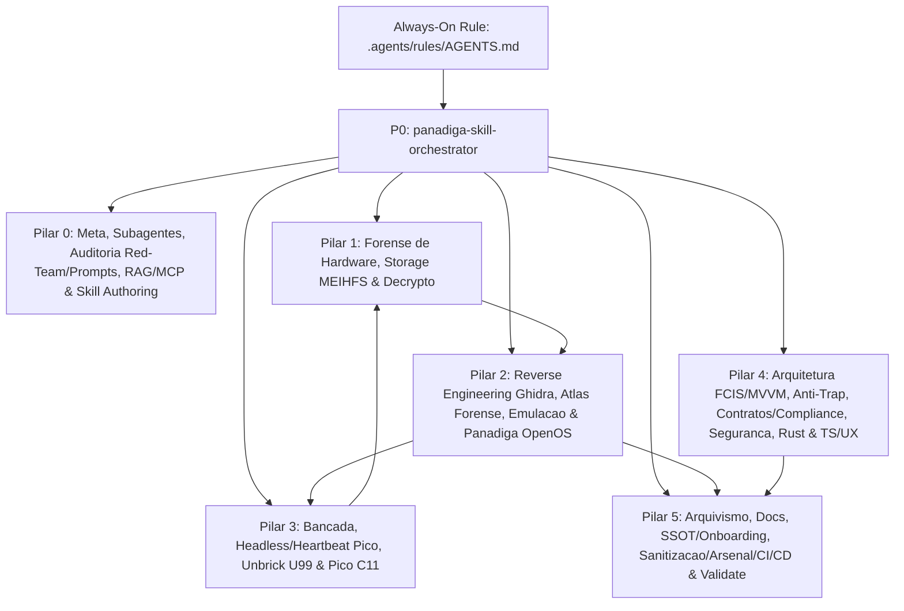

# Ecossistema de Skills Panadiga — 6 Pilares & 29 Skills

> **Bootstrap Obrigatório (Always-On):** Definido em [`.agents/rules/AGENTS.md`](../rules/AGENTS.md) — em qualquer tarefa não-trivial, leia primeiro [`.agents/skills/panadiga-skill-orchestrator/SKILL.md`](./panadiga-skill-orchestrator/SKILL.md) para acionar just-in-time apenas as skills certas sem desperdiçar tokens.

## 1. Mapa Visual do Ecossistema

## 2. Catálogo Completo com Caminhos Explícitos (`29 Skills`)

| Pilar | Skill | Caminho `SKILL.md` | Referências (`references/`) | Especialista |
| :--- | :--- | :--- | :--- | :--- |
| **P0** | `panadiga-skill-orchestrator` | [SKILL.md](./panadiga-skill-orchestrator/SKILL.md) | [routing-matrix-and-token-discipline.md](./panadiga-skill-orchestrator/references/routing-matrix-and-token-discipline.md) · [agent-runtime-and-plan-mode.md](./panadiga-skill-orchestrator/references/agent-runtime-and-plan-mode.md) | `panadiga-architect` |
| **P0** | `panadiga-subagent-and-research` | [SKILL.md](./panadiga-subagent-and-research/SKILL.md) | [delegation-and-research-playbooks.md](./panadiga-subagent-and-research/references/delegation-and-research-playbooks.md) | `panadiga-architect` |
| **P0** | `panadiga-adversarial-and-hallucination-auditor` | [SKILL.md](./panadiga-adversarial-and-hallucination-auditor/SKILL.md) | [anti-hallucination-and-redteam-protocol.md](./panadiga-adversarial-and-hallucination-auditor/references/anti-hallucination-and-redteam-protocol.md) · [adversarial-prompt-templates.md](./panadiga-adversarial-and-hallucination-auditor/references/adversarial-prompt-templates.md) | `panadiga-qa-auditor` |
| **P0** | `panadiga-rag-and-mcp-engineering` | [SKILL.md](./panadiga-rag-and-mcp-engineering/SKILL.md) | [rag-mcp-catalog-and-extension.md](./panadiga-rag-and-mcp-engineering/references/rag-mcp-catalog-and-extension.md) | `panadiga-architect` |
| **P0** | `panadiga-skill-authoring` | [SKILL.md](./panadiga-skill-authoring/SKILL.md) | [skill-template-and-lint-checklist.md](./panadiga-skill-authoring/references/skill-template-and-lint-checklist.md) | `panadiga-architect` |
| **P1** | `panadiga-hardware-forensics` | [SKILL.md](./panadiga-hardware-forensics/SKILL.md) | [dump-integrity-triage.md](./panadiga-hardware-forensics/references/dump-integrity-triage.md) | `panadiga-storage-forensics` |
| **P1** | `panadiga-extract-partitions` | [SKILL.md](./panadiga-extract-partitions/SKILL.md) | — | `panadiga-storage-forensics` |
| **P1** | `panadiga-firmware-decrypto` | [SKILL.md](./panadiga-firmware-decrypto/SKILL.md) | [crypto-primitives-and-keys.md](./panadiga-firmware-decrypto/references/crypto-primitives-and-keys.md) · [container-formats-and-compression.md](./panadiga-firmware-decrypto/references/container-formats-and-compression.md) | `panadiga-firmware-re` |
| **P2** | `panadiga-ghidra-workflow` | [SKILL.md](./panadiga-ghidra-workflow/SKILL.md) | [mn103s-traps-and-sleigh.md](./panadiga-ghidra-workflow/references/mn103s-traps-and-sleigh.md) | `panadiga-firmware-re` |
| **P2** | `panadiga-emulation-and-patching` | [SKILL.md](./panadiga-emulation-and-patching/SKILL.md) | [emulation-limits-and-silicon-abi.md](./panadiga-emulation-and-patching/references/emulation-limits-and-silicon-abi.md) | `panadiga-firmware-re` |
| **P2** | `panadiga-opensource-firmware-dev` | [SKILL.md](./panadiga-opensource-firmware-dev/SKILL.md) | [am34-baremetal-bringup-and-roadmap.md](./panadiga-opensource-firmware-dev/references/am34-baremetal-bringup-and-roadmap.md) · [openos-c11-drivers-isr-and-compression.md](./panadiga-opensource-firmware-dev/references/openos-c11-drivers-isr-and-compression.md) · [mn103s-am34-assembly-and-abi-cheatsheet.md](./panadiga-opensource-firmware-dev/references/mn103s-am34-assembly-and-abi-cheatsheet.md) | `panadiga-firmware-re` |
| **P2** | `panadiga-firmware-forensic-atlas` | [SKILL.md](./panadiga-firmware-forensic-atlas/SKILL.md) | [FORENSIC_ATLAS_INDEX.md](./panadiga-firmware-forensic-atlas/references/FORENSIC_ATLAS_INDEX.md) | `panadiga-firmware-re` |
| **P3** | `panadiga-bench-operations` | [SKILL.md](./panadiga-bench-operations/SKILL.md) | [bench-electrical-and-standby.md](./panadiga-bench-operations/references/bench-electrical-and-standby.md) · [panamon1-davis-and-frontiers.md](./panadiga-bench-operations/references/panamon1-davis-and-frontiers.md) | `panadiga-hardware-embedded` |
| **P3** | `panadiga-bench-automation-and-headless` | [SKILL.md](./panadiga-bench-automation-and-headless/SKILL.md) | [headless-pipelines-and-decision-trees.md](./panadiga-bench-automation-and-headless/references/headless-pipelines-and-decision-trees.md) · [heartbeat-states-and-guided-macros.md](./panadiga-bench-automation-and-headless/references/heartbeat-states-and-guided-macros.md) | `panadiga-hardware-embedded` |
| **P3** | `panadiga-nvram-unbrick` | [SKILL.md](./panadiga-nvram-unbrick/SKILL.md) | — | `panadiga-hardware-embedded` |
| **P3** | `panadiga-pico-flashing` | [SKILL.md](./panadiga-pico-flashing/SKILL.md) | [pico-c11-module-architecture.md](./panadiga-pico-flashing/references/pico-c11-module-architecture.md) | `panadiga-hardware-embedded` |
| **P4** | `panadiga-architecture-and-guardrails` | [SKILL.md](./panadiga-architecture-and-guardrails/SKILL.md) | [architecture-fcis-mvvm-and-anti-patterns.md](./panadiga-architecture-and-guardrails/references/architecture-fcis-mvvm-and-anti-patterns.md) | `panadiga-architect` |
| **P4** | `panadiga-functional-math-and-patterns` | [SKILL.md](./panadiga-functional-math-and-patterns/SKILL.md) | [fp-embedded-c11-rust-refactoring-playbook.md](./panadiga-functional-math-and-patterns/references/fp-embedded-c11-rust-refactoring-playbook.md) · [deterministic-math-pattern-recognition-and-proofs.md](./panadiga-functional-math-and-patterns/references/deterministic-math-pattern-recognition-and-proofs.md) | `panadiga-architect` |
| **P4** | `panadiga-security-and-violation-guards` | [SKILL.md](./panadiga-security-and-violation-guards/SKILL.md) | [violation-taxonomy-and-controls.md](./panadiga-security-and-violation-guards/references/violation-taxonomy-and-controls.md) | `panadiga-qa-auditor` |
| **P4** | `panadiga-anti-trap-geometry-verification` | [SKILL.md](./panadiga-anti-trap-geometry-verification/SKILL.md) | [bgo-4mb-vs-8mb-and-geometry-traps.md](./panadiga-anti-trap-geometry-verification/references/bgo-4mb-vs-8mb-and-geometry-traps.md) | `panadiga-qa-auditor` |
| **P4** | `panadiga-contracts-stream-and-journal` | [SKILL.md](./panadiga-contracts-stream-and-journal/SKILL.md) | [plano-a-plano-b-and-zero-trust-ipc.md](./panadiga-contracts-stream-and-journal/references/plano-a-plano-b-and-zero-trust-ipc.md) · [cross-layer-contracts-and-ssot-coherence.md](./panadiga-contracts-stream-and-journal/references/cross-layer-contracts-and-ssot-coherence.md) | `panadiga-architect` |
| **P4** | `panadiga-rust-backend-dev` | [SKILL.md](./panadiga-rust-backend-dev/SKILL.md) | [rust-workspace-patterns.md](./panadiga-rust-backend-dev/references/rust-workspace-patterns.md) | `panadiga-architect` |
| **P4** | `panadiga-typescript-frontend-dev` | [SKILL.md](./panadiga-typescript-frontend-dev/SKILL.md) | [ts-mvvm-jsdoc-and-testing.md](./panadiga-typescript-frontend-dev/references/ts-mvvm-jsdoc-and-testing.md) · [ux-layout-a11y-and-webview-security.md](./panadiga-typescript-frontend-dev/references/ux-layout-a11y-and-webview-security.md) | `panadiga-desktop-ui` |
| **P5** | `panadiga-forensic-archival` | [SKILL.md](./panadiga-forensic-archival/SKILL.md) | [archival-docs-timeline-and-ledger.md](./panadiga-forensic-archival/references/archival-docs-timeline-and-ledger.md) | `panadiga-storage-forensics` |
| **P5** | `panadiga-technical-documentation` | [SKILL.md](./panadiga-technical-documentation/SKILL.md) | [diataxis-bilingual-and-doc-standards.md](./panadiga-technical-documentation/references/diataxis-bilingual-and-doc-standards.md) | `panadiga-qa-auditor` |
| **P5** | `panadiga-device-onboarding` | [SKILL.md](./panadiga-device-onboarding/SKILL.md) | [ssot-tiers-and-new-project-blueprint.md](./panadiga-device-onboarding/references/ssot-tiers-and-new-project-blueprint.md) · [ssot-schema-validation-and-evolution.md](./panadiga-device-onboarding/references/ssot-schema-validation-and-evolution.md) | `panadiga-architect` |
| **P5** | `panadiga-git-cicd-and-releases` | [SKILL.md](./panadiga-git-cicd-and-releases/SKILL.md) | [workflows-and-release-hardening.md](./panadiga-git-cicd-and-releases/references/workflows-and-release-hardening.md) | `panadiga-architect` |
| **P5** | `panadiga-repo-sanitization-and-commit-sync` | [SKILL.md](./panadiga-repo-sanitization-and-commit-sync/SKILL.md) | [commit-wave-order-and-hygiene-rules.md](./panadiga-repo-sanitization-and-commit-sync/references/commit-wave-order-and-hygiene-rules.md) · [ARSENAL_INDEX.md](./panadiga-repo-sanitization-and-commit-sync/references/ARSENAL_INDEX.md) | `panadiga-qa-auditor` |
| **P5** | `panadiga-validate` | [SKILL.md](./panadiga-validate/SKILL.md) | [universal-testing-and-gates-matrix.md](./panadiga-validate/references/universal-testing-and-gates-matrix.md) · [testing-patterns-and-anti-flakiness.md](./panadiga-validate/references/testing-patterns-and-anti-flakiness.md) | `panadiga-qa-auditor` |
