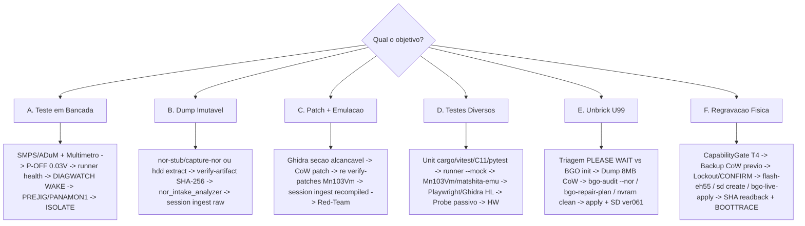

# Modos Headless & Os 6 Caminhos de Raciocínio End-to-End

## 1. Matriz de Execução Headless por Subsistema

| Subsistema | Comando Headless Verificado | Uso Ideal |
| :--- | :--- | :--- |
| **Bancada (`--mock` ou real)** | `python -m scripts.bench.runner {health\|capture\|decode-log\|smoke-suite\|ab-boot} [--mock\|--port COM10]` | Bateria automatizada com `ISOLATE` RAII garantido em `finally` |
| **Wizard & Protocolo Pico** | `cargo run -q -p panadiga-cli -- pico bench-wizard -p COM10 --profile all --non-interactive --out-dir tmp/wiz` | Coleta determinística Standby/Wake/JIG gerando `.md`/`.json` |
| **CLI Nativa JSON** | `cargo run -q -p panadiga-cli -- <subcomando> --json -` | Suprime telemetry logs em stdout para automação pura |
| **Desktop/Web E2E** | `npm --prefix apps/desktop run test:e2e` | Chromium headless (`12` specs, sobe Vite `:1420`) |
| **Ghidra Multi-ISA** | `python -m scripts.re.ghidra_fleet_orchestrator --catalog <JSON> --shard small --java-audit` | Análise sem GUI + `python scripts/validate.py --ghidra-smoke` |
| **Emulação `Mn103Vm` & ODD** | `panadiga re verify-patches --json` · `panadiga unbrick matshita-emu boot --json` | Regressão de opcodes, `E05`, ATAPI `0x3B`/`0xED` sem hardware |

---

## 2. Os 6 Caminhos de Raciocínio (Fluxos Determinísticos)

### Detalhamento Rápido de Critérios de Decisão
- **A (Bancada):** Se `VDD=0.03V`, nunca dispare `XRESET` esperando acordar `IC7501` — use `DIAGWATCH WAKE` / `PREJIG WAKE` ou estabilize Standby antes. Se `SW_UART=LOW`, lembre que `Q7514` corta TX até voltar para `Hi-Z`.
- **B (Dump):** Rejeite imediatamente e recapture se `nor_intake_analyzer.py` acusar `XERTDAEH` (byte-swap), espelho de metade de endereço ou `>99%` `0xFF`.
- **C (Patch):** Nenhum binário sai para o bucket `recompiled/` do Vault sem `PreWriteGateReport.passed == true` e revisão contra as 10 Armadilhas MN103S.
- **D (Testes Diversos):** Nunca pule da camada unitária direto para escrita em silício; suba na escada `Unit -> Mock -> Mn103Vm -> Headless -> Passivo -> Live`.
- **E (Unbrick):** Se `Fvu` travar em `SA70`, verifique imediatamente geometria `45` setores (`0x440337A4`) vs `35` setores (`PROG061` stock sem retarget) e estado de `+0x14`/`+0x5C` da `0xF101`.
- **F (Regravação):** Confirme sempre 4 coisas antes do último Enter: (1) backup SHA-256 salvo em disco, (2) token `CONFIRM-*` no dispositivo certo (nunca `PhysicalDrive0`/NVMe/OS), (3) `SA0..SA10` intactos em `E05`, (4) plano de `BOOTTRACE` + `verify-artifact` pós-escrita.
