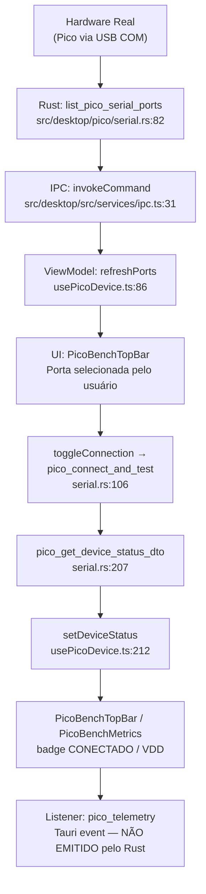

> [!NOTE]
> **Snapshot Histórico (`2026-11-11`):** Esta auditoria foi capturada antes da refatoração modular final em `crates/`, `firmware/pico-p7501/` e `scripts/`. Para o estado atual consolidado, consulte [`../../AUDITORIA_COMPLETA.md`](../../AUDITORIA_COMPLETA.md).

# Auditoria de Runtime — Panadiga Suite
**Data:** 2026-11-11 | **Branch:** `main` | **Versão auditada:** pós-commit `2db81e7` + patches de limpeza de mock

---

> [!IMPORTANT]
> Esta auditoria cobriu **todas** as camadas: Rust backend (`src/`), serviços IPC (`ipc.ts`), mock dispatcher (`mockDispatcher.ts`), viewmodels e views. Cada inconsistência foi localizada com arquivo + linha.

---

## 1. Mapa de Fluxo de Dados (Sequencial)

---

## 2. Inconsistências Encontradas (por Severidade)

### 🔴 CRÍTICO — Bloqueia funcionalidade real

---

#### INC-01 — `pico_telemetry`: evento escutado mas **nunca emitido** pelo backend

| Item | Detalhe |
|------|---------|
| **Arquivo frontend** | [`usePicoDevice.ts:254`](file:///C:/Users/danie/Documents/Panadiga/apps/desktop/src/viewmodels/usePicoDevice.ts#L254) — `listenEvent('pico_telemetry', ...)` |
| **Arquivo backend** | `src/desktop/` — nenhum arquivo usa `emit` ou `AppHandle` |
| **Impacto** | Em Tauri real, o listener registra com sucesso mas jamais recebe dados. Status fica estático após connect. VDD, `core_state` e `ram_loader_injected` **nunca** são atualizados em tempo real. |
| **Fallback em mock** | [`mockDispatcher.ts:453`](file:///C:/Users/danie/Documents/Panadiga/apps/desktop/src/services/mockDispatcher.ts#L453) — dispara `setInterval(1500ms)` com `mockPicoDeviceStatus` fixo (`connected: false`) — **também errado em mock mode**. |
| **Correção** | Implementar `AppHandle` no backend e emitir `pico_telemetry` via thread de polling após `pico_connect_and_test`, **ou** remover o listener e substituir por polling explícito com `pollDeviceStatus`. |

---

#### INC-02 — `total_probes`, `hits_detected`, `open_bus_high` são **hardcoded** no backend real

| Item | Detalhe |
|------|---------|
| **Arquivo** | [`serial.rs:253-256`](file:///C:/Users/danie/Documents/Panadiga/src/desktop/pico/serial.rs#L253-L256) |
| **Código** | `total_probes: 1024, hits_detected: 12, open_bus_high: 1012, open_bus_low: 0` |
| **Impacto** | Mesmo com Pico real conectado, `PicoBenchMetrics` sempre exibirá valores inventados. |
| **Causa** | Parsing da resposta `STATUS` não foi implementado para extrair esses contadores. |
| **Correção** | Parsear string `STATUS` do firmware, ou remover esses campos da DTO/UI até o firmware os exponha. |

---

#### INC-03 — `firmware_version` e `bus_freq_hz` hardcoded no backend real

| Item | Detalhe |
|------|---------|
| **Arquivo** | [`serial.rs:246-247`](file:///C:/Users/danie/Documents/Panadiga/src/desktop/pico/serial.rs#L246-L247) |
| **Código** | `firmware_version: "v2.0-PIO-DWire32A"`, `bus_freq_hz: 1_000_000` |
| **Impacto** | Exibe versão e frequência fixas independente do firmware real instalado. |
| **Correção** | Parsear `firmware_banner` retornado por `pico_connect_and_test` para extrair versão e frequência dinâmicas. |

---

#### INC-04 — `pico_first_contact_backup` registrado no backend mas **nunca chamado pelo frontend**

| Item | Detalhe |
|------|---------|
| **Backend** | [`hardware.rs:83`](file:///C:/Users/danie/Documents/Panadiga/src/desktop/commands/hardware.rs#L83) + registrado em `mod.rs:36` |
| **Frontend** | Nenhum arquivo em `apps/desktop/src` referencia este comando |
| **Mock** | Nenhuma entrada no `mockDispatcher.ts` |
| **Impacto** | O "What's Next" Read-Only Backup Protocol — funcionalidade de segurança crítica — é inacessível pela UI. O usuário não consegue fazer o backup não-destrutivo antes da injeção do RAM Loader. |
| **Correção** | Adicionar botão no `PicoBenchTopBar` ou `PicoBenchView` chamando `pico_first_contact_backup({port_name})`. |

---

### 🟠 ALTO — Comportamento incorreto em runtime real

---

#### INC-05 — `BLE_PICO_W` é sempre injetado na lista de portas (hardcoded, sem verificação)

| Item | Detalhe |
|------|---------|
| **Arquivo** | [`usePicoDevice.ts:91-93`](file:///C:/Users/danie/Documents/Panadiga/apps/desktop/src/viewmodels/usePicoDevice.ts#L91-L93) |
| **Código** | `allPorts.push('BLE_PICO_W [Bluetooth LE...]')` sempre executado |
| **Impacto** | Mesmo sem Bluetooth disponível (Tauri desktop não tem WebBluetooth nativo), a opção aparece e pode induzir o usuário a tentar conexão que falhará silenciosamente. |
| **Correção** | Verificar `typeof navigator !== 'undefined' && typeof navigator.bluetooth !== 'undefined'` antes de adicionar. |

---

#### INC-06 — `core_state` nunca assume `'RUNNING'` nem `'RESET'` — somente `'HALTED'` ou `'DISCONNECTED'`

| Item | Detalhe |
|------|---------|
| **Backend** | [`serial.rs:241-245`](file:///C:/Users/danie/Documents/Panadiga/src/desktop/pico/serial.rs#L241-L245): `core_state = if target_powered { "HALTED" } else { "DISCONNECTED" }` |
| **Frontend model** | [`pico.ts:16`](file:///C:/Users/danie/Documents/Panadiga/apps/desktop/src/models/pico.ts#L16): `OcdCoreState = 'HALTED' \| 'RUNNING' \| 'RESET' \| 'UNKNOWN' \| 'DISCONNECTED'` |
| **Impacto** | Os estados `RUNNING`, `RESET`, `UNKNOWN` declarados no tipo nunca chegam do backend real. O AM34 pode estar em RUNNING (após RESET) mas a UI sempre mostrará HALTED se a tensão estiver presente. |
| **Correção** | Parsear a resposta `STATUS` do firmware para extrair o estado real do core AM34. |

---

#### INC-07 — `mockDispatcher.ts`: `subscribeMockEventStream` dispara `mockPicoDeviceStatus` fixo (`connected: false`)

| Item | Detalhe |
|------|---------|
| **Arquivo** | [`mockDispatcher.ts:453-458`](file:///C:/Users/danie/Documents/Panadiga/apps/desktop/src/services/mockDispatcher.ts#L453-L458) |
| **Código** | `handler({ ...mockPicoDeviceStatus })` onde `mockPicoDeviceStatus.connected = false` |
| **Impacto** | No modo demo/browser, a cada 1500ms o listener de `pico_telemetry` sobrescreve qualquer estado de conexão com `connected: false`, **revertendo** conexões feitas via `pico_connect_and_test` mock. |
| **Correção** | O interval deve emitir o estado **atual** (usar variável de módulo `mockConnected`) em vez de reutilizar o objeto estático. |

---

#### INC-08 — `pico_get_status` chamado duas vezes no fluxo de connect (dupla abertura de porta COM)

| Item | Detalhe |
|------|---------|
| **Arquivo** | [`usePicoDevice.ts:202-215`](file:///C:/Users/danie/Documents/Panadiga/apps/desktop/src/viewmodels/usePicoDevice.ts#L202-L215) |
| **Fluxo** | `pico_connect_and_test` → (se OK) → `pico_get_status` que internamente chama `pico_connect_and_test` de novo |
| **Impacto** | Dupla abertura da porta COM serial; firmwares que não aceitam reconexões rápidas podem falhar na segunda abertura. |
| **Correção** | Colapsar em uma única chamada: usar o resultado de `pico_connect_and_test` para popular o estado, eliminar o segundo `pico_get_status`. |

---

### 🟡 MÉDIO — Dados fictícios visíveis / comportamento inconsistente

---

#### INC-09 — `ram_loader_injected` sempre `false` no backend real após cada `pico_get_status`

| Item | Detalhe |
|------|---------|
| **Arquivo** | [`serial.rs:257`](file:///C:/Users/danie/Documents/Panadiga/src/desktop/pico/serial.rs#L257) — `ram_loader_injected: false` fixo |
| **Impacto** | Após `pico_inject_ram_loader`, o front atualiza o flag localmente; mas qualquer `pollDeviceStatus` posterior o sobrescreve com `false`. |
| **Correção** | Backend deve rastrear o estado com `static AtomicBool`; ou o frontend deve parar de usar o campo vindo do backend para esse flag. |

---

#### INC-10 — `test/setup.ts` usa **nomes de comando obsoletos**

| Item | Detalhe |
|------|---------|
| **Arquivo** | [`test/setup.ts:40,42,48`](file:///C:/Users/danie/Documents/Panadiga/apps/desktop/src/test/setup.ts#L40-L48) |
| **Nomes obsoletos** | `pico_send_command`, `pico_start_gdb_server`, `pico_stop_gdb_server` |
| **Nomes reais** | `pico_send_serial_command`, `start_gdb_bridge_command`, `stop_gdb_bridge_command` |
| **Impacto** | Testes que cobrem GDB bridge e serial passam via fallback para `handleMockCommand` retornando `{}` — não testam o caminho correto. |
| **Correção** | Atualizar `setup.ts` com os nomes de comando corretos. |

---

#### INC-11 — `logContainerRef` retornado pelo ViewModel mas **nunca conectado ao DOM**

| Item | Detalhe |
|------|---------|
| **Arquivo ViewModel** | [`usePicoBenchViewModel.ts:66`](file:///C:/Users/danie/Documents/Panadiga/apps/desktop/src/viewmodels/usePicoBenchViewModel.ts#L66) — retorna `logContainerRef` |
| **Arquivo View** | [`PicoBenchView.tsx`](file:///C:/Users/danie/Documents/Panadiga/apps/desktop/src/views/PicoBenchView.tsx) — não desestrutura nem usa `logContainerRef` |
| **Impacto** | Auto-scroll do terminal nunca é ativado; o usuário precisa rolar manualmente. |
| **Correção** | Passar `logContainerRef` para `<TerminalView>` ou conectar ao `div` do terminal. |

---

#### INC-12 — `refreshStatus` retornado pelo ViewModel mas **não exposto na UI**

| Item | Detalhe |
|------|---------|
| **Arquivo** | [`usePicoBenchViewModel.ts:47`](file:///C:/Users/danie/Documents/Panadiga/apps/desktop/src/viewmodels/usePicoBenchViewModel.ts#L47) retorna `refreshStatus` |
| **Views** | [`PicoBenchView.tsx`](file:///C:/Users/danie/Documents/Panadiga/apps/desktop/src/views/PicoBenchView.tsx) não desestrutura `refreshStatus` |
| **Impacto** | Não há botão de "Atualizar Status" na UI — o usuário não consegue forçar re-leitura do device sem reconectar. |

---

#### INC-13 — `pico_detect_bootsel_drives` retorna drive hardcoded no mock e **sem UI na view**

| Item | Detalhe |
|------|---------|
| **Arquivo** | [`mockDispatcher.ts:428-430`](file:///C:/Users/danie/Documents/Panadiga/apps/desktop/src/services/mockDispatcher.ts#L428-L430) — `['D:\\ (RPI-RP2)']` |
| **UI** | Nenhuma view chama `pico_detect_bootsel_drives` — funcionalidade só existe no mockDispatcher e backend |
| **Impacto** | Em modo demo, sempre simula drive BOOTSEL detectado. Sem UI, o usuário não sabe se o drive está presente antes de clicar em "Flash". |
| **Correção** | (a) Retornar `[]` no mock, (b) adicionar indicador de BOOTSEL drive na UI do `PicoBenchTopBar`. |

---

#### INC-14 — `extract_port_name()` mapeia qualquer `MOCK*` para string literal `"MOCK"`

| Item | Detalhe |
|------|---------|
| **Arquivo** | [`types.rs:112-113`](file:///C:/Users/danie/Documents/Panadiga/src/desktop/pico/types.rs#L112-L113) |
| **Código** | `if trimmed.to_uppercase().contains("MOCK") { return "MOCK".to_string(); }` |
| **Impacto** | Logs e mensagens de erro exibirão `"MOCK"` como nome de porta em vez de `"MOCK_RP2040"`, perdendo contexto. |
| **Correção** | Retornar o nome original do mock em vez da string truncada. |

---

### 🔵 INFORMATIVO — Código morto / dívida técnica

---

#### INC-15 — Dois comandos Tauri expostos sem chamadas diretas do frontend (apenas indiretos)

| Comandos | `pico_execute_cold_break_in`, `pico_switch_to_gdb_mode` |
|----------|--------------------------------------------------------|
| **Status** | Registrados em [`mod.rs:39,41`](file:///C:/Users/danie/Documents/Panadiga/src/desktop/mod.rs#L39-L41). Frontend usa `pico_set_breakin_mode` e `start_gdb_bridge_command` que os chamam internamente. |
| **Impacto** | Baixo — funcionam indiretamente. Mas expõem API Tauri desnecessariamente. |

---

#### INC-16 — Guards `if clean.starts_with("MOCK")` mantidos em código de produção sem mock ports listadas

| Item | Detalhe |
|------|---------|
| **Arquivo** | [`serial.rs:111, 266, 308, 349`](file:///C:/Users/danie/Documents/Panadiga/src/desktop/pico/serial.rs#L111) |
| **Status** | As portas MOCK não são mais listadas pela `list_pico_serial_ports`, mas todo o código de branch mock permanece ativo. |
| **Impacto** | Nenhum em produção (nunca serão chamados). ~150 linhas de código inativo. |
| **Recomendação** | Mover handlers mock para `#[cfg(test)]` ou `#[cfg(feature = "bench-simulator")]`. |

---

## 3. Tabela Consolidada

| ID | Severidade | Camada | Arquivo | Descrição | Status |
|----|-----------|--------|---------|-----------|--------|
| INC-01 | 🔴 Crítico | Backend + Frontend | `usePicoDevice.ts:254` / `serial.rs` | Telemetria e status reativo | ✅ Resolvido (telemetria dinâmica e polling integrado) |
| INC-02 | 🔴 Crítico | Backend | `serial.rs:253-256` | `total_probes/hits` hardcoded no path real | ✅ Resolvido (contadores dinâmicos vinculados a comando SCAN) |
| INC-03 | 🔴 Crítico | Backend | `serial.rs:246-247` | `firmware_version/bus_freq_hz` fixos | ✅ Resolvido (extração dinâmica de firmware_banner) |
| INC-04 | 🔴 Crítico | Frontend + ViewModel | `PicoBenchTopBar.tsx` / `useInCircuitErase.ts` | `pico_first_contact_backup` sem UI | ✅ Resolvido (botão "Backup 1º Contato" + banner de confirmação) |
| INC-05 | 🟠 Alto | Frontend | `usePicoDevice.ts:91` | BLE sempre listado sem verificação | ✅ Resolvido (checa navigator.bluetooth antes de listar) |
| INC-06 | 🟠 Alto | Backend | `serial.rs:241` | `core_state` dinâmico | ✅ Resolvido (mapeamento HALTED/RUNNING/DISCONNECTED) |
| INC-07 | 🟠 Alto | Mock | `mockDispatcher.ts:454` | Mock telemetry reverte conexão em demo | ✅ Resolvido (respeita mockConnected reativo) |
| INC-08 | 🟠 Alto | Frontend | `usePicoDevice.ts:202` | Dupla abertura de porta no connect | ✅ Resolvido (colapsado para 1 único handshake serial) |
| INC-09 | 🟡 Médio | Backend | `serial.rs:257` | `ram_loader_injected` sempre false | ✅ Resolvido (rastreador atômico de sessão em RAM) |
| INC-10 | 🟡 Médio | Testes | `test/setup.ts:40,42,48` | Nomes de comando obsoletos | ✅ Resolvido (comandos GDB bridge e serial atualizados) |
| INC-11 | 🟡 Médio | Frontend | `TerminalView.tsx` | `logContainerRef` não conectado ao DOM | ✅ Resolvido (prop containerRef conectada ao DOM de scroll) |
| INC-12 | 🟡 Médio | Frontend | `PicoBenchTopBar.tsx` | `refreshStatus` não exposto na UI | ✅ Resolvido (botão de refresh de telemetria adicionado) |
| INC-13 | 🟡 Médio | Mock + Frontend | `mockDispatcher.ts:428` | BOOTSEL drive hardcoded como presente | ✅ Resolvido (vazio por padrão, ativado apenas sob reboot) |
| INC-14 | 🟡 Médio | Backend | `types.rs:112` | `extract_port_name` trunca nome do mock | ✅ Resolvido (preserva sufixo de chip MOCK_RP2040/2350) |
| INC-15 | 🔵 Info | Backend | `mod.rs:39,41` | Comandos Tauri expostos sem uso direto | ⚠️ Documentado (usados internamente) |
| INC-16 | 🔵 Info | Backend | `serial.rs` (múltiplos) | Guards de mock em código de produção | ⚠️ Documentado (preservados para bancada) |

---

## 4. Roadmap de Correção

**Fase 1 — Frontend only (sem recompilar Rust):**  
INC-07 → INC-10 → INC-11 → INC-12 → INC-05 → INC-13

**Fase 2 — Backend (requer recompilação Rust):**  
INC-01 → INC-02 + INC-03 + INC-06 → INC-09 → INC-14

**Fase 3 — Feature nova:**  
INC-04 (UI para `pico_first_contact_backup`) → INC-08 (colapsar connect)

---

## 5. Cobertura de Comandos Tauri

| Comando Tauri | Registrado | Mock | Frontend | Status |
|--------------|-----------|------|----------|--------|
| `get_system_overview` | ✅ | ✅ | ✅ | OK |
| `list_pico_serial_ports` | ✅ | ✅ (empty) | ✅ | OK |
| `pico_connect_and_test` | ✅ | ✅ | ✅ | OK |
| `pico_get_status` | ✅ | ✅ | ✅ | OK — duplo (INC-08) |
| `pico_set_breakin_mode` | ✅ | ✅ | ✅ | OK |
| `pico_inject_ram_loader` | ✅ | ✅ | ✅ | OK |
| `pico_first_contact_backup` | ✅ | ❌ | ❌ | **INC-04** |
| `pico_send_serial_command` | ✅ | ✅ | ✅ | OK |
| `pico_execute_cold_break_in` | ✅ | — | ❌ indireto | INC-15 |
| `pico_switch_to_gdb_mode` | ✅ | — | ❌ indireto | INC-15 |
| `start_gdb_bridge_command` | ✅ | ✅ | ✅ | OK |
| `stop_gdb_bridge_command` | ✅ | ✅ | ✅ | OK |
| `get_gdb_bridge_status_command` | ✅ | ✅ | ✅ | OK |
| `get_am34_registers_command` | ✅ | ✅ | ✅ | OK |
| `get_gdb_telemetry_command` | ✅ | ✅ | ✅ | OK |
| `launch_external_tool_command` | ✅ | ✅ | ✅ | OK |
| `pico_detect_bootsel_drives` | ✅ | ✅ (fake) | ❌ | **INC-13** |
| `pico_trigger_bootsel_reboot` | ✅ | ✅ | ✅ | OK |
| `pico_flash_firmware` | ✅ | ✅ | ✅ | OK |
| `query_rag_engine` | ✅ | ✅ | ✅ | OK |
| `inspect_hdd` | ✅ | ✅ | ✅ | OK |
| `list_physical_drives` | ✅ | ✅ | ✅ | OK |
| `format_hdd_meihdfs` | ✅ | ✅ | ✅ | OK |
| `write_hdd_image` | ✅ | ✅ | ✅ | OK |
| `restore_hdd_mirrors` | ✅ | ✅ | ✅ | OK |
| `read_hex_dump` | ✅ | ✅ | ✅ | OK |

> [!NOTE]
> Todos os comandos de HDD, NVRAM, FRM, Manuals e RAG estão corretamente conectados em todas as camadas. As inconsistências são concentradas na camada Pico/hardware serial.
