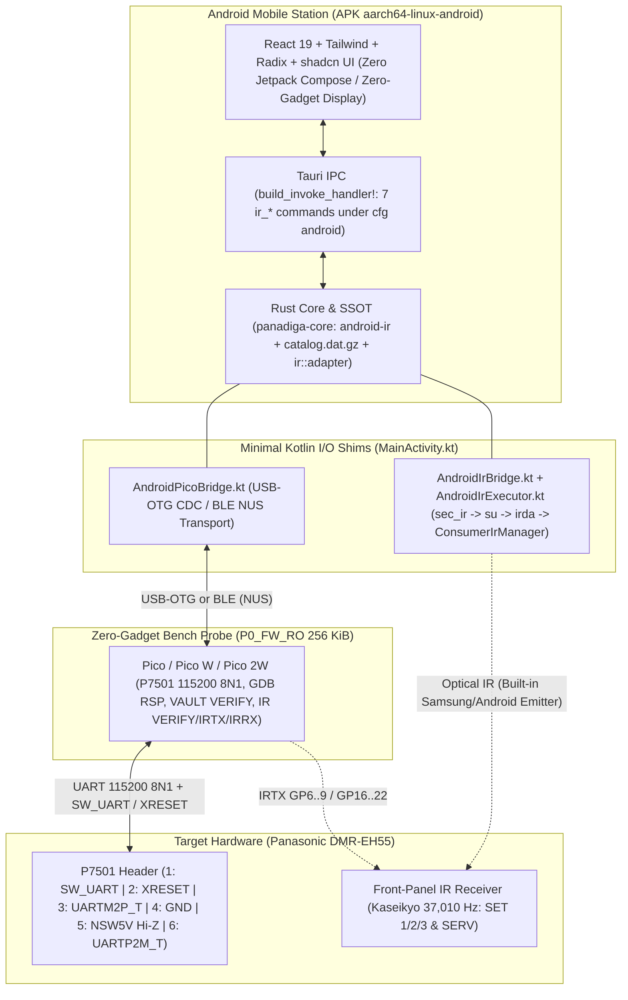
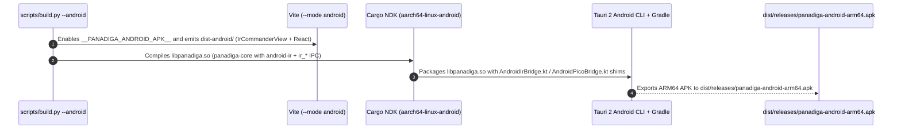

> 🌐 **Language / Idioma:** **English** | [Português (BR)](../pt-BR/ARQUITETURA_MOBILE_ANDROID_E_BLUETOOTH.md)
> 🧭 **Portal:** [Docs Index](../INDEX.md) | [Complete Audit](../../COMPLETE_AUDIT.md) | [Audits](../audits/README.md) | [Ghidra Pseudocode](../pseudocode/INDICE_EVIDENCIA_PSEUDOCODIGO_GHIDRA.md) | [Debug Logs](../debug_logs/README.md)

# Mobile Architecture (Android APK), Minimal Kotlin I/O Shims & Wireless Connectivity (BLE)
## Panadiga Workbench Mobile — Unified Architecture (Rust SSOT + React/Radix/shadcn + Kotlin I/O Shims)

> **Classification:** Systems Architecture and Hardware Engineering Specification  
> **Target Devices:** Android Phones/Tablets (`Dual-ABI Universal arm64-v8a + armeabi-v7a`: `aarch64-linux-android` + `armv7-linux-androideabi`, verified on Samsung `SM-T805` Android `10` API `29` / `SM-T805M` / `GT-N8000`) & Raspberry Pi Pico / Pico W / Pico 2 Probes  
> **Under-Test Target:** Panasonic DIGA DMR-EH55 (Digital PCB `VEP79138`, Header `P7501`, and `Kaseikyo` IR Receiver)  
> **Status:** Normative / Hardware Verified (`dist/releases/panadiga-android-arm64.apk`, `compileSdk = 36`, `targetSdk = 34`, `minSdk = 24`, `v1 + v2 + v3` signed)  

---

## 1. Solution Overview

To enable untethered field bench diagnostics, wireless UART/GDB telemetry, and direct infrared service macro execution against the **Panasonic DMR-EH55**, the **Panadiga** ecosystem builds a unified Android APK (**`dist/releases/panadiga-android-arm64.apk`**) with **Zero Jetpack Compose**, combining:

1. **Unified React 19 + Tailwind CSS + Radix UI + shadcn UI Frontend** ([`IrCommanderView.tsx`](../../apps/desktop/src/views/IrCommanderView.tsx), `apps/desktop/src/components/ir/*`, and `P7501` bench console), compiled solely via `vite --mode android` and [`tauri.android.conf.json`](../../apps/desktop/src-tauri/tauri.android.conf.json) into `dist-android/`.
2. **Native Rust Core & SSOT (`aarch64-linux-android`):** [`panadiga-core::ir`](../../crates/panadiga-core/src/ir/mod.rs) hosts the compressed `panasonic_ir_catalog.dat.gz` dataset (`1,763` codesets / `14,744` models / `80,047` commands), the 14 verified declarative macros (`ir_macros_ssot.json`), the Exynos/AOSP timing adapter (`adapter.rs`), and the serial/BLE probe HAL serving our **zero-gadget probe design** (the smartphone provides display, audio/visual feedback, and IR control while the Pico probe remains comfortably within `P0_FW_RO = 256 KiB` with zero extra OLED/buzzer wiring).
3. **Minimal Kotlin I/O Shims (`AndroidIrBridge.kt` / `AndroidPicoBridge.kt`):** Strictly scoped to forwarding Android OS hardware I/O (USB Host OTG, `sec_ir` sysfs with Magisk `su` cascade, legacy `irda` reflection, and `ConsumerIrManager`) with zero protocol or business logic in Kotlin.



---

## 2. Architectural Decision: Minimal Kotlin I/O Shims + Rust SSOT & Zero-Leakage Isolation

The mobile architecture evolved from the earlier "Zero Kotlin" draft to **Minimal Kotlin I/O Shims**, keeping **100% of protocol logic, Kaseikyo modulation math, and catalog SSOT in Rust** while maintaining **Zero Jetpack Compose** in the UI layer.

### 2.1 Why Minimal Kotlin I/O Shims (Instead of WebUSB or Monolithic Kotlin)?
1. **Android Hardware APIs Outside Standard NDK/WebUSB:** Direct writes to the Samsung Galaxy Tab S IR emitter (`/sys/class/sec/sec_ir/ir_send` plus Magisk `su` permission unlock), legacy `irda` reflection, `ConsumerIrManager`, and Android USB-OTG `UsbManager` intents require Android SDK/Java entry points. Confining those calls to thin I/O bridges ([`AndroidIrBridge.kt`](../../apps/desktop/src-tauri/gen/android/app/src/main/java/com/panasonic/diga/engineering/ir/AndroidIrBridge.kt), [`AndroidIrExecutor.kt`](../../apps/desktop/src-tauri/gen/android/app/src/main/java/com/panasonic/diga/engineering/ir/AndroidIrExecutor.kt), and [`AndroidPicoBridge.kt`](../../apps/desktop/src-tauri/gen/android/app/src/main/java/com/panasonic/diga/engineering/AndroidPicoBridge.kt), wired in [`MainActivity.kt`](../../apps/desktop/src-tauri/gen/android/app/src/main/java/com/panasonic/diga/engineering/MainActivity.kt)) eliminates brittle JS WebUSB hacks without polluting Kotlin with protocol state.
2. **Single React 19 + Radix + shadcn UI (`IrCommanderView.tsx`):** The mobile APK shares the exact React/Tailwind/Radix/shadcn component stack as the desktop workbench — no secondary Jetpack Compose codebase is maintained.
3. **Zero WebUSB / Zero GC Jitter on Critical Paths:** `P7501` UART framing, GDB RSP parsing, and Kaseikyo waveform synthesis remain inside Rust/C11.

### 2.2 Strict Desktop Zero-Leakage Isolation
Android-only IR assets (`DIGA IR Commander` and the `80,047`-command catalog) **NEVER leak into Desktop releases** (`.exe`, `.deb`, `.dmg`), enforced by three compile-time isolation barriers:
1. **Cargo Feature Gate (`android-ir`):** In [`crates/panadiga-core/Cargo.toml`](../../crates/panadiga-core/Cargo.toml), `android-ir` is **disabled by default** (`default = []`) and enabled strictly under `#[cfg(any(target_os = "android", test, feature = "android-ir"))]` (and `[dev-dependencies]` for workspace tests).
2. **Tauri IPC Macro Gate (`build_invoke_handler!`):** In [`apps/desktop/src-tauri/src/lib.rs`](../../apps/desktop/src-tauri/src/lib.rs), `build_invoke_handler!` compiles the **7 `ir_*` IPC commands** exclusively under `#[cfg(target_os = "android")]`.
3. **Vite Compile-Time Tree-Shaking (`__PANADIGA_ANDROID_APK__`):** Defined in [`apps/desktop/vite.config.ts`](../../apps/desktop/vite.config.ts), `__PANADIGA_ANDROID_APK__` folds out all routes, [`IrCommanderView.tsx`](../../apps/desktop/src/views/IrCommanderView.tsx) chunks, and `panasonic_ir_catalog.dat.gz` references from Desktop production builds.

### 2.3 Kotlin I/O Shims (`__PANADIGA_IR_BRIDGE__`) & Hardware Emission Cascade
* [`MainActivity.kt`](../../apps/desktop/src-tauri/gen/android/app/src/main/java/com/panasonic/diga/engineering/MainActivity.kt) registers two WebView bridge objects:
  * `window.__PANADIGA_ANDROID_BRIDGE__` ([`AndroidPicoBridge.kt`](../../apps/desktop/src-tauri/gen/android/app/src/main/java/com/panasonic/diga/engineering/AndroidPicoBridge.kt)) — USB-OTG serial transport to the Pico probe.
  * `window.__PANADIGA_IR_BRIDGE__` ([`AndroidIrBridge.kt`](../../apps/desktop/src-tauri/gen/android/app/src/main/java/com/panasonic/diga/engineering/ir/AndroidIrBridge.kt)) — IR emission bridge backed by [`AndroidIrExecutor.kt`](../../apps/desktop/src-tauri/gen/android/app/src/main/java/com/panasonic/diga/engineering/ir/AndroidIrExecutor.kt).
* **Automatic Hardware Fallback Cascade in `AndroidIrExecutor.kt`:**
  1. `sysfs_direct`: direct write to `/sys/class/sec/sec_ir/ir_send`.
  2. `sysfs_su_unlock`: Magisk `su` unlock (`chmod 0666` / `chown system:radio` on `/sys/class/sec/sec_ir/ir_send`).
  3. `sysfs_su`: `su` pipe (`echo > /sys/class/sec/sec_ir/ir_send`).
  4. `legacy_irda`: Java reflection against legacy `irda` (`write_irsend`).
  5. `consumer_ir_manager`: standard Android `ConsumerIrManager`.

### 2.4 Exynos vs. AOSP Hardware Timing Adapter (`panadiga-core::ir::adapter`)
[`crates/panadiga-core/src/ir/adapter.rs`](../../crates/panadiga-core/src/ir/adapter.rs) emits Kaseikyo payloads (`37,010 Hz` carrier in [`kaseikyo.rs`](../../crates/panadiga-core/src/ir/kaseikyo.rs)) tailored to the underlying IR hardware or Pico fallback:
* **Exynos `SM-T805M` (`universal5420` / `chagall`):** selects **`PeriodScaled`** (`1_000_000 / hz`), clamping total transmit time to `MAX_AOSP_XMIT_TIME_US = 1_900_000` and trail gap to `MAX_HARDWARE_TRAIL_SPACE_US = 45_000`.
* **Legacy Exynos `GT-N8000` (`smdk4x12`):** selects **`CarrierCycles`** for older Samsung kernel IR drivers.
* **Pico USB-OTG / BLE Fallback:** translates any catalog command into `IRTX <DEVSUB>:<CMD> GP<pin> <repeat>` on the Pico C11 firmware ([`p7501_ir_codec.c`](../../firmware/pico-p7501/diag/p7501_ir_codec.c)), constrained to safe spare GPIOs (`GP6..9` / `GP16..22`) with device byte `>= 0x01`.

---

## 3. Wireless Connectivity via Bluetooth Low Energy (BLE)

### 3.1 GATT Profile: Nordic UART Service (NUS)
The Raspberry Pi Pico W / Pico 2W firmware exposes the standard **Nordic UART Service (NUS)** on the Infineon/CYW43439 radio:

| GATT Attribute | Canonical UUID | Properties | Purpose |
| :--- | :--- | :--- | :--- |
| **Service (NUS)** | `6E400001-B5A3-F393-E0A9-E50E24DCCA9E` | Primary Service | Transparent virtual serial stream over BLE |
| **RX Characteristic** | `6E400002-B5A3-F393-E0A9-E50E24DCCA9E` | Write Without Response / Write | Commands sent from Rust Core to Pico (e.g., Cold Break-In, GDB RSP) |
| **TX Characteristic** | `6E400003-B5A3-F393-E0A9-E50E24DCCA9E` | Notify / Read | Telemetry streams and register responses from Pico to Rust Core |

### 3.2 Nanosecond Bus Timing vs. Bluetooth Latency
A common engineering question is whether Bluetooth latency compromises nanosecond-accurate silicon bus timings:

> [!IMPORTANT]
> **Bluetooth NEVER bit-bangs the hardware lines directly.**  
> `P7501` communicates at **`115200 8N1` UART** paired with sub-millisecond Open-Drain reset (`XRESET` / `GP5`) and `SW_UART` boot latching (`GP26`).  
> All real-time UART framing and reset pulses are executed **locally on the RP2040/RP2350** (`p7501_uart_duplex.pio` + HAL).  
> The Bluetooth channel operates solely on the upper transport layer (asynchronously streaming command and telemetry frames managed by the native Rust HAL), where latencies of $15\text{ ms}$ to $25\text{ ms}$ are completely transparent to the user and the asynchronous console/GDB RSP session.

---

## 4. Electrical Discipline: Pinout & P7501 Power Constraints

### 4.1 Strict Prohibition on Powering Pico via Panasonic P7501

> [!CAUTION]
> **CRITICAL PHYSICAL SAFETY RULE: NEVER POWER THE RASPBERRY PI PICO FROM HEADER P7501, AND KEEP `NSW5V` (`GP3`) Hi-Z ONLY.**  
> Pin 1 (`SW_UART`) only senses target logic (`~3.25V`, $I < 10\text{ mA}$), while Pin 5 (`NSW5V` / `GP3`) ties via `D7510` to `IC1506` (`~5.15V` upstream / `~3.29V` resting) to bias `R7570`/`R7572` (`10 kΩ`) and `IC7501` VDD.  
> A standard Pico draws $30\text{ mA}$ to $50\text{ mA}$, while a **Pico W / Pico 2W peaks between $150\text{ mA}$ and $300\text{ mA}$ during Wi-Fi/Bluetooth RF transmissions**.  
> Sourcing power from `P7501` or driving `GP3` (`NSW5V`) as push-pull will destabilize the board supply or overload the `Q7510`/`IC7501` supervisor network.

### 4.2 Grounding and External Power Rules
1. **Pico Power Supply**:
   - Power the Pico from an external $5.0\text{V}$ supply on pin `VSYS` (Pin 39) or via its micro-USB/USB-C connector (portable 5V powerbank or regulated 3.7V LiPo booster).
2. **Ground Reference (GND)**:
   - Header Pin 4 of `P7501` (Panasonic GND) **MUST** be bonded to a Pico GND pin (e.g., Pin 38) to equalize the UART ground reference ($0.0\,\Omega$ to chassis).
3. **Voltage Sensing (Sense Only)**:
   - Header Pin 1 (`SW_UART` -> `GP26` / `ADC0`) reports logic state (`~3.25V` Hi-Z, `~2.69V` Pull-Down), while Pin 5 (`NSW5V` -> `GP3`) remains permanently configured as **`Hi-Z Input` without internal pulls**.

### 4.3 Canonical P7501 Pinout Table (B6B-ZR-3R4)

| Pin (`P7501`) | Schematic Net | Matsushita Signal | Pico Pin (RP2040/RP2350) | Conditioning / PCB Network | Function |
| :---: | :---: | :---: | :---: | :---: | :--- |
| **1** | `SW_UART` | `SW_UART (D)` | `GP26 / ADC0` | $1.0\,\text{k}\Omega$ ADC series / `Q7510` | Serial boot latch (`LOW` drops `XFWE` & cuts off `Q7514`; `Hi-Z` enables TX). **DO NOT POWER PICO.** |
| **2** | `XRESET` | `XRESET` | `GP5` | Strict Open-Drain (`LOW`/Hi-Z) | Master system reset (`~20 µs` Hi-Z release rise time). Push-pull HIGH is strictly forbidden! |
| **3** | `MAX RXD` | `UARTM2P_T` | `GP4` (Pico TX) | Board `R7570 10 kΩ` to `NSW5V` + `Q7514` | Asynchronous `115200 8N1` TX to AM34 RX (requires `SW_UART` Hi-Z). No external 3.3V pull-up. |
| **4** | `GND` | `GND` | `GND` (Pin 38) | Direct low-impedance bond | **Mandatory common ground reference ($0.0\,\Omega$ to chassis)** |
| **5** | `NSW5V` | `X_SW_5R2V` | `GP3` | High-impedance sense via `IC1506`/`D7510` | **Static sense (`~3.29V` resting / `~5.15V` up). MUST remain `Hi-Z Input` without pulls!** |
| **6** | `MAX TXD` | `UARTP2M_T` | `GP2` (Pico RX) | Board `R7572 10 kΩ`, Square Pad | Asynchronous `115200 8N1` RX from AM34 (`<00>DDR CHECK: OK`, `CD diag boot mode`). |

---

## 5. Unified APK Build Pipeline

The Android package compiles the React frontend exclusively with `--mode android` (`vite --mode android` → `dist-android/`), enables the `android-ir` Rust Core feature via [`tauri.android.conf.json`](../../apps/desktop/src-tauri/tauri.android.conf.json), and bundles the minimal Kotlin I/O shims in `MainActivity.kt` through [`scripts/build_lanes/android.py`](../../scripts/build_lanes/android.py) (orchestrated by [`scripts/build.py`](../../scripts/build.py)):



> [!NOTE]
> **Desktop Build Isolation:** Whenever `vite build` runs without `--mode android` (`__PANADIGA_ANDROID_APK__ = false`) and Cargo targets Desktop without `android-ir`, zero **DIGA IR Commander** chunks, routes, or catalog data enter `.exe` / `.deb` / `.dmg` desktop releases.

### 5.1 Local Compilation Instructions
To build the APK locally on a bench workstation:

```powershell
# 1. Export Android SDK and NDK paths
$env:ANDROID_HOME = "C:\Users\<User>\AppData\Local\Android\Sdk"
$env:NDK_HOME = "$env:ANDROID_HOME\ndk\27.0.12077973"

# 2. Add Rust targets for Dual-ABI Universal packaging (ARM64 + ARMv7)
rustup target add aarch64-linux-android armv7-linux-androideabi

# 3. Build, sign (v1+v2+v3), and verify unified APK from repository root
npm run build:android
# or via Python build orchestrator:
python scripts/build.py --android
```

The final universal APK packages both `lib/arm64-v8a/libpanadiga_lib.so` and `lib/armeabi-v7a/libpanadiga_lib.so` (`compileSdk = 36`, `targetSdk = 34`, `minSdk = 24`, `jniLibs.useLegacyPackaging = true`), is aligned via `zipalign -p -f 4` and signed (`v1 + v2 + v3`) using the bench keystore (`panadiga-bench.keystore`, auto-provisioned via `ensure_bench_keystore` when absent), and must pass [`android_verify.py`](../../scripts/build_lanes/android_verify.py) (`zipalign -c 4`, `apksigner verify -v --min-sdk-version 21`, and `aapt2 dump xmltree`) before release at `dist/releases/panadiga-android-arm64.apk` (live ADB install & launch verified on `SM-T805` with `primaryCpuAbi=armeabi-v7a`).

---

## 6. Field Operation Runbook

### 6.1 Workflow A — `P7501` Probe via BLE NUS or USB-C OTG
1. **External Probe Power:** Supply the Raspberry Pi Pico / Pico W from an external USB battery pack or bench supply (never draw power from `P7501`).
2. **Safe Mechanical Mating:** With the DMR-EH55 unplugged from AC mains, seat the 6-pin JST ZR harness onto PCB header `P7501` (`VEP79138`).
3. **Pairing (`__PANADIGA_ANDROID_BRIDGE__` / BLE NUS):** Launch the Android app and attach over **USB-OTG** or **BLE NUS (`6E400001-...`)**.
4. **Telemetry & Diagnostics:**
   - Power on the Panasonic unit and run **`PINCHECK`**, **`JIGBOOT`**, or **`UARTMON` (`115200 8N1`)**. The Pico locally manages `SW_UART` (`GP26`) and Open-Drain `XRESET` (`GP5`), keeping `NSW5V` (`GP3`) strictly configured as **`Hi-Z Input`**.

### 6.2 Workflow B — Infrared Service Control (`DIGA IR Commander`)
1. Open the **IR Commander** tab ([`IrCommanderView.tsx`](../../apps/desktop/src/views/IrCommanderView.tsx)) and select the `DMR-EH55` (`EUR7659Y70`) layout or one of the **14 verified declarative service macros** (`ir_macros_ssot.json`).
2. Rust `panadiga-core::ir::adapter` computes `37,010 Hz` Kaseikyo modulation ([`adapter.rs`](../../crates/panadiga-core/src/ir/adapter.rs): `PeriodScaled` on `SM-T805M` or `CarrierCycles` on `GT-N8000`) and transmits through [`AndroidIrExecutor.kt`](../../apps/desktop/src-tauri/gen/android/app/src/main/java/com/panasonic/diga/engineering/ir/AndroidIrExecutor.kt) (`/sys/class/sec/sec_ir/ir_send`, Magisk `su` unlock cascade when required, legacy `irda`, or `ConsumerIrManager`).
3. When operating a device without a built-in IR blaster, select **Pico Fallback (`IRTX`)** over USB-OTG/BLE to emit `IRTX <DEVSUB>:<CMD> GP<pin> <repeat>` on safe spare GPIOs `GP6..9` / `GP16..22`.
