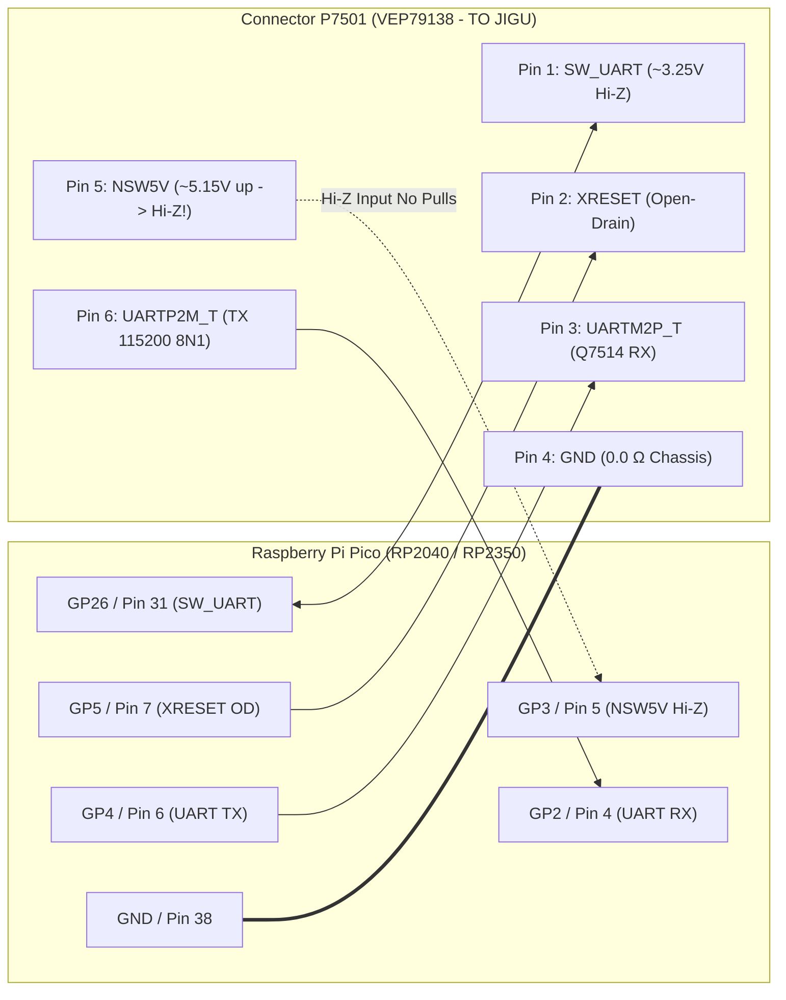

> 🌐 **Language / Idioma:** **English** | [Português (BR)](../pt-BR/GUIA_BANCADA_P7501_SEM_DESSOLDA.md)
> 🧭 **Portal:** [Docs Index](../INDEX.md) | [Complete Audit](../../COMPLETE_AUDIT.md) | [Audits](../audits/README.md) | [Ghidra Pseudocode](../pseudocode/INDICE_EVIDENCIA_PSEUDOCODIGO_GHIDRA.md) | [Debug Logs](../debug_logs/README.md)

# SURGICAL BENCH GUIDE: NO-DESOLDERING `P7501` ASYNC UART CONNECTION
## Diagnostics, Boot Capture & Bench Preparation — Panasonic DMR-EH55 (`VEP79138`)
### Matsushita `AM34` / `MN103S` + Syscon `IC7501` $\leftrightarrow$ Raspberry Pi Pico (`RP2040` / `RP2350`)

---

## 1. Introduction & Technical Scope

This manual details the safe bench procedure for connecting a **Raspberry Pi Pico (`RP2040`)** or **Pico 2 (`RP2350`)** to the 6-pin factory service header **`P7501` (`JST B6B-ZR-3R4`, labeled `"TO JIGU"`)** on board `VEP79138` inside the **Panasonic DIGA DMR-EH55** recorder, enabling **`115200 8N1`** boot capture, complete electrical line diagnostics, discrete boot/reset control, and a GDB RSP bridge without soldering on or desoldering components from the main PCB.

> [!IMPORTANT]
> **Verified Physical Alignment (`P7501` Async UART vs. External `IC5001` Flashing):**
> Full cross-verification across all 3 official **DMR-EH55** service manuals and live bench measurements proved that **`P7501`** is an **Asynchronous UART port (`115200 8N1`)** coupled to discrete stage `Q7510` / `Q7514` / `QR7503` / `IC1506` / `D7510`.
> - The Pico probe on `P7501` captures live boot telemetry (`<00>DDR CHECK: OK`, `CD diag boot mode`), tests electrical integrity across all pins (`PINCHECK`, `UARTPROBE`, `FMUSCAN`), and drives non-destructive recovery without desoldering.
> - Where a unit is stuck in `U99` with no writable live monitor on `P7501` (and if `SDDIAG` via `DIGADIAG.FRM` cannot load), definitive NVRAM repair follows the external route of reading Spansion `S29JL064H70TFI00` (**`IC5001`**) in a TSOP-48 programmer (**XGecu T48** or **SVOD 4**) and applying `panadiga nvram clean` prior to re-flashing.

---

## 1.1 Universal Compatibility with RP2040 and RP2350 Boards (Pico 1 & Pico 2)

> [!IMPORTANT]
> **Full Compatibility with Raspberry Pi Pico (RP2040) and Raspberry Pi Pico 2 (RP2350):**
> The Panadiga ecosystem officially supports **Pico 1 (`RP2040` / `Pico W`)**, **Pico 2 (`RP2350` / `Pico 2 W`)**, and compatible silicon variants:
>
> * **RP2350 Advantages on the Bench:**
>   * **520 KB SRAM (vs. 264 KB on RP2040):** Expanded buffer for continuous high-speed serial captures and GDB RSP caching.
>   * **150 MHz Clock & PIO 2.0:** Deterministic `115200 8N1` UART sampling with `8x` oversampling (`921,600 Hz`) in `p7501_uart.pio` / `p7501_uart_duplex.pio`.
>   * **Native `3.3V` Logic + `NSW5V` (`GP3`) Guard:** Control/UART signals on `P7501` run at `3.3V LVTTL`, while Pin 5 (`NSW5V`) connects to the `~5.15V` upstream node from `IC1506` via `D7510` — and **MUST ALWAYS** remain a pull-disabled `Hi-Z Input` on the RP2040/RP2350.

---

## 1.2 Engineering Warning: `P7501` Async UART (`115200 8N1`) vs. Legacy JTAG / `DWire32A`

> [!CAUTION]
> **Why you must NOT use generic JTAG firmwares, passive 3-wire USB-TTL adapters without Open-Drain, or synchronous `DWire32A` protocols on `P7501`:**
>
> 1. **Actual DMR-EH55 Interface:** `P7501` is **NOT** JTAG (`TDI/TDO/TMS/TCK`) or synchronous `DWire32A` (`SDATA`/`SCLK`). It is `115200 8N1` Asynchronous UART (`UARTP2M_T` & `UARTM2P_T`) paired with discrete boot/reset signals (`SW_UART`, `XRESET`) and switched rail `NSW5V`.
> 2. **TX Blocking via `Q7514`:** Pulling `SW_UART` (Pin 1) `LOW` causes `Q7510` to pull `XFWE` low and force serial boot (`CD diag boot mode` / `SDDIAG`), while simultaneously placing `Q7514` into cutoff and disconnecting Pin 3 (`UARTM2P_T`) from the CPU. TX bits from `GP4` cross `Q7514` only when `SW_UART = Hi-Z`.
> 3. **Damage Hazard on `NSW5V` and `XRESET`:** Feeding external power or forcing push-pull HIGH on Pin 5 (`NSW5V`, `~5.15V` upstream) or Pin 2 (`XRESET`, `QR7503`) risks damaging either the Pico or board `VEP79138`. Exclusively run the native `panasonic_p7501_uart` firmware.

---

## 2. Connector Mechanical & Commercial Standard (`JST ZR 1.5mm` 6-Pin - `B6B-ZR-3R4`)

Service header **`P7501`** soldered on the DMR-EH55 Main PCB (**`VEP79138`**) is a **6-pin JST ZR connector with a `1.5 mm` pitch (`B6B-ZR-3R4`)**, labeled **`TO JIGU`** in the official Panasonic schematic.

### 2.1 Buying the Right Harness (Plug-and-Play Without Micro-Soldering)
To mate cleanly with the Raspberry Pi Pico without soldering directly to SMD header pins:
* **Recommended Search Terms:** `JST ZR / ZH 1.5mm 6-pin Female to Dupont 2.54mm Male jumper cable` (`ZHR-6` female housing with `SZH-002T-P0.5` crimp contacts).
* **Pitch (Pin-to-Pin Spacing):** Strictly **`1.5 mm`** center-to-center.
* **Incompatible Standards (Do NOT Force):** Never force **JST SH (`1.0 mm`)**, **JST PH (`2.0 mm`)**, or **JST XH (`2.54 mm`)**.
* **Physical Orientation:** The square solder pad on the PCB identifies **Pin 6 (`UARTP2M_T` / `MAX TXD`)**, sitting closest to FFC connector **`FP50003`**.

---

## 2.2 Canonical Verified Pinout of Connector `P7501` (`VEP79138`)

> [!CAUTION]
> **SCHEMATIC & BENCH GROUND TRUTH (`P7501`):**
> * **Pin 4 = `GND` ($0.0\,\Omega$ direct to metal chassis).**
> * **Pin 6 = `UARTP2M_T` (`MAX TXD`, SQUARE pad on PCB adjacent to `FP50003`) — active board UART TX output (`115200 8N1`).**
> * **Pin 5 = `NSW5V` (`X_SW_5R2V`) — static rail reading `~3.29V` idle (`~5.15V` upstream via `D7510` / `IC1506`). NEVER ground or drive push-pull!**

```text
          CANONICAL P7501 HEADER [B6B-ZR-3R4] ("TO JIGU") — VEP79138
                     ┌───────────────────────────────────────────┐
      Pin 1          │  [1] SW_UART   (~3.25V Hi-Z / LOW=XFWE)   │
      Pin 2          │  [2] XRESET    (Open-Drain Reset ~20µs)   │
      Pin 3          │  [3] UARTM2P_T (MAX RXD -> Pico GP4 TX)   │
      Pin 4 (GND)    │  [4] GND       (0.0Ω to Metal Chassis!)   │
      Pin 5          │  [5] NSW5V     (KEEP GP3 AT Hi-Z!)        │
      Pin 6 (Square) │  [6] UARTP2M_T (MAX TXD -> Pico GP2 RX)   │
                     └───────────────────────────────────────────┘
```

### Pinout & Measured Electrical Behavior Table (`COM10` + NA/EU Manuals)

| `P7501` Pin | Schematic Signal | Board Circuit (`VEP79138`) | Measured Level / Behavior | Pico Pin (`RP2040/RP2350`) | Role in Recovery / Diagnostics |
| :---: | :--- | :--- | :--- | :---: | :--- |
| **Pin 1** | **`SW_UART`** `(D)` | `Q7510` Collector, `QR7503` Base, `IC7501` Pin 80 | `3.24–3.25V` Hi-Z / `2.68–2.69V` PD | **`GP26 / ADC0`** (Pin 31) | Forces serial/JIG boot (`XFWE`) when `LOW` (cuts `Q7514`); keep `Hi-Z` for active TX. |
| **Pin 2** | **`XRESET`** | `QR7503` reset network | Strict Open-Drain (`0V` / `Hi-Z`, `~20 µs` rise) | **`GP5`** (Pin 7) | Target master reset. Never drive `+3.3V` push-pull! |
| **Pin 3** | **`UARTM2P_T`** (`MAX RXD`) | Driver via `Q7514` (`R7570 10 kΩ`) | `3.3V` LVTTL `115200 8N1` | **`GP4`** (Pin 6, TX) | Probe TX to AM34 RX (`SW_UART=Hi-Z` to conduct). No external pull-up. |
| **Pin 4** | **`GND`** | `GND_DIGITAL` | **`0.0V`** ($0.0\,\Omega$ to chassis) | **`GND`** (Pin 38) | Shared `0V` bench reference. |
| **Pin 5** | **`NSW5V`** (`X_SW_5R2V`) | `IC1506` (`~5.15V`) via `D7510` | `~3.29V` idle / `~5.15V` upstream | **`GP3`** (Pin 5) | Feeds `R7570`/`R7572`/`IC7501`. **ALWAYS KEEP `Hi-Z Input` with NO pulls!** |
| **Pin 6** | **`UARTP2M_T`** (`MAX TXD`) | `R7535` / `R7572 10 kΩ` | Active `3.3V` LVTTL `115200 8N1` boot UART | **`GP2`** (Pin 4, RX) | Only pin carrying active UART TX (`<00>DDR CHECK: OK`, `CD diag`). Square pad. |

### 3-Step Multimeter Check Before Plugging In the Pico
With the recorder **unplugged from AC mains** and the **BLACK probe on the metal chassis**:
1. **Verify `Pin 4 (GND)`:** In continuity mode, confirm **$0.0\,\Omega$** between **`P7501` Pin 4** and chassis ground.
2. **Verify `Pin 6 (UARTP2M_T)`:** Visually confirm the **square PCB solder pad** closest to FFC `FP50003`.
3. **Measure Idle Voltages (Standby/Powered):** With multimeter on DC `20V`, verify `Pin 1 (SW_UART) ≈ 3.25V`, `Pin 5 (NSW5V) ≈ 3.29V`, and no shorts between adjacent pins before plugging Pico USB.

---

## 2.3 Critical Hardware Verification: Spansion `S29JL064H` (`IC5001`) Pin 14 (`WP#/ACC`)

> [!CAUTION]
> **Hardware Write-Protect Lock:**
> Per the **Official Spansion S29JL064H Datasheet** (*Top Boot Block Architecture* section):
> * **Pin 14 (`WP#/ACC`)** on Flash chip **`IC5001`** hardware-protects the top two 8 KB micro-sectors: **`SA140` (`0x007FC000`)** and **`SA141` (`0x007FE000`)**.
> * If Pin 14 is pulled to ground (`0.0V`), JEDEC *Sector Erase* (`0x30`) commands targeting those sectors are ignored internally by the Flash array.
> * Before any in-circuit Flash write procedure, confirm $+3.3\text{V}$ on `IC5001` Pin 14 with a multimeter.

---

## 3. Bench Wiring Diagram: RP2040 / RP2350 $\leftrightarrow$ `P7501`

Board `VEP79138` **already integrates** pull-up resistors `R7570` (`10 kΩ`) and `R7572` (`10 kΩ`) tied to `NSW5V`, plus `R7562` (`4.7 kΩ`) and `R7559` (`10 kΩ`) on `Q7510`. Therefore, **do NOT add an external `4.7 kΩ` pull-up**.

### 3.1 Complete Bench Wiring Schematic

```text
       RASPBERRY PI PICO (RP2040 / RP2350)                           MAIN BOARD VEP79138
               BENCH CONTROLLER                                    CANONICAL HEADER P7501
    ┌───────────────────────────────┐                             ┌──────────────────────────────┐
    │                               │                             │                              │
    │  Pin 31 (GP26 / ADC0) ────────┼◄──[ R_PROT: 1.0kΩ (opt) ]───├───◄ Pin 1: SW_UART (D)       │
    │  (Boot Latch / ~3.25V Sense)  │     Q7510/R7562/R7559       │     (LOW->XFWE; Hi-Z->TX)    │
    │                               │                             │                              │
    │  Pin 7  (GP5 / XRESET) ───────┼───[ R_SER: 100Ω (opt) ]─────├───► Pin 2: XRESET            │
    │  (Emulated Open-Drain)        │     LOW=Reset / Hi-Z=Run    │     (QR7503, ~20µs rise)     │
    │                               │                             │                              │
    │  Pin 6  (GP4 / UART TX) ──────┼───[ R_SER: 100Ω (opt) ]─────├───► Pin 3: UARTM2P_T         │
    │  (115200 8N1 -> AM34 RX)      │     Onboard R7570 10kΩ!     │     (MAX RXD via Q7514)      │
    │                               │                             │                              │
    │  Pin 38 (GND / 0V Ground) ────┼─────────────────────────────┼════ Pin 4: Common GND        │
    │  (Chassis 0V Reference)       │   DIRECT GROUND TIE 0.0Ω    │     (0.0Ω to Chassis!)       │
    │                               │                             │                              │
    │  Pin 5  (GP3 / NSW5V Sense) ──┼◄──[ Hi-Z Input / NO PULLS ]─├───◄ Pin 5: NSW5V (X_SW_5R2V) │
    │  (NEVER Drive Push-Pull!)     │     IC1506 ~5.15V / D7510   │     (~3.29V idle)            │
    │                               │                             │                              │
    │  Pin 4  (GP2 / UART RX) ──────┼◄──[ R_SER: 100Ω (opt) ]─────├───◄ Pin 6: UARTP2M_T         │
    │  (115200 8N1 <- AM34 TX)      │     Onboard R7572 10kΩ!     │     (MAX TXD, Square Pad)    │
    │                               │                             │                              │
    └───────────────────────────────┘                             └──────────────────────────────┘
```

### 3.2 Mermaid Interconnection Diagram



---

## 4. Critical Hardware Protection Rules

### 4.1 Survival Rule 1: `NSW5V` (`GP3` / Pin 5) ALWAYS `Hi-Z Input`
* Pin 5 (`NSW5V` / `X_SW_5R2V`) receives `~5.15V` from regulator `IC1506` through diode `D7510` feeding `R7570`/`R7572` and Syscon `IC7501` (`~3.29V` idle reading).
* **NEVER** configure **`GP3` (`NSW5V`)** as a push-pull output, never enable internal pull-up/pull-down resistors on `GP3`, and **never power the Raspberry Pi Pico from `P7501`**.

### 4.2 Survival Rule 2: Open-Drain Control of `XRESET` (`GP5`)
* Pin 2 (`XRESET`) ties to the board reset line (`QR7503` / system supervisor).
* **NEVER** drive `GP5` to push-pull HIGH (`+3.3V`).
* **Safe Mode (`p7501_hw.c`):**
  * **Assert reset:** `GP5` driven output **`0V`**.
  * **Release reset:** `GP5` configured as unpulled **`Hi-Z` input** (`~20 µs` natural rise time).

### 4.3 Rule 3: Harness Length & Absence of External Pull-Up
* Keep the JST/Dupont harness short ($\le 15\text{ cm}$) and solidly grounded (`Pin 4 <-> Pico Pin 38`).
* **Do NOT** wire an external `4.7 kΩ` pull-up to `3V3_OUT`: `VEP79138` already includes `R7570` (`10 kΩ`) and `R7572` (`10 kΩ`).

---

## 5. Standard Bench Operating Procedure (Step-by-Step)

```text
                     VERIFIED P7501 OPERATIONAL FLOW
  ┌─────────────────────────────────────────────────────────────────────┐
  │ 1. COLD CHECK: Pin 4 <-> Chassis = 0.0Ω; verify inter-pin isolation │
  ├─────────────────────────────────────────────────────────────────────┤
  │ 2. JST ZR-6 MATE: Plug harness into P7501 + USB into Pico           │
  ├─────────────────────────────────────────────────────────────────────┤
  │ 3. TERMINAL (115200 bps): Open console -> Prompt 'PANADIGA> '       │
  ├─────────────────────────────────────────────────────────────────────┤
  │ 4. ELECTRICAL CHECK ('STATUS' & 'PINCHECK'): ~3.25V Hi-Z / ~2.69V PD│
  ├─────────────────────────────────────────────────────────────────────┤
  │ 5. BOOT CAPTURE ('JIGBOOT' / 'BOOTCAP'): <00>DDR CHECK / CD diag    │
  ├─────────────────────────────────────────────────────────────────────┤
  │ 6. SERIAL TX ('ENGAGE' -> 'UARTSEND'): SW_UART Hi-Z for Q7514       │
  ├─────────────────────────────────────────────────────────────────────┤
  │ 7. POST-TEST HYGIENE ('UARTPROBE 8' -> 'ISOLATE'): Back to Hi-Z!    │
  └─────────────────────────────────────────────────────────────────────┘
```

### Step 1: Cold Inspection & Resistance Checks (Unit Unplugged from AC)
1. Unplug the DMR-EH55 from AC mains.
2. With multimeter in continuity mode, verify **$0.0\,\Omega$** between **`P7501` Pin 4 (`GND`)** and the metal chassis.
3. Confirm no short-circuit exists among Pins 4 (`GND`), 5 (`NSW5V`), and 1 (`SW_UART`).

### Step 2: Mating the `P7501` $\leftrightarrow$ Raspberry Pi Pico Harness
1. Plug the `ZHR-6` (`1.5 mm`) connector into `P7501`, double-checking exact 6-pin mapping (`1->GP26`, `2->GP5`, `3->GP4`, `4->GND`, `5->GP3`, `6->GP2`).
2. Power the Pico strictly from its **USB** port connected to the workstation (or Android OTG / BLE on Pico W / 2 W).

### Step 3: Power-On & Opening the Console (`PANADIGA> `)
1. Plug the Panasonic recorder into AC mains and connect Pico USB.
2. Open the Pico serial port in the Desktop app (`panadiga-desktop`), CLI (`panadiga`), or serial terminal at `115200 bps`.
3. Press `<ENTER>` and verify prompt **`PANADIGA> `**.

### Step 4: Electrical Health Check (`STATUS` & `PINCHECK`)
```text
PANADIGA> PING
PONG
PANADIGA> STATUS
VDD: 3.25V (OK)
PANADIGA> PINCHECK
```
* **Expected `PINCHECK` values:** `SW_UART` (`GP26`) reads `~3.25V` `Hi-Z`, `~2.69V` pull-down (clamped via `Q7510` B-C junction), and `~3.27V` pull-up; `XRESET` (`GP5`) rises in `~20 µs` on release; `NSW5V` (`GP3`) reports strictly `Hi-Z Input`; `GP2` (`UARTP2M_T`) shows hundreds of active UART edges during boot.

### Step 5: Live Boot Capture (`BOOTCAP` / `JIGBOOT` / `UARTMON`)
```text
PANADIGA> JIGBOOT
```
* Deterministic PIO capture on `GP2` (`115200 8N1`) displays AM34 bootloader telemetry (`<00>DDR CHECK: OK`, `SD init`, `CD diag boot mode`, `X(80020401)` / `X(80040904)` codes, and optical mechanism sense). *(For `LOADER ver0.61`, timed `UARTSTREAM 12000 JIG:2500` holds `SW_UART` LOW long enough to pass `DDR CHECK: OK` before releasing `GP26`.)*

### Step 6: Interactive Serial TX (`ENGAGE` + `UARTSEND`) & Cleanup (`UARTPROBE 8` + `ISOLATE`)
```text
PANADIGA> ENGAGE
[BUS] P7501 UART TX (GP4) engaged idle HIGH; NSW5V (GP3) kept Hi-Z Input.
PANADIGA> UARTSEND VER
PANADIGA> UARTPROBE 8
PANADIGA> ISOLATE
[BUS] P7501 pins placed in High-Impedance Isolation (NSW5V/XRESET Hi-Z, GP26 ADC0).
```
*(Remember: `UARTSEND` keeps `SW_UART = Hi-Z` so signals pass through `Q7514`; upon completion, `UARTPROBE 8` + `ISOLATE` leaves `GP26 / ADC0` clean for subsequent `STATUS` checks.)*

---

## 6. Bench Troubleshooting Matrix

| Observed Symptom | Most Likely Cause | Immediate Corrective Action |
| :--- | :--- | :--- |
| `VDD: 0.02V (LOW)` after `UARTSEND` / `JIGBOOT` | Residual SIO direction state on `GP26` or recorder unpowered | Run `UARTPROBE 8` followed by `ISOLATE`, and check AC power to the recorder. |
| `PINCHECK` reports `GP2 = 0` transitions | Pin 6 wire (`UARTP2M_T`, square pad) loose or swapped | Check continuity from `P7501` square pad to `GP2` (Pico Pin 4) + common ground `Pin 4 <-> GND`. |
| `UARTSEND LOW:cmd` captures `0 bytes` | Expected hardware behavior: `SW_UART = LOW` cuts off `Q7514` | Send `UARTSEND <text>` without `LOW:` prefix after `ENGAGE` so `GP26` stays `Hi-Z`. |
| Unit still drops to `U99` after `CD diag boot mode` | Corrupted `BGO` / `SA134..SA141` (`EEMUL`) in `IC5001` with optical laser `0x83A7` down | Try `SDDIAG` via `DIGADIAG.FRM` (`JIG:2500`), or extract `IC5001` TSOP-48 externally + `panadiga nvram clean` on **XGecu T48** / **SVOD 4**. |
| Serial console unresponsive | Wrong COM/ttyACM port or USB CDC driver unbound | Confirm port with `panadiga pico list` and verify `115200 8N1`. |

---

## 7. Probe Architecture & Universal Compatibility Matrix

### 7.1. `P7501` Probe (`115200 8N1`) vs. Generic USB-Serial Adapters
* **Raspberry Pi Pico (`RP2040` / `RP2350`)** combines deterministic PIO UART (`p7501_uart.pio` / `p7501_uart_duplex.pio`) with synchronized **`SW_UART`** gating (`GP26` for `Q7510`/`Q7514`), Open-Drain **`XRESET`** (`GP5`), passive **`NSW5V`** guard (`GP3` always `Hi-Z`), and **`GDB` RSP** bridge.
* **Electrical Warning:** Never connect generic USB-Serial dongles directly to `P7501` without strict `3.3V` compliance, true Open-Drain on `XRESET`, and complete isolation of Pin 5 (`NSW5V`).

### 7.2. Compatibility Across NOR Flash Vendors (JEDEC CFI)
Target stub [`ram_loader_am34_target.c`](../../firmware/pico-p7501/flash/ram_loader_am34_target.c) and `panadiga nvram clean` support JEDEC/CFI Top-Boot geometries across **Spansion** (`S29JL064H`, `S29GL064N`, `S29AL016D`), **ST/Numonyx** (`M29W640FB`/`FT`), **Macronix** (`MX29LV640DT`), **Fujitsu** (`MBM29LV640`), and **Toshiba/Winbond**.

### 7.3. Compatibility Across the Panasonic DIGA Family
Top-Boot NVRAM (`EEMUL`) window layout across DIGA generations:
1. **8 MB NOR Flash (`0x807F0000..0x807FFFFF`):** `DMR-EH55`, `DMR-EH56`, `DMR-EH65`, `DMR-ES15`, `DMR-ES25`, `DMR-ES35V`, `DMR-EZ25`.
2. **4 MB NOR Flash (`0x803F0000..0x803FFFFF`):** `DMR-ES10`, `DMR-ES20`, `DMR-ES30V`, `DMR-EH50`, `DMR-EH60`, `DMR-E100H`, `DMR-E500H`.
3. **2 MB NOR Flash (`0x801F0000..0x801FFFFF`):** `DMR-E50`, `DMR-E55`, `DMR-E65`, `DMR-E80H`, `DMR-E85H`, `DMR-E95H`.
4. **16 MB NOR Flash (`0x80FF0000..0x80FFFFFF`):** `DMR-EX75`, `DMR-EX85`, `DMR-EX77`, `DMR-EX87`, `DMR-EX95V`, `DMR-EZ27`, `DMR-EZ45V`, `DMR-EZ48V`.
5. **Full Architecture Reference:** See [SYSTEM_ARCHITECTURE_AND_ENGINEERING_BLUEPRINT.md](SYSTEM_ARCHITECTURE_AND_ENGINEERING_BLUEPRINT.md).

---

## 8. Single-Piece 6-Pin Connector (`JST ZR-6`) & Tri-State Isolation (`ISOLATE` / `HIZ`)

Because **`P7501` (`B6B-ZR-3R4`)** uses a **single-piece 6-pin female housing (`1.5 mm`)**, there is no need to unplug individual wires between diagnostics and normal boot runs:

1. **Connected Harness Safety:**
   * **Pin 4 (`GND`):** Common ground ($0.0\,\Omega$).
   * **Pin 5 (`NSW5V` -> `GP3`):** Permanently stays an unpulled **`Hi-Z Input`** in Pico HAL — **zero current sunk or injected**.
   * **Pin 2 (`XRESET` -> `GP5`):** Idle state is unpulled **`Hi-Z` Open-Drain**.
   * **Pins 1, 3, and 6 (`SW_UART`, `UARTM2P_T`, `UARTP2M_T`):** Placed into safe tri-state isolation via **`ISOLATE`** (`HIZ`), letting the Panasonic board boot normally while connected.
2. **Firmware `ISOLATE` (`HIZ`) and `ENGAGE` Commands:**
   * **`ISOLATE` / `HIZ`:** Calls `p7501_hw_isolate_bus_hiz()`, tri-stating TX drivers into safe high impedance (`NSW5V` & `XRESET` `Hi-Z`, `GP26` `ADC0`).
   * **`ENGAGE`:** Calls `p7501_hw_engage_uart_bus()`, asserting idle HIGH on `GP4` (`UARTM2P_T`) for active TX while keeping `GP3` (`NSW5V`) strictly `Hi-Z Input`.

---

## 9. First-Connection Read-Only Checklist on Real Hardware

Before attempting any invasive write or recovery command:

1. **Step 1 (`STATUS` $\rightarrow$ `PINCHECK`):** Verify `Pin 4 = GND`, clean `SW_UART` voltages (`~3.25V Hi-Z | ~2.69V PD`), strict `GP3 (NSW5V)` isolation, and edges on `GP2 (UARTP2M_T)`.
2. **Step 2 (`BOOTCAP` / `JIGBOOT` / `UARTSTREAM`):** Capture the full `115200 8N1` startup log (`<00>DDR CHECK: OK`, `SD init`, `CD diag boot mode`, sense codes) for exact diagnosis.
3. **Step 3 (`UARTPROBE 8` $\rightarrow$ `ISOLATE`):** Probe serial response with `Q7514` enabled (`SW_UART = Hi-Z`) and always end in `ISOLATE`.
4. **Step 4 (Definitive `U99` Repair):** Whenever rewriting `0x807F0000..0x807FFFFF`, take dual SHA-256-verified reads of Spansion `S29JL064H` (**`IC5001`**) and sanitize with **`panadiga nvram clean`**.
