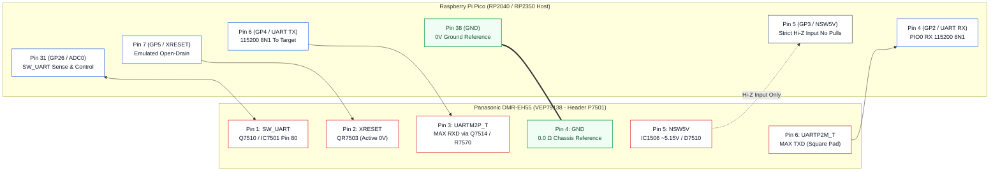

> 🌐 **Language / Idioma:** **English** | [Português (BR)](../pt-BR/BLUEPRINT_ESQUEMA_ELETRICO_BANCADA.md)
> 🧭 **Portal:** [Docs Index](../INDEX.md) | [Complete Audit](../../COMPLETE_AUDIT.md) | [Audits](../audits/README.md) | [Ghidra Pseudocode](../pseudocode/INDICE_EVIDENCIA_PSEUDOCODIGO_GHIDRA.md) | [Debug Logs](../debug_logs/README.md)

# HARDWARE ENGINEERING BLUEPRINT & BENCH CIRCUITS
## In-Circuit `P7501` Async UART (`115200 8N1`) & External Spansion `S29JL064H` (TSOP-48) Programming
### Panasonic DMR-EH55 Digital Recorder — Main Board (`PCB: VEP79138`)

---

## 1. System Overview & Engineering Scope

This document constitutes the **Hardware & Electronics Engineering Blueprint** for electrical diagnostics, live boot/UART capture, recovery, and firmware programming of the **Panasonic DMR-EH55** (DIGA Chassis) DVD/HDD recorder.

```text
                      PANASONIC DMR-EH55 HARDWARE ARCHITECTURE
   ┌─────────────────────────────────────────────────────────────────────────────┐
   │                           MAIN BOARD (VEP79138)                             │
   │                                                                             │
   │   ┌───────────────────────────┐             ┌───────────────────────────┐   │
   │   │   Matsushita / Panasonic  │             │   Spansion S29JL064H      │   │
   │   │      AM34 / MN103S        │   16-Bit    │        (IC5001)           │   │
   │   │    + Syscon IC7501        │◄───────────►│   64 Mbit / 8 MByte NOR   │   │
   │   │   RISC 32-bit Core        │     Bus     │      TSOP-48 Package      │   │
   │   └─────────────┬─────────────┘             └─────────────┬─────────────┘   │
   │                 │                                         │                 │
   │                 │ P7501 UART 115200 8N1                   │ WP#/ACC         │
   │                 │ + Q7510 / Q7514 / QR7503 Control        │ (Pin 14 Unlock) │
   │                 ▼                                         ▼                 │
   │          [ P7501 Header ]                        [ Square SMD Pad ]         │
   │          "TO JIGU" Port                          Hardware Unlock            │
   └─────────────────┬───────────────────────────────────────────────────────────┘
                     │
                     │ Shielded Harness / Bench Leads (<= 15 cm)
                     ▼
   ┌──────────────────────────────────┐        OR       ┌────────────────────────┐
   │    INTERFACE 1: IN-CIRCUIT       │                 │ INTERFACE 2: EXTERNAL  │
   │  Raspberry Pi Pico (RP2040/2350) │                 │  Universal Programmer  │
   │  P7501 UART Engine @ 115200 8N1  │                 │   SVOD 4 / XGecu T48   │
   │    (Non-Destructive Capture)     │                 │ (TSOP-48 ZIF Socket)   │
   └──────────────────────────────────┘                 └────────────────────────┘
```

### Failure Context & Hardware Mission
* **Critical Failure Mode:** Continuous reboot loop displaying front-panel fault code **`U99`** (*Drive Communication / Parameter Timeout*), frequently linked to corruption of non-volatile Flash-emulated parameter blocks (`EEMUL` / NVRAM) residing in the top 64 KB of NOR Flash (`0x7F0000` to `0x7FFFFF`, micro-sectors `SA134` to `SA141`) or drive/handshake failures.
* **Engineering Objectives:**
  1. **In-Circuit `P7501` Async UART (`115200 8N1`) Interface:** Connect a **Raspberry Pi Pico (`RP2040` / `RP2350`)** directly to service connector **`P7501`** (`B6B-ZR-3R4`, `"TO JIGU"`) on board `VEP79138`, maintaining strict **`Hi-Z Input` without pulls on `NSW5V` (`GP3`)**, emulated **Open-Drain** control for **`XRESET` (`GP5`)**, and coordinated **`SW_UART` (`GP26`)** control with respect to transistor **`Q7514`**.
  2. **Direct TSOP-48 Programming Interface:** Provide complete pin-to-pin mapping for the **Spansion `S29JL064H70TFI00` (`IC5001`)** NOR Flash, low-stress hot-air desoldering profile using `Sn63/Pb37` alloy, ZIF socket insertion, verified sanitization via **`panadiga nvram clean`**, and programming on **SVOD 4** / **XGecu T48**.

---

## 2. Detailed Bench Electrical Schematic: `RP2040` / `RP2350` $\leftrightarrow$ `P7501`

The physical link between the **Raspberry Pi Pico** and header **`P7501`** on board `VEP79138` operates over **Asynchronous `115200 8N1` UART** coupled through discrete transistors (`Q7510`, `Q7514`, `QR7503`) alongside power-sense rail **`NSW5V` (`IC1506` via `D7510`)**.

### 2.0 Connector Mechanical Standard (`JST ZR 1.5mm` - `B6B-ZR-3R4`) & Compatible Boards

* **Physical Header Standard for `P7501`:** 6-pin **JST ZR connector with `1.5 mm` pitch**, OEM Panasonic part number **`B6B-ZR-3R4`** (through-hole top entry, silkscreen/schematic legend **`TO JIGU`** on `VEP79138`).
* **Purchasing Pre-Assembled Harness:** Search commercially for **JST ZR / ZH `1.5 mm` 6-pin Female to Dupont `2.54 mm` cable** (`ZHR-6` housing with `SZH-002T-P0.5` crimp terminals). Avoid incompatible pitches such as JST SH (`1.0 mm`), JST PH (`2.0 mm`), or JST XH (`2.54 mm`).
* **Pico 1 (`RP2040`) vs. Pico 2 (`RP2350`) Compatibility:** Both families (including wireless `Pico W` / `Pico 2 W` variants) are natively supported by the C11 firmware in [`firmware/pico-p7501/`](../../firmware/pico-p7501/).
* **Critical Protocol Alert (`P7501` Async UART vs. JTAG / `DWire32A`):** All three official DMR-EH55 service manuals and live `COM10` captures prove that `P7501` does **NOT** expose JTAG (`TDI`/`TDO`/`TMS`) or synchronous `DWire32A` (`SDATA`/`SCLK`). Pin 6 (`UARTP2M_T`) is passive `115200 8N1` RX, Pin 3 (`UARTM2P_T`) is active TX (enabled through `Q7514` when `SW_UART = Hi-Z`), and Pin 5 (`NSW5V`) connects to the `~5.15V` node through `D7510` — **NEVER** drive Pin 5 from the Pico.

### 2.1 Complete Bench Electrical Schematic (Official Panasonic `VEP79138` Reference)

> [!IMPORTANT]
> ### Assembly Disclaimer: Bench Prototype vs. Permanent Fixture
> * **BENCH PROTOTYPE MODE (Short Leads $L \le 15\text{ cm}$):**  
>   Board `VEP79138` already carries internal pull-up resistors **`R7570` (`10 kΩ`)** and **`R7572` (`10 kΩ`)** to `NSW5V`, plus `R7562` (`4.7 kΩ`) and `R7559` (`10 kΩ`) on `Q7510`. **Do NOT add an external `4.7 kΩ` pull-up to `3.3V`** on `UARTM2P_T` (Pin 3). Keep **`GP3` (`NSW5V`) permanently configured as `Hi-Z Input` with pulls disabled**.
> * **PERMANENT BENCH FIXTURE MODE (Optional Series Protection for Cables $> 15\text{ cm}$):**  
>   - **$R_{\text{ser}} = 100\,\Omega$:** Optional inline damping/current-limiting on `GP2` (`UARTP2M_T`), `GP4` (`UARTM2P_T`), and `GP5` (`XRESET`).
>   - **$R_{\text{prot}} = 1.0\text{ k}\Omega$:** Optional series protection on analog/control channel `GP26 / ADC0` (`SW_UART`).

```text
       RASPBERRY PI PICO (RP2040 / RP2350)                          MAIN BOARD VEP79138
             BENCH CONTROLLER                                        HEADER P7501 (CANONICAL)
    ┌───────────────────────────────┐                             ┌──────────────────────────────┐
    │                               │                             │                              │
    │  Pin 31 (GP26 / ADC0) ────────┼◄──[ R_PROT: 1.0kΩ (opt) ]───├───◄ Pin 1: SW_UART (D)       │
    │  (Boot Latch / ~3.25V Sense)  │     Q7510/R7562/R7559       │     (LOW->XFWE; Hi-Z->TX)    │
    │                               │                             │                              │
    │  Pin 7  (GP5 / XRESET) ───────┼───[ R_SER: 100Ω (opt) ]─────├───► Pin 2: XRESET            │
    │  (Emulated Open-Drain)        │     LOW=Reset / Hi-Z=Run    │     (QR7503, ~20µs rise)     │
    │                               │                             │                              │
    │  Pin 6  (GP4 / UART TX) ──────┼───[ R_SER: 100Ω (opt) ]─────├───► Pin 3: UARTM2P_T         │
    │  (115200 8N1 -> AM34 RX)      │     Onboard R7570 10kΩ!     │     (MAX RXD via Q7514)      │
    │                               │                             │                              │
    │  Pin 38 (GND / Ground 0V) ────┼─────────────────────────────┼════ Pin 4: GND Common        │
    │  (0V Chassis Reference)       │   DIRECT 0.0Ω GROUND BUS    │     (0.0Ω to Chassis!)       │
    │                               │                             │                              │
    │  Pin 5  (GP3 / NSW5V Sense) ──┼◄──[ Hi-Z Input / NO PULLS ]─├───◄ Pin 5: NSW5V (X_SW_5R2V) │
    │  (NEVER Drive Push-Pull!)     │     IC1506 ~5.15V / D7510   │     (~3.29V resting)         │
    │                               │                             │                              │
    │  Pin 4  (GP2 / UART RX) ──────┼◄──[ R_SER: 100Ω (opt) ]─────├───◄ Pin 6: UARTP2M_T         │
    │  (115200 8N1 <- AM34 TX)      │     Onboard R7572 10kΩ!     │     (MAX TXD, Square Pad)    │
    │                               │                             │                              │
    └───────────────────────────────┘                             └──────────────────────────────┘
```

### 2.2 Signal Flow & Architecture Mermaid Diagram



### 2.3 Master Pin-to-Pin Interconnect Table (Canonical `P7501` Pinout)

| Canonical Pin (`P7501`) | Schematic Net | Onboard Circuit | Measured Level / Behavior | Pico Pin (`RP2040/RP2350`) | Bench Role & PCB Topography |
| :---: | :---: | :--- | :--- | :---: | :--- |
| **Pin 1** | `SW_UART` `(D)` | `Q7510` / `IC7501` Pin 80 | `~3.25V` Hi-Z / `~2.69V` PD | **Pin 31** (`GP26 / ADC0`) | Forces serial/JIG boot (`XFWE`) when `LOW` (cuts off `Q7514`); keep `Hi-Z` for TX on `GP4`. |
| **Pin 2** | `XRESET` | `QR7503` | Strict Open-Drain (`0V` / `Hi-Z`) | **Pin 7** (`GP5`) | Master reset (`~20 µs` Hi-Z rise time). **Never drive `+3.3V` push-pull!** |
| **Pin 3** | `UARTM2P_T` | `MAX RXD` (`Q7514` + `R7570 10 kΩ`) | `3.3V` LVTTL `115200 8N1` | **Pin 6** (`GP4`, TX) | Pico UART TX to AM34 RX (requires `SW_UART = Hi-Z`). No external pull-up. |
| **Pin 4** | **`GND`** | `GND_DIGITAL` | **`0.0V`** ($0.0\,\Omega$ to chassis) | **Pin 38** (`GND`) | **Canonical ground reference ($0.0\,\Omega$ direct bond to metal chassis).** |
| **Pin 5** | `NSW5V` | `X_SW_5R2V` (`IC1506` $\rightarrow$ `D7510`) | `~5.15V` up / `~3.29V` resting | **Pin 5** (`GP3`) | Feeds `R7570`/`R7572`/`IC7501`. **KEEP PERMANENTLY `Hi-Z Input` without pulls!** |
| **Pin 6** | `UARTP2M_T` | `MAX TXD` (`R7535` $\rightarrow$ `R7572`) | `3.3V` LVTTL `115200 8N1` | **Pin 4** (`GP2`, RX) | Pico UART RX (`<00>DDR CHECK: OK`, `CD diag`). **SQUARE Pad** closest to `FP50003`. |

---

## 3. Signal Integrity Analysis, Logic Levels & `115200 8N1` Timing

### 3.1 Logic Level Compatibility (`3.3V` LVTTL + `NSW5V` Limit)

Control and serial lines on **`P7501`** operate in the `3.3V` logic domain (biased via `D3R3V`, `R7562` `4.7 kΩ`, `R7559` `10 kΩ`, and `D7510`), with the critical exception of power-sense node **`NSW5V`** (Pin 5):

| Electrical Parameter | Target Spec (`P7501` / `VEP79138`) | Pico Spec (`RP2040 / RP2350`) | Safe Operating Condition |
| :--- | :---: | :---: | :--- |
| High Input UART / Control ($V_{IH\_min}$) | $2.00\text{ V}$ | $2.00\text{ V}$ | Safe LVTTL margin (`~3.25V` at rest) |
| Low Input UART / Control ($V_{IL\_max}$) | $0.80\text{ V}$ | $0.80\text{ V}$ | Open-Drain `0V` for `XRESET` and serial TX |
| `NSW5V` Line (`P7501` Pin 5) | `~5.15V` (`IC1506` $\rightarrow$ `D7510`), `~3.29V` resting | `GPIO_IN` without pulls (`Hi-Z`) | **Strictly forbidden to drive output or pulls on `GP3`** |
| `Q7510` B-C Junction under Pull-Down on `SW_UART` | $3.30\text{V} - V_{BC} \approx 2.68\text{--}2.69\text{V}$ | `ADC0` Hi-Z / internal PD | Diagnostic signature verified in `PINCHECK` |

### 3.2 PIO UART RX State Machine (`p7501_uart.pio` — `115200 8N1`)

State machine `PIO0` runs at **8 state-machine cycles oversampling per bit** ($8 \times 115,200 = 921,600\text{ Hz}$):
1. Waits for the falling edge of the **Start Bit** (`wait 0 pin 0` on `GP2`).
2. Delays exactly **1.5 bit periods** (`12` cycles) to sample center-eye of **Bit 0** (`LSB first`), repeating every `8` cycles across all 8 data bits.
3. Checks **Stop Bit HIGH** (`jmp pin, good_stop`) before pushing the byte into RX FIFO; otherwise raises framing error IRQ (`irq 4 rel`).
4. `GP3` (`NSW5V`) is never touched by PIO programs, guaranteeing permanent `Hi-Z Input` isolation.

---

## 4. Spansion `S29JL064H70TFI00` Flash Memory (`IC5001`): Pinout & Bench Programming

The main boot and system Flash IC is **`IC5001`**, part number **Spansion `S29JL064H70TFI00`**, mounted on digital/main board `VEP79138`.

### 4.1 Silicon Technical Specifications
* **Density:** 64 Megabits ($8\text{ Megabytes} = 8,388,608\text{ bytes}$).
* **Bus Organization:** Configurable 8-bit (Byte Mode: $8\text{M} \times 8$) or 16-bit (Word Mode: $4\text{M} \times 16$). On Panasonic hardware, permanently wired in **16-bit Word Mode** (`BYTE# = 3.3V`).
* **Access Time ($t_{AA}$):** $70\text{ ns}$.
* **Supply Range ($V_{CC}$):** $2.7\text{ V}$ to $3.6\text{ V}$ (Nominal: $3.3\text{ V}$).
* **Package:** **TSOP-48 Type I** ($12\text{ mm} \times 20\text{ mm}$, $0.5\text{ mm}$ lead pitch).
* **Sector Architecture (Model 00 - Top Boot):**
  * 126 homogeneous main sectors of $64\text{ KBytes}$.
  * 8 top boot micro-sectors of $8\text{ KBytes}$ at the top of memory (`SA134` through `SA141`, physical range `0x7F0000` to `0x7FFFFF`), housing dynamic calibration partition `EEMUL`.

### 4.2 TSOP-48 Package Pinout Diagram (Top View)

```text
                                SPANSION S29JL064H70TFI00
                                TSOP-48 (TYPE I) PACKAGE
                                      (Top View)
                                      ┌───────────┐
                       [Address]  A15 │ 1  o   48 │ A16       [Address]
                       [Address]  A14 │ 2      47 │ BYTE#     [Word/Byte Mode]
                       [Address]  A13 │ 3      46 │ VSS (GND) [Ground]
                       [Address]  A12 │ 4      45 │ DQ15/A-1  [Data D15 / Byte Addr]
                       [Address]  A11 │ 5      44 │ DQ7       [Data D7]
                       [Address]  A10 │ 6      43 │ DQ14      [Data D14]
                       [Address]   A9 │ 7      42 │ DQ6       [Data D6 / Toggle]
                       [Address]   A8 │ 8      41 │ DQ13      [Data D13]
                       [Address]  A19 │ 9      40 │ DQ5       [Data D5 / Error Flag]
                       [Address]  A20 │ 10     39 │ DQ12      [Data D12]
                       [Control]  WE# │ 11     38 │ DQ4       [Data D4]
                       [Control]RESET#│ 12     37 │ VCC       [+3.3V Supply]
                       [Address]  A21 │ 13     36 │ DQ11      [Data D11]
           [Hardware Lock]   WP#/ACC  │ 14     35 │ DQ3       [Data D3]
             [Status Flag]     RY/BY# │ 15     34 │ DQ10      [Data D10]
                       [Address]  A18 │ 16     33 │ DQ2       [Data D2 / Toggle 2]
                       [Address]  A17 │ 17     32 │ DQ9       [Data D9]
                       [Address]   A7 │ 18     31 │ DQ1       [Data D1]
                       [Address]   A6 │ 19     30 │ DQ8       [Data D8]
                       [Address]   A5 │ 20     29 │ DQ0       [Data D0]
                       [Address]   A4 │ 21     28 │ OE#       [Output Enable]
                       [Address]   A3 │ 22     27 │ VSS (GND) [Ground]
                       [Address]   A2 │ 23     26 │ CE#       [Chip Enable]
                       [Address]   A1 │ 24     25 │ A0        [Address]
                                      └───────────┘
```

### 4.3 Complete TSOP-48 Pin Mapping Table

| Pin | Name | Group | Type | Active Level | Electrical & Functional Description |
| :---: | :---: | :---: | :---: | :---: | :--- |
| **1** | `A15` | Address | Input | CMOS | Word address line 15 |
| **2** | `A14` | Address | Input | CMOS | Word address line 14 |
| **3** | `A13` | Address | Input | CMOS | Word address line 13 |
| **4** | `A12` | Address | Input | CMOS | Word address line 12 |
| **5** | `A11` | Address | Input | CMOS | Word address line 11 |
| **6** | `A10` | Address | Input | CMOS | Word address line 10 |
| **7** | `A9` | Address | Input | CMOS | Word address line 9 |
| **8** | `A8` | Address | Input | CMOS | Word address line 8 |
| **9** | `A19` | Address | Input | CMOS | High-order bank select |
| **10** | `A20` | Address | Input | CMOS | High-order bank select |
| **11** | `WE#` | Control | Input | Low ($0\text{V}$) | *Write Enable*: latches writes and JEDEC commands |
| **12** | `RESET#` | Control | Input | Low ($0\text{V}$) | Hardware reset of internal Flash state machine |
| **13** | `A21` | Address | Input | CMOS | MSB address bit (8 MB window) |
| **14** | `WP#/ACC` | Protection | Input | Special | Hardware write protection of top boot sectors |
| **15** | `RY/BY#` | Status | Output | Open-Drain | Low indicates active internal erase/program cycle |
| **16** | `A18` | Address | Input | CMOS | Word address line 18 |
| **17** | `A17` | Address | Input | CMOS | Word address line 17 |
| **18** | `A7` | Address | Input | CMOS | Word address line 7 |
| **19** | `A6` | Address | Input | CMOS | Word address line 6 |
| **20** | `A5` | Address | Input | CMOS | Word address line 5 |
| **21** | `A4` | Address | Input | CMOS | Word address line 4 |
| **22** | `A3` | Address | Input | CMOS | Word address line 3 |
| **23** | `A2` | Address | Input | CMOS | Word address line 2 |
| **24** | `A1` | Address | Input | CMOS | Word address line 1 |
| **25** | `A0` | Address | Input | CMOS | LSB address bit in 16-bit mode |
| **26** | `CE#` | Control | Input | Low ($0\text{V}$) | *Chip Enable*: enables device for read/write |
| **27** | `VSS` | Power | Ground | $0.0\text{V}$ | Device ground |
| **28** | `OE#` | Control | Input | Low ($0\text{V}$) | *Output Enable*: drives tri-state read buffers |
| **29** | `DQ0` | Data | I/O | CMOS | Data bit 0 (LSB) |
| **30** | `DQ8` | Data | I/O | CMOS | Data bit 8 |
| **31** | `DQ1` | Data | I/O | CMOS | Data bit 1 |
| **32** | `DQ9` | Data | I/O | CMOS | Data bit 9 |
| **33** | `DQ2` | Data | I/O | CMOS | Data bit 2 (Toggle bit 2) |
| **34** | `DQ10` | Data | I/O | CMOS | Data bit 10 |
| **35** | `DQ3` | Data | I/O | CMOS | Data bit 3 |
| **36** | `DQ11` | Data | I/O | CMOS | Data bit 11 |
| **37** | `VCC` | Power | Supply | $+3.3\text{V}$ | Positive main supply rail |
| **38** | `DQ4` | Data | I/O | CMOS | Data bit 4 |
| **39** | `DQ12` | Data | I/O | CMOS | Data bit 12 |
| **40** | `DQ5` | Data | I/O | CMOS | Data bit 5 (Erase/Program Timeout/Error flag) |
| **41** | `DQ13` | Data | I/O | CMOS | Data bit 13 |
| **42** | `DQ6` | Data | I/O | CMOS | Data bit 6 (Progress toggle bit) |
| **43** | `DQ14` | Data | I/O | CMOS | Data bit 14 |
| **44** | `DQ7` | Data | I/O | CMOS | Data bit 7 (*Data# Polling* completion flag) |
| **45** | `DQ15/A-1` | MUX | I/O | CMOS | MSB data bit in 16-bit mode or A-1 in 8-bit mode |
| **46** | `VSS` | Power | Ground | $0.0\text{V}$ | Device reference ground |
| **47** | `BYTE#` | Control | Input | High ($3.3\text{V}$) | High = Word Mode (16-bit), Low = Byte Mode (8-bit) |
| **48** | `A16` | Address | Input | CMOS | Word address line 16 |

### 4.4 Universal Bench Programmer Configuration (SVOD 4 / XGecu T48)

When operating **SVOD 4** or **XGecu T48** with a universal **TSOP-48 ZIF** adapter:

```text
                       BENCH PROGRAMMER STACK-UP
       ┌──────────────────────────────────────────────────────────────┐
       │   SVOD 4 / XGECU T48 PROGRAMMER (USB 3.0 / USB 2.0 Host)     │
       │   Main ZIF Socket (DIP-48 / 48-Pin Header)                   │
       └──────────────────────────────┬───────────────────────────────┘
                                      │ Direct Mate
       ┌──────────────────────────────▼───────────────────────────────┐
       │   TSOP-48 ADAPTER BOARD (ADP_F48_EX-1)                       │
       │   - 100nF + 10µF Decoupling Capacitors on VCC                │
       │   - Regulated VCC Rail: 3.3V                                 │
       └──────────────────────────────┬───────────────────────────────┘
                                      │ Clamshell Socket
       ┌──────────────────────────────▼───────────────────────────────┐
       │   TSOP-48 ZIF CLAMSHELL SOCKET (0.5mm Pitch, 12x20mm)        │
       │   [ IC5001: Aligned Spansion S29JL064H70TFI00 ]              │
       │   (Pin 1 aligned to adapter index mark)                      │
       └──────────────────────────────────────────────────────────────┘
```

#### Software Configuration & Execution Flow:
1. **Device Selection:**
   * **XGecu T48 (Xgpro):** Select `SPANSION S29JL064H [TSOP48]`.
   * **SVOD 4:** Select `Spansion -> S29JL064H` (verify *16-bit mode* algorithm is active).
2. **JEDEC Device ID Verification (*Device ID Check*):**
   * Click `Read ID` / `Check ID`. The programmer must strictly return:
     * **Manufacturer Code (Hex):** `0x0001` (Spansion / AMD).
     * **Device Identifier (Hex):** `0x227E` (S29JL064H family) followed by top-boot sub-codes `0x2200` and `0x2201`.
   * If `0x0000`, `0xFFFF`, or erratic values appear: **Do NOT program!** Clean ZIF contacts or reseat bent leads.
3. **Read, Patch & Program Sequence:**
   * **Step 1 (Redundant Dump):** Read the chip twice consecutively as `DMR_EH55_DUMP_1.bin` and `DMR_EH55_DUMP_2.bin`.
   * **Step 2 (Cryptographic Verification):** Compare SHA-256 hashes of both dumps (`panadiga verify-artifact` / `Get-FileHash`). They must match 100%.
   * **Step 3 (NVRAM Cleaning via Rust CLI):**
     ```bash
     panadiga nvram clean DMR_EH55_DUMP_1.bin DMR_EH55_PATCHED_CLEAN.bin
     ```
   * **Step 4 (Program & Verify):** Load `DMR_EH55_PATCHED_CLEAN.bin` into the programmer software and execute *Erase Full + Blank Check + Program + Verify*.

---

## 5. Standard Operating Procedure (SOP): Safe SMD Desoldering & Reflow

Component **`IC5001`** has 48 fine-pitch pins ($0.5\text{ mm}$). Improper hot-air rework risks lifted copper pads, multilayer PCB warping on `VEP79138`, or plastic package popcorning.

### 5.1 Recommended Desoldering Thermal Profile

```text
    Temperature (°C)
      250 ┼─────────────────────────────────┐ (Peak: 235°C - 245°C / Max 25 sec)
          │                                 │
      200 ┼───────────────────────────/     \───────── Liquidus & Lift with
          │                          /                 ESD Tweezers (Zero Force)
      150 ┼─────────────/───────────/
          │            / Uniform Pre-Heat
      100 ┼───────────/  (120-150°C / 45 sec)
          │          /
       25 ┼─────────/
          └─────────┴───────────────┴───────┴─────────► Time (seconds)
          0        30              75      100
```

### 5.2 Step-by-Step Rework Procedure

#### Phase A: ESD Preparation & Thermal Shielding
1. **ESD Grounding:** Operator grounded via wrist strap ($1\text{ M}\Omega$) and ESD bench mat.
2. **Critical Neighbor Masking:**
   * Shield adjacent SMD electrolytic capacitors, the optical drive FFC connector, and nearby `0402` precision resistors with **two layers of Kapton polyimide tape**.
   * Add aluminum foil shielding tape over the Kapton layer to deflect radiant heat from the hot-air nozzle.

#### Phase B: Low-Temperature Alloy Relief (`Sn63/Pb37`)
1. Panasonic's 2006 factory solder on DMR-EH55 is Lead-Free (`SAC305`), melting around $217\text{--}220^\circ\text{C}$.
2. With a soldering iron set to $320^\circ\text{C}$, bevel tip, and **Amtech RMA-223-TPF / NC-559-V2** flux, flood a thin bead of **`Sn63/Pb37`** alloy across all 48 pins.
3. Eutectic lead mixing lowers the effective melting point toward **$183^\circ\text{C}$**, allowing chip lift under drastically lower board thermal stress.

#### Phase C: Hot Air & Chip Extraction
1. **Hot-Air Station Settings:**
   * Temperature: **$240^\circ\text{C}$** (when alloyed with Sn63/Pb37) or **$280^\circ\text{C}$** (pure lead-free joint, measured $2\text{ cm}$ from nozzle).
   * Air Flow: **Low-Medium** ($30\text{--}40\text{ l/min}$) to avoid blowing neighboring `0402`/`0603` passives off their pads.
2. **Nozzle Motion:**
   * Sweep an $8\text{--}10\text{ mm}$ circular nozzle in continuous elliptical passes along both pin rows at $1.5\text{ cm}$ height.
   * **Never hold heat stationary on one spot or dead-center on the package body.**
3. **ESD Tweezer Lift:**
   * Touch the package edge lightly with curved ESD-15 tweezers.
   * **Golden Rule:** Lift only when every single one of the 48 pins gleams visibly molten. **Zero vertical pulling force.**

#### Phase D: PCB Pad Conditioning
1. Apply fresh gel/liquid flux across all 48 pads.
2. Gently sweep $1.5\text{ mm}$ copper desoldering braid with an iron at $320^\circ\text{C}$ (zero downward pressure) to level pads evenly.
3. Clean thoroughly with cotton swabs and **99.8% Isopropyl Alcohol (IPA)**. Inspect under stereo microscope to confirm zero lifted pads or hairline bridges.

#### Phase E: Re-Soldering After Reprogramming
1. Align the chip accurately, matching **Pin 1** bevel/dot to PCB silkscreen.
2. Tack two opposite diagonal corner pins (e.g., Pin 1 and Pin 25) to lock mechanical alignment.
3. Coat both pin rows generously with NC-559 flux.
4. Perform **drag soldering** with a knife (K) or hoof tip carrying minimal solder, letting surface tension form uniform concave fillets.
5. Perform a $360^\circ$ microscope check for:
   * Zero solder bridges between adjacent pins.
   * Clean wetted solder fillets at every pin-to-pad heel.
6. Final rinse with 99.8% IPA to remove all ionic flux residue.

---

## 6. Complete Bench Bill of Materials (BOM)

| Item | Qty | Designator / Ref | Technical Specification / Vendor | Tolerance / Rating | Specific Role on Test Bench |
| :---: | :---: | :--- | :--- | :---: | :--- |
| **1** | 1 | `U_HOST` | Raspberry Pi Pico (`RP2040`) or Pico 2 (`RP2350`) | Standard | `P7501` Async UART (`115200 8N1`) probe via PIO0 & ADC0 |
| **2** | 3 | `R_SER` (opt.) | Metal Film Resistor $100\,\Omega$ $0.25\text{W}$ | $\pm 1\%$ or $\pm 5\%$ | Optional inline damping on `GP2` (`UARTP2M_T`), `GP4` (`UARTM2P_T`), `GP5` (`XRESET`) |
| **3** | 1 | `R_PROT` (opt.) | Metal Film Resistor $1.0\text{ k}\Omega$ $0.25\text{W}$ | $\pm 1\%$ | Optional series protection on `GP26 / ADC0` (`SW_UART`) |
| **4** | 1 | `CN_CONN` | Female JST ZR 1.5mm (`ZHR-6`) to Dupont harness ($\le 15\text{ cm}$) | `1.5 mm` pitch | Direct mate to OEM `P7501` [`B6B-ZR-3R4`] |
| **5** | 1 | `PROG_TSOP` | Universal Programmer SVOD 4 or XGecu T48 (Genuine) | USB 2.0/3.0 | External TSOP-48 Flash (`IC5001`) programming |
| **6** | 1 | `ADP_TSOP48` | TSOP-48 ZIF to DIP-48 Adapter (Clamshell Socket) | $0.5\text{ mm}$ pitch | Solderless accommodation for Spansion `S29JL064H` |
| **7** | 1 | `SOLDER_L` | `Sn63/Pb37` Rosin-Core Wire Solder $0.5\text{ mm}$ | $183^\circ\text{C}$ eutectic | Low-temp thermal relief during desoldering & reflow |
| **8** | 1 | `FLUX_GEL` | Amtech NC-559-V2 or RMA-223 No-Clean Flux | Syringe / Gel | Oxidation barrier & wetting agent during drag soldering |
| **9** | 1 | `KAPTON_T` | Kapton Polyimide Adhesive Tape $15\text{ mm}$ | $300^\circ\text{C}$ rated | Heat masking for adjacent components |
| **10** | 1 | `DESOLD_W` | Goot Wick $1.5\text{ mm}$ Rosin-Treated Desoldering Braid | Low residue | Pad leveling on TSOP-48 footprint |
| **11** | 1 | `CLEAN_IPA` | Pure 99.8% Isopropyl Alcohol | Electronics Grade | Post-rework ionic residue cleanup |

---

## 7. Operational Safety Protocol & Pre-Power Validation

Before connecting AC mains to the recorder or USB to the Pico, complete this three-stage bench checklist:

```text
               BENCH SAFETY VERIFICATION FLOWCHART
    ┌────────────────────────────────────────────────────────────────────────┐
    │ 1. COLD SHORT-CIRCUIT CHECK (Unit Unplugged from AC Mains)             │
    │    Multimeter in Resistance / Continuity mode:                         │
    │    - Measure P7501 Pin 4 (GND) to Chassis: Must read 0.0Ω              │
    │    - Measure P7501 Pin 5 (NSW5V) to Pin 4: No short to ground!         │
    └───────────────────────────────────┬────────────────────────────────────┘
                                        │ PASSED (No Short)
                                        ▼
    ┌────────────────────────────────────────────────────────────────────────┐
    │ 2. PICO ELECTRICAL SELF-TEST (USB Connected to PC)                     │
    │    PANADIGA> STATUS and PINCHECK console:                              │
    │    - Confirm SW_UART ~3.25V Hi-Z / ~2.69V PD / ~3.27V PU               │
    │    - Confirm GP3 (NSW5V) locked as Hi-Z Input with pulls disabled!     │
    └───────────────────────────────────┬────────────────────────────────────┘
                                        │ ELECTRICALS VERIFIED
                                        ▼
    ┌────────────────────────────────────────────────────────────────────────┐
    │ 3. LIVE UART CAPTURE (115200 8N1)                                      │
    │    - Run BOOTCAP / JIGBOOT / UARTMON on GP2 (UARTP2M_T)                │
    │    - End session cleanly with UARTPROBE 8 -> ISOLATE before cycling AC!│
    └────────────────────────────────────────────────────────────────────────┘
```

> [!CRITICAL]
> **Hardware Survival Rules (`NSW5V` & `XRESET`):**
> * **`P7501` Pin 5 (`NSW5V` $\rightarrow$ `GP3`):** Fed with `~5.15V` via `D7510` from `IC1506` (`~3.29V` resting). **Under zero circumstances configure `GP3` as push-pull output or enable internal pulls.** Never power the Pico from `P7501`.
> * **`P7501` Pin 2 (`XRESET` $\rightarrow$ `GP5`):** Connected to reset transistor `QR7503`. **Under zero circumstances configure `GP5` as Push-Pull driving HIGH ($+3.3\text{V}$).** Drive strictly as Open-Drain: `0V` (asserted reset) vs. `Hi-Z` (input without pulls).

---

## 8. High-Resolution Visual Inspection & Physical PCB Topography (`P7501`)

Below are official CAD diagrams and schematics generated from Panadiga's engineering repository:

### 8.1 Physical Topography & `P7501` Header Orientation


### 8.2 Official Panasonic `P7501` Schematic Excerpt


### 8.3 Pico Probe Electrical Assembly Schematic (`P7501`)


### 8.4 Three-Step Multimeter Validation Protocol (Before Powering the Pico)

1. **Step 1 — Unambiguous Ground Identification (`GND`):**
   * Continuity mode with black probe on metal chassis: only **Pin 4 of `P7501`** measures **$0.0\,\Omega$**.
2. **Step 2 — Square Pad Identification (`UARTP2M_T` - Pin 6):**
   * Pin 6 sits at the end nearest flat-flex cable **`FP50003`**, marked by a **square solder pad** on the PCB copper/silkscreen.
3. **Step 3 — Standby Voltage Check (`SW_UART`, `NSW5V`, `XRESET`):**
   * With the recorder powered in standby/run, verify **`Pin 1 (SW_UART) ≈ 3.25V`**, **`Pin 5 (NSW5V) ≈ 3.29V`**, and **`Pin 2 (XRESET)`** dipping briefly to `0V` during reset assertions.

---

## 9. Uncached AM34 Memory Aperture & Spansion (`IC5001`) Extraction Strategies

### 9.1 `AM34` / `MN103S` Memory Map & Direct Spansion Access
The Matsushita **AM34 (`MN103S`)** core addresses a flat 32-bit space ($4\text{ GB}$):
* **`0x00000000` to `0x007FFFFF`:** Cached NOR Flash boot mirror.
* **`0x80000000` to `0x807FFFFF`:** Direct **uncached** physical aperture of Spansion `S29JL064H` (**`IC5001`**, 8 MB / $8,388,608$ bytes), where the top 64 KB (`0x807F0000..0x807FFFFF`) contain NVRAM/EEMUL micro-sectors (`SA134..SA141`).

### 9.2 In-Circuit Access (`P7501` + `GDB` RSP) vs. External TSOP-48 Access (`SVOD 4` / `XGecu T48`)
* **In-Circuit Route (`P7501` Async UART / `panadiga gdb-bridge`):** Whenever an active serial/monitor stub exposes memory read primitives, `DUMP [hex_addr] [words]` and the GDB RSP bridge (`$m807F0000,0040#`) inspect live 32-bit words without desoldering.
* **External Physical Route (Confirmed for Full U99 Recovery):** Because standard DMR-EH55 `P7501` boots into `BOOTCAP` / `CD diag boot mode` without synchronous JTAG/OCD, complete 8 MB extraction of `IC5001` on locked units uses controlled hot-air TSOP-48 removal (Section 5) and **`panadiga nvram clean`**.

---

## 10. Discrete Electrical Mechanics on `P7501` (`Q7510` / `Q7514` / `QR7503`) & `PINCHECK` / `SNIFF` Diagnostics

### 10.1 Why `UARTSEND LOW:cmd` Returns 0 Bytes (`Q7514` Cutoff)
Inside `VEP79138` discrete schematics (NA Service Manual pp. 62–64):
* **`P7501` Pin 1 (`SW_UART`)** ties directly to the **Collector of `Q7510`** (`2SD0601A0L`) and the **Base of `QR7503`** (`UNR511300L`). The base of `Q7510` is biased to `3.30V` (`D3R3V` via `R7562` `4.7 kΩ`) and its emitter (`XFWE`) pulls up to `3.30V` via `R7559` (`10 kΩ`).
* Driving **`SW_UART = LOW` (`0V`)** forces `Q7510` into conduction and pulls `XFWE` low (latching serial/JIG boot mode), while simultaneously pulling **`Q7514`** into cutoff through `R7528` (`4.7 kΩ`) — physically disconnecting Pin 3 (`UARTM2P_T`) from the CPU `UARTM2P` input!
* Therefore, to transmit any byte from Pico (`GP4`) into the CPU via `P7501`, **`SW_UART` must be released to `Hi-Z`**.
* When RP2040 enables its internal pull-down on `GP26` during `PINCHECK`, the B-C junction of `Q7510` slightly conducts and clamps Pin 1 cleanly to $3.30\text{V} - V_{BC} \approx 2.68\text{--}2.69\text{V}$, explaining the empirical bench signature (`3.25V Hi-Z | 2.69V PD | 3.27V PU`).

### 10.2 What `PINCHECK`, `BUSDIAG`, and `SNIFF` Measure on the Bench
* **`PINCHECK`:** Probing `SW_UART` (`GP26` across `Hi-Z`, pull-down, and pull-up), measuring `XRESET` (`GP5`) release rise time (`~20 µs`), asserting `NSW5V` (`GP3`) remains `Hi-Z Input` with pulls off, and counting transitions on `GP2` (`UARTP2M_T`).
* **`SNIFF [ms]`:** Places digital monitoring pins in Hi-Z without pulls and records edge activity on `115200 8N1` UART (`GP2`) across the requested capture window (default `100 ms`).

---

## 11. Universal Compatibility Across `RP2040` and `RP2350` Boards

Any board carrying Raspberry Pi **`RP2040`** or **`RP2350`** silicon supports `panasonic_p7501_uart`, utilizing the exact same **`PIO0`** and **`ADC0`** blocks and GPIO pin assignments:

```text
               QUALIFIED RP2040 / RP2350 BOARD FAMILIES
                  
  ┌───────────────────────────┐    ┌───────────────────────────┐    ┌───────────────────────────┐
  │  Raspberry Pi Pico / W    │    │  Raspberry Pi Pico 2 / 2W │    │    Waveshare RP2040-Zero  │
  │   (RP2040 Reference)      │    │   (RP2350 + 520KB SRAM)   │    │    (Ultra-Mini Form)      │
  │  RP2040 @ 133MHz / 264KB  │    │  Cortex-M33 @ 150MHz      │    │   RP2040 + USB-C Port     │
  └───────────────────────────┘    └───────────────────────────┘    └───────────────────────────┘
               ▲                                ▲                                ▲
               └────────────────────────────────┴────────────────────────────────┘
                                                │
                           IDENTICAL GPIO MAP (GP2..GP5, GP26, GND)
```

### 11.2 Cross-Board Pinout Matrix (`P7501`)

| Canonical `P7501` Net | Pico GPIO | Raspberry Pi Pico / Pico 2 | Arduino Nano RP2040 Connect | Waveshare RP2040-Zero | Electrical Mode |
| :--- | :---: | :---: | :---: | :---: | :--- |
| **`UARTP2M_T`** (Pico RX, Square Pad) | `GPIO2` | Pin 4 | Pin D2 | Pin GP2 | PIO UART Input `115200 8N1` |
| **`NSW5V`** (`X_SW_5R2V`) | `GPIO3` | Pin 5 | Pin D3 | Pin GP3 | **`Hi-Z Input` NO PULLS (Never Drive!)** |
| **`UARTM2P_T`** (Pico TX) | `GPIO4` | Pin 6 | Pin D4 | Pin GP4 | UART Output `115200 8N1` (Hi-Z at idle) |
| **`XRESET`** (Target Reset) | `GPIO5` | Pin 7 | Pin D5 | Pin GP5 | Strict **Open-Drain** (`0V` / `Hi-Z`) |
| **`SW_UART`** (`(D)` / Boot Sense) | `GPIO26` | Pin 31 | Pin A0 | Pin GP26 | `ADC0 Hi-Z` (or `LOW` for `XFWE` serial boot) |
| **`GND`** (Digital Ground) | `GND` | Pin 38 (or 3, 8, 13, 18, 23, 28) | Pin GND | Pin GND | $0.0\text{V}$ chassis reference ($0.0\,\Omega$) |

---

## 12. Mandatory Safety Rule: Unlocking Spansion Pin 14 (`WP#/ACC`) (`IC5001`)

### 12.1 Hardware Write-Protection Trap on `WP#/ACC`
Per the official Spansion datasheet (**Publication `S29JL064H_00`, Revision B, Section 7.0 "Hardware Data Protection"**):
* **Pin 14 (`WP#/ACC`)** enforces hardware write protection across the uppermost top-boot micro-sectors (**`S29JL064H00`**):
  $$\text{Sector SA140 } (0\text{x007FC000 - 0x007FDFFF}) \quad \text{and} \quad \text{Sector SA141 } (0\text{x007FE000 - 0x007FFFFF})$$
* While held LOW ($V_{IL} = 0\text{V}$), JEDEC *Sector Erase* commands targeting `SA140`/`SA141` are **silently ignored by internal Flash silicon**.

### 12.2 Direct Impact on U99 Recovery
Because the DMR-EH55 `EEMUL` partition extends through `0x7FFFFF` (`SA134..SA141`), in-circuit erase attempts without verifying Pin 14 HIGH ($+3.3\text{V}$) can leave `SA140`/`SA141` corrupted.

### 12.3 Bench Verification Procedure
1. Before performing any in-circuit erase, locate **Pin 14 on `IC5001`** (or its adjacent tinned test pad).
2. Measure DC voltage relative to chassis ground:
   * **$3.3\text{V}$:** Hardware-unlocked.
   * **$0.0\text{V}$:** Hardware-locked; apply $+3.3\text{V}$ via a $1.0\text{ k}\Omega$ current-limiting resistor strictly during the erase pulse (or remove and program externally via TSOP-48 ZIF under Route A).

---

## 13. Official Technical References & Engineering Standards

1. **Matsushita Electric Industrial Co., Ltd. / Panasonic:**
   * *Panasonic DMR-EH55 Service Manual (North America - NTSC)* — Order No. **`CHM0605028CE`**, May 2006 (Main/Digital PCB `VEP79138` schematics, regulator `IC1506` p. 55, discrete circuit `P7501` / `D7510` / `Q7510` / `Q7514` / `QR7503` / `IC7501` pp. 62–64, interconnect `P59001` p. 97).
   * *Panasonic DMR-EH55EC/EP Service Manual (Europe - PAL)* — Order No. **`DSD0603003CE`** (Vol. 1 and Vol. 2).
   * *Matsushita 32-bit RISC Microprocessor `MN103S` / `AM34` Core Architecture Reference Manual*.
2. **Spansion LLC:**
   * *`S29JL064H` 64 Megabit (8M x 8-Bit / 4M x 16-Bit) CMOS 3.0 Volt-only Flash Memory Data Sheet* — Publication **`S29JL064H_00`**, Revision B, December 2005 (Top Boot sectors `SA0`–`SA141`, JEDEC sequences, and `WP#/ACC`).
3. **Raspberry Pi Ltd:**
   * *`RP2040` / `RP2350` Microcontroller Datasheets* — PIO Subsystem (`PIO0`), GPIO Pad Controls, and `ADC0`.
