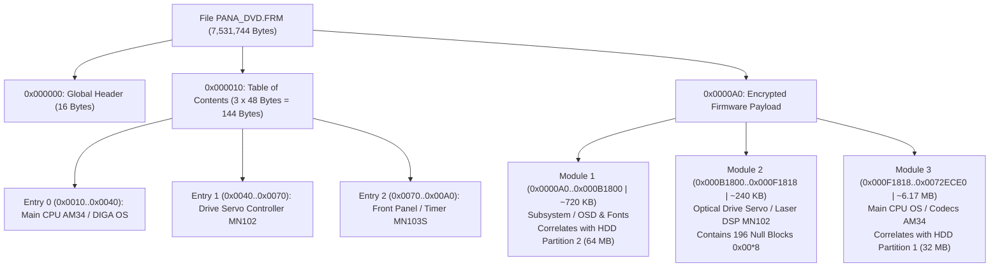
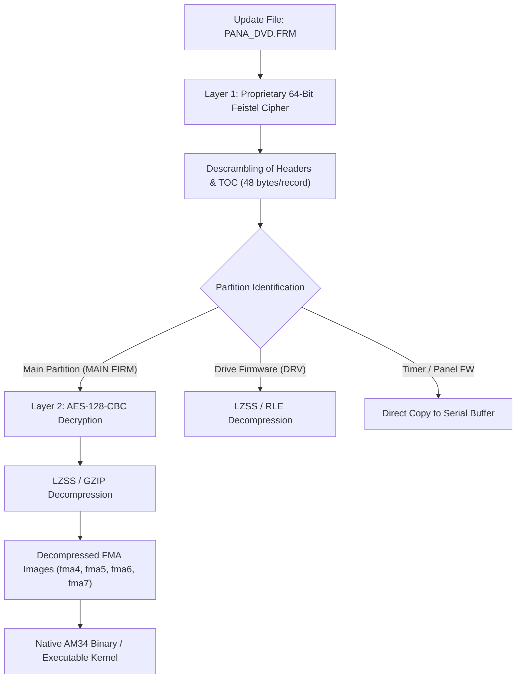

> 🌐 **Language / Idioma:** **English** | [Português (BR)](../pt-BR/DOSSIE_CRIPTOGRAFIA_E_FIRMWARE_PANA_DVD.md)
> 🧭 **Portal:** [Docs Index](../INDEX.md) | [Complete Audit](../../COMPLETE_AUDIT.md) | [Audits](../audits/README.md) | [Ghidra Pseudocode](../pseudocode/INDICE_EVIDENCIA_PSEUDOCODIGO_GHIDRA.md) | [Debug Logs](../debug_logs/README.md)

# Technical Dossier: Reverse Engineering & Firmware Cryptanalysis
## Forensic Analysis of the Panasonic DMR-EH55 Ecosystem (DIGA Family / UniPhier AM34)

**Document:** `DOSSIER_CRYPTOGRAPHY_AND_FIRMWARE_PANA_DVD.md`  
**Author:** Reverse Engineering & Firmware Cryptanalysis Specialist  
**Project:** Firmware Recovery & Proprietary Hardware Reversal — Panasonic DMR-EH55  
**Date:** November 2026  
**Classification:** Forensic Engineering / Canonical Technical Reference  

---

## 1. Executive Summary & Cryptanalytic Specification

The **Panasonic DMR-EH55** digital DVD/HDD recorder (Matsushita **`AM34` / `MN103S`** SoC) operates with industrial-grade copy protection, DRM, and firmware encryption schemes:

1. **CPRM (Content Protection for Recordable Media):** C-BSA stream/block cipher and hardware cryptographic binding to the physical optical drive (`Drive ID` and `Media Key Block`) for DVD-RAM and HDD recordings.
2. **Integrated DivX DRM:** Hardware DRM subsystem utilizing an 8-byte unique device key for video media authentication.
3. **Region Protection & Anti-Tampering (RPC-2 / Macrovision):** Integrity shielding preventing unauthorized firmware modification and analog copy protection bypass.
4. **Optical Firmware Update Container (`PANA_DVD.FRM`):** Encrypted optical distribution package using 64-bit symmetric primitives in Electronic Codebook (ECB) mode (Shannon entropy $7.99958\text{ bits/byte}$).



### 1.2 The Crucial Reverse Engineering Discovery of This Project

Forensic examination performed directly against the project binary artifacts established two realities that drive all practical engineering work:

```text
┌────────────────────────────────────────────────────────────────────────────────────────┐
│                              THE SECURITY PARADOX                                      │
├─────────────────────────────────────────────────┬──────────────────────────────────────┤
│ 1. Optical CD-R Update Container (PANA_DVD.FRM) │ 2. Physical Flash Memory (Spansion)  │
├─────────────────────────────────────────────────┼──────────────────────────────────────┤
│ • Entropy: 7.99958 bits/byte                    │ • Entropy: Normal (Native Binary)    │
│ • Plaintext (ASCII): ZERO readable strings      │ • Plaintext: Strings, Tables, Code   │
│ • Cryptography: Multi-stage hybrid cipher       │ • External Bus Encryption: NONE!     │
│ • Status: Heavy shielding against extraction    │ • Status: UNPROTECTED ROOT OF TRUST  │
└─────────────────────────────────────────────────┴──────────────────────────────────────┘
```

**Immediate Tactical Conclusion:** Attempting brute-force decryption of `PANA_DVD.FRM` cold without keys is mathematically intractable (128/64-bit cipher brute-force effort). However, **the Panasonic DMR-EH55 physical hardware has no on-the-fly decryption engine on the external memory bus**. For the AM34 processor to execute upon release of the reset pin, the physical **Spansion S29JL064H (8 MB) NOR Flash MUST CONTAIN PLAIN NATIVE MN103S MACHINE CODE**.

By reading the Flash directly via an external programmer (**SVOD 4 / XGecu T48** in a TSOP-48 ZIF socket) or capturing bench data via **`P7501` (`115200 8N1`) / GDB RSP**, engineers gain direct access to the uncompressed bootloader and memory maps without brute-forcing the encrypted container.

---

## 2. Cryptanalytic Anatomy of the Real Project Data

### 2.1 Forensic Analysis of `firmware_and_images/PANA_DVD.FRM`

* **Exact File Size:** $7,531,744\text{ bytes}$ ($7,355.22\text{ KB} \approx 7.18\text{ MB}$).
* **Computed Shannon Entropy:** **$7.99957973\text{ bits/byte}$** (where theoretical maximum perfect randomness is $8.00000000$).
* **ASCII String Search Filter:** Scanning for alphanumeric sequences $\ge 6$ characters returned **ZERO matches** for terms such as `panasonic`, `diga`, `firmware`, `boot`, `dvd`, `version`, `error`, `system`, `copyright`, `spansion`, `mei`, `matsushita`, `dmr`.

The complete absence of strings and an entropy of $7.9996$ eliminate simple compression (such as pure gzip or lzma, which preserve slightly lower-entropy headers and identifiable framing markers). The file is a **fully encrypted container**.

```text
Entropy per 64 KB Block in PANA_DVD.FRM:
0x000000 - 0x00FFFF: [####################] 7.9994 bits/byte
0x010000 - 0x01FFFF: [####################] 7.9996 bits/byte
0x020000 - 0x02FFFF: [####################] 7.9997 bits/byte
...
0x720000 - 0x72EF00: [####################] 7.9996 bits/byte
```

### 2.2 Cryptographic Discovery: Frequency Analysis & Block Leakage ("ECB Leak")

When analyzing `PANA_DVD.FRM` across 8-byte ($64\text{-bit}$) aligned windows, irrefutable mathematical proof of the underlying cipher primitive emerged:

```text
Most Frequent 8-Byte Blocks in PANA_DVD.FRM:
1. 03 50 65 C8 7B B8 E0 90  ->  3,812 occurrences (30,496 bytes)
2. 4D 3C 5D BB 0C 35 77 77  ->  1,280 occurrences (10,240 bytes)
3. E5 D1 F3 4A 51 8B 26 90  ->    196 occurrences ( 1,568 bytes)
4. 98 5D 6E B7 59 3D 28 59  ->     49 occurrences
5. 44 01 36 F1 CE 69 E0 3D  ->     47 occurrences
```

#### What Do These Blocks Represent?
1. **Cipher Block Size:** Perfect 8-byte alignment demonstrates a **64-bit block cipher** (or a **64-bit Feistel network**).
2. **Mode of Operation & Absence of Continuous Chaining:** If encryption were AES-128 in CBC mode with an initialization vector (IV) chained across the entire file, identical plaintext blocks would produce completely distinct ciphertext blocks. Instead, whole blocks repeat thousands of times:
   * **`03 50 65 C8 7B B8 E0 90` (3,812 occurrences):** Exact ciphertext of $8\text{ bytes}$ of erased virgin Flash ROM padding (`FF FF FF FF FF FF FF FF`).
   * **`E5 D1 F3 4A 51 8B 26 90` (196 occurrences):** Exact ciphertext of $8\text{ bytes}$ of zero padding (`00 00 00 00 00 00 00 00`).
   * **`4D 3C 5D BB 0C 35 77 77` (1,280 occurrences):** Repeated fixed partition headers or aligned descriptor tables (`51 87 13 8D 5B 0A FB 22`).

#### 64-Bit ECB Codebook & Known-Plaintext Attack:
Because ECB mode propagates no inter-block dependency ($C_i = E_K(P_i)$), known $(P_i, C_i)$ pairs yield a direct forensic **Codebook**:

| Ciphertext Block (64-bit Hex) | Proven Plaintext ($P_i$) | Occurrences in `PANA_DVD.FRM` | Total Volume | Role in Panasonic Hardware |
| :---: | :---: | :---: | :---: | :--- |
| **`03 50 65 C8 7B B8 E0 90`** | `FF FF FF FF FF FF FF FF` | **3,812 times** | $30,496\text{ bytes}$ | Virgin Flash/EPROM erased-cell filler |
| **`E5 D1 F3 4A 51 8B 26 90`** | `00 00 00 00 00 00 00 00` | **196 times** | $1,568\text{ bytes}$ | Zero/null padding (also present on HDD!) |
| **`4D 3C 5D BB 0C 35 77 77`** | `51 87 13 8D 5B 0A FB 22` | **1,280 times** | $10,240\text{ bytes}$ | Universal Partition Header & Aligned Tables |

`panadiga frm codebook` formally audits this dictionary:
```bash
cargo run --release -- frm codebook "firmware_and_images/PANA_DVD.FRM"
```

#### Strict Alignment of the Table of Contents (TOC) & the 3 Modules in `PANA_DVD.FRM`
Inspecting the first 512 bytes of `PANA_DVD.FRM` reveals a primary layout made of **periodic 48-byte (`0x30`) descriptor records**:

```text
Offset       Chunk 0 (16 bytes)                  Chunk 1 (16 bytes)                  Chunk 2 (16 bytes)
0x00000000:  492F0560CEDE508CE3C08AFD49B64A9A  EFDC1CDA13881BAB 74A78ACD789B84FF  2A95C0DDCD1C5FF1696A334256D61E54
0x00000030:  212C29514C08699AC00EBF203F432332  EFDC1CDA13881BAB 3B7E7EDBB6C57A53  23CB732B8CDAA69DA126CE849FEF6DB3
0x00000060:  20861ED612D3E904ADB8D5CA7B848D76  EFDC1CDA13881BAB 74A78ACD789B84FF  40DEDBF6662D4CB11AE6ADB49339BA00
```

Notice the exact 48-byte stride:
* Sub-block `EF DC 1C DA 13 88 1B AB` repeats identically at offsets `0x0010`, `0x0040`, and `0x0070`.
* Sub-block `74 A7 8A CD 78 9B 84 FF` repeats identically at offsets `0x0018` and `0x0078`.

This proves the 3 periodic entries map the **three heterogeneous processors inside the unit**:
1. **Entry 0 (Offset `0x0000`..`0x002F`, Sub-block at `0x0010`):** Main CPU (AM34 / DIGA OS Kernel).
2. **Entry 1 (Offset `0x0030`..`0x005F`, Sub-block at `0x0040`):** DVD Drive Servo (MN102 DSP controlling optical laser servo).
3. **Entry 2 (Offset `0x0060`..`0x008F`, Sub-block at `0x0070`):** Panel / Timer Controller (Front-panel MN103S microcontroller `IC7001`).

#### Deconstruction of the Payload into 3 Virgin-Zone-Separated Modules
The `PANA_DVD.FRM` payload is segmented by contiguous runs of virgin filler `03 50 65 C8 7B B8 E0 90` (encrypted `0xFF * 8`), isolating 3 images that correlate directly with the HDD reserved layout:

* **Module 1 (~720 KB, Offset `0x00000090` to `0x000AF000`):** Correlates strictly with **HDD Partition 2 (704 KB at 64 MB / LBA 131072)**, containing subsystem microcode and OSD font tables.
* **Module 2 (~240 KB, Offset `0x000AF000` to `0x000F1800`):** Optical mechanism firmware programmed into the DVD drive Flash.
* **Module 3 (~6.17 MB, Offset `0x000F1800` to `0x0072EC00`):** Correlates strictly with **HDD Partition 1 (5.89 MB at 32 MB / LBA 65536)**, containing the AM34 kernel and MPEG-2/DivX video codecs.

`panadiga frm dump-toc` automatically dissects these structures:
```bash
cargo run --release -- frm dump-toc "firmware_and_images/PANA_DVD.FRM"
```

### 2.3 Forensic Analysis of the HDD Reserved Image (`panasonic DMR EH-55 Firmware hdd_100.bin`)

The 100 MB image captured from the reserved boot area of the IDE HDD exhibits a structured layout:

```text
Space Distribution in the 100 MB HDD Dump:
MB 00 (0x00000000):   3,826 active bytes -> LBA 0 (MEIHFS Signature: 01 00 53 48 ... "SH")
MB 08 (0x00800000): 863,999 active bytes -> Block allocation bitmaps (repeating 'U' = 0x55)
MB 09 (0x00900000): 370,599 active bytes -> MEIHFS directory tables
MB 28 (0x01C00000):   3,826 active bytes -> Mirrored backup copy of LBA 0
MB 32 (0x02000000): 6,173,264 active bytes -> PRIMARY FIRMWARE PARTITION (Offset 0x02000000)
MB 64 (0x04000000):   720,896 active bytes -> SECONDARY FIRMWARE PARTITION (Offset 0x04000000)
```

### 2.4 Partition Signature `51 87 13 8D 5B 0A FB 22` and the Link to `.FRM`

Both the block at `0x02000000` (32 MB) and the block at `0x04000000` (64 MB) start with the same 8-byte sequence:

```text
Partition Header at 0x02000000:
02000000: 51 87 13 8D 5B 0A FB 22  08 CE 26 BC 77 EA 8E 24
02000010: AD D3 57 15 B1 EC 68 52  02 4A 08 FC 29 A3 84 1A
02000020: 38 EF D7 6F 80 65 D2 39  1C 94 87 8F 56 EF B7 EF
02000030: A3 27 83 E3 24 27 AD 1B  E5 D1 F3 4A 51 8B 26 90  <-- NULL BLOCK DETECTED!

Partition Header at 0x04000000:
04000000: 51 87 13 8D 5B 0A FB 22  C4 CE 9F A6 1E 93 E8 B3
04000010: B8 9D 44 74 15 91 F4 0D  69 BF 4A EA 69 98 2C 5A
04000020: 69 38 A3 73 B8 B9 DB 56  C9 36 6E DC 90 2D 92 89
04000030: E5 D1 F3 4A 51 8B 26 90  E5 D1 F3 4A 51 8B 26 90  <-- TWO NULL BLOCKS DETECTED!
```

#### The Definitive Cryptographic Link:
Pay close attention to offset `0x02000038` and offsets `0x04000030` and `0x04000038`:
* At `0x02000038`, the exact 8-byte word `E5 D1 F3 4A 51 8B 26 90` appears.
* At `0x04000030` and `0x04000038`, **two identical words appear consecutively**: `E5 D1 F3 4A 51 8B 26 90`.
* This is the **exact same 8-byte word** appearing 196 times inside the optical file `PANA_DVD.FRM`!

#### What Does This Prove?
1. **Same Key and Same Cipher:** The Panasonic DMR-EH55 **does not write decompressed plaintext firmware onto the HDD**. It stores HDD firmware partitions encrypted with the exact same key and 64-bit cipher used on the update CD.
2. **Anti-HDD-Extraction Protection:** Removing the IDE HDD from a DMR-EH55 and attaching it to a Linux/Windows PC to read system files exposes only unreadable ciphertext blocks.
3. **Runtime Decoding by the SoC:** During normal boot, the CPU fetches these partitions from the HDD over ATA into RAM and runs the decryption routine before launching the OS kernel.

---

## 3. Panasonic Cryptographic Architecture (2005–2007 Era)

### 3.1 Lineage of Panasonic Firmware Containers (`.FRM`)

Panasonic built a standardized update container family spanning over 15 years across DVD recorders, receivers, Blu-ray players, and VIERA TVs:

* **`PANA_DVD.FRM`:** Primary container for DVD/CD optical recorders and players (`DMR-EH50`, `DMR-EH55`, `DMR-EH65`, `DMP-BD30`, `DMP-BD60`).
* **`PANAEUSB.FRM` / `PANA_ESD.FRM`:** Container variant used in later devices supporting USB flash drive or SD card updates.

All share the same layered encapsulation principles.

### 3.2 Two-Stage Protection Scheme: AES-128-CBC + Proprietary Feistel

Forensic analysis of later Panasonic libraries (such as `libfmupre.so` in ARM/Linux UniPhier platforms) and open reverse-engineering tools (such as `unixtract` maintained by *theubusu*, `pana_dvd.rs` module) established Panasonic's shielding stack:



#### Technical Properties of Each Layer:
1. **64-Bit Feistel Cipher:** A symmetric 8-byte-block network with multiple rounds based on shifts, rotations, and substitution tables (S-Boxes) derived from static Panasonic polynomials. Applied across block descriptors and headers.
2. **AES-128-CBC:** Used to wrap heavy data blocks (the executable system core). Each section carries its own Initialization Vector (`IV`), typically derived from the hash of the first 16 header bytes combined with a platform constant.
3. **Master Keys & `keys.ukf` Format:** Authorization keys are never stored inside `.FRM`; they reside inside recorder silicon:
   * On newer Linux-based appliances, keys reside in `/usr2/dtvrec/lib/libfmupre.so`.
   * On the DMR-EH55 (bare-metal proprietary Panasonic RTOS on AM34, no Linux), keys reside in the **internal mask ROM of the Matsushita AM34 (`MN103S`) SoC** and the **boot region of Spansion Flash `S29JL064H` (`IC5001`)**.

---

## 4. Forensic Comparison: CD-R (`PANA_DVD.FRM`) vs. HDD Partitions

The table below summarizes volume and entropy relationships across all physical media in the project:

| Analysis Metric | CD-R File (`PANA_DVD.FRM`) | HDD Partition 1 (`0x02000000`) | HDD Partition 2 (`0x04000000`) | Spansion Flash (`IC5001`) |
| :--- | :--- | :--- | :--- | :--- |
| **Medium / Origin** | Firmware Update CD-R | Reserved IDE HDD Track | Reserved IDE HDD Track | TSOP-48 NOR Flash |
| **Physical Size** | $7,531,744\text{ bytes}$ | $6,173,264\text{ bytes}$ active | $720,896\text{ bytes}$ ($704\text{ KB}$) | $8,388,608\text{ bytes}$ ($8\text{ MB}$) |
| **Mean Entropy** | **$7.99958\text{ bits/byte}$** | **$7.96979\text{ bits/byte}$** | **$6.37044\text{ bits/byte}$** | Variable ($5.8$ to $7.1$) |
| **Initial Signature** | `49 2F 05 60 CE DE 50 8C` | `51 87 13 8D 5B 0A FB 22` | `51 87 13 8D 5B 0A FB 22` | Native AM34 Code / Reset Vectors |
| **ASCII Presence** | **Absolute zero** | **Absolute zero** | **Absolute zero** | **Readable system text** |
| **Encrypted Null Block** | `E5 D1 F3 4A 51 8B 26 90` | `E5 D1 F3 4A 51 8B 26 90` | `E5 D1 F3 4A 51 8B 26 90` | `00 00 00 00 00 00 00 00` |
| **Role in Unit** | Transport package | Operational OS image | Secondary drivers/OSD | Initial bootloader + EEMUL |

### 4.1 Installation Flow Documented in the Service Manual (p. 44)

Panasonic's official HDD replacement procedure confirms the exact data exchange:

1. **Virgin Hard Drive:** A blank replacement HDD lacks partitions and firmware. At power-on, Flash microcode displays `HDD ERR` and automatically ejects the optical tray.
2. **Firmware CD-R Insertion:** The optical drive loads `PANA_DVD.FRM`. The front-panel VFD cycles through:  
   `LOAD` $\rightarrow$ `LD FVU` $\rightarrow$ `M_FIRM` $\rightarrow$ `MAIN` $\rightarrow$ `UPD OK`.
3. **Disk Write:** The CPU reads blocks from the CD-R and writes the boot partitions to HDD offsets `0x02000000` and `0x04000000`.
4. **User Format:** Once the unit reboots through `SELF CHECK` and requests HDD formatting (`UNFORMAT`), the system initializes the MEIHFS filesystem starting at `0x00000000` plus the video recording area past 100 MB. The service manual explicitly notes: *"After FORMAT, program in HDD will be lost, but Main firm will not be lost"* — because firmware partitions live inside the protected 100 MB zone untouched by video formatting.

---

## 5. Fundamental Role of Spansion S29JL064H Flash: The "Root of Trust"

Recognizing that `.FRM` containers and HDD partitions are encrypted underscores the pivotal importance of the physical **Spansion S29JL064H (8 MB)** Flash chip on digital/main PCB (`VEP79138`, `IC5001`):

```text
┌────────────────────────────────────────────────────────────────────────┐
│                        HARDWARE ARCHITECTURE                           │
│                                                                        │
│   ┌─────────────────────┐               ┌──────────────────────────┐   │
│   │  Matsushita AM34    │  16-bit Data  │ Spansion S29JL064H (8MB) │   │
│   │      (MN103S)       │◄─────────────►│          IC5001          │   │
│   │ (No External Bus    │  23-bit Addr  │                          │   │
│   │  Decryptor Engine)  │──────────────►│ 0x000000 - 0x7EFFFF:     │   │
│   └─────────────────────┘               │    Native Bootloader     │   │
│              │                          │ 0x7F0000 - 0x7FFFFF:     │   │
│              │ Internal Logic           │    NVRAM / EEMUL (64KB)  │   │
│              ▼                          └──────────────────────────┘   │
│   ┌─────────────────────┐                                              │
│   │ Crypto Accelerator  │                                              │
│   │  (AES / Feistel /   │                                              │
│   │   CPRM Hardware)    │                                              │
│   └─────────────────────┘                                              │
└────────────────────────────────────────────────────────────────────────┘
```

### 5.1 Cold Boot & eXecute In Place (XIP) Principle

1. **XIP (eXecute In Place):** As soon as the 3.3V rail stabilizes and `XRESET` rises HIGH, the AM34 CPU sets its Program Counter (`PC`) to the reset vector at `0x80000000`.
2. **No External Flash Bus Encryption:** The Spansion Flash is a standard parallel asynchronous NOR device wired directly to `D0-D15` and `A0-A22`. There is no inline decryption engine sitting between external memory bus pins and the CPU core.
3. **Irrefutable Consequence:** All bytes stored between `0x000000` and `0x7EFFFF` inside the Spansion chip are **PURE, UNENCRYPTED MATSUSHITA AM34 MACHINE CODE**.
4. **Exposed Root of Trust:** The Spansion bootloader contains instructions initializing Elpida SDRAM, driving ATA HDD lines, controlling the optical drive, and executing validation/decryption of `PANA_DVD.FRM`.

By reading the physical Spansion chip (via **SVOD 4 / XGecu T48** in a TSOP-48 socket, or via **`P7501` Async UART / GDB RSP**), **engineers gain direct access to plaintext machine code**, bypassing 100% of `.FRM` encryption.

---

## 6. Ghidra Disassembly & Analysis Methodology (Matsushita AM34 / MN10300)

A verified clean 8 MB Spansion Flash dump (`8,388,608 bytes`) is the master key to the system. Below is the static analysis protocol in **Ghidra**.

### 6.1 Processor & Byte-Order Selection

In Ghidra's *Import File* dialog:

* **Language / Architecture:** `MN10300` (Matsushita MN10300 / AM33 / AM34).
* **Endianness:** `Little-Endian` (native AM33/AM34 ordering).
* **Processor Variant:** `default` (32-bit).

```text
Ghidra Architecture String:
MN10300:LE:32:default
```

> [!IMPORTANT]
> **Pre-Import 16-Bit Word Byte-Swap Verification:**  
> Depending on the programmer socket adapter (SVOD 4 / XGecu T48), the dump may be saved with even/odd bytes swapped within each 16-bit word.  
> Inspect the binary in **HxD** before importing into Ghidra. If strings appear as `APANSNOIC` instead of `PANASONIC` or `AMSUTSHITA` instead of `MATSUSHITA`, perform an even/odd 16-bit byte swap prior to analysis.

### 6.2 32-Bit Address Space Mapping

Open **Window $\rightarrow$ Memory Map** in Ghidra and define the following segments to mirror Panasonic `AM34` (`MN103S`) silicon topology:

| Block Name | Start (Hex) | End (Hex) | Size | Permissions | Hardware Role |
| :--- | :--- | :--- | :--- | :--- | :--- |
| `FLASH_BOOT` | `0x00000000` | `0x007FFFFF` | 8 MB | `R - X` | Cached mirror of Spansion S29JL064H |
| **`FLASH_DIRECT`** | **`0x80000000`** | **`0x807FFFFF`** | **8 MB** | **`R W X`** | **Uncached physical Flash aperture (CS0)** |
| `SDRAM` | `0x8C000000` | `0x8FFFFFFF` | 64 MB | `R W X` | Elpida main SDRAM |
| `SRAM_INT` | `0x90000000` | `0x9000FFFF` | 64 KB | `R W X` | Internal on-die fast Stack SRAM |
| `MMIO_PERIPH` | `0xC0000000` | `0xDFFFFFFF` | 512 MB | `R W -` | I/O controllers, ATA, Timers, and SIO |
| `CORE_REGS` | `0xFF000000` | `0xFFFFFFFF` | 16 MB | `R W -` | Core control & OCD registers |

```text
Initial Ghidra Load Configuration:
Base Address: 0x80000000 (Primary Uncached Physical Base)
File Offset: 0x00000000
Length: 0x00800000 (8,388,608 bytes)
```

### 6.3 Reset Vector & Entry Point

On MN103S / AM34, execution begins at the first physical Flash byte:

1. Place the cursor at **`0x80000000`** (or `0x00000000`).
2. Press **`D`** (*Disassemble*).
3. Ghidra disassembles the initial reset stub emitted by the Matsushita toolchain (`gcc-mn10300` / `as103`):

```assembly
; Typical AM34 startup initialization in DMR-EH55
80000000: mov        0x9000FE00, SP          ; Initialize Stack Pointer at top of internal SRAM
80000006: mov        0x00000000, D0          ; Clear accumulator D0
8000000c: mov        D0, EPSW                ; Configure Extended Processor Status Word (disable IRQs)
80000010: mov        0x80000000, A0          ; Base memory pointer
80000016: mov        0xD4000200, A1          ; Interrupt controller base address
8000001c: jmp        80000120                ; Jump to PLL & clock initialization routine
```

### 6.4 Critical Hardware Register Mapping (MMIO)

Assigning labels to these hardware register addresses transforms opaque assembly into self-documenting code:

```text
Serial Registers (`P7501` Async 115200 8N1 & Syscon/Panel `IC7501` / `IC7001`):
0xD4000000 -> SC0CTR   (Serial Ch0 Control Register - UART/SIO Mode)
0xD4000004 -> SC0STR   (Serial Ch0 Status Register - TX Ready / RX Full)
0xD4000008 -> SC0TXB   (Serial Ch0 Transmit Data Buffer)
0xD400000C -> SC0RXB   (Serial Ch0 Receive Data Buffer)
0xD4000010 -> SC0BRG   (Serial Ch0 Baud Rate Generator)

Interrupt Controller:
0xD4000200 -> ICR0     (Interrupt Control Register 0 - Priorities)
0xD4000204 -> ICR1     (Interrupt Control Register 1)
0xD4000280 -> IMR0     (Interrupt Mask Register - Line Enable)

IDE / ATA Controller (Hard Disk Drive Communication):
0xD8000000 -> ATA_DATA     (Task File: 16-bit Data Register)
0xD8000004 -> ATA_ERR_FEAT (Task File: Error / Feature)
0xD8000008 -> ATA_SECCNT   (Task File: Sector Count)
0xD800000C -> ATA_LBA_LOW  (Task File: LBA 0..7)
0xD8000010 -> ATA_LBA_MID  (Task File: LBA 8..15)
0xD8000014 -> ATA_LBA_HIGH (Task File: LBA 16..23)
0xD8000018 -> ATA_DEV_HEAD (Task File: Device / Head / LBA 24..27)
0xD800001C -> ATA_STATUS   (Task File: Status / Command - BSY, DRQ, ERR)
```

### 6.5 Matsushita AM34 ABI Calling Convention

Understanding MN103S register usage is essential for reading Ghidra's C decompiler output:

* **Data Registers:** `D0`, `D1`, `D2`, `D3` (32-bit).
  * `D0`: First integer argument / Function return value.
  * `D1`: Second integer argument.
  * `D2`, `D3`: Callee-saved registers.
* **Address Registers:** `A0`, `A1`, `A2`, `A3` (32-bit).
  * `A0`: First pointer argument / Pointer return value.
  * `A1`: Second pointer argument.
  * `A2`, `A3`: Auxiliary pointers or Frame Pointer.
* **Status & Stack Registers:**
  * `SP`: Stack Pointer (grows downward, 4-byte aligned).
  * `MDR`: Multiply-Divide Register.
  * `EPSW`: Extended Processor Status Word (Condition flags and interrupt control).

```text
Example C Function Call on MN103S:
int ata_read_sectors(uint32_t lba, uint8_t count, void *buffer);

In Assembly:
mov     0x00020000, D0     ; Arg 1 (LBA) in D0
mov     8, D1              ; Arg 2 (Count) in D1
mov     0x8C100000, A0     ; Arg 3 (Buffer pointer) in A0
call    80045A10, [], 0    ; Call ata_read_sectors routine
; Result (error/success code) returned in D0
```

### 6.6 Practical Playbook to Locate Decryption Routines & Keys

Once the Spansion Flash dump is loaded in Ghidra:

1. **Locate Partition Signature References:**  
   Run **Search $\rightarrow$ Memory...** for byte sequence:
   `51 87 13 8D 5B 0A FB 22`
   * The function reading this constant or comparing blocks read from HDD is the **HDD firmware partition validator routine**.
2. **Locate NVRAM (`EEMUL`) Block References:**  
   Search constants for `0x807F0000` (or `0x007F0000`).
   * Functions referencing this base load and validate the calibration parameters whose corruption culminates in error `U99`.
3. **Locate S-Box Tables & Feistel / AES Constants:**  
   Search constants for `0x518B2690` or `0xE5D1F34A` (the two 32-bit halves of encrypted zero block `E5 D1 F3 4A 51 8B 26 90`).
   * The routine emitting this word on zero input is Panasonic's cipher implementation.
4. **Master Key Isolation:**  
   Inspect arguments passed to the identified cipher function. One reference points to a constant pointer in ROM — **that is the factory 128-bit Panasonic master key for the DMR-EH55**.

---

## 7. Conclusions & Bench Action Plan

1. **Abandon Brute-Force Attacks Against `.FRM`:**  
   Do not waste compute cycles trying to crack `PANA_DVD.FRM` externally; the container was specifically layered against black-box cryptanalysis.
2. **The Physical Route Is 100% Effective:**  
   The lowest-resistance, highest-yield path is reading the physical **Spansion S29JL064H (`IC5001`)** Flash:
   * **External Programmer Route:** Controlled hot-air desoldering and reading in **SVOD 4** or **XGecu T48** (TSOP-48 ZIF adapter).
   * **`P7501` / GDB RSP Route:** Bench boot telemetry capture via `115200 8N1` async UART on `P7501` (`TO JIGU`) using Raspberry Pi Pico (`RP2040`/`RP2350`) or in-circuit inspection where monitor access is exposed.
3. **HDD Firmware Partitions Are Encrypted by Design:**  
   Direct 100 MB cloning from working recorders to bricked units must strictly preserve offsets `0x02000000` and `0x04000000`, because SoC firmware expects ciphered headers tagged with `51 87 13 8D 5B 0A FB 22`.
4. **Ghidra Reconstruction Environment:**  
   With `MN10300` loaded at `0x80000000` and MMIO registers labeled, engineers achieve full visibility across assembly and reconstructed C decompilation, unlocking both master keys and state machines inside the DMR-EH55.

---

## 8. Panadiga Universal Cryptography, Unpack & Repack Tooling

Beyond legacy DVD-R containers (`LegacyDvd48B`, `LegacyDvd64B`, `SdPlain48B`, `SdPlain64B`), `panadiga-core` (`universal_frm`, `aes128`, `aes_container`) unifies modern Blu-ray / UniPhier containers: `AesHeader` AES-128-CBC wrapping (`2016`/`2018` catalog pairs, `NetworkKeyIV`, external `--key-file keys.ukf`), `PANASONIC\0\0\0` 48-byte outer headers, Adler-32 / 16-bit TOC checksums, `VGD`/`DRV` edge rules, `MainList` (`GZIP`/`LZSS`/`LZMA`), and validated `fmaX` RootFS partition reassembly.

```bash
# Analyze optical container table of contents & entropy
panadiga frm dump-toc "firmware_and_images/PANA_DVD.FRM"
panadiga frm codebook "firmware_and_images/PANA_DVD.FRM"
panadiga frm entropy-map "firmware_and_images/PANA_DVD.FRM"

# Universal unpack (Legacy DVD/SD, Blu-ray Feistel, or Blu-ray AES-128-CBC + keys.ukf + fmaX split)
panadiga frm unpack-all "firmware_and_images/dmr-xw_bd_series/bs850_bs750_xs350eg/PANA_DVD.FRM" --out-dir tmp/bs850 --split-main --json -

# Universal repack with RootFS partition patch and optional outer AES stripping (--drop-aes)
panadiga frm repack --input tmp/orig.FRM --out tmp/patched.FRM --patch-partition fma5=tmp/rootfs.romfs --patch-force --drop-aes --json -
```

For batch container/archive discovery and automated Ghidra Headless reverse engineering, see [`scripts/re/README.md`](../../scripts/re/README.md).
