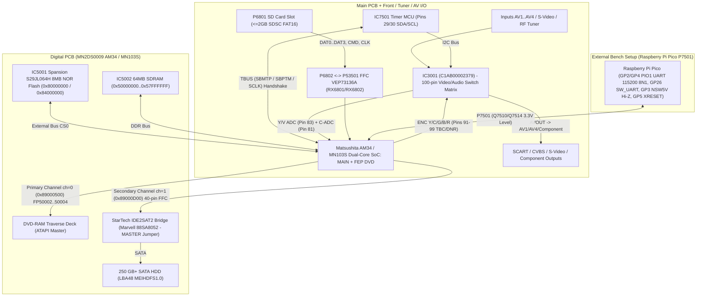

> 🌐 **Language / Idioma:** **English** | [Português (BR)](../pt-BR/VISTA_EXPLODIDA_ARQUITETURA_INJECAO_PICO_E_BYPASS_PASSTHROUGH.md)
> 🧭 **Portal:** [Docs Index](../INDEX.md) | [Complete Audit](../../COMPLETE_AUDIT.md) | [Audits](../audits/README.md) | [Ghidra Pseudocode](../pseudocode/INDICE_EVIDENCIA_PSEUDOCODIGO_GHIDRA.md) | [Debug Logs](../debug_logs/README.md)

# Exploded Architectural View of the `DMR-EH55`, Rust/MCP/RAG Consolidation, Pico Injection & AV Passthrough/Bypass

> [!IMPORTANT]
> **Scope & Forensic Integrity:** Every function, virtual address, file offset, pin, IC, and register listed in this consolidated dossier was directly verified against the extracted real binaries (`eh55_frm_PROG061_BOOT.bin`, `EH55_MAIN_3410PQ.bin`, `main3060np_unpacked.bin`, `EH55_DRV_S211.bin`), comparative `DMR-EH58` binaries (`BOOT.BIN`, `DRV_decomp.bin`), `panadiga` C11/Rust source code, live captures on `P7501` (`COM10`), and official Panasonic schematics (`panasonic_dmr_eh55ec_service_manual_europe.pdf`, `vol2_schematics.pdf`). The HDD dump `panasonic DMR EH-55 Firmware hdd_100.bin` used as reference comes from the **Internet Archive** corpus, **not** from the physical hard disk on the bench.

---

## 1. 100% Plaintext Status, Decryption & Decompilation of the Project

A recurring bench question is whether *"the firmware is already 100% plaintext"*. The answer requires separating **two levels of representation**:

1. **Executable Binary Level (`100% Plaintext / Unpacked` on Disk — Complete):**
   * **Zero residual encryption or compression:** All proprietary Panasonic layers (**64-bit ECB Feistel** block cipher in `PANA_DVD.FRM` and HDD firmware partitions `0x02000000`/`0x04000000`, plus `EXTRHEAD`/`zlib` framing + strided Adler-32) have been completely broken, validated, and automated in Rust (`crates/panadiga-crypto/src/`).
   * All **Matsushita AM34 / MN103S** machine instructions, dispatch tables, MMIO pointers, and **ASCII / Shift-JIS (CP932)** strings are 100% open for inspection, cross-referencing (`XREF`), disassembly, C decompilation in Ghidra (`Panadiga_MN103S`), and direct patching with valid repacking for `DIGADIAG.FRM`, `PANA__SD.FRM`, `PANA_DVD.FRM`, and HDD `MEIHDFS1.0`.
2. **Original C Source Level (`Stripped ELF` vs. Functional Reconstruction):**
   * Production Panasonic binaries were stripped of DWARF local variable tables, yet preserved assert strings, driver names, and internal module strings (`src/hdd_cmd.c`, `src/hdd_ctl.c`, `DVR_SYSTEM_LIB: serial.a`, `rtscdd.a`, `rtsdauth.a`, `sys_boot.a`, `sys_cd.a`, `sys_cntl.a`, `DAVIS`, `nfrom`, `FPC`, `RTSC`).
   * Consequently, every critical subsystem (boot, IDE/ATA, LBA48 HDD, NVRAM/BGO, serial stub `_dev_SERIAL`, optical driver `DRV`, and Timer MCU) now has decompiled pseudocode, exact address maps, and idempotent Rust patchers ready for modification.

| Unpacked Binary | Verified Source | Base VA | Size (`bytes`) | SHA-256 | Status |
| :--- | :--- | :--- | ---: | :--- | :--- |
| **`eh55_frm_PROG061_BOOT.bin`** | `PANA_DVD.FRM` (`NP-309`, `PROG061` slot) | `0x50400000` | `262,144` | `c7da9121174fcf4c54f35f5bb1f7b23a3dc0c93ab227158ad4fdd90a1ea24a81` | **100% Unpacked / Mapped** (`Fvu ver0.61 [05/11/01]`) |
| **`EH55_MAIN_3410PQ.bin`** | Internet Archive HDD (Partition 1 `0x02000000`) | `0x57000000` | `13,003,052` | `c3275d39549b68f48db16bc5fd043c6f8a373d4ba416826de09be5c55dc991b1` | **100% Unpacked / Patchable** (`MAIN` + `_dev_SERIAL` + `"src/hdd_cmd.c"`) |
| **`main3060np_unpacked.bin`** | `PANA_DVD.FRM` (`NP-309`, `MAIN` slot) | `0x57000000` | `13,427,852` | `075f552ed583ba1835c0d44d1b533ff5a016b8d81d15d7166240098461ddcca7` | **100% Unpacked / Patchable** (equivalent optical `MAIN`) |
| **`EH55_DRV_S211.bin`** | `PANA_DVD.FRM` **≡** HDD Partition 2 (`0x04000000`) | `0x90202000` / `0x40000000` | `1,441,792` | `6f2b61ede80ea9e3e9185d3d677813593f3d361446678e437c905a0037060243` | **100% Unpacked / Byte-for-byte identical** (`DRV S211`, CLI `113` cmds) |
| **`BOOT.BIN`** *(EH58 comparative)* | `dmr-eh58/DVDRAM.7z` | `0x44000000` | `262,144` | `7c13c72a54c77387f3f7df0ddc213e4800e20b27eecbfd225cbc05a8fc73e377` | **MN103S Reference** (`Loader ver0.63`; holds `DAT_505733d4` absent in EH55) |
| **`DRV_decomp.bin`** *(EH58 comparative)* | `dmr-eh58/DVDRAM.7z` | `0x40000000` | `1,441,792` | `694a4ab8aa29fcc45350dc0712047663602bdee7e4bff313b8ae62b057efd052` | **MN103S Reference** (`MATSHITA R6-MV4 A0 S415`) |
| **`eh55_nor_8mb_ic5001_dump.bin`** *(captured on bench)* | Physical Digital PCB via `PANADMP1` (`0x9043950E` $\rightarrow$ `J 904394FA`) | `0x84000000..0x847FFFFF` | `8,388,608` | `c1faee798f60545853eefdba0d15f23678b471466dc2bc84f522bc972f15a02d` | **8 MiB Gold Dump Captured** (`Loader ver0.61` `256K` `9f5c448d...` + `SA26..SA70` BGO + `SA71..SA141` Upper EEMUL `803d1465...`); `U99` repair applied & verified live on `COM10` |

---

## 2. Python → Rust Consolidation, MCP (`18` Tools) & Zero-Error RAG

Critical RE and bench routines that initially lived across ad-hoc Python scripts were consolidated natively into crate `panadiga-core`, exposed via the MCP server (`panadiga-mcp`, **`18` tools**), and automatically indexed by `panadiga-rag`:

| Historical Origin (Python / Research) | Consolidated Rust Module (`crates/panadiga-core`) | MCP / UI Exposure |
| :--- | :--- | :--- |
| `scripts/re/pana_frm.py` *(cipher/packing)* | [`crates/panadiga-crypto/src/`](../../crates/panadiga-crypto/src/mod.rs) (`feistel_decrypt_buffer`, `unpack_extrhead`, `build_digadiag_frm`, `pack_frm`) | `panadiga_inspect_frm` + CLI `panadiga frm` |
| `scripts/re/mn10300.py` | [`crates/panadiga-core/src/re/mn10300/`](../../crates/panadiga-core/src/re/mn10300/mod.rs) (`decode_branch_call_refs`, `find_callers_to`, `find_fc_immediate_loads`, `find_pointer_xrefs`) | Internal API + CLI `panadiga re xrefs` |
| `scripts/bench/nor_dumper.py` | [`crates/panadiga-core/src/re/nor_dumper.rs`](../../crates/panadiga-core/src/re/nor_dumper.rs) (`build_readonly_nor_dumper_stub`, `decode_nor_dump_stream`, strict `0x80000000`/`0x84000000` guard) | **`panadiga_nor_dumper_stub`** (MCP Tool #15) |
| Historical RE of `hdd_cmd.c` (`MaxProductLBA`) | [`crates/panadiga-core/src/hdd/capacity_patch/`](../../crates/panadiga-core/src/hdd/capacity_patch/mod.rs) (`inspect_main_hdd_capacity`, `patch_main_hdd_capacity`, `DynamicUnclamped`) | **`panadiga_hdd_capacity`** (MCP Tool #14) + CLI `panadiga hdd inspect-capacity` + Desktop UI |
| Pre-MAIN BGO discovery (`0x50401F3C` / `0x504230F0`) | [`crates/panadiga-core/src/re/bgo_unbrick.rs`](../../crates/panadiga-core/src/re/bgo_unbrick.rs) (`inspect_prog061_bgo_sites`, `patch_prog061_bgo_in_place`, `patch_prog061_or_build_digadiag`) | **`panadiga_bgo_unbrick`** (MCP Tool #16) — outputs `DIGADIAG.FRM` (`262,144 B` raw `ver061` / `131,072 B` `EXTRHEAD` `ver063`) |
| `MAIN` AV TBC (`E-E`) & `_dev_SERIAL` (`0x574F0775`) | [`crates/panadiga-core/src/re/main_passthrough.rs`](../../crates/panadiga-core/src/re/main_passthrough.rs) (`inspect_main_passthrough_sites`, `patch_main_passthrough_file`, `build_passthrough_rsp_plan`) | **`panadiga_main_passthrough`** (MCP Tool #17) + Pico `PANARSP PASSTHROUGH` / `CALL:` |
| SD Kit & Diag Unbrick Orchestration | [`crates/panadiga-core/src/re/unbrick_sd_kit/`](../../crates/panadiga-core/src/re/unbrick_sd_kit/mod.rs) (`compose`, `io`, `verify`) | **`panadiga_sd_unbrick_kit`** (MCP Tool #18) + `panadiga unbrick` + `Unbrick Center` |
| PDF Manuals + `docs/` + C11 + Rust | [`panadiga-rag`](../../crates/panadiga-rag/src/indexer/mod.rs) (automatic hierarchical indexing + `FactCritic` + `HardwareSafetyValidator`) | `panadiga_rag_query`, `panadiga_search_code`, `panadiga_search_manuals`, `panadiga://docs/...` |

---

## 3. Exploded View: Physical Wiring, Boot Flow, Processes & Calls

### 3.1 Exploded Hardware & Bus Architecture (`DMR-EH55`)



### 3.2 Pre-MAIN Call Flow (`Normal Mode` vs `JIG:2500` `SDDIAG`) & BGO Map

```mermaid
sequenceDiagram
    participant IPL as "Flash IPL 0x80000000 (Loader v0.61)"
    participant P7501 as "Pico P7501 (SW_UART / UART0)"
    participant BGO as "NOR BGO EH55 ver0.61 (0x84130000..0x843FFFFF)"
    participant SD as "SD Card P6801 (DIGADIAG.FRM)"
    participant IDE as "DAVIS IDE ch=1 MASTER (HDD)"

    IPL->>IPL: "DDR CHECK: OK -> F/E uncompress 0x84080040 -> 0x90202000 -> detect_boot_mode (0x44006454)"
    alt "SW_UART = HIGH (normal mode) - Pre-FTL repair"
        IPL->>BGO: "bgo_driver_init() (ver0.61: FUN_4401ef82, table 0x440337A4; ver0.63: FUN_4401e636, 0x44036520)"
        BGO-->>IPL: "RETURNS 1 -> BGO driver init failed[1]."
        IPL->>IPL: "BEQ 0x44004ACC -> Main hung-up time changed 255[s] (HALTS BEFORE IDE/HDD!)"
        Note over IPL,IDE: "Unrepaired BGO halts IDE/MAIN. Post-repair (SA70+13 spares+SA41), normal mode reaches *** RTSC Initialize ***!"
    else "Pico JIG:2500 (SW_UART LOW > 2500 ms) -> serial boot mode"
        P7501->>IPL: "Holds SW_UART LOW past DDR CHECK: OK"
        IPL->>SD: "FUN_44007BA5 (SDDIAG): GetSD_Status 1-bit -> ACMD6 4-bit -> GetSD_Status 4-bit"
        Note over SD: "Watch -91006: fails on 2nd GetSD_Status after 4-bit switch (0x89001850 &= 0x7fff)"
        SD->>IPL: "ver0.61 EH55: reads 0x40000 (262,144 B) raw to 0x90400000 (or ver0.63 0x20000 EXTRHEAD)"
        IPL->>SD: "JMP 0x50400000 (PROG061 patched via panadiga_bgo_unbrick / sd_unbrick_kit)"
        SD->>BGO: "default bypass: 0x504230F0/0x50405097 (auto_format 0x50401F3C blocked unless overridden)"
        BGO-->>IDE: "BGO OK -> PROG061 runs DAVIS_Connect_IDE(1) -> FVU / MAIN Boot"
    end
```

---

## 4. `StarTech IDE2SAT2` SATA–PATA Bridge: Why Only Marvell `88SA8052` Is Reliable (and `MASTER` Mandatory)

### 4.1 Marvell `88SA8052` vs JMicron `JM20330` / Generic Bridges

| ATA/ATAPI Protocol Feature Required by EH55 SoC (`DAVIS`) | StarTech `IDE2SAT2` (**Marvell `88SA8052`**) | **JMicron (`JM20330`)** / Generic Bridges |
| :--- | :--- | :--- |
| **`MultiWord DMA MODE2` (`16.6 MB/s`)** — `DMR-EH55` does **not** negotiate UDMA on the HDD channel (`FUN_5041f782` / `FUN_5710c82a` enforces `Set Feature PIO` + `MWDMA2`) | **Faithfully supported** in hardware | Many JMicron adapters stall on `SET FEATURES (0xEF)` -> `MWDMA2` (`0x22`) or report incompatible timing in `IDENTIFY DEVICE` |
| **`ATA Streaming DMA EXT` (`0x2A` / `0x3A`)** & AV RTSD commands (`DAVIS`) | Translates continuous AV blocks in real time | Built primarily for PC UDMA; triggers `0x8000040d` or write dropouts |
| **Spin-Up Control (`PUIS` / `4000 ms` timeout)** & **`DAVIS_Get_DriveID(1, 1)`** | Propagates deterministic `DRDY` (`+0x38 & 0x40`) and status registers | Leaves `BSY`/`DRQ` stuck inside the strict 100-cycle poll at `FUN_5041f61b` / `FUN_5710c6c3` |
| **`Master/Slave` Consistency (`DEV` bit 4 in `0x89000D38`)** | Strictly honors hardware jumper (`MASTER` / `SLAVE` / `CS`) | Cheap bridges frequently ignore pin 28 `CSEL` or alias responses across Device 0 and Device 1 |

### 4.2 Unbreakable Jumper Rule on the `DMR-EH55` (`MASTER`, Never `CS` or `Slave`)

Adversarial auditing of schematics (`vol2_schematics.pdf` pp. 46, 52, 113, 125–126) and machine code (`eh55_frm_PROG061_BOOT.bin` + `EH55_MAIN_3410PQ.bin`) proved:
* **ODD (`ch = 0, dev = 0`, Primary Master)** and **HDD (`ch = 1, dev = 0`, Secondary MASTER)** sit on **physically separate IDE buses**.
* The hardcoded table `acStack_70[4] = { 2, 0, 1, 0 }` in `FUN_50414908` (`PROG061`) and `FUN_574d1de8` (`MAIN`) recognizes the HDD solely at **`ch = 1, dev = 0` (`Secondary MASTER`)**. Variable `DAT_505733d4` exists only in `DMR-EH58` `BOOT.BIN`.
* **Never set `CS` (`Cable Select`) or `Slave` on `StarTech IDE2SAT2`**: always place the jumper explicitly on **`MASTER`**.

---

## 5. Why Flashing Firmware onto the HDD Alone Won't Clear a Pre-MAIN Brick — and How to Fix It

1. **Pre-IDE Halt (`0x44004ACC`):**
   Even if the SATA HDD behind `StarTech IDE2SAT2` (`Marvell 88SA8052`) is cleanly cloned or patched for 250 GB+ (`panadiga_hdd_capacity`), under a `BGO` fault the Digital PCB halts inside the **1st-stage NOR Bootloader (`0x80000000`)** before even initializing the IDE controller (`FUN_44009741`):
   * `FUN_440049eb` calls `bgo_driver_init()` (`FUN_4401e636`) -> fails with **`BGO driver init failed[1].`** -> `BEQ 0x44004ACC` jumps to `boot_panic_or_halt_7812` -> Timer MCU `IC7501` triggers `Main hung-up time changed 255[s].` and shuts down to **`U99`**.
2. **Ordered Paths Out of the Pre-MAIN Brick:**
   * **Solution 1 — No-Desoldering via `JIG:2500` → `SDDIAG` + `DIGADIAG.FRM` BGO Unbrick (`panadiga_bgo_unbrick`):**
     * In `JIG` mode (`SW_UART` held `LOW` $\ge 2500\text{ ms}$ past `DDR CHECK: OK`), `FUN_44006cd9` bypasses the normal `BGO` halt and runs `SDDIAG` (`FUN_44007ba5`).
     * Run **`panadiga_bgo_unbrick`** / **`panadiga unbrick prepare-sd`** (`--loader-profile ver061`, default output `firmware_and_images/sd_unbrick_kit/`) on `eh55_frm_PROG061_BOOT.bin` (**`mode = "uart_monitor"`** or **`"bypass"`**) to produce an exact **`262,144`-byte (`0x40000`) uncompressed raw** `DIGADIAG.FRM` for real DMR-EH55 `Loader ver0.61` (or `131,072`-byte `EXTRHEAD` via `--loader-profile ver063` for `/BOOT.BIN`):
       * **`0x504230F0` (`0x000230F0`):** `C8 0A -> CA 0A` (bypasses `N(N+1)/2` sum check inside `bgo_sum_23058`).
       * **`0x50405097` (`0x00005097`):** `C8 15 -> CA 15` (bypasses panic when `"INFO"` in `DeviceInfo` is missing/corrupted).
       * **`0x5040A2CD` (`0x0000A2CD`):** `auto_format` (`nfrom_format @ 0x50401F3C`) remains **blocked fail-closed** unless `--allow-unsafe-bgo-format` is explicitly set (targets CS1 window `0x84200000..0x843FFFFF` from `PROG061 @ 0x50436E30` — distinct from real EH55 `ver0.61` `0x84130000..0x843FFFFF` at `0x440337A4` — and RAM pointers `0x504F8464..6C` before `0x504802B0==1`); prefer **`bypass`** (default) or **`uart_monitor`**.
     * **Critical Check for SD Error `-91006` (`Fuji 2 GB`):** `FUN_4402791a` passes the 1st `GetSD_Status` (**1-bit**), switches to **4-bit** (`0x89001850 &= 0x7fff`), and fails only on the **2nd 4-bit `ACMD13` read** if `P6802 <-> P53501` ribbon/resistors `RX6801`/`RX6802` have contact issues or `SD_STATUS[2] != 0`. Requires **SDSC $\le 2\text{ GB}$ formatted `FAT16`/`FAT12` ($\le 65,525$ clusters)** with all 4 `DAT0..DAT3` lines healthy.
   * **Solution 2 — Surgical Real FTL BGO Repair / TSOP-48 Bench (`IC5001` `S29JL064H`):**
     * With `PANAMON1>` live (or an external TSOP-48 reader), capture the 8 MiB `IC5001` dump (`eh55_nor_8mb_ic5001_dump.bin`, `SHA-256: c1faee798f60545853eefdba0d15f23678b471466dc2bc84f522bc972f15a02d`) and surgically repair EH55's real BGO window (`SA26..SA70`, `0x84130000..0x843FFFFF`) while leaving Upper EEMUL (`SA71..SA141`, `0x84400000..0x847FFFFF`) untouched: on bench (`COM10`), formatting `SA70` (`0x843F0000`, polling `0xFF` past ~700 ms erase) + `1,629` pure `1 -> 0` writes across 13 spares (`SA42..SA66`) + `6` bytes at `SA41+0x14` (`0x84220014..0x84220023`) cured BGO 100% (`U99` eliminated, booting `***** normal mode *****` $\rightarrow$ `*** RTSC Initialize ***`).

---

## 6. Hot Write I/O (`$M/$X/$G`) & Full 8 MB NOR Flash Dump via Pico

### 6.1 When Hot Write I/O Injection Works (`_dev_SERIAL` in `MAIN`)

Critical verified architectural distinction:
* **Pre-MAIN (`/BOOT.BIN` and `PROG061`):** `uart0_getc @ 0x4400479F` and `FUN_50404c78` have **zero callers** — **no interactive pre-MAIN RX console exists**. All pre-MAIN injection acts via **Pins (`SW_UART JIG:2500`, `P01`, `P10`)** or by loading a **`DIGADIAG.FRM` binary** into SDRAM (`0x50400000`).
* **Post-MAIN (`EH55_MAIN_3410PQ.bin`, driver `_dev_SERIAL` @ `0x574F0775`):** once execution reaches `MAIN` (with ISR vector `0x15 -> 0x574F0F9F` armed), the kernel exposes a **complete UART GDB RSP stub at `115200 8N1`**:
  * **Hex Read `$m<addr>,<len>#<csum>` / Fast Binary Read `$x<addr>,<len>#<csum>` (`FUN_574f0a33` @ `0x574F0A33`):** reads `0x400` B chunks (`$m`) or unescaped raw `0x440` (`1,088`) B chunks (`$x`), returning `+$<payload>#<sum8>`. On Pico (`PANADIGA>`), use `XMEM:<addr>:<len>`.
  * **Register Dump `$g#<csum>` (`FUN_574f0da3` @ `0x574F0DA3`):** returns `0x70` (`112`) bytes (`28` 32-bit LE words).
  * **RAM Write / Hot Write I/O (`FUN_574f0c63` @ `0x574F0C63`):**
    * **Hex:** `$M<addr_hex>,<len_hex>:<data_hex>#<sum8>` → writes arbitrary bytes into **SDRAM** (`0x50000000..0x57FFFFFF`, e.g., live RAM patching or uploading stubs at `0x51800000`) and replies **`+$OK#9A`**.
    * **Binary:** `$X<addr_hex>,<len_hex>:<raw_bytes>#<sum8>` → high-speed raw SDRAM write.
    * **Resume / Loop Exit (`$Z0#..` / `$Z1#..`):** clears the RSP loop flag, signals `0xC0001002 |= 0x80`, and returns control to the kernel.

> [!CAUTION]
> **Physical Voltage & Address Guard:** Port `P7501` (`Q7510`/`Q7514`) runs strictly at **3.3 V TTL** (`5V0` destroys the SoC), and `GP5 (XRESET)` must operate strictly as **open-drain**. Never send raw `$M`/`$X` writes directly to NOR Flash addresses (`0x80000000..0x807EFFFF`) as if they were RAM — NOR Flash requires a CFI sequence (`0x55/0xAA`) executed safely.

### 6.2 Full 8 MB NOR Flash Dump via Pico (`PANADMP1..PANADONE`)

Rust module [`crates/panadiga-core/src/re/nor_dumper.rs`](../../crates/panadiga-core/src/re/nor_dumper.rs) (exposed via MCP tool **`panadiga_nor_dumper_stub`**) emits a **100% read-only MN103S machine-code stub** targeted at free SDRAM (`0x51800000`):
* **Default parameters for complete `IC5001` (`S29JL064H`) dump:**
  * `start_addr = 0x84000000` (uncached NOR Flash window, preventing D-cache aliasing)
  * `total_len = 0x800000` (`8,388,608` bytes = exact 8 MB)
  * `block_size = 4096` (`0x1000`, 2,048 blocks each suffixed with a `u32` LE checksum)
* **UART Output Protocol (`SC0TXB` `0xD4002008` polling `SC0STR` `0xD400200C & 0xA0`):**
  `PANADMP1` + `<start_u32><len_u32><blk_u32>` → `[4096 B data + sum32 LE] * 2048` → `PANADONE` → safe `BRA .` halt loop.
* Decoder `decode_nor_dump_stream()` validates every block byte-by-byte, having produced on bench (via sliced uncached SDRAM `0x9043950E` $\rightarrow$ `J 904394FA`) gold artifacts [`eh55_nor_8mb_ic5001_dump.bin`](../../firmware_and_images/README.md) (`SHA-256: c1faee798f60545853eefdba0d15f23678b471466dc2bc84f522bc972f15a02d`), `eh55_loader_ver061_256k.bin` (`9f5c448d...`), and `eh55_nvram_64k_raw.bin` (`803d1465...`).

---

## 7. Error Workarounds & Using `DMR-EH55` as an AV Signal Passthrough / TBC

Many enthusiasts repurpose Panasonic DIGA recorders as a **Time Base Corrector (TBC) + Frame Synchronizer + Composite/S-Video/SCART ↔ Component converter** for digitizing VHS and LaserDisc sources. Even with an ODD failing `0x83A7` or without recording discs, European Service Manual schematics (`panasonic_dmr_eh55ec_service_manual_europe.pdf`, pp. 22, 26, 45–47, 59–60) reveal **two concrete passthrough routes**:

| Approach | Verified Signal Path | Preserves Digital TBC (`AM34` / `MN103S`)? | Requirements & Trade-Offs |
| :--- | :--- | :---: | :--- |
| **Option A (Recommended): BGO Unbrick + Diskless / Skip-Error Patch + `E-E` / Service Mode `[1][3]`** | `AV1..AV4` → **`IC3001`** (`C1AB00002379`) → **`Y/V ADC` (pin 83) / `C-ADC` (pin 81)** → **Digital PCB SoC (TBC/3D DNR/Frame Sync)** → **`ENC Y/C/G/B/R` (pins 91–99)** → **`IC3001`** → Outputs `AV1/AV4/Component` | **YES (Full TBC active)** | 1. Recover `BGO` via `DIGADIAG.FRM` (`panadiga_bgo_unbrick`) + attach `250 GB` HDD on `StarTech IDE2SAT2` set to `MASTER` (with `MAIN` patched for 250 GB / skip ODD `0x83A7` checks).<br>2. In normal `AV1`/`AV2`/`L1`/`L2` (*E-E monitor* mode) or **Service Mode `[1][3]` (`RTSC Return in XP (A & V)`)**, video routes through ADCs and the MPEG/TBC pipeline in real time **without recording or playing discs**, exiting synchronized on pins `91..99` back into `IC3001`. Service tests `[8][0]..[8][3]` also route analog/digital matrices directly. |
| **Option B (Hardware Fallback if Digital PCB Stays Down): Direct I2C Control of `IC3001` (`C1AB00002379`)** | `AV1..AV4` → internal analog switches `SW1..SW10` / `SA1..SA5` of **`IC3001`** → Outputs `AV1/AV4` *(pure analog bypass skipping ADCs/Digital PCB)* | **NO (analog A/V switch matrix only)** | `IC3001` (Main PCB, 100-pin) is driven via **`I2C` (`SDA` pin 89 / `SCL` pin 88)** from Timer MCU **`IC7501` (pins 29/30)**. However, `IC7501` monitors **`TBUS` (`SBMTP`/`SBPTM`/`SCLK`)** from the Digital PCB and **cuts power rails (`U99` + standby `HALT`)** if the Digital PCB stops responding. Using Option B standalone would require manually enabling `+5V/+9V` video rails and injecting `I2C` writes into `IC3001` from the Pico with `IC7501` isolated — making **Option A** far cleaner and safer for genuine TBC preservation. |

### Recommended Immediate Bench Sequence

1. **Keep the HDD + `StarTech IDE2SAT2`:** Leave the StarTech jumper strictly on **`MASTER`**. Apply capacity patching (`panadiga_hdd_capacity` `dynamic` or 250 GB `cap`) when preparing `MAIN` on disk.
2. **Attack the pre-MAIN brick (`BGO driver init failed[1].`) first:** After cold continuity/resistance checks on `DAT1..DAT3` (`P6801`/`P6802`/`VEP73136A`), generate the `ver061` kit under `firmware_and_images/sd_unbrick_kit/` (raw **`262,144 B`** `DIGADIAG.FRM` in `uart_monitor` or `bypass` mode + **`sd48`** `PANA__SD.FRM`) and boot via `JIG:2500` on an **SDSC $\le 2\text{ GB}$ FAT16** card.
3. **Physical `IC5001` Capture + Surgical `U99` Cure:** Once BGO (`SA26..SA70`) is repaired via `PANAMON1>` (without touching `MAIN` or desoldering Flash), use the `MASTER` HDD to validate full `MAIN` loading past `*** RTSC Initialize ***` + TBC passthrough (`MN2DS` + `IC3001`).

---

## 8. Comparative Container Anatomy (`DIGADIAG.FRM` vs `PANA_DVD.FRM` vs `PANA__SD.FRM`) & Autonomous Pico Automation (`18` MCP Tools)

### 8.1 How the Bootloader Loads and Reads Each `.FRM` Container

| Aspect | `DIGADIAG.FRM` (Direct Diagnostic / Unbrick) | `PANA_DVD.FRM` (Optical CD/DVD Update) | `PANA__SD.FRM` (`PANA_*`, SD Update) |
| :--- | :--- | :--- | :--- |
| **Dispatcher in `/BOOT.BIN`** | `FUN_44007BA5` (`SDDIAG`) / `FUN_4400A97C` (`CDDIAG`) | `FUN_4400A6D0` (`CD-R / ISO9660`, triggered from firmware disc) | `FUN_440075AA` (`PANA__SD.FRM` in FAT12/FAT16 root dir on SD card) |
| **Cipher Protection** | **100% Plaintext** (`262,144 B` raw on EH55 `ver0.61`; `131,072 B` `EXTRHEAD` + `zlib` + `EXTRFOOT` on `/BOOT.BIN` `ver0.63`) | **64-bit Feistel ECB** (`FUN_4400a666`, 16 rounds, S-Box `0x44035D84`, derived 7 B key): full TOC encrypted; `DRV` prefix encrypted; `MAIN` prefix & suffix encrypted | **Plaintext TOC** (`48` B / `0x1800` `sd48` on `PROG061` / EH55 `ver0.61`; `64` B / `0x2000` `sd64` on `/BOOT.BIN` `ver0.63`) pointing to `EXTRHEAD` payloads |
| **Header / TOC Layout** | No global TOC: `ver0.61` starts directly at `JMP 0x50400014`; `ver0.63` begins with a 64-byte `EXTRHEAD` header (`tag = "FVU "`, `dst_addr = 0x50400000`, `adler_step = 4`) | `16`-byte header (`0x00..0x0F`) + **`3 x 48`-byte (`0x30`)** `"Firm list"` entries (`list_sum` u16 at `+0x2E`, `fvu_checksum_u32` at `+0x24`) | Up to `128` slots of `48 B` (`0x1800 B` `sd48` on EH55 `ver0.61`) or `64 B` (`0x2000 B` `sd64` on `/BOOT.BIN` `ver0.63`) with 16-bit `list_sum_u16` at `+0x2E` (`sd48`) / `+0x3E` (`sd64`) |
| **Read Budget & RAM Target** | Under `SDDIAG`, real EH55 **`Loader ver0.61`** reads exact **`0x40000` (`262,144`) raw bytes** to **`0x90400000`** (`JMP 0x50400000`); **`ver0.63`** (`/BOOT.BIN`) reads **`0x20000` (`131,072`) B** to `0x93FC0000` and inflates `zlib` to `0x50400000` | Reads encrypted TOC, decrypts in RAM, and streams sequential modules: `DRV` (`EH55_DRV_S211.bin` -> ODD ATAPI `WRITE BUFFER`), `PROG061` (`FVU` -> `0x50400000`), and `MAIN` (HDD Partition 1 at `LBA 65536` / `0x02000000`) | Iterates valid `list_sum_u16` slots, loads `EXTRHEAD` payloads from `FAT16` (`P6801`, `<= 2 GB SDSC`) into SDRAM, and launches `FVU` (`0x50400000`) |

### 8.2 Consolidating the 4 Open Loose Ends & Autonomous Pico Upgrade (`PANARSP`)

To eliminate underutilization of the **Raspberry Pi Pico (RP2040 / RP2350)** on the bench (`COM10`), the C11 firmware under `firmware/pico-p7501/` and the Rust workspace (`panadiga-core` + `panadiga-mcp`, now exposing **`18` MCP tools**) consolidate the 4 critical fronts:

1. **Pre-MAIN Unblocking (`SDDIAG -91006` / `CDDIAG 0x83A7`) & `PANAMON1` Monitor:**
   * `DIGADIAG.FRM` (`panadiga_bgo_unbrick` / `panadiga_sd_unbrick_kit`) defaults to **`262,144 B` (`0x40000`) raw** (`RAW_VER061` for real DMR-EH55 `Loader ver0.61`) or builds **`EXTRHEAD` $\le 131,072$ B** (`ver0.63`) with valid strided Adler-32 in modes `inspect`, `bypass` (`bypass_only`), **`uart_monitor`** (**`PANAMON1>[B/R/W/D/F/J/E/U/Q]`** at `0x50439494`: `B`=bypass BGO, `R`/`W`=peek/poke `u32` with `E05` guard, `D`=dump 8 MB NOR, `F`=`nfrom_format`, `J`=JEDEC, `E`=sector erase, `U`=unlock Upper NOR `SA4..SA133`, `Q`=abort — updated to MN103S compiler `CALL ..., [], 0` ABI + `46 B` `PUTC_D3_BYTES` `SC0STR & 0xA0`/`0x00040000` after `COM10` `641 B` capture proved `BGO driver init failed[1].` was bypassed), and `auto_format` (`0x50401F3C`, blocked fail-closed without `--allow-unsafe-bgo-format`).
   * Requires a healthy 4-line SD bus (`DAT0..DAT3` across `P6801` and `P53501`) on the 2nd `GetSD_Status` post-`ACMD6`; whenever `0x83A7` disables optical `CDDIAG`, `SDDIAG` via `JIG:2500` remains the primary desolder-free entry vector.
2. **`_dev_SERIAL` Protocol (`0x574F0775`) & Autonomous Pico Execution (`PANARSP` + `DIAGWATCH`):**
   * The Pico now executes autonomous **`PANARSP`** and **`DIAGWATCH`** commands natively on `PIO1` (`115200 8N1`, TX `GP4`, RX `GP2`, `SW_UART` `GP26`, `XRESET` `GP5`, `NSW5V` Hi-Z `GP3`):
     * **3-Byte Handshake (`MAGIC`):** sends `0x0E, 0x04, 0x02` (`DEV_SERIAL_HANDSHAKE_BYTES`, advancing state machine `0x515B2E60`: `0 -> 2 -> 4`) followed by `0x15` (`NAK`).
     * **`PANARSP WMEM:<addr_hex>,<data_hex>` & `PANARSP WRITE32:<addr_hex>,<u32_hex>`:** constructs and transmits GDB RSP frames `$M<addr>,<len>:<hex>#<csum>` directly from the Pico shell without PC/Python host logic.
     * **`PANARSP DUMPNOR [<addr_hex> [<len_hex>]]` (`DUMPNOR:<start>,<len>`):** generates the `162`-byte read-only stub `PANADMP1..PANADONE`, uploads to `0x51800000` via `$M`, redirects `0x515B2E40 -> 0x51800000`, triggers `$g#67`, and streams raw blocks over USB CDC.
     * **`PANARSP CALL:<addr_hex>`:** performs handshake + `0x15`, writes `<addr_hex>` (32-bit LE) into the registered serial callback pointer **`0x515B2E40`** (`DEV_SERIAL_CALLBACK_VA`, or ISR saved context at `0x5316AE8C + 0x64`) via `$M515B2E40,4:<le_hex>#<xx>`, and issues `$g#67` to execute the target routine in RAM.
     * **`PANARSP PASSTHROUGH`:** transmits handshake + `0x15` and the 3 `$M` frames configuring **`MAIN` (`EH55_MAIN_3410PQ.bin`, base VA `0x57000000`)** for continuous TBC (`E-E`) passthrough even without an ODD:
       * `0x5771ABFB` (`+0x0071ABFB`, 6 B, front-panel status): `80 01 F0 FC CB CB` → `$M5771ABFB,6:8001f0fccbcb#7a`.
       * `0x574F7B8C` (`+0x004F7B8C`, 4 B, ODD state bypass): `CC D0 00 CB` (`jmp16 +0x00D0 -> 0x574F7C5C; nop`) → `$M574F7B8C,4:ccd000cb#40`.
       * `0x574F7C5C` (`+0x004F7C5C`, 7 B, ODD init status): `80 00 CB CB CB CB CB` (`clr d0; nop x5`) → `$M574F7C5C,7:8000cbcbcbcbcb#63`.
     * **`DIAGWATCH [ms] [NORMAL|JIG[:ms]|NOPULL] [AUTO|BYPASS|FORMAT|DUMP|NONE] [RELEASE|HOLD]`:** autonomous `PIO1` watchdog with ms timestamps that holds `SW_UART` (`GP26`) `LOW` until detecting `serial boot mode` in `JIG` mode (or `DDR CHECK: OK` in `NORMAL`), releases `Hi-Z` / `Q7514` right after `P50` latching, classifies `SDDIAG (-91006/-90002)`, `CDDIAG (80040904/83A7)`, and `BGO` (`U99`), and auto-replies `'B'`, `'F'`, or `'D'` upon seeing `PANAMON1>`.
3. **Rust Module `main_passthrough.rs` & MCP Tool #17 (`panadiga_main_passthrough`):**
   * `panadiga-core::re::main_passthrough` inspects/patches the 3 sites above in `EH55_MAIN_3410PQ.bin` images (with reversible `FACTORY_ORIGINAL` restoration) and emits exact `rsp_plan` frames via MCP **`panadiga_main_passthrough`**.
4. **Safe 8 MB NOR Reading + BGO Geometry (`0x84000000` / `0x84130000..0x843FFFFF` vs `0x84200000..0x843FFFFF`):**
   * Unifies uncached read-only window `0x84000000` (`panadiga_nor_dumper_stub`, Pico `PANARSP XMEM`/`DUMPNOR`, `FLASH_SIZE`, and `INJECT_LOADER [UNCACHED] CONFIRM`) + real EH55 `Loader ver0.61` BGO partition geometry (`0x84130000..0x843FFFFF`, `45 x 64 KB` in `SA26..SA70` vs `ver0.63`/`PROG061` `0x84200000..0x843FFFFF`) and Upper EEMUL (`SA71..SA141`, `0x84400000..0x847FFFFF`), leaving the opening `256 KiB` IPL untouched.
