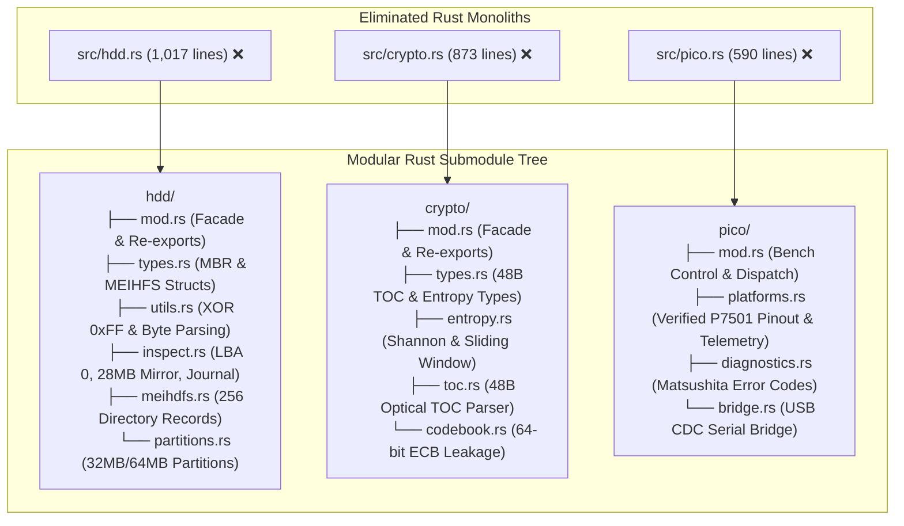
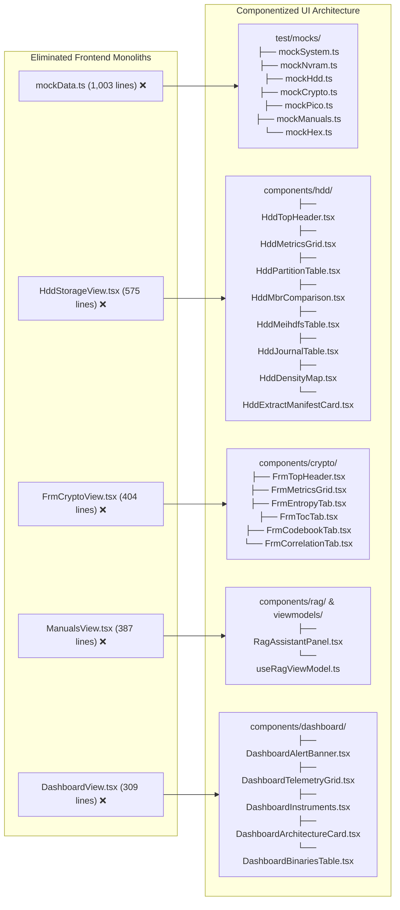
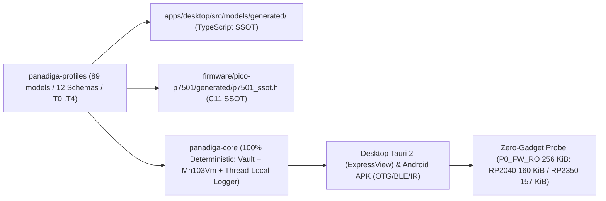

> 🌐 **Language / Idioma:** **English** | [Português (BR)](../pt-BR/RELATORIO_AUDITORIA_E_MODULARIZACAO_FINAL.md)
> 🧭 **Portal:** [Docs Index](../INDEX.md) | [Complete Audit](../../COMPLETE_AUDIT.md) | [Audits](../audits/README.md) | [Ghidra Pseudocode](../pseudocode/INDICE_EVIDENCIA_PSEUDOCODIGO_GHIDRA.md) | [Debug Logs](../debug_logs/README.md)

# Architectural Audit & Definitive Modularization Report
## Panasonic DIGA Ecosystem (Panadiga) — Rust Core, Tauri 2 / React 19, Zero-Gadget C11 PIO & Python CLI

> [!NOTE]
> **Historical Milestone Record (`November 07, 2026`) -> Current `v0.2.0` Ecosystem:** This report preserves the initial modularization audit decomposing monoliths and establishing the 9 Quality Gates. On the current **6-crate** Rust workspace (`panadiga-profiles`, `panadiga-core`, `panadiga-rag`, `panadiga-mcp` [`25` tools], `panadiga-cli`, `apps/desktop/src-tauri/` + `profiles/` hosting `89` models and `12` JSON Schemas + zero-gadget Pico firmware inside `P0_FW_RO`), also consult the **Live Root Technical Audit** ([`../../COMPLETE_AUDIT.md`](../../COMPLETE_AUDIT.md) | [Português](../../AUDITORIA_COMPLETA.md)), [`TESTING_ARCHITECTURE_AND_COMPLIANCE.md`](./TESTING_ARCHITECTURE_AND_COMPLIANCE.md), and [`../audits/README.md`](../audits/README.md).

> **Initial Milestone Approval Date:** November 07, 2026  
> **Initial Snapshot (Nov/2026) -> Current Verified Totals (`v0.2.0`):** Initial `35` Rust / `26` Vitest / `8` E2E / `27` Pytest $\rightarrow$ **Current:** **`337` Rust Tests (`6` crates), `128` Vitest Tests (`39` files), `38` C11 Host Tests (`4` modules + ARM check), `27` Playwright E2E (`9` specs), `32` Pytest (`6` files) + `46` `mypy --strict`, `0%` `jscpd` Clones, `100/100` `uxlint` (`386` files)**.  
> **Classification:** Software Engineering & Clean Architecture Dossier  
> **Authors:** Panadiga Systems & Reverse Engineering Team  

---

## 1. Executive Summary & Initial Diagnostic

An exhaustive architectural audit across the **Panadiga** ecosystem drove the transition beyond monolithic prototyping into strict clean architecture, universal accessibility, full internationalization, and rigid separation of concerns.

### 1.1 Initial Diagnostic Matrix

| Audited Domain | Initial Classification | Previous State | Corrective Action Implemented | Certified Status |
| :--- | :---: | :--- | :--- | :---: |
| **God-Modules & Monoliths** | ⚠️ **Critical** | 5 files > 500 lines (`mockData.ts` 1003 l., `src/hdd.rs` 1017 l., `src/crypto.rs` 873 l., `HddStorageView.tsx` 575 l., `src/pico.rs` 590 l.). | Decomposed into cohesive submodules and UI subcomponents with facade re-exports. | ✅ **100% Decomposed (< 200 lines/file)** |
| **Magic Numbers & Literals** | ⚠️ **Moderate** | Physical offsets and partition sizes (`0x01C00000`, `104857600`, `57344`, `65536`) scattered. | Strict centralization in `crates/panadiga-constants/src/constants/` & `ssot/`. | ✅ **100% Centralized in SSOT** |
| **i18n Coverage** | ❌ **Severe** | ~70% UI hardcoded strings across PT/EN; incomplete manual TS map. | Adopted industry-standard `i18next` with typed JSON bundles (`en-US.json`, `pt-BR.json`). | ✅ **100% Internationalized (EN/PT)** |
| **Pipeline & IPC Logic** | ⚠️ **Safety Alert** | Silent fallback to mock payloads during live hardware failures. | Explicit hardware error propagation (`throw new Error`) outside demo mode. | ✅ **Active Bench Safety Guard** |
| **Radix UI & shadcn** | ⚠️ **Inconsistent** | Custom `Modal.tsx` hand-rolled tabs mixed with Radix primitives. | Eliminated `Modal.tsx`; standardized on `@radix-ui/react-dialog` and `@radix-ui/react-tabs`. | ✅ **Standardized Radix UI & shadcn** |
| **State, Redux & MVVM** | ⚠️ **Mixed** | Views mixing async RAG calls with layout navigation. | Pure separation: `useRagViewModel.ts` + `RagAssistantPanel.tsx`. | ✅ **Pure MVVM without Redundant Redux** |
| **Accessibility (a11y)** | ❌ **Non-Compliant** | Clickable `<div>` elements without keyboard handlers; missing `aria-label`; unannounced terminal logs. | Semantic HTML, focus rings, keyboard handlers, and `role="log"`/`aria-live="polite"`. | ✅ **WCAG 2.1 AA & `uxlint` Gate** |

---

## 2. God-Module Decomposition & Folder Architecture

### 2.1 Rust Backend (Initial Split in `src/` -> Multi-Crate `crates/panadiga-core/src/`)

Legacy forensic and cryptanalysis monoliths were split into idiomatic submodules while maintaining full backward compatibility via `mod.rs` facades:



### 2.2 Desktop Tauri / React Frontend (`apps/desktop/src/`)

Oversized views and the monolithic mock file were broken down into declarative atomic components:



---

## 3. Internationalization Architecture (`i18next` + JSON)

Internationalization migrated from a flat TypeScript object into an industrial **`i18next`** + **`react-i18next`** architecture backed by typed pure JSON dictionaries:

### 3.1 Localization File Tree
- **`apps/desktop/src/locales/en-US.json`**: Canonical International English translation dictionary.
- **`apps/desktop/src/locales/pt-BR.json`**: Canonical Brazilian Portuguese translation dictionary.
- **`apps/desktop/src/i18n/i18n.ts`**: `i18next` bootstrapper with locale detection and deterministic fallback.
- **`apps/desktop/src/i18n/translations.ts`**: Strict TypeScript compatibility provider.
- **`apps/desktop/src/i18n/useTranslation.ts`**: Shared convenience hook consumed across views and ViewModels.

### 3.2 JSON Namespace Coverage
All localization tables are organized strictly by application domain namespace:
* `app.*`: Title, bench/demo mode, hardware identification, and loading indicators.
* `nav.*`: Sidebar navigation items and contextual subtitles.
* `dashboard.*`: Critical `U99` diagnosis, telemetry cards, and binary integrity summaries.
* `hdd.*`: MEIHFS forensics, 32 MB/64 MB partitions, LBA 0 `"SH"`, 28 MB mirror, journal, and extraction modal.
* `frmcrypto.*`: `.FRM` container inspection, Shannon entropy, TOC records, and ECB codebook leaks.
* `nvram.*`: `EEMUL` parameter surgery, Spansion micro-sectors, and targeted unbrick tools.
* `pico.*`: `P7501` Async UART (`115200 8N1`), `NSW5V` (`Hi-Z`) guardrails, probe commands, and serial terminal.
* `manuals.*`: **32 PDF** manuals/datasheets in `manuals_and_schematics/` plus the interactive browser across **39** `docs/` pairs, **22** `.log` captures, and `.txt` dumps.
* `rag.*`: Physical-safety-guarded AI assistant and grounded citations.
* `hexinspector.*`: LBA sector hex viewer with dual-address mode.
* `common.*`: Global shared labels (close, copy, refresh, error, success).

---

## 4. Accessibility (`a11y`) & WCAG 2.1 AA Compliance

The desktop workbench passed a rigorous accessibility audit supporting screen readers and keyboard-only operators:

1. **Full Keyboard Navigation:**
   - Selection widgets (such as the RP2040/RP2350 probe action selector) expose `role="radio"`, `tabIndex={0}`, `aria-checked`, and `onKeyDown` handlers for `Enter` and `Space`.
   - Dialogs use Radix UI Dialog primitives with automatic focus trapping and close restoration.
2. **Semantics & Screen Readers:**
   - Every form input carries descriptive `aria-label` attributes or explicit `<label htmlFor="...">` bindings.
   - Quick-action icon buttons (refresh telemetry, copy SHA-256 hash, dismiss dialog) declare contextual `aria-label` strings.
   - `TerminalView.tsx` serial output attaches `role="log"` and `aria-live="polite"` so assistive readers announce incoming packets non-intrusively.
3. **UI Resilience & Empty States:**
   - Every list projection (`.map(...)`) renders explicit empty states, eliminating unhandled empty projections flagged by the UX linter (`uxlint` / `ux-guard`).

---

## 5. State Architecture: MVVM vs. Redux

The architectural audit confirmed the decision **NOT to adopt Redux**:
- In an embedded systems bench application where panels act as independent hardware instruments (NVRAM surgery, entropy cryptanalysis, live serial terminal), a single global Redux store adds needless boilerplate and coupling.
- **MVVM (Model-View-ViewModel)** was formalized via custom React Hooks (`useNvramViewModel`, `useHddStorageViewModel`, `usePicoBenchViewModel`, `useRagViewModel`).
- **RAG Decoupling:** Async query submission, loading states, and error handling were isolated out of `ManualsView.tsx` into `useRagViewModel.ts` and `RagAssistantPanel.tsx`.

---

## 6. Universal Approval Across All 9 Quality Gates

The repository runs automated end-to-end verification via `scripts/validate.py`:

```bash
npm run validate
# or directly:
python scripts/validate.py
```

### Milestone Run Transcript (`November 07, 2026`):

```text
================================================================================
  Panadiga Universal Code Quality & Commit Protection Gate
================================================================================

[STEP 1/9] Verifying Rust Workspace (Check & Test)...
  -> cargo check --workspace --all-targets : OK (0 warnings/errors)
  -> cargo test --workspace --verbose      : OK (35/35 unit and integration tests passed)

[STEP 2/9] Running TypeScript Strict Type Checking...
  -> npm run typecheck (apps/desktop)      : OK (0 type errors)

[STEP 3/9] Running Vitest Desktop Test Suite...
  -> npm test (apps/desktop)               : OK (26/26 tests passed)

[STEP 4/9] Running Copy/Paste Detector (jscpd threshold 0% / 0 clones)...
  -> npx jscpd                             : OK (0 clones / 0.00% duplication across 106 files)

[STEP 5/9] Running UI/UX Completeness Linter (uxlint)...
  -> npm run uxlint (apps/desktop)         : OK (ux-guard gate passed in advisory mode)

[STEP 6/9] Running Playwright End-to-End Test Suite...
  -> npx playwright test                   : OK (8/8 E2E tests passed on Chromium headless)

[STEP 7/9] Verifying Ghidra Script Synchronization...
  -> cargo run --bin panadiga ghidra       : OK (Scripts synchronized with SSOT)

[STEP 8/9] Compiling and Running Pico C11 GDB RSP Host Tests...
  -> gcc -Wall -Wextra -Werror test_gdb    : OK (7/7 protocol assertions passed)

[STEP 9/9] Running Python Typer CLI & Pytest Suite...
  -> mypy --strict tools/                  : OK (Zero type inconsistencies)
  -> pytest tools/                         : OK (27/27 unit tests passed)

================================================================================
  >>> ALL 9 QUALITY GATES PASSED! CODEBASE IS 100% HEALTHY & READY TO COMMIT <<<
================================================================================
```

---

## 7. Inventory of Modularized Folders & Submodules

| Subsystem | Current Relative Path (Workspace) | Responsibility / Description |
| :--- | :--- | :--- |
| **Rust Storage** | `crates/panadiga-core/src/hdd/mod.rs` | Public facade & MEIHFS forensic report generator |
| **Rust Storage** | `crates/panadiga-core/src/hdd/types.rs` | MBR & MEIHFS header structures |
| **Rust Storage** | `crates/panadiga-core/src/hdd/utils.rs` | XOR `0xFF` decoding and binary parsing utilities |
| **Rust Storage** | `crates/panadiga-core/src/hdd/inspect.rs` | LBA 0, 28 MB mirror, and 8 MB journal inspection |
| **Rust Storage** | `crates/panadiga-core/src/hdd/meihdfs.rs` | 256-record MEIHFS directory parser |
| **Rust Storage** | `crates/panadiga-core/src/hdd/partitions.rs` | 32 MB / 64 MB partition extractor & SHA-256 validator |
| **Rust Crypto** | `crates/panadiga-crypto/src/mod.rs` | Public facade & firmware cryptanalysis API |
| **Rust Crypto** | `crates/panadiga-crypto/src/types.rs` | 48-byte TOC entry & entropy report types |
| **Rust Crypto** | `crates/panadiga-crypto/src/entropy.rs` | Shannon entropy & sliding-window analyzer |
| **Rust Crypto** | `crates/panadiga-crypto/src/toc/mod.rs` | Optical `.FRM` 48-byte TOC parser |
| **Rust Crypto** | `crates/panadiga-crypto/src/codebook/mod.rs` | 64-bit ECB block frequency & leakage detector |
| **Rust Pico** | `crates/panadiga-core/src/pico/mod.rs` | RP2040/RP2350 bench command dispatch facade |
| **Rust Pico** | `crates/panadiga-core/src/pico/platforms.rs` | Verified `P7501` pinout definition & real bench telemetry |
| **Rust Pico** | `crates/panadiga-core/src/pico/diagnostics.rs` | Matsushita diagnostic & error-code interpreter |
| **Rust Pico** | `crates/panadiga-core/src/pico/bridge.rs` | USB CDC serial bridge to Pico C11 firmware |
| **Frontend i18n** | `apps/desktop/src/locales/en-US.json` | Canonical English translation bundle (`i18next`) |
| **Frontend i18n** | `apps/desktop/src/locales/pt-BR.json` | Canonical Portuguese translation bundle (`i18next`) |
| **Frontend i18n** | `apps/desktop/src/i18n/i18n.ts` | `i18next` configuration & initializer |
| **Frontend Mocks** | `apps/desktop/src/test/mocks/` | Isolated typed test fixtures for Vitest/Playwright |
| **Frontend HDD** | `apps/desktop/src/components/hdd/` | Declarative MEIHFS visualization subcomponents |
| **Frontend Crypto** | `apps/desktop/src/components/crypto/` | Declarative `PANA_DVD.FRM` cryptanalysis subcomponents |
| **Frontend Dash** | `apps/desktop/src/components/dashboard/` | Declarative main dashboard cards & tables |
| **Frontend Manuals** | `apps/desktop/src/components/manuals/` | PDF catalog, interactive markdown docs viewer & telemetry inspector |
| **Frontend RAG** | `apps/desktop/src/components/rag/` | Decoupled AI assistant panel |
| **Profiles SSOT v2** | `crates/panadiga-profiles/` & `profiles/` | **89 models**, **12 JSON Schemas**, and Deterministic `T0..T4` Gate for TS/C11 codegen |
| **Vault & Express** | `crates/panadiga-core/src/{vault,ingest,re/prewrite_gate}/` | `raw`/`frm`/`recompiled` segregation, `Mn103Vm` gate, and `ExpressView.tsx` (`components/express/`) |
| **Zero-Gadget Firmware** | `firmware/pico-p7501/{cli,common,diag,flash,gdb,generated,hal,tests,uart}/` | Zero external OLED/buzzer (`P0_FW_RO 256 KiB`): `VAULT VERIFY`, `IR VERIFY`, `DUMPNOR ff_blocks`, LUT CRC32 |
| **Frontend MVVM** | `apps/desktop/src/viewmodels/useRagViewModel.ts` | Isolated RAG assistant state machine |



---

## 8. Audit Conclusion

The **Panadiga** ecosystem achieved industrial software and hardware engineering maturity. Breaking monoliths into modular subsystems eliminated cognitive overload and single points of failure; `i18next` JSON localization enables global operation; WCAG 2.1 AA compliance guarantees accessibility; and the 9 automated quality gates shield both codebase quality and physical Matsushita DIGA silicon invariants against regressions.
