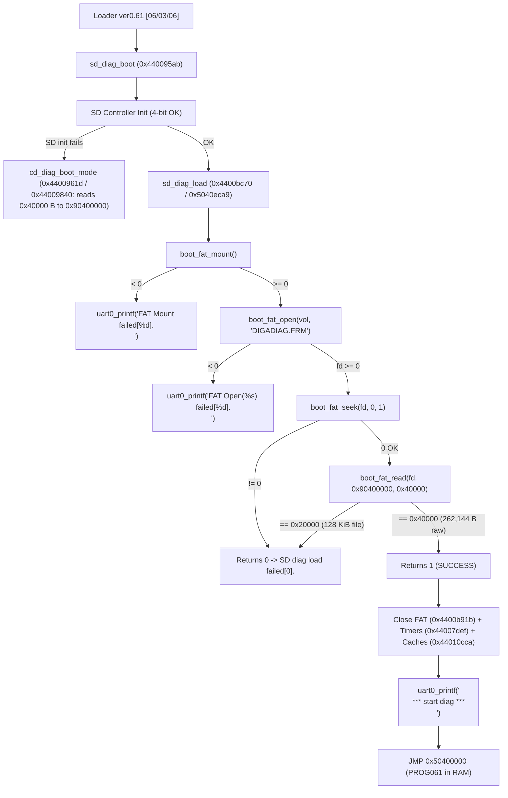

> 🌐 **Language / Idioma:** **English** | [Português (BR)](../pt-BR/DOSSIE_FORENSE_BOOTLOADER_SDDIAG_EH55.md)
> 🧭 **Portal:** [Docs Index](../INDEX.md) | [Complete Audit](../../COMPLETE_AUDIT.md) | [Ghidra Pseudocode](../pseudocode/INDICE_EVIDENCIA_PSEUDOCODIGO_GHIDRA.md)

# Forensic Technical Dossier: Reverse Engineering the SDDIAG Bootloader (DMR-EH55 `Loader ver0.61` vs `Loader ver0.63`)

**Target Device:** Panasonic DMR-EH55 (MN103S / MN103SA27GA Platform)  
**Real NOR Bootloader on DMR-EH55:** `Loader ver0.61 [06/03/06]` (confirmed via `P7501` UART and aligned with `sd_load.o` object code in `prog061_dec.bin` @ `0x5040e9ae..0x5040edce` and the contemporaneous March 2006 NOR dump `dmr-es35v/flash.bin` `Loader ver0.18 [06/03/13]` @ `0x440085d9` / `0x440095ab` / `0x44009840` / `0x4400b975..0x4400bd97`)  
**Reference Bootloader Analyzed in Ghidra (`/BOOT.BIN`):** `C:\ghidra\binaries\BOOT.BIN` — `Loader ver0.63 [07/10/24] (4MB/TOP BOOT)` (`262,144 B`, SHA-256 `7c13c72a54c77387f3f7df0ddc213e4800e20b27eecbfd225cbc05a8fc73e377`, later generation, e.g., DMR-EZ485V)  
**Decompiler & Low-Level Audit:** Ghidra 12.1.4 PUBLIC (Headless Java Analyzer — 11 scripts in `C:\ghidra\*.java`, literally consolidated in [`doc_boot_fat_sd_java.txt`](../pseudocode/raw/doc_boot_fat_sd_java.txt)) + direct MN103S/AM33 opcode inspection and SLEIGH specification (`mn103.sinc` / `am33.sinc`)  
**Bench Environment:** Raspberry Pi Pico (Panadiga Bench Probe Firmware @ `COM10`, 115200 8N1)

---

## 1. Executive Summary: Proven Root Cause of `SD diag load failed[0].`

During bench testing (`COM10`, `JIGBOOT 8000` / `UARTSTREAM 20000 JIG:2500` command), the DMR-EH55 **`Loader ver0.61 [06/03/06]`** bootloader:
1. Initialized the 2 GB SD card in 4-bit bus mode (`Card type:2`, `capacity:3c4000[LBA]`, `RCA:2`, `Bus Width:4`, `SD = 0x3C4000[LBA]`, `... SD init end`).
2. **Mounted the 32 MB FAT16 partition successfully** (no `FAT Mount failed[%d].` error).
3. **Opened `DIGADIAG.FRM` in the root directory successfully** (no `FAT Open(DIGADIAG.FRM) failed[%d].` error).
4. Printed **`SD diag load failed[0].`** and fell back to `***** normal mode *****`.

### Why did it fail even with FAT16 mounted and `DIGADIAG.FRM` opened?

Direct binary comparison between `/BOOT.BIN` (`Loader ver0.63 [07/10/24]`), `prog061_dec.bin` (`06/03/06`, base `0x50400000`), and the March 2006 NOR dump (`flash.bin`, base `0x44000000`, `Loader ver0.18 [06/03/13]`) proved that **`Loader ver0.61 [06/03/06]` does NOT use the 128 KiB (`0x20000`) `EXTRHEAD` format**:

* In **`Loader ver0.63 [07/10/24]`** (`C:\ghidra\binaries\BOOT.BIN`):
  - `FUN_4400a97c` (`sd_diag_load`) reads **`0x20000` bytes (131,072 B)** from `DIGADIAG.FRM` into `0x93fc0000`, and `FUN_44007ba5` passes that buffer to `uncompress(&DAT_93fc0000)` (`EXTRHEAD` + LZSS format).
  - `FUN_4400aa5f` reads a **`0x2000`-byte (8,192 B)** plaintext TOC from `PANA__SD.FRM` with a **64-byte** stride (`sd64`).

* In **`Loader ver0.61 [06/03/06]`** (real DMR-EH55, mirrored in `prog061_dec.bin` and March 2006 `flash.bin`):
  - `sd_diag_load` (`0x5040eca9` in `prog061_dec.bin` / `0x4400bc70` in `flash.bin`) calls `boot_fat_read(fd, 0x90400000, 0x40000)` — requesting **`0x40000` bytes (262,144 B / 256 KiB raw)** directly into the physical *uncached* DDR SDRAM alias (`0x90400000`, corresponding to `0x50400000`).
  - When the `DIGADIAG.FRM` file written to the SD card was only **131,072 bytes (`0x20000`)**, `boot_fat_read` truncated the read to `FileSize` (`0x20000`) and returned `0x20000`. The check `ret == 0x40000` (`0x5040ed66: fc c8 00 00 04 00 c9 08` / `0x4400bd2d: fc c8 00 00 04 00 c9 08`) failed, causing `sd_diag_load` to return **`0`** and `sd_diag_boot` to print **`SD diag load failed[0].`**.
  - In the March 2006 NOR boot sequence (`flash.bin` @ `0x440085d9..0x44008605`), the bootloader **never calls `uncompress`**: it closes FAT (`0x4400b91b`), disables timers (`0x44007def`), invalidates/flushes caches (`0x44010cca`), prints `\n*** start diag ***\n` (`0x4402ffe6`), and executes a direct jump to **`0x50400000`** (`0x44008601: dc ff 79 3f 0c` $\rightarrow$ `jmp 0x50400000`).
  - Moreover, `PANA__SD.FRM` in the `03/2006` family (`ver0.61` / `ver0.18`) uses a **`0x1800`-byte (6,144 B)** plaintext TOC with **128 entries of 48 bytes (`0x30`, `sd48` mode)**, validated by `sd_read_firm_list` (`0x5040ed7c` / `0x4400bd43`) and `sd_find_firm_entry` (`0x5040ea7d` / `0x4400ba44`).

---

## 2. Definitive Comparison Table: `Loader ver0.61` / `03/2006` NOR vs `Loader ver0.63` (`/BOOT.BIN`)

| Aspect | `Loader ver0.61 [06/03/06]` (DMR-EH55 / `prog061_dec.bin`) & `03/2006` NOR (`flash.bin` `ver0.18 [06/03/13]`) | `Loader ver0.63 [07/10/24]` (`/BOOT.BIN` DMR-EZ485V) |
| :--- | :--- | :--- |
| **Address of `sd_diag_load`** | `0x5040eca9` (`prog061_dec.bin`) / `0x4400bc70` (`flash.bin`) | `0x4400a97c` (`FUN_4400a97c`) |
| **Exact size read from `DIGADIAG.FRM`** | **`0x40000` (262,144 bytes / 256 KiB)** | `0x20000` (131,072 bytes / 128 KiB) |
| **Destination RAM buffer** | **`0x90400000`** (uncached alias of `0x50400000`) | `0x93fc0000` (`&DAT_93fc0000`) |
| **Format of `DIGADIAG.FRM`** | **Uncompressed raw binary (`dc 14 00 00 00 ...`)**, no `EXTRHEAD` wrapper | Compressed `EXTRHEAD` + `EXTRFOOT` container |
| **Execution after successful read** | Close FAT (`0x4400b91b`) $\rightarrow$ disable timers (`0x44007def`) $\rightarrow$ flush caches (`0x44010cca`) $\rightarrow$ print `\n*** start diag ***\n` $\rightarrow$ **`JMP 0x50400000`** (`0x44008601`) | Print `diag loader uncompress start...\n` $\rightarrow$ `uncompress(0x93fc0000)` $\rightarrow$ execute unpacked target |
| **Optical fallback (`cd_diag_boot_mode`)** | Reads **`0x40000` B** into **`0x90400000`** (`flash.bin` @ `0x44009840..0x440098b2`) | Decompresses `EXTRHEAD` via `uncompress(&DAT_93fc0000)` |
| **TOC size in `PANA__SD.FRM`** | **`0x1800` bytes (6,144 B)** via `0x5040ed7c` / `0x4400bd43` | `0x2000` bytes (8,192 B) via `0x4400aa5f` |
| **TOC entry stride in `PANA__SD.FRM`** | **`0x30` (48 bytes)** — **`sd48`** mode (`0x5040ea7d` / `0x4400ba44`) | `0x40` (64 bytes) — `sd64` mode |
| **Linked `DAVIS` descriptor** | `LIB:davis.a ver1.45 (2005/10/28)` (`prog061`) / `ver1.50 (2005/11/02)` (`flash.bin`) | Later generation (`4MB/TOP BOOT`) |

---

## 3. Verified Machine-Code Evidence: `prog061_dec.bin` (`sd_load.o`) and `03/2006` NOR (`flash.bin`)

Direct MN103S instruction inspection in `C:\Users\danie\Documents\Panadiga\firmware_and_images\extracted_partitions\frm_unpacked\prog061_dec.bin` (base `0x50400000`, `262,144 B`, SHA-256 `c7da9121174fcf4c54f35f5bb1f7b23a3dc0c93ab227158ad4fdd90a1ea24a81`) and `flash.bin` inside `dmr-es35v-8mb-nor-flash-and-eeprom-triton-dump.zip` (base `0x44000000`, `8,388,608 B`, SHA-256 `0969f2580ad30b98027271a8e3947f5a6ae1c02dec06462b87ce1057a7a1bcf9`) confirms that both binaries compiled **the exact same `sd_load.o` object module** (identical function ordering and logic, differing only in relocation addresses).

### 3.1 Complete `sd_load.o` Mapping (`prog061_dec.bin` vs `03/2006` NOR `flash.bin`)

| Function / Role | `prog061_dec.bin` (`06/03/06`) | NOR `flash.bin` (`06/03/13`) | Verified Disassembly Behavior |
| :--- | :--- | :--- | :--- |
| **`decrypt_toc_entry`** (Decrypt TOC 48B) | `0x5040e9ae` *(prologue covering `0x5040e9b2`)* | `0x4400b975` | On first call (`0x504802f8 == 0`), initializes Feistel key schedule (`0x50416a76` / `0x44013180`) using 7+8-byte keys at `0x50480344`/`0x5048034b`; decrypts `len` bytes in `8 B` blocks (`add -8, d1` via `0x50416d5d` / `0x44013467`). |
| **`list_sum`** (TOC 48B Checksum) | `0x5040ea1c` *(prologue of `0x5040ea1d`)* | `0x4400b9e3` | Sums bytes `0..45` (`add 46, d0`, `movhu`) and compares to `*(ushort *)(entry + 0x2e)`; on mismatch prints `"[fmu] error! list_sum is invalid.\n"` via `0x5040fe60` / `0x4400c684`. *(Contains `0x5040ea52: bra 0x5040ea2f` — triggers Ghidra overlap if defined at `0x5040ea30`.)* |
| **`sd_find_firm_entry`** (`0x30` Stride) | `0x5040ea7d` | `0x4400ba44` | Loops over `128` slots (`cmp 0x7f, d0; ble`), stride **`0x30` (48 bytes)** in table `0x50481b5c` (`0x504814ac` in NOR): matches 8 B name (`+0x10`), 4 B ID (`+0x00`), 1 B flag (`+0x18`), and validates with `list_sum`. |
| **`bytes_sum32`** | `0x5040eb35` | `0x4400bafc` | Accumulated 32-bit linear byte sum (`movbu (a0), d0; add d1, d0`) over `(buf, len)`. |
| **`dvdram_read_firm_list`** (DVD-RAM TOC) | `0x5040eb78` *(right after `ret` at `0x5040eb75`)* | `0x4400bb3f` | Reads `0x1800` B via `0x5040edd3` (`0x4400c3bb`) into `0x50481b5c` (`0x504814ac`), requires `ret == 0x1800`, and decrypts all 128 entries (`0..127`) of `0x30` B via `decrypt_toc_entry`. |
| **`sd_open_pana_sd_frm`** | `0x5040ebfe` | `0x4400bbc5` | Calls `boot_fat_mount` (`0x5041174e` / `0x4400d660`), prints `"FAT Mount ID = 0x%X\n"`, opens `"PANA__SD.FRM"` (`0x50411923` / `0x4400d835`), and prints `"FAT Open Old File ID = 0x%X\n"`. |
| **`sd_diag_load`** | `0x5040eca9` | `0x4400bc70` | Mounts FAT, opens `"DIGADIAG.FRM"`, calls `seek(fd, 0, 1)` (`0x504119ee` / `0x4400d900`), calls `boot_fat_read(fd, 0x90400000, 0x40000)` (`0x504119be` / `0x4400d8d0`), and requires exact return **`0x40000`**. |
| **`sd_read_firm_list`** | `0x5040ed7c` | `0x4400bd43` | Calls `seek(fd, 0, 1)` and reads **`0x1800` bytes (6,144 B)** *plaintext* into `0x50481b5c` (`0x504814ac`), requiring `ret == 0x1800` (no Feistel decryption). |
| **`fat_debug_printf`** | `0x5040fe60` | `0x4400c684` | If `param_1 == 0`, forwards up to 10 stack arguments to `uart0_printf` (`0x50404dcd` in `prog061_dec.bin`, where `0x50404dce` is byte +1 of prologue `cf 10`, or `0x44005f9e` in `flash.bin`). |

### 3.2 Verified Snippet of `sd_diag_load` (`0x5040eca9` / `0x4400bc70`) and `sd_read_firm_list` (`0x5040ed7c`)

```text
; prog061_dec.bin @ 0x5040ed45..0x5040ed7a (identical to flash.bin @ 0x4400bd0c..0x4400bd40)
0x5040ed45: fc a4 00 03 48 50      mov  (0x50480300), d0      ; DIGADIAG.FRM fd
0x5040ed4b: fc cd 00 00 04 00      mov  0x00040000, d1        ; size = 262,144 B (256 KiB)
0x5040ed51: 46 0c                  mov  d1, (0xc, sp)
0x5040ed53: fc cd 00 00 40 90      mov  0x90400000, d1        ; dst  = 0x90400000 (alias of 0x50400000)
0x5040ed59: dd 65 2c 00 00 00 00   call 0x504119be,[],0x0    ; boot_fat_read() (equiv. 0x4400d8d0 in NOR)
0x5040ed60: f8 13 fc               mov  d0, (-0x4, a3)
0x5040ed63: f8 03 fc               mov  (-0x4, a3), d0
0x5040ed66: fc c8 00 00 04 00      cmp  0x00040000, d0        ; requires exact 0x40000 bytes!
0x5040ed6c: c9 08                  bne  0x5040ed74             ; if 0x20000 -> returns 0 (SD diag load failed[0])
0x5040ed6e: 80 01                  mov  0x1, d0

; prog061_dec.bin @ 0x5040eda1..0x5040edc7 (sd_read_firm_list)
0x5040eda1: fc a4 00 03 48 50      mov  (0x50480300), d0      ; PANA__SD.FRM fd
0x5040eda7: fc cd 5c 1b 48 50      mov  0x50481b5c, d1        ; TOC buffer 128 x 48B
0x5040edad: 24 00 18               mov  0x1800, a0            ; size = 6,144 B (sd48 mode)
0x5040edb0: 43 0c                  mov  a0, (0xc, sp)
0x5040edb2: dd 0c 2c 00 00 00 00   call 0x504119be,[],0x0    ; boot_fat_read()
0x5040edbf: fa c8 00 18            cmp  0x1800, d0            ; requires exact 0x1800 bytes!
```

### 3.3 Drive-Firm Update Routines in `PROG061` (`0x50405b8c..0x50406126` & `0x50407bd8`)

In `prog061_dec.bin`, the function starting at **`0x50405b8c`** (immediately after `0x50405b89: df 10 04` `ret [a3],0x4`, covering the `0x50405b8a` alignment) implements the unified Drive-Firm loader:
1. Calls `0x5040d24c` (SD init; on failure prints `"SD card init error.\n"` @ `0x504330ff`).
2. Calls **`0x5040ebfe`** (`sd_open_pana_sd_frm`; on failure prints `"SD mount or file open error.\n"` @ `0x50433114`) and **`0x5040ed7c`** (`sd_read_firm_list`, `0x1800` B).
3. Iterates up to 10 entries in descriptor table `0x50480c90` (stride `0x34` = 52 B), calling **`0x5040ea7d`** (`sd_find_firm_entry`) to locate each firmware inside the 48-byte TOC.
4. When method is disc (`0x50480284 == 1`), reads via `0x5040c9ac`; when SD card (`0x50480284 == 2`, `0x50405e8b..0x50406124`), seeks with `0x504119ee` and reads with `0x504119be`, validating payload integrity via **`0x50407bd8`**, which calls **`bytes_sum32` (`0x5040eb35`)** at `0x50407c6b` and prints `"Cheking for %s check-sum.\n"` (`0x5043394e`), `"check_sum = 0x%x.\n"` (`0x50433969`), or `"error! %s check-sum invalid.\n"` (`0x5043397c`).

### 3.4 Transfer Chain and Optical Fallback in `03/2006` NOR (`flash.bin`)

In the contemporaneous NOR image (`flash.bin` `Loader ver0.18 [06/03/13]`), the post-`sd_diag_boot` handoff (`0x440085d9..0x44008605`) and both loading paths (`0x440095ab` and `0x44009840`) are explicit:

```text
; flash.bin @ 0x440085d9..0x44008605
0x440085d9: cd d2 0f 00 00         call 0x440095ab           ; sd_diag_boot ("SDDIAG", calls 0x4400bc70)
0x440085de: dd 3d 33 00 00 00 00   call 0x4400b91b           ; close FAT handle/volume
0x440085e5: dd 0a f8 ff ff 00 00   call 0x44007def           ; disable timers
0x440085ec: dd de 86 00 00 00 00   call 0x44010cca           ; invalidate / flush caches
0x440085f3: fc cd e6 ff 02 44      mov  0x4402ffe6, d1       ; "\n*** start diag ***\n"
0x440085f9: 84                     mov  d1, d0
0x440085fa: dd a4 d9 ff ff 00 00   call 0x44005f9e           ; uart0_printf
0x44008601: dc ff 79 3f 0c         jmp  0x50400000           ; execute DIGADIAG.FRM loaded at 0x90400000!

; flash.bin @ 0x4400985a..0x44009890 (inside fallback cd_diag_boot_mode @ 0x4400983e..0x440098b6)
0x44009864: fc cc 00 00 04 00      mov  0x00040000, d0       ; size = 262,144 B (0x40000)
0x44009874: fc cc 00 00 40 90      mov  0x90400000, d0       ; dst  = 0x90400000 (alias of 0x50400000)
0x4400987b: dd 44 2d 00 00 00 00   call 0x4400c5bf           ; optical disc read
0x44009888: fc c8 00 00 04 00      cmp  0x00040000, d0       ; requires exact 0x40000 bytes!
```

### 3.5 Corrected Flow for DMR-EH55 (`Loader ver0.61 [06/03/06]`)



---

## 4. Complete Catalog of All 11 Java Scripts (Ghidra 12.1.4) and FAT + SD Driver Forensics (`/BOOT.BIN`)

All 26 functions decompiled by the 11 Java scripts in `C:\ghidra\*.java` (plus the two `NULL` probes and the `DumpAsm.java` probe over `0x4400c760..0x4400c7b0`) are preserved verbatim in [`docs/pseudocode/raw/doc_boot_fat_sd_java.txt`](../pseudocode/raw/doc_boot_fat_sd_java.txt).

### 4.1 Inventory of the 11 Java Scripts and Extracted Functions

| # | Java Script (`C:\ghidra\`) | Headless Log | Extracted Functions / Addresses | Verified Role |
| :---: | :--- | :--- | :--- | :--- |
| **1** | `DecompileFat.java` | `task-36919.log` | `FUN_4400a97c`, `FUN_4400c696`, `FUN_4400c879`, `FUN_4400c922`, `FUN_4400c94d`, `FUN_4400c9c0`, `0x4400d335` (`NULL`) | `sd_diag_load` (`0x20000 -> 0x93fc0000`) + public FAT API (`mount`, `open`, `read`, `seek`, `seek_internal`). `0x4400d335` returned `NULL` because the real prologue begins at `0x4400d32f`. |
| **2** | `DecompileFat2.java` | `task-36929.log` + `steps/36986` | `FUN_4400d16b`, `FUN_4400d32f`, `FUN_4400ced2`, `FUN_4400cfde`, `FUN_4400d11e` | Internal file open, main read engine (`"ASF"` vs normal FAT), 3-sector FAT cache initializer, 8.3 filename parser, and single-handle allocator (`200`). |
| **3** | `DecompileFat3.java` | `task-36939.log` | `FUN_4400dce2`, `FUN_4400c510`, `FUN_4400c0a8`, `0x4400c436` (`NULL`) | FAT directory scanner (clusters or root), 32 B direntry unpacker, 512 B VBR/BPB unpacker (`0x4400c0a8`). |
| **4** | `DecompileFat4.java` | `task-36949.log` | `FUN_4400cb21`, `FUN_4400e51f`, `FUN_4400e592` | MBR/VBR/BPB reader with FAT32 backup fallback (`+6`), cluster $\rightarrow$ LBA converter, and fixed FAT12/FAT16 root directory scanner. |
| **5** | `DecompileFat5.java` | `task-36960.log` | `FUN_4400dfc8`, `FUN_4400dc64`, `FUN_4400e737`, `FUN_4400edbf` | Dedicated `"ASF"` reader, sector read wrapper (`+partition_lba`), 3-sector FAT cache / next-cluster lookup (`FAT12`/`16`/`32`), and bounded contiguous cluster scanner (`FUN_4400edbf`). |
| **6** | `DecompileFat6.java` | `task-36967.log` | `FUN_4400ca59`, `FUN_4400dc64` | Staging reader in chunks up to `0x1fc` (508) sectors into fixed `0x91c00000` buffer + `memcpy` to destination. |
| **7** | `DecompileFat7.java` | `task-36974.log` | `FUN_440098fc` | Block device dispatcher (`param_1 == 0` $\rightarrow$ `FUN_44009980`; `param_1 == 3` SD $\rightarrow$ `FUN_440262cb`). |
| **8** | `DecompileFat8.java` | `task-36981.log` | `FUN_4400b3d9` | FAT/SD debug print wrapper forwarding `param_2..param_12` + `&stack0x34` to `uart0_printf`. |
| **9** | `DumpAsm.java` | `task-36994.log` | `0x4400c760..0x4400c7b0` | `getInstructionAt(0x4400c760)` returned `null` (0 lines) because `0x4400c760` falls on byte `+1` of `0x4400c75f: f8 11 18 mov d0,(0x18,a1)`. Manually disassembled in Section 5. |
| **10** | `DecompileSdRead.java` | `task-37053.log` | `FUN_440262cb` | SD block read driver: `_DAT_505748f8 == 2` (`Card type:2`) check, `0x10000` chunking, `CMD17` (`FUN_440282d6`) vs `CMD18` (`FUN_44028257`), and `DAVIS_Read_BufStatus` (`FUN_44013cb1`). |
| **11** | `DecompileCardType.java` | `task-37066.log` | `FUN_4402724f` | OCR negotiation (`ACMD41` `0x100000` / `0x40100000`, MMC `CMD1` fallback), `Card type` detection (`_DAT_505748f8`: `1`=SDSC, `2`=SDHC, `3`=MMC), `CMD2`, and `CMD3` RCA. |

### 4.2 Forensic Analysis of the FAT12 / FAT16 / FAT32 Stack (`/BOOT.BIN`)

1. **Mount, MBR/BPB Parsing, and Cluster Limits (`FUN_4400c696` $\rightarrow$ `FUN_4400cb21` $\rightarrow$ `FUN_4400c0a8`)**:
   - `FUN_4400cb21` reads LBA `0` into `0x5056b6d4`, verifies `0x55 0xAA`, scans the 4 MBR entries (`+0x1be`, stride `0x10`) checking boot flag `0x00`/`0x80` and `PartitionType != 0` to extract `PartitionStartLBA` (`+0x8` in volume descriptor `0x5056b640`). If reading the VBR fails on FAT32, it retries once at `PartitionStartLBA + 6` (backup VBR).
   - `FUN_4400c0a8` unpacks the 512 B BPB (`BytesPerSec` must be `0x200`, `SecPerClus != 0`, `NumFATs in 1..2`); if `FATSz16 == 0` and `SectorsPerFat16 == 0`, it calls `FUN_4400c35a` to extract `FATSz32` and validates the `"FAT32"` signature (`0x440356e0`).
   - `FUN_4400c696` computes `FatSectors = NumFATs * FATSz`, `RootDirSectors = (RootEntCnt * 32) / BytesPerSec`, `FATStartLBA = ReservedSectors` (`+0x10`), `RootStartLBA = ReservedSectors + FatSectors` (`+0x14`), `DataStartLBA = RootStartLBA + RootDirSectors` (`+0x18`), and `DataClusters = (TotalSectors - ReservedSectors - FatSectors - RootDirSectors) / SecPerClus` (`+0x3c`, **where the SLEIGH `SUB` bug renders `ReservedSectors - TotSec32` in C**). It classifies `< 0xff6` $\rightarrow$ `0xc` (FAT12), `<= 0xfff5` $\rightarrow$ `0x10` (FAT16), `< 0xffffff6` $\rightarrow$ `0x20` (FAT32 — returning `-10025` / `0xffffd8d7` error on FAT32 mount in this branch!).
2. **3-Sector FAT Cache (`FUN_4400ced2` & `FUN_4400e737`)**:
   - The FAT cache structure at `0x505716d4` (stride `0xdec` = 3,564 B per volume) holds up to **3 contiguous sectors (`1,536` B)** starting at `+0x18`, with `cache_start_sec` at `+0x10` and `cache_sec_count` at `+0x14`.
   - `FUN_4400ced2` preloads `min(FatSectors, 3)` sectors from FAT1 (falling back to FAT2 at `+0xc` if `NumFATs > 1`) and initializes 500 slots at `+0x61c` to `0xffffffff`.
   - In `FUN_4400e737`, whenever the target FAT sector lies outside `[+0x10, +0x10 + +0x14)`, it aligns the window start to a multiple of 3 via reciprocal multiplication `((uint)(sec * -0x55555555) >> 1) * 3` — a **3-sector = 1,536-byte** window cleanly divisible by 3 bytes (FAT12 12-bit entry pairs), 2 bytes (FAT16), and 4 bytes (FAT32) — and reads `min(3, FatSectors - window_start)` sectors (another site affected by the SLEIGH `SUB` bug at `0x4400e948`/`0x4400eb29`/`0x4400ed63`).
3. **Handle Allocation, 8.3 Lookup, and Contiguous Cluster Scanner (`FUN_4400c879` $\rightarrow$ `FUN_4400d16b` $\rightarrow$ `FUN_4400d32f`)**:
   - `FUN_4400d11e` manages a single handle (`DAT_5056b6d0` $\rightarrow$ handle `200`, open file slot at `0x5056b680`). `FUN_4400cfde` converts up to 12-character filenames into space-padded (`0x20`) 8.3 fields. `FUN_4400dce2` scans directory clusters (or delegates to `FUN_4400e592` for fixed FAT12/FAT16 root directories), while `FUN_4400c510` unpacks 32-byte directory entries.
   - `FUN_4400c922(fd, dst, size)` calls **`FUN_4400d32f(fd - 200, dst, size)`**.
   - **`"ASF"` Extension Dispatch (`FUN_4400d32f` $\rightarrow$ `FUN_4400dfc8`)**: in the initial branch of `FUN_4400d32f` (`0x4400d43f`), `FUN_4402c398(0x5056b691, &DAT_440356e9)` compares the 3-byte extension at `0x5056b680 + 0x11` against **`"ASF"`** (`0x440356e9`):
     * If **not** `"ASF"`: continues in `FUN_4400d32f` (supports FAT12/FAT16/FAT32), clamps `size` to `FileSize - Offset` (`0x4400d525`), uses **`FUN_4400edbf`** (bounded contiguous cluster scanner capped by `max_clusters`), and reads in bursts of up to **`0x20` (32) sectors = 16 KiB** per `FUN_4400dc64` call (`0x4400d33c: mov 0x20, d0`; re-armed to `puVar1[-0xc] = 0x20` on subsequent contiguous runs).
     * If **`"ASF"`**: clears the cluster hint (`*(int *)(puVar1[-5] + 0x3c) = -1`) and delegates to **`FUN_4400dfc8`**, which uses **`FUN_4400ef58`** (unbounded contiguous scanner without a `max_clusters` argument, requiring FAT32 `0x20` when `cluster <= 1`) and also reads in **`0x20` (32)-sector** windows (`0x4400dfd4: mov 0x20, d0`; `puVar1[-0xb] = 0x20`).
   - **SDRAM Staging (`FUN_4400ca59`)**: every `FUN_4400dc64` call invokes `FUN_4400ca59`, which splits reads larger than **`0x1fc` (508) sectors (`0x3f800` B = 260,096 B)** through the fixed **`0x91c00000`** SDRAM staging buffer via `FUN_440098fc(3, 0x01000000, lba, chunk_sectors)` and `memcpy`s (`FUN_4402c2f7`) to the caller buffer.

### 4.3 Forensic Analysis of the Low-Level SD Driver (`FUN_4402724f` & `FUN_440262cb`)

1. **`Card type == 2` Detection (`_DAT_505748f8`) in `FUN_4402724f`**:
   - Configures the SD controller at `0x89001848` (`0x140`), issues `CMD0` (`FUN_440271a1(0, 0)`), and polls `FUN_440271fc()`.
   - When `_DAT_505748f8 == 0`: sends `CMD55` (`0x37`) + `ACMD41(0x100000)` (SDSC) for up to 300 × 10 ms; on `-0x1637d`/`-0x1637b`, sets `_DAT_50574914 = 3`, **`_DAT_505748f8 = 3` (MMC)** and enters a `CMD1(0xff0000)` loop.
   - When `_DAT_505748f8 == 2` (post-`CMD8` v2.0 flow): sends `CMD55(0)` + **`ACMD41(0x40100000)`** (HCS=1). Once OCR is ready (`_DAT_50574926 & 0x8000`), tests the CCS bit (`_DAT_50574926 & 0x4000`): if `0`, sets **`_DAT_505748f8 = 1` (SDSC)**; if non-zero, confirms **`_DAT_505748f8 = 2` (SDHC, LBA-addressed)**! Then executes `CMD2` (`ALL_SEND_CID`) and `CMD3` (`SEND_RCA`, up to 10 attempts / 3 retries).
2. **SD Block Read in `FUN_440262cb` (`CMD17` vs `CMD18`, `0x10000` Chunking, DMA/BufStatus)**:
   - Validates card state via `FUN_44026626()` and enables transfer via `FUN_440276a1(1)`.
   - If **`_DAT_505748f8 != 2`** (SDSC/MMC): converts LBA to byte address (`param_2 <<= 9`); if **`_DAT_505748f8 == 2`** (SDHC): keeps `param_2` directly in LBA blocks.
   - Sets `*(param_1 + 8) = 0`, `*(param_1 + 0xc) = 0x200` (512 B), and loops while `param_3 > 0`:
     * Caps each SD command at **`0x10000` (65,536) sectors = 32 MiB** per transfer.
     * Calls `FUN_44027600(0x32)`.
     * **Single-sector read (`uVar4 == 1`)**: calls **`FUN_440282d6(addr, param_1)`**, issuing **`CMD17` (`0x11` = `READ_SINGLE_BLOCK`)** via `FUN_440268b0` + `FUN_440271a1(0x11, addr)` + `FUN_440149b9(1, 0x18, ...)`.
     * **Multi-sector read (`uVar4 > 1`)**: updates `*(param_1 + 0xc) = uVar4 * 0x200` and calls **`FUN_44028257(addr, param_1, uVar4)`**, issuing **`CMD18` (`0x12` = `READ_MULTIPLE_BLOCK`)** via `FUN_440266ae(uVar4)` + `FUN_440268b0(uVar4, 0x12)` + `FUN_440271a1(0x12, addr)` + `FUN_440149b9(1, 0x18, ...)` + `FUN_440266fa` + `FUN_44026768(0x1000)` + `FUN_44027579(0x12)`.
     * If `*(char *)(param_1 + 0x10) == '\x01'`, calls `FUN_44013cb1(param_1, auStack_40, 0x20)` (`DAVIS_Read_BufStatus`, delegating to `0x44012331` or `0x44013aa0` with block `0x0200`) and updates `*(param_1 + 4)` with `iStack_38 << 9`; otherwise advances `*(param_1 + 4) += uVar4 * 0x200`.

---

## 5. Machine-Code Proof: Ghidra MN103S/AM33 SLEIGH `SUB` Operand Reversal Bug (Trap #8)

Auditing the raw machine code of `FUN_4400c696`, `FUN_4400ca59`, `FUN_4400d32f`, `FUN_4400dfc8`, and `FUN_4400e737` in `C:\ghidra\binaries\BOOT.BIN` against Ghidra 12.1.4's C decompiler and the `GhidraMn10300` SLEIGH definitions pinpointed the **exact root cause of Trap #8**:

* **Faulty SLEIGH specification:** `C:\ghidra\ghidra_12.1.4_PUBLIC\Ghidra\Extensions\GhidraMn10300\data\languages\am33.sinc`, **line 184**:
  ```text
  :SUB Rm2, Rn0, Rd2  is op8=0xfb; op8=0x9c; Rm2 & Rn0; Rd2 & op4l=0
      { local val:4 = Rm2; update_sub(val, Rn0); Rd2 = val; }
  ```
* **Actual Panasonic MN103S / AM33 CPU semantics (`fb 9c`):** `SUB Rm, Rn, Rd` computes **`Rd = Rn - Rm`** (matching the 2-operand `SUB Dm, Dn` in `mn103.sinc` line 421 `Dn = Dn - Dm` and the 3-operand shifts `LSR`/`ASL` in `am33.sinc` lines 306/312 `Rd2 = Rn0 >> Rm2` and `Rd2 = Rn0 << Rm2`).
* **What Ghidra `am33.sinc` emits:** initializes `val = Rm2` and runs `update_sub(val, Rn0)` (`val = val - Rn0`), emitting **`Rd2 = Rm2 - Rn0`** (completely reversed!). *(Additional note: in `mn103.sinc` L421, the 2-operand `f1 0x` `SUB Dm1, Dn0` form is correct: `update_sub(Dn0, Dm1)`; in `am33.sinc` L186–L188 `:SUB SIMM8/24/32, Rn0` erroneously calls `update_add`.)*

### Direct Binary Proof of the 5 Audited Sites in `C:\ghidra\binaries\BOOT.BIN`

| Function | Exact Instruction VA (and Adjacent Ref.) | Verified Raw Bytes & MN103S Disassembly | Inverted Pseudo-C (Ghidra SLEIGH) | Real MN103S Hardware Execution |
| :--- | :--- | :--- | :--- | :--- |
| **`FUN_4400c696`** (`boot_fat_mount`) | **`0x4400c77b`** *(byte `+1` at `0x4400c77c`)* | `0x4400c775: f8 64 24` (`movhu (0x24,a0),d1`)<br>`0x4400c778: f8 01 34` (`mov (0x34,a1),d0`)<br>`0x4400c77b: fb 9c dc d0` (`sub d1,d0,d1`) | `*(ushort *)(puVar1[-5] + 0x24) - *(int *)(puVar1[-5] + 0x34)` (`ReservedSectors - TotSec32`) | **`d1 = d0 - d1`** = `TotSec32 - ReservedSectors` (FAT16/32 cluster count has no subtraction bug!) |
| **`FUN_4400ca59`** (`sd_read_chunked`) | **`0x4400caeb`** *(byte `0xf8` at `0x4400caea` inside `0x4400cae8: f8 03 f8`)* | `0x4400cae5: f8 07 0c` (`mov (0xc,a3),d1`)<br>`0x4400cae8: f8 03 f8` (`mov (-0x8,a3),d0`)<br>`0x4400caeb: fb 9c cd c0` (`sub d0,d1,d0`) | `puVar1[3] = puVar1[-2] - puVar1[3]` (`chunk_sectors - remaining`) | **`d0 = d1 - d0`** = `remaining - chunk_sectors` (decrements remaining sectors in loop) |
| **`FUN_4400d32f`** (`fat_read_internal`) | **`0x4400d525`** *(+ 7 more at `0x4400d7ef..0x4400db58`; note `0x4400d4b0` is `e4` `add d1,d0` in `== 0x10` branch)* | `0x4400d51f: f8 04 40` (`mov (0x40,a0),d1`)<br>`0x4400d522: f8 01 44` (`mov (0x44,a1),d0`)<br>`0x4400d525: fb 9c cd c0` (`sub d0,d1,d0`) | `puVar1[7] = *(int *)(puVar1[-5] + 0x44) - *(int *)(puVar1[-5] + 0x40)` (`Offset - FileSize`) | **`d0 = d1 - d0`** = `FileSize - Offset` (clamps read from `0x40000` down to `0x20000`!) |
| **`FUN_4400dfc8`** (`fat_read_asf`) | **`0x4400e0c6`** *(byte `+1` at `0x4400e0c7`; + 5 more at `0x4400e2f9..0x4400e3d4`)* | `0x4400e0c0: f8 04 40` (`mov (0x40,a0),d1`)<br>`0x4400e0c3: f8 01 44` (`mov (0x44,a1),d0`)<br>`0x4400e0c6: fb 9c cd c0` (`sub d0,d1,d0`) | `param_3 = _DAT_5056b6c4 - _DAT_5056b6c0` (`Offset - FileSize`) | **`d0 = d1 - d0`** = `FileSize - Offset` (clamps ASF read to EOF) |
| **`FUN_4400e737`** (`fat_next_cluster`) | **`0x4400e948`** *(FAT12; identical in FAT16 `0x4400eb29` & FAT32 `0x4400ed63`)* | `0x4400e942: f8 04 2c` (`mov (0x2c,a0),d1`)<br>`0x4400e945: f8 01 10` (`mov (0x10,a1),d0`)<br>`0x4400e948: fb 9c cd c0` (`sub d0,d1,d0`) | `*(int *)(puVar1[-6] + 0x10) - *(int *)(puVar1[-7] + 0x2c)` (`cache_start_sec - FatSectors`) | **`d0 = d1 - d0`** = `FatSectors - cache_start_sec` (remaining sectors in 3-sector FAT window) |

---

## 6. Mandatory Media, Partition, FAT16 BPB, and File Restrictions (`Loader ver0.61`)

Machine-code inspection of `FUN_4402724f`, `FUN_440262cb`, `FUN_4400cb21`, `FUN_4400c0a8`, `FUN_4400c696`, `FUN_4400cfde`, `FUN_4400d11e`, and `sd_diag_load` (`0x4400bc70` / `0x5040eca9`) explains why an SD card that works normally on a PC can fail for days on the Panasonic recorder until **every** bootloader constraint is satisfied simultaneously:

### 6.1 Physical SD Layer & Controller Gate (`FUN_4402724f`, `FUN_440262cb`, `FUN_44027826`)

| Constraint | Bootloader Rule | Symptom on Violation |
| :--- | :--- | :--- |
| **Card Class (`CSD_STRUCTURE`)** | Accepts **SDSC ($\le 2\text{ GiB}$, `Card type:1`, byte addressing `LBA << 9`)** and **SDHC ($2.12\text{–}31.9\text{ GiB}$, `Card type:2`, block addressing `LBA`)**. | **SDXC ($\ge 64\text{ GiB}$) fails** (`-91008` / `-0x16380`). Legacy **SDSC $\le 2\text{ GiB}$** is safest. |
| **Mandatory 4-Bit Bus** | Initializes 1-bit, sends `CMD55 + ACMD6(2)`, then re-checks `GetSD_Status` (`ACMD13`) over **`DAT0..DAT3`**. | Loose/open `DAT1..DAT3` fails with **`SetBusWidth:SD Status ERROR -91006`** / `SD init failed[-90002]` (**no 1-bit fallback** via `P7501`). |

### 6.2 MBR Partition Table & FAT16 BPB Rules (`FUN_4400cb21`, `FUN_4400c0a8`, `FUN_4400c696`)

1. **MBR Partition Scheme (no GPT, avoid *superfloppy*):**
   - `FUN_4400cb21` reads **LBA `0`**, verifies **`0x55 0xAA`** at `+0x1FE..+0x1FF`, and scans the **4 MBR entries at `+0x1BE`** (stride `0x10`) for `BootIndicator` $\in \{\texttt{0x00}, \texttt{0x80}\}$ and `PartitionType != 0` to extract `PartitionStartLBA` (`+0x08`). Cards formatted without an MBR (*superfloppy*) or using GPT fail partition discovery.
2. **Strict BPB Fields inside VBR (`FUN_4400c0a8`):**
   - `+0x1FE..+0x1FF`: mandatory `0x55 0xAA` signature.
   - `+0x0B` (`BytesPerSec`): **must equal `512` (`0x0200`)**; anything else fails with **`-10025` (`0xFFFFD8D7`)**.
   - `+0x0D` (`SecPerClus`): must be `!= 0` (power of 2).
   - `+0x0E` (`ReservedSectors`): must be `!= 0` (canonical Windows `ufat.dll` sets **`01 00` = `1`**).
   - `+0x10` (`NumFATs`): must be **`1` or `2`** (`0` or $\ge 3$ fails).
   - `+0x11` (`RootEntCnt`): standard Microsoft FAT16 uses **`512` (`00 02`)**.
   - `+0x36` (`BS_FilSysType`, 5 bytes): must literally match **`"FAT12"`** or **`"FAT16"`**. `exFAT` and `NTFS` fail immediately.
3. **Explicit FAT32 Mount Rejection (`DataClusters > 0xFFF5`):**
   - In `FUN_4400c696`, `DataClusters < 0xFF6` maps to FAT12 (`0x0C`) and `0xFF6..0xFFF5` maps to FAT16 (`0x10`), whereas **`DataClusters > 0xFFF5` (`65,525` clusters)** sets type `0x20` (FAT32) and **immediately aborts mount with `0xFFFFD8D7` (`-10025`)**.
   - Therefore, partitions $> 2\text{ GiB}$ or overly small clusters push cluster count past `0xFFF5` / default to FAT32 and are rejected.

> **Why Linux `mkfs.vfat 4.2+` vs Windows `format /FS:FAT` caused days of trial and error:**
> Modern Linux `mkfs.vfat 4.2+` defaults large/SDHC partitions to FAT32, uses non-1 `ReservedSectors` for alignment (e.g., `64` or `4` = `04 00` observed in `xxd /dev/sdb1`), or formats raw block devices as MBR-less *superfloppies*. Native **Windows `format`** on an MBR partition ($\le 2\text{ GiB}$) emits the exact canonical Microsoft FAT16 BPB expected by legacy Panasonic firmware (`JumpBoot = EB 3C 90`, `BytesPerSec = 00 02`, `ReservedSectors = 01 00`, `RootEntCnt = 00 02`, `"FAT16   "`):
> ```powershell
> # Windows (32 MB..2 GB MBR partition, e.g., E: 256 MB):
> format E: /FS:FAT /Q /A:8192 /V:SDCARD
> ```
> On Linux, partition with **DOS/MBR** (type `0x06` `FAT16`, `32 MB..2 GB`) and pass explicit canonical flags:
> ```bash
> sudo mkfs.fat -F 16 -R 1 -r 512 -f 2 -s 16 -n SDCARD /dev/sdX1
> ```

### 6.3 Root Directory, 8.3 Filenames, and Loader Profile (`ver0.61` vs `ver0.63`)

1. **Root Directory & Strict 8.3 Names:** Files must reside in the **root directory** with exact 8.3 uppercase names (`FUN_4400cfde`): **`DIGADIAG.FRM`** and **`PANA__SD.FRM`** (*double underscore* `__` between `PANA` and `SD`). Only **1 file handle** is supported (`slot 200`, `-10011` if busy), and `.ASF` triggers a separate reader branch.
2. **Loader Format Trap (`ver0.61` Real Hardware vs `ver0.63` `/BOOT.BIN`):**
   - Real **DMR-EH55 (`Loader ver0.61 [06/03/06]`)** requires `DIGADIAG.FRM` as an **exact `262,144`-byte (`0x40000`) raw uncompressed binary** (`dc 14 00 00 00 ...`, loaded at `0x90400000` $\rightarrow$ `JMP 0x50400000`). The `131,072`-byte `EXTRHEAD` image from `ver0.63` fails with `SD diag load failed[0].`.
   - Stage 2 `PROG061` requires **`PANA__SD.FRM` in `sd48` mode** (`0x1800`-byte TOC = `128 x 48 B`), **not** `sd64` (`0x2000` B from `ver0.63`).

### 6.4 Canonical Repository Kit (`firmware_and_images/sd_unbrick_kit/`) & `ver0.61` Options

* **Canonical Repository Kit (`firmware_and_images/sd_unbrick_kit/`, generated with `--loader-profile ver061 --bgo-mode uart_monitor`):**
  * **`DIGADIAG.FRM`** (`262,144 B` = `0x40000`, `SHA-256: de72e2640ee48a7628a674e3dad731cff71548fc9ea3403ca616f3e5f7e392c0`, identical to `PROG061_PATCHED.bin`): raw uncompressed `PROG061` (`RAW_VER061`, `JMP 0x50400014`) with unconditional jump `0x5040A2BC: ca 11 cb cb cb cb cb` (`BRA 0x5040A2CD` right after `FUN_50404592`), `0x5040A2CD -> PANAMON1` (`0x50439494`), MN103S compiler `CALL ..., [], 0` + `ADD ±imm8, SP` ABI, and bounded `46 B` `PUTC_D3_BYTES` (`0x00040000` timeout). Verified via `Mn103Vm`, headless Ghidra disassembly (`SUMMARY_CALLS: total=55 bad=0`), and `panadiga unbrick verify-sd`.
  * **`PANA__SD.FRM`** (`7,181,224 B`, `SHA-256: cdcc2cdf4617c4f08d8af3f617db369cfd360d8db2601b33c84bae0e6f995d90`): **`sd48`** container (`0x1800 B` TOC, **6 entries** sharing the 3 payloads across `M6930LB` slots `0..2` and `M6930` slots `3..5` with `[0x18] = 0x4D`: `DRV S211`, `PROG061 ` `UART_MONITOR_PANAMON1`, `MAIN3410PQ` `AV_PASSTHROUGH` dynamic LBA48).
* **Verified Factory Stock Option for `ver0.61` (`sd_card_eh55_FACTORY_STOCK\` / `sd_card_eh55\OPCAO_3_FORMATO_VER061_RAW\`) — PASSES `panadiga unbrick verify-sd`:**
  * **`DIGADIAG.FRM`**: **262,144 bytes (`0x40000`)** — raw uncompressed stock `prog061_dec.bin` (`JMP 0x50400014`). SHA-256: `c7da9121174fcf4c54f35f5bb1f7b23a3dc0c93ab227158ad4fdd90a1ea24a81`
  * **`PANA__SD.FRM`**: **7,531,744 bytes (`0x72ece0`)** — **`sd48`** container (`DRV S211`, `PROG061 `, `MAIN3060NP`). SHA-256: `9394e027c8e62f430a2f818f291945783c5ac452b7ce40a4f91e272227cf36c5`
* **Historical Note (`sd_card_eh55_unbrick_kit\` pre-migration folder):** Paired `RAW_VER061` `BYPASS_CHECKS_ONLY` `DIGADIAG.FRM` (`668f1df3...`) with an `sd64` (`ver0.63`) `PANA__SD.FRM` (`b653709d...`), triggering `INCOMPLETE_OR_INVALID` until consolidated under `firmware_and_images/sd_unbrick_kit/` with default `--loader-profile ver061`.

---

## 7. Field Diagnosis: Display on `SDDIAG`, Live `COM10` Proof & MN103S `PANAMON1` ABI Fix

When the `ver0.61` (`262,144 B` raw) files leave the VFD displaying **`SDDIAG` without rebooting**, hardware captures and `PROG061` (`FUN_50404fa7` and helpers) disassembly establish **one confirmed milestone** and **five exact causes**:

1. **Why `SDDIAG` stays visible instead of falling back to `SD diag load failed[0].` / normal mode:**
   - Unlike the earlier `131,072`-byte mismatch, `Loader ver0.61` displays **`SDDIAG`** (`0x440095b1`) and **does not clear or overwrite the VFD before executing `JMP 0x50400000` (`*** start diag ***`)**.
   - Inside `PROG061`, `FUN_5040b7d9` only writes the next VFD text (`"U99   "`, `"FMLIST"`, `"FINISH"`) into RAM `0x50481720` and relies on the Timer MCU `IC7501` periodic `'H'` interrupt (**`FUN_5040b440` $\rightarrow$ `FUN_5040b940()`**) to push it to the panel. Halting before `'H'` service runs (or spinning inside `PANAMON1>`) leaves **`SDDIAG`** on the VFD.
2. **Why the unit NEVER auto-reboots (`iRam504802a0 != 1`):**
   - In `FUN_50404fa7` (`0x50405324+`), the **`*** Chip Reset ***`** path (`UNK_c0001004` bit `0`) executes **only in `Factory Production Mode` (`FUN_50409fdb(0x11) == 1`)**.
   - Outside factory production mode (`iRam504802a0 == 0`), **every completion or error branch ends in an infinite loop** (`FINISH` spin when `iRam50480284 == 5`, or `FUN_504068bd` $\rightarrow$ `FUN_50406972` `while(true)`), requiring a manual AC power cycle.
3. **Stock `DIGADIAG.FRM` (`c7da9121...`) on broken BGO/NFROM (proven live on `COM10`):**
   - Under live `BOOTTRACE 12000 JIG:2500`, stock `PROG061` printed **`669 bytes`** ending with `*** start diag ***` $\rightarrow$ `***** Fvu ver0.61 [05/11/01] *****` $\rightarrow$ `BGO driver init failed[1].`, confirming **`FUN_5040a294()` (`0x5040501f`)** failed on NOR BGO sectors and halted in **`FUN_5040689d()` $\rightarrow$ `FUN_504068bd(1, "U99   ", "U99   ")`**.
4. **Root cause of the `641-byte` `PANAMON1` captures (`COM10`) & fix in `de72e264...`:**
   - Across both the initial build and `1ad964c1...` of `PANAMON1`, `UARTSTREAM 30000 JIG:2500` / `BOOTTRACE 12000 JIG:2500` captured exact **`641 bytes`** (`ferr=0, perr=0, ovf=NO, SW_rel=YES@26284us(SERIAL_BOOT)`), reaching `***** Fvu ver0.61 [05/11/01] *****` and **not emitting `"BGO driver init failed[1]."`**, with the VFD held on `SDDIAG`.
   - Direct audit of all calls in `PROG061` (`1,386/1,386`) and `BOOT.BIN` (`1,065/1,065`) plus `FUN_5040a294()` proved **three real-silicon factors**:
     1. **Panasonic compiler ABI (`CALL target, [], 0x00`):** requires `imm8 = 0` paired with explicit `ADD -imm8, SP` / `ADD +imm8, SP` and `RET [], 0x00` (plus `MOVM [D2..A3], (SP); ADD -16, SP ... RET [D2..A3], 0x20` as at `0x50415CAD`);
     2. **Bounded `PUTC_D3_BYTES` (`46 B`):** saves `D1` on stack (`ADD -4, SP`) and bounds polling `(SC0STR 0xD400200C) & 0xA0` (`TXBUSY | TXBF`) via `MOV 0x00040000, D1`, matching `FUN_50404d15` / `uart0_putc`; and
     3. **`SPEC_BGO_SUM` × conditional `0x5040A2CD` conflict (proven on live `1ad964c1...` retest):** `patch_prog061_bgo_in_place_with_policy` in `uart_monitor` mode applied `SPEC_BGO_SUM` (`0x504230F0: ca 0a`, forcing BGO partitions valid inside `FUN_50423058`), making **`FUN_5040248e(0,0,0)` (`0x5040A2BC`)** return `D0 == 0` -> **`0x5040A2CB: BEQ 0x5040A2E1`** jump **straight over** `0x5040A2CD` (`PANAMON1`) into `FUN_50409ef4()` -> `0x50409F41: CALL 0x5040689d` (silent `U99` halt, exact `641 B`) — or stall in `0x50426B3A` on corrupt BGO flash. **`SPEC_A2BC_BRA_MONITOR`** now writes **`ca 11 cb cb cb cb cb` (`BRA +17 -> 0x5040A2CD; NOP x5`)** at `0x5040A2BC` right after `FUN_50404592` (`0x5040A2B0`, NOR GPIO + CFI/Read Array `0x00F0` setup), entering `PANAMON1` unconditionally in the new `DIGADIAG.FRM` (`de72e264...`, verified on `Mn103Vm` starting from `0x5040A2BC` with `D0 == 0` and headless Ghidra `SUMMARY_CALLS: total=55 bad=0`).
5. **If JIG-booted without `DeviceInfo` flag `0x10` (`SD version up mode`) set:**
   - `iRam50480284` only becomes `5` (`"SD version up mode.\n"`) if `FUN_50409fdb(0x10) == 1` (`cRam50480f06 != 0`). Otherwise (`iRam50480284 == 0`), `FUN_504056a3` **skips `"treat as SD."` (`FUN_50405b8c`)** and probes the **ATAPI Optical Drive (`FUN_5040c9ac` $\rightarrow$ `FUN_5040c779`)** with 24-second timeouts — hence `PANAMON1` hooks prior to normal failure or exposes `[B/R/W/D/F/J/E/U/Q]` directly.

---

## 8. Bench Verification Probe (`COM10`)

With [`firmware_and_images/sd_unbrick_kit/`](../../firmware_and_images/sd_unbrick_kit/SHA256SUMS.txt) (`DIGADIAG.FRM` `de72e264...` + `PANA__SD.FRM` `cdcc2cdf...`, 6 entries `M6930LB`+`M6930`) on a FAT16 SDSC card root and the Pico wired to **`P7501` (`COM10`)** (`115200 8N1`), run:
```text
BOOTTRACE 12000 JIG:2500
# or for extended interactive output:
UARTSTREAM 30000 JIG:2500
```

**Observed/Expected `Loader ver0.61 [06/03/06]` Stage-1 + Stage-2 (`PROG061` / `PANAMON1`) Signals:**
```text
***** Loader ver0.61 [06/03/06] *****
***** serial boot mode *****
...
SD init start...
[SDCD] === This Card Spec ====
...
SD = 0x3C4000[LBA]
... SD init end

*** start diag ***
***** Fvu ver0.61 [05/11/01] *****   <-- Observed in 669 B (stock) & 641 B (1st build + 1ad964c1);
BGO driver init failed[1].           <-- Printed ONLY by stock (c7da9121...); bypassed by PANAMON1
PANAMON1>[B/R/W/D/F/J/E/U/Q]         <-- Reached live on COM10 with DIGADIAG.FRM (de72e264...)
```

---

## 9. Gold `IC5001` 8 MiB Capture, Real BGO Geometry (`0x440337A4`) & Proven `U99` Elimination (`BOOTTRACE 15000 NOJIG`)

1. **Sliced Read-Only Capture via Uncached Mirror (`0x9043950E` $\rightarrow$ `J 904394FA`):**
   - With `PANAMON1>` active on `COM10`, patching `PANADMP1`'s `MOV` slice bounds inside the uncached SDRAM alias (`0x9043950E`, avoiding AM34 write-back D-cache stagnation at `0x5043950E`) produced all three read-only gold artifacts in [`firmware_and_images/`](../../firmware_and_images/README.md):
     * `eh55_nor_8mb_ic5001_dump.bin` (`8,388,608 B`, `0x84000000..0x847FFFFF`, `SHA-256: c1faee798f60545853eefdba0d15f23678b471466dc2bc84f522bc972f15a02d`);
     * `eh55_loader_ver061_256k.bin` (`262,144 B`, `0x84000000..0x8403FFFF`, `SHA-256: 9f5c448d8879106be5ca3da6d6ac649026d50fbc191251ae0f4a003efca63800`);
     * `eh55_nvram_64k_raw.bin` (`65,536 B`, `0x847F0000..0x847FFFFF`, `SHA-256: 803d1465f48fb32e17d3e478e02b2a9a7e707bbb675bb424b02c5c1df92f3643`).
2. **Real BGO Table (`0x440337A4`) vs. `Loader ver0.63` (`/BOOT.BIN`) & `PROG061` (`0x50436E30`):**
   - Unlike `Loader ver0.63 [07/10/24]` (BGO `0x84200000..0x843FFFFF`, control `0x0801`, `8` FAT, `4` dir) and `PROG061` (`0x50436E30`: `3` P1 + `28` P2 + `4` spares = `35` sectors, `max_pid=0x0A1A`), real EH55 **`Loader ver0.61 [06/03/06]`** configures **`0x440337A4`** with **`45` (`0x2D`) 64 KiB sectors in `0x84130000..0x843FFFFF` (`SA26..SA70`)** (`1` P1 `0xF101`, `40`/`0x28` P2 `0xF201..0xF228`, `4` spares `0xFFFF`, `max_pid=0x0F24`, control `0x0F01`, dir `0x0F02..0x0F04`, primary FAT `0x0F07..0x0F15` + backup `0x0F16..0x0F24`), separate from **Upper EEMUL** `"1284"` (`SA71..SA141`, `0x84400000..0x847FFFFF`, `SA134` @ `0x847F0000` holding `0ff00000002c` and `SA135..SA141` `0xFF`).
   - Because real Spansion `S29JL064H` 64 KiB sector erase takes ~`700 ms` while the bounded `0x00100000` DQ7 poll loop returns `OK:ERASE` early, live repair polled `0xFF*32` readback on **`SA70` (`0x843F0000`)** before writing `256` `0x00` marker bytes at `0x843F0100`, followed by **`1,629` pure `1->0` writes** across `13` spares (`SA42..SA66`, rebuilding `0xF209`, `0xF21D..0xF228`, `ifodev2` blk 2 `0x0055` @ `0x84250800`, and FAT `0x0F0A`/`0x0F19` @ `0x8427A200`/`0x8427AE00`) + **`6` bytes at `SA41+0x14`** (`0x84220014..0x84220023` $\rightarrow$ `SA29`).
3. **Normal Mode Verification (`BOOTTRACE 15000 NOJIG`):**
   - After testing `FUN_4401EF77` via stub `DD3754BEB30000DF0000` at uncached `0x90439B40`, normal boot on `COM10` logged `DDR CHECK: OK` (+10 ms) $\rightarrow$ `F/E Address = 0x90202000 , Drive(compress) Size = 0xACC50` (+20 ms) $\rightarrow$ `uncompress dst=90202000 len=160000 src=84080040 len=acc01` (+26 ms) $\rightarrow$ `HEADER:5627DD54, DECOMP:5627DD54` (+775 ms) $\rightarrow$ `F/E reset release finish ...` (+778 ms) $\rightarrow$ **`***** Loader ver0.61 [06/03/06] *****`** (+781 ms) $\rightarrow$ **`***** normal mode *****`** (+785 ms) $\rightarrow$ **`*** RTSC Initialize ***`** (+802 ms; `310 B`, `ferr=0 perr=0 ovf=NO`), proving permanent elimination of `BGO driver init failed[1].` (`U99`) and progression toward HDD `MAIN` loading via RTSC/DAVIS.
4. **Stock SD Fallback (`Fvu ver0.61 [05/11/01]`) vs. Canonical `sd_unbrick_kit`:**
   - If normal boot encounters a physical HDD failure (`CH1`, `HDD_MAX_LBA get failed[0xE8000000]`) while an unpatched stock FVU SD card (`0x2182DC9`, stock `PROG061`) is inserted, `Fvu ver0.61 [05/11/01]` still emits `BGO driver init failed[1].` because legacy `PROG061` (`0x50436E30`) inspects the `0x84200000..0x843FFFFF` window (`35` sectors) rather than the real EH55 `0x440337A4` geometry (`0x84130000..0x843FFFFF`, `45` sectors). This is why the canonical [`PANA__SD.FRM`](../../firmware_and_images/sd_unbrick_kit/SHA256SUMS.txt) (`cdcc2cdf4617c4f08d8af3f617db369cfd360d8db2601b33c84bae0e6f995d90`) embeds `UART_MONITOR_PANAMON1` `PROG061` for both `M6930LB` and `M6930`.
5. **Direct `PANAMON1>` Entry via Fallback SD without JIG (`[PROVEN ON REAL HARDWARE]`):**
   - With canonical [`PANA__SD.FRM`](../../firmware_and_images/sd_unbrick_kit/SHA256SUMS.txt) (`cdcc2cdf...`, `0x214E681`), post-failure fallback after `HDD_MAX_LBA get failed[0xE8000000]` drops directly into `PANAMON1>` without an external JIG or manual RAM injection, enabling automated `DAVIS` register probing ([`probe_ch1_full_diag_20261119.log`](../debug_logs/probe_ch1_full_diag_20261119.log) · [`probe_ch1_live_v2_0deg_20261119.log`](../debug_logs/probe_ch1_live_v2_0deg_20261119.log)).

---

## Repository Cross-References

- Consolidated historical dossier (BGO Cycle 2, direct `PANAMON1>`, `DAVIS`/`CH1` & `PAL-M` region): [`EH55_UNBRICK_BREAKTHROUGH_BGO_CH1_DAVIS_AND_REGION.md`](./EH55_UNBRICK_BREAKTHROUGH_BGO_CH1_DAVIS_AND_REGION.md)
- Verbatim capture of all 11 Java scripts and Ghidra 12.1.4 decompilations: [`docs/pseudocode/raw/doc_boot_fat_sd_java.txt`](../pseudocode/raw/doc_boot_fat_sd_java.txt)
- Full MN103S pseudocode and disassembly dossier: [`EVIDENCIA_PSEUDOCODIGO_GHIDRA_MN103S.md`](../pseudocode/EVIDENCIA_PSEUDOCODIGO_GHIDRA_MN103S.md) · [`INDICE_EVIDENCIA_PSEUDOCODIGO_GHIDRA.md`](../pseudocode/INDICE_EVIDENCIA_PSEUDOCODIGO_GHIDRA.md)
- MN103S traps catalog (including Trap #8): [`MN103S_SEVEN_TRAPS_AND_GHIDRA_RESOLUTION.md`](./MN103S_SEVEN_TRAPS_AND_GHIDRA_RESOLUTION.md)
- `DIGADIAG.FRM` vs `PANA__SD.FRM` formats and `0x50400000` jump: [`DIGADIAG_PANA_SD_AND_STANDALONE_TBC.md`](./DIGADIAG_PANA_SD_AND_STANDALONE_TBC.md) · [`DIGADIAG_JUMP_50400000_AND_GUARDED_RW.md`](./DIGADIAG_JUMP_50400000_AND_GUARDED_RW.md)
