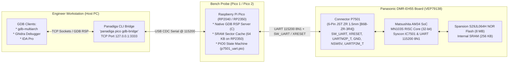

> 🌐 **Language / Idioma:** **English** | [Português (BR)](../pt-BR/GUIA_DEPURACAO_GDB_GHIDRA_IDA.md)
> 🧭 **Portal:** [Docs Index](../INDEX.md) | [Complete Audit](../../COMPLETE_AUDIT.md) | [Audits](../audits/README.md) | [Ghidra Pseudocode](../pseudocode/INDICE_EVIDENCIA_PSEUDOCODIGO_GHIDRA.md) | [Debug Logs](../debug_logs/README.md)

# Interactive Hardware Debugging Guide: GDB, Ghidra, and IDA Pro via P7501 / RSP

**Official Reverse Engineering & Live Debugging Document**  
**Subsystem:** Host-Target Communication Bridge (`P7501`) and GDB RSP Debugging  
**Target Processor:** Matsushita `AM34` / `MN103S` (32-bit RISC Core)  
**Bench Hardware:** Raspberry Pi Pico (RP2040) / Raspberry Pi Pico 2 (RP2350)  
**Physical Interface:** Connector `P7501` (6-pin JST ZR 1.5 mm [`B6B-ZR-3R4`], `TO JIGU` on Main PCB `VEP79138`)

---

## 1. What Are the "GDB Clients" and Where Do They Fit in the Project?

When reverse engineering the Panasonic DMR-EH55 DVD/HDD recorder, there are **3 operational tiers**:

```
+-------------------------------------------------------------------------------+
| TIER 1: Basic Operations / Quick Repair                                       |
| Tools: 'panadiga nvram clean' / 'panadiga pico ping'                          |
| Goal: Clean static dumps, verify 3.3V rails, sanitize firmware files.         |
+-------------------------------------------------------------------------------+
                                      |
                                      v
+-------------------------------------------------------------------------------+
| TIER 2: Bench Graphical Operations                                            |
| Tools: Panadiga Desktop App (Tauri / Visual Interface)                        |
| Goal: Trigger Cold Break-In and NVRAM Erase (clear U99).                      |
+-------------------------------------------------------------------------------+
                                      |
                                      v
+-------------------------------------------------------------------------------+
| TIER 3: Deep Reverse Engineering & Silicon Inspection (WHERE GDB CLIENTS FIT) |
| Tools: mn10300-elf-gdb, gdb-multiarch, Ghidra Debugger, IDA Pro               |
| Goal: Halt the physical CPU, step instruction by instruction, inspect live     |
| registers, and capture encryption keys in flight inside SRAM.                 |
+-------------------------------------------------------------------------------+
```

### Who Are These Clients?

1. **`mn10300-elf-gdb` / `gdb-multiarch` (GNU Debugger):**  
   The standard command-line client. Allows setting breakpoints in real firmware execution, single-stepping assembly instructions (`stepi`), inspecting/modifying registers (`D0..D3`, `A0..A3`, `PC`, `SP`), and reading any memory region on the board.
2. **Ghidra (Ghidra Debugger):**  
   The NSA decompiler. Lets you open the firmware image, connect to the GDB Bridge port (`127.0.0.1:3333`), and view decompiled C synchronized with the physical board, highlighting the exact instruction line executed by the Panasonic chip on the bench.
3. **IDA Pro (GDB Remote Debugger):**  
   Reverse engineering suite that connects directly over the GDB RSP socket, providing control-flow graph visualization for the AM34 processor.
4. **OpenOCD (Legacy Automation Note):**  
   Industrial JTAG/OCD automation tool — see Step 5 below regarding deprecation in favor of the direct Rust bridge for `mn10300`.

---

## 2. Bridge Topology Diagram (End-to-End Pipeline)



---

## 3. Practical Step-by-Step Connection Guide

### Step 1: Start the Bridge in a Terminal

With the DMR-EH55 board connected to the Raspberry Pi Pico over a 1.5 mm JST ZR harness (`ZHR-6` housing — see the [Bench Guide](BENCH_GUIDE_P7501_NO_DESOLDERING.md)), open a terminal and launch the bridge:

```bash
# Identify your Pico COM port (e.g., COM3)
panadiga pico list

# Start the TCP <-> Serial GDB RSP bridge on default port 3333
panadiga pico gdb-bridge --port COM3 --listen 127.0.0.1:3333
```

The terminal outputs:
```text
====================================================================
   PANASONIC AM34 / P7501 GDB REMOTE SERIAL PROTOCOL (RSP) BRIDGE
   Serial Interface : COM3 @ 115200 baud
   TCP GDB Listener : 127.0.0.1:3333
====================================================================
[Bridge] Requesting Pico firmware enter GDB RSP server mode...
[Bridge] Listening for GDB debugger connections on 127.0.0.1:3333...
[Bridge] In your debugger terminal, run:
         (gdb) target remote 127.0.0.1:3333
--------------------------------------------------------------------
```

---

### Step 2: Connecting with GNU Debugger (`gdb-multiarch`)

In another terminal on your computer:

```bash
# Launch the multi-architecture debugger
gdb-multiarch
```

At the GDB prompt, execute:

```text
# 1. Set architecture to Matsushita MN10300 / AM34 core
(gdb) set architecture mn10300

# 2. Connect to the Panadiga bridge listening on port 3333
(gdb) target remote 127.0.0.1:3333

# GDB reports the intercepted target processor (e.g., SIGTRAP / Halt)
0x80000000 in ?? ()

# 3. Read the register bank from the physical processor
(gdb) info registers

# Sample chip output:
# d0: 0x00000000   d1: 0x00000000   d2: 0x00000000   d3: 0x00000000
# a0: 0x00000000   a1: 0x00000000   a2: 0x00000000   a3: 0x0003fff0
# mdr: 0x00000000  psw: 0x00000000  pc: 0x80000000   sp: 0x0003fff0

# 4. Read 16 words from initial Flash memory (Boot Vector at 0x80000000)
(gdb) x/16wx 0x80000000

# 5. Execute one instruction at a time (Single-Step)
(gdb) stepi

# 6. Resume continuous execution
(gdb) continue

# 7. Force the CPU to halt at any moment
Press Ctrl+C in the GDB terminal
```

---

### Step 3: Connecting with Ghidra Debugger

Ghidra provides native processor support for the Matsushita MN10300 family:

1. Open Ghidra and create a project containing the Flash dump (`IC5001`, 8 MB) or extracted modules.
2. In the architecture dialog, select:  
   * **Language:** `MN10300`  
   * **Variant:** `default` (32-bit Little Endian).
3. Open **Ghidra Debugger** (`Window -> Debugger`).
4. On the **Targets** tab, click **Connect**:
   * Select connector: **`gdb via GDB/MI (local or remote)`**.
   * In the target command/host field, specify:  
     `target remote 127.0.0.1:3333`
5. Ghidra automatically synchronizes the decompiler cursor with the live `PC` register returned by the physical board.

---

### Step 4: Connecting with IDA Pro

1. Open the dump in IDA Pro selecting processor **Panasonic MN10300 / AM34**.
2. Go to `Debugger -> Select Debugger -> GDB Remote Debugger`.
3. Open `Debugger -> Process Options`:
   * **Hostname:** `127.0.0.1`
   * **Port:** `3333`
4. Click `Debugger -> Attach to Process`.
5. You can set visual breakpoints in IDA; when the target reaches the desired routine, IDA freezes displaying live hardware registers.

---

### Step 5: Direct Launchers & Native CLI Automation

> [!NOTE]
> OpenOCD support has been discontinued in this repository because it has neither a native `mn10300` target driver nor discrete pin control for `P7501`. All physical probing runs directly through the Rust GDB RSP bridge (`panadiga pico gdb-bridge`) + Pico `P7501` Async UART firmware.

For direct Windows terminal automation or CLI usage:

```cmd
REM Start GDB RSP bridge (:3333) auto-detecting the Pico serial port
tools\iniciar_ponte_gdb.cmd

REM Connect gdb-multiarch pre-configured for mn10300
tools\conectar_gdb_multiarch.cmd
```

Or via direct Rust CLI commands:

```bash
panadiga pico cold-break --port COM3
panadiga pico dump-flash --port COM3 --addr 0x807F0000 --len 0x10000 --out backup_nvram.bin
panadiga pico erase-nvram --port COM3
```

---

## 4. Practical Capabilities Unlocked by GDB

1. **Real-Time Cryptographic Key Capture:**  
   The recorder decrypts `PANA_DVD.FRM` container blocks and HDD firmware partitions directly into SRAM. With GDB, you halt the CPU immediately after key expansion and dump the plaintext memory.
2. **Surgical Hang Diagnosis (`U99` Error):**  
   By placing a breakpoint on the NVRAM validation routine (`0x007F0000`), you observe the exact calibration byte or checksum mismatch triggering the panic path.
3. **In-Memory Microcode Testing Without Flash Wear:**  
   You can load short assembly stubs into free SRAM (`0x00004000`) using `set {int}0x00004000 = 0x...` and redirect `PC` to validate custom patches without burning write/erase cycles on the Spansion NOR Flash.
