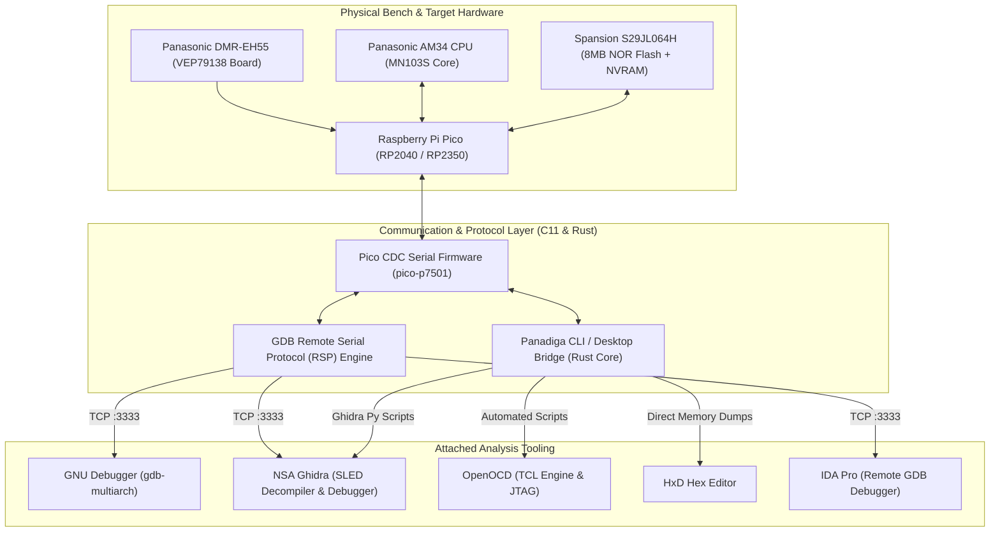

> 🌐 **Language / Idioma:** **English** | [Português (BR)](../pt-BR/ESTRATEGIA_INTEGRACAO_GHIDRA_GDB.md)
> 🧭 **Portal:** [Docs Index](../INDEX.md) | [Complete Audit](../../COMPLETE_AUDIT.md) | [Audits](../audits/README.md) | [Ghidra Pseudocode](../pseudocode/INDICE_EVIDENCIA_PSEUDOCODIGO_GHIDRA.md) | [Debug Logs](../debug_logs/README.md)

# ECOSYSTEM INTEGRATION STRATEGY: GHIDRA, GDB, OPENOCD & PANADIGA
## Silicon Reverse Engineering Architecture for Matsushita AM34 / MN103S

**Document:** `GHIDRA_GDB_INTEGRATION_STRATEGY.md`  
**Classification:** Reverse Engineering Strategy / Architecture Specification  

---

## 1. Architectural Overview

The Panadiga ecosystem acts as the central **Master Hub** bridging proprietary Panasonic hardware (based on the Matsushita AM34 / MN103S processor and Spansion S29JL064H Flash memory) with industry-standard binary analysis and debugging suites: **NSA Ghidra**, **GNU Debugger (`gdb-multiarch`)**, **OpenOCD**, and **IDA Pro**.



---

## 2. Tool Integration Protocols

### 2.1 GNU Debugger (`gdb-multiarch` / `mn10300-elf-gdb`)
* **Protocol:** Standardized GDB Remote Serial Protocol (RSP).
* **Port:** `127.0.0.1:3333` (TCP).
* **Target Architecture:** `mn10300` / `am34`.
* **Execution Flow:**
  1. Start the GDB bridge via Panadiga CLI (`panadiga pico gdb-bridge`) or Desktop UI.
  2. The server binds `127.0.0.1:3333` and opens the USB CDC channel to the Raspberry Pi Pico.
  3. Launch [`tools/conectar_gdb_multiarch.cmd`](../../tools/conectar_gdb_multiarch.cmd) (which auto-detects `gdb-multiarch`, `mn10300-elf-gdb`, `gdb`, or WSL `gdb-multiarch`), or run:
     ```bash
     gdb-multiarch -ex "set architecture mn10300" -ex "target remote 127.0.0.1:3333"
     ```
  4. Full debugging primitives available: breakpoints, register inspection (`info registers`), memory reads (`x/16wx 0x807FE000`), and single-stepping (`stepi`).

### 2.2 NSA Ghidra Integration (Single Source of Truth)
* **Processor Module:** Matsushita AM34 / MN103S SLEIGH processor specification (`mn10300:LE:32:default`).
* **Rust SSOT Generator:** All memory-map definitions and symbol names originate in Rust ([`crates/panadiga-core/src/ghidra/`](../../crates/panadiga-core/src/ghidra/mod.rs), [`specs/regions.rs`](../../crates/panadiga-core/src/ghidra/specs/regions.rs), [`specs/symbols.rs`](../../crates/panadiga-core/src/ghidra/specs/symbols.rs)) and export deterministically:
  ```bash
  panadiga ghidra export-all --dir tools/ghidra/
  ```
  This exports and maintains the 7 Jython scripts in [`tools/ghidra/`](../../tools/ghidra/):
  - [`ghidra_am34_memory_map.py`](../../tools/ghidra/ghidra_am34_memory_map.py): Configures physical/uncached/MMIO bus segments (`INTERNAL_SRAM`, `CORE_MMIO`, `MAIN_SDRAM`, `BOOT_BIN_RAM`, `PROG061_FVU_RAM`, `MAIN_APP_RAM`, `FLASH_NOR_IPL`, `NVRAM_EEMUL`, `FLASH_NOR_CS1_*`, `NVRAM_UNCACHED`, `DAVIS_IDE_*`, `SDCD_HOST_MMIO`, `SDRAM_UNCACHED`, `ASIC_MMIO`, `ATA_IDE_MMIO`, `SC0_UART0_MMIO`).
  - [`ghidra_import_symbols_panadiga.py`](../../tools/ghidra/ghidra_import_symbols_panadiga.py) & [`ghidra_importar_simbolos_panadiga.py`](../../tools/ghidra/ghidra_importar_simbolos_panadiga.py): Annotates reset/interrupt vectors, `P7501` / `SC0` UART registers, `SDCD` / `DAVIS` MMIO, and NVRAM offsets.
  - [`ghidra_connect_debugger.py`](../../tools/ghidra/ghidra_connect_debugger.py) & [`ghidra_conectar_debugger.py`](../../tools/ghidra/ghidra_conectar_debugger.py): Connects Ghidra's debugger client to the `127.0.0.1:3333` RSP target.
  - [`ghidra_auto_unbrick_audit.py`](../../tools/ghidra/ghidra_auto_unbrick_audit.py) & [`ghidra_mn103_fix_decompilation.py`](../../tools/ghidra/ghidra_mn103_fix_decompilation.py): Automated Trap 1–7 auditing, `??` code island recovery, and unbrick cross-referencing.

### 2.3 Native Rust Asynchronous GDB RSP Bridge (`panadiga pico gdb-bridge`)
* **Why `P7501` Requires Asynchronous Bridging:** Connector `P7501` carries asynchronous `115200 8N1` UART (`UARTP2M_T` Pin 6 / `UARTM2P_T` Pin 3) with **no synchronous DWire32A hardware clock**. When using legacy `GDB` (`--target-mode ocd`), [`p7501_bus_protocol.c`](../../firmware/pico-p7501/protocol/p7501_bus_protocol.c) returns `0xFFFFFFFF` fail-safely unless a monitor is alive in AM34 RAM/ROM.
* **Three Selectable Bridge Target Modes (`--target-mode`):**
  - **`panamon1`** (`panadiga pico gdb-bridge --port COM10 --target-mode panamon1`): enters Pico `BRIDGE 115200 PASSIVE` and translates Ghidra synchronous RSP requests (`$qSupported`, `$qXfer:memory-map:read`, `$g`, `$m`, IPL-guarded `$M`) into asynchronous `PANAMON1>` (`R`/`W`) UART commands (`DIGADIAG.FRM` Stage-1.5).
  - **`panarsp`** (`--target-mode panarsp`): forwards RSP `$` packets through `BRIDGE` to `MAIN` `_dev_SERIAL` (`FUN_574f0590`) when normal firmware reaches Ready state.
  - **`ocd`** (default legacy): connects to Pico C11 native RSP handler.
* **Pre-Flight Guided Triage:** Run `panadiga pico bench-wizard` first when diagnosing `U99` / Standby drops; Ghidra attaches live only after `PANAMON1>` or `_dev_SERIAL` answers over `UARTP2M_T`.

### 2.4 HxD Hex Editor Portable Integration
* Automated binary inspection via [`tools/Abrir_HxD.cmd`](../../tools/Abrir_HxD.cmd) launching [`tools/HxD/app/HxD64.exe`](../../tools/HxD/app/HxD64.exe) pre-loaded with the first available lab artifact (`eh55_nor_8mb_ic5001_dump.bin`, `panasonic_dmr-eh55_flash_dump.bin`, `panasonic_dmr_ez485v_flash_dump_4mb.bin`, `panasonic DMR EH-55 Firmware hdd_100.bin`, or `PANA_DVD.FRM`).

---

## 3. AM34 SSOT Memory Map Architecture (`hardware_am34.rs`)

| Memory Region (`AM34_SYSTEM_MEMORY_REGIONS`) | Physical Start | Physical End | Size (KB) | Perms | Description |
| :--- | :---: | :---: | :---: | :---: | :--- |
| **`INTERNAL_SRAM`** | `0x00000000` | `0x0003FFFF` | `256` | `rwx` | On-chip fast work SRAM (`AM34_SRAM_LOADER_BASE` @ `0x00004000`, `4 KiB`) |
| **`CORE_MMIO`** | `0x10000000` | `0x1000FFFF` | `64` | `rw-` | Core AM34 / UniPhier peripheral bus MMIO |
| **`MAIN_SDRAM`** | `0x40000000` | `0x43FFFFFF` | `65536` | `rwx` | External system SDRAM (stage windows: `0x44000000` BOOT, `0x50400000` PROG061, `0x57000000` MAIN; uncached `0x90000000` / `0x90400000` mirror for `PANADMP1` `0x9043950E` & RAM stubs `0x90439B40`) |
| **`FLASH_NOR_IPL`** | `0x80000000` | `0x807EFFFF` | `8128` | `r-x` | Spansion `S29JL064H` (`IC5001`, CS0 / uncached CS1 @ `0x84000000`): IPL `Loader ver0.61` (`0x84000000..0x8403FFFF`, `SA0..SA10`), `DRV` (`0x84080000`), real EH55 `ver0.61` BGO (`0x84130000..0x843FFFFF`, `SA26..SA70` vs `ver0.63`/`PROG061` `0x84200000..0x843FFFFF`), Upper EEMUL (`SA71..SA133`, `0x84400000..0x847EFFFF`) |
| **`NVRAM_U99`** | `0x807F0000` | `0x807FFFFF` | `64` | `rw-` | `SA134..SA141` (`8×8 KiB` uncached @ `0x847F0000`; live `IC5001` dump holds `6 B` `"1284"` header in `SA134` + `0xFF` in `SA135..SA141`) |
| **`SYSTEM_MMIO`** | `0xC0000000` | `0xC0003FFF` | `16` | `rw-` | UniPhier ASIC system registers |
| **`AM34_OCD_MMIO`** | `0xC0004000` | `0xC00040FF` | `1` | `rw-` | On-Chip Debug / hardware trace registers |
| **`ATA_IDE_MMIO`** | `0xD4000000` | `0xD4000FFF` | `4` | `rw-` | ATA/IDE host controller MMIO (`DAVIS` IDE @ `0x89000500`/`0x89000D00`, `SDCD` @ `0x89001800`, `SC0` UART0 @ `0xD4002000`) |

---

## 4. Tauri Desktop One-Click Workbench Launchers

On Desktop hosts (Windows/macOS/Linux), [`launch_external_tool_command`](../../apps/desktop/src-tauri/src/commands/hardware.rs#L232) exposes single-click IPC orchestration for external RE tools (while returning structured guidance on Android):

```rust
#[tauri::command]
pub fn launch_external_tool_command(tool: String) -> Result<String, String> {
    match tool.to_lowercase().as_str() {
        "gdb" => launch_tools_script(&root, "conectar_gdb_multiarch.cmd"),
        "ghidra_scripts" | "ghidra" => launch_tools_script(&root, "iniciar_ghidra.cmd"),
        "hxd" => launch_tools_script(&root, "Abrir_HxD.cmd"),
        "terminal" => spawn_detached("cmd", &["/c", "start", "", "powershell", ...], &root),
        other => Err(format!("Ferramenta externa '{}' não suportada...", other)),
    }
}
```
