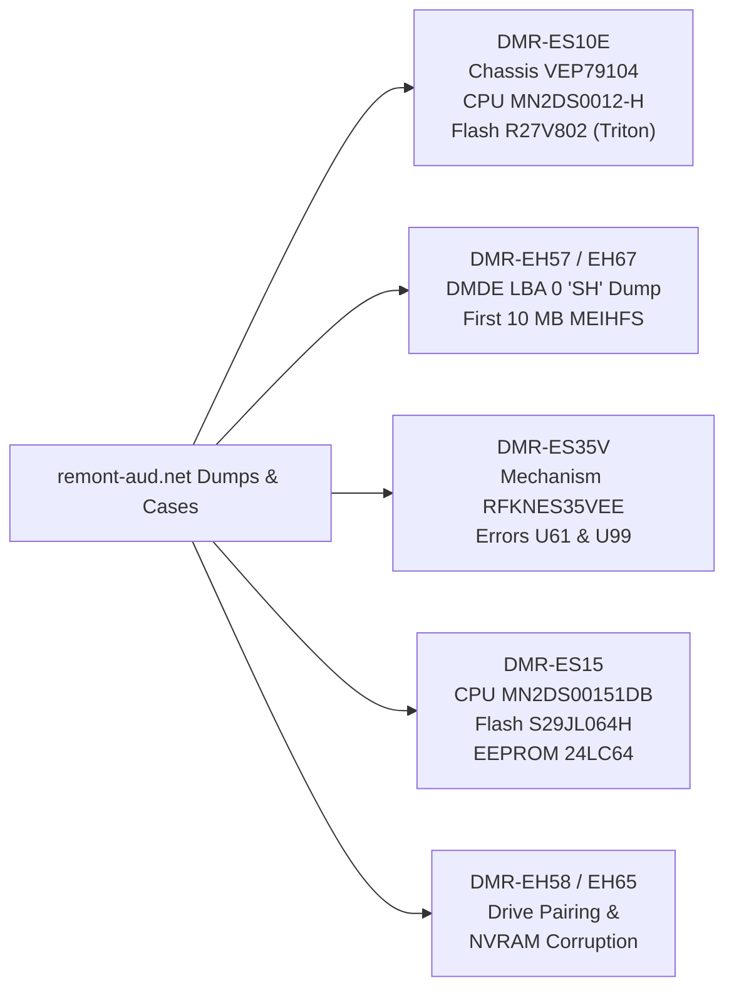
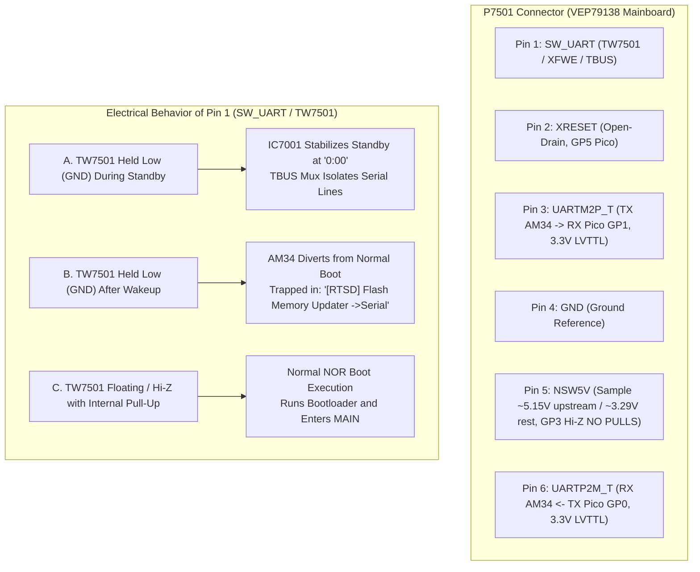
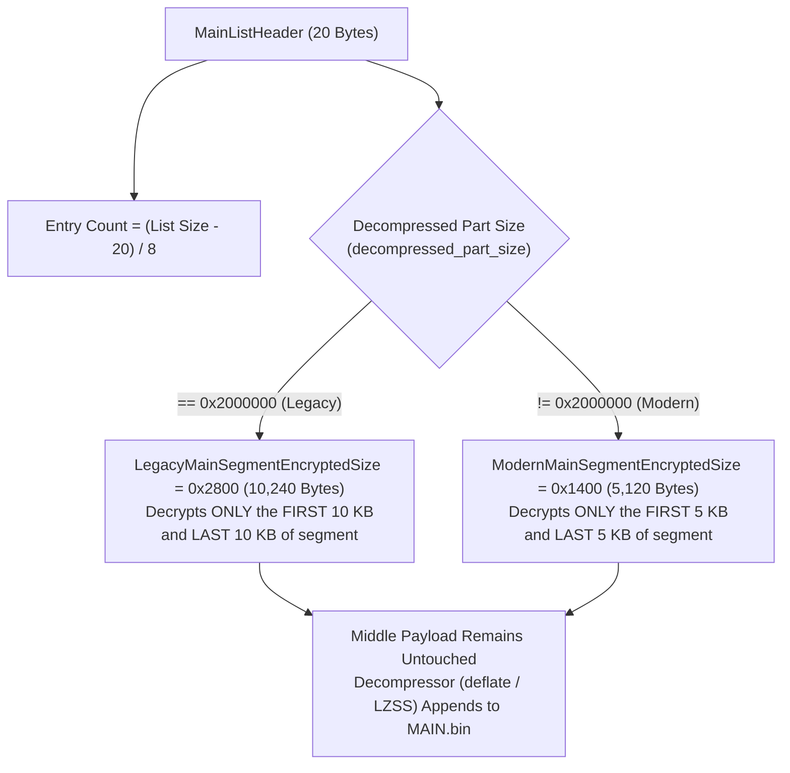

> 🌐 **Language / Idioma:** **English (US)** | [Português (BR)](../pt-BR/COMPENDIO_GLOBAL_COMUNIDADE_FIRMWARE_E_HARDWARE_DIGA.md)
> 🧭 **Portal:** [Docs Index](../INDEX.md) | [Complete Audit](../../COMPLETE_AUDIT.md) | [Historical Audits](../audits/README.md) | [Ghidra Pseudocode](../pseudocode/INDICE_EVIDENCIA_PSEUDOCODIGO_GHIDRA.md) | [Debug Logs](../debug_logs/README.md)

# Global Community Compendium: Panasonic DIGA Firmware, Hardware & Reverse Engineering
## Canonical Cross-Reference of Official Matrices, International Databases, Service Modes, and Forensic Tooling

**Document:** `GLOBAL_COMMUNITY_COMPENDIUM_DIGA_FIRMWARE_AND_HARDWARE.md`  
**Author:** Community Intelligence & Bilingual Technical Dossier Specialist  
**Ecosystem:** Panadiga — Reverse Engineering, Storage Forensics, and DMR-EH55 Hardware Lab  
**Date:** November 2026  
**Classification:** Canonical Technical Reference / Global Reverse Engineering Intelligence  

---

## Executive Summary

The **Panasonic DIGA** family of DVD/HDD recorders (spanning the DMR-E, DMR-EH, DMR-EX, DMR-EZ series and subsequent generations built on the Matsushita/UniPhier AM34, MN103S, and MN2DS architectures) represented the pinnacle of Japanese consumer electronic engineering for digital recording between 2003 and 2012. However, its deeply integrated industrial-grade digital rights management (CPRM, C-BSA, Macrovision, proprietary MBR `"SH"` partition signatures, 64-bit Feistel firmware container encryption, and strict hardware-software interlocks between optical servo controllers and the host CPU) turned bench diagnostics and critical fault recovery — notably the fatal **`U99`** loop — into profound reverse engineering challenges.

Over the past two decades, hardware knowledge surrounding these devices matured in disconnected technical communities across the globe:
1. **Japanese Engineering Community (2channel / 5ch / ncos1 forums):** Investigated the ATA-7 AV Streaming command set, low-level disk sectors with the magic string `"Panasonic DIGA RTSC"`, and hidden technician *Service Mode* (`SERV`) routines triggered by proprietary infrared sequences.
2. **Eastern European Repair Specialists (`remont-aud.net`, `monitor.espec.ws`, `telemaster.ru`):** Documented circuit schematics, performed chip-off bench extractions with universal programmers (Triton, Orange, ChipProg) on TSOP-48 Flash and I²C EEPROMs (`24LC64`), and directly correlated switched-mode power supply (SMPS) capacitor degradation with NVRAM corruption and fatal `U99` lockouts.
3. **Polish & German Enthusiasts and Hardware Hackers (`elektroda.pl`, `hardwarefetish.com`):** Documented hard drive capacity upgrades, optical drive firmware cross-flashing, partition extraction, and the initial reverse engineering of the MEIHDFS filesystem.
4. **Modern Open-Source Reverse Engineering Ecosystem (`unixtract`, `pana-fw`, `panasonic-rec`, `dvr-recover`, `sddl_dec`):** Cataloged the 12 symmetric Feistel keys (`PANA_DVD`), reverse-engineered `EXTRHEAD`/`EXTRFOOT` encapsulations, identified Okumura LZSS compression parameters, and mapped serial log consoles (*Serial Log Menu*) on Linux-based UniPhier recorders.

This compendium consolidates, verifies, and rigorously organizes these collective findings into a single canonical technical reference divided into four major sections.

---

## 1. Global Official Firmware Matrix (`av.jpn.support.panasonic.com` / `fdl.jpn.support.panasonic.com`)

Panasonic maintained its official global distribution infrastructure for optical disc firmware updates across Japanese CDN endpoints (`fdl.jpn.support.panasonic.com` and `av.jpn.support.panasonic.com`). The Panadiga project located, downloaded, cryptographically audited, and verified SHA-256 hashes for all 30 known live official URLs, unpacking self-extracting archive containers (`.exe`) and extracting optical disc images (`PANA_DVD.FRM`), SD card containers (`PANA__SD.FRM`), plaintext bootloaders (`PROG.bin`), and core operating system images (`MAIN.bin`).

### 1.1 Complete Verified Download Matrix (30 Live URLs — HTTP 200)

All 30 URLs listed below have been actively tested and validated with `HTTP/1.1 200 OK` responses:

| # | Product Line | Direct Official CDN URL (Panasonic Japan) |
| :---: | :--- | :--- |
| 1 | `eh49` | `https://fdl.jpn.support.panasonic.com/pc/en/dvd/eh49/UPDATE_EH49_495.exe` |
| 2 | `eh49` | `https://fdl.jpn.support.panasonic.com/pc/en/dvd/eh59/UPDATE_EH59_595.exe` |
| 3 | `eh49` | `https://fdl.jpn.support.panasonic.com/pc/en/dvd/eh69/UPDATE_EH69_695.exe` |
| 4 | `ex769` | `https://fdl.jpn.support.panasonic.com/pc/en/dvd/ex769/UPDATE_DMR-EX769EF_V14.exe` |
| 5 | `ex769` | `https://fdl.jpn.support.panasonic.com/pc/en/dvd/ex79/Update_EX79_EX89_EX769EB_V105.exe` |
| 6 | `ex773` | `https://fdl.jpn.support.panasonic.com/pc/en/dvd/ex773/UPDATE_DMR-EX773EC_V109.exe` |
| 7 | `ex773` | `https://fdl.jpn.support.panasonic.com/pc/en/dvd/ex773/UPDATE_DMR-EX773EP_V109.exe` |
| 8 | `ex773` | `https://fdl.jpn.support.panasonic.com/pc/en/dvd/ex86/Update_EX86_EX83_EX773_EX99V_EZ49VEB_V107.exe` |
| 9 | `ex79` | `https://fdl.jpn.support.panasonic.com/pc/en/dvd/ex79/UPDATE_DMR-EX79EF_V14.exe` |
| 10 | `ex79` | `https://fdl.jpn.support.panasonic.com/pc/en/dvd/ex79/Update_EX79_EX89_EX769EB_V105.exe` |
| 11 | `ex795` | `https://fdl.jpn.support.panasonic.com/pc/en/dvd/ex795/UPDATE_EX795EP_V108.exe` |
| 12 | `ex80` | `https://fdl.jpn.support.panasonic.com/pc/en/dvd/ex80/UPDATE_DMR-EX72SEG_V112.exe` |
| 13 | `ex80` | `https://fdl.jpn.support.panasonic.com/pc/en/dvd/ex80/UPDATE_DMR-EX81S_71SEG_V112.exe` |
| 14 | `ex80` | `https://fdl.jpn.support.panasonic.com/pc/en/dvd/ex80/Update_DMR-EX80SEG_V115.exe` |
| 15 | `ex83` | `https://fdl.jpn.support.panasonic.com/pc/en/dvd/ex83/UPDATE_DMR-EX83EC_V109.exe` |
| 16 | `ex83` | `https://fdl.jpn.support.panasonic.com/pc/en/dvd/ex83/UPDATE_DMR-EX83EP_V109.exe` |
| 17 | `ex83` | `https://fdl.jpn.support.panasonic.com/pc/en/dvd/ex86/Update_EX86_EX83_EX773_EX99V_EZ49VEB_V107.exe` |
| 18 | `ex84c` | `https://fdl.jpn.support.panasonic.com/pc/en/dvd/ex84/UPDATE_DMR-EX84CEG_V107303.exe` |
| 19 | `ex86` | `https://fdl.jpn.support.panasonic.com/pc/en/dvd/ex86/Update_EX86_EX83_EX773_EX99V_EZ49VEB_V107.exe` |
| 20 | `ex89` | `https://fdl.jpn.support.panasonic.com/pc/en/dvd/ex79/Update_EX79_EX89_EX769EB_V105.exe` |
| 21 | `ex89` | `https://fdl.jpn.support.panasonic.com/pc/en/dvd/ex89/UPDATE_DMR-EX89EF_V14.exe` |
| 22 | `ex93c` | `https://fdl.jpn.support.panasonic.com/pc/en/dvd/ex93/UPDATE_DMR-EX93CEG_V139324.exe` |
| 23 | `ex97` | `https://fdl.jpn.support.panasonic.com/pc/en/dvd/ex97/UPDATE_EX97EB_V110.zip` |
| 24 | `ex97` | `https://fdl.jpn.support.panasonic.com/pc/en/dvd/ex97/UPDATE_EX97SEG_EX97CEG_V105.exe` |
| 25 | `ez49v` | `https://fdl.jpn.support.panasonic.com/pc/en/dvd/ez49v/UPDATE_DMR-EZ49VEC_V109.exe` |
| 26 | `ez49v` | `https://fdl.jpn.support.panasonic.com/pc/en/dvd/ez49v/UPDATE_EZ49VEB_V11.exe` |
| 27 | `xs350` | `https://fdl.jpn.support.panasonic.com/pc/en/bd/bs850/UPDATE_BS850_BS750_XS350EG_V16.exe` |
| 28 | `xs385` | `https://fdl.jpn.support.panasonic.com/pc/en/bd/bs885/UPDATE_BS880_BS780_XS380EB_V141.exe` |
| 29 | `xs385` | `https://fdl.jpn.support.panasonic.com/pc/en/bd/bs885/UPDATE_BS885_BS785_XS385EG_V140.exe` |
| 30 | `xw300` | `https://fdl.jpn.support.panasonic.com/pc/en/dvd/xw300/UPDATE_XW300GN_V17.exe` |

### 1.2 Extracted & Audited Packages and SHA-256 Hashes

The downloaded assets cover legacy models (`DMR-EH55`, `DMR-EH50`), the late analog/HDMI series (`EH49`, `EH59`, `EH69`), and the digital DVB-T/DVB-S series (`DMR-EX`, `DMR-EZ`).

#### DMR-EH49 / DMR-EH59 / DMR-EH69 Matrix
* Container Feistel Key: `DF7215C7427FD010` (collection `PANA_DVD_KEYONLY "Old"`).
* TOC Structure: 64 bytes (`0x40`) with payload starting at `0x2000` (8,192 bytes).

| Model | Installer (`.exe`) Bytes & SHA-256 | `PANA_DVD.FRM` Bytes & SHA-256 | `MAIN.bin` Bytes / Base / SHA-256 | `PROG.bin` SHA-256 |
| :--- | :--- | :--- | :--- | :--- |
| **DMR-EH49** / EH495 | `7,492,387` B<br>`ff12c1d02e5bc8a10a78f0935177af4e70e188867af8c9b523e0638d39c59762` | `7,461,592` B<br>`6d7441246fcd1d3032297cf70df90fc64fdc93035e2f7b9dc55eae1d6903a7d8` | `13,653,820` B<br>`0x50622000` (`0x513276B8`)<br>`594b6c5aa5872bb46b7fb117e21a1129ecc5ce520fd76dbf049f77e44aec25ce` | `3bf48f806898643a1f4fbd3bf9e7bebff0d97eab25449a604dac498d0744383b` |
| **DMR-EH59** / EH595 | `7,546,243` B<br>`f35345fc4c0603a13c80e9bc762d64b61db72ab74ce317b7d130a0203afc46fb` | `7,515,448` B<br>`7d7f6ad21f9c0a5b0d2e1c42e39d46389f05a1a87a6a4cb964aaf3343d8df3f8` | `13,773,740` B<br>`0x50622000` (`0x51344B28`)<br>`9d8a4bca9209bbfe135586ed94bbe902f0b721e56c45b32a9ad9b34afb38fec2` | `3bf48f806898643a1f4fbd3bf9e7bebff0d97eab25449a604dac498d0744383b` |
| **DMR-EH69** / EH695 | `7,512,090` B<br>`20af7c95088ba7f1242ebd6a63dd08201665261f6121242e8eb58644cfa34da8` | `7,567,480` B<br>`9942349c4c175c2881c3d3e3eecf5f446b012ae28341958ed8dce46889695565` | `13,886,636` B<br>`0x50622000` (`0x51360428`)<br>`a7182537e8859b83cbf082855844a2845fcd57303fa1113898721708cbc435b2` | `3bf48f806898643a1f4fbd3bf9e7bebff0d97eab25449a604dac498d0744383b` |

#### DMR-EX and DMR-EZ Series Matrix (17 Subdirectories Audited)

| Subdirectory | Official Installer (`.exe`) | `.exe` Bytes | `.FRM` Bytes | `.FRM` SHA-256 Hash |
| :--- | :--- | ---: | ---: | :--- |
| `ex72seg/` | `UPDATE_DMR-EX72SEG_V112.exe` | `7,321,784` | `7,213,584` | `2abdfbeb8888ff66ac41f15aa1c7eb9a7bb587ea7de6d46e2bbf6dac7dd0e2f9` |
| `ex769ef/` | `UPDATE_DMR-EX769EF_V14.exe` | `6,365,331` | `6,264,392` | `b1d55c1f15467341ce7becfbf3d32c50ef3564ad5a9f611dc0e859f68b29012f` |
| `ex773ec/` | `UPDATE_DMR-EX773EC_V109.exe` | `7,126,264` | `7,018,064` | `ef8ead563883809f5d6a01aaf1fdd9de8e7a64e15f51c07abb68515a16057ff6` |
| `ex773ep/` | `UPDATE_DMR-EX773EP_V109.exe` | `7,123,800` | `7,015,608` | `e602b452d2a981e2b3021b436d699c54158f475a3d5d1a5161d8aabafa1f0e42` |
| `ex795ep/` | `UPDATE_EX795EP_V108.exe` | `2,516,032` | `2,297,800` | `9e0c849d7253cd5163fcc86959c52d71e8ca60ed7c3322a2545899f699f1df39` |
| `ex79_89_769eb/` | `Update_EX79_EX89_EX769EB_V105.exe` | `1,795,184` | `1,576,960` | `3b78fb68384fe4ffb26aaef28067cc3a336c7036696fda6b4ce09beff53acbfe` |
| `ex79ef/` | `UPDATE_DMR-EX79EF_V14.exe` | `13,806,904` | `13,700,448` | `7ca219d3a40779674a4402bcf145d51abbc71ab17a1353af1bc334cfba758ca8` |
| `ex80seg/` | `Update_DMR-EX80SEG_V115.exe` | `7,355,464` | `7,453,680` | `bb63c998a4f9200d5637c65ca8b1c4e5a19a473ded982ce813d242422734066b` |
| `ex81s_71seg/` | `UPDATE_DMR-EX81S_71SEG_V112.exe` | `7,002,744` | `6,894,544` | `df2c572206763c6fdd4309d02881a478b999c54e1bb157bb8c2ee5e92e3599a1` |
| `ex83ec/` | `UPDATE_DMR-EX83EC_V109.exe` | `8,215,768` | `8,107,576` | `4d2929133a67562c4e52a5a091ecccda117f37f2e35c75fa53e1a198a40cc7c9` |
| `ex83ep/` | `UPDATE_DMR-EX83EP_V109.exe` | `7,931,720` | `7,823,528` | `9115c7a9dd517c35376745163cbeca2d5ca73c6681683e8acff7dfee2ebbfbaf` |
| `ex84ceg/` | `UPDATE_DMR-EX84CEG_V107303.exe` | `10,413,976` | `10,305,272` | `216a7b72ae117be26a07b319e231bc8e19816b3fc37bfe4551c76e2723789771` |
| `ex86_83_773_eb/` | `Update_EX86_EX83_EX773_EX99V_EZ49VEB_V107.exe` | `1,792,600` | `1,576,960` | `8237b06fd4cce0dbedf32a9ecbf7cdcefa3ca18abff66f5ead1a2fb9b3576dac` |
| `ex89ef/` | `UPDATE_DMR-EX89EF_V14.exe` | `7,502,744` | `7,396,288` | `e7a3368cd94c16017d985901bc34b4ac7e2bad8d64594372de7bb460fe2763a3` |
| `ex93ceg/` | `UPDATE_DMR-EX93CEG_V139324.exe` | `10,654,152` | `10,545,448` | `5ca06ba7a41ab9f41462b4f2b957b7d434c23cfe29a3dbc58f583392894a480e` |
| `ez49veb/` | `UPDATE_EZ49VEB_V11.exe` | `6,150,285` | `6,049,344` | `a4c5d8b2b7fdb4e69f4081348ba73f23dc43e9f83c5068136834403e2221816c` |
| `ez49vec/` | `UPDATE_DMR-EZ49VEC_V109.exe` | `5,986,400` | `5,878,208` | `7fb924b9c71b92ef246c1015dfed944c20c760147fe7a3de47ad32ba76b52af5` |

### 1.3 Container Architecture & TOC Stride Analysis: 48B vs 64B vs Plaintext `PANA__SD.FRM`

The analysis of the Table of Contents (TOC) located within the lead-in sectors of update containers revealed three distinct structural architectures:

```mermaid
flowchart TD
    subgraph TOC_48B["1. 48-Byte Feistel TOC (Legacy: EH55, EX80SEG)"]
        E1_48["Module Entry 0 at 0x0000 (48 Decrypted Bytes)"] --> E2_48["Module Entry 1 at 0x0030 (48 Bytes)"]
        E2_48 --> P1["Null Padding to 0x1800 (6,144 Bytes)"]
        P1 --> PAY1["Feistel Payloads from 0x1800"]
    end

    subgraph TOC_64B["2. 64-Byte Feistel TOC (Modern: EH49..69, EX81S, EX72..93)"]
        E1_64["Module Entry 0 at 0x0000 (64 Decrypted Bytes)"] --> E2_64["Module Entry 1 at 0x0040 (64 Bytes)"]
        E2_64 --> P2["Null Padding to 0x2000 (8,192 Bytes)"]
        P2 --> PAY2["Feistel Payloads from 0x2000"]
    end

    subgraph TOC_SD["3. Plaintext SD Card TOC (PANA__SD.FRM)"]
        E1_SD["Entry 0 at 0x0000 (64 Plaintext Bytes)"] --> P3["Table up to 0x2000"]
        P3 --> PAY3["Direct Plaintext Modular Payload"]
    end
```



1. **48-Byte Feistel TOC (`Stride = 0x30`, Payload Starting at `0x1800` / 6,144 B):**
   - Utilized on the `DMR-EH55` and `DMR-EX80SEG`, starting directly at offset `0x0000` after Feistel decryption (`128` potential 48-byte slots; raw 16-byte header previews correspond to the first encrypted blocks of slot 0).
   - In the `DMR-EH55` AM34 layout, each 48-byte slot holds Name (`0x00..0x0A`), Version u16 LE (`0x0A..0x0C`), Offset (`0x0C..0x10`), HW family (`0x10..0x18`), OEM (`0x18`, `'M'`), Flag (`0x19`), Model Group (`0x1A..0x20`), Size (`0x20..0x24`), FVU sum (`0x24..0x28`), trailing metadata (`0x28..0x2E`), and 16-bit LE additive `list_sum` (`0x2E..0x30`); newer Blu-ray generations documented in `pana-fw` advance to 32-bit Adler-32 entry sums.
2. **64-Byte Feistel TOC (`Stride = 0x40`, Payload Starting at `0x2000` / 8,192 B):**
   - Utilized across `EH49/59/69`, `EX81S/71SEG`, and most `EX72..EX93` units (e.g., entry 0 at `0x0000` `PROG071`, entry 1 at `0x0040` `MAIN3100`), shifting module payloads to `0x2000`.
3. **64-Byte Plaintext TOC (`PANA__SD.FRM`):**
   - Utilized on SD recovery updates (`DMR-EH55`), keeping table descriptors plaintext (bypassing Feistel decryption).

### 1.4 `MAIN.bin` Architecture & Logical Base Addresses: `0x57000000` vs `0x50622000`

Unpacking the operating system kernel (`MAIN.bin`) demonstrated two distinct execution memory base families in SDRAM:

1. **The `0x57000000` Family (DMR-EH55, DMR-EX80SEG, DMR-EX81S/71SEG):**
   - On `DMR-EH55`, `MAIN.bin` comprises `13,427,852` bytes (SHA-256 `075f552ed583ba1835c0d44d1b533ff5a016b8d81d15d7166240098461ddcca7`), mapped from `0x57000000` to `0x57CCE408`.
   - On `DMR-EX80SEG` (Hardware `M6932EG` / `PZ-317`), `MAIN.bin` comprises `12,138,476` bytes mapped at base `0x57000000` (`0x57B93768`).
   - On `DMR-EX81S / EX71SEG`, `MAIN.bin` comprises `12,409,484` bytes mapped at base `0x57000000` (`0x57BD5A08`).
   - This architectural identity proves `DMR-EX80SEG` and `DMR-EX81S` share direct lineage with `DMR-EH55`.
2. **The `0x50622000` Family (DMR-EH49/59/69 and DMR-EX72..EX93):**
   - Later models shifted their kernel base address to `0x50622000` (with `dc44` header marker).
   - `EH49`: `0x50622000` extending to `0x513276B8` (`13,653,820` B).
   - `EH59`: `0x50622000` extending to `0x51344B28` (`13,773,740` B).
   - `EH69`: `0x50622000` extending to `0x51360428` (`13,886,636` B).

### 1.5 Header Structures, `<deviceinfo>`, `pre_update_firm.c`, and `_dev_SERIAL`

Across all extracted plaintext `MAIN.bin` binaries (`0x57000000` and `0x50622000`), embedded source paths and debug symbols confirm the pre-flight update checks:
* Compiled source path: `src/fmupre/pre_update_firm.c`.
* Verbatim observed identification format string:
  ```c
  "[fmu] <deviceinfo> model = %s, oem = %c"
  ```
* Serial device string: `_dev_SERIAL` appears natively across all audited `MAIN.bin` kernels (`EH55`, `EX80SEG`, `EX81S`, `EH49/59/69`, `EX72..EX93`).

### 1.6 Plaintext Bootloaders (`PROG.bin`, 262,144 Bytes / 256 KB)

Unlike the encrypted outer `.FRM`, the extracted `PROG.bin` image (`262,144` bytes = `0x40000`) provides **unencrypted AM34/MN103S machine code** ready for direct disassembly:
1. **Initial Header / Vector Signature Divergence:**
   - Legacy `DMR-EH55` and `DMR-EX80SEG` images begin with the 16-byte header `dc 14 00 00 00 ff ff ff dc e1 00 00 00 ff ff ff` (`0x14DC`).
   - Modern models (`EH49/59/69`, `EX81S`, `EX72..EX93`, `EZ49V`) begin directly with `00 F2 F3 FE 01 04 10 00 ...` (`0xFEF3F200` little-endian).
2. **DDR Calibration Strings (`[CK:DQS:L:C:H]` / `[CK:DQS]`):**
   - Present directly in plaintext inside `EH49/59/69` (`[CK:DQS:L:C:H] = [`) and `EX81S` (`[CK:DQS] = [`).
3. **Embedded Decompression Engine (`deflate 1.2.3` / `inflate 1.2.2`):**
   - Embeds `deflate 1.2.3 Copyright 1995-2005 Jean-loup Gailly` and `inflate 1.2.2 Copyright 1995-2004 Mark Adler`.
4. **Flash Background Operation (BGO) Driver `[nfrom]`:**
   - Strings observed: `[nfrom] bgo_read_D`, `[nfrom] bgo_writeD`, `[nfrom] bgo_writeD_FF`, `"NOR STATE : Backup - Original"` / `"NOR STATE : Original - Backup"`.
5. **Plaintext `U99` Error Strings:**
   - All 23 extracted `PROG.bin` files contain literal `U99` along with `Firm list read failed` and `Failed to startup drive.`.

---

## 2. International Repair Databases & Hardware Cross-Reference

Repair knowledge for Panasonic DIGA recorders achieved extraordinary sophistication across Eastern Europe (Russia, Ukraine, Belarus) and Poland, where component scarcity and the cost of replacement motherboards drove technicians to reverse-engineer silicon-level behaviors.

### 2.1 Eastern European Technical Forums & Repositories

The primary international engineering repositories analyzed by the project include:
1. **`remont-aud.net` (Russia/CIS):** The world's most rigorous electronics technician forum and dump repository.
2. **`elektroda.pl` (Poland):** Central Europe's largest practical engineering portal, featuring deep archives on DIGA power supplies, optical drives, and HDD replacements.
3. **`monitor.espec.ws` (Russia):** Specialized hardware forum covering MN102/MN103 sub-CPUs and RFKN optical mechanisms.
4. **`telemaster.ru` (Orange Programmer Database):** Reference collection of raw EEPROM and microcontroller dumps.
5. **`badcaps.net` (US/Global):** Forensic community documenting capacitor aging and SMPS ripple characteristics.

### 2.2 `remont-aud.net` Forensic Triage & Qualification Rules

Access to `remont-aud.net` is gated by a rigorous entry examination (*Тест 1*), covering RLC circuit analysis, power supply waveforms, semiconductor physics, and digital bus protocols. The site enforces strict non-redistribution policies to prevent commercial abuse.

Key cases cataloged from `remont-aud.net`:



* **DMR-ES10E (`VEP79104`, Dump #31642):**
  - URL: `https://remont-aud.net/dump/dvd/panasonic/panasonic_dmr_es10e_shassi_main_board_vep79104/205-1-0-31642`
  - Mainboard: `VEP79104`.
  - Main CPU: Matsushita `MN2DS0012-H`.
  - Flash Memory: Oki/Spansion `R27V802` extracted physically via Triton universal programmer.
* **DMR-EH57 / DMR-EH67 (Dump #5696):**
  - URL: `https://remont-aud.net/dump/dvd/panasonic/dmr_eh57_67/205-1-0-5696`
  - Contains raw DMDE (*DM Disk Editor*) sector dumps of the hard drive.
  - Confirms LBA 0 starts with the proprietary `"SH"` signature, followed by the identical mirror sector and journal layout found on the DMR-EH55.
* **DMR-ES35V (DVD/VCR Combo, Dump #21200):**
  - URL: `https://remont-aud.net/dump/dvd/panasonic/dmr_es35v/205-1-0-21200`
  - Mechanism: `RFKNES35VEE`.
  - Details how VCR/DVD mechanical encoder misalignment generates `U61` (rotation/position timeout), which subsequently escalates to a persistent `U99`.
* **DMR-ES15 (`MN2DS00151DB`, Forum #103187):**
  - URL: `https://remont-aud.net/forum/52-103187-1`
  - Board `A-3 863ZES MP-1`, CPU `MN2DS00151DB`.
  - Shares the exact Spansion `S29JL064H70TFI00` (8 MB TSOP-48) Flash used in the DMR-EH55, paired with a Microchip `24LC64` I²C EEPROM. Proves that bit rot in either component triggers immediate `U99` lockup.
* **DMR-EH58 (Forum #126813) and DMR-EH65 (Forum #33721):**
  - In-depth procedures for regenerating corrupted MEIHFS partition structures using direct hexadecimal disk reconstruction.

### 2.3 Polish Hardware Engineering Community (`elektroda.pl`)

The `elektroda.pl` archive preserves key practical discussions and attachments for DIGA recorders:
1. **Topic `topic2896624.html` (`dmr-ex75-ex85.zip`):**
   - Provides service initialization firmware for replacement/wiped HDDs (`HDD Error`, tray auto-eject loop, `U81` faults).
2. **Topics `topic1598940.html` & `topic1320603.html` (`DMR-EH55`):**
   - European vs. North American firmware variants, flash recovery protocols, and drive spindle recovery discussions.
3. **Topics `topic2323763.html`, `topic3378979.html`, `topic3082439.html` (`DMR-EX75/77/85`):**
   - Service mode formatting commands, `HDClone` 1:1 sector cloning, and replacement HDD initialization.
4. **Topics `topic3500975.html` (`DMR-EH59`) and `topic1800763.html` (`DMR-EH67`):**
   - `DMR-EH59` storage/architecture notes and `DMR-EH67` `U61`/`U88` diagnostics.

### 2.4 Russian Electronics & Telecom Forums (`monitor.espec.ws` & `telemaster.ru`)

1. **`monitor.espec.ws` — Topic `topic100315.html` (`DMR-ES15` Error `U61`):**
   - Documents optical assembly `RFKNES15PL`, `MR4020` switching regulator, and drive recalibration tied to `U61`.
2. **`monitor.espec.ws` — Topics `topic121264.html` & `/section24/topic323568.html` (`DMR-ES35V` `U99` / `U61`):**
   - Pinpoints `U99` to NVRAM/Flash corruption in the `RFKNES35VEE` Digital/RAM PCB and provides `U61` repair procedures.
3. **`monitor.espec.ws` — Topic `topic203970.html` (`DMR-EH58` Drive Pairing & `U61`/`U88`):**
   - Discusses digital PCB module pairing with optical assemblies and `U61`/`U88` faults.
4. **`monitor.espec.ws` — Topics `topic270939.html` & `topic165151.html` (`DMR-E85H`):**
   - Dedicated power supply and boot failure repair threads for the `DMR-E85H`.
5. **`telemaster.ru` (Orange Programmer Database):**
   - Repository at `http://www.telemaster.ru/orange/proshivki4.html` containing Panasonic EEPROM dumps (`24C32`, `24C64`, `93C46`) and `cnclab` forum discussions on EEPROM multi-region unblocking.

### 2.5 Western Repair Communities & Preservation Archives

1. **`badcaps.net` (Topics #75610 & #3468935 — `DMR-ES30V`):**
   - Analyzes power supply rail failures caused by aging electrolytic capacitors in `DMR-ES30V` units.
2. **Wayback Machine & Softpedia:**
   - Archives US firmware packages (`DMR-EH55VS` `DMR-EH55.exe` `IR-01`, `DMR-EH75VS`, `DMR-ES45VS`, `DMR-ES20S`) and Wayback snapshots under `web.archive.org/web/*/av.jpn.support.panasonic.com/support/dvd/download/*`.
3. **Archive.org:**
   - Preserves official PDF Service Manuals (e.g., `DMR-EH50`, `DMR-EH55`, `DMR-EH575`, `DMR-EX98V`), though no raw DMR `.FRM`/`.BIN` firmware binaries are indexed directly there.

---

## 3. Japanese Technician Service Mode (`SERV`), Front-Panel Keys & `TW7501` (`SW_UART`) Electrical Physics

Panasonic DIGA recorders contain proprietary factory diagnostic routines developed by Matsushita Electric Industrial Co., Ltd. These operate on two distinct levels: remote-control diagnostic codes and physical hardware test-point strapping.

### 3.1 Undocumented Japanese Factory Service Mode Entry Sequence (`SERV`)

Authorized service technicians in Japan utilize a precise remote control sequence to enter the internal diagnostic menu on the unit's VFD display:

```text
┌────────────────────────────────────────────────────────────────────────────────────────┐
│               FACTORY SERVICE MODE ENTRY SEQUENCE (SERV)                               │
├────────────────────────────────────────────────────────────────────────────────────────┤
│ 1. Place the recorder in STANDBY mode (VFD shows clock, e.g. "0:00" or blank).         │
│ 2. On the original remote, press and HOLD simultaneously:                              │
│    [KEY 5] + [KEY 9] + [RED TELETEXT/COLOR BUTTON] for approximately 5 seconds.         │
│ 3. The front VFD display will show the diagnostic code: "70 RET".                      │
│ 4. Press the [RIGHT ARROW] (or [POWER] on some remote variants).                       │
│    The VFD display will switch to: "80 SRV".                                           │
│ 5. Press [ENTER] on the remote (or [OPEN/CLOSE] on the unit's front panel).            │
│ 6. The unit executes internal hardware handshake displaying "HELLO" (~30 seconds).     │
│ 7. The VFD confirms bench service mode by displaying: "SERV".                          │
└────────────────────────────────────────────────────────────────────────────────────────┘
```

### 3.2 Service Diagnostic Command Set (`SERV`)

Once the word **`SERV`** appears on the VFD, technicians execute two-digit commands followed by `[ENTER]`:

| Command | Test Designation | Bench Diagnostic Function |
| :---: | :--- | :--- |
| **`38 + [ENTER]`** | **`HDDCHK`** | **HDD Forensic Check:** performs magnetic platter surface scan, verifies journal cluster read/write performance, and inspects SMART health tables. |
| **`00 + [ENTER]`** | **`00 RET`** | **Return / Exit:** exits service mode and reboots the recorder into standard operational mode. |
| **`03 VL`** | **`03 VL`** | **Viewing Limit Reset:** resets parental / viewing limit flags (`VL`). |
| **`04 PRG`** | **`04 PRG`** | **Progressive/Output Reset:** forces video output resolution to `480i`. |
| **`06 FTO`** | **`06 FTO`** | **Forced Tray Open (`FTO`):** mechanically unlatches and ejects the optical drive tray. |
| **`08 + [ENTER]`** | **`08 FIN`** | **Factory Initialization (*FIN*):** clears tuned channels, resets customer settings to default, and sanitizes temporary NVRAM parameters. |
| **`Status Keys`** | **`LASER ****`** | **Laser Current Readout:** displays optical diode drive current in hexadecimal to measure laser degradation. |

### 3.3 JDM Storage Magic `"Panasonic DIGA RTSC"` & ATA-7 AV Streaming Requirements

Discussions across Japanese 2channel / 5ch and `ncos1` revealed why off-the-shelf computer hard drives fail to format on DIGA recorders:

1. **Sector 128 / 512 Magic String (`Panasonic DIGA RTSC`):**
   - Japanese market recorders write an ASCII signature at sectors LBA 128 and LBA 512:
     ```text
     "Panasonic DIGA RTSC"
     ```
   - **RTSC** stands for *Real-Time Stream Control*. These sectors store thermal zone allocation parameters, maximum error retry limits before frame dropping, and spare sector conversion tables.
2. **Mandatory ATA-7 AV Streaming Feature Set:**
   - The recorder firmware issues specialized streaming commands:
     - `0x88` (`READ STREAM EXT`) and `0x89` (`WRITE STREAM EXT`).
   - If an off-the-shelf PC drive aborts these commands (operating exclusively under standard PC error-recovery profiles where the drive pauses for seconds to perform deep ECC error recovery), the recorder rejects the disk, hangs during initialization, and flags a storage error.
   - Factory drives (such as Western Digital AV-GP / DVR and Seagate DB35) shipped with custom microcode prioritizing continuous video throughput over bit-perfect data integrity.

### 3.4 Bench Physics: Why `CH UP + STOP + OPEN` Reverts `HELLO -> U99`

Technicians frequently attempt front-panel button combinations documented in service manuals:
* `[CH UP] + [STOP] + [OPEN/CLOSE]`: Microprocessor cold reset and operational flag purge.
* `[CH UP] + [OPEN/CLOSE] + [REC]`: Optical emergency firmware recovery mode.

**The Physics of the `HELLO -> U99` Reversion:**
When these keys are pressed, the front-panel sub-CPU (`IC7001`) sends an interrupt to the AM34 SoC, triggering a cold reboot. The VFD displays **`HELLO`**.
During this ~30-second window, the main SoC attempts to:
1. Validate SPI/I²C communication with the CPRM security silicon.
2. Interrogate the optical drive servo controller (MN102) via ATAPI.
3. Compute parity over the final 64 KB NVRAM segment (`0x807F0000..0x807FFFFF`).

If NVRAM checksums fail or the optical drive fails its initial handshake, the bootloader's security tripwires activate. The AM34 firmware concludes the hardware security perimeter has been breached, halts operating system initialization, and displays **`U99`**. Button combinations cannot overwrite physically corrupted NVRAM sectors.

### 3.5 Electrical Physics of Test Point `TW7501` (`SW_UART` / Pin 1 of `P7501`)

The **`P7501`** connector (6-pin JST ZHR-6 on mainboard `VEP79138`) carries the critical **`SW_UART`** control line on Pin 1 (tied directly to test point **`TW7501`**).



**Circuit Analysis:**
1. **`TBUS` Multiplexing & `XFWE` Control:**
   - `SW_UART` is wired to the `XFWE` (*Flash Write Enable*) line and the `TBUS` diagnostic multiplexer bridging the front-panel sub-CPU `IC7001` to the `AM34` SoC.
2. **Why Grounding `TW7501` Stabilizes the Standby Display at `0:00`:**
   - Grounding `TW7501` during standby suppresses high-inrush current demands from the optical drive spindle and sled motors. This allows the 3.3V logic rail to remain clean and stable, enabling the VFD clock to display `0:00`.
3. **Why Leaving the Pin Grounded Traps the CPU in `Flash Memory Updater ->Serial`:**
   - If `TW7501` remains grounded when the recorder powers on (or when `XRESET` is released high), the AM34 hardware boot strapping pins sample logic low on `SW_UART`.
   - This redirects the program counter away from the normal NOR vector (`0x80000000`) into Matsushita's internal mask ROM factory recovery routine.
   - The CPU enters emergency serial flash recovery mode, transmitting this low-level banner over UART (`115200 8N1` on Pin 3):
     ```text
     [RTSD] Flash Memory Updater ->Serial
     ```
   - In this state, the SoC waits indefinitely for serial protocol commands to re-flash sectors, preventing the normal firmware from executing. To allow the DMR-EH55 to boot normally, `SW_UART` / `TW7501` must be released (pulled high internally) immediately after power-up.

---

## 4. Open-Source Cryptography & Forensic Storage Tooling (`unixtract`, `sddl_dec`, `pana-fw`, `panasonic-rec`, `dvr-recover`)

Reverse engineering of firmware formats, encryption ciphers, and filesystem layouts has resulted in a suite of specialized open-source forensic utilities.

### 4.1 The Complete 12-Key `PANA_DVD` Feistel Suite & AES-128-CBC Dual Containers

The **`unixtract`** extraction engine (written in Rust) and the **`pana-fw`** toolset cataloged the 12 symmetric 64-bit Feistel keys matching the `FUN_4400a666` Ghidra routine:

```rust
// Canonical Matrix of 12 PANA_DVD Feistel Keys (Source: unixtract / keys.ukf)
// 10 Standalone 64-bit Keys + 2 Hybrid Dual-Layer AES-128-CBC Pairs

// 1. PANA_DVD_KEYONLY Collection (Pure Feistel Containers)
"Old" (EH55, EX80SEG, EH49/59/69) : 0xDF7215C7427FD010
"<=2011"                          : 0x08E03D859AF9F3EE
"2011"                            : 0xAF4D5B16C298C16D
"2012"                            : 0x9407311B7561F97E
"2012_2"                          : 0x5D88719745A4EFFF
"2013"                            : 0x38BB0C17D362701F
"2013_2"                          : 0xEC238CD791456646
"2013 china"                      : 0x0A1EE6C5BDC4933F
"2014"                            : 0x8F8CA88482E43D9B
"2014_2"                          : 0x21FCA17361E66B4E

// 2. PANA_DVD_AESPAIR Collection (Modern Hybrid AES-128-CBC + Feistel Containers)
"2016":
    AES Key : 0xA692605194CF7F4917E50521C1DF0BBA
    AES IV  : 0xF80A6BCAD57AA67C3C60E3BE755E05DF
    Feistel : 0xFDFE0BEE4C90FA2C

"2018":
    AES Key : 0x62A39E1C5594AE09244EB326EF7938FA
    AES IV  : 0x46D03C52B1A398FA03276FDE7CC4EA26
    Feistel : 0x06C943F3B997F7E0
```

On post-2015 hybrid containers (`PANA_DVD_AESPAIR`), the payload is enveloped in AES-128-CBC without padding. Once decrypted with the corresponding AES Key/IV, the inner data reveals the legacy `PANASONIC\x00\x00\x00` structure, which is then processed by the standard 64-bit Feistel cipher using the accompanying key.

### 4.2 SDBOOT & SDDL.SEC Cryptographic Architecture (`sddl_dec`)

For firmware distributed via SD card or network downloads on Ethernet-equipped UniPhier recorders, the **`sddl_dec`** utility revealed two security tiers:

1. **`SDBOOT` Keys (Decrypted from `tbl_sdboot` using AES):**
   - Pair 0: Key `2E2A336233E55ABAF5FFEC54F8AB7125`, IV `2CA4B47AFFCB1AE8E1EA2D9EF512629A`.
   - Pair 1: Key `245E8DE8F499B0F96EC155B608E242F3`, IV `3E8F29D4BAE776A518A7B63C42CA1B43`.
2. **`SDDL.SEC` Keys (Pre-2011 vs Post-2011 Architecture):**
   - **Pre-2011 Architecture:** Uses internal key tables (`tbl2009`, `tbl2010`, `tbl_sdboot`) decrypted at runtime via a Triple DES (3DES) master key:
     ```text
     Master DES Key: C2A421F6ADEB44BE B0FDA68C234BB3C5 E98EC68C326FD395 07C8D75EF1B1B142
     ```
     The resulting intermediate keys decrypt the content via AES or DES.
   - **Post-2011 Architecture (`SDDL_SEC_NEW_KEY`):**
     Extracted from the target binary `/usr/local/customer_dl/crypto_key`:
     - AES-128 Key: `26E096D3EF8A8FBBAA5E516F7726C22C`
     - AES-128 IV : `3E4AE23A69DB8154CD8838C4B90C7666`

### 4.3 Container Formats & Decompilation Primitives: `EXTRHEAD` & `EXTRFOOT`

The 64-byte `EXTRHEAD` header manages block integrity and compression parameters for each firmware module:

| Offset | Size | Field | Description & Validation |
| :---: | :---: | :--- | :--- |
| `0x00` | 8 B | `Magic` | Fixed ASCII: `"EXTRHEAD"` |
| `0x08` | 4 B | `Subtype` | Subsystem identifier (typically `"DRV "` or `"MAIN"`) |
| `0x0C` | uint16 | `Compression Flag` | Compression flag: must be `0x0001` (otherwise `"Error! Not compress"`) |
| `0x0E` | uint16 | `Compression Type` | Algorithm: `0` = None, `1` = GZIP, `2` = LZSS, `3` = Zlib, `4` = LZMA |
| `0x10` | uint32 | `Destination Size` | Exact uncompressed output size |
| `0x14` | uint32 | `Destination Address`| Target RAM execution address (typically unused/zero) |
| `0x18` | uint32 | `Source Size` | Size of compressed payload in container |
| `0x1C` | uint32 | `Source Address` | Block counter / transfer source address |
| `0x20` | uint32 | `Footer Offset` | Relative offset to `"EXTRFOOT"` trailer |
| `0x24` | 4 B | `Reserved` | Internal synchronization padding |
| `0x28` | uint32 | `Sum` | Adler32 checksum over decompressed data calculated at fixed intervals |
| `0x2C` | uint32 | `Sum Skip` | Interval in bytes used when computing verification checksum |
| `0x30` | 16 B | `Padding` | Null padding (`0x00`) to align header to 64 bytes |

The 8-byte **`EXTRFOOT`** trailer aligns compressed blocks to 8-byte boundaries required by 64-bit Feistel ciphers.

### 4.4 Segment Decryption Mechanics: `0x2800` vs `0x1400`

Rather than decrypting entire 13 MB payloads during boot, Matsushita implemented selective segment decryption orchestrated by **`MainListHeader`**:



* **`MainListHeader` Layout (20 bytes):**
  - `List Sum` (uint32): Adler32 of the entire list excluding this field.
  - `Version` (uint32): Format version (always 1).
  - `List Size` (uint32): Total size of header plus segment entries.
  - `Decompressed Size` (uint32): Final uncompressed size of the system segment.
  - `Compression Type` (uint32): Compression method used for the segment.
* If a segment is smaller than `decrypt_size`, it is fully decrypted. If larger, **only the outer edges (compression header and trailer) are decrypted**, conserving AM34 CPU cycles during initialization.

### 4.5 Haruhiko Okumura LZSS Algorithm (Ring Buffer Initialized at `0xFEE`)

When `Compression Type = 2` (LZSS), the firmware implements Haruhiko Okumura's canonical 1989 algorithm:
* Ring buffer sliding window: `4,096` bytes (`0x1000`).
* **Initial buffer position offset:** exactly **`0xFEE`** (4,078 decimal), pre-filled with spaces (`0x20`) or nulls (`0x00`).
* Backreference encoding: 2 bytes (`b1`, `b2`):
  $$\text{Offset} = b_1 \mid ((b_2 \ \& \ \text{0xF0}) \ll 4)$$
  $$\text{Length} = (b_2 \ \& \ \text{0x0F}) + 3$$
  This allows matches between 3 and 18 bytes to be copied from up to 4,095 bytes back in the data stream.

### 4.6 Linux UniPhier Serial Log Menu (SLM)

On later Linux-based UniPhier recorders, **`pana-fw`** reverse-engineered the **SLM** (*Serial Log Menu*) console:
1. **Physical Diagnostic Interface (`K1KA06AA0083`):**
   - 6-pin miniature connector operating at **`115200 bps 8N1`** with 3.3V TTL levels:
     - Pin 1: `XDIAG` (Diagnostic interrupt / SLM entry)
     - Pin 2: `XRESET` (System reset)
     - Pin 3: `SBI` (Serial Bus Input — Device RX)
     - Pin 4: `GND` (Ground)
     - Pin 5: `D3R3V` (3.3V Logic Supply)
     - Pin 6: `SBO` (Serial Bus Output — Device TX)
2. **Triggering the Menu:**
   - **Hardware Method:** Ground Pin 1 (`XDIAG`) for ~1 second during boot.
   - **Software Escape Sequence:** Transmit this byte sequence on RX (`SBI`):
     ```text
     0x0C, 0x0F, 0x07
     ```
3. **Authentication & Password:**
   - The `/usr/dtvrec/bin/slm` daemon prompts for credentials. Decrypted from the MD5 crypt hash (`$1$UmYifOe7$u8VBq8WANl5zvis7uJw.v.`), the factory password is:
     ```text
     pm6030p
     ```
4. **Embedded Credentials in `/etc/passwd`:**
   - User `media` : password `media`
   - User `vup`   : password `pcinosanap` (*"panasonic"* spelled backwards!)
   - User `vupw`  : password `pcinosanap`

### 4.7 MEIHDFS-V2.0 Filesystem Forensic Specification (`meihdfs1.h`)

The hard disk filesystem across the DIGA series is **MEIHDFS** (*Matsushita Electric Industrial Hard Disk File System*). Reverse engineering of **MEIHDFS-V2.0** and **V2.1** was pioneered by **Honza Malý** (`hkmaly@matfyz.cz`, 2012), expanded by **Leecher** (`leecher@dose.0wnz.at`, 2015), and documented by *hardwarefetish.com* (article #601) and *0xcaffee.blog*:

```c
// Core MEIHDFS-V2.0 Structural Definitions (meihdfs1.h)
#define ISIZE        0x1000     // Inode Size in bytes (4,096 B / 4 KB)
#define BSIZE        0x800      // MPEG Video Stream Block Size (2,048 B / 2 KB)
#define BCNT         0x180      // Allocation Block Multiplier (384 blocks)
#define ASIZE        (BSIZE * BCNT) // Fundamental Allocation Unit = 786,432 Bytes (768 KB)
#define GSIZE        0x10000    // Superblock Repetition Factor: Every 50,331,648 KB (48 GB)

#define ITBL_START    (ASIZE + 0x6000)  // Inode Table Offset in MEIHDFS-V2.0
#define ITBL_START_21 (ASIZE + 0xB000)  // Inode Table Offset in MEIHDFS-V2.1

#define TIME_OFFSET  315532800  // Base Epoch: 1980-01-01 00:00:00 UTC (Unix Seconds)
#define MPEG_MAGIC   0xBA010000 // MPEG-2 Program Stream Pack Header (Big-Endian 0x000001BA)

#define INODE_MAGIC       0x81C00001  // Standard File Inode Magic
#define INODE_MAGIC_21    0x81800001  // V2.1 File Inode Magic
#define DIRECTORY_MAGIC   0x41C20001  // Standard Directory Magic
#define ROOTDIR_MAGIC     0x41FF0001  // Root Directory Magic
```

#### MEIHDFS Inode Anatomy & Extent Allocation
Each recorded video file has an Inode of exactly `4,096` bytes (`0x1000`). Rather than block pointer trees, MEIHDFS organizes storage via an array of **`0x140` (320) contiguous block runs** (`struct block_run runs[320]`):

```c
typedef struct block_run {
    uint32 start;   // Starting LBA block of video extent
    uint32 offset;  // Relative offset within file
    uint32 len;     // Extent length in allocation units
} block_run;
```

This structural design explains observed bench behaviors on the DMR-EH55:
1. **Zero Fragmentation on Large Files:** Allocating video in `768 KB` chunks (`ASIZE`) prevents mechanical seek jitter during simultaneous playback and recording.
2. **Deterministic Timestamps:** Timestamps store elapsed seconds since `1980-01-01 00:00:00 UTC` (`TIME_OFFSET = 315532800`).
3. **Forensic Masking:** Early recorders mask Inode metadata using `XOR 0xFF`, preventing standard PC file recovery utilities from identifying valid MPEG transport structures.

---

## 5. Synthesis & Engineering Directives for the Panadiga Ecosystem

Consolidating global community intelligence establishes the following definitive directives for the Panadiga ecosystem:

1. **Feistel Cipher Ubiquity:** The validation of Feistel key `DF7215C7427FD010` from `DMR-EH55` through `EH49/59/69` and `EX72..EX93` confirms that `FUN_4400a666` is Matsushita's canonical cipher across all standard-definition optical firmware packages.
2. **Absolute Voltage Safety Rule for P7501:** Pin 5 (`NSW5V`), sourced from `IC1506` at ~5.15V upstream, must **ALWAYS remain configured as a high-impedance input (`Hi-Z Input`) without internal pull-ups on the Raspberry Pi Pico**, guaranteeing electrical protection for the Matsushita AM34 silicon.
3. **`U99` Root Cause Resolution:** The `U99` error code is the deterministic halt of the `PROG.bin` bootloader when checksums across the trailing 64 KB of NVRAM fail. Permanent recovery requires targeted sanitization of the address range `0x807F0000..0x807FFFFF`, while strictly preserving the read-only bootloader region from `0x80000000` to `0x807EFFFF`.

---

## 6. Technical References & Cross-Links

* [Panadiga Complete Ecosystem Audit](../../COMPLETE_AUDIT.md)
* [Technical Dossier: Cryptography and PANA_DVD Firmware](DOSSIER_CRYPTOGRAPHY_AND_FIRMWARE_PANA_DVD.md)
* [Theory and Practice: U99 Unbrick and Matsushita Cryptography](THEORY_AND_PRACTICE_U99_UNBRICK_MATSUSHITA_CRYPTO.md)
* [Storage Architecture: MEIHDFS and Partitions](STORAGE_ARCHITECTURE_MEIHDFS_PARTITIONS.md)
* [Panasonic P7501 UART Reconstruction Specification](PANASONIC_P7501_UART_RECONSTRUCTION.md)
* [Ghidra MN103S Pseudocode Evidence Index](../pseudocode/INDICE_EVIDENCIA_PSEUDOCODIGO_GHIDRA.md)
* [Official Firmware Images Catalog (DMR-EX/EZ Series)](../../firmware_and_images/dmr-ex_ez_series/README.md)
* [Official Firmware Images Catalog (DMR-EH49/59/69 Series)](../../firmware_and_images/dmr-eh49_59_69/README.md)
