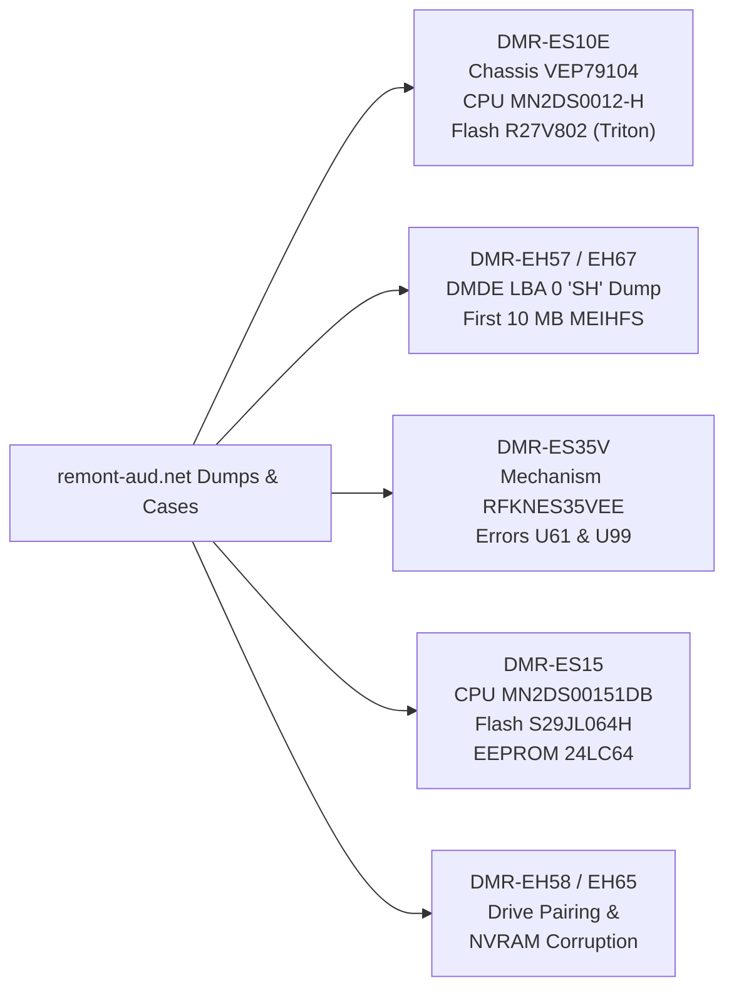
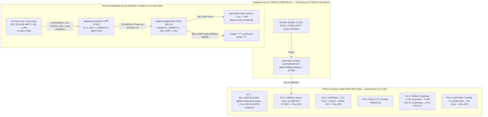
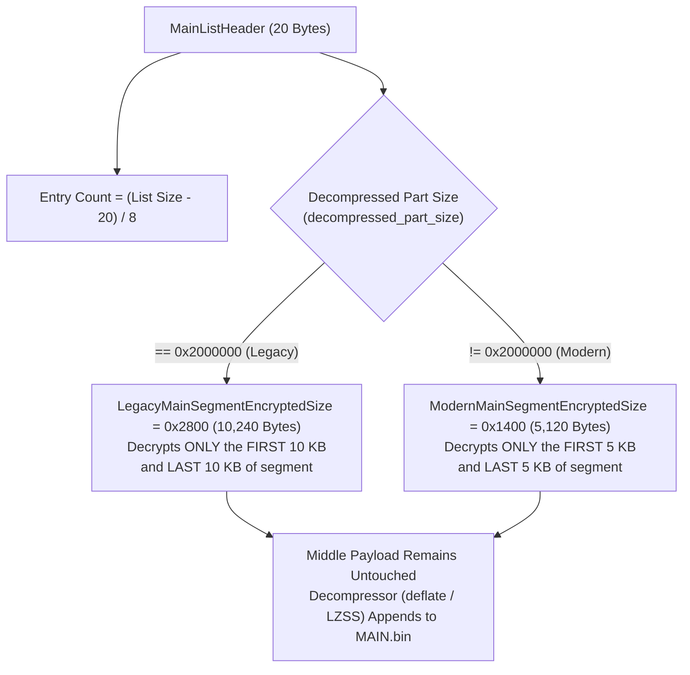
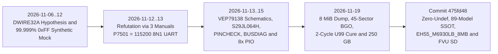

> 🌐 **Language / Idioma:** **English (US)** | [Português (BR)](../pt-BR/COMPENDIO_GLOBAL_COMUNIDADE_FIRMWARE_E_HARDWARE_DIGA.md)
> 🧭 **Portal:** [Docs Index](../INDEX.md) | [Complete Audit](../../COMPLETE_AUDIT.md) | [Historical Audits](../audits/README.md) | [Ghidra Pseudocode](../pseudocode/INDICE_EVIDENCIA_PSEUDOCODIGO_GHIDRA.md) | [Debug Logs](../debug_logs/README.md)

# Global Community Compendium: Panasonic DIGA Firmware, Hardware & Reverse Engineering

## Canonical Cross-Reference of Official Matrices, International Databases, Service Modes, and Forensic Tooling

**Document:** `GLOBAL_COMMUNITY_COMPENDIUM_DIGA_FIRMWARE_AND_HARDWARE.md`
**Author:** Community Intelligence & Bilingual Technical Dossier Specialist
**Ecosystem:** Panadiga — Reverse Engineering, Storage Forensics, and DMR-EH55 Hardware Lab
**Date:** November 2026
**Classification:** Canonical Technical Reference / Global Reverse Engineering Intelligence

---

## Executive Summary

The **Panasonic DIGA** family of DVD/HDD recorders (spanning the DMR-E, DMR-EH, DMR-EX, DMR-EZ series and subsequent generations built on the Matsushita/UniPhier AM34, MN103S, and MN2DS architectures) represented the pinnacle of Japanese consumer electronic engineering for digital recording between 2003 and 2012. However, its deeply integrated industrial-grade digital rights management (CPRM, C-BSA, Macrovision, proprietary MBR `"SH"` partition signatures, 64-bit Feistel firmware container encryption, and strict hardware-software interlocks between optical servo controllers and the host CPU) turned bench diagnostics and critical fault recovery — notably the fatal **`U99`** loop — into profound reverse engineering challenges.

Over the past two decades, hardware knowledge surrounding these devices matured in disconnected technical communities across the globe:

1. **Japanese Engineering Community (2channel / 5ch / ncos1 forums):** Investigated the ATA-7 AV Streaming command set, low-level disk sectors with the magic string `"Panasonic DIGA RTSC"`, and hidden technician *Service Mode* (`SERV`) routines triggered by proprietary infrared sequences.
2. **Eastern European Repair Specialists (`remont-aud.net`, `monitor.espec.ws`, `telemaster.ru`):** Documented circuit schematics, performed chip-off bench extractions with universal programmers (Triton, Orange, ChipProg) on TSOP-48 Flash and I²C EEPROMs (`24LC64`), and directly correlated switched-mode power supply (SMPS) capacitor degradation with NVRAM corruption and fatal `U99` lockouts.
3. **Polish & German Enthusiasts and Hardware Hackers (`elektroda.pl`, `hardwarefetish.com`):** Documented hard drive capacity upgrades, optical drive firmware cross-flashing, partition extraction, and the initial reverse engineering of the MEIHDFS filesystem.
4. **Modern Open-Source Reverse Engineering Ecosystem (`unixtract`, `pana-fw`, `panasonic-rec`, `dvr-recover`, `sddl_dec`):** Cataloged the 12 symmetric Feistel keys (`PANA_DVD`), reverse-engineered `EXTRHEAD`/`EXTRFOOT` encapsulations, identified Okumura LZSS compression parameters, and mapped serial log consoles (*Serial Log Menu*) on Linux-based UniPhier recorders.

This compendium consolidates, verifies, and rigorously organizes these collective findings into a single canonical technical reference divided into five major technical sections (followed by engineering synthesis and cross-links), fully incorporating the chronological reverse engineering chronicle of the Panadiga project through commit `475fd48`.

---

## 1. Global Official Firmware Matrix (`av.jpn.support.panasonic.com` / `fdl.jpn.support.panasonic.com`)

Panasonic maintained its official global distribution infrastructure for optical disc firmware updates across Japanese CDN endpoints (`fdl.jpn.support.panasonic.com` and `av.jpn.support.panasonic.com`). The Panadiga project located, downloaded, cryptographically audited, and verified SHA-256 hashes for all 30 known live official URLs, unpacking self-extracting archive containers (`.exe`) and extracting optical disc images (`PANA_DVD.FRM`), SD card containers (`PANA__SD.FRM`), plaintext bootloaders (`PROG.bin`), and core operating system images (`MAIN.bin`).

### 1.1 Complete Verified Download Matrix (30 Live URLs — HTTP 200)

All 30 URLs listed below have been actively tested and validated with `HTTP/1.1 200 OK` responses:

| # | Product Line | Direct Official CDN URL (Panasonic Japan)                                                              |
| :-: | :----------- | :----------------------------------------------------------------------------------------------------- |
| 1 | `eh49`     | `https://fdl.jpn.support.panasonic.com/pc/en/dvd/eh49/UPDATE_EH49_495.exe`                           |
| 2 | `eh49`     | `https://fdl.jpn.support.panasonic.com/pc/en/dvd/eh59/UPDATE_EH59_595.exe`                           |
| 3 | `eh49`     | `https://fdl.jpn.support.panasonic.com/pc/en/dvd/eh69/UPDATE_EH69_695.exe`                           |
| 4 | `ex769`    | `https://fdl.jpn.support.panasonic.com/pc/en/dvd/ex769/UPDATE_DMR-EX769EF_V14.exe`                   |
| 5 | `ex769`    | `https://fdl.jpn.support.panasonic.com/pc/en/dvd/ex79/Update_EX79_EX89_EX769EB_V105.exe`             |
| 6 | `ex773`    | `https://fdl.jpn.support.panasonic.com/pc/en/dvd/ex773/UPDATE_DMR-EX773EC_V109.exe`                  |
| 7 | `ex773`    | `https://fdl.jpn.support.panasonic.com/pc/en/dvd/ex773/UPDATE_DMR-EX773EP_V109.exe`                  |
| 8 | `ex773`    | `https://fdl.jpn.support.panasonic.com/pc/en/dvd/ex86/Update_EX86_EX83_EX773_EX99V_EZ49VEB_V107.exe` |
| 9 | `ex79`     | `https://fdl.jpn.support.panasonic.com/pc/en/dvd/ex79/UPDATE_DMR-EX79EF_V14.exe`                     |
| 10 | `ex79`     | `https://fdl.jpn.support.panasonic.com/pc/en/dvd/ex79/Update_EX79_EX89_EX769EB_V105.exe`             |
| 11 | `ex795`    | `https://fdl.jpn.support.panasonic.com/pc/en/dvd/ex795/UPDATE_EX795EP_V108.exe`                      |
| 12 | `ex80`     | `https://fdl.jpn.support.panasonic.com/pc/en/dvd/ex80/UPDATE_DMR-EX72SEG_V112.exe`                   |
| 13 | `ex80`     | `https://fdl.jpn.support.panasonic.com/pc/en/dvd/ex80/UPDATE_DMR-EX81S_71SEG_V112.exe`               |
| 14 | `ex80`     | `https://fdl.jpn.support.panasonic.com/pc/en/dvd/ex80/Update_DMR-EX80SEG_V115.exe`                   |
| 15 | `ex83`     | `https://fdl.jpn.support.panasonic.com/pc/en/dvd/ex83/UPDATE_DMR-EX83EC_V109.exe`                    |
| 16 | `ex83`     | `https://fdl.jpn.support.panasonic.com/pc/en/dvd/ex83/UPDATE_DMR-EX83EP_V109.exe`                    |
| 17 | `ex83`     | `https://fdl.jpn.support.panasonic.com/pc/en/dvd/ex86/Update_EX86_EX83_EX773_EX99V_EZ49VEB_V107.exe` |
| 18 | `ex84c`    | `https://fdl.jpn.support.panasonic.com/pc/en/dvd/ex84/UPDATE_DMR-EX84CEG_V107303.exe`                |
| 19 | `ex86`     | `https://fdl.jpn.support.panasonic.com/pc/en/dvd/ex86/Update_EX86_EX83_EX773_EX99V_EZ49VEB_V107.exe` |
| 20 | `ex89`     | `https://fdl.jpn.support.panasonic.com/pc/en/dvd/ex79/Update_EX79_EX89_EX769EB_V105.exe`             |
| 21 | `ex89`     | `https://fdl.jpn.support.panasonic.com/pc/en/dvd/ex89/UPDATE_DMR-EX89EF_V14.exe`                     |
| 22 | `ex93c`    | `https://fdl.jpn.support.panasonic.com/pc/en/dvd/ex93/UPDATE_DMR-EX93CEG_V139324.exe`                |
| 23 | `ex97`     | `https://fdl.jpn.support.panasonic.com/pc/en/dvd/ex97/UPDATE_EX97EB_V110.zip`                        |
| 24 | `ex97`     | `https://fdl.jpn.support.panasonic.com/pc/en/dvd/ex97/UPDATE_EX97SEG_EX97CEG_V105.exe`               |
| 25 | `ez49v`    | `https://fdl.jpn.support.panasonic.com/pc/en/dvd/ez49v/UPDATE_DMR-EZ49VEC_V109.exe`                  |
| 26 | `ez49v`    | `https://fdl.jpn.support.panasonic.com/pc/en/dvd/ez49v/UPDATE_EZ49VEB_V11.exe`                       |
| 27 | `xs350`    | `https://fdl.jpn.support.panasonic.com/pc/en/bd/bs850/UPDATE_BS850_BS750_XS350EG_V16.exe`            |
| 28 | `xs385`    | `https://fdl.jpn.support.panasonic.com/pc/en/bd/bs885/UPDATE_BS880_BS780_XS380EB_V141.exe`           |
| 29 | `xs385`    | `https://fdl.jpn.support.panasonic.com/pc/en/bd/bs885/UPDATE_BS885_BS785_XS385EG_V140.exe`           |
| 30 | `xw300`    | `https://fdl.jpn.support.panasonic.com/pc/en/dvd/xw300/UPDATE_XW300GN_V17.exe`                       |

### 1.2 Extracted & Audited Packages and SHA-256 Hashes

The downloaded assets cover legacy models (`DMR-EH55`, `DMR-EH50`), the late analog/HDMI series (`EH49`, `EH59`, `EH69`), and the digital DVB-T/DVB-S series (`DMR-EX`, `DMR-EZ`).

#### DMR-EH49 / DMR-EH59 / DMR-EH69 Matrix

* Container Feistel Key: `DF7215C7427FD010` (collection `PANA_DVD_KEYONLY "Old"`).
* TOC Structure: 64 bytes (`0x40`) with payload starting at `0x2000` (8,192 bytes).

| Model                      | Installer (`.exe`) Bytes & SHA-256                                                | `PANA_DVD.FRM` Bytes & SHA-256                                                    | `MAIN.bin` Bytes / Base / SHA-256                                                                                 | `PROG.bin` SHA-256                                                 |
| :------------------------- | :---------------------------------------------------------------------------------- | :---------------------------------------------------------------------------------- | :------------------------------------------------------------------------------------------------------------------ | :------------------------------------------------------------------- |
| **DMR-EH49** / EH495 | `7,492,387` B`ff12c1d02e5bc8a10a78f0935177af4e70e188867af8c9b523e0638d39c59762` | `7,461,592` B`6d7441246fcd1d3032297cf70df90fc64fdc93035e2f7b9dc55eae1d6903a7d8` | `13,653,820` B`0x50622000` (`0x513276B8`)`594b6c5aa5872bb46b7fb117e21a1129ecc5ce520fd76dbf049f77e44aec25ce` | `3bf48f806898643a1f4fbd3bf9e7bebff0d97eab25449a604dac498d0744383b` |
| **DMR-EH59** / EH595 | `7,546,243` B`f35345fc4c0603a13c80e9bc762d64b61db72ab74ce317b7d130a0203afc46fb` | `7,515,448` B`7d7f6ad21f9c0a5b0d2e1c42e39d46389f05a1a87a6a4cb964aaf3343d8df3f8` | `13,773,740` B`0x50622000` (`0x51344B28`)`9d8a4bca9209bbfe135586ed94bbe902f0b721e56c45b32a9ad9b34afb38fec2` | `3bf48f806898643a1f4fbd3bf9e7bebff0d97eab25449a604dac498d0744383b` |
| **DMR-EH69** / EH695 | `7,512,090` B`20af7c95088ba7f1242ebd6a63dd08201665261f6121242e8eb58644cfa34da8` | `7,567,480` B`9942349c4c175c2881c3d3e3eecf5f446b012ae28341958ed8dce46889695565` | `13,886,636` B`0x50622000` (`0x51360428`)`a7182537e8859b83cbf082855844a2845fcd57303fa1113898721708cbc435b2` | `3bf48f806898643a1f4fbd3bf9e7bebff0d97eab25449a604dac498d0744383b` |

#### DMR-EX and DMR-EZ Series Matrix (17 Subdirectories Audited)

| Subdirectory        | Official Installer (`.exe`)                     | `.exe` Bytes | `.FRM` Bytes | `.FRM` SHA-256 Hash                                                |
| :------------------ | :------------------------------------------------ | -------------: | -------------: | :------------------------------------------------------------------- |
| `ex72seg/`        | `UPDATE_DMR-EX72SEG_V112.exe`                   |  `7,321,784` |  `7,213,584` | `2abdfbeb8888ff66ac41f15aa1c7eb9a7bb587ea7de6d46e2bbf6dac7dd0e2f9` |
| `ex769ef/`        | `UPDATE_DMR-EX769EF_V14.exe`                    |  `6,365,331` |  `6,264,392` | `b1d55c1f15467341ce7becfbf3d32c50ef3564ad5a9f611dc0e859f68b29012f` |
| `ex773ec/`        | `UPDATE_DMR-EX773EC_V109.exe`                   |  `7,126,264` |  `7,018,064` | `ef8ead563883809f5d6a01aaf1fdd9de8e7a64e15f51c07abb68515a16057ff6` |
| `ex773ep/`        | `UPDATE_DMR-EX773EP_V109.exe`                   |  `7,123,800` |  `7,015,608` | `e602b452d2a981e2b3021b436d699c54158f475a3d5d1a5161d8aabafa1f0e42` |
| `ex795ep/`        | `UPDATE_EX795EP_V108.exe`                       |  `2,516,032` |  `2,297,800` | `9e0c849d7253cd5163fcc86959c52d71e8ca60ed7c3322a2545899f699f1df39` |
| `ex79_89_769eb/`  | `Update_EX79_EX89_EX769EB_V105.exe`             |  `1,795,184` |  `1,576,960` | `3b78fb68384fe4ffb26aaef28067cc3a336c7036696fda6b4ce09beff53acbfe` |
| `ex79ef/`         | `UPDATE_DMR-EX79EF_V14.exe`                     | `13,806,904` | `13,700,448` | `7ca219d3a40779674a4402bcf145d51abbc71ab17a1353af1bc334cfba758ca8` |
| `ex80seg/`        | `Update_DMR-EX80SEG_V115.exe`                   |  `7,355,464` |  `7,453,680` | `bb63c998a4f9200d5637c65ca8b1c4e5a19a473ded982ce813d242422734066b` |
| `ex81s_71seg/`    | `UPDATE_DMR-EX81S_71SEG_V112.exe`               |  `7,002,744` |  `6,894,544` | `df2c572206763c6fdd4309d02881a478b999c54e1bb157bb8c2ee5e92e3599a1` |
| `ex83ec/`         | `UPDATE_DMR-EX83EC_V109.exe`                    |  `8,215,768` |  `8,107,576` | `4d2929133a67562c4e52a5a091ecccda117f37f2e35c75fa53e1a198a40cc7c9` |
| `ex83ep/`         | `UPDATE_DMR-EX83EP_V109.exe`                    |  `7,931,720` |  `7,823,528` | `9115c7a9dd517c35376745163cbeca2d5ca73c6681683e8acff7dfee2ebbfbaf` |
| `ex84ceg/`        | `UPDATE_DMR-EX84CEG_V107303.exe`                | `10,413,976` | `10,305,272` | `216a7b72ae117be26a07b319e231bc8e19816b3fc37bfe4551c76e2723789771` |
| `ex86_83_773_eb/` | `Update_EX86_EX83_EX773_EX99V_EZ49VEB_V107.exe` |  `1,792,600` |  `1,576,960` | `8237b06fd4cce0dbedf32a9ecbf7cdcefa3ca18abff66f5ead1a2fb9b3576dac` |
| `ex89ef/`         | `UPDATE_DMR-EX89EF_V14.exe`                     |  `7,502,744` |  `7,396,288` | `e7a3368cd94c16017d985901bc34b4ac7e2bad8d64594372de7bb460fe2763a3` |
| `ex93ceg/`        | `UPDATE_DMR-EX93CEG_V139324.exe`                | `10,654,152` | `10,545,448` | `5ca06ba7a41ab9f41462b4f2b957b7d434c23cfe29a3dbc58f583392894a480e` |
| `ez49veb/`        | `UPDATE_EZ49VEB_V11.exe`                        |  `6,150,285` |  `6,049,344` | `a4c5d8b2b7fdb4e69f4081348ba73f23dc43e9f83c5068136834403e2221816c` |
| `ez49vec/`        | `UPDATE_DMR-EZ49VEC_V109.exe`                   |  `5,986,400` |  `5,878,208` | `7fb924b9c71b92ef246c1015dfed944c20c760147fe7a3de47ad32ba76b52af5` |

### 1.3 Container Architecture & TOC Stride Analysis: 48B vs 64B vs Plaintext `PANA__SD.FRM`

The analysis of the Table of Contents (TOC) located within the lead-in sectors of update containers revealed three distinct structural architectures:

```mermaid
flowchart TD
    subgraph TOC_48B["1. 48-Byte Feistel TOC (Legacy: EH55, EX80SEG)"]
        E1_48["Module Entry 0 at 0x0000 (48 Decrypted Bytes)"] --> E2_48["Module Entry 1 at 0x0030 (48 Bytes)"]
        E2_48 --> P1["Null Padding to 0x1800 (6,144 Bytes)"]
        P1 --> PAY1["Feistel Payloads from 0x1800"]
    end

    subgraph TOC_64B["2. 64-Byte Feistel TOC (Modern: EH49..69, EX81S, EX72..93)"]
        E1_64["Module Entry 0 at 0x0000 (64 Decrypted Bytes)"] --> E2_64["Module Entry 1 at 0x0040 (64 Bytes)"]
        E2_64 --> P2["Null Padding to 0x2000 (8,192 Bytes)"]
        P2 --> PAY2["Feistel Payloads from 0x2000"]
    end

    subgraph TOC_SD["3. Plaintext SD Card TOC (PANA__SD.FRM)"]
        E1_SD["Entry 0 at 0x0000 (48 B sd48 EH55 ver0.61 | 64 B sd64 ver0.63)"] --> P3["Table 0x1800 (sd48) / 0x2000 (sd64)"]
        P3 --> PAY3["Direct Plaintext Modular Payload"]
    end
```



1. **48-Byte Feistel TOC (`Stride = 0x30`, Payload Starting at `0x1800` / 6,144 B):**
   - Utilized on the `DMR-EH55` and `DMR-EX80SEG`, starting directly at offset `0x0000` after Feistel decryption (`128` potential 48-byte slots; raw 16-byte header previews correspond to the first encrypted blocks of slot 0).
   - In the `DMR-EH55` AM34 layout, each 48-byte slot holds Name (`0x00..0x0A`), Version u16 LE (`0x0A..0x0C`), Offset (`0x0C..0x10`), HW family (`0x10..0x18`), OEM (`0x18`, `'M'`), Flag (`0x19`), Model Group (`0x1A..0x20`), Size (`0x20..0x24`), FVU sum (`0x24..0x28`), trailing metadata (`0x28..0x2E`), and 16-bit LE additive `list_sum` (`0x2E..0x30`); newer Blu-ray generations documented in `pana-fw` advance to 32-bit Adler-32 entry sums.
2. **64-Byte Feistel TOC (`Stride = 0x40`, Payload Starting at `0x2000` / 8,192 B):**
   - Utilized across `EH49/59/69`, `EX81S/71SEG`, and most `EX72..EX93` units (e.g., entry 0 at `0x0000` `PROG071`, entry 1 at `0x0040` `MAIN3100`), shifting module payloads to `0x2000`.
3. **Plaintext SD TOC (`PANA__SD.FRM` — `48-Byte sd48` vs `64-Byte sd64`):**
   - Utilized on SD recovery updates, keeping table descriptors plaintext (bypassing Feistel decryption). On real **`DMR-EH55` hardware (`Loader ver0.61 [06/03/06]` + `PROG061`)**, the native layout is **`48 Bytes` (`sd48`, `0x1800`-byte TOC = `6,144 B`, `list_sum` at `+0x2E`)** paired with raw `262,144 B` `DIGADIAG.FRM`; whereas on **`Loader ver0.63 [07/10/24]`** (`/BOOT.BIN` EZ485V/EH58), it uses **`64 Bytes` (`sd64`, `0x2000`-byte TOC = `8,192 B`, `list_sum` at `+0x3E`)** paired with `131,072 B` `EXTRHEAD` `DIGADIAG.FRM`.

### 1.4 `MAIN.bin` Architecture & Logical Base Addresses: `0x57000000` vs `0x50622000`

Unpacking the operating system kernel (`MAIN.bin`) demonstrated two distinct execution memory base families in SDRAM:

1. **The `0x57000000` Family (DMR-EH55, DMR-EX80SEG, DMR-EX81S/71SEG):**
   - On `DMR-EH55`, `MAIN.bin` comprises `13,427,852` bytes (SHA-256 `075f552ed583ba1835c0d44d1b533ff5a016b8d81d15d7166240098461ddcca7`), mapped from `0x57000000` to `0x57CCE408`.
   - On `DMR-EX80SEG` (Hardware `M6932EG` / `PZ-317`), `MAIN.bin` comprises `12,138,476` bytes mapped at base `0x57000000` (`0x57B93768`).
   - On `DMR-EX81S / EX71SEG`, `MAIN.bin` comprises `12,409,484` bytes mapped at base `0x57000000` (`0x57BD5A08`).
   - This architectural identity proves `DMR-EX80SEG` and `DMR-EX81S` share direct lineage with `DMR-EH55`.
2. **The `0x50622000` Family (DMR-EH49/59/69 and DMR-EX72..EX93):**
   - Later models shifted their kernel base address to `0x50622000` (with `dc44` header marker).
   - `EH49`: `0x50622000` extending to `0x513276B8` (`13,653,820` B).
   - `EH59`: `0x50622000` extending to `0x51344B28` (`13,773,740` B).
   - `EH69`: `0x50622000` extending to `0x51360428` (`13,886,636` B).

### 1.5 Header Structures, `<deviceinfo>`, `pre_update_firm.c`, and `_dev_SERIAL`

Across all extracted plaintext `MAIN.bin` binaries (`0x57000000` and `0x50622000`), embedded source paths and debug symbols confirm the pre-flight update checks:

* Compiled source path: `src/fmupre/pre_update_firm.c`.
* Verbatim observed identification format string:
  ```c
  "[fmu] <deviceinfo> model = %s, oem = %c"
  ```
* Serial device string: `_dev_SERIAL` appears natively across all audited `MAIN.bin` kernels (`EH55`, `EX80SEG`, `EX81S`, `EH49/59/69`, `EX72..EX93`).

### 1.6 Plaintext Bootloaders (`PROG.bin`, 262,144 Bytes / 256 KB)

Unlike the encrypted outer `.FRM`, the extracted `PROG.bin` image (`262,144` bytes = `0x40000`) provides **unencrypted AM34/MN103S machine code** ready for direct disassembly:

1. **Initial Header / Vector Signature Divergence:**
   - Legacy `DMR-EH55` and `DMR-EX80SEG` images begin with the 16-byte header `dc 14 00 00 00 ff ff ff dc e1 00 00 00 ff ff ff` (`0x14DC`).
   - Modern models (`EH49/59/69`, `EX81S`, `EX72..EX93`, `EZ49V`) begin directly with `00 F2 F3 FE 01 04 10 00 ...` (`0xFEF3F200` little-endian).
2. **DDR Calibration Strings (`[CK:DQS:L:C:H]` / `[CK:DQS]`):**
   - Present directly in plaintext inside `EH49/59/69` (`[CK:DQS:L:C:H] = [`) and `EX81S` (`[CK:DQS] = [`).
3. **Embedded Decompression Engine (`deflate 1.2.3` / `inflate 1.2.2`):**
   - Embeds `deflate 1.2.3 Copyright 1995-2005 Jean-loup Gailly` and `inflate 1.2.2 Copyright 1995-2004 Mark Adler`.
4. **Flash Background Operation (BGO) Driver `[nfrom]`:**
   - Strings observed: `[nfrom] bgo_read_D`, `[nfrom] bgo_writeD`, `[nfrom] bgo_writeD_FF`, `"NOR STATE : Backup - Original"` / `"NOR STATE : Original - Backup"`.
5. **Plaintext `U99` Error Strings:**
   - All 23 extracted `PROG.bin` files contain literal `U99` along with `Firm list read failed` and `Failed to startup drive.`.

---

## 2. International Repair Databases & Hardware Cross-Reference

Repair knowledge for Panasonic DIGA recorders achieved extraordinary sophistication across Eastern Europe (Russia, Ukraine, Belarus) and Poland, where component scarcity and the cost of replacement motherboards drove technicians to reverse-engineer silicon-level behaviors.

### 2.1 Eastern European Technical Forums & Repositories

The primary international engineering repositories analyzed by the project include:

1. **`remont-aud.net` (Russia/CIS):** The world's most rigorous electronics technician forum and dump repository.
2. **`elektroda.pl` (Poland):** Central Europe's largest practical engineering portal, featuring deep archives on DIGA power supplies, optical drives, and HDD replacements.
3. **`monitor.espec.ws` (Russia):** Specialized hardware forum covering MN102/MN103 sub-CPUs and RFKN optical mechanisms.
4. **`telemaster.ru` (Orange Programmer Database):** Reference collection of raw EEPROM and microcontroller dumps.
5. **`badcaps.net` (US/Global):** Forensic community documenting capacitor aging and SMPS ripple characteristics.

### 2.2 `remont-aud.net` Forensic Triage & Qualification Rules

Access to `remont-aud.net` is gated by a rigorous entry examination (*Тест 1*), covering RLC circuit analysis, power supply waveforms, semiconductor physics, and digital bus protocols. The site enforces strict non-redistribution policies to prevent commercial abuse.

Key cases cataloged from `remont-aud.net`:



* **DMR-ES10E (`VEP79104`, Dump #31642):**
  - URL: `https://remont-aud.net/dump/dvd/panasonic/panasonic_dmr_es10e_shassi_main_board_vep79104/205-1-0-31642`
  - Mainboard: `VEP79104`.
  - Main CPU: Matsushita `MN2DS0012-H`.
  - Flash Memory: Oki/Spansion `R27V802` extracted physically via Triton universal programmer.
* **DMR-EH57 / DMR-EH67 (Dump #5696):**
  - URL: `https://remont-aud.net/dump/dvd/panasonic/dmr_eh57_67/205-1-0-5696`
  - Contains raw DMDE (*DM Disk Editor*) sector dumps of the hard drive.
  - Confirms LBA 0 starts with the proprietary `"SH"` signature, followed by the identical mirror sector and journal layout found on the DMR-EH55.
* **DMR-ES35V (DVD/VCR Combo, Dump #21200 — Downloaded & Audited in `firmware-pack-v0.1.0`):**
  - Original URL: `https://remont-aud.net/dump/dvd/panasonic/dmr_es35v/205-1-0-21200` (Triton v5.7 chip-off readout — curated archive **`dmr-es35v-8mb-nor-flash-and-eeprom-triton-dump.zip`**, SHA-256 `800f3874d4a3ed2bacf90780a7f6f666cb9f8b5a3b2e6bf9dfd9529f2b50cb32`, published on the official Release!).
  - **Extracted & Unpacked Contents:**
    - `flash.bin` (`8,388,608 B`, CRC32 `B246C174`, SHA-256 `0969f2580ad30b98027271a8e3947f5a6ae1c02dec06462b87ce1057a7a1bcf9`): complete unencrypted 8 MiB physical NOR Flash dump.
    - `eeprom.bin` (`8,192 B`, CRC32 `66A845DB`, SHA-256 `17bb5383c287dc90a493aa5c67f729dbb54b587224b267940e1e7133aa2ce32c`): 24C64 I²C EEPROM holding disc strategy/calibration records (`GS176031`, `@RITEK`, `@MBIPG101R05`).
    - **Verified Physical 8 MiB NOR Layout (`flash.bin`):**
      * `0x000000..0x03FFFF` (`256 KB`): Plaintext XIP Bootloader **`Loader ver0.18 [06/03/13]`** (compiled only 7 days after DMR-EH55 `Loader ver0.61 [06/03/06]`, sharing `MATSHITA DVD-RAM RECORDER`, `serial boot mode`, `Read fvu program from Nor-FROM`, `RV NG U99`).
      * `0x080000..0x12C0C0`: `EXTRHEAD` `"DRV "` container (Zlib `algo=0`) $\rightarrow$ unpacks cleanly to **`DRV_0x080000.bin`** (`1,441,792 B`, `dst=0x90202000`, SHA-256 `f6655390b3769bf278571c561b976e59489a2b075eab218d3b2095ef8f9800c7`), directly referencing **`DMR-EH55`**, `DMR-EH55S159`, `DMR-E500F`.
      * `0x130000..0x40FFFF`: Uncompressed XIP `MAIN` code and rodata (`_dev_SERIAL`, `src/fmupre/pre_update_firm.c`, `[fmu] <deviceinfo> model = %s, oem = %c`).
      * `0x430000..0x6D42F0`: `EXTRHEAD` `"MAIN"` container (LZMA `algo=3`, build **`3080GR`**) $\rightarrow$ unpacks cleanly to **`MAIN_3080GR_0x430000.bin`** (`6,739,752 B`, `dst=0x52DF6000`, SHA-256 `841a5419506e995a31d0a3ef6583051a4f46500a5dda834c70edabbfd07732c1`).
      * `0x700000..0x7EFFFF` (`15 × 64 KB`): Flash **BGO** filesystem tagged `FF FF FF FF <id> F2 FF FF` (`01f2`..`0df2`).
      * `0x7F0000..0x7FFFFF` (trailing `64 KB`): **EEMUL / NVRAM** parameter sectors tagged `FF FF FF FF <id> F1 FF FF` at `0x7F2000` (`02f1`), `0x7F4000` (`01f1`), and `0x7F8000` (`03f1`) — direct physical proof of the `U99` sanitization target window.
  - See the dedicated manifest in [`firmware_and_images/dmr-es35v/README.md`](../../firmware_and_images/dmr-es35v/README.md).
* **DMR-ES15 (`MN2DS00151DB`, Forum #103187):**
  - URL: `https://remont-aud.net/forum/52-103187-1`
  - Board `A-3 863ZES MP-1`, CPU `MN2DS00151DB`.
  - Shares the exact Spansion `S29JL064H70TFI00` (8 MB TSOP-48) Flash used in the DMR-EH55, paired with a Microchip `24LC64` I²C EEPROM. Proves that bit rot in either component triggers immediate `U99` lockup.
* **DMR-EH58 (Forum #126813) and DMR-EH65 (Forum #33721):**
  - In-depth procedures for regenerating corrupted MEIHFS partition structures using direct hexadecimal disk reconstruction.

### 2.3 Polish Hardware Engineering Community (`elektroda.pl`)

The `elektroda.pl` archive preserves key practical discussions and attachments for DIGA recorders:

1. **Topic `topic2896624.html` (`dmr-ex75-ex85.zip`):**
   - Provides service initialization firmware for replacement/wiped HDDs (`HDD Error`, tray auto-eject loop, `U81` faults).
2. **Topics `topic1598940.html` & `topic1320603.html` (`DMR-EH55`):**
   - European vs. North American firmware variants, flash recovery protocols, and drive spindle recovery discussions.
3. **Topics `topic2323763.html`, `topic3378979.html`, `topic3082439.html` (`DMR-EX75/77/85`):**
   - Service mode formatting commands, `HDClone` 1:1 sector cloning, and replacement HDD initialization.
4. **Topics `topic3500975.html` (`DMR-EH59`) and `topic1800763.html` (`DMR-EH67`):**
   - `DMR-EH59` storage/architecture notes and `DMR-EH67` `U61`/`U88` diagnostics.

### 2.4 Russian Electronics & Telecom Forums (`monitor.espec.ws` & `telemaster.ru`)

1. **`monitor.espec.ws` — Topic `topic100315.html` (`DMR-ES15` Error `U61`):**
   - Documents optical assembly `RFKNES15PL`, `MR4020` switching regulator, and drive recalibration tied to `U61`.
2. **`monitor.espec.ws` — Topics `topic121264.html` & `/section24/topic323568.html` (`DMR-ES35V` `U99` / `U61`):**
   - Pinpoints `U99` to NVRAM/Flash corruption in the `RFKNES35VEE` Digital/RAM PCB and provides `U61` repair procedures.
3. **`monitor.espec.ws` — Topic `topic203970.html` (`DMR-EH58` Drive Pairing & `U61`/`U88`):**
   - Discusses digital PCB module pairing with optical assemblies and `U61`/`U88` faults.
4. **`monitor.espec.ws` — Topics `topic270939.html` & `topic165151.html` (`DMR-E85H`):**
   - Dedicated power supply and boot failure repair threads for the `DMR-E85H`.
5. **`telemaster.ru` (Orange Programmer Database):**
   - Repository at `http://www.telemaster.ru/orange/proshivki4.html` containing Panasonic EEPROM dumps (`24C32`, `24C64`, `93C46`) and `cnclab` forum discussions on EEPROM multi-region unblocking.

### 2.5 Western Repair Communities & Preservation Archives

1. **`badcaps.net` (Topics #75610 & #3468935 — `DMR-ES30V`):**
   - Analyzes power supply rail failures caused by aging electrolytic capacitors in `DMR-ES30V` units.
2. **Wayback Machine & Softpedia:**
   - Archives US firmware packages (`DMR-EH55VS` `DMR-EH55.exe` `IR-01`, `DMR-EH75VS`, `DMR-ES45VS`, `DMR-ES20S`) and Wayback snapshots under `web.archive.org/web/*/av.jpn.support.panasonic.com/support/dvd/download/*`.
3. **Archive.org:**
   - Preserves official PDF Service Manuals (e.g., `DMR-EH50`, `DMR-EH55`, `DMR-EH575`, `DMR-EX98V`), though no raw DMR `.FRM`/`.BIN` firmware binaries are indexed directly there.

---

## 3. Official Service Mode (`DSD0603003CE`), JDM `[RED]` Sequence, and Standby / `TW7501` vs. `P7501` Electrical Physics

Panasonic DIGA recorders embed factory diagnostic routines officially documented in Panasonic Service Manuals (notably **`ORDER NO. DSD0603003CE`** for DMR-EH55EC/EP/EH56EG) alongside extended infrared remote sequences used on Japanese domestic (JDM) and later Blu-ray models.

### 3.1 What `[RED]` Is & Differences Between DMR-EH55 vs. JDM/BD Models

1. **Physical Identification of `[RED]` on the Remote Control (Operating Instructions `RQT8415`, p. 12 Item `#10`):**
   - On original Panasonic DIGA remotes (`EUR7659Y60` / `EUR7659YC0`), directly **below** the directional cluster (`ENTER` / `FUNCTIONS` / `DIRECT NAVIGATOR` / `RETURN` / `SUB MENU`) sits a row of **4 Colour/Teletext buttons (`Colour buttons`)**: **Red (`[RED]`)**, **Green (`[GREEN]`)**, **Yellow (`[YELLOW]`)**, and **Blue (`[BLUE]`)**.
2. **Critical Model Distinction — JDM/BD vs. Global DMR-EH55:**
   - The **`[5] + [9] + [RED]`** 5-second infrared chord (`70 RET` $\rightarrow$ right arrow `80 SRV` $\rightarrow$ `[ENTER]`) applies to Japanese domestic (JDM) and newer Blu-ray DIGA units.
   - On the **global/European Panasonic DMR-EH55 (Official Service Manual `ORDER NO. DSD0603003CE`, Sections `8.1.2` & `8.1.3`, pages 18–26)**, `[5]+[9]+[RED]` is **NOT** used: both **Service Mode (`SERV`)** and **TEST Mode (`TM AV1`)** are triggered from **Front-Panel keys while powered off (Standby)**, followed by two-digit numeric remote codes (`[0][0]`..`[9][9]`).

### 3.2 Official Front-Panel Special Modes (DMR-EH55 `DSD0603003CE`, pp. 17–21)

| Mode                              |      FL Display      | Exact Key Operation (`DSD0603003CE`, pp. 17–21)                                                                                                | Effect / Bench Purpose                                                                          |
| :-------------------------------- | :-------------------: | :------------------------------------------------------------------------------------------------------------------------------------------------ | :---------------------------------------------------------------------------------------------- |
| **Service Mode (`SERV`)** |       `SERV`       | While **power is off (Standby)**, press **`[CH UP] + [OPEN/CLOSE] + [REC]`** on front panel simultaneously for **5 seconds**. | Unlocks factory diagnostics (`[0][0]`..`[9][9]`) via remote control.                        |
| **TEST Mode (`TM AV1`)**  |      `TM AV1`      | While **power is off (Standby)**, press **`[STOP] + [CH UP] + [OPEN/CLOSE]`** simultaneously for **5 seconds**.               | **NOT Service Mode**: resets tuner/user preferences and initializes main unit parameters. |
| **Forced Disc Eject**       |      *(prior)*      | While **power is off**, press **`[STOP] + [CH UP]`** simultaneously for **5 seconds**.                                        | Forcibly opens tray (disabled when Child/Demo Lock is ON).                                      |
| **Forced Power-Off**        |      *(P-off)*      | Press front-panel **`[POWER]`** key for **over 10 seconds**.                                                                        | Hard-halts a hung main microprocessor.                                                          |
| **First Time Setup Reset**  |       `HELLO`       | *(Firmware Guide pp. 7–8)* While tuned, hold **`[CH UP] + [CH DOWN]`** for **10–15 seconds** until power off.                   | Triggers First Time Setup wizard on next boot.                                                  |
| **NTSC / PAL Switch**       |      *(prior)*      | While **power is on (E-E mode)**, hold **`[STOP] + [OPEN/CLOSE]`** for **5 seconds**.                                         | Toggles PAL / NTSC video output system.                                                         |
| **Rating Password Reset**   |     *(Level 8)*     | Open tray and hold **`[REC] + [PLAY]`** simultaneously for **5 seconds**.                                                           | Resets parental rating password to Level 8.                                                     |
| **Progressive Init**        |      *(prior)*      | Power on (E-E): hold **`[STOP] + [PLAY]`** for **5 seconds**.                                                                       | Resets video output setting back to Interlace.                                                  |
| **Demo Lock / Unlock**      | `LOCK` / `UNLOCK` | Power on: hold **`[STOP] + [POWER]`** for **5 seconds**.                                                                            | Locks/unlocks tray ejection (persists across Main Unit Init).                                   |
| **Child Lock (`X-HOLD`)** |      `X-HOLD`      | Remote controller: hold **`[ENTER] + [RETURN]`** simultaneously until `[X-HOLD]` displays.                                              | Locks out front panel and remote inputs (10x `ENTER` pulses do NOT unlock it).                |

### 3.3 Complete Remote Command Reference Inside `SERV` Mode (DMR-EH55 `DSD0603003CE`, pp. 21–26)

Once **`SERV`** is displayed on the FL panel, two-digit remote codes execute factory hardware diagnostics:

|                      Code                      | Official Designation (`DSD0603003CE`, pp. 21–26)               | Verified Diagnostic Function                                                                                                                                                                                                                                                             |
| :--------------------------------------------: | :---------------------------------------------------------------- | :--------------------------------------------------------------------------------------------------------------------------------------------------------------------------------------------------------------------------------------------------------------------------------------- |
| **`[0][0]`** or **`[RETURN]`** | **Release Items**                                           | Cancels current active test and returns to top `SERV` prompt (NOT a VFD test; VFD test is `[5][1]`).                                                                                                                                                                                 |
|              **`[0][1]`**              | **Error Code Display**                                      | Shows **latest error code (`U**`/`H**`/`F**`) held by Timer `IC7501`** (`F00` if none).                                                                                                                                                                                  |
|              **`[0][2]`**              | **ROM Version Display**                                     | Sequentially displays (5s each): **1. Region code** $\rightarrow$ **2. Main firm** $\rightarrow$ **3. Timer firm** $\rightarrow$ **4. Drive firm** $\rightarrow$ **5. ROM correction**.                                                            |
|       **`[1][1]` / `[1][2]`**       | **White / Magenta Picture Output**                          | Outputs 100% white or magenta component test raster from AV Decoder.                                                                                                                                                                                                                     |
|       **`[1][3]` / `[1][4]`**       | **RTSC Return in XP / I-P Switch**                          | Live AV1 encode/decode loopback (`XP`, 48kHz) without disc media; `[1][4]` toggles Interlace/Progressive.                                                                                                                                                                            |
|       **`[2][1]` / `[2][2]`**       | **Audio Mute (`XTMUTE` / `XDMUTE`)**                    | Verifies audio mute assertion from Timer (`T MUTE`) or Digital PCB (`D MUTE`).                                                                                                                                                                                                       |
|       **`[2][3]` / `[2][4]`**       | **Audio Pattern Output**                                    | Generates reference tones (`L=1kHz/-18dB`, `R=400Hz/-18dB`); `[2][4]` switches 48kHz / 44.1kHz.                                                                                                                                                                                    |
|              **`[3][1]`**              | **HDD READ inspection**                                     | Runs full HDD read test (**`HDD OK`** or defect code; exit via `[POWER] > 10s`).                                                                                                                                                                                               |
|       **`[4][1]` / `[9][5]`**       | **Laser Used Time / Delete Laser Time**                     | Displays cumulative optical laser hours (`*****`); **`[9][5]`** clears counter (`CLR`, destructive).                                                                                                                                                                         |
|       **`[4][2]` / `[9][6]`**       | **RAM Drive Last Error (`NO **`) / Delete**               | Reports error ID, timestamp (`DD/hh/mm`), media type & maker; `[0][1]`..`[1][9]` cycles past 19 errors (`[9][6]` clears).                                                                                                                                                        |
|              **`[4][4]`**              | **Laser Power Confirmation**                                | Compares present laser power against shipping baseline with DVD-RAM inserted (`CHK *` / `NO DISC` / `ERROR`).                                                                                                                                                                      |
|       **`[5][1]` / `[5][4]`**       | **Turn on all FL/LEDs / Front Key Check**                   | `[5][1]` lights every FL segment/LED; `[5][4]` verifies every front key contact incrementally.                                                                                                                                                                                       |
|       **`[6][1]` / `[6][4]`**       | **Production Date / Accumulated Working Time**              | `[6][1]` prints manufacture date (`YYMMDD`); `[6][4]` shows total runtime in seconds.                                                                                                                                                                                              |
|       **`[6][5]` / `[9][7]`**       | **Display Error History (`[0][1]`..`[1][9]`) / Delete** | Lists past **19 errors** with fault source (5s): **`01`/`05`** = Digital PCB (`AV DEC / MAIN CPU`), **`02`** = RAM Drive, **`03`** = Disc, **`04`** = Digital PCB / Communication Error, **`06`** = Defect of HDD (`[9][7]` clears). |
|              **`[7][4]`**              | **SD Card WRITE Check**                                     | Insert SD card while power off (`[CARD SD]`): verifies write (`SD OK` / `SD NG`; **erases SD images!**).                                                                                                                                                                     |
|        **`[8][0]`..`[8][3]`**        | **AV1/AV2/AV4 Video I/O Routing**                           | Sets analog input/output routing matrices for AV Jack testing (European SCART I/O passthrough tests absent on NA models).                                                                                                                                                                |
|       **`[8][4]` / `[8][5]`**       | **`P50(H)` / `P50(L)` Output Check**                    | Verifies Timer `IC7501-76` inverted output on AV1 Pin 10 (`~0V` vs `~4.4V DC`).                                                                                                                                                                                                    |
|              **`[9][1]`**              | **Tray OPEN/CLOSE Test**                                    | Cycles RAM drive tray continuously counting cycles (release with remote `[POWER] > 10s`).                                                                                                                                                                                              |
|              **`[9][8]`**              | **Error Code Initialization**                               | Clears Timer-latched error code back to `F00` (`CLR`).                                                                                                                                                                                                                               |
|              **`[9][9]`**              | **Initialize Service (`CLR SERV`)**                       | Resets Last Drive Error, Error History, and Error Codes simultaneously to factory defaults (`CLR`).                                                                                                                                                                                    |
|             **`[POWER]`**             | **Finishing Service Mode**                                  | Exits `SERV` mode to standard `STOP (E-E)`.                                                                                                                                                                                                                                          |

> [!NOTE]
> On Japanese (JDM) and later Blu-ray recorders, additional remote codes include `38 + [ENTER]` (`HDDCHK`), `03 VL`, `04 PRG`, `06 FTO`, and `08 FIN`.

#### 3.3.1 JDM Storage Magic `"Panasonic DIGA RTSC"` & ATA-7 AV Streaming Requirements

Discussions across Japanese 2channel / 5ch and `ncos1` revealed why off-the-shelf computer hard drives fail to format on DIGA recorders:

1. **Sector 128 / 512 Magic String (`Panasonic DIGA RTSC`):**
   - Japanese market recorders write an ASCII signature at sectors LBA 128 and LBA 512:
     ```text
     "Panasonic DIGA RTSC"
     ```
   - **RTSC** stands for *Real-Time Stream Control*. These sectors store thermal zone allocation parameters, maximum error retry limits before frame dropping, and spare sector conversion tables.
2. **Mandatory ATA-7 AV Streaming Feature Set:**
   - The recorder firmware issues specialized streaming commands:
     - `0x88` (`READ STREAM EXT`) and `0x89` (`WRITE STREAM EXT`).
   - If an off-the-shelf PC drive aborts these commands (operating exclusively under standard PC error-recovery profiles where the drive pauses for seconds to perform deep ECC error recovery), the recorder rejects the disk, hangs during initialization, and flags a storage error.
   - Factory drives (such as Western Digital AV-GP / DVR and Seagate DB35) shipped with custom microcode prioritizing continuous video throughput over bit-perfect data integrity.

### 3.4 Why `PLEASE WAIT (~2s) -> U99`, Direct `U99`, or `HELLO (~2s) -> U99` Cannot Enter `SERV` / `ND2` / `Functions`

As defined in `DSD0603003CE` (p. 18 Table `8.1.1` & p. 40 Display Flow), Timer MCU `IC7501` schematics ([`panasonic_dmr_eh55ec_service_manual_vol2_schematics.pdf`](../../manuals_and_schematics/dmr-eh55/service/panasonic_dmr_eh55ec_service_manual_vol2_schematics.pdf) pp. 121–122; [`panasonic_dmr_eh55ec_service_manual_vol1_diagnostics.pdf`](../../manuals_and_schematics/dmr-eh55/service/panasonic_dmr_eh55ec_service_manual_vol1_diagnostics.pdf) pp. 22–25, 40, 63–68; [`panasonic_dmr_eh55p9_eh55pc9_service_manual_north_america.pdf`](../../manuals_and_schematics/dmr-eh55/service/panasonic_dmr_eh55p9_eh55pc9_service_manual_north_america.pdf) pp. 21–24, 62–64), and the detailed scientific study in [`STANDBY_IC7501_TBUS_TW7501_AND_BOOT_STATES_ARCHITECTURE.md`](./STANDBY_IC7501_TBUS_TW7501_AND_BOOT_STATES_ARCHITECTURE.md), **`U99` ("Hang-up")** signals a `TBUS` communication/handshake failure between Timer MCU `IC7501` and the Main AM34 SoC (`MN2DS0009`):

1. **Critical Distinction Between `TEST Mode`, `Service Mode (`SERV`)`, and the Two Real VFD Failure Signatures (`PLEASE WAIT` vs `HELLO`):**
   - On AC-on / post-glitch recovery boots (`IC7501` exiting AC recovery / `TW7501`), the VFD **does NOT** show `HELLO -> PLEASE WAIT`: it shows **`PLEASE WAIT` (~2s) -> `U99`**, or jumps **directly to `U99`** without displaying `PLEASE WAIT`.
   - Only after stabilizing true **Standby (`0:00` / `P-OFF`)** via `[POWER]` off $\rightarrow$ brief energized `TW7501` short $\rightarrow$ sustained `[POWER]` hold (`KEY3_POWER`), waking the deck from Standby (via `[POWER]` or front-panel `[CH UP] + [OPEN/CLOSE] + [REC]`/`[STOP]`) makes the VFD show **`HELLO`** (`EC p.40` Step 11 normal wake banner) and then, **~2s later**, drop to **`U99`** before finishing startup!
   - Front-panel **`[STOP] + [CH UP] + [OPEN/CLOSE]`** for **5s** enters **`TEST Mode` (`TM AV1`)**, which resets tuner/user preferences — it is **NOT Service Mode**. Official **`SERV`** (`[CH UP] + [OPEN/CLOSE] + [REC]`), `Functions`, and `ND2` (`[5]+[9]+[RED]`) all require `MAIN` (`SYS_SERV`) to come up; when `U99` aborts boot in ~2s, none of those menus exist in RAM.
2. **Why Both `PLEASE WAIT (~2s) -> U99` (AC/Retry) and `HELLO (~2s) -> U99` (Standby Wake) Trip Before `BOOT.BIN`:**
   - During a normal NOR boot, `BOOT.BIN` (`PROG061`) runs `wait_1_sec_timer_sync` (`0x4400b34d`: `delay_ms(1000)` $\rightarrow$ reads `startup reason` via `FUN_4400592c(2, ...)` $\rightarrow$ sends `FUN_440056b1(0x81, 1)` $\rightarrow$ `FUN_44005cd0()` `[0x8A, 0x02, ..., 0xFF]`), extending the Timer MCU hang-up timeout to **`255s`** (`"Main hung-up time changed 255[s]."` over `TBUS`).
   - Any **`U99` trip in ~2s** (whether **`PLEASE WAIT -> U99`**, **direct `U99`**, or **`HELLO -> U99`** when woken from stabilized Standby) therefore triggers **BEFORE** AM34 completes `FUN_44005cd0()`, indicating one of three pre-handshake faults:
     1. Early power rail or reset failure (`X_SW+3.8V`, `X_SW+5.8V`, `X_SW+12V`, `ANA+3.3V`, `X_SW+3.3V`, or `PFAIL[L]` — fatal supply faults that must never be bypassed by applying > `3.3V` to LVTTL pins);
     2. Early `SA0..SA3` (`0x80000000..0x8003FFFF`) Flash or SDRAM (`DDR CHECK`) freeze before the `TBUS` handshake; or
     3. A physical `TBUS` (`TBUS_CLK`, `TBUS_TXD`, `TBUS_RXD`, `XMPREQ`, `XINTM`) fault.
   - By contrast, `BGO driver init failed[1].` occurs **after** `BOOT.BIN` initializes SDRAM and starts printing over AM34 TX (`UARTP2M_T` on `P7501` Pin 6 $\rightarrow$ Pico `GP2` RX; whereas `P7501` Pin 3 `UARTM2P_T` is the Pico `GP4` TX $\rightarrow$ AM34 RX input via `Q7514`).
3. **Verified Recovery Path:**
   - Front-panel button chords cannot repair rail, `TBUS`, SDRAM, or Flash failures. The recovery path is passive `P7501` Pin 6 (`UARTP2M_T`) UART triage + `SW_UART` (`P7501` Pin 1 / `GP26`) `LOW` + `XRESET` (`P7501` Pin 2 / `GP5`) Open-Drain (`***** serial boot mode *****` $\rightarrow$ `DIGADIAG.FRM`) or external TSOP-48 recovery (preserving read-only `SA0..SA3` while recovering Upper NOR / NVRAM `SA134..SA141`), always keeping `NSW5V` (`GP3`) strictly `Hi-Z Input` (never push-pull!) and never powering the Pico from `P7501`.

### 3.5 Electrical Physics of Standby (`P-OFF`), `TW7501` vs. `P7501` Pin 1 (`SW_UART`), `IC3001` & Wakeup Mapping

Cross-referencing official schematics ([`panasonic_dmr_eh55ec_service_manual_vol2_schematics.pdf`](../../manuals_and_schematics/dmr-eh55/service/panasonic_dmr_eh55ec_service_manual_vol2_schematics.pdf) pp. 121–122, [`panasonic_dmr_eh55ec_service_manual_vol1_diagnostics.pdf`](../../manuals_and_schematics/dmr-eh55/service/panasonic_dmr_eh55ec_service_manual_vol1_diagnostics.pdf) pp. 22–25, 67–68, [`panasonic_dmr_eh55p9_eh55pc9_service_manual_north_america.pdf`](../../manuals_and_schematics/dmr-eh55/service/panasonic_dmr_eh55p9_eh55pc9_service_manual_north_america.pdf) pp. 21–24, 62–63, and [`panasonic_dmr_es10_service_manual_north_america.pdf`](../../manuals_and_schematics/dmr-es10/service/panasonic_dmr_es10_service_manual_north_america.pdf) p. 27) corrects a legacy naming conflation and establishes the verified circuit topology:

1. **Critical Correction — `TW7501` (`VWJ0795=5`) Is NOT `P7501` Pin 1 (`SW_UART`):**
   - **`TW7501` (`VWJ0795=5`):** Resides on the **5V/memory backup supply rail** (`D7509`, `C7578`, `R7623`, supercap `C7584` `0.047F` on EC; `B7501` `CR2354` battery on NA) feeding **Timer Microprocessor `IC7501`** (`C2CBJG000713` on EC; `MN67788RA` + `IC8001` on NA) and reset detector **`IC7502`** (`C0EBE0000504`) $\rightarrow$ `XRESET` (`IC7501` Pin 12 & `P7501` Pin 2). Shorting `TW7501` resets Timer MCU state and clears volatile standby data (consistent with `DMR-ES10` NA manual p. 27, where shorting `TW7501` asserts `RESET (L)` to `XRESET`).
   - **`P7501` Pin 1 (`SW_UART/IR_BUSY`):** Is the **separate AM34 (`MN2DS0009`) serial boot strap line** wired through `Q7510`/`QR7503` and driven in software by Pico `GP26` (`JIGPIN LOW` / `JIGPIN HIZ`).
   - **Note on legacy naming:** Legacy firmware/UI strings (such as `"TW7501_STRAP"` inside `p7501_cli.c`) historically nicknamed `JIGPIN` `"TW7501"`, even though electrically `TW7501` (`VWJ0795=5` backup/reset rail) and `P7501` Pin 1 (`SW_UART/IR_BUSY`) are distinct nets.
2. **Role of `IC3001` and Absence of External EEPROM on DMR-EH55:**
   - **`IC3001` (`C1AB00002379`)** is the **100-pin A/V switching matrix IC** (controlled over I²C by `IC7501`), **NOT** the Timer MCU (`IC7501`).
   - The **DMR-EH55 has no external EEPROM**: on `EC vol2 p. 122` and `EC vol1 p. 68`, `IC7501` pin `(EEPROM_W_C)` is explicitly **`NC(OPEN)`**. Persistent recorder state lives inside Spansion NOR Flash `IC5001` (`SA134..SA141`).
3. **Why `STATUS` / `VDD` Reads `0.03V (LOW / UNPOWERED)` in Standby Without Jumper:**
   - The power regulators (`IC1502` `X SW +5.2V`, `IC1504` `JC +5V`, `IC1506` `DR +5V`, `IC1507` `ANA +3.3V`) and Digital PCB supply (`D3R3V`) are **switched** via `P_SAVE_L` / `DI_P_ON[H]` controlled by `IC7501` (`NA pp. 55–56, 62`).
   - Because `NSW5V` (`P7501` Pin 5) and the pull-ups on `SW_UART/IR_BUSY` (Pin 1), `UARTM2P_T` (Pin 3), and `UARTP2M_T` (Pin 6) derive from these switched rails, **every `P7501` pin drops to ~`0.00V` during Standby (`P-OFF` / `0:00`)** (`VDD: 0.03V`, `RXD=0, NSW5V=0, TXD=0, XRESET=0`). The instant `DI_P_ON[H]` rises (even for 1–2 seconds), `NSW5V` and `SW_UART` climb to `~3.25V`.
4. **Can the `P7501` Probe Directly Turn On the Unit From Standby?**
   - **Not over the existing 6 `P7501` wires alone**: front-panel `[POWER]` (`S7002` `KEY3_POWER`, `EC p. 65`) routes directly to `IC7501` Pin 88 (`KEYIN3`) and IR input routes from `IR7501` to Pin 65 (`IR`) — neither reaches `P7501`.
   - **Two Simple Options for Automated Wakeup:**
     * **38 kHz Kaseikyo IR TX LED (`IRTX`, zero modification to recorder):** an IR LED + `330 Ω` resistor driven by a spare safe Pico GPIO (`GP6..9` / `GP16..22`) aimed at `IR7501` sends Panasonic Kaseikyo `Power Toggle` and `SERV` remote digits cleanly.
     * **Optional Open-Drain Wire on `S7002` (`KEYIN3`):** simulates pressing the physical front `[POWER]` switch.
5. **How the Pico Maps Standby Transitions & Pre-Straps `SW_UART` (`PREJIG` + `WAKE`):**
   - **Continuous Standby <-> Wakeup Mapping (`BRIDGE 115200 PASSIVE CTRL`, `PWRTRACE`, `BOOTTRACE ... WAKE`, `BAUDSCAN ... WAKE`):** left in passive mode during Standby, the Pico waits on `NSW5V (GP3) == 1 || VDD >= 2.0V` and timestamps every rising/falling transition on **`NSW5V` (`GP3`, strictly `Hi-Z Input`), `TXD` (`GP4`), and `XRESET` (`GP5`)** plus every `115200 8N1` boot character received on `UARTP2M_T` (`GP2`).
   - **Software Control & Clean `PREJIG` Without `XRESET` (`JIGPIN LOW` / `BOOTTRACE ... PREJIG WAKE` / `DIAGWATCH ... PREJIG WAKE`):** On `VEP79138` EC (`europe.pdf` pp. 47, 50, 54, 63–65), Main-to-Digital connector `P59001` carries `XFWE` (`Pin 32` -> `Q7401`/`QR7403`/`QR7404`) and `P_OFF_L` (`Pin 30`) but omits `XRESET`, so `IC7502` resets `IC7501` (`Pin 12`) locally while `P7501 Pin 2` resets Digital PCB `VEP79138`. Pre-strapping **`SW_UART = LOW` while in Standby (`PREJIG WAKE`)** waits on `NSW5V (GP3)` rising **without pulsing `XRESET`**, capturing `***** serial boot mode *****` cleanly from `t = 0 ms` when `[POWER]`, IR `POWER`, or front-panel `SERV`/`TEST` chords wake the unit.
6. **Verified `TW7501` + `[POWER]` Hold Sequence Stopping the 2-Second Auto-Restart Loop (`C7584` + `R7623` + `KEYIN3`):**
   - **Why discharging `TW7501` creates a `2s` restart loop:** On `EC p. 63`, `TW7501` (`VWJ0795=5`) sits across supercapacitor `C7584` (`0.047F`), `C7578` (`47uF`), `R7621` (`100K`), and `D7509` Pin 1 (`R7623 180Ω` from `X_SW_5R2V`). Draining `TW7501` with AC off erases `IC7501` backup RAM (`SELF CHECK` / recovery flag); on AC-on, `IC7501` energizes `DI_P_ON[H]` automatically, and if halted before ODD laser focus, tapping `[POWER]` drops `NSW5V` only briefly before `IC7501`'s retry timer re-fires after ~2s.
   - **Why `[POWER] off -> momentary TW7501 jump while AC-on -> hold [POWER]` latches clean Standby (`0:00` / `VDD=0.03V`):** Shorting `TW7501` briefly under AC (`R7623 180Ω` limits surge to `~29 mA` from `X_SW_5R2V`) clears the volatile 2s auto-retry latch across `IC7502`/`IC7505` reset while holding `S7002` (`KEY3_POWER` $\rightarrow$ `IC7501 Pin 88 KEYIN3`; `EC p. 20` Forced Power-Off `>10s`) locks `IC7501` cleanly in **`P-OFF` Standby**, giving unlimited time to arm `panadiga pico bench-wizard --port COM10` before any boot test.



---

## 4. Open-Source Cryptography & Forensic Storage Tooling (`unixtract`, `sddl_dec`, `pana-fw`, `panasonic-rec`, `dvr-recover`)

Reverse engineering of firmware formats, encryption ciphers, and filesystem layouts has resulted in a suite of specialized open-source forensic utilities.

### 4.1 The Complete 12-Key `PANA_DVD` Feistel Suite & AES-128-CBC Dual Containers

The **`unixtract`** extraction engine (written in Rust) and the **`pana-fw`** toolset cataloged the 12 symmetric 64-bit Feistel keys matching the `FUN_4400a666` Ghidra routine:

```rust
// Canonical Matrix of 12 PANA_DVD Feistel Keys (Source: unixtract / keys.ukf)
// 10 Standalone 64-bit Keys + 2 Hybrid Dual-Layer AES-128-CBC Pairs

// 1. PANA_DVD_KEYONLY Collection (Pure Feistel Containers)
"Old" (EH55, EX80SEG, EH49/59/69) : 0xDF7215C7427FD010
"<=2011"                          : 0x08E03D859AF9F3EE
"2011"                            : 0xAF4D5B16C298C16D
"2012"                            : 0x9407311B7561F97E
"2012_2"                          : 0x5D88719745A4EFFF
"2013"                            : 0x38BB0C17D362701F
"2013_2"                          : 0xEC238CD791456646
"2013 china"                      : 0x0A1EE6C5BDC4933F
"2014"                            : 0x8F8CA88482E43D9B
"2014_2"                          : 0x21FCA17361E66B4E

// 2. PANA_DVD_AESPAIR Collection (Modern Hybrid AES-128-CBC + Feistel Containers)
"2016":
    AES Key : 0xA692605194CF7F4917E50521C1DF0BBA
    AES IV  : 0xF80A6BCAD57AA67C3C60E3BE755E05DF
    Feistel : 0xFDFE0BEE4C90FA2C

"2018":
    AES Key : 0x62A39E1C5594AE09244EB326EF7938FA
    AES IV  : 0x46D03C52B1A398FA03276FDE7CC4EA26
    Feistel : 0x06C943F3B997F7E0
```

On post-2015 hybrid containers (`PANA_DVD_AESPAIR`), the payload is enveloped in AES-128-CBC without padding. Once decrypted with the corresponding AES Key/IV, the inner data reveals the legacy `PANASONIC\x00\x00\x00` structure, which is then processed by the standard 64-bit Feistel cipher using the accompanying key.

### 4.2 SDBOOT & SDDL.SEC Cryptographic Architecture (`sddl_dec`)

For firmware distributed via SD card or network downloads on Ethernet-equipped UniPhier recorders, the **`sddl_dec`** utility revealed two security tiers:

1. **`SDBOOT` Keys (Decrypted from `tbl_sdboot` using AES):**
   - Pair 0: Key `2E2A336233E55ABAF5FFEC54F8AB7125`, IV `2CA4B47AFFCB1AE8E1EA2D9EF512629A`.
   - Pair 1: Key `245E8DE8F499B0F96EC155B608E242F3`, IV `3E8F29D4BAE776A518A7B63C42CA1B43`.
2. **`SDDL.SEC` Keys (Pre-2011 vs Post-2011 Architecture):**
   - **Pre-2011 Architecture:** Uses internal key tables (`tbl2009`, `tbl2010`, `tbl_sdboot`) decrypted at runtime via a Triple DES (3DES) master key:
     ```text
     Master DES Key: C2A421F6ADEB44BE B0FDA68C234BB3C5 E98EC68C326FD395 07C8D75EF1B1B142
     ```

     The resulting intermediate keys decrypt the content via AES or DES.
   - **Post-2011 Architecture (`SDDL_SEC_NEW_KEY`):**
     Extracted from the target binary `/usr/local/customer_dl/crypto_key`:
     - AES-128 Key: `26E096D3EF8A8FBBAA5E516F7726C22C`
     - AES-128 IV : `3E4AE23A69DB8154CD8838C4B90C7666`

### 4.3 Container Formats & Decompilation Primitives: `EXTRHEAD` & `EXTRFOOT`

The 64-byte `EXTRHEAD` header manages block integrity and compression parameters for each firmware module:

|  Offset  |  Size  | Field                   | Description & Validation                                                        |
| :------: | :----: | :---------------------- | :------------------------------------------------------------------------------ |
| `0x00` |  8 B  | `Magic`               | Fixed ASCII: `"EXTRHEAD"`                                                     |
| `0x08` |  4 B  | `Subtype`             | Subsystem identifier (typically `"DRV "` or `"MAIN"`)                       |
| `0x0C` | uint16 | `Compression Flag`    | Compression flag: must be `0x0001` (otherwise `"Error! Not compress"`)      |
| `0x0E` | uint16 | `Compression Type`    | Algorithm: `0` = None, `1` = GZIP, `2` = LZSS, `3` = Zlib, `4` = LZMA |
| `0x10` | uint32 | `Destination Size`    | Exact uncompressed output size                                                  |
| `0x14` | uint32 | `Destination Address` | Target RAM execution address (typically unused/zero)                            |
| `0x18` | uint32 | `Source Size`         | Size of compressed payload in container                                         |
| `0x1C` | uint32 | `Source Address`      | Block counter / transfer source address                                         |
| `0x20` | uint32 | `Footer Offset`       | Relative offset to `"EXTRFOOT"` trailer                                       |
| `0x24` |  4 B  | `Reserved`            | Internal synchronization padding                                                |
| `0x28` | uint32 | `Sum`                 | Adler32 checksum over decompressed data calculated at fixed intervals           |
| `0x2C` | uint32 | `Sum Skip`            | Interval in bytes used when computing verification checksum                     |
| `0x30` |  16 B  | `Padding`             | Null padding (`0x00`) to align header to 64 bytes                             |

The 8-byte **`EXTRFOOT`** trailer aligns compressed blocks to 8-byte boundaries required by 64-bit Feistel ciphers.

### 4.4 Segment Decryption Mechanics: `0x2800` vs `0x1400`

Rather than decrypting entire 13 MB payloads during boot, Matsushita implemented selective segment decryption orchestrated by **`MainListHeader`**:



* **`MainListHeader` Layout (20 bytes):**
  - `List Sum` (uint32): Adler32 of the entire list excluding this field.
  - `Version` (uint32): Format version (always 1).
  - `List Size` (uint32): Total size of header plus segment entries.
  - `Decompressed Size` (uint32): Final uncompressed size of the system segment.
  - `Compression Type` (uint32): Compression method used for the segment.
* If a segment is smaller than `decrypt_size`, it is fully decrypted. If larger, **only the outer edges (compression header and trailer) are decrypted**, conserving AM34 CPU cycles during initialization.

### 4.5 Haruhiko Okumura LZSS Algorithm (Ring Buffer Initialized at `0xFEE`)

When `Compression Type = 2` (LZSS), the firmware implements Haruhiko Okumura's canonical 1989 algorithm:

* Ring buffer sliding window: `4,096` bytes (`0x1000`).
* **Initial buffer position offset:** exactly **`0xFEE`** (4,078 decimal), pre-filled with spaces (`0x20`) or nulls (`0x00`).
* Backreference encoding: 2 bytes (`b1`, `b2`):

  $$
  \text{Offset} = b_1 \mid ((b_2 \ \& \ \text{0xF0}) \ll 4)
  $$

  $$
  \text{Length} = (b_2 \ \& \ \text{0x0F}) + 3
  $$

  This allows matches between 3 and 18 bytes to be copied from up to 4,095 bytes back in the data stream.

### 4.6 Linux UniPhier Serial Log Menu (SLM)

On later Linux-based UniPhier recorders, **`pana-fw`** reverse-engineered the **SLM** (*Serial Log Menu*) console:

1. **Physical Diagnostic Interface (`K1KA06AA0083`):**
   - 6-pin miniature connector operating at **`115200 bps 8N1`** with 3.3V TTL levels:
     - Pin 1: `XDIAG` (Diagnostic interrupt / SLM entry)
     - Pin 2: `XRESET` (System reset)
     - Pin 3: `SBI` (Serial Bus Input — Device RX)
     - Pin 4: `GND` (Ground)
     - Pin 5: `D3R3V` (3.3V Logic Supply)
     - Pin 6: `SBO` (Serial Bus Output — Device TX)
2. **Triggering the Menu:**
   - **Hardware Method:** Ground Pin 1 (`XDIAG`) for ~1 second during boot.
   - **Software Escape Sequence:** Transmit this byte sequence on RX (`SBI`):
     ```text
     0x0C, 0x0F, 0x07
     ```
3. **Authentication & Password:**
   - The `/usr/dtvrec/bin/slm` daemon prompts for credentials. Decrypted from the MD5 crypt hash (`$1$UmYifOe7$u8VBq8WANl5zvis7uJw.v.`), the factory password is:
     ```text
     pm6030p
     ```
4. **Embedded Credentials in `/etc/passwd`:**
   - User `media` : password `media`
   - User `vup`   : password `pcinosanap` (*"panasonic"* spelled backwards!)
   - User `vupw`  : password `pcinosanap`

### 4.7 MEIHDFS-V2.0 Filesystem Forensic Specification (`meihdfs1.h`)

The hard disk filesystem across the DIGA series is **MEIHDFS** (*Matsushita Electric Industrial Hard Disk File System*). Reverse engineering of **MEIHDFS-V2.0** and **V2.1** was pioneered by **Honza Malý** (`hkmaly@matfyz.cz`, 2012), expanded by **Leecher** (`leecher@dose.0wnz.at`, 2015), and documented by *hardwarefetish.com* (article #601) and *0xcaffee.blog*:

```c
// Core MEIHDFS-V2.0 Structural Definitions (meihdfs1.h)
#define ISIZE        0x1000     // Inode Size in bytes (4,096 B / 4 KB)
#define BSIZE        0x800      // MPEG Video Stream Block Size (2,048 B / 2 KB)
#define BCNT         0x180      // Allocation Block Multiplier (384 blocks)
#define ASIZE        (BSIZE * BCNT) // Fundamental Allocation Unit = 786,432 Bytes (768 KB)
#define GSIZE        0x10000    // Superblock Repetition Factor: Every 50,331,648 KB (48 GB)

#define ITBL_START    (ASIZE + 0x6000)  // Inode Table Offset in MEIHDFS-V2.0
#define ITBL_START_21 (ASIZE + 0xB000)  // Inode Table Offset in MEIHDFS-V2.1

#define TIME_OFFSET  315532800  // Base Epoch: 1980-01-01 00:00:00 UTC (Unix Seconds)
#define MPEG_MAGIC   0xBA010000 // MPEG-2 Program Stream Pack Header (Big-Endian 0x000001BA)

#define INODE_MAGIC       0x81C00001  // Standard File Inode Magic
#define INODE_MAGIC_21    0x81800001  // V2.1 File Inode Magic
#define DIRECTORY_MAGIC   0x41C20001  // Standard Directory Magic
#define ROOTDIR_MAGIC     0x41FF0001  // Root Directory Magic
```

#### MEIHDFS Inode Anatomy & Extent Allocation

Each recorded video file has an Inode of exactly `4,096` bytes (`0x1000`). Rather than block pointer trees, MEIHDFS organizes storage via an array of **`0x140` (320) contiguous block runs** (`struct block_run runs[320]`):

```c
typedef struct block_run {
    uint32 start;   // Starting LBA block of video extent
    uint32 offset;  // Relative offset within file
    uint32 len;     // Extent length in allocation units
} block_run;
```

This structural design explains observed bench behaviors on the DMR-EH55:

1. **Zero Fragmentation on Large Files:** Allocating video in `768 KB` chunks (`ASIZE`) prevents mechanical seek jitter during simultaneous playback and recording.
2. **Deterministic Timestamps:** Timestamps store elapsed seconds since `1980-01-01 00:00:00 UTC` (`TIME_OFFSET = 315532800`).
3. **Forensic Masking:** Early recorders mask Inode metadata using `XOR 0xFF`, preventing standard PC file recovery utilities from identifying valid MPEG transport structures.

### 4.8 Cross-Brand OEM Compatibility (Shared `.FRM` Chassis vs. Incompatible Platforms)

Not every DVD recorder with a European badge uses Panasonic silicon. Cross-referencing PCB series (`VEP`), SoCs (`MN2DS` / `MN103S`), partition layouts (`MEIHFS`), and encrypted headers (`PANA_DVD.FRM`) cleanly separates true OEM siblings from unrelated platforms:

| Brand / Platform                                                                             | Hardware / Cipher Evidence                                                                                                                                                    |          Practical Panadiga Compatibility          | Bench Rule & Source Notes                                                                                                                                                                                                                                                                          |
| :------------------------------------------------------------------------------------------- | :---------------------------------------------------------------------------------------------------------------------------------------------------------------------------- | :------------------------------------------------: | :------------------------------------------------------------------------------------------------------------------------------------------------------------------------------------------------------------------------------------------------------------------------------------------------- |
| **Loewe Centros `1102` / `1172` / `2102 HD` / `2172 HD` & `ViewVision DR+`** | Matsushita/Panasonic OEM chassis (`MN2DS` SoC, `VEP`-series PCBs, Panasonic update/service conventions)                                                                   |     **Same Architecture (Genuine OEM)**     | Shares `MEIHFS` / `.FRM` layout tooling; verify exact `DEV.BIN` header before any cross-flashing attempt. Service manuals on Elektrotanya; ViewVision SW builds `090410L`/`070627a` referenced on `die-oberklasse.de` (no unauthenticated direct `.FRM`/`.bin` downloads located). |
| **Hualu `BDR-9800`**                                                                 | Listed in `PANA_DVD_KEY_CATALOG` with 8-byte Feistel key `0x0A1EE6C5BDC4933F` (`bfhualu.com`)                                                                           | **Confirmed (Same `.FRM` Feistel Cipher)** | Compatible with Panadiga's `.FRM` decrypt/pack engine using its own 8-byte key.                                                                                                                                                                                                                  |
| **Matsushita `SW-9585` / `MN2DS0003`..`0018` & Sub-brands**                      | `SW-9585` IDE DVD-RAM drive and `MN2DS0003`/`0009`/`0016`/`0018` SoCs in select JVC, Pioneer, Marantz, Cambridge Audio, and Nintendo RVT-R units; Quasar / National |   **Partial (Subsystem / Optical Drive)**   | Useful for optical drive firmware or SoC/mechanical salvage; full `.FRM` images are **not** interchangeable without PCB/model matching.                                                                                                                                                    |
| **Tevion / Medion / Funai / most Philips**                                             | Funai/MediaTek platform (`FUNAI_UPG` in `unixtract/src/keys.ukf`)                                                                                                         |               **Incompatible**               | Completely different CPU ISA and firmware container format — never flash Panadiga/DIGA binaries onto these boards.                                                                                                                                                                                |

### 4.9 Practical Kaseikyo IR Map: `EUR7659Y70` Remote, `AUDIO [A]` vs. `[RED]`, Android CIR, and Pico `IRTX`

#### 1. Can `EUR7659Y70` be used without `[RED]`, and does any key replace `[RED]`?

* **YES — on the DMR-EH55 you do NOT need `[RED]` at all:** per the official **DMR-EH55 Service Manual (`DSD0603003CE`)**, **Service Mode (`SERV`)** is entered using the **front panel buttons** in Standby (**`[CH UP] + [OPEN/CLOSE] + [REC]` held for 5s**) — **not** JDM `[5]+[9]+[RED]`. Once the VFD displays `SERV`, all service codes (`00`, `01`, `02`, `31`, `41`, `42`, `65`, `80`, `81`, `91`, `98`, `99`) use **only the standard `0`..`9` numeric keys** already present on **`EUR7659Y70`**.
* **No key on `EUR7659Y70` or North American combo remotes replaces `[RED]` (`0x141`) or `ND2` (`0x182`):** North American combo remotes (`DVD/VHS POWER`, `AUDIO [A]`, `DISPLAY [B]`, `SUB MENU [S]`) omit the four Teletext colour buttons and replace them with Guide/VCR+ softkeys `[A]` and `[B]`. Cross-verified across `Flipper-IRDB`, `pana-fw`, and the live `.irplus` capture `Panasonic_DMR_EH55_Commander.irplus` (`android-remote-panasonic`):

| Remote Key / Command                  |     Kaseikyo Code     | LSB-First Wire Bytes              | Verified Source                     | Actual Function                                                    |
| :------------------------------------ | :-------------------: | :-------------------------------- | :---------------------------------- | :----------------------------------------------------------------- |
| **`POWER`**                   |       `0x03D`       | `02 20 B0 00 3D 8D`             | `.irplus` (`0000 0070...`)      | Power On / Standby toggle                                          |
| **`AUDIO [A]`**               |       `0x033`       | `02 20 B0 00 33 83`             | `.irplus` + `Flipper-IRDB`      | Audio stream selector / softkey `[A]` (**NOT** `[RED]`)  |
| **`DISPLAY [B]`**             |       `0x092`       | `02 20 B0 00 92 22`             | `.irplus` + `Flipper-IRDB`      | On-screen status / softkey `[B]`                                 |
| **`FUNCTIONS` / `ENTER`**   | `0x057` / `0x082` | `02 20 B0 00 57 E7` / `82 32` | `.irplus`                         | Setup OSD & confirm (`SET 2`/`SET 3` unlock)                   |
| **`1`..`9`, `0`**         | `0x010`..`0x019` | `02 20 B0 00 10 A0`..`19 A9`  | `.irplus`                         | DMR-EH55 `SERV` two-digit diagnostic entry on `EUR7659Y70`     |
| **`MEDIA SERVER`**            |       `0x004`       | `02 20 B0 00 04 B4`             | `.irplus` (`MULTI_REGION_HACK`) | Final discrete pulse after `1..0 -> AUDIO` in Region Free unlock |
| **Teletext `[RED]`**          |       `0x141`       | `02 20 B0 01 41 F0`             | `pana-fw` (`41 B0 01 41`)       | European Teletext remotes (`EUR7659Y60`) / programmable IR only  |
| **`ND2` (`[5]+[9]+[RED]`)** |       `0x182`       | `02 20 B0 01 82 33`             | `pana-fw` (`40 B0 01 82`)       | Service Non-Disclosure mode 2 sequence on supported JDM/BD units   |

#### 2. Do you need an IR transmitter wired to the Pico, or can you use a normal remote / Android phone?

| Bench Hardware Option                                                                                                     |         Needs IR LED on Pico?         | Practical Capability                                                                                                                                                                                                                                                                                                                                                 |
| :------------------------------------------------------------------------------------------------------------------------ | :------------------------------------: | :------------------------------------------------------------------------------------------------------------------------------------------------------------------------------------------------------------------------------------------------------------------------------------------------------------------------------------------------------------------- |
| **1. Standard Physical Remote (`EUR7659Y70` / `EUR7729KG0`)**                                                   |              **NO**              | Runs power/navigation and **all DMR-EH55 `SERV` numeric diagnostics (`00`..`99`)** once entered via front panel buttons (`[CH UP] + [OPEN/CLOSE] + [REC]`). Does not have Teletext `[RED]` (`0x141`) or `ND2` (`0x182`).                                                                                                                       |
| **2. Android Device with Built-in IR Blaster (`SM-T805M` + `.irplus` profiles / `android-remote-panasonic`)** |              **NO**              | Uses the device's built-in IR diode (`ConsumerIrManager` / `/sys/class/sec/sec_ir/ir_send` @ `37.010 kHz`). Sends any arbitrary Kaseikyo pulse without extra Pico wiring: `SET 1`/`2`/`3` (`0x00`/`0x10`/`0x20`), VCR `0x90`, automated `AUTO_RESTORE_SET2/3_TO_SET1`, Region Free (`1..0 -> AUDIO -> MEDIA SERVER`), and `[RED]`/`ND2`. |
| **3. Pico `P7501` UART Probe (`STATUS`, `CDDIAG`, `DUMP`, `ERASE_NVRAM`, `GDB`, `DIAGWATCH WAKE`)**   |              **NO**              | All `P7501` engineering telemetry travels over the 6-pin wire harness. `DIAGWATCH WAKE` / `DIAGWATCH WAKE:<ms>` arm on `VDD >= P7501_VDD_WAKE_THRESHOLD_V` (`2.0f`) upon Standby wakeup before PIO capture and report Standby state when `rx=0`.                                                                                                         |
| **4. Pico `IRTX` Synthesizer (`firmware/pico-p7501/`)**                                                         | **YES (External 940 nm IR LED)** | `IRTX <RED                                                                                                                                                                                                                                                                                                                                                           |

The expanded catalog in `crates/panadiga-crypto/src/pana_fw_go.rs` (`PANA_KASEIKYO_SERVICE_COMMANDS`) tracks `"Audio / Subtitles [A]"`, `"Display [B]"`, `"Teletext Red [RED]"`, and `"Power On/Off"` for uniform desktop and serial decoding.

### 4.10 E2E Validation via `Mn103Vm` + Simulated Spansion NOR (`panadiga re verify-patches`)

The validation module [`crates/panadiga-core/src/re/emu_patch_suite.rs`](../../crates/panadiga-core/src/re/emu_patch_suite.rs) and CLI command `panadiga re verify-patches` combine **`Mn103Vm`**, a simulated **8 MiB Spansion `S29JL064H` NOR Flash** enforcing the read-only IPL airgap (`0x80000000..0x807EFFFF` $\rightarrow$ `E05`), and real `.FRM` pack/retarget/unpack workflows across six end-to-end tests:

1. `spansion_nor_cfi_and_ipl_airgap` — Verifies CFI identity, strict `E05` write protection over the bootloader/IPL range, and isolated NVRAM sanitization (`0x807F0000..0x807FFFFF`).
2. `frm_pack_retarget_and_flash` — Exercises `.FRM` packing, TOC model/region retargeting (`3410PQ`/`3060NP` + `DEV.BIN`), and flashing into simulated NOR.
3. `bgo_bypass_and_panamon1_commands` — Executes the BGO bypass and `PANAMON1>` monitor commands (`B/R/W/D/F/J/E/U/Q`) inside `Mn103Vm`.
4. `tbc_ee_passthrough_routines` — Executes TBC/E-E passthrough routines under VM supervision.
5. `region_model_compat_unlock` — Validates deterministic region/model compatibility unlocking with `.FRM` re-packing.
6. `hdd_resize_over_200gb_lba48` — Executes the real `src/hdd_cmd.c` capacity limiter (`[MaxProductLBA]` at `0x5311_B9AC`, instruction `cmp d0, d1; bls/bra +12` at `site_va + 0x4E..0x6F`): the factory `0xC6` opcode clamps a 500 GB drive (`0x0E8D4A51`) down to `0x05D21DB9` (`200 GB - 1`), whereas the patched `0xCA` opcode preserves `0x0E8D4A50` (`500 GB - 1`).

---

## 5. Complete Chronicle of Panadiga Research: From the `DWIRE32A` Hypothesis to Full DMR-EH55 Reverse Engineering

Across the **Panasonic DMR-EH55 (`VEP79138`)** investigation, Panadiga progressed from inherited closed-literature hypotheses to direct real-hardware proof (`N4_HARDWARE`), deterministic emulator verification (`N2_EMULATED`), and static Ghidra triangulation (`N1_STATIC`) tracked in the [verifiable evidence ledger](../evidence/ledger.json) (`EV-20261119-001` .. `EV-20261120-018`) and the **22 bench logs** cataloged in [`docs/debug_logs/README.md`](../debug_logs/README.md).



### 5.1 Initial Probing & Refutation of the `DWIRE32A` Hypothesis

During the earliest repository milestones (`3843833` / `04894f8` / `ffbb8bc`), literature assumptions drawn from other DIGA chassis (`MN2DS` / `MN2WS` / `PanaX NEO` / `PX-ADPDWA` / `CN55001`) led to the hypothesis that the 6-pin service header on the DMR-EH55 operated Matsushita's synchronous On-Chip Debug protocol **`DWire32A`** (`EXTRG` / `SCLK` / `SDATA` / `nRESET`). Four empirical discoveries between `2026-11-12` and `2026-11-13` permanently refuted that premise:

1. **Forensic Audit of the Synthetic Mock (`panasonic_dmr-eh55_flash_dump.bin`):** Entropy and byte-distribution analysis on the initial `8,388,608 B` dump proved `8,388,509 B` (`99.999%`) were `0xFF` padding alongside just `99` synthetic test-fixture bytes (`PANASONIC DMR-EH55 AM34 IPL BOOTLOADER VEP79138`). Static reverse engineering was immediately redirected to genuine binaries: [`PANA_DVD.FRM`](../../firmware_and_images/README.md) (`7,531,744 B`) and `dmr-eh58/DVDRAM.7z` (`BOOT.BIN` + `DRV.BIN`).
2. **Failure of Passive Serial Bridges & `DCSR: 0xFFFFFFFF` under `DWire32A`:** Passive 3-wire USB-UART adapters (`FT232RL`, bare Arduino) could not drive mode pin `SW_UART` or `XRESET` in the discrete reset timing required to toggle `XFWE`. Meanwhile, synchronous `DWire32A` `HANDSHAKE` consistently returned `DCSR: 0xFFFFFFFF` on `P7501`: on the wired harness, `GP3` sat on static rail `Pin 5 (NSW5V)` (not `SCLK`), while `GP4` sat on pull-up `R7570` at `Pin 3 (UARTM2P_T)` (not bidirectional `SDATA`).
3. **Live Inflection Point Captured on `COM10` (`captura_live_20261112_*.log`):** The earliest preserved logs in [`docs/debug_logs/`](../debug_logs/README.md) literally document this historical pivot inside the Pico firmware on `2026-11-12`:
   * [`captura_live_20261112_143843.log`](../debug_logs/captura_live_20261112_143843.log) (`126 B`, SHA-256 `5F8A1712...`) and [`captura_live_20261112_151352.log`](../debug_logs/captura_live_20261112_151352.log) (`126 B`, `FC82AFBC...`) still display the legacy **`DWIRE32A>`** prompt while invoking `UARTMON 30000`.
   * Immediately afterward, [`captura_live_20261112_144101.log`](../debug_logs/captura_live_20261112_144101.log) (`324,209 B`, SHA-256 `C7775A5C...`) issued `DWIRE32A> UARTMON 30000` and decoded the live **`115200 8N1`** asynchronous stream on `GP2` directly from the AM34 SoC: `Loader ver0.61 [06/03/06]`, `cd_diag`, `startup reason = [70]`, `SD -91006/-90002/-90001` card errors, and `1,361` `SENSE` blocks across `X(80020401)` $\rightarrow$ `[RTSD] === DRIVE ACCESS ERROR === ( 80040904 )` (`0x83A7`).
4. **Cross-Verification Across All 3 Official DMR-EH55 Service Manuals:** Full-text inspection of **`CHM0605028CE`** (`panasonic_dmr_eh55p9_eh55pc9_service_manual_north_america.pdf`) and **`DSD0603003CE` Vol. 1 / Vol. 2** (`europe.pdf`, `vol1_diagnostics.pdf`, `vol2_schematics.pdf`) returned **zero hits** for `MN2DS`, `MN2WS`, `CN55001`, `P55001`, `DWire`, or `IC55007`. **`P7501` (`JST B6B-ZR-3R4`, labeled `"TO JIGU"` / `"TO WRITE JIGU"`)** on Main PCB `VEP79138` was definitively established as **Asynchronous `115200 8N1` UART** with discrete boot/reset control — driving the codebase-wide migration to `P7501 Async UART` (`d0740f6`).

### 5.2 Electronic Diagnosis via Datasheets & Schematics (`VEP79138`)

Vector schematic inspection (`NA pp. 55, 62–64`, `EC Vol. 1 p. 68`, `Vol. 2 pp. 113, 122, 151, 153`) paired with IC datasheets and DC multimeter probes resolved every bench measurement:

1. **`IC1506` / `D7510` Supply Network $\rightarrow$ `NSW5V` (`P7501` Pin 5 / `GP3`):**
   * Linear regulator **`IC1506` (`C0DAEYH00002` / `SI-3011ZFE`)** regulates `X_SW5R8V` down to **`~5.15V` nominal (`X_SW_5R2V` via `R1510 1.5 kΩ`, `R1509 39 kΩ`, `R1511 11 kΩ`)**, feeding `NSW5V` through dual diode **`D7510` (`B0JDCE000002`)** to pull-ups **`R7570` / `R7572` (`10 kΩ`)** and **`IC7501`** `VDD` (wired-OR with `B7501` `CR2354`). Even though a multimeter reads **`~3.29V` at rest** on `P7501` Pin 5 due to downstream loading/diode drops, the `~5.15V` upstream potential enforces a non-negotiable hardware invariant: **`GP3` (`NSW5V`) must ALWAYS stay `Hi-Z Input` with internal pulls disabled — NEVER drive push-pull**.
2. **Discrete Transistor Stage (`Q7510`, `Q7514`, `QR7503`) & `SW_UART` $\leftrightarrow$ `TX` Coupling:**
   * **`Q7510` (`2SD0601A0L` NPN):** Collector connects to **`P7501` Pin 1 (`SW_UART`)** and `IC7501` Pin 80, Base is biased to `D3R3V (3.30V)` via `R7562 (4.7 kΩ)`, and Emitter feeds **`XFWE`**, pull-up `R7559 (10 kΩ)` (`3.30V`), and — via **`R7528 (4.7 kΩ)`** — the Base of **`Q7514` (`2SD0601A0L`)**.
   * This topology explains two critical bench findings: (a) under Pico internal pull-down (`~50–80 kΩ`), the `Q7510` Base-Collector junction forward-biases and clamps `GP26` precisely to **`2.68–2.69V`** ($3.30\text{ V} - V_{BC}$, vs **`3.24–3.25V`** Hi-Z), staying safe for ADC0; and (b) holding **`SW_UART = LOW`** sinks `XFWE` and **forces `Q7514` into cutoff through `R7528` (`4.7 kΩ`)**, physically disconnecting `Pin 3 (UARTM2P_T)` (`R7570 10 kΩ`) from SoC `UARTM2P` (`R7527 4.7 kΩ`) until `SW_UART` returns to `Hi-Z` (explaining why early `UARTSEND` attempts with `SW_UART = LOW` yielded `0` bytes, compounded by `uart_gets` at `0x4400488a` having `0` callers in `BOOT.BIN`).
   * **`QR7503` (`UNR511300L` digital PNP)** & **`XRESET` (`Pin 2` / `GP5`):** `QR7503` links `SW_UART` to `IC7501` Pin 15 (`MMOD`, `R7513 4.7 kΩ`) and the `XRESET` reset network, where **`GP5`** must operate strictly **Open-Drain** (`0V` / `Hi-Z`, measured rise time **`~20 µs`**). In true Standby (`P-OFF`, `DI_P_ON=0V`), switched `P7501` rails collapse (`VDD = 0.03V`), while the Always-On domain powers `IC7501` / `TW7501` / `C7584 (0.047F)` / `R7623 (180 Ω)` / `IC7502`.
3. **Absence of External EEPROM on Timer MCU (`IC7501` `EEPROM_W_C = NC (OPEN)`):**
   * Schematics (`EC Vol. 1 p. 68`, `Vol. 2 p. 122`) mark **`IC7501` pin `EEPROM_W_C` as `NC (OPEN)`**, proving the **DMR-EH55 carries no external serial I²C EEPROM on the Timer MCU** (`IC3001` `C1AB00002379`/`1979` is an I²C A/V switching matrix at 7-bit `0x4A` / 8-bit `0x94`). All non-volatile configuration, BGO, and NVRAM persistence live inside `IC5001`.
4. **Spansion `S29JL064H70TFI00` Datasheet (`IC5001`, Pub. `S29JL064H_00` Rev. B, Dec 2005):**
   * 3.0V Top-Boot TSOP-48 **8 MiB (`8,388,608 B`)** NOR Flash divided into **142 sectors (`SA0..SA141`: `8×8 KiB` + `126×64 KiB` + `8×8 KiB`)**.
   * **Pin 14 (`WP#/ACC`):** when grounded (`0V` / $V_{IL}$), hardware-locks the uppermost micro-sectors **`SA140` (`0x007FC000`) and `SA141` (`0x007FE000`)**, requiring HIGH (`3.3V`) before any in-circuit NVRAM erase.
   * **Physical Sector Erase Timing (~`700 ms`):** erasing a `64 KiB` sector takes ~`700 ms` (outlasting bounded `0x00100000`-iteration `DQ7` polling loops in `jedec_emit.rs`), mandating external **`0xFF × 32`** read-back polling after `OK:ERASE` prior to programming bytes.
5. **Reversed `P58001` Pinout & Asymmetric `DAVIS` Reset Polarity (`EV-20261119-005`/`006`, `N4_HARDWARE`):**
   * `vol2_schematics.pdf` p. 113 proved the 40-pin HDD FFC connector **`P58001`** reverses ATA pin numbering via $\text{Pin}_{P58001}(k) \equiv \text{ATA}(41 - k)$ across `VEK0K00` $\rightarrow$ adapter PCB `N5EZZ0000003` $\rightarrow$ `StarTech IDE2SAT2`. Bench probes proved **`180°`** rotation with a Type-A cable returned `0x00002004` across all registers (`DD13|DD2`, reading `IORDY`/`CSEL` `3.3V`), whereas **`0°`** ([`probe_ch1_live_v2_0deg_20261119.log`](../debug_logs/probe_ch1_live_v2_0deg_20261119.log)) eliminated the `R 89000D58,4` CPU hang and read `0x00000000`, with verified DC voltages on `IDE2SAT2` (`Pin 27 IORDY = 3.34 V`, `Pins 1/23/25/37/38 = 2.45–2.47 V`, zero short circuits).
   * Live `J 504156AD` probing ([`probe_fe_release_com10_20261119.log`](../debug_logs/probe_fe_release_com10_20261119.log), [`probe_ch1_full_diag_20261119.log`](../debug_logs/probe_ch1_full_diag_20261119.log)) proved asymmetric **`DAVIS`** reset polarity: **`CH0` (ODD) is active-LOW** (`0x504F81D0 = 2`, released by `0x89000420 = 0x02/0x03`, passing `STATUS=0x50` / `0xEB14` ATAPI), whereas **`CH1` (HDD) is active-HIGH** (`0x504F81D4 = 1`, released by `0x89000C20 = 0x00` due to an external inverter).

### 5.3 Controlled Pulse Sequencing on the Pico Probe (`RP2040`/`RP2350`) & UART Capture

The modular C11 firmware in `firmware/pico-p7501/` evolved into a **Zero-Gadget** dual-target probe (`RP2040` and `RP2350`, plus optional `Pico W`/`Pico 2W` CYW43439 BLE NUS) fitting inside `P0_FW_RO` (`256 KiB`), distributed as unified UF2 `panasonic_p7501_uart_unified.uf2` (auto-sliced via `INFO_UF2.TXT`) and verified by **38 C11 host test suites/functions** across `4` modules:

1. **Electrical Diagnostics `PINCHECK` & `BUSDIAG` ([`p7501_diag_electrical.c`](../../firmware/pico-p7501/diag/p7501_diag_electrical.c), [`p7501_diag_busdiag.c`](../../firmware/pico-p7501/diag/p7501_diag_busdiag.c)):**
   * `PINCHECK` profiles all 6 `P7501` lines under Hi-Z, pull-down, and pull-up (skipping pulls on `GP3/NSW5V`), samples `GP26/ADC0` (**`~3.25V`** Hi-Z / **`~2.69V`** pull-down / **`~3.27V`** pull-up), enforces anti-backpower protection when `VDD` is off, and times Open-Drain `XRESET` rise (`~20 µs`). (Fixed the `ISOLATE` bug that previously left `GP26` as SIO LOW reading `0.02V`, restoring `adc_gpio_init(GP26)`.)
   * `BUSDIAG` sweeps `GP4` drive strength (`2mA`, `4mA`, `8mA`, `12mA`) across 3 `SW_UART`/`XRESET` states and logs `Phase A (0..1300ms)` / `Phase B (1300..3500ms)` edge counts (`GP2 = 872 / 2124 / 3308` transitions vs `0` on `GP3` and `GP4`).
2. **8x Oversampled PIO UART & Logic Samplers ([`p7501_uart_duplex.pio`](../../firmware/pico-p7501/p7501_uart_duplex.pio), [`p7501_logic_sampler.pio`](../../firmware/pico-p7501/p7501_logic_sampler.pio), [`p7501_sds_sampler.pio`](../../firmware/pico-p7501/p7501_sds_sampler.pio)):**
   * `p7501_uart_rx_fast` (`PIO1 SM0` on `GP2`) performs **8x oversampling** (`921,600 Hz` @ `115200 8N1`), waits `1.5` bit times (`[10]` + setup cycles) to the center of `D0`, samples each bit every `8` cycles, and validates Stop bit HIGH via `jmp pin` (raising `irq 4` on framing error without ever touching `GP3`). `p7501_uart_tx_fast` (`PIO1 SM1`) transmits on `GP4` through `Q7514`. Alongside it, `PIO0` runs the 4-channel `PIOLOGIC` sampler and passive Hi-Z SD sniffer (`SDSNIFF`, `GP10..15`).
3. **Coordinated `UARTPROBE`, `JIGBOOT`, `BOOTTRACE`, `UARTSTREAM` & `DIAGWATCH` ([`p7501_diag_watch.c`](../../firmware/pico-p7501/uart/p7501_diag_watch.c)):**
   * Coordinating Open-Drain `XRESET` (`GP5`) pulses with timed/pattern-matched `SW_UART = LOW` holds (`JIGBOOT` / `JIG:2500` or rolling match on `"serial boot mode"` / `"DDR CHECK: OK"`), the probe captured `<00>DDR CHECK: OK`, `Chip select = 1`, `***** Loader ver0.61 [06/03/06] *****`, `***** serial boot mode *****`, `startup reason = [70]`, `CD diag boot mode`, live 4-bit SD booting in [`sddiag_ver061_live_20261119.log`](../debug_logs/sddiag_ver061_live_20261119.log) (`0x3c4000[LBA]`, `25000 Kbps`, `641 B`, `ferr=0` $\rightarrow$ `***** Fvu ver0.61 [05/11/01] *****`), automatic `PREJIG WAKE` triggering (`VDD >= 2.0V`), and interactive **`PANAMON1>`** command injection.
4. **Transparent `BRIDGE 115200 PASSIVE` ([`p7501_uart_tx.c`](../../firmware/pico-p7501/uart/p7501_uart_tx.c), `crates/panadiga-core/src/pico/panamon1/`):**
   * Implements raw full-duplex USB-CDC $\leftrightarrow$ `SC0` passthrough with a `50 ms` Hayes guard on `~~~` exit, `[CTRL]` edge timestamps, safe `?\r` liveness probing (avoiding bare `\r` or GDB `#B1` suffixes that would trigger `'B'` = `OK:BYPASS`), and deterministic `300–350 µs` byte pacing for the 1-byte MN103S `SC0RXB` register across `8 MiB` NOR captures, live BGO surgery, and `DAVIS` probes.

### 5.4 Subsequent Breakthroughs up to Current Architecture (`475fd48`)

Live `PANAMON1>` access on `COM10` enabled four major breakthroughs culminating in commit **`475fd48`**:

1. **Gold `8 MiB` `IC5001` Dump & Discovery of the Real `45`-Sector EH55 BGO Layout (`0x440337A4`):**
   * Using `PANAMON1>` + `PANADMP1` over the uncached window `0x84000000..0x847FFFFF`, the full gold capture [`eh55_nor_8mb_ic5001_dump.bin`](../../firmware_and_images/README.md) (`8,388,608 B`, SHA-256 `c1faee798f60545853eefdba0d15f23678b471466dc2bc84f522bc972f15a02d`) was extracted alongside slices `eh55_loader_ver061_256k.bin` (`9f5c448d...`) and `eh55_nvram_64k_raw.bin` (`803d1465...`).
   * Static disassembly of `Loader ver0.61` proved that the DMR-EH55 uses descriptor table **`0x440337A4`** spanning **`45 × 64 KiB` sectors across `SA26..SA70` (`0x84130000..0x843FFFFF`, `40` logical `0xF2xx` blocks, `D_ID 0x0F01..0x0F24`)** — refuting prior assumptions based on the **`35`-sector table at `0x84200000..0x843FFFFF` (`28` logical blocks, `D_ID 0x0A01`)** hardcoded in `Loader ver0.63` (`/BOOT.BIN`) and stock `PROG061` (`0x50436E30`, EH50 `M6930`). It further proved `Loader ver0.61` demands **raw `262,144 B` (`0x40000`)** `DIGADIAG.FRM` loaded directly to `0x90400000` (`EV-20261119-001`) and a plaintext **`sd48`** TOC (`0x1800 B`, 48-byte stride) in `PANA__SD.FRM`.
2. **2-Cycle Surgical BGO/`U99` Cure (`SA54`/`SA41`/`SA29`/`SA39`) & JIG-Free Door #1 (`EV-20261119-002`/`003`/`004`/`007`):**
   * **Cycle 1** ([`apply_bgo_repair_com10_20261119.log`](../debug_logs/apply_bgo_repair_com10_20261119.log)): under `U CONFIRM_UPPER_NOR` / `U LOCK` (keeping `SA0..SA3` locked `E05`), formatted `SA70` (`256` zeros) and executed `1,629` pure `1 -> 0` writes across `13` spare sectors (`SA42..SA66`, restoring `ifodev2` blk2 `0x0055` and FAT pages `0x0F0A`/`0x0F19`, offline reference `adb21d95...`).
   * **Relapse Forensics & Cycle 2** ([`repair_bgo_sa39_sa54_com10_20261119.log`](../debug_logs/repair_bgo_sa39_sa54_com10_20261119.log), [`verify_bgo_restored_boot_20261119.log`](../debug_logs/verify_bgo_restored_boot_20261119.log)): diagnosed `+0x14` rollback (`FUN_4401F536`), `5` `"ATIHSTAM"` cycles exhausting `0xF20A` (`SA26 -> SA29`), and stock FVU `0x2182DC9` erasing `SA54`/`SA39..SA69` and aborting on `SA70` (`0x843FE100`). Cycle 2 restored `SA54`, `SA41` slot 9, `SA29` (`0x51 -> 0x64`), and `SA39` (`E 84200000`), compacting the volume to **`1` `0xF101` (`SA29`) + `40` `0xF2xx` + `4` clean spares (`SA41, 67, 68, 70`)** with `19/19` valid FAT chains. Normal boot advanced cleanly through `Loader ver0.61` $\rightarrow$ `normal mode` $\rightarrow$ `*** RTSC Initialize ***` **with zero `U99`**, producing the live post-repair `8 MiB` dump [`eh55_nor_8mb_ic5001_repaired.bin`](../../firmware_and_images/README.md) (`8,388,608 B`, SHA-256 `bd089ed1a062c48756c60407e6555463e8646cde094b0328b88a253e4f1d4121`, `317.8 s`, `ferr=0`), the Brazilian `eh55_ifodev2_m6930lb_2048b.bin` descriptor (`M6930LB`, `f4f22dd0...`), and live proof of **Door #1** JIG-free `PANAMON1>` entry upon `CH1` failure ([`probe_ch1_full_diag_20261119.log`](../debug_logs/probe_ch1_full_diag_20261119.log)).
3. **Ghidra Zero-Undef (`0 ??`) Pipeline & Relational `profiles/` SSOT:**
   * [`am33_panadiga_zero_undef.patch`](../../tools/ghidra/sleigh_patches/am33_panadiga_zero_undef.patch) (fixing `12` SLEIGH defects in `am33.sinc` and `mn103.sinc` on isolated clone `Panadiga_MN103S_ZeroUndef`) cleared all undefined bytes and `mn_todo()` calls across all `6` binary stages: **`3,626,323` instructions and `45,034` functions with `0` `??`** ([`GHIDRA_UNDEF_AUDIT_REPORT.md`](../pseudocode/GHIDRA_UNDEF_AUDIT_REPORT.md)), unified in Rust/JSON SSOT (`ghidra_maps_ssot.json` $\rightarrow$ `ghidra_ssot_maps.json`).
   * `panadiga-profiles` and `profiles/` unified **89 DIGA models**, **12 Draft 2020-12 JSON Schemas**, **796 relational checks**, and the **T0..T4 Capability Gate** (restricting live NOR/NVRAM writes exclusively to `T4` `DMR-EH55`).
4. **HDD `5 GB..2 TB` Unlock, `250 GB` RTSD Preset (`0x07466528`) & Physical `PhysicalDrive1` Flash (`EV-20261119-008`):**
   * [`crates/panadiga-core/src/hdd/capacity_patch/specs.rs`](../../crates/panadiga-core/src/hdd/capacity_patch/specs.rs) spans **`5 GB` (`0x0024C388`, `SAMSUNG SV0511D`) through `2 TB` (`DYNAMIC_UNCLAMPED_MAX_BLOCKS_2KB = 0x3FFF_FFFF`, plus explicit `4 TiB` ceiling)** via `0xC6 -> 0xCA` bypass in `src/hdd_cmd.c` (`3410PQ @ 0x574DD1FC`, `3060NP @ 0x574E499C`) and the 9 RTSD presets (`#3 250GB = 0x07466528` = `122,053,928` 2 KiB blocks = `488,215,712` LBAs). In [`hdd_unbrick_flash_250gb_20261119.log`](../debug_logs/hdd_unbrick_flash_250gb_20261119.log), `\\.\PhysicalDrive1` (`250 GB`) received a CoW backup (`354d38bd...`), `panasonic_dmr_eh55_hdd_250gb_patched.img` (`4fde753c...`), and P1 mirror at `LBA 488266096` (`d932692c...`) verified by full SHA-256 read-back.
5. **Post-`475fd48` SSOT State — Declarative `BGO_45SEC_8MB_0X84130000` Retarget, Decoupled FVU `PANA__SD.FRM` (`MAIN3060NP` + `250 GB`) & RTSD Selector:**
   * [`crates/panadiga-core/src/re/bgo_unbrick/retarget.rs`](../../crates/panadiga-core/src/re/bgo_unbrick/retarget.rs) (evolved from the initial `475fd48` module) declaratively retargets factory `PROG061` (`BGO_35SEC_4MB_0X84200000`) to **`BGO_45SEC_8MB_0X84130000`** (`0x84130000..0x84400000`, `45` physical / `40` logical sectors, `D_ID 0x0F01..0x0F24`) via `profiles/firmware_trains/`, transplanting `Loader ver0.61`'s `nfrom_drv.o` (`29,770 B`, [`profiles/blobs/loader_ver061_nfrom_drv.bin.gz`](../../profiles/blobs/loader_ver061_nfrom_drv.bin.gz)), relocating `211` RAM pointers (`0x504FA000..0x504FE000`), expanding `.bss` (`0x504FE000`), and applying `34` geometry/`D_ID` patches — without hardcoded product names in Rust.
   * [`crates/panadiga-core/src/re/unbrick_sd_kit/compose/builders.rs`](../../crates/panadiga-core/src/re/unbrick_sd_kit/compose/builders.rs) and [`firmware_and_images/sd_unbrick_kit/SHA256SUMS.txt`](../../firmware_and_images/sd_unbrick_kit/SHA256SUMS.txt) decouple both SD kit roles: **`DIGADIAG.FRM`** (`305cc2ee...`, `262,144 B`) runs `UART_MONITOR_PANAMON1` + `BGO_45SEC_8MB_0X84130000` for `P7501` JIG surgery, while **`PANA__SD.FRM`** (`2d3d62a7...`, `7,563,224 B`, `sd48`, `6` SSOT-driven slots) embeds `PROG061` in **`BYPASS_CHECKS_ONLY`** + `BGO_45SEC_8MB_0X84130000` so normal `"SD version up mode."` flexibly installs `MAIN3060NP` (canonical **`250 GB`** `0x07466528` preset) or `MAIN3410PQ` onto blank HDDs cleanly, exposed in the Desktop UI via [`SdKitBuilderCard.tsx`](../../apps/desktop/src/components/unbrick/SdKitBuilderCard.tsx) and [`SdKitProfileControls.tsx`](../../apps/desktop/src/components/unbrick/SdKitProfileControls.tsx) (`Auto`, `250 GB` RTSD, `400..80 GB`).
   * **Documented Open Boundary:** `MAIN` awaits `IDENTIFY DEVICE (0xEC)` handshake completion on `CH1` (`P58001`–`VEK0K00`–`N5EZZ0000003`–`IDE2SAT2`, with verified DC voltages `IORDY = 3.34 V` and `2.45–2.47 V` across control lines) to boot from HDD on silicon, alongside Stage-0 clean-room `PAL-M` / TBC (`AIOF` `0x8800_0000`, `AVDD` `0x8980_0000`, `M0` `TBUS` keepalive).

### 5.5 Referenced Open-Source Ecosystem (Flash/EEPROM Emulation & Panasonic Tooling)

Panadiga's engineering synthesis drew from both modern open-source Flash/EEPROM emulation references and the community Panasonic reverse-engineering ecosystem:

#### Spansion / Cypress / Infineon Flash EEPROM Emulation vs. Matsushita `EEMUL` & `BGO`

| Open-Source Reference                                     | Canonical URL                                                                | Technical Role & Contrast with DMR-EH55 `S29JL064H` (`IC5001`)                                                                                                                                                                                                                                                                                                                                                      |
| :-------------------------------------------------------- | :--------------------------------------------------------------------------- | :---------------------------------------------------------------------------------------------------------------------------------------------------------------------------------------------------------------------------------------------------------------------------------------------------------------------------------------------------------------------------------------------------------------------- |
| **`Infineon/emeeprom`**                           | https://github.com/Infineon/emeeprom                                         | Canonical ModusToolbox Emulated EEPROM middleware (PSoC / XMC / Traveo), implementing wear-leveling, redundant rows, and checksums in internal Flash. Contrasts directly with Matsushita's proprietary **`EEMUL`** engine (`"1284"`, `0x0FF00000` header, `1,158` tags across `SA71..SA141`, active tail `0ff00000002c` in `SA134`) replacing an absent external I²C EEPROM (`EEPROM_W_C = NC`). |
| **`Infineon/mtb-xmc-emeeprom`**                   | https://github.com/Infineon/mtb-xmc-emeeprom                                 | ModusToolbox library layering `emeeprom` atop `XMCLib` Flash drivers (XMC1xxx/XMC4xxx), demonstrating logical record paging across large physical sectors — a conceptual parallel to `512 B` slot packing inside `64 KiB` sectors in Matsushita's BGO `[nfrom]` FTL (`SA26..SA70`).                                                                                                                        |
| **`Infineon/mtb-example-psoc6-emulated-eeprom`**  | https://github.com/Infineon/mtb-example-psoc6-emulated-eeprom                | Reference application demonstrating wear-leveled persistence inside PSoC 6 internal/auxiliary Flash via `emeeprom`, highlighting the gap between documented modern record layouts and Matsushita's undocumented dual-bitmap migration headers (`+0x14` rollback / `+0x5C` forward).                                                                                                                               |
| **Linux Kernel `drivers/mtd/spi-nor/spansion.c`** | https://github.com/torvalds/linux/blob/master/drivers/mtd/spi-nor/spansion.c | Mainline Linux MTD SPI-NOR driver for Spansion/Cypress/Infineon chips (JEDEC ID `0x01`, SFDP parsing, multi-die quirks, protection registers). Unlike SPI-NOR parts handled by `spansion.c`, the EH55 **`S29JL064H70TFI00`** is a **parallel 16-bit TSOP-48** NOR (`0xAA`/`0x55`/`0xA0` JEDEC sequences, `8×8K + 126×64K + 8×8K`, Pin 14 `WP#/ACC` lock, and ~`700 ms` 64 KiB erase).  |

#### Panasonic Decompilers, Unpackers, Recompilers, Forensics & IR

| Repository / Project                          | Canonical URL                                                               | Language & Ecosystem Role / Panadiga Integration                                                                                                                                                                                                                                                                                                                                                                                                                                                |
| :-------------------------------------------- | :-------------------------------------------------------------------------- | :---------------------------------------------------------------------------------------------------------------------------------------------------------------------------------------------------------------------------------------------------------------------------------------------------------------------------------------------------------------------------------------------------------------------------------------------------------------------------------------------- |
| **`WeebDataHoarder/pana-fw`**         | https://git.gammaspectra.live/WeebDataHoarder/pana-fw                       | **Go:** foundational reference for Blu-ray & UniPhier `MainListHeader` (`20 B`, edge-only `0x1400`/`0x2800` Feistel), `DRV` (`32 B` header + `-48` tail), `VGD` skip, `fmaX` (`RomFS`/`CramFS`) partition split/reassembly, statistical `findKeySlow`, `libdownloadlib.so` `NetworkKeyIV`, `AesHeader` (`2016`/`2018` AES-128-CBC + Feistel), UniPhier `SLM` console, and Kaseikyo `[RED]`/`ND2` IR tables — fully integrated into pure Rust (`panadiga frm unpack-all` / `repack`) under [`crates/panadiga-crypto/src/`](../../crates/panadiga-crypto/src/universal_frm/mod.rs). |
| **`theubusu/unixtract`**              | https://github.com/theubusu/unixtract                                       | **Rust:** universal unpacker (`PANA_DVD.FRM` / `PANA_ESD.FRM` / `PANAEUSB.FRM`, `12` Feistel keys, `2016`/`2018` `PANA_DVD_AESPAIR`, `keys.ukf`, `EXTRHEAD`/`EXTRFOOT`, Okumura LZSS / GZIP / LZMA) — now unified with Panadiga's legacy DVD/HDD & SD unbrick engine via [`crates/panadiga-crypto/src/aes128/mod.rs`](../../crates/panadiga-crypto/src/aes128/mod.rs) (`--key-file keys.ukf`) and [`scripts/re/README.md`](../../scripts/re/README.md). |
| **`theubusu/sddl_dec`**               | https://github.com/theubusu/sddl_dec                                        | **Panasonic `SDBOOT` / `SDDL.SEC` Decoder:** decrypts Panasonic SD and network firmware containers (`tbl2009`/`tbl2010`/3DES and post-2011 AES-128-CBC `SDDL_SEC_NEW_KEY`).                                                                                                                                                                                                                                                                                                     |
| **`txt231/GhidraMn10300`**            | https://github.com/txt231/GhidraMn10300                                     | **Ghidra SLEIGH (`mn10300:LE:32:default`):** Matsushita `MN103`/`MN10300`/`AM33` processor module serving as the baseline upon which Panadiga built [`am33_panadiga_zero_undef.patch`](../../tools/ghidra/sleigh_patches/am33_panadiga_zero_undef.patch) fixing `12` decode/semantic defects down to `0 ??`.                                                                                                                                                                 |
| **`leecher1337/panasonic-rec`**       | https://github.com/leecher1337/panasonic-rec                                | **C (`extract_meihdfs` / `meihdfs1.h`):** pioneering **`MEIHDFS-V2.0` / `V2.1`** recovery toolkit mapping superblocks, `itbl`, `768 KiB` `ASIZE` allocation units, `320` extents per inode, and `1980-01-01` epoch (`TIME_OFFSET = 315532800`).                                                                                                                                                                                                                 |
| **`haliner/dvr-recover`**             | https://github.com/haliner/dvr-recover                                      | **Python:** raw disk surface scanner recovering video streams by packet signatures across DVR/CCTV HDDs, cited as a comparative reference for metadata-less media recovery.                                                                                                                                                                                                                                                                                                               |
| **`lukasz-gratkowski/diga-archive`**  | https://github.com/lukasz-gratkowski/diga-archive                           | **Windows / Network:** utility to connect over LAN to network-capable Panasonic DIGA recorders, browse recorded titles, and archive them without re-encoding.                                                                                                                                                                                                                                                                                                                             |
| **`Flipper-IRDB` (`emptythevoid`)** | https://github.com/Lucaslhm/Flipper-IRDB · https://github.com/emptythevoid | **Community IR Database:** supplied `DVD_Players/Panasonic/Panasonic_DVD_TV.ir` (`4,943 B`, SHA-256 `82acb0a7...`, `50` parsed Kaseikyo signals: `6` TV `0x80` + `44` DVD/DIGA `0xB0`), cross-verified against `EUR7659Y70` and Android `.irplus` profiles.                                                                                                                                                                                                           |

---

## 6. Synthesis & Engineering Directives for the Panadiga Ecosystem

Consolidating global community intelligence establishes the following definitive directives for the Panadiga ecosystem:

1. **Feistel Cipher Ubiquity:** The validation of Feistel key `DF7215C7427FD010` from `DMR-EH55` through `EH49/59/69` and `EX72..EX93` confirms that `FUN_4400a666` is Matsushita's canonical cipher across all standard-definition optical firmware packages.
2. **Absolute Voltage Safety Rule for P7501:** Pin 5 (`NSW5V`), sourced from `IC1506` at ~5.15V upstream, must **ALWAYS remain configured as a high-impedance input (`Hi-Z Input`) without internal pull-ups on the Raspberry Pi Pico**, guaranteeing electrical protection for the Matsushita AM34 silicon.
3. **`U99` Root Cause Resolution:** The `U99` error code is the deterministic halt of the `PROG.bin` bootloader when checksums across the trailing 64 KB of NVRAM fail — or, on the physical DMR-EH55 (`Loader ver0.61`), when the BGO `[nfrom]` FTL across `SA26..SA70` (`0x84130000..0x843FFFFF`) is corrupted. Permanent recovery requires preserving the critical IPL (`SA0..SA10`, `256 KiB` under `E05`), targeted NVRAM sanitization across `0x807F0000..0x807FFFFF` when applicable, and SHA-256-verified BGO reconstruction paired with the declarative `BGO_45SEC_8MB_0X84130000` retarget.

---

## 7. Technical References & Cross-Links

* [Panadiga Complete Ecosystem Audit](../../COMPLETE_AUDIT.md)
* [100% Faithful Live Reverse Engineering Session Report (`DMR-EH55` / `COM10` / `P7501`)](EH55_REVERSE_ENGINEERING_SESSION_FAITHFUL_REPORT.md)
* [Historical &amp; Forensic EH55 Dossier: BGO (`SA39`/`SA54`), `PANAMON1>`, `DAVIS`, `P58001` &amp; `PAL-M`](EH55_UNBRICK_BREAKTHROUGH_BGO_CH1_DAVIS_AND_REGION.md)
* [Bench Engineering Wiring &amp; Hardware Schematic Blueprint (`VEP79138` / `S29JL064H`)](BLUEPRINT_BENCH_WIRING_AND_SCHEMATIC.md)
* [Pico `P7501` Firmware Guide (`RP2040` / `RP2350`)](PICO_P7501_FIRMWARE_GUIDE.md)
* [Forensic Bootloader SDDIAG Dossier (`Loader ver0.61` vs `ver0.63`)](FORENSIC_DOSSIER_BOOTLOADER_SDDIAG_EH55.md)
* [MN103S Seven Traps &amp; Ghidra Zero-Undef Resolution](MN103S_SEVEN_TRAPS_AND_GHIDRA_RESOLUTION.md)
* [DIGA Hardware Profiles Catalog &amp; Audit (89 Models)](DIGA_LINEUP_HARDWARE_PROFILES_CATALOG_AND_AUDIT.md)
* [Technical Dossier: Cryptography and PANA_DVD Firmware](DOSSIER_CRYPTOGRAPHY_AND_FIRMWARE_PANA_DVD.md)
* [Theory and Practice: U99 Unbrick and Matsushita Cryptography](THEORY_AND_PRACTICE_U99_UNBRICK_MATSUSHITA_CRYPTO.md)
* [Storage Architecture: MEIHDFS and Partitions](STORAGE_ARCHITECTURE_MEIHDFS_PARTITIONS.md)
* [Panasonic P7501 UART Reconstruction Specification](PANASONIC_P7501_UART_RECONSTRUCTION.md)
* [Ghidra MN103S Pseudocode Evidence Index](../pseudocode/INDICE_EVIDENCIA_PSEUDOCODIGO_GHIDRA.md)
* [Official Firmware Images Catalog (DMR-EX/EZ Series)](../../firmware_and_images/dmr-ex_ez_series/README.md)
* [Official Firmware Images Catalog (DMR-EH49/59/69 Series)](../../firmware_and_images/dmr-eh49_59_69/README.md)
