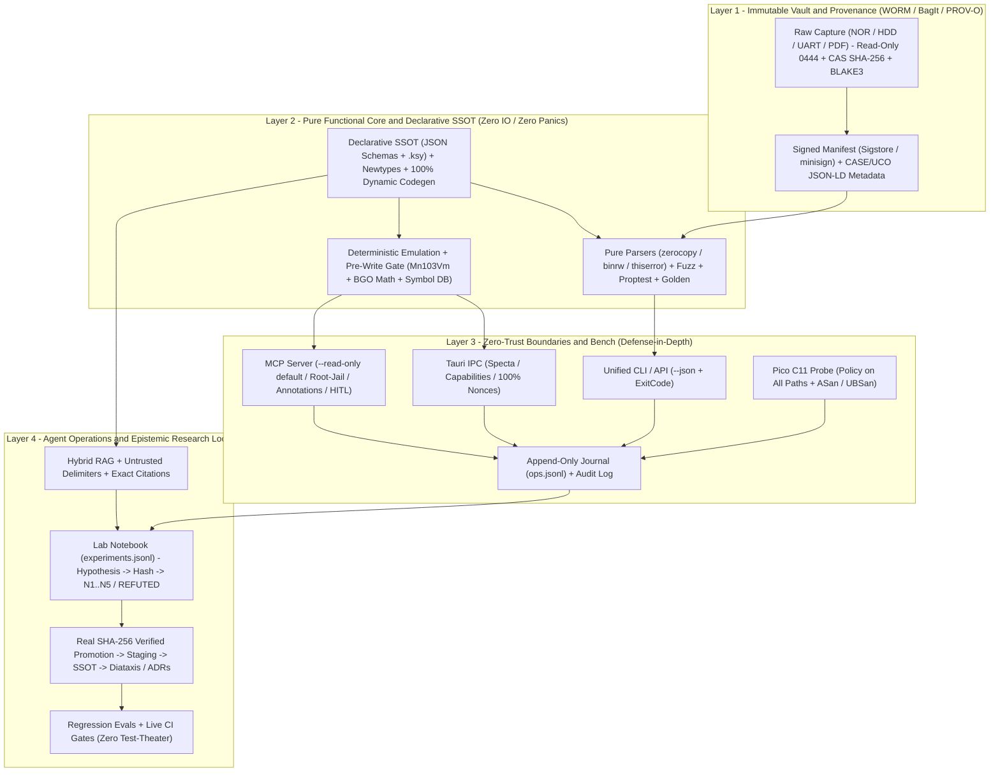
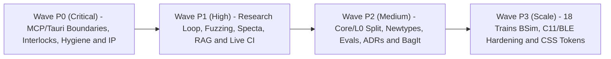

> 🌐 **Language / Idioma:** **English (US)** · [Versão em Português (`pt-BR`)](../pt-BR/PADRAO_OURO_ARQUITETURA_FORENSE_RE_E_AUDITORIA.md) · [Portal `docs/INDEX.md`](../INDEX.md) · [Status & Diátaxis](../STATUS.md)

# Gold Standard for Forensic Reverse Engineering Architecture & Point-by-Point Panadiga Audit

> **Scope & Methodology:** This document establishes the **Gold Standard** for operationalizing hardware and firmware reverse engineering research with forensic rigor across **7 dimensions** (*Archive, File Organization, Code, Architecture, Design, Security, and AI Agent Operations*) and cross-audits every criterion point by point against the verified `Panadiga` repository state at the post-sync baseline (`a343cdc`, including modularized `main_bgo_retarget/` & `sata_bridge_stage2/`, skill consolidation to 29 skills, `firmware/digaos/`, and [`docs/audits/GIT_FILTER_REPO_PLAN.md`](../audits/GIT_FILTER_REPO_PLAN.md)).

---

## Executive Summary & Maturity Scorecard

**Panadiga** already exhibits uncommon rigor in several foundational pillars: a 89-model relational SSOT with compile-time drift checks (`crates/panadiga-core/build.rs`), 7 custom AST architecture lint rules (`packages/oxlint-plugin-panadiga`), an automated CI epistemic overclaiming gate (`scripts/tests/test_docs_parity.py`), an authoritative silicon safety gate in Pico C11 (`p7501_bus_policy.c`), and 65 SHA-40 pinned GitHub Actions. However, the point-by-point audit uncovered **critical trust-boundary gaps** (arbitrary path traversal and HITL bypasses in MCP/Tauri, raw UART/GDB physical interlock bypasses), **disconnected research-loop links** (`panadiga-vault::Journal` unwired in production, `promote.rs` skipping actual file SHA-256 hashing, missing `profiles/staging/`), **forensic/IP debt in Git history** (`225+ MiB` pack containing 32 PDFs and 8 proprietary binaries under a blanket MIT license plus an undetected corrupted checksum at `datasheets/SHA256SUMS.txt:5`), and **missing parser fuzzing, property testing, and agent evaluations**.

| # | Dimension | Maturity (0–5) | Strengths Already at Gold Standard | Most Urgent Critical / High Gaps |
| :-: | :--- | :-: | :--- | :--- |
| **1** | **Archive** | **2.3 / 5** | CI-checked SHA-256 ledger; `panadiga-vault` chained SHA-256 + `.vault.lock`; runtime `raw/frm/recompiled` bucket isolation | `0%` OS read-only bits or on-disk CAS naming; 32 PDFs (`144 MB`) + 8 vendor binaries in Git under blanket MIT without `NOTICE`; corrupted 63-char hash at `datasheets/SHA256SUMS.txt:5` unchecked in CI; 21 unindexed `docs/evidence/` files; `Journal` unwired |
| **2** | **File Org.** | **3.0 / 5** | 44/44 bilingual pairs with 0 orphans; 28 UART logs SHA-256 verified in CI; refuted hypotheses logged; stray root `-` removed and `/test-results/`, `/backups/` gitignored | No RFC 8493 BagIt or OAIS SIP/AIP/DIP packaging; no `docs/adr/`; stale `SA0..SA3` wording in `docs/STATUS.md` and `ledger.json:304`; no machine-queryable `experiments.jsonl`; monolithic `README.md` (`75 KB`) |
| **3** | **Code** | **3.2 / 5** | Zero `TODO`/`FIXME`; only 2 `allow(dead_code)`; 14 `unsafe` isolated to `Mmap`/IOCTL; 398+ Rust `#[test]`; `main_bgo_retarget/` & `sata_bridge_stage2/` modularized | **Zero `cargo-fuzz`, `proptest`, or `insta`** on binary parsers; `anyhow` 381× vs `thiserror` 2×; 23 `.unwrap()` + 12 `panic!` in prod; missing `rust-toolchain.toml`, `[workspace.lints]`, `deny.toml`, `pyproject.toml`; `tracing` barely instrumented |
| **4** | **Architecture** | **3.4 / 5** | Acyclic 11-crate DAG; compile-time `build.rs` SSOT gate + `SSOT_CONTRACT_HASH`; Android/Desktop Vite isolation; 12-defect SLEIGH patch | `panadiga-core` remains a **god-crate** (`~55k LOC`) violating FCIS (`std::fs` in 36 prod files); L0 `panadiga-constants` pulls `memmap2`/`opentelemetry`; `profiles_codegen` still has static emitters; partial `profiles/symbols/` across 18 trains |
| **5** | **Design** | **2.9 / 5** | AST-enforced MVVM (`oxlint-plugin-panadiga`); 0 `console.*`; 20+ i18n bundles; hash-bound symbol schema | **121 Tauri commands without `tauri-specta`/`ts-rs`** (Zod 1×, dual-casing in `ipc.ts`); 0 declarative specs (`.ksy`/`binrw`/`zerocopy`) & **1,100+ magic hex** literals in prod; **0 Newtypes** in `ir`/`profiles`; 23 `!important` CSS rules |
| **6** | **Security** | **2.3 / 5** | 100% SHA-40 Actions; 0 third-party Tauri plugins; `withGlobalTauri: false`; 0 `strcpy`/`sprintf` C11 and 0 `shell=True` Python; 0 DRM/CPRM circumvention | **Arbitrary R/W path traversal in MCP & Tauri**; **MCP HITL bypass** (`live_apply`/`run_live`); nonces on only 2/12 destructive Tauri commands; `cmd /c` in `os_launch.rs`; 6 physical interlock bypasses (`UARTSEND`/`BRIDGE`/CDC/GDB/Android/RAG); hardcoded keystore in `release.yml`; no Threat Model/SLSA/SBOM/`cargo-audit` |
| **7** | **Agent Ops** | **2.9 / 5** | Skills consolidated (35 → 29) including `panadiga-functional-math-and-patterns`; deterministic `HardwareSafetyValidator`; active pre-commit hook | **Zero least-privilege across 6 personas** (all write + `auto`); **RAG drops `file_path`** in citations and emits `"L5-L5"` for PDF pages; no untrusted PDF delimiters; **test-theater** (`--check` only on `tmp_path`); 0 `evals/`; 7 manual rule files |

### Reference Architecture — Gold-Standard Forensic Research Pipeline

---

## Part I — Gold-Standard Specification (7 Dimensions)

### 1. Archive (*ISO/IEC 27037, NIST SP 800-86, RFC 8493 BagIt, W3C PROV-O, CASE/UCO JSON-LD*)
1. **Physical & Logical Immutability (WORM + CAS):** Every raw capture (`NOR`, `NAND`, `EEPROM`, `HDD`, `.FRM`, UART/logic traces) lives outside Git history (object store / DVC / git-annex / private vault), with OS read-only bits (`0444` / `attrib +R`) and content-addressed naming (`<sha256[0..16]>_<slug>.<ext>`).
2. **Dual Digests & Cryptographic Signing:** Dual checksum (**SHA-256** + **BLAKE3**) in a unified manifest signed via `minisign` or Sigstore `cosign` and verified in CI.
3. **Structured Provenance:** Every artifact and bench JSON carries `acquired_at_utc`, `operator`, `tool_name`, `tool_version`, `git_commit` (clean tree), `device_model`, `device_serial`, `board_rev`, `acquisition_method`, and `derived_from_sha256[]` with **CASE/UCO JSON-LD** export.
4. **Clean-Room IP Hygiene:** Public MIT/Apache-2.0 repos track only original code, schemas, expected SHA-256 tables, local ingest tooling, and clean-room diffs (`bsdiff`/JSON), scoped via `LICENSE` + `NOTICE` + `THIRD_PARTY_LICENSES.md` — never vendor manuals or proprietary firmware dumps.

### 2. File Organization (*OAIS ISO 14721, BagIt RFC 8493, Diátaxis, MADR*)
1. **OAIS / BagIt Separation:** Strict separation across `sip_raw/` (immutable raw captures), `aip_curated/` (extracted/decrypted/verified symbols), and `dip_kits/` (derived kits/reports), with one canonical log root.
2. **Naming & Hygiene:** Lowercase ASCII without spaces (`YYYYMMDD_HHMMSS_<model>_<region>_<artifact>.<ext>`), POSIX `/` paths in JSON outputs, CI max-blob gate (`> 1 MiB`), and clean-tree capture enforcement.
3. **Diátaxis Docs & ADRs:** Lean portal `README.md` (`< 250` lines), 4 **Diátaxis** quadrants (*Tutorials, How-To, Reference, Explanation*), **MADR** records under `docs/adr/`, and zero manually duplicated volatile counts.
4. **Epistemic Lab Notebook (`experiments.jsonl`):** Queryable log linking `exp_id → hypothesis → setup → evidence_sha256[] → outcome (CONFIRMED | REFUTED | INCONCLUSIVE) → tier → conclusion`, preserving negative results.

### 3. Code (*Determinism, Memory Safety & Hostile Parsers*)
1. **Pure Deterministic Core:** Pure libraries use typed `thiserror` enums mapped to a unified `ErrorCode` taxonomy (`anyhow` reserved for CLI/app shells), zero `.unwrap()`/`.expect()`/`panic!` in production, and `#![forbid(unsafe_code)]` on all pure crates.
2. **Hostile-Input Parser Verification:** Every proprietary parser (`MEIHFS`, `.FRM`, `EXTRHEAD`, `BGO`, `LZSS`, `Feistel`, `UF2`, `GDB RSP`) has `cargo-fuzz` targets, `proptest` round-trip invariants, and `insta` golden snapshots.
3. **Reproducibility & Observability:** Pinned `rust-toolchain.toml`, `[workspace.lints]` + MSRV, `rustfmt.toml`, `deny.toml`, `pyproject.toml` + `--require-hashes`, and real `tracing::instrument` spans.

### 4. Architecture (*FCIS, Clean DAG, Real SSOT & RE Pipeline*)
1. **Functional Core, Imperative Shell (FCIS):** L0 holds only constants, domain types, and error definitions (zero I/O, zero `std::fs`, zero telemetry). Pure domains (`hdd`, `emu`, `ghidra`, `ssot`) live in cohesive crates (`< 10k LOC`, `< 400–800 LOC`/file) with I/O pushed to thin edge adapters.
2. **100% Dynamic SSOT:** Schemas/catalogs dynamically generate Rust, TypeScript, C11, and Python code without static hardcoded string emitters or duplicated literals, gated by CI `git diff --exit-code`.
3. **Scalable RE Pipeline:** Cross-platform SLEIGH patch installer verifying target `mn103.sla` SHA-256; `profiles/symbols/` covering `BOOT`/`PROG`/`MAIN`/`DRV` across trains plus **Ghidra BSim / Version Tracking / `.fidb`** propagation.

### 5. Design (*Domain Modeling, Declarative Formats, Contracts & UX*)
1. **Newtypes over Primitive Obsession:** Distinct compile-time types (`PhysAddr`, `VirtAddr`, `SectorIndex`, `Lba`, `ModelId`, `Sha256Hex`) preventing cached (`0x8000_0000`) vs uncached (`0x8400_0000`) vs file-offset mix-ups.
2. **Declarative Binary Formats:** Headers declared via `zerocopy`/`binrw`/`deku` + living `.ksy` Kaitai specs.
3. **End-to-End Typed Contracts:** Auto-generated Tauri IPC bindings (`tauri-specta`/`ts-rs`), standardized CLI `--json` envelope + `ExitCode`, and semantic CSS Custom Properties (zero `!important`).

### 6. Security (*OWASP Top 10, OWASP MCP/LLM Top 10, SLSA L3*)
1. **Formal Threat Model:** Mermaid DFD + STRIDE matrix + attack trees covering WebView↔IPC, MCP↔FS/Serial, GDB/BLE↔Pico↔SoC, and `.FRM`/NOR patching.
2. **Silicon Defense-in-Depth:** Hardware interlocks (`<= 3.3V`, `NSW5V` Hi-Z, `0xC000100C`, `IPL SA0..SA10`) enforced across every path (including raw UART/BRIDGE, hex payloads, GDB, Android, and RAG) with dedicated unit tests.
3. **Zero-Trust Desktop/Android:** Tauri v2 minimal `capabilities/*.json`, strict CSP, `canonicalize()` root-jail, zero `cmd /c`, ephemeral nonces across **100%** of destructive commands, and LESC/Bonding BLE.
4. **MCP & RAG Security:** Default **`--read-only` mode**, `canonicalize_within` root-jail, 26 tool `annotations`, out-of-band HITL, `64 KiB` output cap, JSONL audit log, `UNTRUSTED_DATA` PDF delimiters, and `0600` private cache.
5. **C11, GDB & Supply Chain:** Loopback-only GDB listener, C11 `-fstack-protector-strong` + ASan/UBSan + `cppcheck`, SLSA L3 provenance, SBOM, `cosign`, `cargo-audit`/`cargo-deny`/`gitleaks`/CodeQL/Dependabot, `SECURITY.md`, and `CODEOWNERS`.

### 7. Agent Operations (*Governance, Auditable RAG, Evals & Epistemic Loop*)
1. **Single Instruction SSOT:** One source generates slim IDE projections (`AGENTS.md`, `GEMINI.md`, `.cursorrules`, `.mcp.json`) with zero contradictions and `< 3,000` fixed tokens.
2. **Orthogonal Skills & Least-Privilege Personas:** Minimal overlap fitting context budgets; read-only auditor/researcher personas without `auto` exec and with formal handoff schemas.
3. **Closed Verified Loop & Evals:** Promotion hashes real disk evidence; RAG preserves `file_path` + distinct `page`/`line_range`; `evals/` tracks Recall@k, MCP tool routing, and Red-Team block rate; live `--check` CI gates with zero test-theater.

---

## Part II — Point-by-Point Cross-Audit: Gold Standard × Current Panadiga State

### Dimension 1 — Archive (`A1–A3, A8`)

| ID | Gold Standard Criterion | Current Verified State (Evidence) | Sev. | Concrete Remediation |
| :--- | :--- | :--- | :-: | :--- |
| **A1** | WORM + CAS immutability outside Git | `0` dumps have OS `IsReadOnly` or CAS names; no LFS/annex/DVC; Git history holds binary revisions forced via [.gitignore](../../.gitignore#L97-L109); [layout.rs](../../crates/panadiga-core/src/vault/layout.rs#L126-L136) lacks OS read-only bit enforcement. | **Critical** | Execute [GIT_FILTER_REPO_PLAN.md](../audits/GIT_FILTER_REPO_PLAN.md) after user approval; enforce `readonly = true` (`0444`) and CAS naming in `ingest_vault_artifact()`. |
| **A2** | Signed dual manifests in CI | SHA-256 only (0 BLAKE3, 0 signatures). [datasheets/SHA256SUMS.txt](../../manuals_and_schematics/datasheets/SHA256SUMS.txt#L5) has a corrupted 63-char hash (`...c3e7c2ad...` vs `...c3e75c2ad...`) unchecked by CI; 21 `docs/evidence/` files and 24 PDFs lack manifest entries. | **High** | Fix `datasheets/SHA256SUMS.txt:5`, verify all `SHA256SUMS.txt` in `test_docs_parity.py`, backfill `ledger.json`, add BLAKE3 + `cosign` signatures. |
| **A3** | Chain of custody (PROV-O / CASE-UCO) | [panadiga-vault/src/journal/types.rs](../../crates/panadiga-vault/src/journal/types.rs#L29-L83) defines hash-chained `ops.jsonl`, yet `Journal::open` has **0 production callers**; [vault/mod.rs](../../crates/panadiga-core/src/vault/mod.rs#L119-L146) and probe outputs omit `operator`, `device_serial`, `board_rev`, `tool_version`/`git_sha`, `derived_from_sha256[]`. | **High** | Wire `panadiga-vault::Journal` into CLI/MCP/Tauri; enforce full provenance header + `CASE/UCO JSON-LD` export command. |
| **A8** | Clean-room IP & third-party licensing | Blanket MIT [LICENSE](../../LICENSE) lacks `NOTICE` / `THIRD_PARTY_LICENSES.md` while tracking 32 vendor PDFs, 8 Panasonic binaries, and `Panasonic_DVD_TV.ir`. | **Critical** | Add `NOTICE` & `THIRD_PARTY_LICENSES.md` scoping MIT to original Panadiga code/docs and execute clean-room offload upon user approval. |

### Dimension 2 — File Organization (`A4–A7, A9–A10`)

| ID | Gold Standard Criterion | Current Verified State (Evidence) | Sev. | Concrete Remediation |
| :--- | :--- | :--- | :-: | :--- |
| **A4** | BagIt (RFC 8493) / OAIS packaging | No `panadiga vault pack-bag`; `firmware_and_images/` mixes raw dumps, kits, and `.ir`; logs split across `docs/debug_logs/` (`28`) and `docs/evidence/` (`boottrace_*.log`). | **Medium** | Add `panadiga vault pack-bag` (`data/{sip_raw,aip_curated,dip_kits}`) and unify bench log policy. |
| **A5** | Naming & repo cleanliness | Stray root `-` removed and `/test-results/`, `/backups/`, `.env*`, `*.pem`, `*.key`, `*.jks`, `*.p12`, `*.pfx`, `/.aider-desk/` added to `.gitignore`. Remaining: 13 spaced filenames in `firmware_and_images/`, Windows backslashes in `prepare_report.json`, dumps missing date/region tags. | **Medium** | Enforce space-free lowercase naming on new evidence and normalize POSIX `/` paths in JSON outputs. |
| **A6** | Diátaxis, ADRs & zero drift | 0 ADRs (`docs/adr/` absent); monolithic `README.md` (`75 KB`); [docs/STATUS.md](../STATUS.md#L37) still mentions `SA0..SA3`; 2 bilingual pairs exceed 10% line divergence; manual counts in `AGENTS.md:82-90` drift. | **High** | Add `docs/adr/` (MADR), slim `README.md` (`<250` L) pointing to Diátaxis dirs, move root audits to `docs/audits/`, add heading-parity check. |
| **A7** | Epistemic lab notebook | Disproved hypotheses appear in prose ([EH55_REVERSE_ENGINEERING...md](../en-US/EH55_REVERSE_ENGINEERING_SESSION_FAITHFUL_REPORT.md)), but no machine-queryable `experiments.jsonl`; broken ref `no_ide_cable_boot.log`; 21 `docs/evidence/` files missing from `ledger.json`. | **Medium** | Add `docs/evidence/experiments.jsonl`, backfill all 21 files in `ledger.json`, fix broken log ref. |
| **A9** | Large-blob hygiene | No pre-commit/CI max-blob limit (raw `fleet_main_function_maps_part*.txt` ~4.6 MB each tracked). | **High** | Enforce `> 1 MiB` blob gate (bar allowlist) and externalize/compress raw maps and binaries. |
| **A10** | Clean-tree capture policy | Historical captures ran atop dirty working trees without automatic `git_commit`/`git_dirty` tracking. | **High** | Record `git_commit` + `git_dirty` in capture scripts and fail closed on dirty tree unless `--allow-dirty`. |

### Dimension 3 — Code (`C2–C4, C7–C8, C10, C12`)

| ID | Gold Standard Criterion | Current Verified State (Evidence) | Sev. | Concrete Remediation |
| :--- | :--- | :--- | :-: | :--- |
| **C2** | No god-modules (`<800` LOC) | `main_bgo_retarget.rs` and `sata_hdd_autoboot` were successfully modularized! [ghidra_zero_undef_pipeline.py](../../tools/ghidra/ghidra_zero_undef_pipeline.py) (`2,229 L`) still exceeds 800 lines. | **Medium** | Decompose `ghidra_zero_undef_pipeline.py` into pure FP passes + thin PyGhidra adapters (`<400 L`/module) and enforce ceiling in Gate 9. |
| **C3** | `thiserror`, zero panics, `forbid(unsafe_code)` | Prod Rust still holds **23 `.unwrap()`**, **38 `.expect()`**, **12 `panic!()`** ([guardrails.rs](../../crates/panadiga-rag/src/guardrails.rs#L12) 12×, [uf2.rs](../../crates/panadiga-core/src/pico/flasher/uf2.rs#L12-L183) 6×, `ssot/` 12×, [cli/main.rs](../../crates/panadiga-cli/src/main.rs#L45)); `anyhow` 381× vs `thiserror` 2×; `panadiga-crypto`/`rag`/`mcp` lack `#![forbid(unsafe_code)]`. | **High** | Add `#![forbid(unsafe_code)]` across pure crates, adopt `thiserror` in pure parsers, eliminate prod `.unwrap()`/`panic!`, enable `clippy::unwrap_used`. |
| **C4** | Fuzzing, property & snapshot tests | **0** `cargo-fuzz`, **0** `proptest`, **0** `insta` over `MEIHFS`, `.FRM`, `EXTRHEAD`, `BGO`, `LZSS`, `Feistel`, `UF2`, `GDB RSP`. | **Critical** | Add `fuzz/` (`cargo-fuzz`) + `proptest` round-trip invariants + `insta` snapshots for CLI/MCP JSON. |
| **C7** | Balanced test pyramid | Critical L1 crates remain lightly tested (`panadiga-vault` 1, `panadiga-bench` 2, `panadiga-constants` 2, `panadiga-ir` 4, `panadiga-profiles` 9). | **Medium** | Expand fault-injection, crash-recovery, backpressure, and negative capability tests in L1 crates. |
| **C8** | Observability (`tracing`) | `logger_tracing.rs` lacks an exporter; `cli`, `mcp`, `rag`, `src-tauri` have 0 `tracing::` spans despite declaring the dep; `cli` uses 29 `println!`. | **Medium** | Instrument edge handlers with `#[tracing::instrument]`, wire optional JSONL/OTLP export, standardize `ErrorCode`. |
| **C10** | Toolchain pinning & lint policy | Missing `rust-toolchain.toml`, `rust-version`, `[workspace.lints]`, `rustfmt.toml`, `clippy.toml`, `deny.toml`, `pyproject.toml` + pinned hashes. | **High** | Add toolchain/lint configs and run `cargo deny check` + `pip install --require-hashes` in CI. |
| **C12** | Suppressions & clone strictness | Clean (`0` `TODO`/`FIXME`, `2` `allow(dead_code)`), yet 17 `#[allow(clippy::too_many_arguments)]` remain and `.jscpd.json` uses `"mode": "weak"`. | **Low** | Group long argument lists into request structs and tighten `.jscpd.json` to `"mode": "mild"`. |

### Dimension 4 — Architecture (`C1, C6, C11`)

| ID | Gold Standard Criterion | Current Verified State (Evidence) | Sev. | Concrete Remediation |
| :--- | :--- | :--- | :-: | :--- |
| **C1** | Clean DAG + strict FCIS | `panadiga-core` (`~55k LOC`) blends pure domains with `std::fs` (36 files), `serialport`, `memmap2`, `windows-sys`. L0 `panadiga-constants` imports `opentelemetry_sdk`, `memmap2`, `rayon`, `flate2`, `md-5`. | **High** | Purify L0 by moving `logger*`/`forensic.rs` out; split `panadiga-core` into pure FP domain crates (`hdd`, `emu`, `ghidra`, `ssot`) + edge I/O shells. |
| **C6** | 100% dynamic SSOT codegen | `ssot/profiles_codegen/` retains static emitters and raw literals (`0xC000100C`, `0x807F0000`, `115200`) still duplicate across C/Rust/TS/Python. | **High** | Drive TS/Python/C11 emitters directly from JSON Schemas and add anti-literal lint in `validate.py`. |
| **C11** | Scalable RE pipeline | SLEIGH patch docs assume Windows path `C:\ghidra\...`; `profiles/symbols/` only partially covers 18 trains; no BSim/Version Tracking/FID. | **Medium** | Package cross-platform SLEIGH installer checking `mn103.sla` SHA-256, expand `profiles/symbols/`, adopt BSim/VT. |

### Dimension 5 — Design (`C5, C9`)

| ID | Gold Standard Criterion | Current Verified State (Evidence) | Sev. | Concrete Remediation |
| :--- | :--- | :--- | :-: | :--- |
| **C5** | Declarative specs & Newtypes | 0 `.ksy`/`binrw`/`zerocopy`; manual slice indexing; >1,100 prod hex literals; 0 Newtypes in `panadiga-ir`/`panadiga-profiles`. | **High** | Introduce `zerocopy`/`binrw` (+ `.ksy`), Newtypes (`PhysAddr`, `VirtAddr`, `SectorIndex`, `Lba`, `ModelId`, `Sha256Hex`), and SSOT address lookup. |
| **C9** | Typed IPC, Design System & CLI | **121 `#[tauri::command]`** lack `tauri-specta`/`ts-rs` (Zod 1×; [ipc.ts](../../apps/desktop/src/services/ipc.ts#L61-L73) duplicates casing); [index.css](../../apps/desktop/src/index.css#L38-L100) uses **23 `!important`**; CLI lacks uniform `ExitCode`. | **High** | Adopt `tauri-specta`/`ts-rs`, refactor CSS themes to semantic variables without `!important`, standardize CLI `ExitCode` + `--json`. |

### Dimension 6 — Security (`S1–S11`)

| ID | Gold Standard Criterion | Current Verified State (Evidence) | Sev. | Concrete Remediation |
| :--- | :--- | :--- | :-: | :--- |
| **S1** | Formal Threat Model | Missing (`STRIDE`/DFD/attack trees absent across `docs/`). | **Medium** | Author `docs/security/THREAT_MODEL.md` covering all 4 trust boundaries. |
| **S2** | Tauri v2 & Android hardening | No `src-tauri/capabilities/`; CSP permits `'unsafe-inline'`; `paths.rs` uses tiny denylist (allows reading `~/.ssh/*`); `os_launch.rs` invokes `cmd /c` + `powershell` + `terminal`; **nonces on only 2/12 destructive commands**; Android `INTERNET` + wide `file_paths.xml` + `@JavascriptInterface` bypass. | **High** | Add `capabilities/default.json`, harden CSP, allowlist root-jail in `paths.rs`, direct `Command::new` in `os_launch.rs`, require nonces on 100% of destructive commands, tighten Android manifest/paths/Rust USB-BLE validation. |
| **S3** | Secrets & key hygiene | [android_verify.py](../../scripts/build_lanes/android_verify.py#L19-L20) hardcodes `panadigabench`/`panadiga` used by [release.yml](../../.github/workflows/release.yml#L440); vendor keys hardcoded in `crypto_frm.rs`/`aes128/keys.rs`. | **High** | Sign releases via GitHub Secrets (`env:ANDROID_KS_PASS`), limit `ensure_bench_keystore` to `--dev-bench`, externalize vendor keys, add `gitleaks`. |
| **S4** | CI/CD supply chain | Unpinned `pip install`, `pico-sdk --branch 2.1.1`, `npx --yes @tauri-apps/cli`; inline interpolation at `release.yml:320`; 0 `cosign`/SLSA/SBOM/`cargo-audit`/`cargo-deny`/CodeQL/Scorecard/Dependabot. | **High** | Pin `@tauri-apps/cli`, `pico-sdk` SHA-40, and Python `--require-hashes`; move `release.yml:320` expr to `env:`; add SLSA, SBOM, `cosign`, scanners, Dependabot. |
| **S5** | Dependency policy | `Cargo.lock` and `package-lock.json` committed; missing `deny.toml` and hash-pinned Python requirements. | **Medium** | Add `deny.toml` + `scripts/requirements-dev.txt --require-hashes`. |
| **S6** | Physical interlocks (Defense-in-Depth) | **6 bypasses:** (1) Pico `UARTSEND`/`UARTTXHEX`/`WAITTX`/`BRIDGE` bypass `p7501_bus_policy.c`/F14; (2) [telemetry.rs](../../crates/panadiga-core/src/pico/bench_decoders/telemetry.rs#L75-L95) only scans literal `"C000100C"` and 3 IPL cmds; (3) GDB host (`bridge.rs`/`session.rs`) lacks RSP filtering; (4) `AndroidPicoBridge.kt` bypasses validator; (5) RAG [safety/mod.rs](../../crates/panadiga-rag/src/safety/mod.rs#L158-L177) skips `0xC000100C` on negated `is_query=true` and lacks `NSW5V` push-pull rule; (6) `hal/p7501_hw.c` excluded from `C11_HOST_SOURCES`. | **High** | Enforce policy inspection on `UARTSEND`/`UARTTXHEX`/`BRIDGE`, hex-decode in `telemetry.rs`, host RSP filter, fix `safety/mod.rs` + `NSW5V` rule, add GPIO mock host test for `p7501_hw.c`. |
| **S7** | MCP & AI agent security | **5 severe gaps:** (1) Arbitrary FS R/W in [workspace.rs](../../crates/panadiga-mcp/src/workspace.rs#L9-L16) + symlink gap in `resources.rs`; (2) `live_apply`/`run_live` lack `--read-only` & out-of-band HITL and `defs_re_ext.rs:151` leaks static override string; (3) 0/26 tool `annotations`; (4) no `64 KiB` cap or audit log; (5) RAG `retrieve_filtered` ignores `q.is_injection`, PDFs lack untrusted delimiters, shared `temp_dir()` PDF cache. | **Critical** | `canonicalize_within` root-jail, default `--read-only` + out-of-band HITL, 26 `annotations`, `64 KiB` cap + JSONL audit log, enforce `q.is_injection`, untrusted PDF delimiters, private `0600` cache. |
| **S8** | GDB / C11 / BLE | Android BLE pairs without LESC/Bonding; GDB TCP allows non-loopback `listen_addr`; `CMakeLists.txt` lacks `-fstack-protector-strong`/`-Wformat=2`; 0 ASan/UBSan/`cppcheck`. | **Alto** | Require `ip().is_loopback()` on GDB, LESC/Bonding BLE, CMake hardening + ASan/UBSan + `cppcheck` in CI. |
| **S9** | Python script security | Clean (`0` `shell=True`/`eval`/`pickle`), minor `7z` `--`/symlink gap and raw `mkdtemp()` in 3 scripts. | **Low** | Pass `["--", path]` + symlink check, use `TemporaryDirectory()`, run `bandit`. |
| **S10** | Security governance | Missing `SECURITY.md`, `.github/CODEOWNERS`, signed-commit policy, and `gitleaks` hook. | **Medium** | Add `SECURITY.md`, `CODEOWNERS` for sensitive paths, and `gitleaks protect --staged`. |
| **S11** | Legal / DRM posture | Zero DRM/CPRM circumvention code; takedown risk from tracked vendor manuals/binaries/keys under MIT. | **High** | Execute `A8` + `S3` clean-room plan and scope `NOTICE` / `THIRD_PARTY_LICENSES.md`. |

### Dimension 7 — Agent Operations (`G1–G10`)

| ID | Gold Standard Criterion | Current Verified State (Evidence) | Sev. | Concrete Remediation |
| :--- | :--- | :--- | :-: | :--- |
| **G1** | Single entrypoint & zero contradictions | 7 manual rule files (`AGENTS.md`, `GEMINI.md`, `.cursorrules`, `.agents/rules/*`) with contradictions (`React 19` vs `^18.3.1`, `.cursorrules:8`, `ledger.json:304` `SA0..SA3`, `hardware.rs:356` 6 vs 11 crates). | **High** | Generate IDE projections from one SSOT rule manifest and fix all contradictions. |
| **G2** | Orthogonal skills within budget | Consolidated cleanly from 35 → **29 skills** (including `panadiga-functional-math-and-patterns`). Phantom test refs remain in `git-cicd-and-releases/SKILL.md:41,51`. | **Medium** | Fix phantom paths and validate all 29 skills continuously via `test_agent_layer.py`. |
| **G3** | Least-privilege personas | All 6 `.agents/agents/*.md` share identical write+`auto` tools (incl. `panadiga-qa-auditor`), legacy tool names, and 0 MCP / handoff schemas. | **High** | Restrict `panadiga-qa-auditor` to read-only without `auto`, modernize tool lists, add handoff schemas. |
| **G4** | Machine-checked epistemic rigor | `ledger.json` lacks `HYPOTHESIS`/`PROBABLE`/`REFUTED` and `ledger.json:304-307` has `SA0..SA3` outside `STALE_SA_PATTERN` scan. | **Medium** | Scan `ledger.json` in `test_profiles_ssot.py` and add `experiments.jsonl` tracking negative results. |
| **G5** | Programmatic HITL & hooks | 0 `.agents/hooks`; MCP lacks confinement/`annotations`/out-of-band HITL; static override literal exposed in `defs_re_ext.rs:151`. | **Critical** | Implement full `S7` controls + pre-tool `.agents/hooks`. |
| **G6** | Agent & RAG regression evals | 0 `evals/` harnesses (PT/EN Q&A Recall@k, 26 MCP tool routing, PT+EN Red-Team). | **High** | Build versioned `evals/` benchmark suite wired into CI. |
| **G7** | RAG engineering quality | `RagAnswer::to_query_result()` drops `file_path`; `pdf.rs:169` stores page in `line_start`/`line_end` (`L5-L5`); stale `SA0..SA133` strings; duplicated `KNOWN_COMPONENTS`; omits `profiles/` and `.agents/skills/`. | **High** | Preserve `file_path`, split `page` vs `line_range`, index `profiles/` & `.agents/skills/`, fix `SA0..SA133`, deduplicate constants, frame untrusted PDFs. |
| **G8** | Closed research ops loop | Missing `profiles/staging/manual_proposals/`; `promote.rs` never hashes evidence files on disk; `Journal` unwired in prod; `promote` does not sync `ledger.json`. | **High** | Verify real disk SHA-256 in `promote.rs`, wire `Journal`, add `review-proposal`, sync `ledger.json`. |
| **G9** | Live drift detection (zero test-theater) | `--check` tests run only against `tmp_path`; Gate 7 lacks `git diff --exit-code`; no `.agents/**` link/schema gate. | **High** | Run live `--check` in CI, add Gate 7 `git diff --exit-code`, add `test_agent_layer.py`. |
| **G10** | Multi-IDE portability | Rules and `.mcp.json` / `.agents/mcp_config.json` manually maintained. | **Medium** | Generate via `panadiga ssot export-agents` with CI parity gate. |

---

## Part III — Strengths Already at Gold Standard (Preserve Without Regression)

1. **Compile-Time SSOT & `SSOT_CONTRACT_HASH` Gate** ([build.rs](../../crates/panadiga-core/build.rs)): validates 89 models and 12 Draft 2020-12 JSON Schemas during `cargo build` and verifies Rust/TS/C11 contract parity.
2. **CI Epistemic Anti-Overclaiming Gate** ([test_docs_parity.py](../../scripts/tests/test_docs_parity.py)): rejects unbacked hardware proof badges, SHA-256 checks all 28 curated `docs/debug_logs/` captures, and enforces 1:1 bilingual pair integrity.
3. **AST-Enforced Frontend Architecture** (`packages/oxlint-plugin-panadiga`): 7 custom Oxlint rules enforcing MVVM, immutability, zero-hardcode, zero unsafe casts, and `ux-guard` 100/100 + zero `console.*` + Android asset isolation in `vite.config.ts`.
4. **Pico C11 Silicon Guardrails** ([p7501_bus_policy.c](../../firmware/picofw/flash/picofw_bus_policy.c)): authoritative bus gate (`0xC000100C..F`, `SA0..SA10` E05, F14), `NSW5V` falling-edge isolation (`p7501_hw.c`), GDB command allowlist, `-Wframe-larger-than=512`, and zero `strcpy`/`sprintf`.
5. **Ready-to-Wire Foundational Modules**: `panadiga-vault` (`ops.jsonl` + `.vault.lock`), `panadiga-bench` (coalescing stream + `OperationNonceStore`), hash-bound symbol indexes, 12-defect SLEIGH patch, 65 SHA-40 Actions, zero DRM/CPRM circumvention, and clean Python (`0` `shell=True`/`eval`/`pickle`).

---

## Part IV — Prioritized 4-Wave Remediation Roadmap (`P0 → P3`)

1. **Wave P0 — Critical (Boundary Security, Physical Interlocks, Archive Hygiene & IP):**
   - **Archive/IP:** fix `datasheets/SHA256SUMS.txt:5` + CI verification, full `ledger.json` backfill, fix `SA0..SA3` in `ledger.json:304-307` and `docs/STATUS.md:37`, add `NOTICE` & `THIRD_PARTY_LICENSES.md` (keeping [`GIT_FILTER_REPO_PLAN.md`](../audits/GIT_FILTER_REPO_PLAN.md) unexecuted pending user sign-off).
   - **MCP (`S7`, `G5`):** `canonicalize_within` root-jail, default `--read-only` + out-of-band HITL for `live_apply`/`run_live`, 26 tool `annotations`, `64 KiB` output cap + JSONL audit log, scrub leaked override literal from schemas, list all 11 workspace crates.
   - **RAG (`S6`, `S8`):** fix `if is_query || !has_warning` for `0xC000100C..F`, enforce `NSW5V`/`GP3` push-pull rule, 3-zone IPL copy, `#![forbid(unsafe_code)]`.
   - **Tauri/Android & Interlocks (`S2`, `S3`, `S6`, `S8`):** `capabilities/default.json`, strict CSP, `paths.rs` allowlist, eliminate `cmd /c`, nonces on 100% of destructive commands, Android manifest/paths/Rust USB-BLE + release secrets, C11 `UARTSEND`/`UARTTXHEX`/`BRIDGE` inspection, `telemetry.rs` hex decoding, loopback/RSP-filtered GDB, and GPIO mock host tests for `hal/p7501_hw.c`.
2. **Wave P1 — High (Research Loop, Hostile-Input Parsers, Typed IPC & Live CI):**
   - Wire `panadiga-vault::Journal` into production, verify real disk SHA-256 in `promote.rs`, add `profiles/staging/manual_proposals/` + `review-proposal`, enforce OS `readonly` on ingest.
   - Preserve `file_path` and distinct `page` in RAG, enforce `q.is_injection` in `retrieve_filtered`, wrap PDF chunks in untrusted delimiters, move cache to `0600` private dir, index `profiles/` & `.agents/skills/`.
   - Add `fuzz/` (`cargo-fuzz`) + `proptest` + `insta`, `#![forbid(unsafe_code)]`, zero prod `.unwrap()`/`panic!`, `thiserror`, `tauri-specta`/`ts-rs` across 121 commands, pinned toolchains + `deny.toml` + `cargo-audit`/`gitleaks`/SLSA/SBOM/`cosign`/CodeQL/Dependabot, live `--check` gates, `test_agent_layer.py`, SSOT rule codegen, and read-only `panadiga-qa-auditor`.
3. **Wave P2 — Medium (FCIS Decomposition, FP Domain, Evals & Formal Memory):**
   - Purify L0 `panadiga-constants`, split `panadiga-core`, decompose `ghidra_zero_undef_pipeline.py`, make `profiles_codegen` 100% schema-driven, remove duplicated literals (`0xC000100C`, `0x807F0000`, `115200`), introduce Newtypes + `zerocopy`/`binrw` (+ `.ksy`), instrument `tracing`, add `evals/`, `THREAT_MODEL.md`, `SECURITY.md`, `CODEOWNERS`, `docs/adr/`, `experiments.jsonl`, and `panadiga vault pack-bag`.
4. **Wave P3 — Multi-Model Scale (89 Models / 18 Trains) & Polish:**
   - Cross-platform SLEIGH installer, 18-train `profiles/symbols/` + Ghidra BSim/VT, C11 hardening + ASan/UBSan + `cppcheck`, `bandit`, BLE LESC/Bonding, CSS Custom Properties (zero `!important`), lean Diátaxis `README.md` (`< 250` L), uniform CLI `ExitCode`, zero `allow(too_many_arguments)`, and `.jscpd.json` `"mode": "mild"`.
