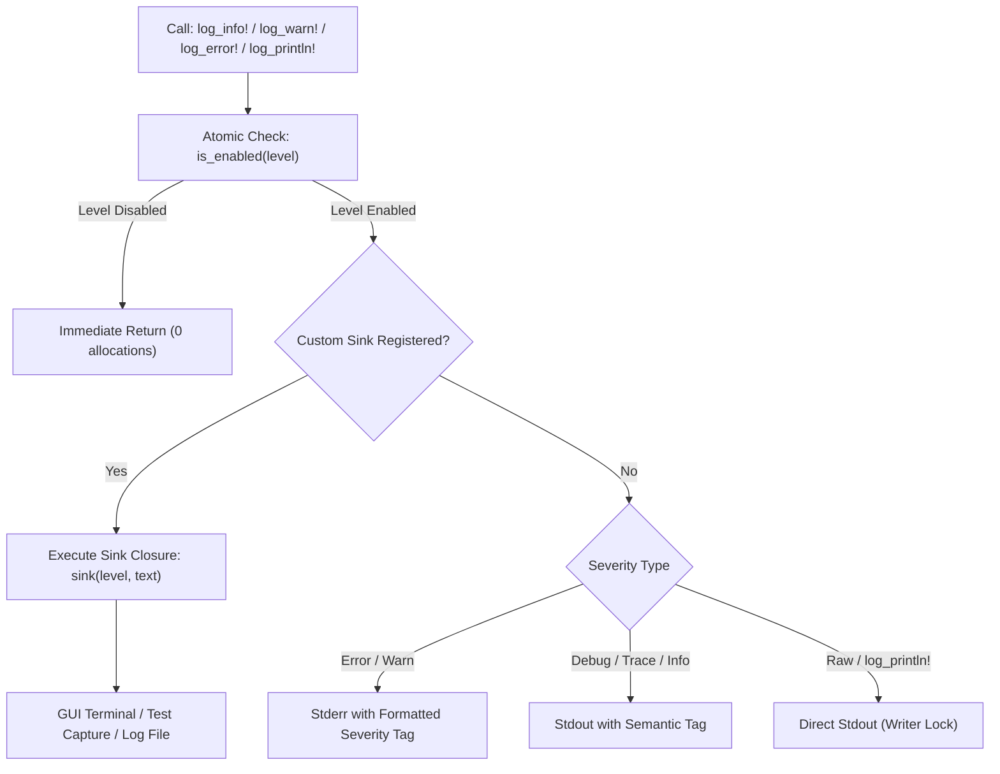

> 🌐 **Language / Idioma:** **English** | [Português (BR)](../pt-BR/SUBSISTEMA_LOGGING_E_TELEMETRIA.md)
> 🧭 **Portal:** [Docs Index](../INDEX.md) | [Complete Audit](../../COMPLETE_AUDIT.md) | [Audits](../audits/README.md) | [Ghidra Pseudocode](../pseudocode/INDICE_EVIDENCIA_PSEUDOCODIGO_GHIDRA.md) | [Debug Logs](../debug_logs/README.md)

# UNIFIED LOGGING & TELEMETRY SUBSYSTEM SPECIFICATION — PANADIGA
## Architecture, Structured Telemetry & Diagnostics for the Rust Core Engine

**Document:** `LOGGING_AND_TELEMETRY_SUBSYSTEM.md`  
**Classification:** Systems Architecture & Code Standards Technical Reference  
**Module:** `crates/panadiga-core/src/logger.rs` (`panadiga_core::logger`)  

---

## 1. Engineering Motivation & Requirements

Historically, command-line utilities and forensic modules in Rust relied on ad-hoc `println!` and `eprintln!` calls scattered throughout the codebase. In an ecosystem comprising five distinct subsystems (storage parsing, NVRAM surgery, serial GDB bridge, binary scanning, and firmware cryptanalysis), uncoordinated raw printing introduced significant architectural challenges:

1. **Lack of Verbosity Control:** Inability to run commands in silent mode (`--quiet`) for automated scripts or verbose mode (`--verbose`) for debugging.
2. **Terminal Pollution During Automated Tests:** Unit and integration test suites emitted hundreds of uncoordinated log lines during `cargo test`.
3. **Inability to Redirect to GUI (Tauri):** The React/Tauri desktop frontend could not programmatically capture Rust engine output without brittle process pipe manipulation.
4. **Absence of Semantic Severity Levels:** Errors, critical hardware alerts, and informational banners were indistinguishably written to `stdout`.

To permanently solve these limitations, the unified logging subsystem [`crates/panadiga-core/src/logger.rs`](../../crates/panadiga-core/src/logger.rs) was designed, tested, and certified.

---

## 2. Module Architecture (`crates/panadiga-core/src/logger.rs`)

The subsystem was engineered for **maximum throughput**, **strict thread-safety**, and **zero heap allocation overhead** when log levels are filtered out.



### 2.1 Severity Hierarchy (`LogLevel`)

The [`LogLevel`](../../crates/panadiga-core/src/logger.rs) enum defines semantic ordering:

```rust
#[derive(Debug, Clone, Copy, PartialEq, Eq, PartialOrd, Ord)]
#[repr(u8)]
pub enum LogLevel {
    Off   = 0, // Total silence (no output)
    Error = 1, // Critical hardware, file, or protocol failures
    Warn  = 2, // Non-fatal anomalies (e.g., GDB socket disconnect)
    Info  = 3, // Standard operational milestones (Default Level)
    Debug = 4, // Offset tracing, entropy metrics, and packet decoding
    Trace = 5, // Byte-level hexadecimal dumps and timing inspections
}
```

### 2.2 Global State & Thread-Safety

Active log levels are stored in a global atomic primitive using `Acquire`/`Release` memory ordering:

```rust
static CURRENT_LEVEL: AtomicU8 = AtomicU8::new(LogLevel::Info as u8);
```

* Global verbosity control via `set_level(level: LogLevel)` and `get_level() -> LogLevel`.
* Inline fast-path filtering (`#[inline]`) via `is_enabled(level: LogLevel) -> bool` with relaxed ordering so disabled debug/trace logs incur virtually zero overhead.

### 2.3 Custom Log Sinks for GUI & Automated Testing

The logger supports registering and clearing custom thread-safe sinks:
```rust
pub fn set_sink<F>(sink: F)
where
    F: Fn(LogLevel, &str) + Send + Sync + 'static,

pub fn reset_sink()
```
This enables the Tauri desktop frontend and automated unit tests (`crates/panadiga-core/src/logger.rs`) to capture real-time serial and forensic logs and restore standard `stdout`/`stderr` output when finished.

---

## 3. Macro-Based Standard API

All subsystems in the workspace invoke Panadiga's ergonomic macros rather than writing directly to standard output:

```rust
use panadiga_core::{log_info, log_warn, log_error, log_debug, log_println};

pub fn inspect_partition(id: usize) {
    log_info!("Scanning MEIHDFS partition #{}...", id);
    log_debug!("LBA offset = 0x{:08X}", 0x0200_0000);
    // For clean ASCII/Hex tables without level prefix:
    log_println!("+------------------------------------------+");
}
```

### Supported Macros ([`crates/panadiga-core/src/logger.rs`](../../crates/panadiga-core/src/logger.rs))
* **`log_println!` / `log_raw!`:** Emits structured unprefixed ASCII output (CLI banners, dump tables, and hex views) controlled by `LogLevel::Info` while still routing through active custom sinks.
* **`log_error!`:** Routes to `stderr` (`[ERROR]`) or the active custom sink when `level >= LogLevel::Error`.
* **`log_warn!`:** Routes to `stderr` (`[WARN]`) or the active custom sink when `level >= LogLevel::Warn`.
* **`log_info!`, `log_debug!`, `log_trace!`:** Route to `stdout` (`[INFO]`, `[DEBUG]`, `[TRACE]`) or the active custom sink.

---

## 4. Custom Sinks & Tauri / GUI Forwarding

The architecture cleanly decouples engine execution from console presentation via thread-safe `Mutex<Option<LogSink>>` registration:

```rust
use panadiga_core::logger::{set_sink, reset_sink, LogLevel};

pub fn attach_tui_or_websocket_sink() {
    set_sink(|level, msg| {
        if level <= LogLevel::Info {
            // Forward structured event to Tauri 2 IPC / UI terminal
            // e.g., app_handle.emit("backend-log", (level.as_str(), msg));
        }
    });
}
```

This eliminates intermediate subprocess stdout scraping — GUI and automated tests intercept events natively inside the same Rust process.

---

## 5. Migration Record & Quality Guarantee

A total of **365 legacy `println!`/`eprintln!` calls** were audited and migrated to `panadiga_core::logger` macros during the original single-crate refactor *(before splitting into `crates/panadiga-core/`, `crates/panadiga-cli/`, and `crates/panadiga-rag/`)*:

| Domain | Legacy File (Pre-Workspace -> Current Crate) | Migrated Calls |
| :--- | :--- | :---: |
| **Cryptanalysis & CPRM** | `src/crypto.rs` *(pre-workspace -> [`crates/panadiga-crypto/src/`](../../crates/panadiga-crypto/src/mod.rs))* | 119 calls |
| **Storage Forensics & MEIHFS** | `src/hdd.rs` *(pre-workspace -> [`crates/panadiga-core/src/hdd/`](../../crates/panadiga-core/src/hdd/mod.rs))* | 91 calls |
| **CLI & Dispatcher** | `src/main.rs` *(pre-workspace -> [`crates/panadiga-cli/src/main.rs`](../../crates/panadiga-cli/src/main.rs))* | 56 calls |
| **Spansion NVRAM Surgery** | `src/nvram.rs` *(pre-workspace -> [`crates/panadiga-core/src/nvram.rs`](../../crates/panadiga-core/src/nvram.rs))* | 34 calls |
| **Header Inspection** | `src/headers.rs` *(pre-workspace -> [`crates/panadiga-core/src/headers.rs`](../../crates/panadiga-core/src/headers.rs))* | 19 calls |
| **Pico Serial & GDB Bridge** | `src/pico.rs` *(pre-workspace -> [`crates/panadiga-core/src/pico/`](../../crates/panadiga-core/src/pico/mod.rs))* | 16 calls |
| **Forensic String Scanner** | `src/scan.rs` *(pre-workspace -> [`crates/panadiga-core/src/scan.rs`](../../crates/panadiga-core/src/scan.rs))* | 15 calls |
| **PDF Manuals Indexer** | `src/manuals.rs` *(pre-workspace -> `crates/panadiga-rag/src/indexer/`)* | 13 calls |

* **Quality Gate Assurance:** Zero `unwrap()` / `expect()` panics in formatting paths and zero leaked stdout handles when redirecting via custom sinks (validated in `logger::tests`).
