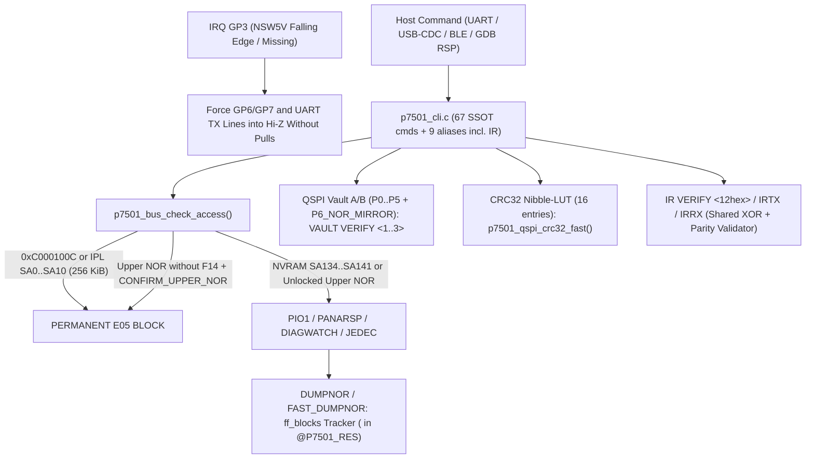

> 🌐 **Language / Idioma:** **English** | [Português (BR)](../pt-BR/FIRMWARE_PICO_P7501_GUIA.md)
> 🧭 **Portal:** [Docs Index](../INDEX.md) | [Complete Audit](../../COMPLETE_AUDIT.md) | [Audits](../audits/README.md) | [Ghidra Pseudocode](../pseudocode/INDICE_EVIDENCIA_PSEUDOCODIGO_GHIDRA.md) | [Debug Logs](../debug_logs/README.md)

# Panasonic P7501 Async UART & Boot Probe Firmware Engine (RP2040 / RP2350)

Official bench controller firmware built for **Raspberry Pi Pico (RP2040)** and **Raspberry Pi Pico 2 (RP2350)** to perform boot capture, electrical diagnostics, and asynchronous UART communication (**`115200 8N1`**) across factory service connector **`P7501` (`B6B-ZR-3R4`, labeled `TO JIGU`)** on the **Panasonic DMR-EH55** recorder (**Matsushita `AM34` / `MN103S`** SoC + Syscon `IC7501`, board `VEP79138`).

---

## 1. System Overview (Zero-Gadget `P0_FW_RO` Architecture)

The modular C11 firmware in [`firmware/pico-p7501/`](../../firmware/pico-p7501/) implements strict ISO C11 hardware control organized cleanly across `cli/`, `common/`, `diag/`, `flash/`, `gdb/`, `generated/` (`p7501_ssot.h`), `hal/`, `tests/`, and `uart/`:

> [!NOTE]
> **Zero-Gadget Probe Decision (v0.2.0):** The Raspberry Pi Pico (`RP2040` / `RP2350`) probe deliberately attaches **zero extra standalone hardware gadgets** (no `SSD1306` OLED, buzzer, or probe push-buttons). Screen rendering, audio/visual cues, and **DIGA Commander IR** run on the **Android smartphone (USB-C OTG / BLE NUS)** and **Desktop Tauri 2 Workbench**, keeping probe firmware lean inside `P0_FW_RO` (`256 KiB`: `RP2040` `text=223,336 B` / `bss=81,416 B` / `slice=223,488 B`; `RP2350` `text=220,528 B` / `bss=81,036 B` / `slice=220,672 B`).

1. **PIO1 Full-Duplex Multi-Baud UART Engine + PIO0 (`p7501_uart_duplex.pio` / `uart/p7501_uart_pio_engine.c`):**
   * Deterministic passive reception via **`PIO1` (`SM0`)** on **`GP2`** (`P7501` Pin 6 `UARTP2M_T` / `MAX TXD`) and dedicated transmission via **`PIO1` (`SM1`)** on **`GP4`** (`P7501` Pin 3 `UARTM2P_T` / `MAX RXD` through transistor `Q7514`), featuring fixed-point fractional dividers for dynamic rates (`BAUD` and autobaud `BAUDSCAN`), live streaming (`UARTSTREAM`), microsecond-delta RAM logging (`HEXCAP`, zero-drop at `115200 8N1`), trigger-based injection (`WAITTX`), and transparent USB-CDC ↔ SC0 bridging (`BRIDGE`).
   * Retains `PIO0` capture engines (`p7501_uart_duplex.pio` + `uart/p7501_uart_capture.c`), `p7501_logic_sampler.pio`, and `p7501_sds_sampler.pio` for `BOOTCAP` / `UARTMON` / `JIGBOOT` / `PIOLOGIC` / `SDSNIFF`.
2. **Safe Open-Drain Reset Control (`XRESET` / `GP5`):** `GP5` (`P7501` Pin 2) toggles strictly between `0V` (active reset) and `Hi-Z` (unpulled input, `~10–20 µs` rise time through `QR7503`), preventing contention against Panasonic's reset supervisor.
3. **Strict Guard on `NSW5V` (`GP3` / `P7501` Pin 5) & `SW_UART` Control (`GP26` / `ADC0`, Pin 1):**
   * **`GP3` (`NSW5V` / `X_SW_5R2V`):** Supplied by `IC1506` (`~5.15V` upstream via `D7510`, resting at `~3.29V` across `R7570`/`R7572`). **ALWAYS remains a `Hi-Z Input` with pulls disabled** and is never driven push-pull.
   * **`GP26` (`SW_UART`):** Samples voltage via `ADC0` (`~3.24–3.25V` Hi-Z, `~2.70V` pull-down, `~3.26V` pull-up) and pulls `LOW` strictly for the exact serial-boot sampling window (`XFWE`, e.g., `JIG:350`), restoring `ADC0 Hi-Z` via `p7501_hw_restore_sw_uart_adc0()` whenever `GP4` TX must pass through `Q7514`.
4. **Non-Blocking LED Driver with Manual Lock (`hal/p7501_led.c` & `hal/p7501_led_logic.c`):** Pure 10 Hz state machine driven by an IRQ-safe `repeating_timer` (`GP25` on Pico/RP2040 and Pico 2/RP2350; tick fallback to `CYW43_WL_GPIO_LED_PIN` on Pico W / Pico 2 W), enforcing `MANUAL_LOCK` so periodic `STATUS` polling never overrides operator selection (`LED <IDLE|ACTIVE|GDB|FAULT|OFF|AUTO>`).
5. **USB CDC + Optional BLE Serial Console (`PANADIGA> `):** Interactive `115200 bps` command shell compatible with standard terminals (PuTTY, TeraTerm), `panadiga` CLI, and the Tauri Desktop/Android app (`panadiga-desktop` / APK). `pico_w` and `pico2_w` builds also enable a Bluetooth LE Nordic UART Service bridge (`PANADIGA_BLE_ENABLED=1`).
6. **GDB RSP Bridge & Fail-Loud Injection/Sanitization (2-Layer NOR Policy):** Embeds a **GNU Remote Serial Protocol (RSP)** server (`GDB`) plus `AUTODETECT` / `INJECT_LOADER CONFIRM` / `ERASE_NVRAM CONFIRM` primitives that refuse to run blindly if `DCSR=0xFFFFFFFF`. On already-bricked `U99` units, the primary no-desoldering path pairs **`SDDIAG` (`DIGADIAG.FRM` + `PANA__SD.FRM` `ver0.61` with `JIG:2500`)** or headless **Door #1 (`0x0B1800`)** $\rightarrow$ **`PANAMON1>`**, requiring a verified **8 MiB** read-only dump (`PANADMP1` + SHA-256) first and keeping **Layer 1 Critical Boot IPL (`SA0..SA10`) permanently locked (`E05`)** while authorizing explicit `CONFIRM_UPPER_NOR` BGO recovery (leaving `SVOD 4` / `XGecu T48` external TSOP-48 programming as physical fallback if IPL or SD slot fails).

---

## 2. Build Toolchain Requirements

To compile the firmware from source:
* **CMake** $\ge$ 3.13 (on `PATH`)
* **ARM GCC Toolchain:** `arm-none-eabi-gcc` $\ge$ 10.3
* **Build System:** `Ninja` (recommended) or `MinGW Makefiles`
* **Raspberry Pi Pico SDK:** configured via environment variable `PICO_SDK_PATH` (imported by [`firmware/pico-p7501/pico_sdk_import.cmake`](../../firmware/pico-p7501/pico_sdk_import.cmake))

---

## 3. Building the Multi-Platform Firmware (RP2040 and RP2350)

The subsystem in [`firmware/pico-p7501/`](../../firmware/pico-p7501/) provides native multi-board support (`pico`, `pico_w`, `pico2`, `pico2_w`), orchestrated by cross-platform builder [`scripts/build.py`](../../scripts/build.py) and the native Rust CLI (building *out-of-tree* in `target/pico-build/`):

### Option A: Unified Repository Builder (Windows / Linux / macOS)
```bash
# Builds RP2040 + RP2350, generates panasonic_p7501_uart_unified.uf2, and syncs crates/panadiga-core/src/pico/firmware_bins/
npm run build:pico
# Or directly via Python:
python scripts/build.py --pico
```

### Option B: Manual CMake + Native UF2 Merge via Rust CLI
```bash
cmake -S firmware/pico-p7501 -B target/pico-build/pico -G Ninja -DCMAKE_BUILD_TYPE=Release -DPICO_BOARD=pico
cmake --build target/pico-build/pico --config Release

cmake -S firmware/pico-p7501 -B target/pico-build/pico2 -G Ninja -DCMAKE_BUILD_TYPE=Release -DPICO_BOARD=pico2
cmake --build target/pico-build/pico2 --config Release

cargo run -p panadiga-cli -- pico merge-uf2 \
  --rp2040 target/pico-build/pico/panasonic_p7501_uart.uf2 \
  --rp2350 target/pico-build/pico2/panasonic_p7501_uart.uf2 \
  --out target/pico-build/out/panasonic_p7501_uart_unified.uf2
```

### Generated Binary Artifacts & Verified Footprint
Builds synchronize the unified container under `crates/panadiga-core/src/pico/firmware_bins/` (embedded into the Rust binary) and slice per silicon family via `extract_uf2_family_slice`:
* **`panasonic_p7501_uart_unified.uf2`** (**`891,904 bytes` / `1,742` blocks**, `SHA-256: da847750278f7857cd7904506a6d80ddbd7f09ee0e0f1a910936f8c6dbf85476`, **`SSOT_CONTRACT_HASH = C045CA85`**) $\leftarrow$ Universal `RP2040` + `RP2350` container:
  * **RP2040 (`pico`):** `text = 224,208 B` (`slice = 224,256 B` / `876` blocks `448,512 B` UF2, `SHA-256: 88c3b2f176346f6df1d486e2944109bed19b49ea26ec2ba2165218a6c79559bd`, `P0_FW_RO = 256 KiB`, `245,760 B` safe ceiling), `bss = 81,456 B`.
  * **RP2350 (`pico2`):** `text = 221,352 B` (`slice = 221,440 B` + `256 B` / `865` blocks `0xe48bff59` + `1` block `0xe48bff57`, `P0_FW_RO = 256 KiB`), `bss = 81,076 B`.
* Auxiliary images (`.elf`, `.bin`, `.hex`, `.map`) generated by `pico_add_extra_outputs(panasonic_p7501_uart)` remain in `target/pico-build/`.

### Continuous Integration (CI/CD)
The CI workflow in [`.github/workflows/ci.yml`](../../.github/workflows/ci.yml) and local gate runner (`python scripts/validate.py` / `npm run validate`) verify **38 C11 host test suites/functions across 4 modules** ([`test_gdb_rsp_host.c`](../../firmware/pico-p7501/tests/test_gdb_rsp_host.c), [`test_pana_diag_drv.c`](../../firmware/pico-p7501/tests/test_pana_diag_drv.c), [`test_pana_logic.c`](../../firmware/pico-p7501/tests/test_pana_logic.c), and [`test_uart_codec.c`](../../firmware/pico-p7501/tests/test_uart_codec.c)) with `-Wall -Wextra -Werror` plus dual RP2040/RP2350 ARM compile verification, alongside Rust (`337` tests / `6` crates), Vitest (`128`), E2E (`27`), `uxlint` (`386`), `jscpd` (`0%`), and Python (`mypy --strict` / `pytest`).



---

## 4. Flashing the `.uf2` File onto the Raspberry Pi Pico

The RP2040 / RP2350 includes a native ROM USB bootloader (**UF2 Bootloader**). Automated flashing is also supported via `panadiga pico flash --port COM10`:

```text
        DRAG & DROP FLASHING ON RASPBERRY PI PICO
   ┌───────────────────────────────────────────────────────────┐
   │  1. Unplug the Pico USB cable                             │
   │  2. Hold down the white BOOTSEL button                    │
   │  3. Plug the USB cable into the host PC                   │
   │  4. Release the BOOTSEL button                            │
   │  5. Volume "RPI-RP2" (or "RP2350") mounts on the OS       │
   │  6. Copy "panasonic_p7501_uart_unified.uf2" to the drive  │
   │  7. The Pico reboots automatically into the new firmware! │
   └───────────────────────────────────────────────────────────┘
```

*(With the firmware already running over USB CDC, you can also send `BOOTSEL` at the `PANADIGA> ` prompt to enter UF2 mode without pressing the physical button.)*

---

## 5. USB CDC Serial Connection (Terminal & Tauri)

After rebooting, the Pico enumerates a USB CDC serial port (`COMx` on Windows, `/dev/ttyACM0` on Linux, `/dev/cu.usbmodem*` on macOS, or USB-OTG on Android):
* **Baud Rate:** `115200` (native 12 Mbps USB CDC)
* **Framing:** 8 data bits, no parity, 1 stop bit (`8N1`), no flow control

Upon connecting or pressing `<ENTER>`, the console prints the official banner from [`p7501_cli_help.c`](../../firmware/pico-p7501/cli/p7501_cli_help.c):

```text
====================================================================
   PANADIGA: Panasonic DMR-EH55 P7501 Async UART & Boot Bench Probe
   MCU Host : RP2040 (Pico / ARM Cortex-M0+)
   Bus      : P7501 (B6B-ZR-3R4) 115200 8N1 (PIO1) + SW_UART / XRESET / NSW5V(Hi-Z)
   [GDB-RSP] Active Server Mode (RP2040 8 KB Cache)
   Type HELP for available P7501 UART, PIO1, FMU, diag, Flash, LED & GDB commands.
====================================================================

PANADIGA> 
```

---

## 6. Complete Command Reference (`p7501_cli.c` / `p7501_cli_help.c`)

The firmware serves interactive human operators as well as Rust automation (`panadiga`), bench scripts (`scripts/bench/`), and the Tauri reactive UI (`SSOT` in [`crates/panadiga-core/src/ssot/spec.rs`](../../crates/panadiga-core/src/ssot/spec.rs)):

| Command | Syntax | Verified Operational Behavior |
| :--- | :--- | :--- |
| **`PING`** | `PING` | Replies `PONG` for fast link health checks. |
| **`STATUS` / `VDD` / `WDT`** | `STATUS` \| `VDD` \| `WDT` | Samples `GP26 (ADC0)` on `P7501` Pin 1 (`SW_UART`), prints `VDD: X.XXV (OK / LOW / FLOATING)`, and reports Watchdog (`WDT`) traceability. |
| **`SELFTEST` / `FAULTACK`** | `SELFTEST` \| `FAULTACK` | `SELFTEST` validates probe FSM/codec/guard invariants; `FAULTACK` clears `fault_latch` (`EFaultLatched`) while keeping target bus lines `Hi-Z`. |
| **`BANNER`** / **`HELP`** | `BANNER` \| `HELP` \| `?` | Prints the identification banner or complete command list. |
| **`BAUD` / `FRAMING`** | `BAUD [bps]` \| `FRAMING [8N1\|8E1\|8O1]` | Queries or configures **`PIO1` (`SM0`/`SM1`)** baud rate (`300..921600 bps`) and hardware parity framing using FP16 fractional dividers. |
| **`BAUDSCAN`** | `BAUDSCAN [ms] [NORMAL\|JIG[:ms]\|NOPULL] [APPLY]` | Glitch-immune dual-polarity (LOW/HIGH) bit-width cluster detector + PIO1 `IRQ 4` framing & ASCII counter on `GP2` (`APPLY` switches `PIO1`). **Note:** Changing baud in PuTTY/RealTerm only affects virtual USB CDC — `PIO1` controls physical `P7501` sampling. |
| **`UARTSTREAM`** | `UARTSTREAM [ms] [NORMAL\|JIG[:ms]\|NOPULL]` | Live capture via `PIO1` with timed `SW_UART` release (`JIG:2500` for `Loader ver0.61` or `JIG:350`) and automatic `ADC0` restoration. |
| **`HEXCAP`** | `HEXCAP [ms] [NORMAL\|JIG[:ms]\|NOPULL]` | RAM capture (`HEXCAP_RAM_BUF_CAP` = `2048` bytes) with `+us` deltas and hex+ASCII dump after window (zero overflow at `115200 bps`). |
| **`UARTTXHEX`** | `UARTTXHEX [LOW:]<hex\|BRK> [rx_ms]` | Injects arbitrary hex bytes or a `120 ms` `BREAK` pulse over `PIO1 TX` (`Q7514` requires `SW_UART` released unless prefixed with `LOW:`). |
| **`WAITTX`** | `WAITTX <ms> <NORMAL\|JIG[:ms]\|NOPULL> "<trig>" <hex\|BRK> [post_ms]` | Waits for trigger substring on `GP2` (e.g., `"wait 1"` after `JIG:350`) and injects payload/BREAK via `PIO1 TX` keeping `NSW5V` `Hi-Z`. |
| **`BRIDGE`** | `BRIDGE [baud] [NORMAL\|JIG[:ms]\|NOPULL]` | Transparent byte bridge USB-CDC ↔ `SC0` (`PIO1`), terminated by escape sequence `~~~` (or timeout). |
| **`PWRTRACE` / `BOOTTRACE`** | `PWRTRACE [ms] [boot]` \| `BOOTTRACE [ms] [boot\|PREJIG] [WAKE]` | `PWRTRACE` samples min/max `ADC0` + `RXD/NSW5V/TXD` edges; `BOOTTRACE` correlates PIO1 UART + `GP3..5` + `ADC0` (supports `PREJIG WAKE` for `IC7501` standby). |
| **`PIOLOGIC`** | `PIOLOGIC [ms] [boot] [khz] [CTRL]` | 4-channel `PIO0` logic sampler (`GP2..5`) for control-line edges and FMU/SC0 handshake timing. |
| **`SDSNIFF`** | `SDSNIFF [ms] [boot]` | Passive `Hi-Z` `PIO0` SD bus sniffer (`GP10..15`) with CRC16 and 4-bit data-lane verification. |
| **`JIGSWEEP`** | `JIGSWEEP [HOLD\|DELAY\|PREBOOT] [ms..]` | Automated `SW_UART` latch window & pre-DDR Bootrom timing sweep for deterministic `SDDIAG` capture. |
| **`BOOTCAP`** | `BOOTCAP [ms]` | Asserts Open-Drain `XRESET` with `SW_UART` released and captures `115200 8N1` boot UART stream (`PIO0`). |
| **`UARTMON`** | `UARTMON [ms]` | Passively listens on `GP2` (`UARTP2M_T`) without forcing reset or `SW_UART`. |
| **`JIGBOOT`** | `JIGBOOT [ms]` | Boots with `SW_UART = LOW` (`XFWE` / JIG mode) across `XRESET` pulse and captures `GP2` at `115200 8N1`. |
| **`JIGPIN`** | `JIGPIN [LOW\|HIZ\|STATUS]` | Drives Open-Drain control on `P7501` Pin 1 (`SW_UART` on `GP26`, historically nicknamed `"TW7501"` in legacy CLI strings — distinct from the physical `TW7501` pad on `IC7501`'s 5V backup rail). |
| **`UARTSEND`** | `UARTSEND [LOW:]<text>` | Transmits ASCII/bytes on `GP4` (`UARTM2P_T`) at `115200 8N1` (default `Hi-Z` enables `Q7514` conduction; `LOW:` prefix forces `SW_UART` low). |
| **`UARTPROBE`** | `UARTPROBE [sec]` | Runs serial probing on `P7501` and restores `GP26` to `ADC0 Hi-Z` afterward. |
| **`PANARSP`** | `PANARSP [ms] [boot] [WAIT:x] <act>` | `_dev_SERIAL` RSP bridge (`REGS`, `MEM`, `WMEM`, `DUMPNOR`, `CALL`, `NORUNLOCK:CONFIRM_UPPER_NOR`, `NORLOCK`, `JEDEC_ERASE:<addr>`, `JEDEC_PROG:<addr>,<hex>`). |
| **`DIAGWATCH`** | `DIAGWATCH [ms] [boot] [act] [WAKE]` | Autonomous `SC0` watchdog and resident `PANAMON1>` monitor (`NORUNLOCK:CONFIRM_UPPER_NOR` / `NORLOCK` dispatching two-step `'U'` → `'W'`/`'E'`). |
| **`DRVPANA`** | `DRVPANA [ms] [boot] [NOPASS] <cmd>` | Matshita `R6-MV4` optical drive factory CLI bridge with automatic `PASS 0x4d415453 0x48495441` unlock (or `NOPASS`). |
| **`IR` / `IRTX` / `IRRX`** | `IR [TX\|RX\|VERIFY <12hex>]` \| `IRTX ...` | 38 kHz Kaseikyo PWM synthesizer ([`p7501_ir_codec.c`](../../firmware/pico-p7501/diag/p7501_ir_codec.c)) on safe GPIOs `GP6..9`/`GP16..22`, RX capture, plus offline frame validation (`IR VERIFY <12hex>`: Panasonic OEM `0x02,0x20`, vendor parity + XOR `dev ^ sub ^ cmd` $\rightarrow$ `parity=OK\|ERR`). |
| **`VAULT`** | `VAULT [STATUS\|VERIFY <1..3>\|DUMP\|ERASE]` | QSPI Vault A/B (`P6_NOR_MIRROR`, `P7501_VAULT_PAYLOAD_SLOTS=3`, slot `0` = manifest). `VAULT VERIFY <1..3>` computes nibble-LUT XIP `CRC32` (`p7501_qspi_crc32_fast`) + `non_ff` byte count emitting `sub=VERIFY` (`ENOENT`/`ECRC` if empty/corrupt). |
| **`DUMPNOR` (`ff_blocks`)** | `PANARSP DUMPNOR ...` \| `FAST_DUMPNOR` | Streams inline blank-block (`0xFF` × 512 B) detection via `p7501_dumpnor_ff_tracker_t` and appends `ff_blocks=<u32>` to `@P7501_RES` and `PANARSP:` lines. |
| **`FMUSCAN` / `FMUTEST` / `FMUBATCH`** | `FMUSCAN` \| `FMUTEST` \| `FMUBATCH` | Timing probes and byte scans against Bootrom/FMU over `P7501`. |
| **`PINCHECK`** | `PINCHECK` | 6-pin electrical matrix check on `P7501` (`Hi-Z`, pull-down, pull-up on `GP26`, edge count on `GP2`, `XRESET` rise time, `NSW5V`/`GP3` guard). |
| **`BUSDIAG` / `SNIFF`** | `BUSDIAG` \| `SNIFF [ms]` | Bus activity diagnostic and passive transition counting. |
| **`ISOLATE` / `HIZ`** | `ISOLATE` \| `HIZ` | Disables TX drivers and places interface pins into safe high-impedance (`NSW5V` and `XRESET` `Hi-Z`, `GP26` `ADC0`). |
| **`ENGAGE`** | `ENGAGE` | Sets `GP4` (`UARTM2P_T`) idle HIGH for active UART TX while keeping `NSW5V` (`GP3`) strictly `Hi-Z Input`. |
| **`RESET`** | `RESET` | Generates an active-low Open-Drain pulse on `XRESET` (`GP5`), then releases to `Hi-Z`. |
| **`IDENTIFY` / `AUTOPROBE` / `JOB`** | `IDENTIFY` \| `AUTOPROBE` \| `JOB <act>` | `IDENTIFY` emits 4-stage `@P7501_IDENT` (`vdd_mv`, `nsw5v`, `ipl_crc32`, `model`, `ssot`); `JOB` runs bounded atomic NVRAM/BGO/VAULT workflows. |
| **`SERVMACRO`** | `SERVMACRO <SERVICE_MODE\|SELF_CHECK\|OPTICAL_CAL\|ERR_HISTORY\|RELEASE> [GPn]` | Dispatches automated Kaseikyo IR macro sequences for factory service mode, self-check, and error history. |
| **`HANDSHAKE` / `SCAN` / `BREAK_IN`** | `BREAK_IN [0..3]` \| `BOOT_PROFILE [0..3]` \| `SCAN` | Discrete `SW_UART + XRESET` sequence profiles (`0..3`) and bus response check. |
| **`DUMP` / `AUTODETECT` / `CFI` / `FLASH_SIZE`** | `DUMP [addr] [words]` \| `PROBE` \| `FLASH_SIZE [2\|4\|8\|16]` \| `TARGET_PROFILE [id]` | Monitor memory read, fail-loud check (`DCSR=0xFFFFFFFF` aborts), CFI `QRY` query, `EEMUL` geometry selection, and active DIGA profile selector. |
| **`INJECT_LOADER`** | `INJECT_LOADER CONFIRM` | Loads AM34 micro-driver (`ram_loader_am34_target.c`) into `0x00004000` (requires `CONFIRM` token and active synchronous monitor). |
| **`ERASE_NVRAM`** | `ERASE_NVRAM CONFIRM` | Executes JEDEC erase across NVRAM/EEMUL micro-sectors (requires `CONFIRM` token and active target bus access). |
| **`NOR_MAP`** | `NOR_MAP` | Scans all **142 Spansion `S29JL064H` sectors (`SA0..SA141`)** directly on the Pico (`IPL`, `NORFROM`, `EXTRHEADDRV`, 45 BGO sectors, Upper `EEMUL`, NVRAM), streaming `@P7501_PROG phase=MAP` push frames and `[NOR_MAP] ... healthy=YES|NO`. |
| **`BGO_INSPECT` (`NORFROM`)** | `BGO_INSPECT [DETAIL\|NORFROM\|NOR_AUTOBOOT\|FULL]` \| `EEMUL_INSPECT` | Audits all 45 BGO sectors (`SA26..SA70`), `EEMUL` (`SA134` `"1284"`), and in `NORFROM`/`NOR_AUTOBOOT`/`FULL` mode (legacy `PORTAO4` alias accepted) performs read-only inspection of `SA11` (`0x84040000`, `ERASED_FF` / `P4ZU_STUB` / `EXTRHEAD`) + `p1_sa`, emitting `[NORFROM] ...` and `@P7501_FRAME ... type=UNBRICK_READY`. |
| **`MMIO_SNAP`** | `MMIO_SNAP [CORE\|VIDEO\|STORAGE\|ALL\|DIFF]` | SSOT snapshot of **31** AM34 registers (`CORE`=8, `VIDEO`=15, `STORAGE`=8 including `DAVIS_PRST 0x89000420`, `DAVIS_SRST 0x89000C20`, `SDCD_CFG4 0x89001850` `4BIT/1BIT`, and `TBUS_MBX0 0xDC010010`), excluding `0xC000100C`/`0xDC0F0000`. |
| **`FAST_READ` / `SECTOR`** | `FAST_READ <hex_va> <hex_len_mult_100>` \| `SECTOR ...` | Uploads on-demand the verified `606 B` MN103S binary stub (`0x9043A000`, `CRC32 0x3D2D3D4A`), reads `256 B` pages with `0xFF` blank-page elision, streams `@P7501_PROG phase=READ` + `@P7501_CHUNK`, and runs sector helpers. |
| **`FAST_WRITE` / `FAST_ERASE`** | `FAST_WRITE <hex_va> <even_hex> CONFIRM_UPPER_NOR` \| `FAST_ERASE <hex_va> CONFIRM_UPPER_NOR` | High-speed BGO-window (`SA26..SA70`) writer/eraser enforcing **permanent Layer-1 IPL `E05` lockout (`SA0..SA10`)**, on-Pico **`1 -> 0`** monotonicity check, `@P7501_PROG` frames, and unconditional `U LOCK` on all exits. |
| **`LIVE_MAP` / `HOTPLUG` / `STREAM`** | `LIVE_MAP [QUICK\|FULL\|VIDEO] [ms]` \| `HOTPLUG [ON\|OFF\|STATUS]` \| `STREAM [STATUS\|TEST\|RESET]` | Unified `@P7501_FRAME` snapshot (electrical, `IC3001`, 31 MMIOs, NOR headers), hotplug events, and async push stream control. |
| **`TRAP` / `PAYLOAD`** | `TRAP [LIST\|CHECK <addr> <len> <R\|W\|E>]` \| `PAYLOAD [LIST\|VERIFY\|RUN <name>]` | Inspects lethal/IPL barriers (`0xC000100C`, `0xDC0F0000`, `SA0..SA10`, `4 MiB` alias) and CRC32-verifies/runs RAM stubs (`fast_bgo_stream`, `video_mmio_dump`, `tbc_passthrough`, `jedec_nvram_erase`, `jedec_probe_id`). |
| **`PWROSC` / `TBUSSNIFF` / `M0KEEPALIVE` / `I2C_SCAN` / `EEPROM`** | `PWROSC` \| `TBUSSNIFF` \| `M0KEEPALIVE` \| `I2C_SCAN` \| `EEPROM` | Rail oscillation monitor, `IC7501` TBUS sniffer & `255s` keepalive injector, safe-GPIO I²C bus scanner, and external EEPROM inspector. |
| **`USBMODE` / `BLE` / `BLE_NOR_AUTH`** | `USBMODE` \| `BLE` \| `BLE_NOR_AUTH` | Switches USB CDC/Bridge transport and manages `Pico W`/`2W` (`CYW43439`) BLE Nordic UART Service + Upper-NOR auth challenge. |
| **`BLACKBOX` / `CRYPTO` / `DECOMP` / `SURG` / `XRAY` / `GPS` / `ROUTE`** | `CRYPTO ...` \| `DECOMP ...` \| `XRAY ...` \| `SURG ...` | Advanced lab suite (`P7501_ENABLE_LAB_DIAG`): blackbox/recipes (`PROBE_CFG`/`RECIPE`), `Feistel`/`Adler32`, `LZSS`/`zlib` codecs, `GPS`/`ROUTE` planner, boot `XRAY`, and `SURG` RAM/MEIHFS microsurgery. |
| **`GDB`** | `GDB` | Switches the USB CDC channel into the **GDB Remote Serial Protocol (RSP)** server. |
| **`LED`** | `LED [IDLE\|ACTIVE\|GDB\|FAULT\|OFF\|AUTO\|STATUS]` | Selects a visual pattern with `MANUAL_LOCK` (`IDLE`, `ACTIVE`, `GDB`, `FAULT`, `OFF`), restores automatic control (`AUTO`), or queries status (`STATUS`). |
| **`BOOTSEL`** | `BOOTSEL` | Reboots the Pico directly into the USB UF2 ROM bootloader without pressing the physical button. |

---

## 7. Practical Session Examples

### Example 1: Initial Electrical Check (Safe Passive Mode, No Active TX)
```text
PANADIGA> PING
PONG
PANADIGA> STATUS
VDD: 3.25V (OK)
PANADIGA> PINCHECK
...
PANADIGA> ISOLATE
[BUS] P7501 pins placed in High-Impedance Isolation (NSW5V/XRESET Hi-Z, GP26 ADC0).
```

### Example 2: Multi-Baud PIO1 Capture, Timed JIG & LED Control
```text
PANADIGA> LED GDB
[LED] Pico GP25 (Standard Pico / RP2040 / RP2350) | mode=GDB_RSP | lock=MANUAL | pin=1
LED: OK (GDB_RSP, MANUAL_LOCK)

PANADIGA> BAUDSCAN 3500 NORMAL
... edges=2124 min_low_us=8 max_low_us=54 raw_bps=125000 snapped_baud=115200
BAUDSCAN: OK

PANADIGA> HEXCAP 3000 NORMAL
... (348 bytes in RAM zero drop: DDR CHECK: OK .. Loader ver0.61 [06/03/06]) ...
HEXCAP: OK (348 bytes, framing_err=0, overflow=NO)

PANADIGA> PWRTRACE 3000 JIG:350
... GP26_SWUART: min=3.21V max=3.30V | Edges: RXD=2124 NSW5V=0 TXD=0 (final NSW5V=1)
PWRTRACE: OK

PANADIGA> WAITTX 8000 JIG:350 "wait 1" 0D 4000
... [WAITTX] Trigger matched! Injecting payload via Q7514 (SW_UART=Hi-Z)...
WAITTX: OK (triggered=YES, rx=715 bytes)

PANADIGA> LED AUTO
[LED] Pico GP25 (Standard Pico / RP2040 / RP2350) | mode=HEARTBEAT_IDLE | lock=AUTO | pin=1
LED: OK (HEARTBEAT_IDLE, AUTO)
```

> [!NOTE]
> Prefer **`PIO1` commands (`BAUD`, `BAUDSCAN`, `UARTSTREAM`, `BOOTTRACE`, `HEXCAP`, `PWRTRACE`, `WAITTX`, `DIAGWATCH`, `PANARSP`)** for new bench runs. For **`Loader ver0.61`**, use `JIG:2500` in `UARTSTREAM 12000 JIG:2500` to hold `SW_UART` through `DIGADIAG.FRM` loading (whereas `JIG:350` suits short bootrom windows); in both cases the timer automatically releases `GP26 -> ADC0 Hi-Z` so `Q7514` conducts TX. `ISOLATE` remains mandatory after legacy sessions (`UARTSEND` / `UARTPROBE`).

### Example 3: Injection / Erase with `CONFIRM` Lock & Bricked-`U99` No-Desoldering Compliance
```text
PANADIGA> INJECT_LOADER CONFIRM
[INJECT_LOADER] Target Address : 0x00004000 (AM34 Internal SRAM)
[INJECT_LOADER] Flash Geometry : 8 MB (NVRAM Window: 0x807F0000..0x807FFFFF)
...
INJECT_LOADER: OK

PANADIGA> ERASE_NVRAM CONFIRM
[ERASE_NVRAM] Launching JEDEC Sector Erase on Spansion Flash (8 MB)
[ERASE_NVRAM] Target Memory Range: 0x807F0000 to 0x807FFFFF (64 KB)
[ERASE_NVRAM] Micro-sectors      : SA134 to SA141 (8 x 8 KB)
...
ERASE_NVRAM: OK
```

*(Compliance Note: On an already-bricked `U99` DMR-EH55, first attempt **100% no-desoldering** recovery via `SDDIAG` `DIGADIAG.FRM` + `PANA__SD.FRM` `ver0.61` on SDSC FAT16 with `JIG:2500`, or headless **Door #1** `0x0B1800` $\rightarrow$ `PANAMON1>`, taking a mandatory full `8 MiB` SHA-256 read-only backup via `PANADMP1` before authorizing Layer 2 BGO `U CONFIRM_UPPER_NOR` / `NORUNLOCK:CONFIRM_UPPER_NOR` — Layer 1 Critical Boot IPL `SA0..SA10` stays permanently locked (`E05`). External TSOP-48 removal (**SVOD 4** / **XGecu T48** + `panadiga nvram clean`) remains the fallback if `SA0..SA10` IPL or SD hardware has failed.)*

---

## 8. GDB RSP Bridge Mode (Interactive Debugging with Ghidra / IDA Pro)

The firmware embeds a **GNU Remote Serial Protocol (RSP)** server governed by [`gdb/gdb_rsp.h`](../../firmware/pico-p7501/gdb/gdb_rsp.h), [`gdb_rsp_codec.c`](../../firmware/pico-p7501/gdb/gdb_rsp_codec.c), and [`gdb_rsp_memory.c`](../../firmware/pico-p7501/gdb/gdb_rsp_memory.c):
* Serial command: `GDB` (or autodetection of packets starting with `$`).
* Custom Upper-NOR governance packets in RSP:
  * `$qPanadigaNorUnlock:CONFIRM_UPPER_NOR#<xx>` — explicitly unlocks writes on **Layer 2 (`SA4..SA133`)**.
  * `$qPanadigaNorLock#<xx>` — restores the default `NorWritePolicy::NvramOnly` (`E05`) lock.
* Unified TCP/Serial bridge in the Rust CLI (including async translation over `P7501` UART because no synchronous `DWire32A` clock exists):
  ```bash
  # Live async Ghidra/GDB bridge over DIGADIAG PANAMON1> (R/W) or MAIN _dev_SERIAL:
  panadiga pico gdb-bridge --port COM10 --target-mode panamon1 --listen 127.0.0.1:3333
  panadiga pico gdb-bridge --port COM10 --target-mode panarsp  --listen 127.0.0.1:3333
  # Guided interactive multi-boot bench battery (Standby WAKE, PREJIG no-XRESET, BAUDSCAN, Firmware Error Dictionary):
  panadiga pico bench-wizard --port COM10
  panadiga pico bench-wizard --port COM10 --profile prejig --wake-timeout-ms 45000
  panadiga pico error-lookup 0x83A7
  ```
* Detailed step-by-step walkthrough for Ghidra, IDA Pro, and `gdb-multiarch`:
  * 📖 **[Interactive Hardware Debugging Guide: GDB, Ghidra, and IDA Pro](GDB_GHIDRA_IDA_DEBUGGING_GUIDE.md)**

---

## 9. Two-Layer NOR Write Policy & Real JEDEC SRAM Stubs

The flash subsystem ([`p7501_flash.c`](../../firmware/pico-p7501/flash/p7501_flash.c)) mirrors [`NorWritePolicy`](../../crates/panadiga-core/src/pico/rsp_codec/policy.rs) over the Spansion `S29JL064H` (`0x80000000..0x807FFFFF` / uncached mirror `0x84000000..0x847FFFFF`):

| Layer | Sectors & Bus Window | Pico Firmware Policy | Unlock / Governance Notes |
| :--- | :--- | :--- | :--- |
| **Layer 1 — Critical IPL / Bootloader** | `0x80000000..0x8003FFFF` / `0x84000000..0x8403FFFF` (`256 KiB`: policy `SA0..SA3` in `64 KiB` units; physical `SA0..SA10` = `8×8K+3×64K`) | **Permanently read-only (`immutable RO`, never writable) → `E05`** | Never unlocked on the Pico probe so `P7501` serial boot recovery remains intact. |
| **Layer 2 — Upper NOR / BGO App** | `0x80040000..0x807EFFFF` / `0x84040000..0x847EFFFF` (policy `SA4..SA133`; physical `SA11..SA133`) | **Write-protected by default (`NvramOnly` → `E05`, forbidden until unlocked)** | Opt-in unlock via `$qPanadigaNorUnlock:CONFIRM_UPPER_NOR#<xx>`, `PANAMON1` (`U CONFIRM_UPPER_NOR`), or `PANARSP`/`DIAGWATCH` (`NORUNLOCK:CONFIRM_UPPER_NOR`). Houses EH55 `ver0.61` BGO (`0x84130000..0x843FFFFF`, `SA26..SA70` vs `ver0.63`/`PROG061` `0x84200000..0x843FFFFF`) & Upper EEMUL (`SA71..SA133`). |
| **Layer 3 — Top NVRAM / EEMUL** | `SA134..SA141` (`0x807F0000..0x807FFFFF`, `8 KiB` sectors) | **Writable by default** | On real EH55, `SA134` (`0x847F0000`) holds active `"1284"` header `0ff00000002c` (`6 B`) while `SA135..SA141` are `0xFF`. |

* **JEDEC SRAM Stubs (`0x51800000`), Uncached Mirror (`0x90400000`) & Real `S29JL064H` (~700 ms) Erase Timing:**
  * `PANARSP JEDEC_ERASE:<addr>` and `PANARSP JEDEC_PROG:<addr>,<hex>` (`1..=16` bytes per call) upload the [`p7501_pana_jedec.h`](../../firmware/pico-p7501/uart/p7501_pana_jedec.h) / [`p7501_pana_jedec_stubs.c`](../../firmware/pico-p7501/uart/p7501_pana_jedec_stubs.c) stub to `0x51800000`, signaling **`PANAJEDEC_OK`** or timeout **`PANAJEDEC_TO`**. Over `PANAMON1>`, [`p7501_diag_watch.c`](../../firmware/pico-p7501/uart/p7501_diag_watch.c) dispatches `'U'` before `'W'`/`'E'`.
  * **Uncached SDRAM Coherence (`0x90400000`):** when patching executable RAM in `PROG061` (`0x50400000`), target its uncached **`0x90400000`** mirror (e.g., `PANADMP1` `MOV` bounds at `0x9043950E` $\rightarrow$ `J 904394FA`, or test stubs at `0x90439B40`) so writes bypass write-back D-cache and are seen immediately by I-cache.
  * **~700 ms 64 KiB Erase vs DQ7 Polling:** physical `S29JL064H` 64 KiB sector erase requires ~`700 ms`, outlasting the bounded `0x00100000`-iteration DQ7 loop in `jedec_emit.rs`; callers must poll readback for `0xFF` × 32 after `OK:ERASE` before issuing `W` program writes.
* **Offline Copy-on-Write Fallback:** Image patching runs via `panadiga nvram patch-upper-nor` ([`nvram.rs`](../../crates/panadiga-cli/src/cli/handlers/nvram.rs)) with mandatory SHA-256 `--backup` (blocking the opening `256 KiB` unless `--allow-critical-ipl` is specified offline).
* **Deep-Dive on `IC7501` Standby, `TW7501`, `TBUS` & Real VFD States:** See the dedicated architecture dossier [`STANDBY_IC7501_TBUS_TW7501_AND_BOOT_STATES_ARCHITECTURE.md`](./STANDBY_IC7501_TBUS_TW7501_AND_BOOT_STATES_ARCHITECTURE.md) (`PLEASE WAIT -> U99` vs `HELLO -> U99`, `TW7501` + `[POWER]` standby stabilization physics, `FUN_44005cd0` `255s` handshake, and `PREJIG WAKE`).

---

## 10. Cross-Language SSOT Wire Contract (`C045CA85`) & Live Round-5 Proof (`EV-20261124-004`)

* **Single Wire Contract SSOT (Rust $\rightarrow$ C11 Pico / C11 OpenOS / TypeScript / Python):** Tags `@P7501_RES`, `@P7501_EVT`, `@P7501_FRAME`, `@P7501_IDENT`, `@P7501_SURG`, `@P7501_BOOT_CLASS` (`hdd_autoboot=`, XRAY stage `S4_SD_DIAG_FVU`) and canonical result codes (`0`, `EINVAL`, `E05`, `EOFFLINE`, `ETIMEOUT`, `EDROPOUT`, `EBUS_POLICY`, `EFaultLatched`) live in [`crates/panadiga-constants/src/events.rs`](../../crates/panadiga-constants/src/events.rs), fold into `SSOT_CONTRACT_HASH`, and export automatically via `panadiga ssot export-all` to `p7501_ssot.h`, `openos_ssot.h`, `ssot.ts`, and `profiles_types.py`, locked by [`p7501_wire_contract.json`](../../firmware/pico-p7501/tests/golden/p7501_wire_contract.json) (`schema_version: 2`).
* **Live `COM10` Silicon Evidence (`EV-20261124-004`, [`com10_round5_live_unbrick_sd_trace_20261124.log`](../evidence/com10_round5_live_unbrick_sd_trace_20261124.log), 100% RO on NOR/HDD):**
  1. `IDENTIFY` verified `ssot=C045CA85`, `ipl_crc32=0xECBB4B55`, and `vdd_mv=3251`.
  2. `PAYLOAD RUN jedec_probe_id` closed `S11` on live silicon (`mfg=0x0001 dev=0x227E:0x2202:0x2201 verified=YES`).
  3. `MMIO_SNAP STORAGE` + `LIVE_MAP` sampled `31/31` registers with SD inserted: `SDCD_CFG4 0x89001850 = 0x000040B8` (`sd_bus=4BIT`), `DAVIS_PRST = 0x00000003` (`ch0_rst=RELEASED`), `DAVIS_SRST = 0x00000003` (`ch1_rst=HELD`), and `TBUS_MBX0 0xDC010010 = 0x840000A3`.
  4. `BGO_INSPECT PORTAO4` (canonical `BGO_INSPECT NORFROM`) + `NOR_MAP` confirmed 45/45 healthy BGO sectors (`p1_sa=41`, `bgo_corrupt=0`), healthy top `EEMUL` (`hdr_dirty=1%`), and `SA11 0x84040000 = ERASED_FF` (`norfrom_used=0`), concluding with `davis-probe` (`SAMSUNG HM251JI`) and safe `ISOLATE` + `STATUS` (`NSW5V=1`, `VDD=3.25V`, `fault_latch=0`).

---

## 11. Operational Glossary (`PANAMON`, `WAITTX`, `JIG`, `BOOTREC`, `OpenOS`) & Host `panadiga pico` CLI

This section documents the core terms bridging the `P7501` Pico probe, AM34 Bootrom states, and SDRAM/NOR payloads:

### 11.1 `PANAMON` / `PANAMON1>` (Resident Surgery & Recovery Monitor)
* **What it is:** An interactive **`115200 8N1`** monitor entered at **`0x50439494`** (uncached alias **`0x90439494`**) inside `DIGADIAG.FRM` (patched `PROG061` or generated bare-metal monitor via [`cmd_handlers.rs`](../../crates/panadiga-core/src/re/prog061_uart_monitor/cmd_handlers.rs)). Its banner prompt is **`PANAMON1>[B/R/W/D/F/J/E/U/Q]`**.
* **Liveness probe & verbs:** Sending `?\r` (non-mutating) returns the prompt. Individual verbs are:
  * **`R <addr>` / `W <addr> <val>`**: guarded memory/Flash read and write;
  * **`D <addr> <len>`**: **`PANADMP1..PANADONE`** binary/hex NOR dump stream;
  * **`E <addr>`**: Spansion `S29JL064H` JEDEC sector erase;
  * **`J <addr>`**: jump (`CALLS`) into an uploaded SDRAM stub (e.g., `0x9043A000` `fast_bgo_stream`, `0x51800000` `jedec_probe_id`);
  * **`U CONFIRM_UPPER_NOR` / `U LOCK`**: unlocks and re-locks Layer 2 (`SA11..SA133`) while **Layer 1 IPL (`SA0..SA10`) remains permanently `E05` read-only**;
  * **`F`**: fail-closed **`E05`** rejection preventing `nfrom_format` (`0x50401F3C`);
  * **`B` / `Q`**: bypass / quit monitor loop.
* **Difference vs `PANARSP` (`_dev_SERIAL`):** `PANAMON1>` executes **pre-`MAIN`** (`DIGADIAG.FRM` or headless **Door #1** `PANA__SD.FRM` without HDD), whereas `PANARSP` speaks GDB RSP to `_dev_SERIAL` embedded inside `MAIN` once booted from HDD.

### 11.2 `JIG` (`TO JIGU`, `SW_UART`, `JIGBOOT`, `JIGPIN`, `JIGSWEEP`, `PREJIG`)
* **Physics on `VEP79138`:** On connector **`P7501` (`TO JIGU`)**, **Pin 1 (`SW_UART` / `GP26`)** controls Bootrom strap sampling on the rising edge of `XRESET` (Pin 2) — **`SW_UART = LOW`** switches Bootrom into **`serial boot mode`** (`SDDIAG` / service UART handshake). Never power the Pico from Pin 1 ($< 10\text{ mA}$ sense line); drive it Open-Drain only.
* **Why `Q7514` dictates timed holds:** While `SW_UART` stays **`LOW`**, transistor **`Q7514`** on `VEP79138` gates off `AM34` RX (`UARTM2P_T`), preventing host TX. Hence Pico commands provide deterministic timed modes:
  * **`NORMAL`**: keeps `SW_UART` in `ADC0 Hi-Z` (continuous TX once monitor is awake).
  * **`JIG:<ms>`** (e.g., **`JIG:350`** for pre-DDR Bootrom or **`JIG:2500`** for `Loader ver0.61` SD load of `DIGADIAG.FRM`): asserts Open-Drain `LOW` across `XRESET`, holds for the requested window, and **automatically releases `GP26` back to `Hi-Z`** so `Q7514` passes TX.
  * **`JIGBOOT [ms]`**: automated `SW_UART=LOW` + `XRESET` pulse + `115200 8N1` boot capture.
  * **`JIGPIN [LOW|HIZ|STATUS]`**: manual Open-Drain `GP26` control (nicknamed `"TW7501"` in legacy CLI strings — distinct from the physical `TW7501` 5V backup pad on `IC7501`).
  * **`JIGSWEEP [HOLD|DELAY|PREBOOT]`**: automated latch-window sweep across `SW_UART + XRESET`.
  * **`PREJIG [ms] WAKE`**: waits passively for `IC7501` cold wakeup **without** pulsing `XRESET` on an unpowered board, arming capture and JIG timing only once `NSW5V`/`VDD` assert.

### 11.3 `WAITTX` (Deterministic Hardware Pattern-Match TX Injector)
* **What it is:** A hardware-timed command [`WAITTX <ms> <NORMAL|JIG[:ms]|NOPULL> "<trig>" <hex|BRK> [post_ms]`](../../firmware/pico-p7501/cli/p7501_cli.c) running inside `PIO1` on the RP2040/RP2350.
* **Why it is needed:** Bootloader handshakes (`"wait 1"`, `FVU)`, `PANAMON1>`) have tight millisecond windows that fail when a PC host round-trips over USB-CDC. `WAITTX` executes boot-profile setup, matches `"<trig>"` on `PIO1 RX` in real time, fires `<hex>` or a `120 ms` `BRK` over `PIO1 TX` (always keeping `GP3 NSW5V` `Hi-Z`), and records post-trigger output for `[post_ms]`.

### 11.4 `BOOTREC` (Boot Recovery Chain & Capture Commands)
Although `BOOTREC` is not a single literal command at `PANADIGA>`, it refers to the **Boot Recovery** pipeline across the recorder, SD kit, and Rust CLI:
1. **Target Boot Recovery Chain:**
   * **Layer-1 `IPL` (`SA0..SA10`)**: immutable `E05`-locked bootloader bringing up `P7501` UART and `SDCD`.
   * **`SDDIAG` (`DIGADIAG.FRM` + `PANA__SD.FRM` `ver0.61`)**: `262,144 B` raw stage loaded at `0x50400000` over **4-bit** SDSC FAT16 (`SDCD_CFG4 0x89001850`), entering `PANAMON1>` via **`JIG:2500`** or **Door #1** (`PROG` slot `0x0B1800` when `HDD_MAX_LBA` fails without a JIG strap).
   * **`NorAutoboot` / `Nor-FROM` (`SA11..SA14` at `0x84040000`)**: opt-in persistent SD-less `P4ZU -> FVU -> MAIN` boot stage (read-only status via `BGO_INSPECT NORFROM`, legacy `PORTAO4` alias).
2. **Probe & Host Boot Recovery Commands:**
   * Probe (`PANADIGA>`): `BOOTCAP` (`SW_UART=Hi-Z` + `XRESET` capture), `JIGBOOT` (JIG-mode capture), `BOOTTRACE` (correlated UART + `GP3..5` + `ADC0` emitting `@P7501_BOOT_CLASS`), `BREAK_IN` / `BOOT_PROFILE` (`0..3`), `XRAY BOOT`, and `BOOTSEL` (enters RP2040/RP2350 ROM UF2 mode).
   * Host (`panadiga unbrick`): `prepare-sd`, `rebuild-from-dump`, `verify-sd`, `bgo-audit`, `bgo-repair-plan`, `bgo-live-apply`, and `bgo-live-heal`.

### 11.5 `OpenOS` (`Panadiga OpenOS` vs `panadiga-blackbox-fw` vs `PiE-OS`)
* **What it is:** **`Panadiga OpenOS`** ([`firmware/panadiga-openos/`](../../firmware/panadiga-openos/README.md), milestones `M0..M4`) is an open-source ISO C11 + GNU assembly hardware-interoperability replacement OS for `AM34` (`MN103S`) containing **zero proprietary Matsushita binaries** — explicitly designated **`HARDWARE-INTEROPERABILITY PROTOTYPE -- NOT LEGALLY CLEAN-ROOM`** because it lives beside reverse-engineering artifacts in this repository.
* **Execution model & differences:**
  * Runs **strictly in volatile SDRAM** (`0x50400000` `DIAG_PROG_RAM` via `DIGADIAG.FRM` + `0x57000000` `MAIN_OS_RAM`), leaving Layer-1 IPL `SA0..SA10` untouched (protected alongside lethal apertures `0xC000100C`/`0xDC0F0000` in `am34_mmio_is_forbidden()`).
  * Consumes [`generated/openos_ssot.h`](../../firmware/panadiga-openos/generated/openos_ssot.h) (`SSOT=C045CA85`), provides the non-blocking **`OPENOS>`** interactive shell on `SC0` (`0xD400200C & 0x0010` $\rightarrow$ `SC0RXB 0xD4002009`) with automatic **`IC7501` `255 s`** TBUS keepalive preventing ~`44 s` power drop, video `AIOF`/`AVDD`/`IC3001` (`NTSC`/`PAL-M`/`PAL`, TBC, color bar), `DAVIS CH1` `1000 ms` bridge reset wait, `sd` (`SDCD_CFG4`), `bgo` (`SA11..SA70`/`EEMUL`), `ssot`, and storage `provision`.
  * Unlike `PANAMON1>` (minimal flash/memory surgery monitor) and the earlier [`panadiga-blackbox-fw`](../../firmware/panadiga-blackbox-fw/README.md) (`PANAMON2>` feasibility spike), `OpenOS` aims at full open `M0 -> M4` subsystem operation on `AM34`.

### 11.6 Host CLI `panadiga pico <subcommand>` Summary
| Host Subcommand | Probe / Host Role |
| :--- | :--- |
| `list` / `ping` / `status` / `dcsr` | Enumerates RP2040/RP2350 ports (`VID:2E8A`), samples `VDD`/`NSW5V`/`@P7501_IDENT`, and reads `DCSR` over USB-CDC. |
| `breakin` / `bench-wizard` / `ab-boot` | Runs `BREAK_IN 0..3` boot profiles, guided `Standby WAKE`/`PREJIG` battery, and statistical `NORMAL` vs `JIG` cold-boot trials. |
| `dump` / `capture-nor` / `davis-probe` | Word reads, `PANAMON1>` NOR slice capture, and safe `DAVIS CH0/CH1` probe (`0xEC IDENTIFY` with RAII `ISOLATE` cleanup). |
| `gdb-bridge` / `rsp-codec` | Async TCP ↔ Serial bridge (`127.0.0.1:3333`) for Ghidra/IDA Pro and pure GDB RSP framing + `E05` policy checks. |
| `flash` / `merge-uf2` | `1200 bps` BOOTSEL auto-flash (family-sliced RP2040/RP2350) and universal UF2 merger. |
| `decode-log` / `parse-diag` / `error-lookup` / `validate-bench-cmd` | Decodes UTF-16LE/UTF-8 logs, parses structured `@P7501_*` outputs, looks up 431+ Panasonic/Matshita errors, and validates commands against `SAFE_BENCH_COMMANDS`. |
