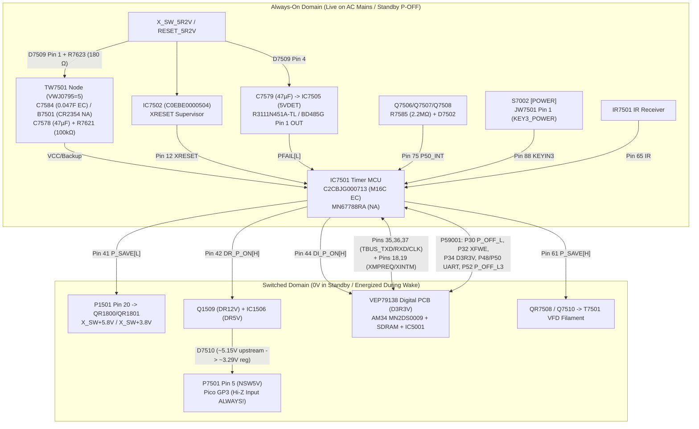
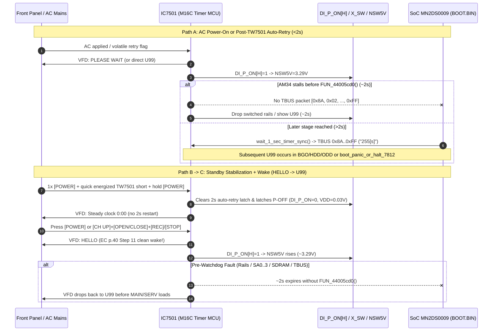

# Standby (`IC7501`) Architecture, `TBUS` Bus, `TW7501` Circuitry & Boot States (`DMR-EH55`)

> 🌐 **Language / Idioma:** **English (US)** | [Português (BR) (`ARQUITETURA_STANDBY_IC7501_TBUS_TW7501_E_MODOS_BOOT.md`)](../pt-BR/ARQUITETURA_STANDBY_IC7501_TBUS_TW7501_E_MODOS_BOOT.md) · [Portal `docs/INDEX.md`](../INDEX.md) · [Global Compendium](./GLOBAL_COMMUNITY_COMPENDIUM_DIGA_FIRMWARE_AND_HARDWARE.md) · [Ghidra Pseudocode](../pseudocode/INDICE_EVIDENCIA_PSEUDOCODIGO_GHIDRA.md) · [Pico `P7501` Guide](./PICO_P7501_FIRMWARE_GUIDE.md)

> **Verified Primary Sources:** Official Panasonic service manuals and schematics ([`panasonic_dmr_eh55ec_service_manual_europe.pdf`](../../manuals_and_schematics/dmr-eh55/service/panasonic_dmr_eh55ec_service_manual_europe.pdf) pp. 18–25, 40, 47, 50, 54, 62–65; [`panasonic_dmr_eh55ec_service_manual_vol2_schematics.pdf`](../../manuals_and_schematics/dmr-eh55/service/panasonic_dmr_eh55ec_service_manual_vol2_schematics.pdf) pp. 121–122; [`panasonic_dmr_eh55p9_eh55pc9_service_manual_north_america.pdf`](../../manuals_and_schematics/dmr-eh55/service/panasonic_dmr_eh55p9_eh55pc9_service_manual_north_america.pdf) pp. 21–24, 62–64; [`panasonic_dmr_es10_service_manual_north_america.pdf`](../../manuals_and_schematics/dmr-es10/service/panasonic_dmr_es10_service_manual_north_america.pdf) p. 27), MN103S `BOOT.BIN` disassembly ([`EVIDENCIA_PSEUDOCODIGO_GHIDRA_MN103S.md`](../pseudocode/EVIDENCIA_PSEUDOCODIGO_GHIDRA_MN103S.md) §§1.2–1.3), and live `COM10` / `VEP79138` bench telemetry.

---

## 1. Executive Engineering Summary & Real Empirical VFD Signatures

The Matsushita (Panasonic) architecture inside the DIGA `DMR-EH55` partitions **power sequencing, VFD control, IR decoding, and watchdog supervision** — run by auxiliary **Timer MCU `IC7501`** (`M16C` `C2CBJG000713` on European `EC` boards, or `MN67788RA` + `IC8001` on North American `NA` boards) — from the **Main 32-bit RISC multimedia subsystem** run by SoC **`AM34` / `MN2DS0009`** and Spansion NOR Flash **`IC5001`** (`S29JL064H70TFI00`, 8 MB).

Direct bench observation on live **`U99`** units clarifies a critical distinction across **three distinct empirical VFD states**:

| Observed Bench Scenario | Exact Front-Panel VFD Progression | Time to `U99` | Underlying `IC7501` / `VEP79138` Electronic State |
| :--- | :--- | :---: | :--- |
| **A1. AC Plug-In / Post-Glitch Auto-Retry** | **`PLEASE WAIT` $\rightarrow$ `U99`** | `~2 s` | `IC7501` exits AC recovery / `TW7501` discharge with a volatile recovery / `SELF CHECK` flag set, raises `DI_P_ON[H]=1` (`NSW5V` up), and drops to `U99` before `TBUS` extends the `255s` watchdog. Pressing `[POWER]` once can still re-trigger an automatic restart ~2s later. |
| **A2. Immediate Pre-Banner Fault** | **Direct `U99`** (skips `PLEASE WAIT`) | `< 2 s` | `IC7501` drops directly into `U99` retry/error state before displaying `PLEASE WAIT`. |
| **B. Stabilized True Standby** | `1x [POWER]` off $\rightarrow$ brief live `TW7501` short $\rightarrow$ hold `[POWER]` $\rightarrow$ **Continuous Standby (`0:00`)** | Stays in Standby | Draining the `TW7501` node under AC wipes `IC7501`'s 2s volatile auto-retry latch while holding `KEYIN3` (`S7002 KEY3_POWER`) parks `IC7501` cleanly in **`P-OFF`** (`DI_P_ON[H]=0`, `VDD=0.03V`, `NSW5V=0`) without waking back up after 2s. |
| **C. Wake from Stabilized Standby** *(`[POWER]` or front-panel chord)* | **`HELLO` $\rightarrow$ `U99`** (no `PLEASE WAIT`!) | `~2 s` | `EC` Manual p. 40 Step 11: clean wake from `P-OFF` displays **`HELLO`** (for `[POWER]` as well as `[CH UP]+[OPEN/CLOSE]+[REC]`/`[STOP]`), asserts `DI_P_ON[H]=1`, then drops back to **`U99`** ~2s later before AM34 / `MAIN` initialization completes. |

> [!IMPORTANT]
> **The deck NEVER displays `HELLO -> PLEASE WAIT -> U99` in this fault flow.**
> - On AC power-on or auto-retry loops, it displays **`PLEASE WAIT -> U99` (~2s)** or jumps **directly to `U99`**.
> - Only after stabilizing True Standby (**energized `TW7501` quick jump + hold `[POWER]`**) does waking the deck display **`HELLO`**, dropping back to **`U99`** ~2s later before startup finishes.

---

## 2. Electrical Power Domain Topology (`EC` vs. `NA`)

Official Main and **`VEP79138`** Digital PCB schematics isolate recorder power into **two hardware domains**:

1. **Always-On Domain (*Standby Backup Rail*): `X_SW_5R2V` / `RESET_5R2V`:**
   - Remains live whenever AC mains are connected.
   - Powers the AC/power sense detector (`Q7506` / `Q7507` / `Q7508` / `R7585 = 2.2 MΩ` / `D7502` $\rightarrow$ `IC7501 Pin 75 P50_INT`), infrared receiver **`IR7501`**, `IC7501` standby rails, supercapacitor **`C7584` (`0.047F`)** backup node, jumper test point **`TW7501`**, voltage detector **`IC7505`**, and reset supervisor **`IC7502`**.
2. **Switched Domain (`0V` in `P-OFF`, Active Only During Boot/Operation):**
   - Gated exclusively by `IC7501` output pins: **`P_SAVE[L]`** (Pin 41), **`DR_P_ON[H]`** (Pin 42), **`DI_P_ON[H]`** (Pin 44), and **`P_SAVE[H]`** (Pin 61).
   - Feeds `X_SW+5.8V`, `X_SW+3.8V`, `X_SW+5.2V` (`IC1502`), `JC+5V` (`IC1504`), `DR+5V` (`IC1506`), `DR12V` (`Q1509`), `ANA+3.3V` (`IC1507`), `D3R3V` (`VEP79138`), VFD heater `T7501`, and **all `P7501` pull-up resistors**.



---

## 3. Verified Pin Matrix for `IC7501`, `IC3001` & `P59001` Interconnect

### 3.1 Verified Critical Pins on Timer MCU `IC7501` (`EC p. 64–65`, `vol2 p. 122`)

| `IC7501` Pin | Schematic Net | Circuit Origin / Destination | Electrical Function & `U99` Impact |
| :---: | :--- | :--- | :--- |
| **12** | `XRESET` | Output of **`IC7502`** (`C0EBE0000504`) powered by `RESET_5R2V` / `X_SW_5R2V` | Hardware reset of Timer MCU `IC7501` on `X_SW_5R2V` loss or transient `TW7501` short. |
| **16** | `VCC1 (3.3V)` | Timer 3.3V logic rail | Core and 3.3V I/O supply for `IC7501`. |
| **18** | `XMPREQ` | `TBUS` bus $\leftrightarrow$ `AM34` | Handshake request line across synchronous-serial `TBUS`. |
| **19** | `XINTM` | `TBUS` bus $\leftrightarrow$ `AM34` | Interrupt / Ready status signal between `Main` and `Timer`. |
| **35** | `TBUS_TXD` | Serial TX `Timer -> AM34` | Transmits state bytes, key events, and `startup reason` responses to `BOOT.BIN`. |
| **36** | `TBUS_RXD` | Serial RX `AM34 -> Timer` | Receives commands **`0x80`**, **`0x81`**, and **`0x8A` (`255s` Hung-up Watchdog)** from `AM34`. |
| **37** | `TBUS_CLK` | Shift clock for `TBUS` | `TBUS` clock line; open/corrupt clock or TX/RX triggers ~2s `U99` regardless of AM34 health. |
| **41** | `P_SAVE[L]` | $\rightarrow$ `P1501 Pin 20` $\rightarrow$ `QR1800` / `QR1801` | Active-low enable for **`X_SW+5.8V`** and **`X_SW+3.8V`** regulators. |
| **42** | `DR_P_ON[H]` | $\rightarrow$ `Q1509` (`DR12V`) & **`IC1506`** (`DR5V`) | Powers optical drive rails (`12V`/`5V`) and feeds **`NSW5V`** upstream via `D7510`. |
| **44** | `DI_P_ON[H]` | Digital PCB supply rail (`D3R3V` on `VEP79138`) | Enables the entire Digital PCB (`AM34`, SDRAM, `IC5001` Flash). Drops to **`0V`** in Standby. |
| **61** | `P_SAVE[H]` | $\rightarrow$ `QR7508` / `Q7510` $\rightarrow$ `T7501` | Switches front-panel VFD heater filament supply. |
| **62** | `VCC2 (5V)` | Timer 5V supply | 5V analog/port supply for `IC7501`. |
| **65** | `IR` | **`IR7501`** infrared receiver | Receives 38 kHz Panasonic Kaseikyo frames (`Power`, `SERV` codes); **absent from `P7501`**. |
| **75** | `P50_INT` | `Q7506`/`Q7507`/`Q7508` + `R7585 (2.2MΩ)` + `D7502` | Power-loss / P50 sense interrupt input to `IC7501`. |
| **76** | `P50(H)/(L)` | Inverter $\rightarrow$ `AV1` Pin 10 | External AV/SCART control output (tested via `SERV` `[8][4]`/`[8][5]`). |
| **88** | `KEYIN3` | `JW7501 Pin 1 (KEY3_POWER)` $\leftarrow$ **`S7002 [POWER]`** | Dedicated front `[POWER]` button sense (**absent from `P7501`**); long hold triggers Forced Power-Off (`EC p. 20`). |
| **89** | `VDD2 (5V)` | Timer 5V driver supply | 5V high-side port supply for `IC7501`. |
| `EEPROM_W_C` | **`NC (OPEN)`** | No Connect | Confirms (`EC vol1 p. 68`, `vol2 p. 122`) **DMR-EH55 has no external Timer EEPROM**: all persistent NOR parameters live inside Spansion `IC5001` (`SA26..SA70` BGO `[nfrom]` @ `0x84130000..0x843FFFFF` + `SA71..SA141` Upper EEMUL `"1284"` @ `0x84400000..0x847FFFFF`). |

> [!NOTE]
> **`IC3001` (`C1AB00002379`):** Is the **100-pin A/V switching matrix IC** (driven over I²C by `IC7501`), **NOT** the Timer MCU and NOT an EEPROM.

### 3.2 Inter-Board Connector `P59001` (`EC p. 54`) vs. `EC` / `NA` Hardware Differences

On European chassis (`EC p. 54`, Main-to-Digital connector `P59001 TO DIGITAL P.C.B. VEP79138`), the ribbon carries:

| `P59001` Pin | Signal (`EC p. 54`) | Circuit Path | Direct Consequence for `P7501` Probing |
| :---: | :--- | :--- | :--- |
| **30** | `P_OFF_L` | Power-off notice to `VEP79138` | Notifies AM34 prior to Timer rail shutdown. |
| **32** | `XFWE` | Buffered via `Q7401`, `D7403`, `QR7403`, `QR7404` | Flash write-enable / serial strap path. |
| **34** | `D3R3V` | 3.3V Digital PCB supply | Drops to `0V` in Standby; energized only when `DI_P_ON[H]` goes HIGH. |
| **48** | `UARTP2M` | AM34 async TX (`115200 8N1`) | Routes to **`P7501 Pin 6 (UARTP2M_T)`** $\rightarrow$ Pico `GP2` RX. |
| **50** | `UARTM2P` | AM34 async RX (`115200 8N1`) | Routes to **`P7501 Pin 3 (UARTM2P_T)`** via `Q7514` $\leftarrow$ Pico `GP4` TX. |
| **52** | `P_OFF_L3` | Secondary `P_OFF` signal | Power-down status feedback. |
| *(Omitted)* | **`XRESET` does not cross `P59001` on `EC`** | On `EC`, `IC7502` resets `IC7501 Pin 12` on Main PCB while `P7501 Pin 2` (`QR7503`) resets Digital PCB `VEP79138` locally. | Pulsing `XRESET` from Pico **while parked in Standby (`VDD=0.03V`) cannot wake `IC7501`**. On `NA p. 64`, `IC8001` (`C2BBFD000536`) and `Q7510`/`Q7514`/`QR7503` reside on Main PCB. |

---

## 4. Circuit Physics of the `TW7501` + `[POWER]` Standby Stabilization Sequence

Why does draining **`TW7501`** unpowered cause a 2-second auto-restart loop (`PLEASE WAIT -> U99`), whereas **`1x [POWER]` off $\rightarrow$ brief live `TW7501` jump $\rightarrow$ hold `[POWER]`** locks cleanly into **Standby (`0:00`)**?

1. **Stage 1 — Draining `TW7501` Unplugged (`C7584` depleted):**
   - `TW7501` (`VWJ0795=5`, `EC p. 63`) sits across backup supercapacitor **`C7584` (`0.047F`)**, `C7578` (`47µF`), and `R7621` (`100 kΩ`), trickle-charged from `X_SW_5R2V` via **`R7623` (`180 Ω`)** and **`D7509` Pin 1**.
   - Shorting `TW7501` with AC disconnected drains `C7584` to `0 V`, wiping `IC7501`'s volatile backup RAM.
   - Upon plugging AC back in, `IC7501` detects cold backup loss (`SELF CHECK` / recovery state, matching `EC p. 40` Steps 3–4), automatically raises `DI_P_ON[H]=1`, shows **`PLEASE WAIT`** (or jumps directly to **`U99`**), and runs drive/AM34 initialization. If the AM34 fails to answer before ~2s (and before optical drive lens focus succeeds), `IC7501`'s volatile retry latch restarts the unit automatically ~2s even after tapping `[POWER]`.
2. **Stage 2 — Empirical Standby Stabilization Sequence:**
   ```text
   1. Tap [POWER] once cleanly to initiate momentary rail drop;
   2. Apply a brief jumper pulse (< 1s) across TW7501 WHILE AC-POWERED;
   3. Hold [POWER] (S7002 / KEY3_POWER -> IC7501 Pin 88 KEYIN3) continuously until Standby settles.
   ```
   - **Step-by-step circuit physics:**
     1. Momentarily shorting `TW7501` while AC-powered pulls down the backup node with **`R7623` (`180 Ω`)** bounding `X_SW_5R2V` current (`~5.2V / 180Ω ≈ 29 mA`), dipping `C7584`/`C7579` past `IC7505`/`IC7502` thresholds.
     2. This reset glitch **clears the volatile 2s auto-retry latch** inside `IC7501`.
     3. The instant `IC7502` releases `IC7501 Pin 12 (XRESET)`, `IC7501` samples **`S7002 [POWER]`** held LOW on **`Pin 88 KEYIN3`** (`EC p. 20` Forced Power-Off semantics), enters clean **`P-OFF` (`0:00` Standby)** with **`DI_P_ON[H]=0`**, `VDD = 0.03V`, `NSW5V = 0`, and **stops auto-restarting**.
3. **Stage 3 — Why Waking From This Stabilized Standby Displays `HELLO -> U99`:**
   - Because `IC7501` is now parked in true `P-OFF` Standby rather than post-AC recovery, pressing `[POWER]` or any front-panel chord (**`[CH UP] + [OPEN/CLOSE] + [REC]`** for `SERV` or **`[STOP] + [CH UP] + [OPEN/CLOSE]`** for `TEST Mode`) triggers the official wakeup step (`EC p. 40` Step 11): VFD writes **`HELLO`** and energizes `DI_P_ON[H]=1`.
   - Approximately **2 seconds later**, before `MAIN` can load (`SERV` and `TEST Mode` both require `MAIN`), `IC7501` times out waiting on `TBUS` and drops back to **`U99`**.

---

## 5. Exact `BOOT.BIN` (`PROG061`) `TBUS` Handshake Disassembly & `255s` Watchdog

Why do **`PLEASE WAIT (~2s) -> U99`**, **direct `U99`**, and **`HELLO (~2s) -> U99`** all share the exact **~2 second window** and block `SERV`?

Verified MN103S decompilation in [`EVIDENCIA_PSEUDOCODIGO_GHIDRA_MN103S.md`](../pseudocode/EVIDENCIA_PSEUDOCODIGO_GHIDRA_MN103S.md) (lines 2279–2491) exposes the exact handover sequence in `BOOT.BIN`:

```c
// wait_1_sec_timer_sync @ 0x4400b34d (140 B)
void wait_1_sec_timer_sync(void) {
  uart0_printf("wait 1 second.\n");                       // 0x44035222
  delay_ms(1000);                                         // Initial 1.0s stabilization wait!
  uart0_printf("*** timer correspond initialize ***\n");  // 0x44035232
  FUN_4400597e(0);
  FUN_440056b1(0x80, 0);                                  // Open TBUS session (cmd 0x80)
  FUN_4400592c(2, *(undefined4 *)(in_A3 + 8));            // Read wakeup reason from IC7501
  uart0_printf("startup reason = [%x]\n",
               (uint)*(byte *)(*(int *)(in_A3 + 8) + 1)); // 0x44035257
  FUN_440056b1(0x81, 1);                                  // Confirm sync (cmd 0x81)
  FUN_44005cd0();                                         // -> Watchdog extended to 255[s]!
  FUN_440057f3();
  if (*(char *)(*(int *)(in_A3 + 8) + 1) != '\x04') {
    FUN_440058d0();
  }
}

// FUN_44005cd0 (`vfd_wait_5cd0`) @ 0x44005cd0 (70 B)
void FUN_44005cd0(void) {
  // Zeroes 15-byte frame (FUN_4402c348), writes:
  // byte[0] = 0x8A, byte[1] = 0x02, byte[3] = 0xFF (255 s)
  FUN_44005747(0xf, frame);
  uart0_printf("Main hung-up time changed %u[s].\n", 0xff); // 0x44034058
}
```

### Comparative State & Timing Diagram



### Two Distinct Root Causes Behind the ~2-Second `U99` Drop

1. **Zero `UARTP2M_T` Edges During Wakeup (`rxd_edges == 0` on `P7501 Pin 6 -> Pico GP2` while `NSW5V` rises):**
   - Digital rails came up (`HELLO` shown, `NSW5V` toggled), yet the `AM34` did not even transmit `"Loader ver0.61"` / `"DDR CHECK"`: points to switched power rail failure (`X_SW+3.8V`, `X_SW+5.8V`, `D3R3V`), `PFAIL[L]` (`IC7505`) trip, **`SA0..SA3` (`0x80000000..0x8003FFFF`)** IPL lockup, Digital clock fault, or SDRAM initialization halt prior to `UART0` init.
2. **AM34 Transmits on `UARTP2M_T` (`rxd_edges > 0`), Yet `IC7501` Drops in ~2s (`FUN_44005cd0` Never Reached or `TBUS` Broken):**
   - Either AM34 stalls mid-stage before `0x4400b34d`, calls `boot_panic_or_halt_7812` (`0x44007812`) / `FUN_440079a4`, or a physical **`TBUS`** fault (`IC7501 Pins 35, 36, 37, 18, 19`) blocks packet `0x8A 0x02 .. 0xFF` from extending the Timer MCU watchdog.

---

## 6. Scientific Probe Procedure with Pico (`P7501`, `PREJIG WAKE` & Async GDB)

### 6.1 Non-Negotiable Physical Invariants
* **`P7501 Pin 5 (NSW5V -> Pico GP3)`**: **ALWAYS `Hi-Z Input` with NO pulls**. Never drive push-pull (`~5.15V` upstream via `D7510` / `~3.29V` active).
* **`P7501 Pin 2 (XRESET -> Pico GP5)`**: **Strictly Open-Drain** (`0V` or `Hi-Z`; never `+3.3V` push-pull).
* **`P7501 Pin 1 (SW_UART -> Pico GP26 / ADC0)`**: Sense/strap line (`< 10 mA`); **NEVER power the Pico from `P7501`**.
* **No DWire32A Sync Clock / PuTTY & RealTerm:** `P7501` only carries async `115200 8N1` UART. Toggling baud rates in PuTTY/RealTerm produces nothing when `rxd_edges == 0`; the Pico C11 firmware uses hardware **`BAUDSCAN`** (`PIO1` dual-polarity anti-glitch filter + `IRQ 4` framing telemetry) directly on `GP2`.

### 6.2 `PREJIG` + `WAKE` Capture From Stabilized Standby (`t = 0 ms`)

1. **Run the interactive guided battery (`bench-wizard`):**
   ```powershell
   panadiga pico bench-wizard --port COM10
   ```
   The wizard runs electrical pre-checks (`STATUS`, `PINCHECK`, `BUSDIAG`), arms **`BOOTTRACE ... PREJIG:3000 WAKE:45000`** or **`DIAGWATCH ... PREJIG:3000 NONE RELEASE WAKE:45000`**, waits for your `[POWER]` press or front-panel chord from True Standby, measures `BAUDSCAN ... WAKE`, and correlates against all **457 entries** in `panadiga pico error-lookup`.
2. **Decision Matrix (`PREJIG WAKE` without `XRESET` pulse):**
   - **`rxd_edges == 0` while `nsw5v_edges > 0`**: Proves AM34 died **before `UART0` emission** during `HELLO -> ~2s -> U99`; inspect `D3R3V`, `X_SW+3.8/+5.8`, `IC5001 SA0..SA3`, SDRAM, or Pin 3 vs Pin 6 wiring.
   - **`rxd_edges > 0` yielding `PANAMON1>` or `_dev_SERIAL`**: Attach Ghidra live via async GDB RSP proxy (`panadiga pico bridge --port COM10 --target-mode panamon1`).
   - **If `PREJIG` catches `0` UART activity across both passive wake and `PREJIG`:** Fault occurs prior to `BOOT.BIN` reading `SW_UART`, requiring external **`TSOP-48`** inspection/recovery of **`IC5001`** (keeping `256 KiB` IPL `SA0..SA10` [`SA0..SA3` policy] strictly read-only while surgically repairing BGO `SA26..SA70` or EEMUL `SA71..SA141`).
