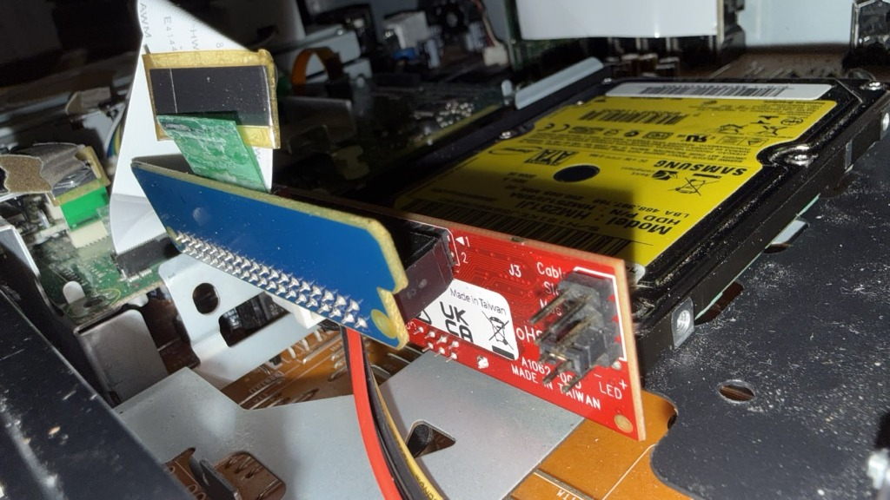
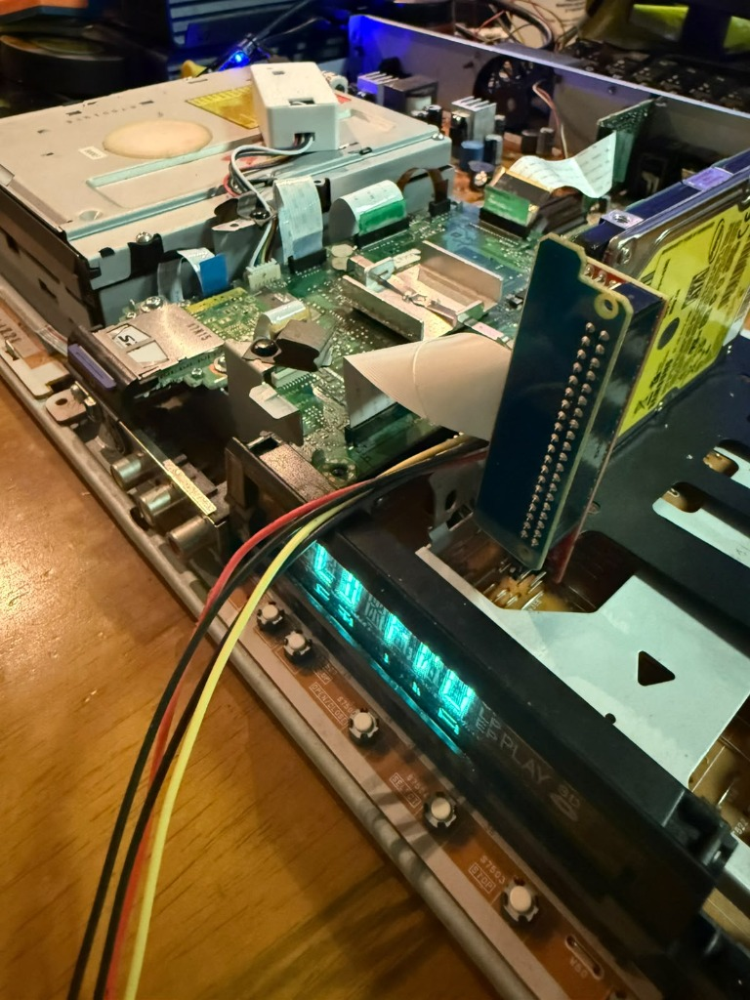
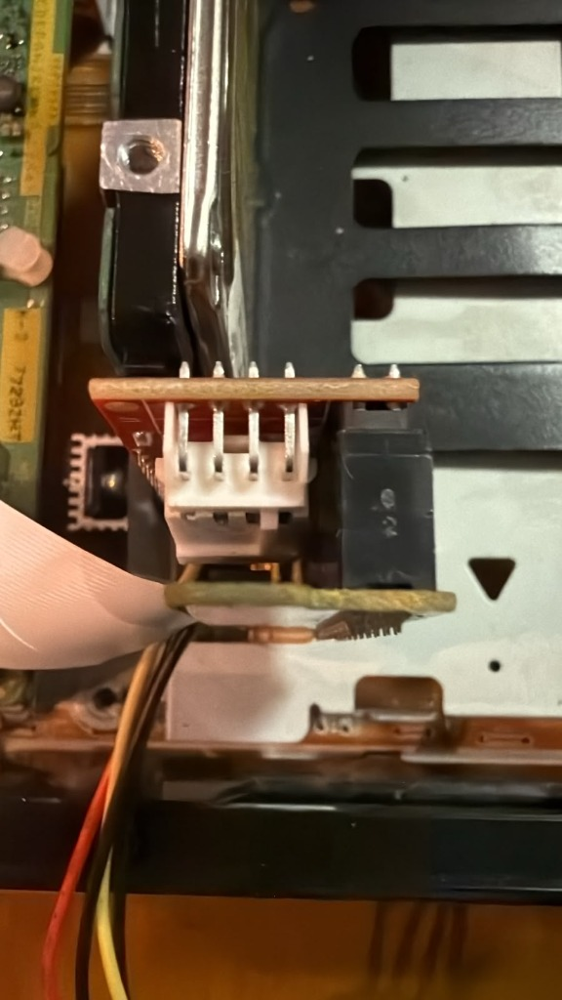

> 🌐 **Language / Idioma:** **English** | [Português (BR)](../pt-BR/ARQUITETURA_STORAGE_MEIHDFS_PARTICOES.md)
> 🧭 **Portal:** [Docs Index](../INDEX.md) | [Complete Audit](../../COMPLETE_AUDIT.md) | [Audits](../audits/README.md) | [Ghidra Pseudocode](../pseudocode/INDICE_EVIDENCIA_PSEUDOCODIGO_GHIDRA.md) | [Debug Logs](../debug_logs/README.md)

# MEIHDFS Storage Architecture & Partitioning Specification

## Reverse Engineering the Hard Disk & Firmware Structure of Panasonic DMR-EH55

### Matsushita UniPhier / AM34 Platform — DIGA Chassis (PCB: VEP79138)

---

## 1. System Overview & Storage Engineering Scope

The **Panasonic DMR-EH55** digital DVD/HDD recorder (Matsushita Electric Industrial Co., Ltd.'s DIGA line) implements a non-conventional hybrid storage architecture. Unlike PCs or commodity Linux DVRs, the DMR-EH55 runs on the proprietary **Matsushita AM34** (32-bit RISC **MN103S** core on `VEP79138` main board) and splits persistent storage across two complementary media:

1. **On-Board NOR Flash Memory (Spansion `S29JL064H` — 8 MBytes TSOP-48):**
   Contains the Stage-1 Initial Program Loader (*IPL*), minimal hardware bring-up routines, exception vectors, and Flash-emulated calibration parameter blocks (`EEMUL` / NVRAM).
2. **Internal PATA/IDE Hard Disk Drive (80 GB to 500 GB / Up to 2 TB+ Unclamped):**
   Does not merely store TV recordings. The HDD is an active participant in the boot subsystem: **it houses the primary executive firmware partitions (`MAIN` AM34 OS), audio/video CODEC microcode, On-Screen Display (OSD) assets, auxiliary microcodes, and MEIHDFS volume metadata**.

If an uninitialized blank hard drive is installed in a unit with a non-functional optical drive, POST stalls with front-panel codes **`HDDERR`** or **`DRV NG`**, refusing to launch the executive kernel or format the disk through user setup menus.

```text
                  PANASONIC DMR-EH55 HYBRID BOOT ARCHITECTURE
 ┌────────────────────────────────────────────────────────────────────────────────────────┐
 │                               MAIN BOARD (VEP79138)                                    │
 │                                                                                        │
 │   ┌──────────────────────────┐                  ┌──────────────────────────────────┐   │
 │   │  Matsushita AM34 / MN103S │   Initial Boot   │  IC5001 Spansion S29JL064H     │   │
 │   │  (UniPhier / AM34 Core)  │◄─────────────────│  (8 MB Flash NOR TSOP-48)        │   │
 │   │   108 MHz / 162 MHz      │   (Stage 1 IPL)  │  - Initial Program Loader (IPL)  │   │
 │   └────────────┬─────────────┘                  │  - Minimal Bootloader            │   │
 │                │                                │  - NVRAM / EEMUL (Calibrations)  │   │
 │                │ IDE / ATA Bus                  └──────────────────────────────────┘   │
 │                ▼                                                                       │
 │   ┌────────────────────────────────────────────────────────────────────────────────┐   │
 │   │                       HARD DISK DRIVE (PATA / IDE / SSD)                       │   │
 │   │                                                                                │   │
 │   │   [ LBA 0 ]                Panasonic Proprietary MBR ("SH", Disk GUID)         │   │
 │   │   [ LBA 24..31 ]           Low-Level Metadata & Allocation Table (XOR 0xFF)    │   │
 │   │   [ LBA 16,384..19,199 ]   Transactional Journal (10 x 128 KB Blocks)          │   │
 │   │   [ LBA 57,344 (28 MB) ]   Mirror MBR Table / Bit-Identical Backup of LBA 0    │   │
 │   │   [ LBA 65,536 (32 MB) ]   Firmware Partition 1 (0x5E3250 = ~5.89 MB, Stage 2) │   │
 │   │   [ LBA 131,072 (64 MB) ]  Firmware Partition 2 (0xB0000 = ~704 KB, OSD/Micro) │   │
 │   │   [ LBA 204,800+ ]         MEIHDFS Volume (VR_MOVIE.VRO / VR_MANGR.IFO)        │   │
 │   └────────────────────────────────────────────────────────────────────────────────┘   │
 └────────────────────────────────────────────────────────────────────────────────────────┘
```

### Analyzed Reference Image Artifact

* **Filename:** `firmware_and_images/panasonic DMR EH-55 Firmware hdd_100.bin`
* **Exact Physical Size:** `104,857,600` bytes (`100.00 MB`)
* **Total LBA Sectors:** `204,800` sectors of 512 bytes
* **Global MD5:** `ef4453fc8651903b0a4b0c1873d950d4`
* **Global SHA-256:** `9d292d5b46f190775f359e30af11d074021fb321f040bf701d0ecf0f2056db00`

---

## 2. Global Memory Map & Disk Sector Layout (`LBA` & Hex Offsets)

Sector-by-sector inspection of the 100 MB dump reveals Matsushita's exact layout separating guard zones, transactional journals, mirror redundancy, and executable firmware partitions:

| LBA Sector Range                 | Hexadecimal Offset Range         | Size (Bytes) | Size (MB) | Primary Function / Technical Description                                                           |
| :------------------------------- | :------------------------------- | :-----------: | :-------: | :------------------------------------------------------------------------------------------------- |
| **LBA 0**                  | `0x00000000` – `0x000001FF` |     512 B     | 0.0005 MB | **Panasonic Master Boot Record:** ASCII `"SH"` signature, rev 1.0, and Disk GUID.          |
| **LBA 1 .. 23**            | `0x00000200` – `0x00002FFF` |   11,776 B   | 0.0112 MB | **Guard Band 1:** Zero-filled (`0x00`) pre-metadata isolation sectors.                     |
| **LBA 24 .. 31**           | `0x00003000` – `0x00003FFF` |    4,096 B    | 0.0039 MB | **Descriptor Table:** 8 sectors housing 256 16-byte physical mapping records (`XOR 0xFF`). |
| **LBA 32 .. 16,383**       | `0x00004000` – `0x007FFFFF` |  8,372,224 B  | 7.9844 MB | **Intermediate Guard Band:** Zero-padded gap extending to the 8 MB boundary.                 |
| **LBA 16,384**             | `0x00800000` – `0x008001FF` |     512 B     | 0.0005 MB | **Journal Catalog Header:** Header containing block pool count (`0x0A` = 10 blocks).       |
| **LBA 16,385 .. 16,639**   | `0x00800200` – `0x0081FFFF` |   130,560 B   | 0.1245 MB | **Pre-Allocation Guard:** Block boundary padding.                                            |
| **LBA 16,640 .. 19,199**   | `0x00820000` – `0x0095FFFF` |  1,310,720 B  | 1.2500 MB | **Transactional Journal Area:** 10 discrete 128 KB blocks (256 sectors each).                |
| **LBA 19,200 .. 49,151**   | `0x00960000` – `0x017FFFFF` | 15,335,424 B | 14.625 MB | **Post-Journal Guard Band:** Zero-padded gap up to 24 MB.                                    |
| **LBA 49,152**             | `0x01800000` – `0x018001FF` |     512 B     | 0.0005 MB | **24 MB Transition Marker:** Format state flag & volume geometry delimiter.                  |
| **LBA 49,153 .. 57,343**   | `0x01800200` – `0x01BFFFFF` |  4,193,792 B  | 3.9995 MB | **Pre-Mirror Guard Band:** Zero-padded isolation zone up to 28 MB.                           |
| **LBA 57,344**             | `0x01C00000` – `0x01C001FF` |     512 B     | 0.0005 MB | **Mirror MBR Table:** Bit-identical copy of LBA 0 at exact 28.00 MB mark.                    |
| **LBA 57,368 .. 57,375**   | `0x01C03000` – `0x01C03FFF` |    4,096 B    | 0.0039 MB | **Mirror Descriptors:** Bit-identical copy of sectors LBA 24 through 31.                     |
| **LBA 57,376 .. 65,535**   | `0x01C04000` – `0x01FFFFFF` |  4,177,920 B  | 3.9844 MB | **Pre-Firmware Guard Band:** Zero-padded buffer up to 32 MB.                                 |
| **LBA 65,536 .. 77,593**   | `0x02000000` – `0x025E33FF` |  6,173,696 B  | 5.8877 MB | **Firmware Partition 1:** Main AM34 OS kernel, codecs, and DIGA executive (`0x5E3250`).    |
| **LBA 77,594 .. 131,071**  | `0x025E3400` – `0x03FFFFFF` | 27,382,784 B | 26.114 MB | **Inter-Partition Reserved Space:** Zero-filled buffer up to 64 MB.                          |
| **LBA 131,072 .. 132,479** | `0x04000000` – `0x040AFFFF` |   720,896 B   | 0.6875 MB | **Firmware Partition 2:** Subsystem microcode, OSD font assets, services (`0xB0000`).      |
| **LBA 132,480 .. 204,799** | `0x040B0000` – `0x063FFFFF` | 37,052,416 B | 35.336 MB | **100 MB Expansion Reserve:** Trailing reserved buffer up to user A/V area.                  |
| **LBA 204,800 onwards**    | `0x06400000` to end            | Remaining HDD | Remainder | **MEIHDFS A/V Filesystem Space:** Contiguous extents for real-time MPEG-2/AC-3 streaming.    |

---

## 3. Detailed Reverse Engineering of the MBR & Sector 0 (`LBA 0` & `LBA 57344`)

### Hexadecimal Breakdown of Sector 0 (`0x00000000`)

Inspecting all 512 bytes of LBA 0 reveals the following structure:

```text
Offset    00 01 02 03 04 05 06 07 08 09 0A 0B 0C 0D 0E 0F  ASCII
00000000: 00 00 00 00 01 00 53 48 62 8C 6E F5 1B 2C 36 66  ......SHb.n..,6f
00000010: 00 00 00 00 00 00 00 00 00 00 00 00 00 00 00 00  ................
...
000001F0: 00 00 00 00 00 00 00 00 00 00 00 00 00 00 00 00  ................
```

### Structural Field Decoding

```text
                      PANASONIC PROPRIETARY HEADER STRUCTURE (16 BYTES)
   0x00        0x03 0x04  0x05 0x06  0x07 0x08                                0x0F
  ┌────────────────┬──────────┬──────────┬────────────────────────────────────────┐
  │  00 00 00 00   │  01 00   │  53 48   │        62 8C 6E F5 1B 2C 36 66         │
  └────────────────┴──────────┴──────────┴────────────────────────────────────────┘
     Status/Flags    Version    Magic Tag             Volume Disk GUID
      (Reserved)     Rev 1.0    ASCII "SH"       (Unique Format Session Token)
```

1. **Bytes `0x00 .. 0x03` (`00 00 00 00`):** Volume status flags and boot control (zero indicates healthy mountable volume).
2. **Bytes `0x04 .. 0x05` (`01 00`):** Little-endian Panasonic partition layout revision (`0x0001` = Rev 1.0).
3. **Bytes `0x06 .. 0x07` (`53 48`):** ASCII magic tag `"SH"` (**Storage Header** / **System Harddisk**), the first marker verified by the Spansion IPL right after ATA `IDENTIFY DEVICE`.
4. **Bytes `0x08 .. 0x0F` (`62 8C 6E F5 1B 2C 36 66`):** Pseudo-random 64-bit Volume Disk GUID generated by the AM34 CPU during service-menu formatting; must match identically between LBA 0 and LBA 57,344.
5. **Bytes `0x10 .. 0x1FF` (502 zero bytes):** Strictly zero-filled through the end of Sector 0.

### Why Windows & Linux Reject the Disk as Uninitialized

* **Missing `0x55AA` Signature:** IBM-PC MBR mandates `55 AA` at offsets `0x1FE..0x1FF`; Panasonic leaves `00 00`.
* **Missing `0x1BE` Partition Entries:** The 4 standard 16-byte MBR entries at `0x01BE..0x01FD` are completely zeroed.
* **Host OS Behavior:**
  - **Windows (`diskmgmt.msc`):** Reports **"Unknown, Not Initialized Disk"** and prompts to initialize MBR/GPT — **WARNING:** initializing in Windows overwrites LBA 0, destroying `"SH"` and breaking DMR-EH55 boot!
  - **Linux Kernel:** Logs `sdX: unable to read partition table` or `unknown partition table` at attach time.

### Redundant Mirror Sector at `LBA 57,344` (`0x01C00000` = 28 MB)

At exact byte offset `0x01C00000` (`29,360,128` bytes = `28.00 MB`, LBA `57,344`), Panasonic maintains a bit-identical backup of LBA 0:

* **SHA-256 of LBA 0:** `61162c24c9240408ac807cd4307c9c5833d440715a982126c536aa10aa7530f2`
* **SHA-256 of LBA 57344:** `61162c24c9240408ac807cd4307c9c5833d440715a982126c536aa10aa7530f2`
* **Status:** **100% Bit-Identical (512/512 bytes match)**. If LBA 0 is damaged on a PC, service recovery can restore from LBA 57,344.

---

## 4. Allocation Metadata & Transactional Journaling (MEIHDFS Allocation Table)

### Sectors 24 to 31 (`0x00003000`..`0x00003FFF` — 4,096 Bytes): `XOR 0xFF` Encoded Descriptors

The 8 sectors spanning `LBA 24..31` store packed 16-byte service extent records encoded in bitwise 1's-complement (**`byte ^ 0xFF`**) so erased/unused regions stay aligned with flash/EPROM semantics (`0xFF` virgin state):

When the 4,096-byte table is XORed by `0xFF`, **256 structured 16-byte records** emerge partitioned across 6 master type tags covering 100% of the table:

- **Tag `0x5D` (65 records):** Primary extents, allocated sector counts, and LBA pointers for A/V blocks.
- **Tag `0x55` (64 records):** Sync markers and fragmented extent continuations.
- **Tag `0x57` (47 records):** LBA pointers and physical addressing vectors.
- **Tag `0xE0` (42 records):** Directory entries and MEIHDFS system file metadata.
- **Tag `0xE1` (26 records):** Virtual Nodes (*V-Nodes*) and filesystem inode identifiers.
- **Tag `0x5F` (12 records):** Block geometry descriptors and physical media pool records.
  *(Exact sum: $65 + 64 + 47 + 42 + 26 + 12 = 256\text{ records}$ of 16 bytes).*

* **Automated Native Decoder:**
  ```bash
  cargo run --release -- hdd decode-descriptors "firmware_and_images/panasonic DMR EH-55 Firmware hdd_100.bin"
  ```
* **28 MB Mirror Redundancy:** Duplicated identically at **LBA 57,368..57,375 (`0x01C03000..0x01C03FFF`)** with matching SHA-256 `4b604ad2a689bd39cc8667b2479e70e304d574a78fcf72bfdeb91ca138fdce24`.

### Journal Catalog & 10-Block Pool (`0x00800000`..`0x00960000`)

Starting at 8 MB (`0x00800000`), Matsushita maintains a *Write-Ahead Journal* pool protecting metadata against sudden power loss:

1. **LBA 16,384 (`0x00800000`) — Block Catalog Header:**
   * Bytes `0x00..0x03`: `0A 00 00 00` (`10` blocks in pool).
   * Bytes `0x04..0x07`: `09 00 00 00` (max 0-based index `9`).
2. **10 Allocation Blocks of 128 KB (`LBA 16,640..19,199`):** Consecutive 256-sector blocks (`131,072 bytes`), each starting with `5D FF FF FF FF FF FF FF FF FF FF FF FF FF FF FF`:

|    Block    |  Start Offset  | Start LBA |  Size  | Header (16 Bytes Hex)                               | Sequence Trailer (8 Bytes)           |
| :---------: | :------------: | :-------: | :----: | :-------------------------------------------------- | :----------------------------------- |
| **0** | `0x00820000` |  16,640  | 128 KB | `5D FF FF FF FF FF FF FF FF FF FF FF FF FF FF FF` | `D1 81 C8 0A 00 00 00 01` (Seq 1)  |
| **1** | `0x00840000` |  16,896  | 128 KB | `5D FF FF FF FF FF FF FF FF FF FF FF FF FF FF FF` | `5C FC 6E 0A 00 00 00 02` (Seq 2)  |
| **2** | `0x00860000` |  17,152  | 128 KB | `5D FF FF FF FF FF FF FF FF FF FF FF FF FF FF FF` | `47 06 23 0A 00 00 00 03` (Seq 3)  |
| **3** | `0x00880000` |  17,408  | 128 KB | `5D FF FF FF FF FF FF FF FF FF FF FF FF FF FF FF` | `71 F3 B9 0A 00 00 00 04` (Seq 4)  |
| **4** | `0x008A0000` |  17,664  | 128 KB | `5D FF FF FF FF FF FF FF FF FF FF FF FF FF FF FF` | `55 D5 9F 0A 00 00 00 05` (Seq 5)  |
| **5** | `0x008C0000` |  17,920  | 128 KB | `5D FF FF FF FF FF FF FF FF FF FF FF FF FF FF FF` | `55 54 C0 0A 00 00 00 06` (Seq 6)  |
| **6** | `0x008E0000` |  18,176  | 128 KB | `5D FF FF FF FF FF FF FF FF FF FF FF FF FF FF FF` | `55 57 7E 0A 00 00 00 07` (Seq 7)  |
| **7** | `0x00900000` |  18,432  | 128 KB | `5D FF FF FF FF FF FF FF FF FF FF FF FF FF FF FF` | `55 51 03 0A 00 00 00 08` (Seq 8)  |
| **8** | `0x00920000` |  18,688  | 128 KB | `5D FF FF FF FF FF FF FF FF FF FF FF FF FF FF FF` | `74 60 32 08 00 00 00 09` (Seq 9)  |
| **9** | `0x00940000` |  18,944  | 128 KB | `5D FF FF FF FF FF FF FF FF FF FF FF FF FF FF FF` | `17 3F 9B 09 00 00 00 0A` (Seq 10) |

---

## 5. Engineering of Proprietary Firmware Partitions

### Universal Partition Signature

Matsushita's executable HDD partitions are not located via standard CHS/LBA MBR tables; instead, the bootloader seeks fixed 32 MB and 64 MB offsets and checks an 8-byte hardware sync signature:

$$
\mathbf{\text{Panasonic Partition Magic: }}\quad \mathtt{51\ 87\ 13\ 8D\ 5B\ 0A\ FB\ 22}
$$

```text
                     HDD FIRMWARE PARTITION LAYOUT
    0x02000000 (32 MB, LBA 65,536)
   ┌────────────────────────────────────────────────────────────────────────┐
   │ 51 87 13 8D 5B 0A FB 22 ... E5 D1 F3 4A 51 8B 26 90 (+0x38 Sync)       │
   │                                                                        │
   │ PARTITION 1: MAIN FIRMWARE & DIGA CODECS                               │
   │ Active Payload: 0x5E3250 (6,173,264 bytes = ~5.89 MB)                  │
   │ Sector Padding: 432 bytes 0x00 to 0x025E3400 (12,058 LBA sectors)      │
   │ Entropy: 7.9990 bits/byte (Encrypted / Compressed Binary)              │
   └────────────────────────────────────────────────────────────────────────┘

    0x04000000 (64 MB, LBA 131,072)
   ┌────────────────────────────────────────────────────────────────────────┐
   │ 51 87 13 8D 5B 0A FB 22 ... E5 D1 F3 4A 51 8B 26 90 (+0x30/0x38 Sync)  │
   │                                                                        │
   │ PARTITION 2: SUBSYSTEM, OSD FONTS & MICROCODE                          │
   │ Active Payload: 0xAFFD0 (720,848 B) + 48 B 0xFF (Total: 0xB0000)       │
   │ Size: 720,896 bytes = 704 KB (1,408 LBA sectors)                       │
   │ Entropy: 7.9929 bits/byte (Encrypted / Compressed Binary)              │
   └────────────────────────────────────────────────────────────────────────┘
```

### Partition 1: Executive OS Firmware & Codecs (`0x02000000`)

* **Physical Location:** `0x02000000` (exact 32.00 MB mark, **LBA 65,536**).
* **Active Payload Size:** `6,173,264` bytes (`0x5E3250` $\approx 5.887\text{ MB}$).
* **Sector-Aligned Size:** `6,173,696` bytes (`0x5E3400` = **12,058 LBA sectors**; trailing 432 bytes zero-filled).
* **Sync Markers:** `0x00..0x07` = `51 87 13 8D 5B 0A FB 22`; `0x38..0x3F` = `E5 D1 F3 4A 51 8B 26 90`.
* **Cryptographic Hashes:**
  - Active Payload (`0x5E3250`): MD5 `393e52d939eee76bbf06a98f2415253f` | SHA-256 `6ec63de059c00b287a0e8a1a4102a8007bbccf3210a552bfb45118a03b85c898`
  - Sector-Aligned (`0x5E3400`): MD5 `85af47c916ac085a0b77619e7d4fe05e` | SHA-256 `d77fa2af9860edc694bf9fa7250514c1bf7a2e1821d69ffdac33454940c6950b`

### Partition 2: Subsystem, OSD Fonts & Microcode (`0x04000000`)

* **Physical Location:** `0x04000000` (exact 64.00 MB mark, **LBA 131,072**).
* **Total Size:** `720,896` bytes (`0xB0000` = `704 KB` = **1,408 LBA sectors**; `0xAFFD0` payload + 48 bytes `0xFF`).
* **Sync Markers:** `0x00..0x07` = `51 87 13 8D 5B 0A FB 22`; `0x30..0x3F` duplicates `E5 D1 F3 4A 51 8B 26 90`; trailer `0xAFFC0..0xAFFCF` repeats `03 50 65 C8 7B B8 E0 90` twice before 48 bytes of `0xFF`.
* **Cryptographic Hashes (`0xB0000`):** MD5 `ee465f12930bef1599bb4fc256346ef0` | SHA-256 `487d5951d4aa7bc45e5f634c4ca079f369db06d5cb62e41a173575cecd68dbae`

---

## 6. Technological Investigation of MEIHDFS & UDF Lineage

### Historical Origin of MEIHDFS

**MEIHDFS** (*Matsushita Electric Industrial Hard Disk File System*) was engineered between 2002 and 2004 to overcome real-time A/V streaming limits of general-purpose filesystems:

1. **FAT32 Limits:** 4 GB file size cap blocked >2 h recordings at XP bitrate (10 Mbps), while cluster fragmentation induced mechanical seek stalls (*dropped frames*).
2. **NTFS / ext3 Overhead:** General POSIX B-tree/ACL journaling lacked hard real-time QoS streaming guarantees.
3. **Transition Beyond UDF:** Earlier DVD-RAM recorders (e.g., DMR-E85H) emulated UDF 1.5/2.01 on HDD, whereas multi-hundred-gigabyte drives led Matsushita to design **MEIHDFS-V2.0** (deployed on DMR-EH55 and later chassis).

### Operational Mechanisms of MEIHDFS-V2.0

```text
                     MEIHDFS INODE & EXTENT ORGANIZATION
  ┌─────────────────────────────────────────────────────────────────────────────┐
  │                           MEIHDFS SUPERBLOCK                                │
  │   - Magic identifier at Offset 0x0C                                         │
  │   - Root pointer to Inode Table (`itbl`)                                    │
  │   - Base Extent Cluster Size (128 KB or 2 MB)                               │
  └──────────────────────────────────────┬──────────────────────────────────────┘
                                         │
                                         ▼
  ┌─────────────────────────────────────────────────────────────────────────────┐
  │                     INODE & DIRECTORY TABLE                                 │
  │                                                                             │
  │   INODE 1: VR_MANGR.IFO                                                     │
  │   ├── Metadata: Size, Date, Video Flags                                     │
  │   └── Extent Map: LBA 204,800 (Size: 64 KB)                                 │
  │                                                                             │
  │   INODE 2: VR_MOVIE.VRO (MPEG-2 Video Stream)                               │
  │   ├── Extent 0: LBA 205,056 to 409,600   (100 MB contiguous)                │
  │   ├── Extent 1: LBA 800,000 to 1,200,000 (200 MB contiguous)                │
  │   └── Extent N: ... (Macro-block allocation prevents dropped frames)        │
  └─────────────────────────────────────────────────────────────────────────────┘
```

1. **Continuous Extent Allocation:** Pre-allocates massive contiguous runs (128 KB, 2 MB, or 32 MB macro-blocks) for stutter-free linear MPEG-2 recording.
2. **Zero-Copy Non-Linear Editing (NLE):** Title splits and *A-B Erase* edit cuts never rewrite multi-gigabyte video files; MEIHDFS merely splits inode extent descriptors and frees cut LBA spans back into the bitmap.
3. **Audio/Video Indexing:**
   - **`VR_MOVIE.VRO`:** Multiplexed MPEG-2 Video Elementary Streams + Dolby AC-3 / LPCM PES packets.
   - **`VR_MANGR.IFO` / `VR_MANGR.BUP`:** DVD-VR management tables containing **Time Maps (TMAP)** linking timestamps to **VOBUs (Video Object Units)** and navigation packets (`NV_PCK`).
4. **CPRM Copy Protection:** Non-standard LBA 0 structure prevented desktop OSes from mounting/copying *Copy-Once* broadcasts directly.

### Open-Source & Forensic Ecosystem State of the Art

* **`panasonic-rec` (`leecher1337`):** Open-source utility **`extract_meihdfs`** parsing MEIHDFS-V2.0 superblocks and `itbl` tables.
* **`dvd-vr`:** Remuxes extracted `VR_MOVIE.VRO` discontinuities into standard `.VOB`/`.MPG` streams.
* **Commercial Forensics:** IsoBuster Pro includes native Panasonic MEIHDFS disk parsers.

---

## 7. Native Rust CLI (`panadiga hdd`) & Extracted Manifest (`SHA256SUMS.txt`)

> [!NOTE]
> Legacy script `scripts/parse_panasonic_hdd_partitions.py` was retired and consolidated natively inside Rust ([`crates/panadiga-core/src/hdd/`](../../crates/panadiga-core/src/hdd/mod.rs)).

```bash
# Inspect image layout & hashes
panadiga hdd inspect -i "firmware_and_images/panasonic DMR EH-55 Firmware hdd_100.bin"

# Decode all 256 XOR 0xFF descriptors
panadiga hdd decode-descriptors "firmware_and_images/panasonic DMR EH-55 Firmware hdd_100.bin"

# Extract partitions & verify SHA-256 digests
panadiga hdd extract --outdir firmware_and_images/extracted_partitions "firmware_and_images/panasonic DMR EH-55 Firmware hdd_100.bin"
panadiga hdd verify-hashes "firmware_and_images/panasonic DMR EH-55 Firmware hdd_100.bin"
```

Extracted artifact manifest (`SHA256SUMS`):

```text
61162c24c9240408ac807cd4307c9c5833d440715a982126c536aa10aa7530f2  hdd_mbr_master_lba0.bin
61162c24c9240408ac807cd4307c9c5833d440715a982126c536aa10aa7530f2  hdd_mbr_mirror_lba57344.bin
4b604ad2a689bd39cc8667b2479e70e304d574a78fcf72bfdeb91ca138fdce24  hdd_allocation_descriptors_0x00003000.bin
4c28d51cde8bcbcf2d2a86d30f4351f50bf509228fe804a09601205fa06f73a2  hdd_journal_blocks_0x00820000.bin
6ec63de059c00b287a0e8a1a4102a8007bbccf3210a552bfb45118a03b85c898  hdd_partition_firmware_0x02000000.bin
d77fa2af9860edc694bf9fa7250514c1bf7a2e1821d69ffdac33454940c6950b  hdd_partition_firmware_0x02000000_sector_aligned.bin
487d5951d4aa7bc45e5f634c4ca079f369db06d5cb62e41a173575cecd68dbae  hdd_partition_firmware_0x04000000.bin
```

---

## 8. Practical HDD / SSD Replacement Playbook

```text
               HDD / SSD RESTORATION FLOWCHART IN DMR-EH55
  ┌────────────────────────┐
  │  Virgin New HDD / SSD  │
  └───────────┬────────────┘
              │
              ▼
  ┌────────────────────────────────────────────────────────────────────────┐
  │ STEP 1: Write First 100 MB (Patched Dynamic Image for >= 250 GB)       │
  │ panadiga hdd write-image --target \\.\PhysicalDrive1 ...               │
  │ (Writes LBA 0, 28 MB Mirror, and 32 MB / 64 MB Firmware Partitions)    │
  └───────────────────────────────────┬────────────────────────────────────┘
                                      │
                                      ▼
  ┌────────────────────────────────────────────────────────────────────────┐
  │ STEP 2: Install in DMR-EH55 with Jumper Explicitly Set to MASTER       │
  │ Attach dedicated 40-pin IDE FFC and Molex power (NEVER CS / NEVER SLV) │
  └───────────────────────────────────┬────────────────────────────────────┘
                                      │
                                      ▼
  ┌────────────────────────────────────────────────────────────────────────┐
  │ STEP 3: Clean Initial Boot (No "DRV NG" / "HDDERR")                    │
  │ AM34 validates "SH" header and loads Firmware 1 & Firmware 2           │
  └───────────────────────────────────┬────────────────────────────────────┘
                                      │
                                      ▼
  ┌────────────────────────────────────────────────────────────────────────┐
  │ STEP 4: Format via Panasonic Menu                                      │
  │ Functions -> To Others -> Setup -> Others -> HDD Management -> Format  │
  │ (DMR-EH55 allocates full drive capacity to MEIHDFS)                    │
  └────────────────────────────────────────────────────────────────────────┘
```

1. Write the 100 MB bootstrap image (`*_PATCHED_DYNAMIC.bin` for drives $\ge 250\text{ GB}$, or factory image for $\le 200\text{ GB}$).
2. Set the PATA HDD or SATA-PATA bridge (`StarTech IDE2SAT2`) jumper strictly to **`Master`** (`Device 0` on Secondary IDE `ch = 1` — **never** `CS` and **never** `Slave`).
3. Power on (`HELLO` $\rightarrow$ `PLEASE WAIT` $\rightarrow$ `UNFORMAT`, with `DRV NG` eliminated) and run **Functions $\rightarrow$ To Others $\rightarrow$ Setup $\rightarrow$ Others $\rightarrow$ HDD Management $\rightarrow$ Format** to allocate full drive capacity under `MEIHDFS`.

---

## 9. Dynamic HDD Capacity Unlock (`src/hdd_cmd.c` + MEIHDFS1.0) — 80 GB to 2 TB+

By factory default, Panasonic DIGA's MEIHDFS/LBA48 driver supports full physical drive geometry at the ATA layer, while executive **`MAIN`** firmware enforces a software ceiling inside **`src/hdd_cmd.c`**, clamping `PhysicalBlocks2KB` against SDRAM variable `MaxProductLBA` (~200 GB on standard EU retail builds).

### 9.1 Full Byte-by-Byte MN103S Disassembly Anatomy (`src/hdd_cmd.c`)

Binary analysis localized the complete **117-byte basic block (`+0x00..+0x74`)**, anchored deterministically via **`WIN_LEN = 0x72` (`114`-byte)** signature `FD AA 00 8A 00 00 FB E9 00 80 C8 1D FC CC`:

| Field / Symbol                             | `MAIN3060NP` (`main3060np_unpacked.bin`) | `EH55_MAIN_3410PQ` (`EH55_MAIN_3410PQ.bin`) | Technical Detail                                                                     |
| :----------------------------------------- | :------------------------------------------- | :---------------------------------------------- | :----------------------------------------------------------------------------------- |
| **Unpacked Size / SHA-256**          | `13,427,852 B` / `075f552e...61ddcca7`   | `13,003,052 B` / `c3275d39...5dc991b1`      | Uncompressed `MAIN` module (base `0x57000000`)                                   |
| **Block Start (`VA` / File Off.)** | `0x574E499C` (`+0x004E499C`)             | `0x574DD1FC` (`+0x004DD1FC`)                | Start of `WIN_LEN = 0x72` (`114` B) in `src/hdd_cmd.c`                         |
| **Global `MaxProductLBA`**         | `0x5300750C`                               | `0x5311B9AC`                                  | SDRAM 32-bit ceiling in 2 KB blocks                                                  |
| **Global `PhysicalBlocks2KB`**     | `0x530077E0`                               | `0x5311BC80`                                  | Measured LBA48 capacity (`sectors_512b / 4`)                                       |
| **`400GB` / `200GB` Strings**    | `0x579F9F13` / `0x579F9F2D`              | `0x57A5E957` / `0x57A5E971`                 | `"[RTSD] M7920(HDD 400GB) \n"` / `"M7920(HDD 200GB) \n"`                         |
| **`DevInfo` / `MaxLBA` Logs**    | `0x579F9EEC` / `0x579F5853`              | `0x57A5E930` / `0x57A5A299`                 | `"[RTSD] Read DevInfo(option) Err=%08x \n"` / `"[RTSD] MaxProductLBA = %08x \n"` |

Exact MN103S instruction sequence across `+0x00..+0x74`:

| Offset                     | Bytes (`EH55_MAIN_3410PQ`)                         | Equivalent MN103S Instruction                  | Engineering Semantics                                                                                                       |
| :------------------------- | :--------------------------------------------------- | :--------------------------------------------- | :-------------------------------------------------------------------------------------------------------------------------- |
| **`+0x00..+0x03`** | `FD AA 00 8A`                                      | `movhu (0x8a, a2), d2`                       | Reads option halfword `DevInfo(option)+0x8A`.                                                                             |
| **`+0x04..+0x09`** | `00 00 FB E9 00 80`                                | `and 0x00008000, d2`                         | Tests bit `0x8000` (`M7920` 400 GB SKU flag).                                                                           |
| **`+0x0A..+0x0B`** | `C8 1D`                                            | `beq +29` (`-> +0x27`)                     | If zero, jumps to standard **200 GB** slot.                                                                           |
| **`+0x0C..+0x11`** | `FC CC 74 3B A4 0B`                                | `mov 0x0BA43B74, d0`                         | Loads `slot_400gb` (`0x0BA43B74` = `195,312,500` x 2 KB = 400.00 GB). **`+0x0E` is patched offset**.          |
| **`+0x12..+0x17`** | `FC 81 AC B9 11 53`                                | `mov d0, (0x5311B9AC)`                       | Stores `MaxProductLBA` (`0x5300750C` in `3060NP`).                                                                    |
| **`+0x18..+0x24`** | `FC CC <str> DD <disp32>`                          | `mov <str_400gb>, d0; call log`              | Logs `"[RTSD] M7920(HDD 400GB) \n"`.                                                                                      |
| **`+0x25..+0x26`** | `CA 29`                                            | `bra +41` (`-> +0x4E`)                     | Jumps to `MaxProductLBA` vs `PhysicalBlocks2KB` compare.                                                                |
| **`+0x27..+0x2C`** | `FC CC BA 1D D2 05`                                | `mov 0x05D21DBA, d0`                         | Loads `slot_200gb` (`0x05D21DBA` = `97,656,250` x 2 KB = 200.00 GB). **`+0x29` is patched offset**.           |
| **`+0x2D..+0x3F`** | `FC 81 <var> FC CC <str> DD <disp32>`              | `mov d0, (MaxProductLBA); call log`          | Stores `MaxProductLBA = 200 GB` and logs `"[RTSD] M7920(HDD 200GB) \n"`.                                                |
| **`+0x40..+0x41`** | `CA 0E`                                            | `bra +14` (`-> +0x4E`)                     | Jumps to comparison block.                                                                                                  |
| **`+0x42..+0x4D`** | `FC CC <fb> FC 81 <var>`                           | `mov <slot_fb>, d0; mov d0, (MaxProductLBA)` | Non-`M7920` fallback: `0x05D0DDBA` (`3060NP`) / `0x04A6D7C8` (`3410PQ`). **`+0x44` is patched offset**.   |
| **`+0x4E..+0x53`** | `FC A5 AC B9 11 53`                                | `mov (MaxProductLBA), d1`                    | Loads `MaxProductLBA` ceiling into `d1`.                                                                                |
| **`+0x54..+0x59`** | `FC A4 80 BC 11 53`                                | `mov (PhysicalBlocks2KB), d0`                | Loads actual physical LBA48 block count into `d0`.                                                                        |
| **`+0x5A`**        | `A1`                                               | `cmp d1, d0`                                 | Compares `d0` (`PhysicalBlocks2KB`) vs `d1` (`MaxProductLBA`).                                                      |
| **`+0x5B..+0x5C`** | **`C6 0C`** (`0xC6` -> **`0xCA`**) | **`bls +12`** (`-> +0x67`)           | Skips truncation when `d0 <= d1`. **Patching `+0x5B` to `0xCA` (`bra +12`) bypasses clamping for every HDD**. |
| **`+0x5D..+0x64`** | `29 FF FC 85 80 BC 11 53`                          | `add -1, d1; mov d1, (PhysicalBlocks2KB)`    | **Original clamp branch:** overwrites `PhysicalBlocks2KB` with `MaxProductLBA - 1`.                               |
| **`+0x65..+0x66`** | `CA 0A`                                            | `bra +10` (`-> +0x6F`)                     | Ends block after applying cap.                                                                                              |
| **`+0x67..+0x6E`** | `28 FF FC 81 80 BC 11 53`                          | `add -1, d0; mov d0, (PhysicalBlocks2KB)`    | **Unlocked path:** computes `PhysicalBlocks2KB -= 1` keeping **100% of physical drive sectors**.              |
| **`+0x6F..+0x74`** | `FC A4 80 BC 11 53`                                | `mov (PhysicalBlocks2KB), d0`                | Reloads unlocked sector count for MEIHDFS formatting (first 3 bytes `FC A4 80` complete `WIN_LEN`).                     |

### 9.2 Unlock Strategies (`dynamic`, `cap`, `factory_200gb`) & Equations

1. **Dynamic Auto-Detect (`dynamic`, recommended):** Rewrites `+0x5B` from `0xC6` (`bls +12`) to **`0xCA`** (`bra +12` unconditional) and lifts `+0x0E`, `+0x29`, `+0x44` to `0x3FFFFFFF` (~2.199 GB in 2 KB blocks) or `--target-gb`. Any LBA48 drive (**250 GB, 320 GB, 500 GB, 1 TB, 2 TB+**) retains its full physical `IDENTIFY DEVICE` geometry.
2. **Explicit Cap / RTSD Preset (`cap`):** Keeps `0xC6` (`bls +12`) and pins all three `MaxProductLBA` slots to the chosen ceiling (e.g., **`250 GB` = `0x07466528`**). Custom sizes follow:
   $$
   N_{\text{blocks 2KB}} = \left\lfloor \frac{\text{Capacity}_{\text{GB}} \times 10^9}{2048} \right\rfloor, \qquad N_{\text{sectors 512B}} = N_{\text{blocks 2KB}} \times 4
   $$
3. **Factory Restore (`factory_200gb`):** Restores `+0x5B` to `0xC6` and factory slot values `0x0BA43B74` / `0x05D21DBA` / `0x05D0DDBA`.

### 9.3 Official RTSD `Change HDD Capacity` Table (`0x574CA054` / `0x574C267B`)

Service menu handler `Change HDD Capacity` stores 9 hardcoded RTSD entries (`#1` 400 GB to `#9` 80 GB), writing selection to RAM (`0x52FEE95C` / `0x53102DFC`) and logging `"[RTSD] MaxProductLBA = %08x \n"`. Entry **`#3`** defines **250 GB as `0x07466528`** (`122,053,928` blocks = `488,215,712` sectors):

|    RTSD Index    | Preset Label                   |    2 KB Blocks (Hex)    |     2 KB Blocks (Dec)     | 512 B LBA Sectors (`x 4`) |
| :--------------: | :----------------------------- | :----------------------: | :-----------------------: | :-------------------------: |
|      `#1`      | `400GB HDD (RTSD)`           |      `0x0BA3FB74`      |      `195,296,116`      |       `781,184,464`       |
|      `#2`      | `300GB HDD (RTSD)`           |      `0x08BAEC97`      |      `146,467,991`      |       `585,871,964`       |
| **`#3`** | **`250GB HDD (RTSD)`** | **`0x07466528`** | **`122,053,928`** |  **`488,215,712`**  |
|      `#4`      | `200GB HDD (RTSD)`           |      `0x05D1DDBA`      |      `97,639,866`      |       `390,559,464`       |
|      `#5`      | `160GB HDD (RTSD)`           |      `0x04A7D7C8`      |      `78,108,616`      |       `312,434,464`       |
|      `#6`      | `137GB HDD (RTSD)`           |      `0x03FC7AC3`      |      `66,878,147`      |       `267,512,588`       |
|      `#7`      | `120GB HDD (RTSD)`           |      `0x037DD1D6`      |      `58,577,366`      |       `234,309,464`       |
|      `#8`      | `100GB HDD (RTSD)`           |      `0x02E8CEDD`      |      `48,811,741`      |       `195,246,964`       |
|      `#9`      | `80GB HDD (RTSD)`            |      `0x0253CBE4`      |      `39,046,116`      |       `156,184,464`       |

### 9.4 Cryptographic Repackaging (`EXTRHEAD` / `EXTRFOOT`) & Mandatory `MASTER` Hardware Rule

[`hdd/capacity_patch/`](../../crates/panadiga-core/src/hdd/capacity_patch/mod.rs) auto-detects `RAW_MAIN_BINARY`, `EXTRHEAD_CONTAINER` (`hdd_partition_firmware_0x02000000.bin`), and `FULL_HDD_IMAGE_P1` (`panasonic DMR EH-55 Firmware hdd_100.bin`). Repacking automatically recomputes deflate payload, strided Adler-32 (`step=16`, matching `FUN_4401e5a3`), `EXTRFOOT`, and 16-round 64-bit Feistel ECB ciphering (`unpack_extrhead` round-trip verified with `checksum_valid == true`), preserving `zeros_after_header_clean` on factory dumps and only syncing LBA 0 / LBA 57,344 sector counts on procedural `mkfs` images.

> [!CAUTION]
> **Mandatory Hardware Rule (`StarTech IDE2SAT2` Jumper = `MASTER`, NEVER `CS` and NEVER `Slave`):**
> On **`DMR-EH55`**, schematics (`vol2_schematics.pdf` pp. 46, 52, 113, 125–126) and real disassembly (`eh55_frm_PROG061_BOOT.bin` `FUN_504141df` / `FUN_50414ce8` / `FUN_50414908`, `EH55_MAIN_3410PQ.bin` `FUN_574d1487` / `FUN_574d21ee` / `FUN_574d1de8`) prove that **ODD and HDD run on separate IDE buses** (`DAT_505733d4` single-cable Slave remapping exists only in **`DMR-EH58` `BOOT.BIN`**, not `DMR-EH55`):
>
> - **Primary Channel (`ch = 0`, MMIO `0x89000500`, `Pri`):** DVD-RAM ODD (`acStack_70[0] = 2`, Primary Master) attached internally to Front-End (`FEP`).
> - **Secondary Channel (`ch = 1`, MMIO `0x89000D00`, `Sec`):** HDD (`acStack_70[2] = 1`, **Secondary MASTER**; `acStack_70[3] = 0`, Secondary Slave unused) over its dedicated 40-pin `Extension FFC`.
>
> Setting **`Slave` (`dev = 1`)** maps to unused slot `acStack_70[3] == 0`. Leaving **`CS` (`Cable Select`, Pin 28 `CSEL`)** risks indeterminate `DEV` selection, `0x8000040d` collisions, or `MultiWord DMA MODE2` lockups in `FUN_5041f61b` / `FUN_5041f782` (`FUN_5710c6c3` / `FUN_5710c82a`). Power-cycling during an IDE hang can corrupt NOR **BGO sectors (`0x84130000..0x843FFFFF` on real EH55 `Loader ver0.61`; `0x84200000..0x843FFFFF` on `ver0.63`/`PROG061`)**, yielding `BGO driver init failed[1].` and `U99`. **Always jumper HDD / `StarTech IDE2SAT2` explicitly as `MASTER` (`Device 0`) — never `CS` and never `Slave`.**

### 9.5 On-Call CLI & Desktop UI Workflow

```bash
# Inspect current clamp opcode and SKU slots
panadiga hdd inspect-capacity -i firmware_and_images/extracted_partitions/hdd_partition_firmware_0x02000000.bin

# Unlock dynamic LBA48 capacity (250 GB to 2 TB+; -o optional -> *_PATCHED_DYNAMIC.bin)
panadiga hdd patch-capacity -i hdd_partition_firmware_0x02000000.bin --mode dynamic

# Or set explicit 250 GB RTSD ceiling (0x07466528 -> *_PATCHED_250GB.bin)
panadiga hdd patch-capacity -i hdd_partition_firmware_0x02000000.bin --mode cap --target-gb 250
```

In **Panadiga Desktop (`HddStorageView`)**, open **`Capacity Unlock (250GB / 2TB)`** (`HddCapacityPatcherCard`) followed by the capacity target selector (`Auto (Physical)`, `250 GB`, `300 GB`, `400 GB`, `500 GB`, `1 TB`, `2 TB`, or custom) under **`Physical Write & mkfs`** (`HddWriterCard`).

### 9.4 `DAVIS` `CH1` Hardware Diagnostics, Reversed `P58001` Pinout & `PhysicalDrive1` (250 GB) Flash

* **`PhysicalDrive1` (250 GB SATA via `StarTech IDE2SAT2`) `[PROVEN ON REAL HARDWARE]`:** The 250 GB disk received a `64 KiB` CoW backup of occupied sectors, unified image flashing (`SHA-256: 4fde753c...`), and a high-LBA Partition 1 mirror (`488266096`, `SHA-256: d932692c...`) logged in [`hdd_unbrick_flash_250gb_20261119.log`](../debug_logs/hdd_unbrick_flash_250gb_20261119.log).
* **`DAVIS` asymmetric reset polarity & `P58001` pinout `[PROVEN ON REAL HARDWARE]`:** On the `AM34` IDE bridge, `CH0` uses active-LOW reset (`0x504F81D0 = 2`) whereas **`CH1` requires active-HIGH reset (`0x504F81D4 = 1`)** via helper `J 504156AD`. Connector `P58001` (`VEK0K00` / 40-pin continuous `N5EZZ0000003` ribbon) obeys reversed pin numbering `Pin k = ATA (41 - k)`, explaining why `IDE2SAT2` reads `0x00000000` (non-hanging) at `0°` vs. `0x00002004` (`DD13|DD2`) at `180°`.
* **Live `CH1` bench state `[UNDER INVESTIGATION / CH1 PHYSICAL BLOCK]`:** While automated `PANAMON1>` probing ([`probe_ch1_full_diag_20261119.log`](../debug_logs/probe_ch1_full_diag_20261119.log) · [`probe_ch1_live_v2_0deg_20261119.log`](../debug_logs/probe_ch1_live_v2_0deg_20261119.log)) and `re::davis_probe` are operational, physical `CH1` still reads `0x00000000` (`is_ata=0`) on the bench `EH55` pending DC/continuity isolation. **Consequently, `MAIN` has NOT yet booted from `PhysicalDrive1` on live `EH55` hardware.**

### 9.6 Low-Profile Chassis-Closure Modification: 40-Pin `Type B` FFC (or DIY Strip) + `180°` Inverted Blue Panasonic Adapter (`N5EZZ0000003`)

When mounting a `2.5"` SATA HDD/SSD (e.g., `Samsung HM251JI`) with a **`StarTech IDE2SAT2`** bridge inside the **`DMR-EH55`**, mating the blue Panasonic IDE-to-FFC adapter board (**`N5EZZ0000003`**) in its stock **`0°`** orientation points the FFC latch and white **`VEK0K00`** ribbon straight upward above the VFD frame, **preventing the top DVD/DVR lid from closing**.

#### 40-Pin IDE FFC Ribbon Technical Specification (`P58001` $\leftrightarrow$ `N5EZZ0000003`)

| Parameter | Technical Specification | Details & Source Reference |
| :--- | :--- | :--- |
| **Panasonic OEM Part Numbers** | **`VEK0K00`** (NA) / **`VEK0K15`** (EC/EE) | Listed as `FFC(40P)` in `P9/PC9` (p. 97) and `EC/EE` (pp. 91–94) service manuals, routing `P58001` (`vol2_schematics.pdf` pp. 113, 126) to **`N5EZZ0000003`**. |
| **Conductor Count ($N$)** | **`40 pins` (`40P`)** | All 40 parallel conductors wired straight through to **`N5EZZ0000003`**. |
| **Contact Pitch ($P$)** | **`0.5 mm`** | Matches `P58001` ZIF/LIF connector and aligns visually against the 2×20 `2.54 mm` IDE header width on `N5EZZ0000003`. |
| **Total Ribbon Width ($W$)** | **`20.5 mm`** (`~2.05 cm`, std. tol. `± 0.1 mm`) | Standard FFC geometry: $W = (N + 1) \times P = 41 \times 0.5\text{ mm}$. |
| **Pin-1 to Pin-40 Span** | **`19.5 mm`** *(center-to-center)* | $(N - 1) \times P = 39 \times 0.5\text{ mm}$. |
| **End Thickness (Stiffened)** | **`0.30 mm ± 0.05 mm`** | Standard `0.5 mm`-pitch ZIF thickness; **`~4 mm`** (`3.5–5 mm`) exposed contact strip length and **`~8 mm`** (`6–10 mm`) backing stiffener. |
| **Contact Polarity** | **`Type A`** (stock `0°`) vs. **`Type B`** (`180°`) | `Type A` = same-side contacts; **`Type B`** = opposite-side / reverse contacts (required when mounting `N5EZZ0000003` rotated `180°`). |
| **Insulation / UL Rating** | **`UL AWM 20624`** or **`UL AWM 2896`** | Standard commercial rating `80 °C`, `30 V–60 V`, `VW-1` (stock bench ribbon pictured shows partial print `AWM ... E4144...`). |
| **Suggested Length (`Type B`)** | **`100 mm` to `150 mm`** (`10–15 cm`) | Long enough for a gentle low-profile fold while keeping ATA/UDMA signal integrity high; verify stock ribbon length with a ruler/calipers before ordering. |

**Commercial search string:** `40-pin 0.5mm pitch FFC ribbon cable (20.5mm width) Type B / reverse contacts — 100mm–150mm (AWM 20624)`.

#### Mathematical Proof of Exact Equivalence (`Type B FFC` + `180°` Inverted `N5EZZ0000003`)

Inverting the blue adapter becomes **100% electrically equivalent** because a dual-row 40-pin IDE header forms a symmetric odd/even matrix involution:

1. **Rotating the 2×20 IDE Socket by `180°` (`N5EZZ0000003` $\leftrightarrow$ `IDE2SAT2`):**On a 2×20 dual-row header with column index $c \in \{0,\dots,19\}$, odd row $2c+1$, and even row $2c+2$, rotating the mating socket by **`180°`** swaps odd $\leftrightarrow$ even rows and reverses columns ($c \mapsto 19 - c$):
   $$
   \pi_{180^\circ}(2c+1) = 2(19-c)+2 = 41 - (2c+1), \qquad \pi_{180^\circ}(2c+2) = 2(19-c)+1 = 41 - (2c+2)
   $$

   Thus, for every pin $k \in \{1,\dots,40\}$, a `180°` rotation enforces $\pi_{180^\circ}(k) = 41 - k$ (which is why rotating the board with a stock **Type A** FFC read `0x00002004` — mapping `ATA 27/28` onto `DD13/DD2`).
2. **Linear reversal across a 40-pin `Type B` FFC (opposite-face exposed contacts):**A **`Type B` FFC** cable exposes its 40 conductors on opposite faces at the two ends, reversing the ribbon pin order linearly:
   $$
   \pi_{\text{TypeB}}(k) = 41 - k
   $$
3. **Composition (`Type B FFC` + `180°` Blue Adapter `N5EZZ0000003`):**
   Composing the two involutions yields the exact **1:1 identity mapping** from Digital PCB `P58001` to every pin of the SATA-IDE bridge:
   $$
   (\pi_{180^\circ} \circ \pi_{\text{TypeB}})(k) = 41 - (41 - k) = k \qquad (\forall\, k \in \{1,\dots,40\})
   $$

#### Key/Blind Pin (`ATA Pin 20 = KEY`) & `DMARQ` (`ATA Pin 21`) Continuity

* Unlike PC IDE cables with a plugged hole #20, **the blue Panasonic `N5EZZ0000003` board populates all 40 female socket positions (full 2×20 soldered pins and active copper traces through the FFC connector)** — including cavity #20 matching the missing key pin on the `StarTech IDE2SAT2`.
* Under **`Type B` FFC** + **`180°` inverted blue board**:

| ATA Signal                                  |     `IDE2SAT2` Pin     |   `Type B` Mapping   | Blue-Board FFC Pin (`180°`) |                               Socket Cavity Used                               | Resulting Connection                |
| :------------------------------------------ | :----------------------: | :--------------------: | :----------------------------: | :-----------------------------------------------------------------------------: | :---------------------------------- |
| **`RESET-`**                        |          `1`          | $\pi_{\text{TypeB}}$ |             `40`             |          Cavity `40` $\xrightarrow{180^\circ}$ Pin **`1`**          | Exact `1:1` identity              |
| **`KEY` (Missing pin)**             |    `20` *(keyed)*    | $\pi_{\text{TypeB}}$ |             `21`             |     Cavity `21` $\xrightarrow{180^\circ}$ Pin **`20`** (`NC`)     | No electrical conflict              |
| **`DMARQ`**                         |     **`21`**     | $\pi_{\text{TypeB}}$ |        **`20`**        | Active cavity **`20`** $\xrightarrow{180^\circ}$ Pin **`21`** | **DMA `DMARQ` 100% routed** |
| **`IORDY` / `DIOR-` / `DIOW-`** | `27` / `25` / `23` | $\pi_{\text{TypeB}}$ |    `14` / `16` / `18`    |       $\xrightarrow{180^\circ}$ Pins **`27` / `25` / `23`**       | Handshake bus preserved             |
| **`GND`**                           |          `40`          | $\pi_{\text{TypeB}}$ |             `1`             |          Cavity `1` $\xrightarrow{180^\circ}$ Pin **`40`**          | Exact `1:1` identity              |

#### Two Implementation Paths (Commercial `Type B` FFC vs. DIY Razor-Blade Strip)

* **Option A — Commercial 40-Pin `Type B` FFC:** Source a **40-pin, `0.5 mm` pitch, `20.5 mm` (`~2 cm`) wide, `0.30 mm` end-thickness `Type B` FFC** (opposite-side exposed contacts), typically **`100 mm`–`150 mm`** long (measure the stock Panasonic **`VEK0K00` / `VEK0K15`** ribbon length with a ruler/calipers before ordering).
* **Option B — DIY Conversion of the Factory `Type A` Ribbon (Brand-New Razor Blade):**If a commercial `Type B` ribbon is unavailable, modify **only one end** of the factory FFC:
  1. Place the ribbon flat on a hard, rigid cutting surface under strong lighting and magnification with the **unstripped back film facing up**.
  2. Hold a **brand-new, razor-sharp utility blade** at a very shallow grazing angle (`~5°–10°`) and gently shave/peel away **only the top polymer insulation film** across the same `~4–6 mm` contact length, exposing all **40 tinned conductors cleanly** without gouging copper or dragging burrs across adjacent traces.
  3. Clean the newly stripped surface with isopropyl alcohol (IPA) and apply a neat strip of **thin polyimide/Kapton tape** over the **previously exposed original face** to both insulate the unused back contacts against the ZIF shell and retain the nominal `~0.3 mm` FFC thickness required by the connector latch.

> [!WARNING]
> **Mandatory Pre-Power Bench Safety Checklist (DIY / `Type B`):**
>
> 1. **Magnified optical check:** confirm zero copper whiskers or smear shorts between adjacent tracks ($k$ and $k \pm 1$).
> 2. **Isolated ribbon multimeter check (unplugged):** confirm end-to-end diagonal `Type B` continuity ($k \leftrightarrow 41 - k$, e.g., `1 <-> 40`, `20 <-> 21`, `21 <-> 20`, `40 <-> 1`) and open circuit ($\infty\,\Omega$) between neighboring tracks.
> 3. **Assembled bridge continuity check (`P58001` $\leftrightarrow$ `IDE2SAT2`, AC unplugged):** verify exact **1:1 identity (`Pin k <-> Pin k`)** end-to-end, especially on `GND`, `RESET-` (`1`), `DMARQ` (`21`), `DIOW-` (`23`), `DIOR-` (`25`), `IORDY` (`27`), `CS0-` (`37`), and `CS1-` (`38`).
> 4. Keep the **`StarTech IDE2SAT2`** jumper strictly on **`MASTER`** (never `CS`, never `Slave`).

#### Bench Photos (`DMR-EH55` Low-Profile Chassis Clearance Setup)

|                                                    Side View `N5EZZ0000003` + `IDE2SAT2`                                                    |                                                    Chassis View with Routed Flat & `180°` Flip                                                    |                                                              Top Profile Clearance in HDD Bay                                                              |
| :----------------------------------------------------------------------------------------------------------------------------------------------: | :--------------------------------------------------------------------------------------------------------------------------------------------------: | :--------------------------------------------------------------------------------------------------------------------------------------------------------: |
|  |  |  |

---

## 10. Technical Conclusion

Reverse engineering `panasonic DMR EH-55 Firmware hdd_100.bin` demonstrates the tight symbiosis between NOR Flash and the internal IDE hard drive across Panasonic DIGA hardware. Far more than passive video storage, the HDD stores executive runtime code required by the AM34 processor. Redundant 28 MB LBA 0 mirroring (`0x01C00000`), the 10-block transactional journal pool (`0x00800000`), the ~5.89 MB executive Partition 1 (`0x02000000`), and the 704 KB subsystem Partition 2 (`0x04000000`) establish a resilient, power-fail-tolerant broadcast recorder storage architecture.
