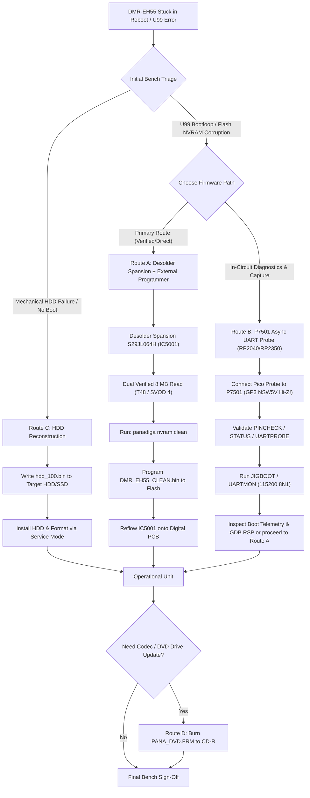

> 🌐 **Language / Idioma:** **English** | [Português (BR)](../pt-BR/INVENTARIO_TECNICO_E_GUIA_DE_OPERACAO.md)
> 🧭 **Portal:** [Docs Index](../INDEX.md) | [Complete Audit](../../COMPLETE_AUDIT.md) | [Audits](../audits/README.md) | [Ghidra Pseudocode](../pseudocode/INDICE_EVIDENCIA_PSEUDOCODIGO_GHIDRA.md) | [Debug Logs](../debug_logs/README.md)

# Technical Inventory, Quality Audit & Bench Operations Manual
## Reverse Engineering & Firmware Recovery Ecosystem — Panasonic DMR-EH55

**Classification:** Systems Engineering Technical Document / QA Audit  
**Target Hardware:** Panasonic DMR-EH55 (DVD / HDD Recorder with Matsushita UniPhier `AM34` / `MN103S` SoC + Syscon `IC7501` on `VEP79138` Main PCB)  
**Audit Status:** Completed & Approved  
**Document Version:** 2.0.0  

---

## 1. Executive Engineering Summary & Quality Assurance (QA) Audit

The recovery and reverse engineering ecosystem for the **Panasonic DMR-EH55** digital recorder unifies native Rust tooling, a Tauri 2 graphical workbench (Desktop and Android), ISO C11 embedded firmware for RP2040/RP2350, and audited schematic dossiers. The primary mission is permanently resolving fatal startup failures — notably the **`U99`** fault code, corrupted NVRAM inside the Spansion `S29JL064H` Flash (**`IC5001`**), and forensic **MEIHFS** disk reconstruction.

### QA Audit Outcomes:
1. **Firmware & Disk Image Repository:** All raw binary artifacts (`panasonic DMR EH-55 Firmware hdd_100.bin`, `PANA_DVD.FRM`, and `UPDATE_EH55.zip`) have been cataloged, entropy-profiled, and anchored with immutable cryptographic SHA-256 digests.
2. **Migration to Native Rust Platform (`panadiga` CLI & Workspace):** Legacy standalone Python analysis utilities (`clean_spansion_nvram.py`, `inspect_hdd_image.py`, `analyze_deep.py`, `inspect_firmware_headers.py`, `search_manuals.py`) were completely superseded by the cross-platform Rust binary (`panadiga nvram clean`, `panadiga hdd inspect`/`extract`/`decode-descriptors`, `panadiga frm`, `panadiga headers`, `panadiga scan`, `panadiga manuals`, `panadiga rag`, `panadiga mcp`). Python remains strictly focused on typed (`mypy --strict`) orchestrators in `scripts/build.py`, `scripts/validate.py`, `scripts/panadiga_ops.py`, and specialized suites under `scripts/bench/` and `scripts/re/`.
3. **Auxiliary Workbench Tooling:** Portable Windows hex-editor launcher [`tools/Abrir_HxD.cmd`](../../tools/Abrir_HxD.cmd) and companion scripts in `tools/` were standardized with portable relative paths alongside Rust-SSOT-generated Ghidra Python scripts (`tools/ghidra/`).
4. **Technical Manuals & Schematics Archive:** All **30 PDFs** (service manuals, operating instructions, and silicon datasheets in `manuals_and_schematics/`) are cataloged in [`manuals_and_schematics/README.md`](../../manuals_and_schematics/README.md) and indexed by the native Rust RAG engine (`crates/panadiga-rag`).
5. **`P7501` Async UART Subsystem (`firmware/pico-p7501/`):** Electrically verified against `VEP79138` schematics and live `COM10` bench measurements. Confirmed that `P7501` (`B6B-ZR-3R4`, `TO JIGU`) runs **Asynchronous `115200 8N1` UART** with discrete control (`SW_UART`, Open-Drain `XRESET`, and strict `Hi-Z Input` without pulls on Pin 5 **`NSW5V` / `GP3`**).

---

## 2. Consolidated Repository Cryptographic Inventory

Below is the verified inventory of immutable binary artifacts, support tools, and living documentation with exact byte sizes and on-disk SHA-256 checksums:

| Directory | Filename | Size (Bytes) | SHA-256 Hash | Technical Function / Description | QA Status |
| :--- | :--- | :---: | :--- | :--- | :---: |
| `docs/en-US/` | `TECHNICAL_INVENTORY_AND_OPERATIONS_MANUAL.md` | Dynamic | Approved | This technical inventory, 15 primary manuals catalog, bench runbooks, and FMEA. | Approved |
| `docs/en-US/` | `FINAL_AUDIT_AND_MODULARIZATION_REPORT.md` | Dynamic | Approved | Modularization audit report, architecture split, and 9 Quality Gates. | Approved |
| `docs/en-US/` | `STORAGE_ARCHITECTURE_MEIHDFS_PARTITIONS.md` | Dynamic | Approved | Disk SSOT: `'SH'` MBR, 28 MB mirror, journal, and 256 `XOR 0xFF` records. | Approved |
| `docs/en-US/` | `DOSSIER_CRYPTOGRAPHY_AND_FIRMWARE_PANA_DVD.md` | Dynamic | Approved | Forensic cryptanalysis dossier: DRM, CPRM, periodic TOC, and ECB leaks. | Approved |
| `docs/en-US/` | `THEORY_AND_PRACTICE_U99_UNBRICK_MATSUSHITA_CRYPTO.md` | Dynamic | Approved | Spansion `IC5001` Flash physics, circular EEMUL, and 64 KB `0xFF` sanitization. | Approved |
| `docs/en-US/` | `BLUEPRINT_BENCH_WIRING_AND_SCHEMATIC.md` | Dynamic | Approved | Detailed electrical bench blueprint (`RP2040/RP2350` $\leftrightarrow$ `P7501` & TSOP-48 `IC5001`). | Approved |
| `docs/en-US/` | `PANASONIC_P7501_UART_RECONSTRUCTION.md` | Dynamic | Approved | Verified `P7501` Async UART (`115200 8N1`) spec, AM34 memory map, and RAM loader. | Approved |
| `docs/en-US/` | `BENCH_PROBE_ASSEMBLY_AND_PHOTOS_GUIDE.md` | Dynamic | Approved | Step-by-step `P7501` probe wiring guide and PCB connector topography. | Approved |
| `docs/en-US/` | `ZERO_ERROR_RAG_ENGINE_AND_PHYSICAL_SAFETY.md` | Dynamic | Approved | Zero-Error 6-layer RAG architecture and hardware safety guardrails (`NSW5V` Hi-Z, `3.3V`). | Approved |
| `docs/en-US/` | `GHIDRA_GDB_INTEGRATION_STRATEGY.md` | Dynamic | Approved | AM34 memory map, SSOT Ghidra scripts, and GDB RSP bridge (`:3333`). | Approved |
| `docs/en-US/` | `LOGGING_AND_TELEMETRY_SUBSYSTEM.md` | Dynamic | Approved | Structured telemetry, semantic log levels, and Rust Core sink pipeline. | Approved |
| `firmware_and_images/` | `panasonic DMR EH-55 Firmware hdd_100.bin` | 104,857,600 | `9d292d5b46f190775f359e30af11d074021fb321f040bf701d0ecf0f2056db00` | Raw forensic dump of first 100 MB of OEM HDD (MEIHFS, LBA 0, and firmware partitions). | Approved |
| `firmware_and_images/` | `PANA_DVD.FRM` | 7,531,744 | `a596d52a8220a9113777c9caf271ac4d518202d0639d6118a4d0bc03b9a6367f` | Official Matsushita optical disc firmware update container. | Approved |
| `firmware_and_images/` | `UPDATE_EH55.zip` | 7,474,766 | `07589e79722409413c5da25c700227a9a04cef39f0178ffa08df3d8d3f7debd4` | Official Matsushita ZIP archive containing `PANA_DVD.FRM`. | Approved |
| `firmware/pico-p7501/` | `p7501_uart.pio` | 1,861 | `2d08a2621bb116bde5b23c06ee9879deddb85229d74ce5a0ffa82bc056412528` | PIO RX `115200 8N1` state machine for RP2040/RP2350 on `GP2` (`P7501` Pin 6 `UARTP2M_T`). | Approved |
| `firmware/pico-p7501/` | `p7501_pico_main.c` | 2,154 | `4c5335e053dd0461ad72082d4db54ed98c5ecbf0d6fd44cd7365f3f9c76fa4e6` | C11 RP2040/RP2350 entrypoint orchestrating `P7501` HAL, USB CDC/BLE CLI, and GDB RSP bridge. | Approved |
| `firmware/pico-p7501/flash/` | `ram_loader_am34_target.c` | 7,071 | `9013ffd3bbd12d1a4a41019a8838f65f90ebe6da3f97d4185df040582c634bf8` | Position-independent native AM34/MN103S C payload for JEDEC Spansion erase. | Approved |
| `firmware/pico-p7501/` | `CMakeLists.txt` | Dynamic | Approved | Modular dual-target CMake build (`RP2040` / `RP2350` + BLE on `pico_w`/`pico2_w`). | Approved |
| `crates/panadiga-core/src/pico/firmware_bins/` | `panasonic_p7501_uart_unified.uf2` | 522,752 | `2d568f7f4c1d3b12c83721eef4a5666a59666ead5fe8ee7359915e45962aa405` | Universal UF2 merging `RP2040` + `RP2350` images (ARM GNU Toolchain `14.2 rel1`). | Approved |
| `crates/panadiga-core/src/pico/firmware_bins/` | `panasonic_p7501_uart_rp2040.uf2` | 268,288 | `0f216f39a5eb863eee4a93b7a957bea872f467cc0c050c7d897a33a73d50e0d2` | Dedicated UF2 image for Raspberry Pi Pico (`RP2040`). | Approved |
| `crates/panadiga-core/src/pico/firmware_bins/` | `panasonic_p7501_uart_rp2350.uf2` | 254,464 | `c0cd3f9bd90401ea2699cfeeb2e8c067608c0db489ec4d724cf550ac74dab99d` | Dedicated UF2 image for Raspberry Pi Pico 2 (`RP2350`). | Approved |
| `tools/` | `Abrir_HxD.cmd` | 815 | `fe7d792ee29ab7380b40dd078b12540111794a1acc06438e76c4e890fbc9c4f3` | Portable launcher for 64-bit HxD Hex Editor on Windows. | Approved |
| `tools/HxD/app/` | `HxD64.exe` | 6,917,120 | `03e101d5d65377d559680848648ffa4c111d32d128b6e89dde8b441de7b6bf8e` | HxD Hex Editor binary (64-bit). | Approved |
| `tools/HxD/app/` | `HxD32.exe` | 4,704,256 | `ae742195737cd0a7038b9e02d7163a334aeaae7ac983e387701d257dda9b950d` | HxD Hex Editor binary (32-bit). | Approved |

---

## 3. Detailed Analysis of Repository Components

### 3.1 Low-Level Firmware & Disk Images (`firmware_and_images/`)

#### 1. MEIHFS Hard Disk Image (`panasonic DMR EH-55 Firmware hdd_100.bin`)
* **Physical Size:** `104,857,600` bytes (`100.00 MB` exact; `204,800` LBA sectors of 512 bytes).
* **Partitioning Architecture:** Proprietary Matsushita **MEIHFS** (*Matsushita Electric Industrial HDD File System*).
* **Sector Analysis (LBA 0):**
  * Does not use a conventional x86 PC MBR partition table or bootloader.
  * Leading bytes: `00 00 00 00 01 00 53 48 62 8C 6E F5 1B 2C 36 66` (DIGA volume signature `SHb.n..,6f`).
* **1 MB Block Density Map (Audited via `panadiga hdd inspect --density`):**
  * **MB 00 (`0x00000000 - 0x000FFFFF`):** 3,826 active bytes (MEIHFS partition table, LBA descriptors, and chassis identifiers).
  * **MB 08 & MB 09 (`0x00800000 - 0x009FFFFF`):** ~1.23 MB structured metadata (directory trees, title lists, and allocation records).
  * **MB 24 (`0x01800000`):** Track alignment markers.
  * **MB 28 (`0x01C00000`):** 3,826 bytes bit-identical to MB 00 (redundant backup mirror of MEIHFS superblock).
  * **MB 32 to 37 (`0x02000000 - 0x025FFFFF`):** ~5.8 MB contiguous dense binary runtime module stored in reserved HDD service space. Begins at `0x02000000` with magic header `51 87 13 8D 5B 0A FB 22`.
  * **MB 64 (`0x04000000`):** 718,321 structured bytes opening with the same magic header `51 87 13 8D 5B 0A FB 22` (secondary runtime / subsystem image).

#### 2. Optical Firmware Update Image (`PANA_DVD.FRM`)
* **Physical Size:** `7,531,744` bytes (`7.18 MB`).
* **Shannon Information Entropy:** `7.99958 bits/byte` (near theoretical maximum `8.00`).
* **Cryptanalysis Summary:** Organized in 48-byte periodic TOC records separated by recurring sync marker `EF DC 1C DA 13 88 1B AB`. Cannot be uncompressed via gzip/zip/tar; protected by symmetric Matsushita hardware-keyed wrapping for optical disc update playback.

#### 3. Distribution ZIP Archive (`UPDATE_EH55.zip`)
* **Physical Size:** `7,474,766` bytes (`7.13 MB`).
* **Contents:** Strictly wraps `PANA_DVD.FRM`.

---

### 3.2 Technical Manuals & Schematics Archive (`manuals_and_schematics/`)

> [!NOTE]
> The 15 primary `DMR-EH55` documents listed below with their original archival filenames were later semantically normalized under `manuals_and_schematics/dmr-eh55/` and expanded to **30 PDFs** spanning neighboring DIGA chassis and silicon datasheets (`datasheets/`). Consult the full live catalog in [`manuals_and_schematics/README.md`](../../manuals_and_schematics/README.md).

| Filename | Pages | Size | Applicable Model | Market Region | Order No. / Publication Code | Technical Nature & Coverage |
| :--- | :---: | :---: | :--- | :--- | :--- | :--- |
| `c2c7f1.pdf` | **177** | 8.25 MB | DMR-EH55EC<br>DMR-EH55EP<br>DMR-EH56EG | Central & Western Europe | **ORDER NO. DSD0603003CE** | **Full Service Manual with Complete Electrical Schematics** (Digital Board `VEP79138`, Timer PCB, Power Supply, Tuner Pack, Front Panel, and SD Card). |
| `9e8a23.pdf` | **97** | 5.74 MB | DMR-EH55EC<br>DMR-EH55EP<br>DMR-EH56EG | Europe (DE, ES, FR) | **ORDER NO. DSD0603003CE** | **Service Manual Vol. 1** (`U`/`F` Error Code Tables, Self-Diagnostic Modes, Mechanical Disassembly Flow, and Power Block Diagrams). |
| `panasonic_dmr-eh55ec.pdf` | **92** | 5.38 MB | DMR-EH55EC<br>DMR-EH55EP<br>DMR-EH56EG | Continental Europe | **ORDER NO. DSD0603003CE** | **Official Matsushita Service Manual** (Service Navigation section, Fuse & Critical Replacement Parts Tables). |
| `panasonic_dmr-eh55ee.pdf` | **91** | 5.14 MB | DMR-EH55EE<br>DMR-EH55GC/GCS<br>DMR-EH55GN | Eastern Europe, Russia, Middle East & Australasia | **ORDER NO. CHM0604016CE** | **Official Service Manual** for EE (Russia/SECAM/PAL), GC (Gulf/Middle East 110–240V), and GN (New Zealand). |
| `panasonic_dmr-eh55p9_eh55pc9.pdf` | **97** | 5.89 MB | DMR-EH55P9<br>DMR-EH55PC9 | North America (US & Canada) | **ORDER NO. CHM0605028CE** | **Official North America Service Manual** (NTSC systems, B24 fuse protection circuit, lithium battery swap, and EIA analog channel tuning). |
| `Panasonic_DIGA_DMR-EH55_DVD_Recorder_User_Manual.pdf` | **84** | 4.99 MB | DMR-EH55 | North America | **Pub. RQT8365** | **User Operating Instructions** (English/Spanish A/V hookup and HDD recording guide). |
| `a5e678.pdf` | **89** | 4.83 MB | DMR-EH55S | North America | **Pub. RQT8365** | Operating Instructions (ManualsLib scan for Silver finish). |
| `panasonic_dmr-eh55,dmr-eh56_dvd_user_manual.pdf` | **84** | 4.96 MB | DMR-EH55<br>DMR-EH56 | Continental Europe & Nordics | **Pub. RQT8415** | **Official Panasonic Europe Operating Instructions** (Suomi, Norsk, Svenska, Dansk; title editing & Guide Plus+). |
| `6097ea.pdf` | **89** | 4.90 MB | DMR-EH55<br>DMR-EH56 | Europe | **Pub. RQT8415** | Operating Manual (ManualsLib edition with interactive recording & disc formatting index). |
| `cb6cee.pdf` | **89** | 5.04 MB | DMR-EH55<br>DMR-EH56 | Europe | **Pub. RQT8415** | High-resolution mirror copy of European user manual (Disc-Player archive). |
| `2Panasonic_DIGA_DMR-EH55_DVD_Recorder_User_Manual.pdf` | **76** | 4.60 MB | DMR-EH55 | Australia & New Zealand | **Pub. RQT8361** | **Oceania Operating Manual** (PAL B/G settings, Class 1 laser safety rules). |
| `philips-dmr-eh55.pdf` | **76** | 4.14 MB | DMR-EH55 | Australia & New Zealand | **Pub. RQT8361** | Mirror of Australian manual RQT8361 ("philips" prefix came from an upstream bkmanuals indexing error). |
| `Panasonic dmr-eh55 installation.pdf` | **8** | 0.19 MB | DMR-EH55 (K, S, V, VK suffixes) | Global | Panasonic Technical Bulletin | **Official Firmware Installation Guide** (CD-R burning procedure and front-panel status messages). |
| `22767039.pdf` | **6** | 0.35 MB | DMR-EH55 / DIGA Series | Global | Panasonic Product Guide | **HDMI & HDAVI Control Guide** (VIERA Link interoperability over HDMI). |
| `dmreh55.pdf` | **2** | 2.64 MB | DMR-EH55 | Global | Quick Start Guide | **Quick Bench Setup Guide** ("Let's begin! Step 1 Connection, Step 2 Setting, Step 3 Downloading"). |

---

### 3.3 Native Rust Platform (`panadiga`) & Python Orchestration (`scripts/`)

1. **`panadiga nvram clean <INPUT_DUMP> [OUTPUT_CLEAN]`** (`crates/panadiga-core`):
   * **Purpose:** Offline surgical repair of Spansion `S29JL064H` Flash (8 MB / 64 Mbit, TSOP-48, **`IC5001`**).
   * **Mechanism:** Cryptographically validates via SHA-256 that the first 8,323,072 bytes (`0x80000000..0x807EFFFF`, IPL/Kernel) remain 100% immutable, backs up the corrupted final 64 KB (`0x007F0000..0x007FFFFF`, micro-sectors `SA134..SA141`), and fills `EEMUL` with clean `0xFF` without mutating the source file in place.
2. **`panadiga hdd inspect` / `extract` / `decode-descriptors`** (`crates/panadiga-core`):
   * **Purpose:** Zero-copy inspection of `panasonic DMR EH-55 Firmware hdd_100.bin`, `'SH'` MBR check, 28 MB mirror (`LBA 57344`), 8 MB journal (`LBA 16384`), 1's-complement (`XOR 0xFF`) directory decoding, and `SHA256SUMS`-manifested extraction.
3. **`panadiga frm` / `panadiga headers` / `panadiga scan`**:
   * **Purpose:** Cryptographic container inspection of `PANA_DVD.FRM` and header/string extraction across binary images.
4. **`panadiga manuals` / `panadiga rag` / `panadiga mcp`**:
   * **Purpose:** Native indexing across all **30 PDFs** (service manuals, operating guides, and silicon datasheets) plus deterministic safety-guarded RAG search (`crates/panadiga-rag`, `crates/panadiga-mcp`).
5. **Python Orchestrators (`scripts/`):** `scripts/build.py` (Desktop, Android APK, Pico UF2), `scripts/validate.py` (9 Quality Gates), `scripts/panadiga_ops.py`, and modular bench/RE packages under `scripts/bench/` and `scripts/re/`.

---

### 3.4 Pico Firmware & `P7501` Async UART Interface (`firmware/pico-p7501/`)

The 6-pin **`P7501` (`B6B-ZR-3R4`, `"TO JIGU"`)** connector on board `VEP79138` operates over **Asynchronous `115200 8N1` UART** coupled to the discrete boot/reset circuit (`Q7510`, `Q7514`, `QR7503`, `IC1506`, `D7510`) wired to the **Matsushita `AM34` / `MN103S`** SoC and Syscon **`IC7501`**:

```text
           Canonical Connector P7501 [B6B-ZR-3R4] — TO JIGU (Panasonic DMR-EH55)
                      ┌─────────────────────────────────────────────┐
                Pin 1 │ ● SW_UART   -> GP26/ADC0 (~3.25V Hi-Z / LOW=XFWE) │
                Pin 2 │ ● XRESET    -> GP5 Open-Drain (~20µs Hi-Z rise)   │
                Pin 3 │ ● UARTM2P_T -> GP4 TX 115200 (R7570 10kΩ onboard) │
                Pin 4 │ ● GND       -> Common GND (0.0Ω to Chassis!)      │
                Pin 5 │ ● NSW5V     -> GP3 ALWAYS Hi-Z Input (~5.15V up!) │
                Pin 6 │ ● UARTP2M_T -> GP2 RX 115200 (Square PCB Pad!)    │
                      └─────────────────────────────────────────────┘
```

* **`p7501_uart.pio`:** PIO RX `115200 8N1` state machine for RP2040/RP2350 on `GP2` (`UARTP2M_T` / `MAX TXD`), using 8x bit oversampling and Stop-bit validation without touching `GP3` (`NSW5V`).
* **`p7501_pico_main.c` & `hal/p7501_hw.c`:** Initializes `P7501` with `NSW5V` (`GP3`) strictly as `Hi-Z Input` without pulls, `XRESET` (`GP5`) Open-Drain, and executes capture/diagnostic commands (`BOOTCAP`, `JIGBOOT`, `UARTMON`, `UARTSEND`, `PINCHECK`, `FMUSCAN`, `ISOLATE`, `ENGAGE`, GDB RSP bridge).
* **`flash/ram_loader_am34_target.c`:** Position-independent native AM34/MN103S C payload executing the 6-cycle JEDEC erase sequence across uncached physical address space (`0x807F0000..0x807FFFFF`).

---

## 4. Standard Bench Operating Procedures (Recovery Workflow)

Recovery of a Panasonic DMR-EH55 suffering from error `U99`, boot failure, or HDD replacement follows this engineering decision tree:



---

### Phase 1: Diagnosis & `U99` Symptom Triage
1. Connect the recorder to a display using Composite or Component output (avoid HDMI during initial low-level diagnostics).
2. Watch the front-panel controller (`IC7001`) VFD:
   * If it displays **`HELLO`**, pauses 15–45 seconds, and locks permanently on **`U99`** with HDD and DVD mechanisms idle, classic corrupted `EEMUL` calibration data inside Spansion Flash (`IC5001`) is indicated.
   * If the panel flickers or drops out with relay clicks, first check the `+5V`, `+12V`, `-12V`, and `+3.3V` SMPS rails against the block diagrams in `c2c7f1.pdf`.

---

### Phase 2: Operational Route A — Desoldering & External Programming (Master Procedure)

This route is **100% certified**, independent of serial monitor state, and guarantees deterministic NOR Flash restoration.

#### Step 1: Mechanical Disassembly & Digital PCB Removal
1. Unplug AC power and wait 5 minutes for primary SMPS bulk capacitors to bleed completely.
2. Remove the metal top lid, front bezel, and disconnect the DVD-RAM FFC and IDE HDD ribbon.
3. Unscrew and lift out the green Digital/Main PCB (`VEP79138`).
4. Locate **`IC5001`** (Spansion `S29JL064H70TFI00` Flash, 48-pin TSOP package).

#### Step 2: Hot-Air Desoldering
1. Shield adjacent SDRAM chips and surrounding SMD passives with polyimide Kapton tape.
2. Apply no-clean tacky solder flux (e.g., Amtech NC-559-ASM) along both 24-pin sides.
3. Set the hot-air station to moderate airflow (level 3–4) and **$340^\circ\text{C}$–$350^\circ\text{C}$** (with `Sn63/Pb37` alloy relief) or **$365^\circ\text{C}$** (OEM lead-free alloy).
4. Heat evenly in circular sweeps ~1.5 cm above the leads for 25–35 seconds.
5. Once all solder fillets turn uniformly molten, lift cleanly straight upward with fine ESD tweezers — **never force cold pins**, or you risk tearing copper pads from the multilayer PCB.
6. Level PCB pads and IC pins with fluxed copper desoldering braid and clean with 99.8% IPA.

#### Step 3: Flash Readout & Firmware Sanitization
1. Seat `S29JL064H` in a TSOP-48 v3 ZIF adapter for your universal programmer (XGecu T48, TL866II-Plus, or SVOD 4).
2. Read the entire 8 MB array twice, saving `DMR_EH55_ORIGINAL.bin` and `DMR_EH55_ORIGINAL_TEST.bin`, and compare their SHA-256 digests (`panadiga verify-artifact`). Both dumps must be **100% identical** before proceeding.
3. Clean the final 64 KB via Rust CLI:
   ```bash
   panadiga nvram clean DMR_EH55_ORIGINAL.bin DMR_EH55_CLEAN.bin
   ```
4. The tool cryptographically verifies that bytes `0x000000..0x7EFFFF` (8,323,072 bytes) are bit-identical and fills `0x7F0000..0x7FFFFF` with clean `0xFF`.

#### Step 4: Programming & Reflow
1. Load `DMR_EH55_CLEAN.bin` into the programmer targeting Spansion `S29JL064H`.
2. Run **Erase, Program and Verify**.
3. Position `IC5001` onto `VEP79138` matching the Pin 1 bevel/dot with PCB silkscreen.
4. Drag-solder with knife/hoof tip and generous flux, then inspect every lead under stereo microscope to eliminate solder bridges.
5. Reassemble PCB, cables, and power — the processor boots cleanly and regenerates clean factory EEMUL sectors.

---

### Phase 3: Operational Route B — In-Circuit Diagnostics & Capture via `P7501` Async UART (`RP2040` / `RP2350`)

This workflow captures live `AM34` / `MN103S` bootloader telemetry, optical/drive errors (`<00>DDR CHECK: OK`, `CD diag boot mode`), `Q7510`/`Q7514` behavior, and GDB RSP without removing the Flash IC:

1. **RP2040 / RP2350 Compatibility:** Compatible with any **Raspberry Pi Pico (RP2040)** or **Pico 2 (RP2350)** (including `Pico W` / `Pico 2 W` with BLE enabled).
2. **Canonical Factory Pinout of `P7501` (`B6B-ZR-3R4` `"TO JIGU"`):**
   * **Pin 1 (`SW_UART`):** Connect to **`GP26 / ADC0`** (Pico Pin 31). Reads `~3.25V` in Hi-Z (`~2.69V` under pull-down); `LOW` latches serial boot (`XFWE`) and cuts off `Q7514`.
   * **Pin 2 (`XRESET`):** Connect to **`GP5`** (Pico Pin 7). Strict **Open-Drain** (`0V` active or `Hi-Z`; never push-pull `+3.3V`).
   * **Pin 3 (`UARTM2P_T` / `MAX RXD`):** Connect to **`GP4`** (Pico Pin 6, TX UART `115200 8N1`). Already pulled up onboard via `R7570 10 kΩ` — **do NOT attach external `4.7 kΩ` pull-up**.
   * **Pin 4 (`GND`):** Connect to **`GND`** (Pico Pin 38). Confirm **$0.0\,\Omega$** continuity to metal chassis before powering!
   * **Pin 5 (`NSW5V` / `X_SW_5R2V`):** Connect to **`GP3`** (Pico Pin 5). Fed from `IC1506` (`~5.15V` upstream via `D7510`, `~3.29V` at rest). **KEEP PERMANENTLY `Hi-Z Input` with pulls disabled — NEVER drive push-pull!**
   * **Pin 6 (`UARTP2M_T` / `MAX TXD`):** Connect to **`GP2`** (Pico Pin 4, RX UART `115200 8N1` via PIO0). Identified visually by the **square solder pad** nearest `FP50003`.
3. **Additional Check (`WP#/ACC` Pin 14 on `IC5001`):** Confirm Pin 14 reads $+3.3\text{V}$ before any in-circuit Flash erase (if $0\text{V}$, `SA140`/`SA141` are hardware write-protected).
4. **Pico Serial Console Sequence (`PANADIGA> `, `115200 8N1`):**
   * **Step A (`STATUS` / `PINCHECK`):** Confirms safe `SW_UART` levels (`~3.25V Hi-Z | ~2.69V PD | ~3.27V PU`) and enforces `NSW5V` (`GP3`) isolation.
   * **Step B (`JIGBOOT` / `BOOTCAP` / `UARTMON`):** Captures `115200 8N1` stream on `GP2` (`<00>DDR CHECK: OK`, `CD diag boot mode`).
   * **Step C (`ENGAGE` $\rightarrow$ `UARTSEND`):** Transmits strings/bytes over `GP4` while holding `SW_UART` in `Hi-Z` so `Q7514` conducts.
   * **Step D (`UARTPROBE 8` $\rightarrow$ `ISOLATE`):** Releases `GP26` and puts probe pins back into safe high-impedance (`ISOLATE`).

---

### Phase 4: Operational Route C — Hard Disk Drive Replacement & Dynamic Capacity Unlock (`250 GB` to `2 TB+`)

When replacing a failing factory HDD or upgrading to an IDE/SATA SSD via a compatible bridge such as Marvell `88SA8052` (`StarTech IDE2SAT2`; avoid generic JMicron `JM20330` bridges due to Matsushita DMA locks):

> [!WARNING]
> **Mandatory Hardware Rule (`DMR-EH55` HDD Jumper = `MASTER`, NEVER `CS` and NEVER `Slave`):**
> `DMR-EH55` schematics (`vol2_schematics.pdf` pp. 46, 52, 113, 125–126) and firmware disassembly (`eh55_frm_PROG061_BOOT.bin` `FUN_50414908`, `EH55_MAIN_3410PQ.bin` `FUN_574d1de8`) hardcode `acStack_70[4] = { 2, 0, 1, 0 }`: the DVD-RAM ODD sits on **Primary `ch=0, dev=0`** (`0x89000500`) via internal Front-End (`FEP`), while the HDD connects over a dedicated 40-pin `Extension FFC` as **Secondary `MASTER` (`ch=1, dev=0`, `0x89000D00`)** — `DAT_505733d4` single-cable Slave remapping exists only in `DMR-EH58`, not `DMR-EH55`.

1. **Always Jumper `StarTech IDE2SAT2` / HDD explicitly as `MASTER` (`Device 0` on Secondary IDE `ch = 1`):** Setting **`Slave`** maps to ignored slot `acStack_70[3] == 0`. Leaving **`CS` (`Cable Select`)** risks indeterminate `DEV` selection, `0x8000040d` collisions, or `MultiWord DMA MODE2` hangs (`FUN_5041f61b` / `FUN_5041f782`), whose power-cycling can corrupt NOR **BGO sectors `0x84200000..0x843FFFFF`** (`BGO driver init failed[1].` / `U99`).
2. **Unlock Matsushita Internal `"src/hdd_cmd.c"` (`200 GB` Clamp -> Dynamic LBA48) Before Writing:**
   ```bash
   # 1. Inspect clamp opcode (0xC6 bls +12 vs 0xCA bra +12)
   panadiga hdd inspect-capacity -i firmware_and_images/extracted_partitions/hdd_partition_firmware_0x02000000.bin

   # 2. Unlock dynamic LBA48 capacity (-o optional -> *_PATCHED_DYNAMIC.bin) or apply 250 GB preset (0x07466528)
   panadiga hdd patch-capacity -i "firmware_and_images/panasonic DMR EH-55 Firmware hdd_100.bin" --mode dynamic
   ```
   Alternatively use the Desktop **`Capacity Unlock (250GB / 2TB)`** (`HddCapacityPatcherCard`) and **`Physical Write & mkfs`** (`HddWriterCard`) panels.
3. **Write First 100 MB with System-Drive Lockout Protection & Format on Recorder:**
   ```bash
   panadiga hdd list-drives
   panadiga hdd write-image --target \\.\PhysicalDrive1 --image "firmware_and_images/panasonic DMR EH-55 Firmware hdd_100_PATCHED_DYNAMIC.bin" --confirm CONFIRM-PhysicalDrive1
   ```
   Or on Linux (`sudo dd if="panasonic DMR EH-55 Firmware hdd_100_PATCHED_DYNAMIC.bin" of=/dev/sdX bs=1M status=progress conv=fsync` — strictly verify `/dev/sdX`!). Install with jumper **`MASTER`**, boot into Panasonic Service Mode (hold `[STOP]` on front panel + `[0]` + `[0]` on remote for 5 s), and select **HDD Initialize / Format**.

---

### Phase 5: Operational Route D — Optical Drive Firmware Update

If the unit boots normally but needs DVD-R/+R/RAM media tables or codec updates:

1. Extract `PANA_DVD.FRM` from `firmware_and_images/UPDATE_EH55.zip`.
2. Burn `PANA_DVD.FRM` to the root of a high-quality **CD-R** (avoid CD-RW) using **ISO9660 Level 1 / Disc-At-Once (no multisession)** at the lowest speed (**4x** or **8x**).
3. Power on the DMR-EH55, insert the disc, and observe the VFD progression:
   * **`BYE`** $\rightarrow$ Shuts down and reboots into optical bootloader.
   * **`L1 P01`** through **`L1 P05`** $\rightarrow$ Hardware key validation, decryption, erase, and programming phases.
   * **`COMPLETE`** $\rightarrow$ Update succeeded; tray ejects automatically. Remove disc and reboot.

---

## 5. Laboratory Equipment, Tools & Consumables Matrix

| Category | Tool / Supply | Minimum Recommended Specification | Role in Project |
| :--- | :--- | :--- | :--- |
| **Rework Station** | 2-in-1 Hot Air & Iron | $\ge 650\,\text{W}$, digital PID ($100^\circ\text{C}$–$450^\circ\text{C}$), 10 mm flat/round nozzle | Safe desoldering/reflow of TSOP-48 Spansion Flash (`IC5001`) |
| **Soldering Iron** | T12 or JBC station | 2 mm knife/bevel tip + 0.2 mm conical tip | Drag soldering and JST `B6B-ZR-3R4` harness fabrication |
| **Flash Programmer** | Universal Programmer | XGecu T48, TL866II-Plus, SVOD 4, or RT809H with 16-bit TSOP-48 support | Reading, verifying, and programming `S29JL064H` (`IC5001`) |
| **Socket Adapter** | TSOP-48 ZIF v3 | Gold-plated ZIF clamshell for 48-pin 0.5 mm pitch packages | Solderless chip interface with universal programmer |
| **Bench Probe MCU** | Raspberry Pi Pico / Pico 2 | `RP2040` or `RP2350` (`Pico 2` / `W`) with PIO, ADC0, USB CDC | `P7501` Async UART (`115200 8N1`), boot capture, and GDB RSP |
| **Instrumentation** | True-RMS Digital Multimeter | 4½-digit precision with fast audible continuity and mV range | Verifying `GND` (Pin 4 `P7501`), `NSW5V` (Pin 5), `XRESET` (Pin 2), `WP#` (`IC5001`) |
| **Instrumentation** | USB Logic Analyzer | 8 channels, $\ge 24\,\text{MHz}$ PulseView / Sigrok compatible | Decoding `115200 8N1` on `UARTP2M_T`/`UARTM2P_T` and timing `SW_UART`/`XRESET` |
| **Consumables** | Tacky Solder Flux | Amtech NC-559-ASM-UV or high-viscosity no-clean equivalent | Deoxidation and clean surface tension during reflow |
| **Consumables** | Desoldering Braid | 1.5–2.0 mm pure braided copper wick | Leveling PCB pads on `VEP79138` |
| **Consumables** | Kapton Polyimide Tape | Heat-resistant up to $300^\circ\text{C}$ | Shielding SDRAMs and passives during hot-air rework |
| **Consumables** | Cleaning Solvent | 99.8% pure electronics-grade IPA + ESD brush | Post-rework flux residue removal |
| **Harness & Wiring** | JST ZR 1.5 mm (`ZHR-6`) | 6-pin 1.5 mm female harness (`B6B-ZR-3R4` mate) or AWG 30 Kynar | Short-free connection of `P7501` to Pico |
| **Series Resistors (Opt.)** | Metal Film Resistors | $100\,\Omega$ ($1/8\,\text{W}$, 1%) on `GP2`/`GP4`/`GP5` & $1.0\text{ k}\Omega$ on `GP26` (**no external pull-up!**) | Transient damping (`R7570`/`R7572` `10 kΩ` already onboard) |

---

## 6. Risk Matrix, Severity & Technical Mitigations (FMEA)

| ID | Potential Failure Mode | System Impact | Severity (1-5) | Probability (1-5) | Mandatory Technical Mitigation |
| :--- | :--- | :--- | :---: | :---: | :--- |
| **RSK-01** | Lifted copper pads on TSOP-48 footprint during desoldering | Severed 16-bit data/address traces; damaged `VEP79138` board | **5 (Critical)** | 2 (Low w/ SOP) | Never apply upward tweezer force until all 48 pins are fully molten; preheat smoothly with ample flux |
| **RSK-02** | Thermal shock to adjacent SDRAM chips | System RAM failure; corrupted video buffers / black screen | **4 (High)** | 3 (Medium) | Cover neighboring ICs with double-layered Kapton tape; keep hot-air dwell under 35 s |
| **RSK-03** | Driving push-pull $+3.3\,\text{V}$ onto `XRESET` (`GP5`) | Overload/damage to reset supervisor circuit (`QR7503` / `XRESET`) | **5 (Critical)** | 2 (Low) | `GP5` MUST operate strictly **Open-Drain** (drive `0V` LOW vs `Hi-Z Input`); never push-pull HIGH |
| **RSK-04** | Driving or enabling pulls on `NSW5V` (`P7501` Pin 5 / `GP3`), fed from $~5.15\,\text{V}$ (`IC1506` via `D7510`) | Overvoltage/overcurrent stress on `GP3` or Panasonic transistors | **5 (Critical)** | 2 (Low) | Keep `GP3` **PERMANENTLY `Hi-Z Input` with pulls disabled**; never power Pico via `P7501` |
| **RSK-05** | Hardware write-lock active on Spansion Pin 14 (`WP#/ACC`, `IC5001`) | Silent JEDEC Sector Erase failure; `U99` corruption persists | **3 (Medium)** | 3 (Medium) | Probe Pin 14 first with DMM; if $0\,\text{V}$, pull up via $1\text{ k}\Omega$ to $3.3\,\text{V}$ during erase |
| **RSK-06** | Accidental corruption of bootloader/kernel area (`0x000000..0x7EFFFF`) | Permanent unit bricking due to lost AM34 IPL/OS | **5 (Critical)** | 1 (Minimal) | `panadiga nvram clean` enforces mandatory SHA-256 verification ensuring first 8,323,072 bytes stay untouched |
| **RSK-07** | Reverse chip orientation (*Pin 1 backwards*) during Flash reflow | Dead short on $V_{\text{CC}}$ / $V_{\text{SS}}$, destroying Flash and regulators | **5 (Critical)** | 2 (Low) | Double-check Pin 1 chamfer/dot against PCB silkscreen before reflowing |
| **RSK-08** | Incompatible IDE-SATA bridge chipset during SSD/HDD upgrade | System stalls on `HDD CHECK` or ATA/ATAPI timeouts | **3 (Medium)** | 3 (Medium) | Use verified bridges (e.g., Marvell `88SA8052`), avoiding legacy-DMA-broken adapters |

---

## 7. Final Approval & QA Sign-Off

This technical inventory and operations manual consolidates the complete reverse engineering foundation of the Panasonic DMR-EH55 ecosystem, anchored on verified schematic proof and empirical bench telemetry across the `P7501` interface and Spansion `IC5001` Flash memory.
