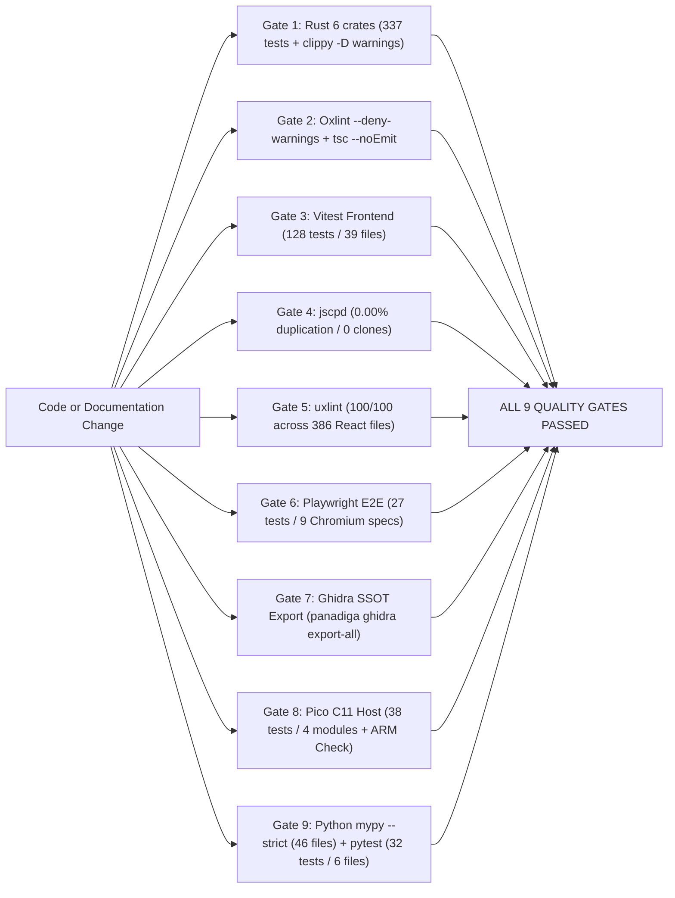

> 🌐 **Language / Idioma:** **English** | [Português (BR)](../pt-BR/ARQUITETURA_DE_TESTES_E_CONFORMIDADE.md)
> 🧭 **Portal:** [Docs Index](../INDEX.md) | [Complete Audit](../../COMPLETE_AUDIT.md) | [Audits](../audits/README.md) | [Ghidra Pseudocode](../pseudocode/INDICE_EVIDENCIA_PSEUDOCODIGO_GHIDRA.md) | [Debug Logs](../debug_logs/README.md)

# Testing Architecture & Compliance Matrix: Panadiga Ecosystem

## Multi-Layer Verification: Pure FP Domain, Strict MVVM, Introspective GDB & SSOT

> **Version:** 2.2.0 | **Current Status Reference:** Live 9 Quality Gates (`337` Rust Workspace Tests across `6` crates, `128` Vitest Tests across `39` files, `38` C11 Host Tests across `4` modules + ARM check, `27` Playwright E2E across `9` specs, `32` Pytest across `6` files + `46` `mypy --strict`, `0%` `jscpd` Clones, `100/100` `uxlint` / `0` issues across `386` files)  
> **Authors:** Panadiga Systems Architecture & Reverse Engineering Team

---

## 1. Overview & Testing Philosophy

The architectural evolution of **Panadiga** required a fundamental restructuring of its testing strategy. The previous approach, based on ad-hoc tests tightly coupled to physical filesystem paths, was replaced by a **Multi-Layer Testing Pyramid** paired with a **Parallel 9 Quality Gates Pipeline**:

```text
                          PANADIGA TESTING PYRAMID
                                       ▲
                                      / \
                                     /   \
                                    / E2E \   (27 Playwright Chromium tests / 9 specs + CI/CD)
                                   /───────\
                                  /  MVVM   \  (128 Vitest / 39 files + ExpressView + Logger)
                                 /───────────\
                                /  GDB & HAL  \ (38 C11 Host Tests across 4 modules + ARM RP2040/RP2350 Check)
                               /───────────────\
                              /  FP Pure Domain \ (337 Rust tests across 6 crates: profiles/core/cli/desktop/mcp/rag)
                             /───────────────────\
```



---

## 2. Layer 1: Pure FP Domain (Immutable Slice Tests on `&[u8]`)

### Architectural Goal

Decouple low-level forensic and cryptanalysis logic from disk I/O. All math, parsing, and decoders must operate as pure functions over immutable byte slices (`&[u8]`).

### Implemented Test Suite

| Test File                             | Tested Function / Module                | Compliance Assurance                                                                                                                             |
| :------------------------------------ | :-------------------------------------- | :----------------------------------------------------------------------------------------------------------------------------------------------- |
| `crates/panadiga-core/src/nvram/tests.rs` | `clean_nvram_slice(&[u8])`            | Tests surgical microsector sanitization (SA134..SA141) directly in RAM, verifying bootloader immutability and zeroing of corrupt U99 parameters. |
| `crates/panadiga-core/src/hdd/inspect/tests.rs` | `inspect_hdd_slice_pure(&[u8])`       | Validates proprietary Panasonic MBR, mirror table at LBA 57344, and partition descriptors over memory buffers without filesystem access.         |
| `crates/panadiga-core/tests/entropy_math_tests.rs` | `calculate_entropy(&[u8])`            | Validates Shannon entropy calculation (0.0 for pure patterns, 1.0 for alternating binary, 8.0 for uniform distribution).                         |
| `crates/panadiga-core/tests/crypto_codebook_tests.rs` | `test_real_frm_dump_toc_and_codebook` | Dissects 48-byte periodic TOC entries and known plaintext-ciphertext dictionary from `PANA_DVD.FRM`.                                           |

---

## 3. Layer 2: Introspective GDB & Hardware Protocol (`P7501` Async UART / RSP)

### Architectural Goal

Guarantee absolute protocol fidelity in the serial-to-TCP GDB bridge, prevent packet corruption, and protect the host RP2040/RP2350 microcontroller.

### Implemented Test Suite

| Test File                                            | Tested Function / Module                | Compliance Assurance                                                                                                                                    |
| :--------------------------------------------------- | :-------------------------------------- | :------------------------------------------------------------------------------------------------------------------------------------------------------ |
| `crates/panadiga-core/tests/debugger_gdb_tests.rs`   | `test_gdb_rsp_checksum_calculation`   | Formal validation of 2-digit hex checksum calculation (`sum % 256`) for RSP commands (`qSupported`, `g`, `?`, `c`, `s`, `OK`).            |
| `apps/desktop/src-tauri/src/pico/gdb_bridge.rs`      | `test_verify_and_classify_rsp_packet` | Tests formal RSP packet classifier: `$` prefix, `#` delimiter, checksum comparison, and command type tagging.                                       |
| `apps/desktop/src-tauri/src/pico/gdb_bridge.rs`      | `test_telemetry_ring_capacity`        | Validates introspective circular buffer (`RingBuffer<GdbPacketTelemetryEvent>`): fixed capacity, FIFO eviction without leaks, chronological ordering. |
| `firmware/pico-p7501/tests/` (`4` modules, `38` suites/functions) | Host C11 Firmware (`-Wall -Wextra -Werror` / `/W4 /WX`) | Protocol, `DIAGWATCH`/`PANARSP`/`DRVPANA`/`SDSNIFF`/`PIOLOGIC`, `VAULT VERIFY`, `IR VERIFY`, `DUMPNOR ff_blocks`, nibble-LUT CRC32 & `E05` IPL write-rejection host tests (`test_gdb_rsp_host.c`: 13, `test_pana_logic.c`: 10, `test_pana_diag_drv.c`: 9, `test_uart_codec.c`: 6). |

---

## 4. Layer 3: Strict MVVM, Subcomponents & Dedicated Logger

### Architectural Goal

Eliminate scattered booleans in favor of closed finite state machines (ADTs / Discriminated Unions) in React, isolate UI subcomponents according to SRP, and centralize structured logging.

### Implemented Test Suite (Vitest)

| Test File                        | Component / ViewModel                                | Compliance Assurance                                                                                                                                                    |
| :------------------------------- | :--------------------------------------------------- | :---------------------------------------------------------------------------------------------------------------------------------------------------------------------- |
| `useInCircuitErase.test.ts`    | `useInCircuitErase`                                | Verifies discrete states (`idle`, `confirming`, `erasing`, `success`, `error`) and callback triggering during surgical unbrick.                               |
| `useSerialConsole.test.ts`     | `useSerialConsole`                                 | Validates interactive terminal: command history ring buffer, bounded log array, and command dispatch.                                                                   |
| `useGdbBridge.test.ts`         | `useGdbBridge`                                     | Tests bridge state transitions (`stopped`, `starting`, `running`, `stopping`, `error`), async telemetry polling, and log emission.                            |
| `GdbServerComponents.test.tsx` | `GdbServerControls` & `GdbExternalToolLaunchers` | Tests decomposed GDB card: status badge rendering, TCP start/stop invocation, and tool launcher button handlers (GDB Multiarch, Ghidra, HxD, PowerShell). |
| `logger.test.ts`               | `PanadigaLogger`                                   | Tests frontend logging subsystem: severity filtering (`minLevel`), multi-sink dispatch, subscription disposal, and error resilience.                                  |
| `translations.test.ts`         | `i18n` Engine                                      | Validates complete parity between `pt-BR` and `en-US` dictionaries and canonical key resolution.                                                                    |

---

## 5. Layer 4: CLI Decomposition & SSOT Constants

### Architectural Goal

Guarantee strong CLI argument parsing via Clap, deterministic handler routing, and zero magic numbers or file paths hardcoded outside SSOT (`crates/panadiga-constants/src/constants/`).

### Implemented Test Suite

| Test File                   | Tested Module                                     | Compliance Assurance                                                                                                                                                                            |
| :-------------------------- | :------------------------------------------------ | :---------------------------------------------------------------------------------------------------------------------------------------------------------------------------------------------- |
| `crates/panadiga-core/tests/firmware_scan_tests.rs` | `test_cli_args_parsing_matrix` + scan tests | Validates parsing and deserialization of CLI subcommands (`memory-map`, `gdb-config`, `pico list`, `nvram clean`, etc.), aliases (`tui`, `verify`), and rejection of unknown flags. |
| `crates/panadiga-core/tests/system_constants_tests.rs` | `test_constants_memory_map_and_candidate_paths` | Validates all 8 official AM34/UniPhier memory regions, ASCII table formatting, canonical JSON schema export, and presence of universal candidate paths.                                         |
| `crates/panadiga-core/tests/pico_bench_tests.rs` | `test_all_host_controller_platforms_matrix` | Validates USB VID/PID hardware identification matrix for Raspberry Pi Pico, Pico W, Pico 2 (ARM/RISC-V), and clones.                                                                            |

---

## 6. Layer 5: End-to-End (E2E) & Multi-Platform CI/CD

### Playwright Coverage (Chromium)

27 automated browser tests across 9 E2E specs (`apps/desktop/e2e/`) verify end-to-end user workflows:

1. `calibration-and-tbc.spec.ts`: Calibration workflows (`PAL-M`/`DAVIS`/`TBC`) and bench UI pipelines.
2. `express-mode.spec.ts`: Express Rescue Mode (FAT16B SD card, `PANAMON1` `U99`, NOR `8 MiB`, JIT `PicoConnectionSafetySheet`, Vault CoW `raw`/`frm`, ISO 9660 `1x`, and `Mn103Vm` gate).
3. `frm-packager.spec.ts`: Cryptographic `.FRM` inspection, Feistel/TOC decoding, and Unbrick Center container workflows.
4. `hdd-safe-flash.spec.ts`: System-drive lockout guard, `HddCapacityPatcherCard`, and CoW MEIHFS disk flashing flows.
5. `ir-commander.spec.ts`: Kaseikyo IR commander, `SYS_SERV` macros, offline catalog, and USB-OTG/Android dispatch.
6. `navigation.spec.ts`: Default dashboard rendering, seamless cross-view navigation (`NVRAM`, `MEIHFS`, `Pico`, `Manuals`, `Interactive Docs`), and workbench state continuity.
7. `nvram.spec.ts`: Spansion NOR Flash `S29JL064H` specifications, 8 microsector breakdown (`SA134..SA141`), and surgical NVRAM controls.
8. `pico-bench.spec.ts`: Host controller telemetry, `P7501` (`115200 8N1` Async UART + `NSW5V` Hi-Z) pinout table, boot mode switching, and interactive serial terminal.
9. `pico-bgo-davis.spec.ts`: Live BGO FTL (`SA26..SA70`) and `DAVIS CH0/CH1` interactive diagnostic panels in Pico Bench.

### Continuous Integration Matrix (GitHub Actions & `scripts/validate.py`)

All 9 Quality Gates execute on push or locally via `python scripts/validate.py`:

- **Android APK Build (Tauri 2.0 / ARM64)**: Native Android compilation with `cargo-ndk`.
- **Rust Workspace (`6` crates)**: `cargo fmt --all -- --check`, `cargo clippy --workspace --all-targets --no-deps -- -D warnings`, and `cargo test --workspace` (**337 tests**, including `panadiga-profiles` across **89 models** and **12 JSON Schemas** plus thread-local isolated `logger.rs` tests).
- **Ghidra Generator & Python Tools**: `panadiga ghidra export-all` (`.py` scripts + `tools/ghidra/java/` suite), `py_compile`, `mypy --strict scripts` (**46 files**), and `pytest scripts/tests` (**32 tests across 6 files**, including `test_docs_parity.py` enforcing 1:1 parity of all **39** pairs in `translation_pairs.json` ↔ `docs/INDEX.md`, **22** captures in `docs/debug_logs/`, stale-hash guard, and internal markdown link checks).
- **Desktop UI**: `oxlint --deny-warnings && tsc --noEmit`, Vitest (**128 tests across 39 files** in `apps/desktop/src/**/*.test.*`), `uxlint` (`100/100` with `--fail-on info`, `0` issues across **`386` files**), and Playwright E2E (**27 tests across 9 specs**).
- **Code Quality & Duplication**: `jscpd` clone detector (**0% threshold / 0 clones**).
- **Pico Firmware Dual Target**: Host C11 tests (`4` modules, **38 test suites/functions**, `-Wall -Wextra -Werror` / `/W4 /WX`) and RP2040/RP2350 ARM Release compile verification fitting cleanly inside `P0_FW_RO` (`256 KiB`).

---

## 7. Traceability Matrix: Architectural Requirement ➔ Protecting Test

| Architectural Requirement            | Mitigated Risk                                                                    | Protecting Test Suite                                                                            |
| :----------------------------------- | :-------------------------------------------------------------------------------- | :----------------------------------------------------------------------------------------------- |
| **Pure FP Domain**             | Regressions in forensic decoders dependent on physical file state or disk paths.  | `nvram/tests.rs`, `hdd/inspect/tests.rs`, `test_entropy_calculation`                        |
| **Strict MVVM**                | UI locking in intermediate states due to scattered boolean flags.                 | `useInCircuitErase.test.ts`, `useGdbBridge.test.ts`, `useManualsViewModel`                     |
| **Introspective GDB**          | RSP packet corruption or telemetry buffer overflow under high traffic.            | `test_gdb_rsp_checksum_calculation`, `test_telemetry_ring_capacity`, `test_gdb_rsp_host.c` |
| **2-Layer NOR & Lethal MMIO Compliance** | Layer 1 IPL (`SA0..SA10`) overwrite, unguarded Layer 2 BGO (`SA11..SA133`) erase without `CONFIRM_UPPER_NOR`, or lethal `0xC000100C` access. | `policy.rs`, `safety/mod.rs`, `panadiga-rag/src/tests.rs`, `mcp_core_tests.rs` |
| **Component SRP**              | Regressions in quick tool launchers or TCP debugging socket controls.             | `GdbServerComponents.test.tsx`, `docLinkResolver.test.ts`                                      |
| **Zero Raw Prints / Consoles** | Stdout pollution breaking JSON-RPC parsing for MCP servers or external consumers. | `logger.test.ts`, `mcp_core_tests.rs`, `mcp_re_tests.rs`                                       |
| **SSOT Constants**             | Memory map address conflicts between Ghidra, TUI, CLI, and Desktop.               | `test_constants_memory_map_and_candidate_paths`, `test_system_constants_integrity`           |
| **CLI Decomposition**          | Silent parsing errors or ignored flags across subcommands (`unbrick`, `re`, etc.). | `cli_tests.rs`, `firmware_scan_tests.rs`                                                       |
