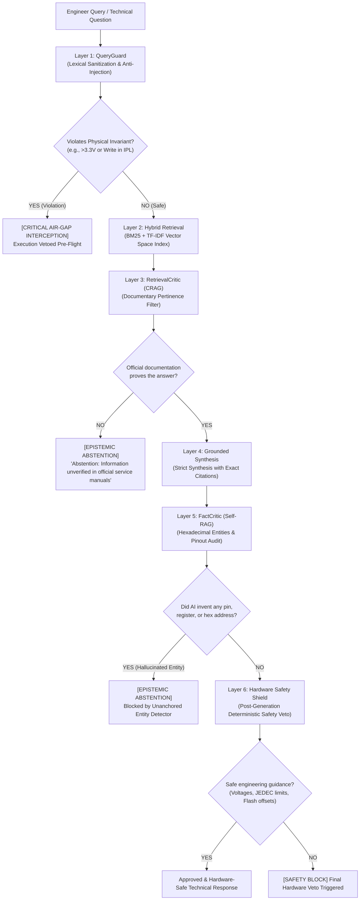

> 🌐 **Language / Idioma:** **English** | [Português (BR)](../pt-BR/ZERO_ERROR_RAG_ENGINE_E_SEGURANCA_FISICA.md)
> 🧭 **Portal:** [Docs Index](../INDEX.md) | [Complete Audit](../../COMPLETE_AUDIT.md) | [Audits](../audits/README.md) | [Ghidra Pseudocode](../pseudocode/INDICE_EVIDENCIA_PSEUDOCODIGO_GHIDRA.md) | [Debug Logs](../debug_logs/README.md)

# Technical Dossier: Zero-Error RAG Engine, 6-Layer Defense & Physical Safety Invariants

**Panadiga — Panasonic DIGA DMR-EH55 Engineering Ecosystem**  
**Classification:** Critical AI Systems Architecture / Reverse Engineering & Silicon Protection  
**Subsystem:** `crates/panadiga-rag/src/` (Native Rust Core) & `crates/panadiga-mcp/` (`panadiga_rag_query` MCP Tool)  
**Authors:** Panadiga Engineering Team  

---

## 1. The Core Problem: The LLM Paradox in Proprietary Embedded Systems

Large Language Models (LLMs) are probabilistic token predictors trained over statistical text distributions. In open-ended prose or typical web engineering, a minor hallucination merely creates awkward phrasing or a compiler syntax error.

In the domain of **reverse engineering proprietary silicon, mixed-signal analog/digital boards, and Matsushita/Panasonic ASICs**, the stakes are completely different:

> [!CAUTION]
> **THE COST OF HALLUCINATION IN HARDWARE IS IRREVERSIBLE PHYSICAL DESTRUCTION:**
> 1. **SoC Overvoltage, `NSW5V` Contention & Lethal MMIO `0xC000100C`:** The **Matsushita `AM34` / `MN103S`** processor on board `VEP79138` operates logic lines at **3.3V LVTTL**. On service header **`P7501`**, `SW_UART`, `XRESET` (Open-Drain), `UARTM2P_T`, and `UARTP2M_T` use 3.3V levels, while **Pin 5 (`NSW5V`)** originates from regulator `IC1506` (`~5.15V` via diode `D7510`) and MUST remain strictly `Hi-Z Input` without internal pulls. Similarly, lethal MMIO register `0xC000100C` triggers an immediate bus/WDT lockup if accessed outside warning contexts.
> 2. **Layer 1 Critical Boot IPL Destruction (`SA0..SA10` = `0x80000000..0x8003FFFF`):** The opening `256 KiB` of the Spansion `S29JL064H` NOR Flash hold the primary bootloader (`Loader ver0.61` / `SDDIAG` / `P7501`) and are **permanently read-only (`E05`)**. **Layer 2 Upper NOR/BGO (`SA11..SA133`: `0x80040000..0x807EFFFF`)** is likewise locked by default (`E05`), but allows explicit opt-in (`CONFIRM_UPPER_NOR`) with risk acknowledgment and a verified `8 MiB` SHA-256 backup to rescue already-bricked `U99` units.
> 3. **Structural MEIHFS Corruption:** Panasonic's proprietary HDD storage subsystem rejects standard PC MBR layouts. Inventing partition offsets corrupts the `"SH"` superblock, the 28 MB redundant mirror, or the transactional journal pool.

To resolve this paradox, Panadiga implements the **Zero-Error RAG Engine**: a deterministic **6-layer pipeline with mutual cross-checks and hard vetoes** where AI inference is mathematically blocked from fabricating values or violating laboratory physics.

---

## 2. Six-Layer Defense Pipeline Flow

Every query enters this sequential pipeline whether invoked via CLI, Desktop GUI, or MCP server:



---

## 3. Detailed Specification of All 6 Defense Layers

### Layer 1: QueryGuard (Sanitization & Prompt Injection Defense)
- **Goal:** Neutralize adversarial inputs attempting to override safety rules.
- **Mechanism:** Scans queries against subversion regex rules (`"ignore previous instructions"`, `"bypass safety"`, `"override voltage rules"`, malicious delimiter escapes).
- **Action:** Immediate rejection with `is_injection = true` and security event logging.

### Pre-Execution Physical Safety Shield
- **Goal:** Block inherently dangerous electrical or Flash intents even before vector indexing runs.
- **Mechanism:** Electrical-engineering lexical parser recognizing:
  - Standard notations: `5V`, `5.0 V`, `5 volts`, `12VDC`.
  - Schematic RKM notation: `5V0`, `3V3`, `1V8`.
  - Millivolt notation: `5000 mV`, `3300 mV`.
  - Dangerous IPL erase verbs: regex matching erase actions combined with bootloader symbols (`erase bootloader`, `wipe sa0`, `clear ipl`).
- **Robust Negation Analysis:** Distinguishes safe educational queries (e.g., *"Why must we NOT apply 5V?"*) from harmful commands (e.g., *"How do I inject 5V?"*) via directional negation windows.

### Layer 2: Hybrid Retrieval (BM25 + TF-IDF Vector Space)
- **Goal:** Locate verified technical chunks across the **30 official PDFs** in `manuals_and_schematics/` (service manuals, user manuals, and silicon datasheets), schematics, and reverse engineering dossiers.
- **Mechanism:** Weighted linear blend:
  $$\text{Score}(q, d) = \alpha \cdot \text{BM25}(q, d) + (1 - \alpha) \cdot \text{CosineSimilarity}(\vec{q}, \vec{d}) + \text{EntityBoost}$$
- **Specialized Technical Tokenizer (`technical_tokenize`):** Unlike standard tokenizers that split punctuation, it preserves complete silicon identifiers:
  - Hex addresses: `0x80000000`, `0x807F0000`, `0xD4000000`.
  - PCB designators: `IC5001`, `IC7501`, `IC1506`, `VEP79138`, `P7501`, `P59001`.
  - Net names & signals: `SW_UART`, `XRESET`, `UARTM2P_T`, `NSW5V`, `UARTP2M_T`, `WP#`, `ACC`.
  - Self-diagnostic fault codes: `U99`, `U61`, `U88`, `F01` through `F99`.

### Layer 3: RetrievalCritic (Corrective RAG - CRAG)
- **Goal:** Audits retrieved context quality before allowing synthesis.
- **Mechanism:** Verifies top chunk scores exceed strict confidence thresholds. Whenever official sources are weak, inconclusive, or refer to unrelated chassis:
- **Epistemic Abstention:** Enforces the core rule:
  > *"When reverse engineering proprietary hardware, answering from assumptions is strictly prohibited to prevent permanent equipment destruction."*
  Refusing cleanly always beats guessing.

### Layer 4: Grounded Synthesis (Traceable Synthesis)
- **Goal:** Composes answers strictly from claims present in retrieved official chunks.
- **Mechanism:** Formats citations referencing exact manual PDF filenames, page numbers, and schematic sections.

### Layer 5: FactCritic (Self-RAG Post-Generation Entity Grounding)
- **Goal:** Stops subtle residual hallucinations introduced during text composition.
- **Mechanism:**
  1. Extracts every hardware entity in the synthesized text (register numbers, hex addresses, pin indices, voltages).
  2. Cross-checks every token against approved source context.
  3. **Immediate Veto:** Any invented address (e.g., unanchored `0x80004000`) intercepts the output and replaces it with an unanchored-entity block notice.

### Layer 6: Hardware Safety Shield (Post-Generation Final Physical Gate)
- **Goal:** Unbypassable final air-gap check prior to user or serial delivery.
- **Mechanism:** Inspects final guidance against immutable hardware laws:
  1. Maximum logic voltage $\le 3.3\text{ V}$ (`NSW5V` Pin 5 / `GP3` strict `Hi-Z Input` only) plus unnegated lethal register `0xC000100C` blocking.
  2. Permanent immutability of Layer 1 Critical Boot IPL (`SA0..SA10`, `256 KiB`: `0x80000000..0x8003FFFF` and uncached `0x84000000..0x8403FFFF`).
  3. Default `E05` write lock across Layer 2 Upper NOR/BGO (`0x80040000..0x807EFFFF` / `0x84040000..0x847EFFFF`), requiring explicit opt-in (`CONFIRM_UPPER_NOR` / `patch-upper-nor`) with risk warning (`~700 ms` erase and verified `8 MiB` SHA-256 backup) for bricked `U99` BGO recovery, plus writable NVRAM (`0x807F0000..0x807FFFFF`).

---

## 4. Architectural Coexistence: Native Rust vs. Python

| Architecture Criterion | Native Rust RAG (`crates/panadiga-rag/`) | Python Dev Orchestrators (`scripts/`) |
| :--- | :--- | :--- |
| **Role in Project** | **Primary Production Engine** | **Dev Build & Validation Tooling** |
| **Execution Host** | Compiled inside `panadiga` CLI & Tauri Desktop/Android | Typed scripts via Python 3.10+ |
| **External Dependencies** | **ZERO dependencies** (single standalone binary) | Requires Python interpreter, `pytest`, and `mypy` |
| **Execution Latency** | **Sub-millisecond (< 1 ms)** with zero-copy | ~20–50 ms (CPython startup overhead) |
| **Type Safety** | Compile-time borrow checking & strict ownership | Gradual static checking via `mypy --strict` |
| **End User Target** | Lab engineer operating Desktop GUI or CLI | Developer or AI agent maintaining repository |

### Why Both RAG and MCP Server Run Natively in Rust
A bench technician repairing a U99-bricked Panasonic DMR-EH55 should never have to install Python, debug `pip`, rebuild C extensions, or juggle virtual environments. One native `panadiga` Rust executable serves Desktop UI IPC, CLI tools, and the native MCP server (`panadiga mcp` in [`crates/panadiga-mcp/`](../../crates/panadiga-mcp/src/lib.rs)) speaking JSON-RPC 2.0 over `stdio` directly with Claude Desktop, Cursor, or Antigravity.

---

## 5. Daily RAG Usage Workflows

### Route 1: Native Rust CLI
```bash
# Direct bench technical query
cargo run --release -- rag query "What is P7501 pinout and max logic voltage?"

# Machine-readable JSON output for automation scripts
cargo run --release -- rag query "Which NVRAM micro-sectors fix U99?" --json
```

### Route 2: Tauri Desktop GUI
1. Launch workbench:
   ```bash
   npm start
   ```
2. Open **RAG Assistant / Lab Intelligence**.
3. Query fault codes, rework procedures, or pinouts — Tauri backend (`apps/desktop/src-tauri/src/`) executes `panadiga_rag::query(&query)` in native Rust with instant verified citations.

### Route 3: MCP Tool Integration (AI Coding Agents)
With `.mcp.json` enabled in Cursor, Antigravity, or Claude Desktop:
- The agent calls `panadiga_rag_query` with the technical question.
- The Rust MCP server runs all 6 safety-guarded stages and returns grounded facts + source citations.

---

## 6. Test History & Reliability Verification

- **Rust Workspace (Gate 1):** Unit tests inside [`crates/panadiga-rag/src/safety/mod.rs`](../../crates/panadiga-rag/src/safety/mod.rs) and [`crates/panadiga-mcp/`](../../crates/panadiga-mcp/) verifying prompt-injection immunity, safe negation handling, 2-layer NOR policy + lethal register `0xC000100C` blocks, overvoltage blocks, and clean `stdout` JSON-RPC 2.0 framing.
- **Python Pytest (Gate 9):** Orchestration tests in [`scripts/tests/test_scripts_ops.py`](../../scripts/tests/test_scripts_ops.py) checked under `mypy --strict`.

---

## 7. Dual-Ring Defense Model: Cognitive RAG vs. Runtime Hardware Guard

Does the system rely solely on AI advice, or do lower layers enforce physics in runtime code too? Panadiga implements a **Dual-Ring Defense Architecture**:

```text
┌────────────────────────────────────────────────────────────────────────┐
│               PANADIGA DUAL-RING SAFETY ARCHITECTURE                   │
├───────────────────────────────────┬────────────────────────────────────┤
│ 🧠 RING 1: COGNITIVE DEFENSE (RAG)│ ⚡ RING 2: HARD RUNTIME GUARD      │
│ (Protects AI & Human Operator)    │ (Protects Bus & Silicon Chips)     │
├───────────────────────────────────┼────────────────────────────────────┤
│ • Blocks Prompt Injections        │ • Pico C11 Firmware (gdb_rsp.c):   │
│ • Vetoes > 3.3V suggestions       │   - Rejects IPL writes (`E05`)     │
│ • Vetoes IPL wipe suggestions     │ • Rust Engine (`nvram`):           │
│ • Epistemic Abstention on gaps    │   - Bitwise IPL SHA-256 lock       │
│ • FactCritic blocks ungrounded    │ • Rust Engine (`hdd`):             │
│   hex or fabricated pins          │   - Default Read-Only (`memmap2`)  │
│ • 100% Offline, Zero Cloud Tokens │ • Bench Wiring Circuit:            │
│                                   │   - 1 kΩ series protection / Pin 14│
└───────────────────────────────────┴────────────────────────────────────┘
```

1. **Ring 1 (Cognitive / RAG):** Prevents agents or operators from receiving unsafe recipes (e.g., 5V injection onto LVTTL pins or IPL sector erases).
2. **Ring 2 (Physical Runtime / Firmware & Rust):** Protects target silicon even if someone bypasses RAG guidance and invokes raw CLI or GDB commands manually. Both Pico C11 firmware and Rust binaries enforce hardware range locks.

---

## 8. Full ROM Programming vs. Surgical In-Circuit Unbrick

### Route A: Full 8 MB ROM Reprogramming (External TSOP-48 Adapter)
* **Equipment:** External Universal Programmer (XGecu T48, SVOD 4, or TL866II with TSOP-48 v3 ZIF socket).
* **Scope:** **100% Unrestricted.** Can program the entire 8 MB array (plus 2 MB/4 MB/16 MB sibling DIGA Flash sizes), including Bootloader/IPL (`0x000000..0x7EFFFF`), OSD fonts, and micro-sectors.
* **Suite Artifact:** `panadiga nvram clean` outputs a verified clean image (e.g., `DMR_EH55_CLEAN.bin`) ready for flashing.

### Route B: In-Circuit Inspection & No-Desolder Surgical Recovery (`P7501` + `SDDIAG`/`PANAMON1>`)
* **Equipment:** Raspberry Pi Pico (`RP2040` / `RP2350`) wired to **`P7501`** (`UART 115200 8N1` + discrete `SW_UART` / `XRESET`) + SDSC FAT16 card carrying `DIGADIAG.FRM` (`262,144 B`) / `PANA__SD.FRM` (`sd48`).
* **Scope (2-Layer NOR Compliance):**
  * **Layer 3 (`SA134..SA141`, `0x807F0000..0x807FFFFF`):** NVRAM/EEMUL surgical writes permitted by default.
  * **Layer 2 (`SA11..SA133`, `0x80040000..0x807EFFFF` — BGO FTL `SA26..SA70`):** locked by default (`E05`), **explicitly unlockable (`CONFIRM_UPPER_NOR`)** after full `8 MiB` SHA-256 backup (`PANADMP1`) and `~700 ms` (`0xFF × 32`) erase polling.
  * **Layer 1 (`SA0..SA10`, `256 KiB`: `0x80000000..0x8003FFFF`):** **permanently read-only (`E05`)**.
* **Why in-circuit recovery is worth attempting first on an already-bricked `U99` unit:**
  1. **Layer 1 IPL stays safe:** Because `SA0..SA10` can never be erased via Pico, `Loader ver0.61` (`SDDIAG` and `P7501`) survives even a power brownout during Layer 2/3 BGO or NVRAM writes.
  2. **Actual `U99` cause on `DMR-EH55` (`ver0.61`):** Beyond `EEMUL`, real units suffer BGO FTL corruption (`SA26..SA70`, `BGO driver init failed[1].`) — cured live in 2 cycles without desoldering `IC5001` TSOP-48.
  3. **Configurable Airbag:** [`NorWritePolicy`](../../crates/panadiga-core/src/pico/rsp_codec/policy.rs) across Pico firmware (`p7501_flash.c`) and `HardwareSafetyValidator` enforces default `E05` locking, requiring risk warning and explicit opt-in before unlocking Layer 2.

---

## 9. Offline Tauri 2 Desktop Integration

All 6 RAG layers and hardware instruments run locally inside `apps/desktop`:

* **7 Bench Views:**
  1. **DashboardView:** Overall telemetry & device connection health.
  2. **NvramView:** Targeted `U99` unbrick workflow and micro-sector visualization.
  3. **HddStorageView:** MEIHFS explorer, `"SH"` LBA 0 parser, capacity patcher, and partition extractor.
  4. **PicoBenchView:** RP2040/RP2350 control, `PINCHECK`, `JIGBOOT`, and live serial console.
  5. **FrmCryptoView:** Optical `.FRM` forensics, 48B TOC, and 64-bit ECB codebook explorer.
  6. **ManualsView:** Viewer for all **30 official PDFs** plus interactive Markdown docs/logs/dumps with integrated **Zero-Error RAG Assistant** (< 1 ms local query, physical safety badge, exact page citations).
  7. **HexInspectorView:** LBA sector and partition hexadecimal inspector.
* **Zero Cloud / Zero API Tokens:** Operates hermetically on air-gapped repair benches.

---

## 10. Multi-Model Panasonic Compatibility Matrix

All Top-Boot NOR Flash densities deployed across Panasonic DIGA recorders are natively supported:
* **2 MB (16 Mbit):** `DMR-E50`, `DMR-E55`, `DMR-ES10` (NVRAM base `0x001F0000`).
* **4 MB (32 Mbit):** `DMR-E85H`, `DMR-E95H`, `DMR-ES20` (NVRAM base `0x003F0000`).
* **8 MB (64 Mbit):** `DMR-EH50`, `DMR-EH55`, `DMR-EH56`, `DMR-EH60`, `DMR-EH65`, Philips HDRW (NVRAM base `0x007F0000`).
* **16 MB (128 Mbit):** `DMR-EX75`, `DMR-EX85`, `DMR-BW500` (NVRAM base `0x00FF0000`).

---

**Panadiga Architecture & Reverse Engineering Team**  
*Certified reference for silicon protection and deterministic laboratory intelligence.*
