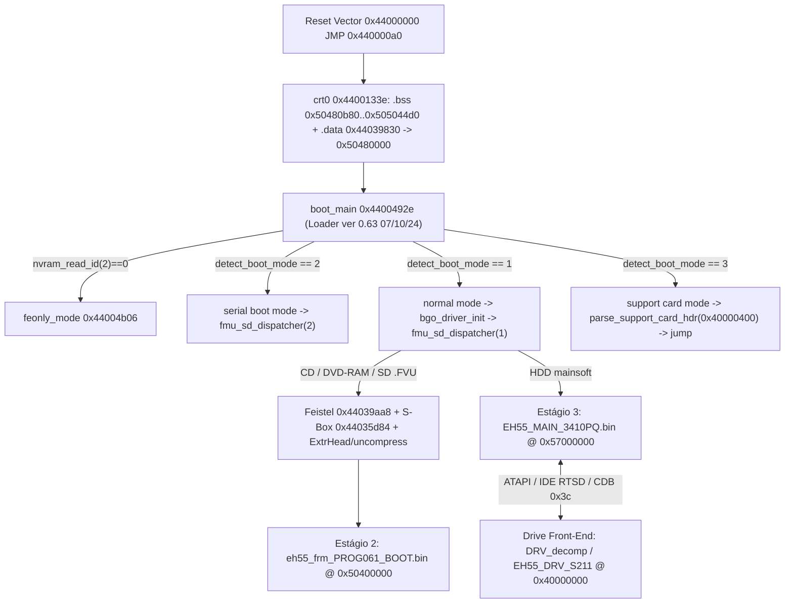

> 🌐 **Language / Idioma:** **Bilingual (PT-BR / EN-US)**
> 🧭 **Portal:** [Docs Index](../INDEX.md) | [Complete Audit (EN)](../../COMPLETE_AUDIT.md) | [Auditoria Completa (PT-BR)](../../AUDITORIA_COMPLETA.md) | [Audits Archive](../audits/README.md) | [`??` Audit](./GHIDRA_UNDEF_AUDIT_REPORT.md) | [Debug Logs](../debug_logs/README.md)

# Evidência Técnica Ghidra MN103S — Panasonic DMR-EH55 / Ghidra Pseudocode & Disassembly Evidence Index

> [!NOTE]
> **PT-BR:** Este artefato apresenta a síntese estruturada, as provas cirúrgicas em pseudocódigo C/disassembly e o índice navegável por linha para o dossiê integral no workspace: [**EVIDENCIA_PSEUDOCODIGO_GHIDRA_MN103S.md**](./EVIDENCIA_PSEUDOCODIGO_GHIDRA_MN103S.md) (`488.538 B`, `13.677` linhas, `SHA-256: 050e29aed745db3bc654693b2f379e8a5f2570e2ac74e072b2a520087082ce77`, `166` blocos/funções indexados com **0 omissões**).
> **EN-US:** This index provides the structured synthesis, verified C pseudocode/disassembly proofs, line-level jump table into [**EVIDENCIA_PSEUDOCODIGO_GHIDRA_MN103S.md**](./EVIDENCIA_PSEUDOCODIGO_GHIDRA_MN103S.md) (`488,538 B`, `13,677` lines, `166` indexed blocks/functions), and direct links to the raw text extractions in [`./raw/`](./raw/doc_boot_core.txt) and the [Undefined `??` Audit](./GHIDRA_UNDEF_AUDIT_REPORT.md).
>
> Toda a extração em `C:\ghidra\projects\Panadiga_MN103S` permaneceu estritamente **read-only** (`endTransaction(tx, False)`), com todos os arquivos `Panadiga_MN103S.rep\idata\00\~00000000..00000004.db\db.*.gbf` mantendo carimbo original de `13/11/2026`.

## Capturas Brutas em Texto (`./raw/`) / Raw Ghidra Text Captures

| Arquivo Raw / Raw Artifact | Tamanho / Size | Escopo Coberto / Covered Binary & Functions |
| :--- | ---: | :--- |
| [`./raw/doc_boot_core.txt`](./raw/doc_boot_core.txt) | `97.709 B` | `/BOOT.BIN` — Reset vector, `crt0`, `boot_main`, BGO init, NVRAM/NFROM |
| [`./raw/doc_boot_media_crypto.txt`](./raw/doc_boot_media_crypto.txt) | `108.964 B` | `/BOOT.BIN` — `SDCD` (`-91006`), ODD/Joliet/RTSD, Feistel `0x44039AA8`, `ExtrHead`, LZSS |
| [`./raw/doc_prog061.txt`](./raw/doc_prog061.txt) | `38.145 B` | `/eh55_frm_PROG061_BOOT.bin` — Menu DIGADIAG, `FMU_list_sum`, 3 BGO patch sites |
| [`./raw/doc_main.txt`](./raw/doc_main.txt) | `34.181 B` | `/EH55_MAIN_3410PQ.bin` — `_dev_SERIAL` GDB RSP, `FPC_TestModeControl`, LBA48 `400GB` |
| [`./raw/doc_drv_and_atapi.txt`](./raw/doc_drv_and_atapi.txt) | `49.491 B` | `/DRV_decomp.bin` & `/EH55_DRV_S211.bin` — `PASS`, CLI `0x400df55c`, ATAPI `0x3c`, SenseLUT |

---

## 1. Inventário Verificado dos 5 Binários (`mn10300:LE:32:default`)

| Programa Ghidra | Papel no Sistema | Bloco Inicializado (`ram`) | Tamanho | `funcs` | `defined_strings` | SHA-256 | Link no Dossiê Integral |
|---|---|---|---:|---:|---:|---|---|
| `/BOOT.BIN` | Estágio 1: IPL / NOR XIP | `0x44000000..0x4403ffff` | `0x40000` (262.144 B) | 843 | 512 | `7c13c72a54c77387f3f7df0ddc213e4800e20b27eecbfd225cbc05a8fc73e377` | [Parte I](./EVIDENCIA_PSEUDOCODIGO_GHIDRA_MN103S.md#L261) |
| `/eh55_frm_PROG061_BOOT.bin` | Estágio 2: DIGADIAG / FVU Loader | `0x50400000..0x5043ffff` | `0x40000` (262.144 B) | 5 | 0 | `c7da9121174fcf4c54f35f5bb1f7b23a3dc0c93ab227158ad4fdd90a1ea24a81` | [Parte II](./EVIDENCIA_PSEUDOCODIGO_GHIDRA_MN103S.md#L7934) |
| `/EH55_MAIN_3410PQ.bin` | Estágio 3: Main OS / `_dev_SERIAL` / LBA48 | `0x57000000..0x57c6692b` | `0xc6692c` (13.003.052 B) | 33 | 0 | `c3275d39549b68f48db16bc5fd043c6f8a373d4ba416826de09be5c55dc991b1` | [Parte III](./EVIDENCIA_PSEUDOCODIGO_GHIDRA_MN103S.md#L9465) |
| `/DRV_decomp.bin` | FE Drive S211 (dump principal analisado) | `0x40000000..0x4015ffff` | `0x160000` (1.441.792 B) | 2.346 | 1.913 | `694a4ab8aa29fcc45350dc0712047663602bdee7e4bff313b8ae62b057efd052` | [Parte IV](./EVIDENCIA_PSEUDOCODIGO_GHIDRA_MN103S.md#L10989) |
| `/EH55_DRV_S211.bin` | FE Drive S211 (revisão alterna comparada) | `0x40000000..0x4015ffff` | `0x160000` (1.441.792 B) | 15 | 0 | `6f2b61ede80ea9e3e9185d3d677813593f3d361446678e437c905a0037060243` | [Seção 4.2](./EVIDENCIA_PSEUDOCODIGO_GHIDRA_MN103S.md#L11545) |

---

## 2. Arquitetura de Boot & Desbloqueio (DMR-EH55 MN103S)



---

## 3. Evidências Cirúrgicas por Estágio (Trechos Verificados)

### 3.1 `/BOOT.BIN` — `crt0` (`0x4400133e`) e Derivação Exata da Chave Feistel (`0x44039aa8`)

- **Prova CRT0 (`.data` ROM -> RAM):** Em [`0x4400134f..0x44001368`](./EVIDENCIA_PSEUDOCODIGO_GHIDRA_MN103S.md#L585), `crt0` copia exatamente `0x0b80` bytes de `0x44039830` para `0x50480000` (`MOV 0x44039830,A0`, `MOV 0x50480000,A1`, loop `SETLB`/`LLT` até `0x50480b80`).
- **Derivação da Chave de 15 Bytes:** Em [`FUN_4400a666`](./EVIDENCIA_PSEUDOCODIGO_GHIDRA_MN103S.md#L7223), a chamada `FUN_44011d42(0x50480278, 0x5048027f, 0x5050173c)` referencia `0x50480000 + 0x278 = 0x44039830 + 0x278 = 0x44039aa8`:
  - `param_1` (`0x50480278` / `0x44039aa8`, 7 bytes): `72 eb ca 91 30 45 68`
  - `param_2` (`0x5048027f` / `0x44039aaf`, 8 bytes): `ad 99 df 56 72 3a b8 10`
  - S-Box completa de 256 bytes em `0x44035D84`: [Seção 1.6](./EVIDENCIA_PSEUDOCODIGO_GHIDRA_MN103S.md#L7908).

```asm
  0x4400134f: [fc dc 30 98 03 44    ] MOV 0x44039830,A0
  0x44001355: [fc dd 00 00 48 50    ] MOV 0x50480000,A1
  0x4400135b: [db                   ] SETLB
  0x4400135c: [f9 6a c8             ] MOV (A0+),D0
  0x4400135f: [f9 7a c9             ] MOV D0,(A1+)
  0x44001362: [fc d9 80 0b 48 50    ] CMP 0x50480b80,A1
  0x44001368: [d0                   ] LLT
```

- **Boot Routes & Cartão de Suporte (`0x4400492e`):** [`boot_main`](./EVIDENCIA_PSEUDOCODIGO_GHIDRA_MN103S.md#L1121) despacha conforme `detect_boot_mode()` e NVRAM (`nvram_read_id(2, ...)` / `nvram_read_id(0xb, ...)`):
  - `nvram_read_id(2) == 0`: `"***** FEonly mode *****\n"` -> [`feonly_mode()`](./EVIDENCIA_PSEUDOCODIGO_GHIDRA_MN103S.md#L5314)
  - Modo `2`: `"***** serial boot mode *****\n"` -> `fmu_sd_dispatcher(2)`
  - Modo `1`: `"***** normal mode *****\n"` -> `bgo_driver_init()` -> `fmu_sd_dispatcher(1)`
  - Modo `3`: `"***** support card mode *****\n"` -> `parse_support_card_hdr(0x40000400)` -> `FUN_4402c2f7(...)` -> salto indireto `(*(code *)puVar2[-5])()`.

---

### 3.2 `/eh55_frm_PROG061_BOOT.bin` — Os 3 Sítios Exatos de Patch BGO & Overlap `0x5040ea30`

Os 3 pontos de verificação/bloqueio BGO estão documentados em [`Disassembly dos 3 Sítios Exatos de Patch BGO no PROG061`](./EVIDENCIA_PSEUDOCODIGO_GHIDRA_MN103S.md#L9351):

1. **Site 1 (`0x504230f0`, dentro de `FUN_50423058` / `p61_bgo_sum_23058`):** compara soma esperada com `D2`: `0x504230ef: CMP D2,D0` -> `0x504230f0: [c8 0a] BEQ 0x504230fa`.
2. **Site 2 (`0x50405097`, menu principal):** após `0x50405088: CALL 0x5040af11`, verifica `CMP 0x0,D0`: `0x50405097: [c8 15] BEQ 0x504050ac` (se não desviar, imprime string `0x50432ed8` e entra em `0x5040689d` halt).
3. **Site 3 (`0x5040a2cb`, dentro de `FUN_5040a294`):** após `0x5040a2bc: CALL 0x5040248e`, testa `CMP 0x0,D0`: `0x5040a2cb: [c8 16] BEQ 0x5040a2e1` (em caso de falha, passa string `0x50433eb0` em `0x5040a2cd` e retorna `0xff`).

Em [`FUN_5040ea30` (`FMU_list_sum`)](./EVIDENCIA_PSEUDOCODIGO_GHIDRA_MN103S.md#L8960), o disassembly confirma instrução sobreposta: `0x5040ea52: [ca dd] BRA 0x5040ea2f` salta 1 byte antes de `0x5040ea30: [07 08 84] MOVHU D1,(0x8408)` (onde `0x5040ea2f` contém `[f8]`).

---

### 3.3 `/EH55_MAIN_3410PQ.bin` — `_dev_SERIAL` GDB RSP, `FPC_TestModeControl` & `400GB` vs `200GB`

- **GDB Remote Serial (`FUN_574f0590`):** Em [`FUN_574f0590`](./EVIDENCIA_PSEUDOCODIGO_GHIDRA_MN103S.md#L9559), após `bVar6 == 0x15`, lê quadros iniciados em `` `$` ``, soma bytes mod `0xff`, compara com 2 dígitos hex finais, responde `` `-$E00#A5` `` / `` `-$E01#A6` `` / `` `-$E02#A7` `` / `` `+$OK#9A` `` e despacha comandos `'m'`, `'M'`, `'x'`, `'X'`, `'c'`, `'g'` e `'Z'`.
- **`FPC_TestModeControl()` (`FUN_5771abfb`):** Em [`0x5771ac87`](./EVIDENCIA_PSEUDOCODIGO_GHIDRA_MN103S.md#L10064), `BCLR 0xff,(0x0,A2)` zera o byte apontado por `param_3` — porém o decompilador MN103S emite `*param_3 = *param_3;`.
- **`400GB` Ocultado pelo Decompilador (`FUN_574dd15b`):** Embora o C mostre `WARNING: Removing unreachable block (ram,0x574dd208)` e apenas `0x5d21dba` (`200GB`), o [disassembly real em `0x574dd208..0x574dd221`](./EVIDENCIA_PSEUDOCODIGO_GHIDRA_MN103S.md#L10728) comprova ambos os ramos ativos:

```asm
  0x574dd208: [fc cc 74 3b a4 0b   ] MOV 0xba43b74,D0
  0x574dd20e: [fc 81 ac b9 11 53   ] MOV D0,(0x5311b9ac)
  0x574dd214: [fc cc 57 e9 a5 57   ] MOV 0x57a5e957,D0      ; '[RTSD] M7920(HDD 400GB) \n'
  0x574dd21a: [dd c0 2b 01 00 00 00] CALL 0x574efdda,[],0x0
```

---

### 3.4 `/DRV_decomp.bin` vs `/EH55_DRV_S211.bin` — `PASS` (`MATS`/`HITA`), CLI & ATAPI `0x3c`

| Item Comparado | `/EH55_DRV_S211.bin` | `/DRV_decomp.bin` | Link no Dossiê |
|---|---|---|---|
| **Handler `PASS`** | `FUN_40130efa` (`0x40130efa`, 57 B) | `FUN_4013420a` (`0x4013420a`, 57 B) | [`FUN_4013420a`](./EVIDENCIA_PSEUDOCODIGO_GHIDRA_MN103S.md#L11201) / [`FUN_40130efa`](./EVIDENCIA_PSEUDOCODIGO_GHIDRA_MN103S.md#L11575) |
| **Assinatura Esperada** | `0x4d415453` (`"MATS"`) & `0x48495441` (`"HITA"`) | `0x4d415453` (`"MATS"`) & `0x48495441` (`"HITA"`) | [Seção 4.2](./EVIDENCIA_PSEUDOCODIGO_GHIDRA_MN103S.md#L11545) |
| **Flag de Desbloqueio** | `BSET 0x1,(0xd78)` (`UNK_00000d78 \|= 1`) | `DAT_00000cd8 \|= 1` | [Seção 4.2](./EVIDENCIA_PSEUDOCODIGO_GHIDRA_MN103S.md#L11603) |
| **O que há em `0x40130efa`?** | Código ativo de `PASS` | String format `"ret   = %wh\n"`, `"RZoneNo \n"`, `" ->pba  = 0x%lh\n"` (`0x40130ee0..0x40130f2f`) | [Prova §6](./EVIDENCIA_PSEUDOCODIGO_GHIDRA_MN103S.md#L13339) |
| **Despacho ATAPI `0x3c`** | — | `FUN_400209f3` (`if (DAT_00000247 == '<')`, modos `1` e `0x10`) | [`FUN_400209f3`](./EVIDENCIA_PSEUDOCODIGO_GHIDRA_MN103S.md#L12653) |
| **CLI Serial (`0x400DF55C..`)** | 15 funções criadas no repo comparativo | 50 entradas de 20 B (45 comandos ASCII nomeados: `SLOGON`, `SLOGOFF`, `PASS`, `VER`, `MMODE`, `SMODE`, `RB`, `WB`, `EEP`, `FEP`...) | [Tabela CLI](./EVIDENCIA_PSEUDOCODIGO_GHIDRA_MN103S.md#L11478) |

---

## 4. Catálogo das 7 Armadilhas do Decompilador MN103S (Resumo)

Detalhes completos e regras de verificação em [Parte V do Dossiê Integral](./EVIDENCIA_PSEUDOCODIGO_GHIDRA_MN103S.md#L13659):

1. **Binários crus sem seeds de símbolos** (`PROG061`, `MAIN`, `EH55_DRV_S211`, `FUN_574dd010`): deixam `in_D2`/`in_R4`/`in_A3` não resolvidos até criação explícita de função.
2. **`BCLR`/`BSET` degenerado**: `0x5771ac87: BCLR 0xff,(0x0,A2)` vira `*param_3 = *param_3;` em C.
3. **`Removing unreachable block` + `mn_todo()` por retorno não modelado na pilha**: `FUN_574dd15b` esconde `400GB` (`0x57a5e957`) e exibe apenas `200GB`.
4. **Instruções sobrepostas 1 byte antes da função**: `FUN_5040ea30` (`BRA 0x5040ea2f` -> byte `f8` antes de `MOVHU D1,(0x8408)`).
5. **Eliminação de código MMIO / Flash CFI**: `FUN_440236ed` (205 B, 18 warnings) colapsa para `_DAT_84200554 = 0x55; _DAT_84200aaa = 0x90; _DAT_84200000 = 0xf0; return 2;`.
6. **Indexação negativa em `in_A3` e loop de hardware `LAR` como call indireto**: `*(in_A3 + -4)` (frame local) e `(*(code *)(in_LAR + -4))()` em `FUN_50404f12`.
7. **Desalinhamento entre revisões, Shift-JIS e falsos matches de bytes**: `0x40130efa` (`S211` `PASS` vs `DRV_decomp` string format); `LE16(0x83a7)` (`a7 83`) em `0x4006f5e2` dentro de `CALL 0x40027988,[D2,A2,A3],0x14`; tabela Shift-JIS `Err05mWTable` em `0x400e8a16`.

---

## 5. Mapa Completo de Acesso ao Dossiê Integral

- **Inventário & End-to-End:** [Sumário](./EVIDENCIA_PSEUDOCODIGO_GHIDRA_MN103S.md#L7) · [Inventário SHA-256](./EVIDENCIA_PSEUDOCODIGO_GHIDRA_MN103S.md#L34) · [Índice das 166 Entradas](./EVIDENCIA_PSEUDOCODIGO_GHIDRA_MN103S.md#L88)
- **Parte I (`/BOOT.BIN`):** [1.1 Reset/CRT0](./EVIDENCIA_PSEUDOCODIGO_GHIDRA_MN103S.md#L263) · [1.2 `boot_main`/UART0/Timer](./EVIDENCIA_PSEUDOCODIGO_GHIDRA_MN103S.md#L1117) · [1.3 BGO/NFROM/NVRAM](./EVIDENCIA_PSEUDOCODIGO_GHIDRA_MN103S.md#L2320) · [1.4 SD/`SetBusWidth`/`-91006`](./EVIDENCIA_PSEUDOCODIGO_GHIDRA_MN103S.md#L3916) · [1.5 ODD/Joliet/RTSD/DAVIS](./EVIDENCIA_PSEUDOCODIGO_GHIDRA_MN103S.md#L5310) · [1.6 Feistel/`ExtrHead`/LZ](./EVIDENCIA_PSEUDOCODIGO_GHIDRA_MN103S.md#L7219)
- **Parte II (`/eh55_frm_PROG061_BOOT.bin`):** [2.1 Menu DIGADIAG/`FMU_list_sum`](./EVIDENCIA_PSEUDOCODIGO_GHIDRA_MN103S.md#L7938) · [2.2 BGO & 3 Patch Sites](./EVIDENCIA_PSEUDOCODIGO_GHIDRA_MN103S.md#L9056)
- **Parte III (`/EH55_MAIN_3410PQ.bin`):** [3.1 `_dev_SERIAL` GDB RSP](./EVIDENCIA_PSEUDOCODIGO_GHIDRA_MN103S.md#L9469) · [3.2 `FPC_TestModeControl`/ODD/`ATIH`](./EVIDENCIA_PSEUDOCODIGO_GHIDRA_MN103S.md#L9787) · [3.3 HDD LBA48 & `400GB` Disasm](./EVIDENCIA_PSEUDOCODIGO_GHIDRA_MN103S.md#L10352)
- **Parte IV (`/DRV_decomp` & `/EH55_DRV_S211`):** [4.1 Serial CLI & `PASS`](./EVIDENCIA_PSEUDOCODIGO_GHIDRA_MN103S.md#L10993) · [4.2 Comparativo `S211` vs `DRV_decomp`](./EVIDENCIA_PSEUDOCODIGO_GHIDRA_MN103S.md#L11545) · [4.3 ATAPI `0x3c`, SenseTable & `DRV12`](./EVIDENCIA_PSEUDOCODIGO_GHIDRA_MN103S.md#L11965)
- **Parte V:** [Catálogo Completo de Armadilhas MN103S](./EVIDENCIA_PSEUDOCODIGO_GHIDRA_MN103S.md#L13659)
