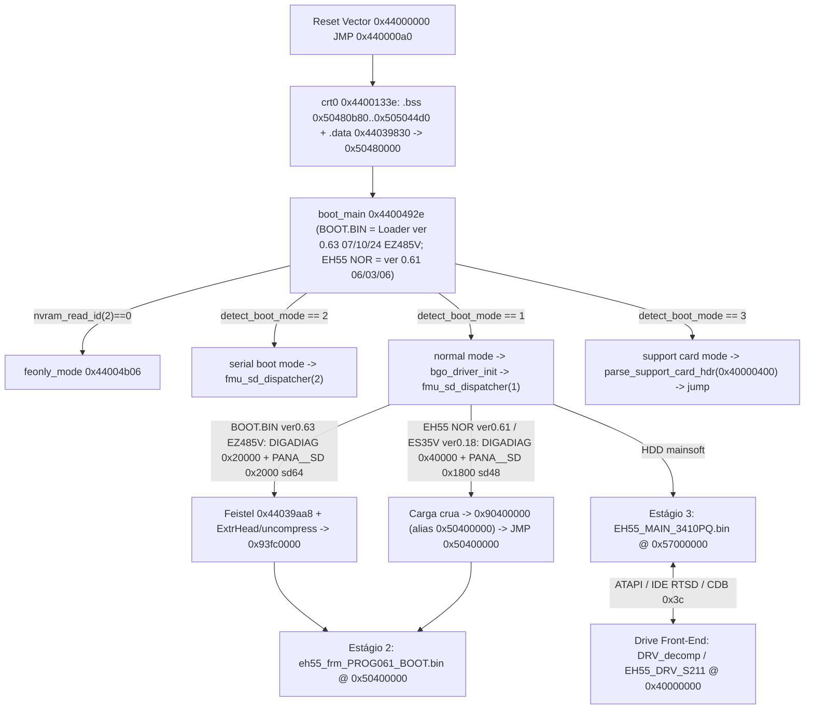

> 🌐 **Language / Idioma:** **Bilingual (PT-BR / EN-US)**
> 🧭 **Portal:** [Docs Index](../INDEX.md) | [Complete Audit (EN)](../../COMPLETE_AUDIT.md) | [Auditoria Completa (PT-BR)](../../AUDITORIA_COMPLETA.md) | [Audits Archive](../audits/README.md) | [`??` Audit](./GHIDRA_UNDEF_AUDIT_REPORT.md) | [Debug Logs](../debug_logs/README.md)

# Evidência Técnica Ghidra MN103S — Panasonic DMR-EH55 / Ghidra Pseudocode & Disassembly Evidence Index

> [!NOTE]
> **PT-BR:** Este artefato apresenta a síntese estruturada, as provas cirúrgicas em pseudocódigo C/disassembly e o índice navegável por linha para o dossiê integral no workspace: [**EVIDENCIA_PSEUDOCODIGO_GHIDRA_MN103S.md**](./EVIDENCIA_PSEUDOCODIGO_GHIDRA_MN103S.md) (`1.044.995 B`, `26.555` linhas, `SHA-256: 3be0559934d97106794edfd7eef9f460ba8b9bade5e49ff00b651a6d5f4b84b7`, `219` entradas no Índice Geral e `10` classes de armadilhas MN103S na Parte V).
> **EN-US:** This index provides the structured synthesis, verified C pseudocode/disassembly proofs, line-level jump table into [**EVIDENCIA_PSEUDOCODIGO_GHIDRA_MN103S.md**](./EVIDENCIA_PSEUDOCODIGO_GHIDRA_MN103S.md) (`1,044,995 B`, `26,555` lines, `219` indexed entries, `10` compiler/SLEIGH trap classes), and direct links to the raw text extractions in [`./raw/`](./raw/doc_boot_core.txt) (original Ghidra 12.0.3 / PyGhidra + [`./raw/doc_boot_fat_sd_java.txt`](./raw/doc_boot_fat_sd_java.txt) via Ghidra 12.1.4 PUBLIC Headless) plus the Ghidra 12.1.4 PUBLIC read-only extractions of BGO FTL (`SA41 + 0x14`), RTSC/DAVIS IDE, and `eh55_loader_ver061_256k.bin` (`Loader ver0.61 [06/03/06]`) and the [Undefined `??` Audit](./GHIDRA_UNDEF_AUDIT_REPORT.md).
>
> Toda a extração em `C:\ghidra\projects\Panadiga_MN103S` permaneceu estritamente **read-only** (`endTransaction(tx, False)`), assim como a análise isolada de `eh55_loader_ver061_256k.bin` e as listagens adicionais de `sd_load.o` (`prog061_dec.bin`), `dmr-es35v/flash.bin` e `BOOT.BIN` verificadas diretamente contra os binários originais.

## Capturas Brutas em Texto (`./raw/`) / Raw Ghidra Text Captures

| Arquivo Raw / Raw Artifact | Tamanho / Size | Escopo Coberto / Covered Binary & Functions |
| :--- | ---: | :--- |
| [`./raw/doc_boot_core.txt`](./raw/doc_boot_core.txt) | `97.709 B` | `/BOOT.BIN` (`ver0.63`) — Reset vector, `crt0`, `boot_main`, BGO init, NVRAM/NFROM |
| [`./raw/doc_boot_media_crypto.txt`](./raw/doc_boot_media_crypto.txt) | `108.964 B` | `/BOOT.BIN` (`ver0.63`) — `SDCD` (`-91006`), ODD/Joliet/RTSD, Feistel `0x44039AA8`, `ExtrHead`, LZSS |
| [`./raw/doc_boot_fat_sd_java.txt`](./raw/doc_boot_fat_sd_java.txt) | `104.320 B` | `/BOOT.BIN` (`ver0.63`) — 11 scripts `C:\ghidra\*.java` (Ghidra 12.1.4 Headless): FAT12/16/32, `CMD17`/`CMD18`, `DumpAsm` `0x4400c760..0x4400c7b0` |
| [`./raw/doc_prog061.txt`](./raw/doc_prog061.txt) | `38.145 B` | `/eh55_frm_PROG061_BOOT.bin` — Menu DIGADIAG, `FMU_list_sum`, 3 BGO patch sites |
| [`./raw/doc_main.txt`](./raw/doc_main.txt) | `34.181 B` | `/EH55_MAIN_3410PQ.bin` — `_dev_SERIAL` GDB RSP, `FPC_TestModeControl`, LBA48 `400GB` |
| [`./raw/doc_drv_and_atapi.txt`](./raw/doc_drv_and_atapi.txt) | `49.491 B` | `/DRV_decomp.bin` & `/EH55_DRV_S211.bin` — `PASS`, CLI `0x400df55c`, ATAPI `0x3c`, SenseLUT |

---

## 1. Inventário Verificado dos 5 Binários (`mn10300:LE:32:default`) + Ref. `Loader ver0.61`

| Programa Ghidra | Papel no Sistema | Bloco Inicializado (`ram`) | Tamanho | `funcs` | `defined_strings` | SHA-256 | Link no Dossiê Integral |
|---|---|---|---:|---:|---:|---|---|
| `/BOOT.BIN` | Estágio 1: IPL / NOR XIP — **`Loader ver0.63 [07/10/24] (4MB/TOP BOOT)`** (DMR-EZ485V; distinto do `ver0.61 [06/03/06]` do EH55) | `0x44000000..0x4403ffff` | `0x40000` (262.144 B) | 843 | 512 | `7c13c72a54c77387f3f7df0ddc213e4800e20b27eecbfd225cbc05a8fc73e377` | [Parte I](./EVIDENCIA_PSEUDOCODIGO_GHIDRA_MN103S.md#L428) |
| `eh55_loader_ver061_256k.bin` *(NOR real EH55, proj. read-only auxiliar)* | Estágio 1 Real EH55: IPL / NOR XIP — **`Loader ver0.61 [06/03/06]`** (`IC5001` `SA0..SA10`), geometria BGO `0x440337A4` (`45` setores `0x84130000..0x843FFFFF` / `SA26..SA70`) | `0x44000000..0x4403ffff` | `0x40000` (262.144 B) | *(sob demanda)* | *(0x4402f746..)* | `9f5c448d8879106be5ca3da6d6ac649026d50fbc191251ae0f4a003efca63800` | [1.3-B](./EVIDENCIA_PSEUDOCODIGO_GHIDRA_MN103S.md#L4095) · [1.4-B](./EVIDENCIA_PSEUDOCODIGO_GHIDRA_MN103S.md#L8787) · [2.3](./EVIDENCIA_PSEUDOCODIGO_GHIDRA_MN103S.md#L21420) |
| `/eh55_frm_PROG061_BOOT.bin` | Estágio 2: DIGADIAG / FVU Loader (`PROG061` do DMR-EH55; inclui `sd_load.o` @ `0x5040e9b0..0x5040edde`) | `0x50400000..0x5043ffff` | `0x40000` (262.144 B) | 5 | 0 | `c7da9121174fcf4c54f35f5bb1f7b23a3dc0c93ab227158ad4fdd90a1ea24a81` | [Parte II](./EVIDENCIA_PSEUDOCODIGO_GHIDRA_MN103S.md#L12869) |
| `/EH55_MAIN_3410PQ.bin` | Estágio 3: Main OS / `_dev_SERIAL` / LBA48 | `0x57000000..0x57c6692b` | `0xc6692c` (13.003.052 B) | 33 | 0 | `c3275d39549b68f48db16bc5fd043c6f8a373d4ba416826de09be5c55dc991b1` | [Parte III](./EVIDENCIA_PSEUDOCODIGO_GHIDRA_MN103S.md#L22340) |
| `/DRV_decomp.bin` | FE Drive S211 (dump principal analisado) | `0x40000000..0x4015ffff` | `0x160000` (1.441.792 B) | 2.346 | 1.913 | `694a4ab8aa29fcc45350dc0712047663602bdee7e4bff313b8ae62b057efd052` | [Parte IV](./EVIDENCIA_PSEUDOCODIGO_GHIDRA_MN103S.md#L23864) |
| `/EH55_DRV_S211.bin` | FE Drive S211 (revisão alterna comparada) | `0x40000000..0x4015ffff` | `0x160000` (1.441.792 B) | 15 | 0 | `6f2b61ede80ea9e3e9185d3d677813593f3d361446678e437c905a0037060243` | [Seção 4.2](./EVIDENCIA_PSEUDOCODIGO_GHIDRA_MN103S.md#L24420) |

> **Nota Crítica (`/BOOT.BIN` `ver0.63` vs NOR DMR-EH55 `ver0.61`):** `/BOOT.BIN` (`7c13c72a...`) é o **`Loader ver0.63 [07/10/24]`** (DMR-EZ485V): lê `DIGADIAG.FRM` comprimido (`0x20000` = `131.072 B` `EXTRHEAD` em `0x93fc0000` -> `uncompress`) e `PANA__SD.FRM` TOC `0x2000` (`sd64`, 64 B/entrada). Já a NOR do hardware **DMR-EH55 (`Loader ver0.61 [06/03/06]`)** — idêntica em `sd_load.o` a `/eh55_frm_PROG061_BOOT.bin` (`0x5040e9ae..0x5040edd2` / `0x5040e9b0..0x5040edde`) e ao NOR de março de 2006 `dmr-es35v/flash.bin` (`Loader ver0.18 [06/03/13]`, `0x440085d9` / `0x440095ab` / `0x4400bc70`, `SHA-256: 0969f258...`) — lê `DIGADIAG.FRM` **`0x40000` (`262.144 B`) cru diretamente em `0x90400000`** (alias não-cacheado de `0x50400000`) com salto **`JMP 0x50400000`**, além de `PANA__SD.FRM` **`0x1800` B** em modo `sd48` (entradas de 48 B).

---

## 2. Arquitetura de Boot & Desbloqueio (DMR-EH55 / NOR Flash XIP MN103S)



---

## 3. Evidências Cirúrgicas por Estágio (Trechos Verificados)

### 3.1 `/BOOT.BIN` (`ver0.63`) — `crt0` (`0x4400133e`) e Derivação Exata da Chave Feistel (`0x44039aa8`)

- **Prova CRT0 (`.data` ROM -> RAM):** Em [`0x4400134f..0x44001368`](./EVIDENCIA_PSEUDOCODIGO_GHIDRA_MN103S.md#L758), `crt0` copia exatamente `0x0b80` bytes de `0x44039830` para `0x50480000` (`MOV 0x44039830,A0`, `MOV 0x50480000,A1`, loop `SETLB`/`LLT` até `0x50480b80`).
- **Derivação da Chave de 15 Bytes:** Em [`FUN_4400a666`](./EVIDENCIA_PSEUDOCODIGO_GHIDRA_MN103S.md#L12158), a chamada `FUN_44011d42(0x50480278, 0x5048027f, 0x5050173c)` referencia `0x50480000 + 0x278 = 0x44039830 + 0x278 = 0x44039aa8`:
  - `param_1` (`0x50480278` / `0x44039aa8`, 7 bytes): `72 eb ca 91 30 45 68`
  - `param_2` (`0x5048027f` / `0x44039aaf`, 8 bytes): `ad 99 df 56 72 3a b8 10`
  - S-Box completa de 256 bytes em `0x44035D84`: [Seção 1.6](./EVIDENCIA_PSEUDOCODIGO_GHIDRA_MN103S.md#L12843).

```asm
  0x4400134f: [fc dc 30 98 03 44    ] MOV 0x44039830,A0
  0x44001355: [fc dd 00 00 48 50    ] MOV 0x50480000,A1
  0x4400135b: [db                   ] SETLB
  0x4400135c: [f9 6a c8             ] MOV (A0+),D0
  0x4400135f: [f9 7a c9             ] MOV D0,(A1+)
  0x44001362: [fc d9 80 0b 48 50    ] CMP 0x50480b80,A1
  0x44001368: [d0                   ] LLT
```

- **Boot Routes & Cartão de Suporte (`0x4400492e`):** [`boot_main`](./EVIDENCIA_PSEUDOCODIGO_GHIDRA_MN103S.md#L1295) despacha conforme `detect_boot_mode()` e NVRAM (`nvram_read_id(2, ...)` / `nvram_read_id(0xb, ...)`):
  - `nvram_read_id(2) == 0`: `"***** FEonly mode *****\n"` -> [`feonly_mode()`](./EVIDENCIA_PSEUDOCODIGO_GHIDRA_MN103S.md#L9715)
  - Modo `2`: `"***** serial boot mode *****\n"` -> `fmu_sd_dispatcher(2)`
  - Modo `1`: `"***** normal mode *****\n"` -> `bgo_driver_init()` -> `fmu_sd_dispatcher(1)`
  - Modo `3`: `"***** support card mode *****\n"` -> `parse_support_card_hdr(0x40000400)` -> `FUN_4402c2f7(...)` -> salto indireto `(*(code *)puVar2[-5])()`.

---

### 3.1-B Mapa 3-Vias (`Loader ver0.61` × `PROG061` × `Loader ver0.63`), Erratas & Geometria BGO (`0x440337A4`)

Para eliminar confusões entre o dump `/BOOT.BIN` (`ver0.63` EZ485V) e o firmware físico do DMR-EH55 (`eh55_loader_ver061_256k.bin` `Loader ver0.61 [06/03/06]` + `PROG061`), o [Mapa Completo de Correspondência 3-Vias](./EVIDENCIA_PSEUDOCODIGO_GHIDRA_MN103S.md#L97) consolida:

1. **Errata `0x44008020` (`ver0.61`):** Não é função — é `+0x112` (+5 B dentro de `0x4400801b MOVBU D0,(0x504992c4)`) em [`FUN_44007f0e` (`v61_fmu_sd_dispatcher_7f0e`)](./EVIDENCIA_PSEUDOCODIGO_GHIDRA_MN103S.md#L8947), contraparte exata de `ver0.63 fmu_sd_dispatcher` (`0x440065bc`) e acompanhada por [`FUN_44005fb3` (`v61_boot_main_5fb3`)](./EVIDENCIA_PSEUDOCODIGO_GHIDRA_MN103S.md#L8791).
2. **Errata `0x504238a5` (`PROG061`):** Não é função — recai `+5 B` dentro de `0x504238a0 MOV 0x504f84c4,R0` em [`FUN_5042383c` (`p61_bgo_p2_reconcile_2383c`, 875 B)](./EVIDENCIA_PSEUDOCODIGO_GHIDRA_MN103S.md#L17775).
3. **Correção `FUN_5040211f` & `FUN_5040248e` (`PROG061`):** Substituem os apelidos históricos errôneos (`p61_cmd_dispatch_211f` / `p61_fmu_sd_diag_248e`) por [`FUN_5040211f` (`p61_nfrom_recover_map_211f`)](./EVIDENCIA_PSEUDOCODIGO_GHIDRA_MN103S.md#L13080) (`10` págs FAT, equiv. `ver0.61` [`FUN_44003150`](./EVIDENCIA_PSEUDOCODIGO_GHIDRA_MN103S.md#L4099) com `15` págs e `ver0.63 FUN_440018bb` com `8` págs) e [`FUN_5040248e` (`p61_bgo_ioctl_dispatch_248e`)](./EVIDENCIA_PSEUDOCODIGO_GHIDRA_MN103S.md#L13216) (switch `0..8` via `0x50432830`, equiv. `ver0.61 FUN_440034bf` / `ver0.63 FUN_44001c49`).
4. **Geometria BGO NOR Real ([Tabela C](./EVIDENCIA_PSEUDOCODIGO_GHIDRA_MN103S.md#L142)):** `Loader ver0.61` **`0x440337A4`** (`0x44033738 + 0x6c`) define **`45` (`0x2D`) setores de 64 KiB** em `0x84130000..0x84400000` (`SA26..SA70`: `1` P1 + `40` P2 + `4` spares, `max_page_id = 0x0F24`, Bank 2 `-1`); diverge de `PROG061 0x50436E30` (`28` P2, `0x84200000..0x843f0000` + `8×8K` top-boot, `0x0A1A`) e `ver0.63 0x44036520` (`+0x04 = 0x44036524`, `24` P2, `0x84200000..0x843f0000`, `0x0816`).

---

### 3.2 `/eh55_frm_PROG061_BOOT.bin` — 3 Sítios de Patch BGO, FTL `[nfrom]` (`SA41 + 0x14`), `sd_load.o` & RTSC/DAVIS IDE

Os 3 pontos de verificação/bloqueio BGO estão documentados em [`Disassembly dos 3 Sítios Exatos de Patch BGO no PROG061`](./EVIDENCIA_PSEUDOCODIGO_GHIDRA_MN103S.md#L16411):

1. **Site 1 (`0x504230f0`, dentro de `FUN_50423058` / `p61_bgo_sum_23058`):** compara soma esperada com `D2`: `0x504230ef: CMP D2,D0` -> `0x504230f0: [c8 0a] BEQ 0x504230fa`.
2. **Site 2 (`0x50405097`, menu principal):** após `0x50405088: CALL 0x5040af11`, verifica `CMP 0x0,D0`: `0x50405097: [c8 15] BEQ 0x504050ac` (se não desviar, imprime string `0x50432ed8` e entra em `0x5040689d` halt).
3. **Site 3 (`0x5040a2cb`, dentro de `FUN_5040a294`):** após `0x5040a2bc: CALL 0x5040248e`, testa `CMP 0x0,D0`: `0x5040a2cb: [c8 16] BEQ 0x5040a2e1` (em caso de falha, passa string `0x50433eb0` em `0x5040a2cd` e retorna `0xff`).

- **Motor BGO FTL & `[nfrom]` (`SA41 + 0x14`):** Decompilação e disassembly completos de [`FUN_50421e6a..FUN_50428725`](./EVIDENCIA_PSEUDOCODIGO_GHIDRA_MN103S.md#L16527) (plus wrappers `[nfrom]` `FUN_50401f3c..FUN_50404592` e contrapartes [`ver0.61` `FUN_4401ef82..FUN_44021bd9`](./EVIDENCIA_PSEUDOCODIGO_GHIDRA_MN103S.md#L4371)):
  - Montagem P1/P2 em [`FUN_50422ebf`](./EVIDENCIA_PSEUDOCODIGO_GHIDRA_MN103S.md#L17036), varredura e bitmap `SA41 + 0x14` (`16` bits / bloco) em [`FUN_50423402`, `FUN_50423540`, `FUN_5042358b`](./EVIDENCIA_PSEUDOCODIGO_GHIDRA_MN103S.md#L17325) (evidência de `Trap #8A`, `Trap #9 NOT D0,D0` e `Trap #10 BTST 0x8000,R0`), reconciliação do journal P2 em [`FUN_5042383c`](./EVIDENCIA_PSEUDOCODIGO_GHIDRA_MN103S.md#L17775) e tradução OMAP/BMAP em [`FUN_50423dc3`, `FUN_50423fc8`, `FUN_50424b2e`, `FUN_50425812`](./EVIDENCIA_PSEUDOCODIGO_GHIDRA_MN103S.md#L18298).
- **Subsistema RTSC, Controladora DAVIS IDE & Carga `mainsoft` ([Seção 2.3](./EVIDENCIA_PSEUDOCODIGO_GHIDRA_MN103S.md#L19220)):**
  - Fluxo [`FUN_5040c700` (`rtsc_init`)..`FUN_5040ceab` (`hdd_max_lba`)](./EVIDENCIA_PSEUDOCODIGO_GHIDRA_MN103S.md#L19243) e driver DAVIS IDE em [`FUN_5041d8e4..FUN_50431303`](./EVIDENCIA_PSEUDOCODIGO_GHIDRA_MN103S.md#L20406) (`FUN_504141df`, `FUN_50414268`, `FUN_504156ad`, `FUN_5041cd4d`, `FUN_5041b444`, `FUN_5041b55b`, `FUN_5041df27`, `FUN_5041f61b`, `FUN_5041ceaa`, `FUN_5041cf21`) + contrapartes verificadas no [`Loader ver0.61` (`FUN_4400b1d5`, `FUN_4400b980`, `FUN_44012d77`, `FUN_4401851f`, `FUN_44018636`, `FUN_4401a9fc`, `FUN_4401c733`)](./EVIDENCIA_PSEUDOCODIGO_GHIDRA_MN103S.md#L21422).
  - Prova MMIO e timeout: `0x89000538` (`Drive/Head`, RMW máscara `0xff10` Master/Slave), `0x89000558` (`AltStatus/DevCtl`, máscara `BSY = 0x80`), busy-spin `0x9487` (`~10 ms`) + `0xc80 * 10 ms = 32 s` por dispositivo (`FUN_50431303`), e fallback `"mainsoft data is invalid, so set update flag."` gravando NVRAM (`"MATS"` / `"HITA"`) em [`ver0.61 FUN_44007f0e`](./EVIDENCIA_PSEUDOCODIGO_GHIDRA_MN103S.md#L8947).

Em [`FUN_5040ea30` (`FMU_list_sum`)](./EVIDENCIA_PSEUDOCODIGO_GHIDRA_MN103S.md#L14592), o disassembly confirma instrução sobreposta: `0x5040ea52: [ca dd] BRA 0x5040ea2f` salta 1 byte antes de `0x5040ea30: [07 08 84] MOVHU D1,(0x8408)` (onde `0x5040ea2f` contém `[f8]`), sendo o prólogo real da rotina em [`0x5040ea1c`](./EVIDENCIA_PSEUDOCODIGO_GHIDRA_MN103S.md#L14735).

- **Módulo `sd_load.o` (`0x5040e9ae..0x5040edd2` / chamadores `0x50405b8c..0x50406155`, `0x50407bd8`) & Paralelo NOR 2006 (`dmr-es35v/flash.bin` `Loader ver0.18 [06/03/13]`):** Verificados em disassembly MN103S direto em [`Módulo sd_load.o`](./EVIDENCIA_PSEUDOCODIGO_GHIDRA_MN103S.md#L14688) e [`Paralelo Exato na NOR Flash de Março de 2006`](./EVIDENCIA_PSEUDOCODIGO_GHIDRA_MN103S.md#L15912):
  - `PROG061`: `sd_decrypt_toc_48b` (`0x5040e9ae`), `sd_list_sum_48b` (`0x5040ea1c`), `sd_find_firm_entry` (`0x5040ea7d`, stride `0x30`), `bytes_sum32` (`0x5040eb35`, `RET` em `0x5040eb75`), leitor DVD-RAM (`0x5040eb78`), `sd_open_pana_sd_frm` (`0x5040ebfe`), `sd_diag_load` (`0x5040eca9`, `0x40000` -> `0x90400000`), `sd_read_firm_list` (`0x5040ed7c`, `0x1800` `sd48` -> `0x50481b5c`), `fat_debug_printf` (`0x5040fe60` -> `0x50404dcd` `uart0_printf`).
  - `dmr-es35v/flash.bin` (`0x44000000`): `0x440085d9` chama `0x440095ab` (`sd_diag_boot`) e transfere controle via `0x44008601: [dc ff 79 3f 0c] JMP 0x50400000`; `0x44009840..0x440098b5` (CD) e `0x4400bc70..0x4400bd42` (`sd_diag_load`) leem `DIGADIAG.FRM` `0x40000` B cru em `0x90400000`; `0x4400bd43..0x4400bd98` lê `PANA__SD.FRM` `0x1800` B (`sd48` -> `0x504814ac`).

---

### 3.3 `/EH55_MAIN_3410PQ.bin` — `_dev_SERIAL` GDB RSP, `FPC_TestModeControl` & `400GB` vs `200GB`

- **GDB Remote Serial (`FUN_574f0590`):** Em [`FUN_574f0590`](./EVIDENCIA_PSEUDOCODIGO_GHIDRA_MN103S.md#L22434), após `bVar6 == 0x15`, lê quadros iniciados em `` `$` ``, soma bytes mod `0xff`, compara com 2 dígitos hex finais, responde `` `-$E00#A5` `` / `` `-$E01#A6` `` / `` `-$E02#A7` `` / `` `+$OK#9A` `` e despacha comandos `'m'`, `'M'`, `'x'`, `'X'`, `'c'`, `'g'` e `'Z'`.
- **`FPC_TestModeControl()` (`FUN_5771abfb`):** Em [`0x5771ac87`](./EVIDENCIA_PSEUDOCODIGO_GHIDRA_MN103S.md#L22895), `BCLR 0xff,(0x0,A2)` zera o byte apontado por `param_3` — porém o decompilador MN103S emite `*param_3 = *param_3;`.
- **`400GB` Ocultado pelo Decompilador (`FUN_574dd15b`):** Embora o C mostre `WARNING: Removing unreachable block (ram,0x574dd208)` e apenas `0x5d21dba` (`200GB`), o [disassembly real em `0x574dd208..0x574dd221`](./EVIDENCIA_PSEUDOCODIGO_GHIDRA_MN103S.md#L23603) comprova ambos os ramos ativos:

```asm
  0x574dd208: [fc cc 74 3b a4 0b   ] MOV 0xba43b74,D0
  0x574dd20e: [fc 81 ac b9 11 53   ] MOV D0,(0x5311b9ac)
  0x574dd214: [fc cc 57 e9 a5 57   ] MOV 0x57a5e957,D0      ; '[RTSD] M7920(HDD 400GB) \n'
  0x574dd21a: [dd c0 2b 01 00 00 00] CALL 0x574efdda,[],0x0
```

---

### 3.4 `/DRV_decomp.bin` vs `/EH55_DRV_S211.bin` — `PASS` (`MATS`/`HITA`), CLI & ATAPI `0x3c`

| Item Comparado | `/EH55_DRV_S211.bin` | `/DRV_decomp.bin` | Link no Dossiê |
|---|---|---|---|
| **Handler `PASS`** | `FUN_40130efa` (`0x40130efa`, 57 B) | `FUN_4013420a` (`0x4013420a`, 57 B) | [`FUN_4013420a`](./EVIDENCIA_PSEUDOCODIGO_GHIDRA_MN103S.md#L24076) / [`FUN_40130efa`](./EVIDENCIA_PSEUDOCODIGO_GHIDRA_MN103S.md#L24439) |
| **Assinatura Esperada** | `0x4d415453` (`"MATS"`) & `0x48495441` (`"HITA"`) | `0x4d415453` (`"MATS"`) & `0x48495441` (`"HITA"`) | [Seção 4.2](./EVIDENCIA_PSEUDOCODIGO_GHIDRA_MN103S.md#L24420) |
| **Flag de Desbloqueio** | `BSET 0x1,(0xd78)` (`UNK_00000d78 \|= 1`) | `DAT_00000cd8 \|= 1` | [Seção 4.2](./EVIDENCIA_PSEUDOCODIGO_GHIDRA_MN103S.md#L24478) |
| **O que há em `0x40130efa`?** | Código ativo de `PASS` | String format `"ret   = %wh\n"`, `"RZoneNo \n"`, `" ->pba  = 0x%lh\n"` (`0x40130ee0..0x40130f2f`) | [Prova §6](./EVIDENCIA_PSEUDOCODIGO_GHIDRA_MN103S.md#L26215) |
| **Despacho ATAPI `0x3c`** | — | `FUN_400209f3` (`if (DAT_00000247 == '<')`, modos `1` e `0x10`) | [`FUN_400209f3`](./EVIDENCIA_PSEUDOCODIGO_GHIDRA_MN103S.md#L25528) |
| **CLI Serial (`0x400DF55C..`)** | 15 funções criadas no repo comparativo | 50 entradas de 20 B (45 comandos ASCII nomeados: `SLOGON`, `SLOGOFF`, `PASS`, `VER`, `MMODE`, `SMODE`, `RB`, `WB`, `EEP`, `FEP`...) | [Tabela CLI](./EVIDENCIA_PSEUDOCODIGO_GHIDRA_MN103S.md#L24353) |

---

### 3.5 `/BOOT.BIN` (`ver0.63`) — Pilha Completa FAT12/FAT16/FAT32 & Bloco SD (`Ghidra 12.1.4 Headless`)

Extraída literalmente dos 11 scripts `C:\ghidra\*.java` ([`./raw/doc_boot_fat_sd_java.txt`](./raw/doc_boot_fat_sd_java.txt)) e integrada com disassembly MN103S verificado na [Seção 1.4](./EVIDENCIA_PSEUDOCODIGO_GHIDRA_MN103S.md#L6518):

- **Camada de blocos SD & I/O:** [`FUN_440098fc`](./EVIDENCIA_PSEUDOCODIGO_GHIDRA_MN103S.md#L6522) (`dev 3` -> SD) -> [`FUN_440262cb`](./EVIDENCIA_PSEUDOCODIGO_GHIDRA_MN103S.md#L8712) (`CMD17`/`CMD18`, SDHC `type == 2`) -> [`FUN_4400ca59`](./EVIDENCIA_PSEUDOCODIGO_GHIDRA_MN103S.md#L7013) (staging `0x91c00000`, máx `0x1fc` setores/transfer) -> [`FUN_4400dc64`](./EVIDENCIA_PSEUDOCODIGO_GHIDRA_MN103S.md#L7833) (`PartitionLBA` + LBA relativo).
- **Montagem & Tabela FAT:** [`FUN_4400cb21`](./EVIDENCIA_PSEUDOCODIGO_GHIDRA_MN103S.md#L7133) (LBA 0 / MBR `0x4400bfb0` / VBR) + [`FUN_4400c0a8`](./EVIDENCIA_PSEUDOCODIGO_GHIDRA_MN103S.md#L6575) (BPB FAT12/16/32) + [`FUN_4400c696`](./EVIDENCIA_PSEUDOCODIGO_GHIDRA_MN103S.md#L6693) (classificação FAT12 `< 0xff6` / FAT16 `<= 0xfff5` / FAT32 retorna `0xffffd8d7`) + [`FUN_4400ced2`](./EVIDENCIA_PSEUDOCODIGO_GHIDRA_MN103S.md#L7288) (cache 3 setores) + [`FUN_4400e737`](./EVIDENCIA_PSEUDOCODIGO_GHIDRA_MN103S.md#L8256) (next cluster FAT12/16/32) + [`FUN_4400edbf`](./EVIDENCIA_PSEUDOCODIGO_GHIDRA_MN103S.md#L8494) / [`FUN_4400ef58`](./EVIDENCIA_PSEUDOCODIGO_GHIDRA_MN103S.md#L8546) (corrida de clusters contíguos).
- **Diretório, Handles, Seek, Read & Close:** [`FUN_4400c879`](./EVIDENCIA_PSEUDOCODIGO_GHIDRA_MN103S.md#L6832) -> `FUN_4400cfde` / `FUN_4400d11e` (handle `200`, `-10011` `0xffffd8e5` se ocupado) / `FUN_4400d16b` / `FUN_4400dce2` / `FUN_4400e592` / `FUN_4400c510`; seek via `FUN_4400c94d` -> `0x4400c9bd` ([`FUN_4400c9c0`](./EVIDENCIA_PSEUDOCODIGO_GHIDRA_MN103S.md#L6956), `whence 1/2/3`); close [`FUN_4400c984`](./EVIDENCIA_PSEUDOCODIGO_GHIDRA_MN103S.md#L6930); leitura principal [`FUN_4400d32f`](./EVIDENCIA_PSEUDOCODIGO_GHIDRA_MN103S.md#L7476) & caminho `'ASF'` [`FUN_4400dfc8`](./EVIDENCIA_PSEUDOCODIGO_GHIDRA_MN103S.md#L7959). Log FAT via [`FUN_4400b3d9`](./EVIDENCIA_PSEUDOCODIGO_GHIDRA_MN103S.md#L6558) -> `uart0_printf`.

---

## 4. Catálogo das 10 Armadilhas do Decompilador MN103S (Resumo)

Detalhes completos e regras de verificação em [Parte V do Dossiê Integral](./EVIDENCIA_PSEUDOCODIGO_GHIDRA_MN103S.md#L26534):

1. **Binários crus sem seeds de símbolos** (`PROG061`, `MAIN`, `EH55_DRV_S211`, `FUN_574dd010`): deixam `in_D2`/`in_R4`/`in_A3` não resolvidos até criação explícita de função.
2. **`BCLR`/`BSET` degenerado**: `0x5771ac87: BCLR 0xff,(0x0,A2)` (e `0x5041f64b` / `0x4401c763` em `davis_probe_devices`) vira `*param_3 = *param_3;` ou `local = local;` em C.
3. **`Removing unreachable block` + `mn_todo()` por retorno não modelado na pilha**: `FUN_574dd15b` esconde `400GB` (`0x57a5e957`) e exibe apenas `200GB`.
4. **Instruções sobrepostas 1 byte antes da função**: `FUN_5040ea30` (`BRA 0x5040ea2f` -> byte `f8` antes de `MOVHU D1,(0x8408)`).
5. **Eliminação de código MMIO / Flash CFI**: `FUN_440236ed` (205 B, 18 warnings) colapsa para `_DAT_84200554 = 0x55; _DAT_84200aaa = 0x90; _DAT_84200000 = 0xf0; return 2;`.
6. **Indexação negativa em `in_A3` e loop de hardware `LAR` como call indireto**: `*(in_A3 + -4)` (frame local) e `(*(code *)(in_LAR + -4))()` em `FUN_50404f12`.
7. **Desalinhamento entre revisões, Shift-JIS e falsos matches de bytes**: `0x40130efa` (`S211` `PASS` vs `DRV_decomp` string format); `LE16(0x83a7)` (`a7 83`) em `0x4006f5e2` dentro de `CALL 0x40027988,[D2,A2,A3],0x14`; tabela Shift-JIS `Err05mWTable` em `0x400e8a16`.
8. **Inversão sistemática de operandos em `SUB Rm, Rn, Rd` de 3 operandos (`fb 9c`) no SLEIGH ([Parte V #8](./EVIDENCIA_PSEUDOCODIGO_GHIDRA_MN103S.md#L26547)):** `am33.sinc:184` emite `Rm2 - Rn0` (`src - dst`) em vez da semântica real do hardware **`Rd = Rn - Rm` (`dst - src`)**, enquanto `SUB Dm, Dn` (`f1 0x`, `mn103.sinc:421`) não é invertido. Verificado byte-a-byte em `BOOT.BIN`, `PROG061` e `Loader ver0.61`:
   - `FUN_4400c696`: `0x4400c77b` (`0x4400c77c` byte `+1`: `fb 9c dc d0`) -> `ReservedSectors - TotSec32` no C (real: `TotSec32 - ReservedSectors`).
   - `FUN_4400d32f`: `0x4400d525` (`fb 9c cd c0`) -> `FileOffset - FileSize` (real: `FileSize - FileOffset`), mais 7 sítios (`0x4400d7ef`, `d8b4`, `d921`, `d92e`, `d961`, `d98f`, `db58`); nota forense: `0x4400d4b0` é `ADD` (`e4` / `f1 60`), não `SUB`.
   - `FUN_4400dfc8`: `0x4400e0c6` (`0x4400e0c7` byte `+1`: `fb 9c cd c0`) -> `_DAT_5056b6c4 - _DAT_5056b6c0` (real: `FileSize - FileOffset`), mais 5 sítios.
   - `FUN_4400ca59`: `0x4400caeb` (`fb 9c cd c0`, após `0x4400caea` fim de `MOV (-0x8,A3),D0`) -> `puVar1[-2] - puVar1[3]` (real: `puVar1[3] -= puVar1[-2]`).
   - `FUN_4400e737`: `0x4400e948` (+ `0x4400eb29`, `0x4400ed63`) -> `CacheStart - FATSectors` (real: `FATSectors - CacheStart`).
   - **Novos sítios FTL/DAVIS:** `PROG061` `FUN_50423540 @ 0x50423566` (`fb 9c d1 90`) & `FUN_5042358b @ 0x504235af` (`fb 9c d1 80`, bit index `15 - k`); `BOOT.BIN` `FUN_440188fc @ 0x44018963` (`fb 9c 64 c0`); `Loader ver0.61` `FUN_44012d77 @ 0x44012e69` (`fb 9c cd c0`, `puVar5[0xb] - puVar5[10]`).
9. **`NOT Dm1, Dn0` (`0xF2 0x3x`) modelado como XOR (`Dm1 ^ Dn0`) em `mn103.sinc:503` ([Parte V #9](./EVIDENCIA_PSEUDOCODIGO_GHIDRA_MN103S.md#L26548)):** Quando `Dm1 == Dn0` (`PROG061 FUN_50423540 @ 0x50423550 [f2 30] NOT D0,D0`), emite `D0 ^ D0 = 0`, eliminando toda a expressão `~(w0 | w1 | w2) & w3` no C; com registradores distintos (`FUN_5041b4e1 @ 0x5041b548` / `FUN_44016703 @ 0x44016761`), emite `(mask ^ reg) & mask`.
10. **`BTST SIMM, Rn0` e `NOT Rn0` `AM33` não modelados (`mn_todo()`) em `am33.sinc:293-297` ([Parte V #10](./EVIDENCIA_PSEUDOCODIGO_GHIDRA_MN103S.md#L26549)):** Em `FUN_50423540 @ 0x5042355e` e `FUN_5042358b @ 0x504235a7` (`[fd e9 00 00 80 00] BTST 0x8000,R0`), o teste do bit 15 vira chamada opaca `mn_todo()` no C.

---

## 5. Mapa Completo de Acesso ao Dossiê Integral

- **Inventário & End-to-End:** [Sumário](./EVIDENCIA_PSEUDOCODIGO_GHIDRA_MN103S.md#L10) · [Inventário SHA-256](./EVIDENCIA_PSEUDOCODIGO_GHIDRA_MN103S.md#L40) · [Mapa 3-Vias (`ver0.61`×`PROG061`×`ver0.63`)](./EVIDENCIA_PSEUDOCODIGO_GHIDRA_MN103S.md#L97) · [Índice das 219 Entradas](./EVIDENCIA_PSEUDOCODIGO_GHIDRA_MN103S.md#L202)
- **Parte I (`/BOOT.BIN` `ver0.63` & Ref. `Loader ver0.61`):** [1.1 Reset/CRT0](./EVIDENCIA_PSEUDOCODIGO_GHIDRA_MN103S.md#L432) · [1.2 `boot_main`/UART0/Timer](./EVIDENCIA_PSEUDOCODIGO_GHIDRA_MN103S.md#L1286) · [1.3 BGO/NFROM/NVRAM](./EVIDENCIA_PSEUDOCODIGO_GHIDRA_MN103S.md#L2494) · [1.3-B `ver0.61` `[nfrom]` & `0x440337A4`](./EVIDENCIA_PSEUDOCODIGO_GHIDRA_MN103S.md#L4095) · [1.4 SD/`SetBusWidth`/`-91006`](./EVIDENCIA_PSEUDOCODIGO_GHIDRA_MN103S.md#L5120) · [1.4 FAT12/16/32 & `CMD17`/`18`](./EVIDENCIA_PSEUDOCODIGO_GHIDRA_MN103S.md#L6518) · [1.4-B `ver0.61` `fmu_sd_dispatcher` & `mainsoft`](./EVIDENCIA_PSEUDOCODIGO_GHIDRA_MN103S.md#L8787) · [1.5 ODD/Joliet/RTSD/DAVIS](./EVIDENCIA_PSEUDOCODIGO_GHIDRA_MN103S.md#L9711) · [1.6 Feistel/`ExtrHead`/LZ](./EVIDENCIA_PSEUDOCODIGO_GHIDRA_MN103S.md#L12154)
- **Parte II (`/eh55_frm_PROG061_BOOT.bin`):** [2.1 Menu DIGADIAG/`FMU_list_sum`](./EVIDENCIA_PSEUDOCODIGO_GHIDRA_MN103S.md#L12873) · [2.1 `sd_load.o` Disasm](./EVIDENCIA_PSEUDOCODIGO_GHIDRA_MN103S.md#L14688) · [2.1 NOR 2006 `dmr-es35v/flash.bin`](./EVIDENCIA_PSEUDOCODIGO_GHIDRA_MN103S.md#L15912) · [2.2 BGO FTL (`SA41+0x14`) & 3 Patch Sites](./EVIDENCIA_PSEUDOCODIGO_GHIDRA_MN103S.md#L16107) · [2.3 RTSC/DAVIS IDE & `mainsoft` (`PROG061`×`ver0.61`)](./EVIDENCIA_PSEUDOCODIGO_GHIDRA_MN103S.md#L19220)
- **Parte III (`/EH55_MAIN_3410PQ.bin`):** [3.1 `_dev_SERIAL` GDB RSP](./EVIDENCIA_PSEUDOCODIGO_GHIDRA_MN103S.md#L22344) · [3.2 `FPC_TestModeControl`/ODD/`ATIH`](./EVIDENCIA_PSEUDOCODIGO_GHIDRA_MN103S.md#L22662) · [3.3 HDD LBA48 & `400GB` Disasm](./EVIDENCIA_PSEUDOCODIGO_GHIDRA_MN103S.md#L23227)
- **Parte IV (`/DRV_decomp` & `/EH55_DRV_S211`):** [4.1 Serial CLI & `PASS`](./EVIDENCIA_PSEUDOCODIGO_GHIDRA_MN103S.md#L23868) · [4.2 Comparativo `S211` vs `DRV_decomp`](./EVIDENCIA_PSEUDOCODIGO_GHIDRA_MN103S.md#L24420) · [4.3 ATAPI `0x3c`, SenseTable & `DRV12`](./EVIDENCIA_PSEUDOCODIGO_GHIDRA_MN103S.md#L24840)
- **Parte V:** [Catálogo Completo de 10 Armadilhas MN103S](./EVIDENCIA_PSEUDOCODIGO_GHIDRA_MN103S.md#L26534) · [Armadilha #8 (`SUB fb 9c`)](./EVIDENCIA_PSEUDOCODIGO_GHIDRA_MN103S.md#L26547) · [Armadilha #9 (`NOT f2 3x`)](./EVIDENCIA_PSEUDOCODIGO_GHIDRA_MN103S.md#L26548) · [Armadilha #10 (`BTST mn_todo`)](./EVIDENCIA_PSEUDOCODIGO_GHIDRA_MN103S.md#L26549)
