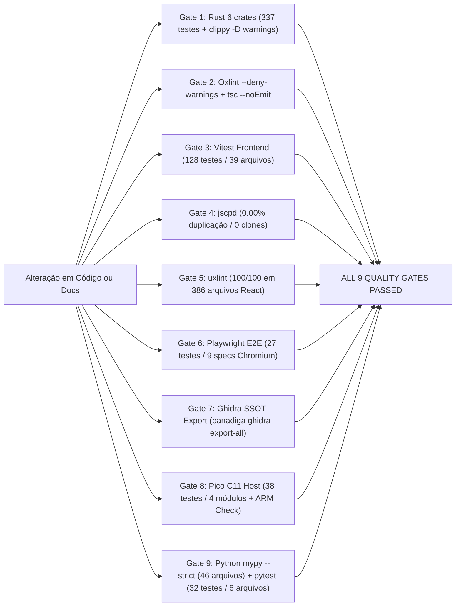

> 🌐 **Idioma / Language:** [English (US)](../en-US/TESTING_ARCHITECTURE_AND_COMPLIANCE.md) | **Português (BR)**
> 🧭 **Portal:** [Índice da Documentação](../INDEX.md) | [Auditoria Completa](../../AUDITORIA_COMPLETA.md) | [Auditorias](../audits/README.md) | [Pseudocódigo Ghidra](../pseudocode/INDICE_EVIDENCIA_PSEUDOCODIGO_GHIDRA.md) | [Logs de Debug](../debug_logs/README.md)

# Arquitetura de Testes & Matriz de Conformidade do Ecossistema Panadiga

## Validação Multicamadas: FP Pure Domain, MVVM Rigoroso, GDB Introspectivo & SSOT

> **Versão:** 2.2.0 | **Referência Atual dos 9 Quality Gates:** `337` Testes Rust Workspace (`6` crates), `128` Testes Vitest (`39` arquivos), `38` Testes C11 Host em `4` módulos (+ check ARM), `27` E2E Playwright (`9` specs), `32` Pytest (`6` arquivos) + `46` `mypy --strict`, `0%` Clones `jscpd`, `100/100` `uxlint` (`0` issues / `386` arquivos)  
> **Autores:** Equipe de Engenharia Reversa e Arquitetura de Sistemas Panadiga

---

## 1. Visão Geral & Filosofia de Testes

A evolução arquitetural do **Panadiga** exigiu uma reestruturação profunda da estratégia de testes. A abordagem anterior, baseada em testes pontuais e acoplados a arquivos físicos em disco, foi substituída por uma **Pirâmide de Testes Multicamadas** combinada a um **Portão Paralelo de 9 Quality Gates**:

```text
                          PIRÂMIDE DE TESTES PANADIGA
                                       ▲
                                      / \
                                     /   \
                                    / E2E \   (27 testes Playwright Chromium / 9 specs + CI/CD)
                                   /───────\
                                  /  MVVM   \  (128 Vitest / 39 arquivos + ExpressView + Logger + i18n)
                                 /───────────\
                                /  GDB & HAL  \ (38 testes C11 Host em 4 módulos + Check ARM RP2040/RP2350)
                               /───────────────\
                              /  FP Pure Domain \ (337 testes Rust em 6 crates: profiles/core/cli/desktop/mcp/rag)
                             /───────────────────\
```



---

## 2. Camada 1: FP Pure Domain (Testes sobre Fatias Imutáveis `&[u8]`)

### Objetivo Arquitetural

Desacoplar a lógica forense de baixo nível de operações de E/S em disco. Todas as operações matemáticas, de parsing e de decodificação são funções puras sobre fatias de memória imutáveis (`&[u8]`).

### Suíte de Testes Implementada

| Arquivo de Teste                      | Função / Módulo Testado              | Garantia de Conformidade                                                                                                                                                |
| :------------------------------------ | :-------------------------------------- | :---------------------------------------------------------------------------------------------------------------------------------------------------------------------- |
| `crates/panadiga-core/src/nvram/tests.rs` | `clean_nvram_slice(&[u8])`            | Testa a sanitização cirúrgica de microsetores SA134..SA141 diretamente em memória RAM, verificando integridade do bootloader e zeramento estrito da partição U99. |
| `crates/panadiga-core/src/hdd/inspect/tests.rs` | `inspect_hdd_slice_pure(&[u8])`       | Valida MBR proprietário Panasonic, tabela de espelho em LBA 57344 e partições de firmware sobre buffers sem tocar o sistema de arquivos.                             |
| `crates/panadiga-core/tests/entropy_math_tests.rs` | `calculate_entropy(&[u8])`            | Verifica o cálculo de entropia de Shannon (0.0 para sequências puras, 1.0 para binários alternados, 8.0 para distribuição uniforme).                               |
| `crates/panadiga-core/tests/crypto_codebook_tests.rs` | `test_real_frm_dump_toc_and_codebook` | Testa a dissecação da TOC periódica de 48 bytes e matriz de conhecidos pares de texto-plano do container `PANA_DVD.FRM`.                                           |

---

## 3. Camada 2: GDB Introspectivo & Protocolo de Hardware (P7501 Async UART / RSP)

### Objetivo Arquitetural

Garantir fidelidade protocolar absoluta na ponte de depuração serial-para-TCP, validação estrita de integridade contra corrupção de pacotes e isolamento do microcontrolador RP2040/RP2350.

### Suíte de Testes Implementada

| Arquivo de Teste                                     | Função / Módulo Testado              | Garantia de Conformidade                                                                                                                                                                                                             |
| :--------------------------------------------------- | :-------------------------------------- | :----------------------------------------------------------------------------------------------------------------------------------------------------------------------------------------------------------------------------------- |
| `crates/panadiga-core/tests/debugger_gdb_tests.rs`   | `test_gdb_rsp_checksum_calculation`   | Validação formal do cálculo de checksum de dois dígitos hexadecimais (`sum % 256`) para comandos RSP (`qSupported`, `g`, `?`, `c`, `s`, `OK`).                                                                     |
| `apps/desktop/src-tauri/src/pico/gdb_bridge.rs`      | `test_verify_and_classify_rsp_packet` | Testa o classificador formal de pacotes RSP: validação de prefixo `$`, delimitador `#`, cálculo de checksum e extração do tipo de comando.                                                                                  |
| `apps/desktop/src-tauri/src/pico/gdb_bridge.rs`      | `test_telemetry_ring_capacity`        | Valida o buffer circular introspectivo (`RingBuffer<GdbPacketTelemetryEvent>`): capacidade máxima fixa, rotação FIFO sem vazamentos e ordenação cronológica.                                                                 |
| `firmware/picofw/tests/` (`4` módulos, `38` suítes/funções) | Host C11 Firmware (`-Wall -Wextra -Werror` / `/W4 /WX`) | Protocolo GDB RSP, codecs `DIAGWATCH`/`PANARSP`/`DRVPANA`/`SDSNIFF`/`PIOLOGIC`, `VAULT VERIFY`, `IR VERIFY`, `DUMPNOR ff_blocks`, nibble-LUT CRC32 e guarda IPL `E05` (`test_gdb_rsp_host.c`: 13, `test_pana_logic.c`: 10, `test_pana_diag_drv.c`: 9, `test_uart_codec.c`: 6). |

---

## 4. Camada 3: MVVM Rigoroso, Subcomponentes & Logger Dedicado

### Objetivo Arquitetural

Substituição definitiva de booleanos soltos por máquinas de estado fechadas (ADTs / Discriminated Unions) na camada React, decomposição de componentes de responsabilidade única e centralização de logs estruturados.

### Suíte de Testes Implementada (Vitest)

| Arquivo de Teste                 | Componente / ViewModel                               | Garantia de Conformidade                                                                                                                                                                                               |
| :------------------------------- | :--------------------------------------------------- | :--------------------------------------------------------------------------------------------------------------------------------------------------------------------------------------------------------------------- |
| `useInCircuitErase.test.ts`    | `useInCircuitErase`                                | Testa os estados discretos (`idle`, `confirming`, `erasing`, `success`, `error`) e callbacks de log/sucesso durante o unbrick cirúrgico.                                                                    |
| `useSerialConsole.test.ts`     | `useSerialConsole`                                 | Valida o terminal interativo: anel de histórico de comandos, buffers de log com limite de capacidade e despacho de comandos.                                                                                          |
| `useGdbBridge.test.ts`         | `useGdbBridge`                                     | Testa transições da ponte GDB (`stopped`, `starting`, `running`, `stopping`, `error`), telemetria assíncrona e despacho de logs para a UI.                                                                |
| `GdbServerComponents.test.tsx` | `GdbServerControls` & `GdbExternalToolLaunchers` | Testa a decomposição do monólito GDB: exibição correta dos badges de estado, início/parada do servidor TCP e acionamento dos disparadores de ferramentas (GDB Multiarch, Ghidra, HxD, PowerShell). |
| `logger.test.ts`               | `PanadigaLogger`                                   | Valida o subsistema de logging do frontend: filtragem por severidade (`minLevel`), despacho para múltiplos sinks desacoplados, descarte de instâncias e resiliência contra falhas em sinks.                       |
| `translations.test.ts`         | `i18n` Engine                                      | Valida paridade completa entre dicionários `pt-BR` e `en-US` e resolução de chaves canônicas.                                                                                                                  |

---

## 5. Camada 4: Decomposição do CLI & SSOT de Constantes

### Objetivo Arquitetural

Garantir que argumentos de linha de comando sejam fortemente validados via Clap, que handlers atuem de forma determinística e que nenhuma constante física ou caminho de arquivo seja hardcoded fora do SSOT (`crates/panadiga-constants/src/constants/`).

### Suíte de Testes Implementada

| Arquivo de Teste            | Módulo Testado                                   | Garantia de Conformidade                                                                                                                                                                                        |
| :-------------------------- | :------------------------------------------------ | :-------------------------------------------------------------------------------------------------------------------------------------------------------------------------------------------------------------- |
| `crates/panadiga-core/tests/firmware_scan_tests.rs` | `test_cli_args_parsing_matrix` + testes scan | Valida parsing e desserialização tipada de subcomandos isolados (`memory-map`, `gdb-config`, `pico list`, `nvram clean`, etc.), aliases (`tui`, `verify`) e rejeição de comandos desconhecidos. |
| `crates/panadiga-core/tests/system_constants_tests.rs` | `test_constants_memory_map_and_candidate_paths` | Valida as 8 regiões de memória oficiais da arquitetura AM34/UniPhier, formatação de tabela ASCII para terminal, exportação de schema JSON canônico e presença de caminhos candidatos universais.        |
| `crates/panadiga-core/tests/pico_bench_tests.rs` | `test_all_host_controller_platforms_matrix` | Valida a matriz de identificação de hardware USB VID/PID para Raspberry Pi Pico, Pico W, Pico 2 (ARM/RISC-V) e compatíveis.                                                                                  |

---

## 6. Camada 5: End-to-End (E2E) & CI/CD Multiplataforma

### Cobertura Playwright (Chromium)

27 testes automatizados em 9 arquivos spec (`apps/desktop/e2e/`) verificam o comportamento visual e reativo da aplicação:

1. `calibration-and-tbc.spec.ts`: Pipelines de calibração `PAL-M`/`DAVIS`/`TBC` e fluxos visuais de bancada.
2. `express-mode.spec.ts`: Fluxo Express Rescue (Missões FAT16B SD, `PANAMON1` `U99`, NOR `8 MiB`, JIT `PicoConnectionSafetySheet`, CoW Vault `raw`/`frm`, ISO 9660 `1x` e gate `Mn103Vm`).
3. `frm-packager.spec.ts`: Inspeção criptográfica de `.FRM`, decodificação Feistel/TOC e fluxo do `Centro Unbrick`.
4. `hdd-safe-flash.spec.ts`: Bloqueio de disco de sistema, `HddCapacityPatcherCard` e fluxo CoW de gravação segura MEIHFS.
5. `ir-commander.spec.ts`: Controlador IR Kaseikyo, macros `SYS_SERV`, catálogo offline e envio USB-OTG/Android.
6. `navigation.spec.ts`: Carregamento do Dashboard, navegação fluida entre todas as telas (`NVRAM`, `MEIHFS`, `Pico`, `Manuais`, `Docs Interativos`) e continuidade de estado.
7. `nvram.spec.ts`: Renderização da Spansion NOR Flash `S29JL064H`, detalhamento dos 8 microsetores (`SA134..SA141`) e ações cirúrgicas.
8. `pico-bench.spec.ts`: Telemetria do controlador, pinagem verificada do conector `P7501` (`115200 8N1` + `NSW5V` Hi-Z), modos de boot e console serial interativo.
9. `pico-bgo-davis.spec.ts`: Diagnósticos interativos BGO FTL (`SA26..SA70`) e painel `DAVIS CH0/CH1` na `Bancada Pico`.

### Matriz de Integração Contínua (GitHub Actions & `scripts/validate.py`)

Todos os 9 Quality Gates são executados via `python scripts/validate.py`:

- **Android APK Build (Tauri 2.0 / ARM64)**: Compilação de binário Android com `cargo-ndk`.
- **Rust Workspace (`6` crates)**: `cargo fmt --all -- --check`, `cargo clippy --workspace --all-targets --no-deps -- -D warnings` e `cargo test --workspace` (**337 testes**, cobrindo `panadiga-profiles` com **89 modelos** e **12 JSON Schemas**, além de `logger.rs` isolado por thread).
- **Ghidra Generator & Python Tools**: `panadiga ghidra export-all` (scripts `.py` + suíte Java `tools/ghidra/java/`), `py_compile`, `mypy --strict scripts` (**46 arquivos**) e `pytest scripts/tests` (**32 testes em 6 arquivos**, incluindo `test_docs_parity.py` para paridade 1:1 de **39** pares em `translation_pairs.json` ↔ `docs/INDEX.md`, **22** capturas em `docs/debug_logs/`, guarda anti-hash obsoleto e validação de links internos).
- **Desktop UI**: `oxlint --deny-warnings && tsc --noEmit`, Vitest (**128 testes em 39 arquivos** em `apps/desktop/src/**/*.test.*`), `uxlint` (`100/100` com `--fail-on info`, `0` issues em **`386` arquivos**) e Playwright E2E (**27 testes em 9 specs**).
- **Code Quality & Duplication**: Detector de clones `jscpd` (**limite estrito 0% / 0 clones**).
- **Pico Firmware Dual Target**: Suíte C11 Host (`4` módulos, **38 suítes/funções de teste**, `-Wall -Wextra -Werror` / `/W4 /WX`) e checagem de compilação UF2 ARM Release para `RP2040` e `RP2350` dentro de `P0_FW_RO` (`256 KiB`).

---

## 7. Matriz de Rastreabilidade: Requisito Arquitetural ➔ Teste Protetor

| Requisito Arquitetural               | Problema Mitigado                                                                  | Teste Automatizado de Proteção                                                                 |
| :----------------------------------- | :--------------------------------------------------------------------------------- | :----------------------------------------------------------------------------------------------- |
| **FP Pure Domain**             | Regressão de decodificadores que dependiam de arquivos locais ou caminhos fixos.  | `nvram/tests.rs`, `hdd/inspect/tests.rs`, `test_entropy_calculation`                        |
| **MVVM Rigoroso**              | Telas travando em estado intermediário devido a flags booleanas soltas.           | `useInCircuitErase.test.ts`, `useGdbBridge.test.ts`, `useManualsViewModel`                     |
| **GDB Introspectivo**          | Corrupção de pacotes RSP ou estouro de buffer de telemetria em alta frequência. | `test_gdb_rsp_checksum_calculation`, `test_telemetry_ring_capacity`, `test_gdb_rsp_host.c` |
| **Conformidade NOR 2 Camadas & MMIO Letal** | Sobrescrita do IPL crítico (`SA0..SA10`), unlock silencioso na Camada 2 BGO (`SA11..SA133`) ou leitura letal de `0xC000100C`. | `policy.rs`, `safety/mod.rs`, `panadiga-rag/src/tests.rs`, `mcp_core_tests.rs` |
| **SRP em Componentes**         | Regressão nos launchers rápidos ou controles do socket TCP de depuração.       | `GdbServerComponents.test.tsx`, `docLinkResolver.test.ts`                                      |
| **Zero Raw Prints / Consoles** | Poluição de stdout que quebra integrações JSON-RPC de servidores MCP.          | `logger.test.ts`, `mcp_core_tests.rs`, `mcp_re_tests.rs`                                       |
| **SSOT de Constantes**         | Conflito de endereços de memória entre Ghidra, TUI, CLI e Desktop.               | `test_constants_memory_map_and_candidate_paths`, `test_system_constants_integrity`           |
| **Decomposição do CLI**      | Parsing silencioso ou argumentos ignorados entre subcomandos (`unbrick`, `re` etc.).| `cli_tests.rs`, `firmware_scan_tests.rs`                                                       |
