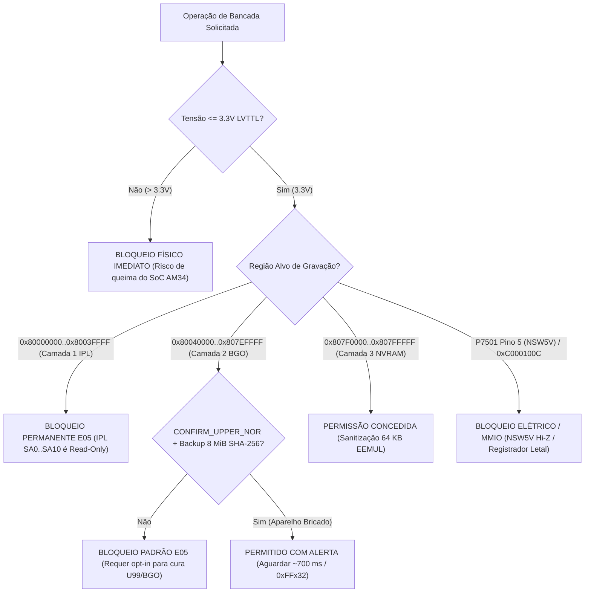

> 🌐 **Idioma / Language:** [English (US)](../en-US/SYSTEM_ARCHITECTURE_AND_ENGINEERING_BLUEPRINT.md) | **Português (BR)**
> 🧭 **Portal:** [Índice da Documentação](../INDEX.md) | [Auditoria Completa](../../AUDITORIA_COMPLETA.md) | [Auditorias](../audits/README.md) | [Pseudocódigo Ghidra](../pseudocode/INDICE_EVIDENCIA_PSEUDOCODIGO_GHIDRA.md) | [Logs de Debug](../debug_logs/README.md)

# Arquitetura de Sistemas e Blueprint de Engenharia
## Panadiga — Especificação Mestre de Decomposição Modular, Silício e Invariantes

> **Classificação:** Documento Mestre de Engenharia de Software e Hardware  
> **Escopo:** Workspace Rust (6 crates, `panadiga-profiles` data-driven), Desktop/Express UI (Tauri 2 / React 19), Firmware Pico RP2040/RP2350 Zero-Gadget, Android Mobile (OTG/BLE/IR), RAG & Forense  
> **Status:** Normativo / Aprovado  

---

## 1. Visão Geral da Arquitetura do Ecossistema

O **Panadiga** é uma suíte integrada de engenharia reversa, análise forense de armazenamento, recuperação de firmware (com foco na resolução do erro crítico **`U99`**) e instrumentação de baixo nível para **89 modelos** de gravadores digitais **Panasonic DIGA** (referência principal **DMR-EH55** no SoC **Matsushita AM34 / MN103S**, PCB `VEP79138`).

O sistema opera segundo o paradigma **Functional Core (100% Determinístico) + Imperative Shell** e **Camadas Desacopladas com Comunicação Unidirecional Restrita**:

```mermaid
flowchart TD
    subgraph Presentation["1. Camada de Apresentação e Host (UI & MVVM)"]
        DESKTOP["Desktop Workbench (Tauri 2 / React 19 / ExpressView)"]
        MOBILE["Android APK (aarch64 / USB-OTG / BLE / IrCommanderView)"]
        TUI["Terminal UI e CLI Unificada (panadiga / Clap v4 / Ratatui)"]
        VIEWMODELS["ViewModels Estritos (ADTs: EraseState / SerialState / GdbState)"]
        DESKTOP --- VIEWMODELS
        MOBILE --- VIEWMODELS
    end

    subgraph Orchestration["2. Orquestração, IPC & Serviços de Borda"]
        IPC["Tauri IPC Commands / Subprocess / PanadigaLogger"]
        MCP["Servidor MCP stdio (panadiga-mcp: 25 tools + profiles resources)"]
        RAG["Motor RAG Zero-Error (panadiga-rag: 6 escudos + 32 PDFs)"]
        VIEWMODELS --> IPC
    end

    subgraph Core["3. Functional Core 100% Determinístico & Data-Driven SSOT"]
        PROFILES["SSOT Relacional (panadiga-profiles + profiles/: 89 modelos, 12 Schemas, T0..T4)"]
        FP_FORENSICS["Pure Domain (slices imutáveis: MEIHFS, NVRAM, Vault raw/frm/recompiled, Entropia)"]
        EMULATOR["Gate Pré-Gravação Mn103Vm + Cleanroom FAT16B / ISO9660 / Streaming HDD"]
        GDB_BRIDGE["Bridge GDB RSP Introspectivo (:3333 / RingBuffer + Checksum)"]
        PROFILES --- FP_FORENSICS
        FP_FORENSICS --- EMULATOR
        IPC --> Core
        MCP --> Core
        RAG --> PROFILES
    end

    subgraph HAL["4. Sonda Zero-Gadget (P0_FW_RO = 256 KiB / RP2040 & RP2350)"]
        USB_SERIAL["Ponte USB-C OTG / CDC Virtual COM (Desktop & Android)"]
        BLE_NUS["Ponte Bluetooth BLE Nordic UART Service (Smartphone)"]
        UART_TRANS["Firmware C11/PIO (P7501 115200 8N1, VAULT VERIFY, IR VERIFY, DUMPNOR ff_blocks)"]
        GDB_BRIDGE --> USB_SERIAL
        GDB_BRIDGE --> BLE_NUS
        MOBILE --> BLE_NUS
        MOBILE --> USB_SERIAL
        USB_SERIAL --> UART_TRANS
        BLE_NUS --> UART_TRANS
    end

    subgraph TargetHW["5. Alvo Físico de Silício (Panasonic DIGA VEP79138)"]
        P7501["Conector P7501 (JST B6B-ZR-3R4 'TO JIGU')"]
        SOC["SoC Matsushita AM34 (MN103S)"]
        FLASH["NOR Flash Spansion S29JL064H (IC5001, 8 MB TSOP-48)"]
        HDD["Disco PATA/IDE / SATA (MEIHDFS / MBR 'SH')"]
        UART_TRANS <-->|"UART 115200 8N1 (3.3V LVTTL / NSW5V Hi-Z / XRESET Open-Drain)"| P7501
        P7501 <--> SOC
        SOC <--> FLASH
        SOC <--> HDD
    end
```

---

## 2. Princípios de Engenharia e Padrões Aplicados

### 2.1 Pure FP Domain (Programação Funcional Pura no Domínio Forense)
A manipulação de estruturas de baixo nível (como imagens brutas de disco de 80 GB–500 GB e dumps da memória Flash de 8 MB) foi completamente desacoplada de operações de I/O de disco e estado mutável:
- **Zero I/O no Núcleo de Parsing**: Funções como `inspect_hdd_slice_pure(&[u8])`, `clean_nvram_slice(&[u8])` e `calculate_entropy(&[u8])` aceitam exclusivamente fatias de memória imutáveis (`&[u8]`).
- **Determinismo Matemático**: Para qualquer entrada idêntica, a saída é 100% reproduzível, permitindo testes unitários sem necessidade de criar arquivos físicos temporários em disco.
- **Isolamento de Erros**: Falhas de leitura física de disco são tratadas na fronteira de I/O, impedindo corrupção acidental de evidências periciais.

### 2.2 MVVM Rigoroso com ADTs (Algebraic Data Types)
No frontend (React 18 / TypeScript), eliminou-se completamente o antipadrão de *flags booleanas dispersas* (`isLoading`, `isErasing`, `isConnecting`, etc.):
- **Estados Mutuamente Exclusivos**: Cada fluxo de longa duração é modelado como uma **União Discriminada (Tagged Union)**:
  ```typescript
  export type EraseFlowState =
    | { status: 'idle' }
    | { status: 'confirming'; target: string }
    | { status: 'erasing'; progress: number; currentSector: string }
    | { status: 'success'; sectorsErased: number; durationMs: number }
    | { status: 'failed'; error: string; code: string };
  ```
- **Impossibilidade de Estados Ilegais**: É matematicamente impossível a interface exibir simultaneamente "carregando" e "sucesso", assegurando cobertura explícita dos estados monitorados pelo `uxlint` (`ux-guard`).

### 2.3 GDB Introspectivo e Telemetria Circular Sem Perdas
A depuração in-circuit do núcleo AM34 através do conector P7501 exige taxa de transmissão de dados contínua:
- **Anel Circular em Memória (`GdbTelemetryRingBuffer`)**: Armazena os últimos $N$ eventos de barramento com capacidade fixa, evitando alocação contínua de memória durante sessões de depuração prolongadas.
- **Validação Formal de Checksums RSP**: Cada pacote recebido (`$<dados>#<checksum>`) passa por verificação léxica rigorosa. Pacotes corrompidos disparam retransmissão imediata (`-`), blindando o depurador contra ruído eletromagnético em bancada.

### 2.4 SSOT Data-Driven, Codegen Multi-Alvo e Zero Hardcode
- **Perfis Relacionais & Portão `T0..T4` (`panadiga-profiles` + `profiles/`):** A crate dedicada [`crates/panadiga-profiles/`](../../crates/panadiga-profiles/) modela **89 gravadores DIGA** em 10 famílias relacionais (`soc_cores`, `socs`, `boards`, `flash_chips`, `eeprom_chips`, `firmware_trains`, `nor_layouts`, `media_formats`, `models`) validadas contra **12 JSON Schemas** Draft 2020-12 (`profiles/schema/`), gerando código SSOT sincronizado para TypeScript ([`apps/desktop/src/models/generated/`](../../apps/desktop/src/models/generated/)) e C11 ([`firmware/picofw/generated/picofw_ssot.h`](../../firmware/picofw/generated/picofw_ssot.h)).
- **Constantes Canônicas & Catálogo Visual:** O módulo [`crates/panadiga-constants/src/constants/`](../../crates/panadiga-constants/src/constants/) e [`hardware_catalog.json`](../../crates/panadiga-core/src/ssot/hardware_catalog.json) são a única autoridade para mapas AM34, regiões BGO e pinagens `P7501`.
- **Tolerância Zero a Clones (`jscpd`):** Toda a codebase mantém **0.00% de duplicação** (`threshold: 0`).

### 2.5 Cofre Forense, Emulador `Mn103Vm` e Isolamento de Logging
- **Isolamento Estrito de Artefatos (`vault/` & `ingest/`):** Separa fisicamente capturas `raw/`, contêineres `.FRM` (`frm/`) e saídas recompiladas (`recompiled/`), garantindo que imagens cleanroom FAT16B (`32 MiB`), ISO 9660 e *streaming flash* composto MEIHFS passem pelo gate pré-gravação na VM **`Mn103Vm`** (`re/prewrite_gate/`) antes de tocar qualquer mídia.
- **Logging Determinístico Sem Poluição:** Proibição estrita de `println!`/`console.log` soltos em produção. `crates/panadiga-core/src/logger.rs` suporta overrides *thread-local* (`with_thread_log_level` / `ThreadLogSinkGuard`) garantindo determinismo em testes paralelos (`cargo test`).

### 2.6 Decisão Arquitetural v0.2.0 — Sonda Pico Zero-Gadget + Celular/Desktop
- Em vez de acoplar displays OLED `SSD1306`, buzzers ou botões externos à sonda Raspberry Pi Pico (que introduziriam ruído elétrico, dependência de montagem e pressão de espaço), o **Smartphone Android (via USB-C OTG ou BLE NUS)** e o **Workbench Desktop Tauri 2** (com o **Modo Express Rescue** em `ExpressView.tsx` e **DIGA Commander IR** em `IrCommanderView.tsx`) atuam como visor, síntese áudio/visual e controlador IR. A sonda mantém-se compacta (`~157–160 KiB` dentro da partição `P0_FW_RO` de `256 KiB`) realizando UART `P7501`, GDB RSP, `VAULT VERIFY <1..3>`, `IR VERIFY <12hex>`/`IRTX`/`IRRX`, `DUMPNOR ff_blocks` e CRC32 nibble-LUT.

---

## 3. Blueprint do Silício e Invariantes Físicas do Panasonic DMR-EH55

### 3.1 Mapeamento Físico de Memória do SoC AM34 (MN103S)

| Faixa de Endereços Físicos | Tamanho | Tipo de Memória / Periférico | Propósito no Firmware Matsushita |
| :--- | :---: | :--- | :--- |
| `0x00000000` – `0x03FFFFFF` | 64 MB | SDRAM Principal (32-bit @ 162 MHz) | Código executável do sistema operacional, buffers de vídeo OSD e heaps. |
| `0x04000000` – `0x07FFFFFF` | 64 MB | SDRAM de Vídeo / Áudio (MPEG-2) | Buffers circulares de compressão/descompressão de stream de transporte. |
| `0x80000000` – `0x807EFFFF` | 8.128 KB | NOR Flash Spansion (`IC5001` / CS0; *uncached* CS1 `0x84000000`) | **IPL Protegido (`256 KiB` `SA0..SA10` [política `SA0..SA3`] RO estrito)** + `DRV` (`0x84080000`) + BGO real EH55 `ver0.61` (`SA26..SA70` `0x84130000..0x843FFFFF` vs `ver0.63` `0x84200000..0x843FFFFF`) + Upper EEMUL (`SA71..SA133` `0x84400000..0x847EFFFF`). |
| `0x807F0000` – `0x807FFFFF` | 64 KB | NOR Flash Spansion (NVRAM / EEMUL Topo) | **Área de Escrita Cirúrgica.** Setores `SA134..SA141` (`0x847F0000..0x847FFFFF`; no dump real EH55, `SA134` tem `6 B` `"1284"` e `SA135..SA141` estão `0xFF`). |
| `0xD0000000` – `0xD0003FFF` | 16 KB | SRAM Interna do SoC (Uncached) | Hospeda o `ram_loader` injetado pelo Pico durante o Cold Break-In. |
| `0xD4000000` – `0xD4000FFF` | 4 KB | Registradores MMIO do Controlador PATA | Comandos ATA/ATAPI, canais DMA e transferência de blocos do HDD interno. |
| `0xD8000000` – `0xD80001FF` | 512 B | Registradores do Servo Óptico DVD | Controle de foco, tracking, velocidade do spindle e laser de gravação. |
| `0xE0000000` – `0xE000003F` | 64 B | Registradores On-Chip Debug (OCD) | Registrador de controle e status DCSR, breakpoints por hardware e passo único. |

---

## 4. Matriz de Segurança e Prevenção de Danos Físicos



1. **Invariante 1: Tensão Máxima de 3.3V & Proteção `NSW5V` + MMIO Letal**: Os sinais lógicos de comunicação e controle em `P7501` (`SW_UART`, `XRESET` Open-Drain, `UARTM2P_T`, `UARTP2M_T`) e a Flash `IC5001` operam em **3.3V LVTTL**; o **Pino 5 (`NSW5V` / `GP3`)** provém de `IC1506` (`~5.15V` via `D7510`, medido `~3.29V` em repouso) e **DEVE permanecer SEMPRE como entrada `Hi-Z` sem pulls (NUNCA dirigir push-pull!)**, e o registrador `0xC000100C` é estritamente bloqueado (trava barramento/WDT).
2. **Invariante 2: Isolamento de Alimentação da Porta `P7501` & Conformidade NOR em 2 Camadas**: Nunca alimente o Pico por `P7501`. Na `IC5001`, a **Camada 1 IPL (`SA0..SA10`, `256 KiB` iniciais)** é **imutável (`E05`)**, enquanto a **Camada 2 Upper NOR/BGO (`0x80040000..0x807EFFFF`)** só abre via `CONFIRM_UPPER_NOR` após alerta de risco e backup SHA-256 completo de `8 MiB` para curar gravadores já bricados em `U99`.
3. **Invariante 3: Imutabilidade de Evidências Forenses**: Dumps originais de disco rígido MEIHFS e da Flash Spansion jamais são sobrescritos in-place; a ferramenta opera sempre sobre cópias de trabalho com conferência criptográfica SHA-256.
