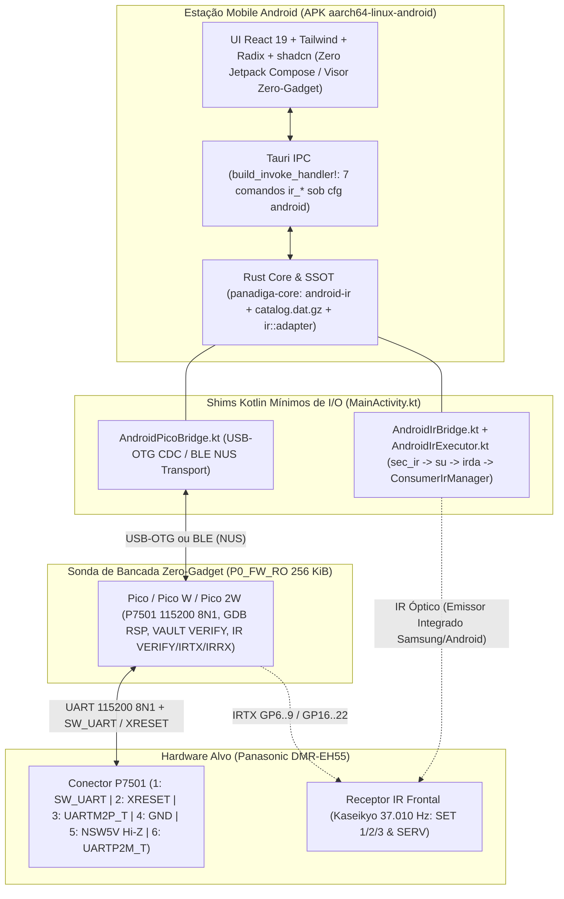
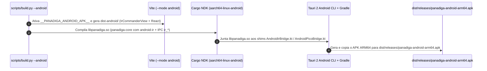

> 🌐 **Idioma / Language:** [English (US)](../en-US/ANDROID_APK_AND_BLUETOOTH_ARCHITECTURE.md) | **Português (BR)**
> 🧭 **Portal:** [Índice da Documentação](../INDEX.md) | [Auditoria Completa](../../AUDITORIA_COMPLETA.md) | [Auditorias](../audits/README.md) | [Pseudocódigo Ghidra](../pseudocode/INDICE_EVIDENCIA_PSEUDOCODIGO_GHIDRA.md) | [Logs de Debug](../debug_logs/README.md)

# Arquitetura Mobile (Android APK), Shims Kotlin Mínimos e Conectividade Sem Fio (BLE)
## Panadiga Workbench Mobile — Especificação Unificada (Rust SSOT + React/Radix/shadcn + Kotlin I/O Shim)

> **Classificação:** Documento Técnico de Arquitetura e Engenharia de Sistemas  
> **Dispositivo-Alvo:** Tablets/Smartphones Android (`Dual-ABI Universal arm64-v8a + armeabi-v7a`: `aarch64-linux-android` + `armv7-linux-androideabi`, homologado em Samsung `SM-T805` Android `10` API `29` / `SM-T805M` / `GT-N8000`) & Sondas Raspberry Pi Pico / Pico W / Pico 2  
> **Equipamento Sob Depuração:** Panasonic DIGA DMR-EH55 (Placa Digital `VEP79138`, Conector `P7501` e Receptor IR `Kaseikyo`)  
> **Status:** Normativo / Homologado em Hardware Real (`dist/releases/panadiga-android-arm64.apk`, `compileSdk = 36`, `targetSdk = 34`, `minSdk = 24`, assinatura `v1 + v2 + v3`)  

---

## 1. Visão Geral da Solução Mobile

Para habilitar a operação de bancada em campo, telemetria UART/GDB sem cabo acoplado ao notebook e disparo direto de comandos/macros de serviço IR no **Panasonic DMR-EH55**, o ecossistema **Panadiga** compila um APK unificado (**`dist/releases/panadiga-android-arm64.apk`**) com **Zero Jetpack Compose**, combinando:

1. **Interface Unificada React 19 + Tailwind CSS + Radix UI + shadcn UI** ([`IrCommanderView.tsx`](../../apps/desktop/src/views/IrCommanderView.tsx), `apps/desktop/src/components/ir/*` e painel de sonda `P7501`), empacotada exclusivamente via `vite --mode android` e [`tauri.android.conf.json`](../../apps/desktop/src-tauri/tauri.android.conf.json) em `dist-android/`.
2. **Núcleo & SSOT em Rust (`aarch64-linux-android`):** [`panadiga-core::ir`](../../crates/panadiga-core/src/ir/mod.rs) concentra o catálogo comprimido `panasonic_ir_catalog.dat.gz` (`1.763` codesets / `14.744` modelos / `80.047` comandos), as 14 macros declarativas (`ir_macros_ssot.json`), o adaptador de hardware Exynos/AOSP (`adapter.rs`) e a HAL serial/BLE de bancada integrada ao **modelo de sonda zero-gadget** (o smartphone atua como visor, áudio e controlador IR em `P0_FW_RO = 256 KiB`, dispensando OLED ou botões externos no Pico).
3. **Shims Kotlin Mínimos de I/O (`AndroidIrBridge.kt` / `AndroidPicoBridge.kt`):** Restritos estritamente ao encaminhamento de chamadas de hardware do sistema Android (USB Host, sysfs `sec_ir` com cascata `su`, reflexão `irda` e `ConsumerIrManager`) sem lógica de negócio no Kotlin.



---

## 2. Decisão Arquitetural: Shims Kotlin Mínimos + Rust SSOT & Isolamento Zero-Leakage

A arquitetura mobile substituiu a premissa original de "Zero Kotlin" por **Shims Kotlin Mínimos de I/O**, preservando **100% das regras de protocolo, codificação Kaseikyo e catálogo na SSOT em Rust** e mantendo **Zero Jetpack Compose** na interface.

### 2.1 Por que Shims Kotlin Mínimos (em vez de WebUSB ou Kotlin Monolítico)?
1. **APIs Android Sem Exposição Direta via NDK/WebUSB:** O acesso nativo ao emissor IR do Samsung Galaxy Tab S (`SM-T805M`, `/sys/class/sec/sec_ir/ir_send` e *escalation* via Magisk `su`), ao serviço legado `irda`, ao `ConsumerIrManager` e às permissões `UsbManager` de OTG exigem chamadas às APIs Java/Android do SDK. Isolá-las em shims finos ([`AndroidIrBridge.kt`](../../apps/desktop/src-tauri/gen/android/app/src/main/java/com/panasonic/diga/engineering/ir/AndroidIrBridge.kt), [`AndroidIrExecutor.kt`](../../apps/desktop/src-tauri/gen/android/app/src/main/java/com/panasonic/diga/engineering/ir/AndroidIrExecutor.kt) e [`AndroidPicoBridge.kt`](../../apps/desktop/src-tauri/gen/android/app/src/main/java/com/panasonic/diga/engineering/AndroidPicoBridge.kt), registrados em [`MainActivity.kt`](../../apps/desktop/src-tauri/gen/android/app/src/main/java/com/panasonic/diga/engineering/MainActivity.kt)) evita reescrever drivers frágeis no JavaScript e impede que regras de negócio vazem para o Kotlin.
2. **UI Única React 19 + Radix + shadcn (`IrCommanderView.tsx`):** Toda a experiência mobile reutiliza o mesmo stack declarativo React/Tailwind/Radix/shadcn do workbench, evitando manter uma segunda base de interface em Jetpack Compose.
3. **Sem WebUSB / Web Bluetooth no Motor JS:** Todo o parsing de frames `P7501` / GDB RSP e o empacotamento Kaseikyo permanecem no Rust/C11 sem jitter de GC no caminho crítico.

### 2.2 Isolamento Estrito Zero-Leakage no Build Desktop
Os artefatos exclusivos de Android IR (`DIGA IR Commander` e o catálogo de `80.047` comandos) **NUNCA vazam para os binários Desktop** (`.exe`, `.deb`, `.dmg`), garantido por três barreiras em tempo de compilação:
1. **Cargo Feature Gate (`android-ir`):** Em [`crates/panadiga-core/Cargo.toml`](../../crates/panadiga-core/Cargo.toml), a feature `android-ir` vem **desativada por padrão** (`default = []`) e só é compilada em `#[cfg(any(target_os = "android", test, feature = "android-ir"))]` (e em `[dev-dependencies]` para testes).
2. **Tauri IPC Macro Gate (`build_invoke_handler!`):** Em [`apps/desktop/src-tauri/src/lib.rs`](../../apps/desktop/src-tauri/src/lib.rs), a macro `build_invoke_handler!` restringe os **7 comandos `ir_*`** exclusivamente a `#[cfg(target_os = "android")]`.
3. **Vite Compile-Time Tree-Shaking (`__PANADIGA_ANDROID_APK__`):** Definida em [`apps/desktop/vite.config.ts`](../../apps/desktop/vite.config.ts), a constante `__PANADIGA_ANDROID_APK__` é dobrada em tempo de compilação para eliminar rotas, chunks de [`IrCommanderView.tsx`](../../apps/desktop/src/views/IrCommanderView.tsx) e referências ao `panasonic_ir_catalog.dat.gz` nos pacotes Desktop.

### 2.3 Shims Kotlin (`__PANADIGA_IR_BRIDGE__`) & Cascata Hardware Samsung/AOSP
* [`MainActivity.kt`](../../apps/desktop/src-tauri/gen/android/app/src/main/java/com/panasonic/diga/engineering/MainActivity.kt) injeta duas interfaces WebView determinísticas:
  * `window.__PANADIGA_ANDROID_BRIDGE__` ([`AndroidPicoBridge.kt`](../../apps/desktop/src-tauri/gen/android/app/src/main/java/com/panasonic/diga/engineering/AndroidPicoBridge.kt)) — transporte serial USB-OTG para a sonda Pico.
  * `window.__PANADIGA_IR_BRIDGE__` ([`AndroidIrBridge.kt`](../../apps/desktop/src-tauri/gen/android/app/src/main/java/com/panasonic/diga/engineering/ir/AndroidIrBridge.kt)) — ponte de disparo IR delegada a [`AndroidIrExecutor.kt`](../../apps/desktop/src-tauri/gen/android/app/src/main/java/com/panasonic/diga/engineering/ir/AndroidIrExecutor.kt).
* **Cascata Automática de Emissão em `AndroidIrExecutor.kt`:**
  1. `sysfs_direct`: escrita direta em `/sys/class/sec/sec_ir/ir_send`.
  2. `sysfs_su_unlock`: desbloqueio via Magisk `su` (`chmod 0666` / `chown system:radio` em `/sys/class/sec/sec_ir/ir_send`).
  3. `sysfs_su`: *pipe* via `su` (`echo > /sys/class/sec/sec_ir/ir_send`).
  4. `legacy_irda`: invocação por reflexão do serviço `irda` (`write_irsend`).
  5. `consumer_ir_manager`: API padrão Android `ConsumerIrManager`.

### 2.4 Adaptação de Temporização Hardware em `panadiga-core::ir::adapter`
O módulo [`crates/panadiga-core/src/ir/adapter.rs`](../../crates/panadiga-core/src/ir/adapter.rs) gera payloads Kaseikyo (`37.010 Hz` em [`kaseikyo.rs`](../../crates/panadiga-core/src/ir/kaseikyo.rs)) compatíveis com cada controlador infravermelho e com o fallback da sonda Pico:
* **Exynos `SM-T805M` (`universal5420` / `chagall`):** seleciona o modo **`PeriodScaled`** (`1_000_000 / hz`), impondo teto seguro `MAX_AOSP_XMIT_TIME_US = 1_900_000` e `MAX_HARDWARE_TRAIL_SPACE_US = 45_000`.
* **Exynos Legado `GT-N8000` (`smdk4x12`):** seleciona o modo **`CarrierCycles`** para o microcontrolador IR acoplado ao kernel Samsung antigo.
* **Fallback Pico via USB-OTG / BLE:** traduz qualquer comando do catálogo para o protocolo `IRTX <DEVSUB>:<CMD> GP<pin> <repeat>` no firmware C11 ([`p7501_ir_codec.c`](../../firmware/pico-p7501/diag/p7501_ir_codec.c)), restrito aos GPIOs livres seguros (`GP6..9` / `GP16..22`) com código de dispositivo `>= 0x01`.

---

## 3. Conectividade Sem Fio via Bluetooth Low Energy (BLE)

### 3.1 Perfil de Comunicação: Nordic UART Service (NUS)
O firmware do Raspberry Pi Pico W / Pico 2W expõe o serviço padrão **Nordic UART Service (NUS)** sobre o chip de rádio Infineon/CYW43439:

| Atributo GATT | UUID Oficial | Propriedades | Função |
| :--- | :--- | :--- | :--- |
| **Service (NUS)** | `6E400001-B5A3-F393-E0A9-E50E24DCCA9E` | Primary Service | Canal virtual serial transparente via BLE |
| **RX Characteristic** | `6E400002-B5A3-F393-E0A9-E50E24DCCA9E` | Write Without Response / Write | Envio de comandos do Rust Core para o Pico (ex: Cold Break-In, GDB RSP) |
| **TX Characteristic** | `6E400003-B5A3-F393-E0A9-E50E24DCCA9E` | Notify / Read | Envio de telemetria e respostas de registradores do Pico para o Rust Core |

### 3.2 Desmistificação: Determinismo de Hardware vs. Conexão Bluetooth
Uma dúvida recorrente em engenharia de hardware é se o uso de Bluetooth geraria *jitter* excessivo para protocolos seriais de baixo nível e controle de reset na interface `P7501`:

> [!IMPORTANT]
> **O Bluetooth NUNCA faz bit-banging direto dos pinos de bancada.**  
> Os transceptores PIO / UART a `115200 8N1` e o controle sub-milissegundo de `SW_UART` / `XRESET` Open-Drain (subida Hi-Z em `~20 µs`) são executados **localmente dentro do microcontrolador Pico (RP2040 / RP2350)**.  
> O canal Bluetooth atua exclusivamente na camada superior (transporte assíncrono de pacotes de comando e telemetria forense gerenciado pela HAL em Rust), onde latências de $15\text{ ms}$ a $25\text{ ms}$ são perfeitamente imperceptíveis para a operação humana e para o protocolo GDB RSP assíncrono.

---

## 4. Rigor Elétrico de Bancada: Pinagem e Alimentação da Porta J (P7501)

### 4.1 Proibição Absoluta de Alimentar o Pico pela Placa Panasonic

> [!CAUTION]
> **REGRA DE OURO DE SEGURANÇA FÍSICA: NUNCA ALIMENTE O RASPBERRY PI PICO PELO CONECTOR P7501 E MANTENHA `NSW5V` (`GP3`) EM `Hi-Z`.**  
> Os sinais lógicos de comunicação e controle em `P7501` (`SW_UART`, `XRESET`, `UARTM2P_T`, `UARTP2M_T`) operam em nível de $3.3\text{V}$ LVTTL com capacidade de corrente restrita a controle/sensoriamento ($< 10\text{ mA}$). Já o **Pino 5 (`NSW5V`)** provém de `IC1506` (`~5.15V` via `D7510`, `~3.29V` em repouso) e deve permanecer **SEMPRE como `Hi-Z Input` sem pulls** em `GP3` (NUNCA dirigir push-pull!).  
> O Raspberry Pi Pico normal consome entre $30\text{ mA}$ e $50\text{ mA}$, e o **Pico W / Pico 2W atinge picos de $150\text{ mA}$ a $300\text{ mA}$ durante transmissões de rádio Wi-Fi/Bluetooth**.  
> Tentar alimentar o Pico pelo conector `P7501` ou dirigir `GP3` em push-pull causará **queda da barra de alimentação/supervisão**, acionamento de reset (`XRESET`) ou dano elétrico na PCB da Panasonic.

### 4.2 Topologia Correta de Alimentação e Aterramento
1. **Alimentação do Pico**:
   - Conectar o Pico a uma fonte de alimentação externa de $5.0\text{V}$ no pino `VSYS` (Pino 39 da placa Pico) ou via porta micro-USB/USB-C (ou powerbank/LiPo dedicada via módulo de regulação USB).
2. **Referência de Terra (GND)**:
   - O Pino 4 do conector `P7501` (GND da Panasonic) **DEVE** ser interligado ao `GND` do Pico (Pino 38) para equalizar o potencial elétrico do barramento UART (`0.0 Ω` ao chassi).
3. **Sensoriamento Seguro (`SW_UART` / `NSW5V`)**:
   - O Pino 1 (`SW_UART`) conecta-se a `GP26 / ADC0` para leitura de presença (`~3.25V` Hi-Z / `~2.69V` PD via `Q7510`) e seleção de serial boot em `LOW`.
   - O Pino 5 (`NSW5V`) conecta-se a `GP3` configurado estritamente como **`Hi-Z Input` sem pulls** (apenas leitura passiva).

### 4.3 Tabela Canônica de Pinagem Verificada do Conector `P7501` (`B6B-ZR-3R4`)

| Pino `P7501` | Sinal Matsushita (`VEP79138`) | Pino Pico (`RP2040`/`RP2350`) | Condicionamento & Regra Elétrica | Função Verificada no Ecossistema |
| :---: | :---: | :---: | :---: | :--- |
| **1** | **`SW_UART`** (`(D)`) | `GP26 / ADC0` (Pino 31) | Entrada ADC / Open-Drain `LOW` | Seleção de boot (`LOW` aciona serial boot e corta `Q7514`; `Hi-Z` habilita TX UART ao SoC) |
| **2** | **`XRESET`** | `GP5` (Pino 7) | **Dreno Aberto (*Open-Drain*)** estrito | Reset mestre do sistema (`QR7503`, ativo `0V`; proibido dirigir `3.3V` push-pull!) |
| **3** | **`UARTM2P_T`** (`MAX RXD`) | `GP4` (Pino 6 / TX Pico) | UART TX `115200 8N1` (sem pull-up externo) | Transmissão do Pico para o AM34 (via `Q7514` com `R7570 10 kΩ` interno para `NSW5V`) |
| **4** | **`GND`** | `GND` (Pino 38) | Ligação direta de baixa impedância ($0.0\,\Omega$) | **Terra comum obrigatório entre gravador e microcontrolador** |
| **5** | **`NSW5V`** (`X_SW_5R2V`) | `GP3` (Pino 5) | **SEMPRE `Hi-Z Input` sem pulls** | Barramento `~5.15V` de `IC1506` via `D7510` (`~3.29V` repouso) — **PROIBIDO dirigir push-pull ou alimentar Pico!** |
| **6** | **`UARTP2M_T`** (`MAX TXD`) | `GP2` (Pino 4 / RX Pico) | UART RX `115200 8N1` (Pad Quadrado na PCB) | Recepção de console/boot do AM34 (`R7535`/`R7572 10 kΩ`) |

---

## 5. Pipeline de Compilação do APK Unificado

O empacotamento Android compila o frontend exclusivamente com `--mode android` (`vite --mode android` → `dist-android/`), habilita a feature `android-ir` no Rust Core via [`tauri.android.conf.json`](../../apps/desktop/src-tauri/tauri.android.conf.json) e incorpora os shims Kotlin mínimos em `MainActivity.kt` através da lane [`scripts/build_lanes/android.py`](../../scripts/build_lanes/android.py) (invocada por [`scripts/build.py`](../../scripts/build.py)):



> [!NOTE]
> **Builds Desktop Isolados:** Quando `vite build` roda sem `--mode android` (`__PANADIGA_ANDROID_APK__ = false`) e o Cargo compila para `x86_64` / host Desktop sem `android-ir`, zero código, rota ou catálogo do **DIGA IR Commander** entra nos binários `.exe` / `.deb` / `.dmg`.

### 5.1 Como Compilar Manualmente em Ambiente Local
Caso o engenheiro deseje gerar o APK localmente em sua máquina de bancada:

```powershell
# 1. Configurar variáveis de ambiente do SDK e NDK
$env:ANDROID_HOME = "C:\Users\<Usuario>\AppData\Local\Android\Sdk"
$env:NDK_HOME = "$env:ANDROID_HOME\ndk\27.0.12077973"

# 2. Adicionar targets Rust para arquitetura Dual-ABI (ARM64 + ARMv7)
rustup target add aarch64-linux-android armv7-linux-androideabi

# 3. Disparar o build unificado, assinatura v1+v2+v3 e validação via python
npm run build:android
# ou via orquestrador Python (emite dist/releases/panadiga-android-arm64.apk validado):
python scripts/build.py --android
```

O APK universal final empacota `lib/arm64-v8a/libpanadiga_lib.so` e `lib/armeabi-v7a/libpanadiga_lib.so` (`compileSdk = 36`, `targetSdk = 34`, `minSdk = 24`, `jniLibs.useLegacyPackaging = true`), recebe alinhamento `zipalign -p -f 4` e assinatura `v1 + v2 + v3` com o keystore de bancada (`panadiga-bench.keystore`, gerado automaticamente via `ensure_bench_keystore` quando ausente), e passa pelo portão [`android_verify.py`](../../scripts/build_lanes/android_verify.py) (`zipalign -c 4`, `apksigner verify -v --min-sdk-version 21` e `aapt2 dump xmltree`) antes de ser publicado em `dist/releases/panadiga-android-arm64.apk` (verificado via ADB em `SM-T805` com `primaryCpuAbi=armeabi-v7a`).

---

## 6. Procedimento de Operação de Campo com o App Mobile

### 6.1 Fluxo A — Sonda `P7501` via BLE NUS ou USB-C OTG
1. **Energização Externa da Sonda**: Alimente o Raspberry Pi Pico / Pico W via powerbank ou porta USB externa de bancada (nunca pelo conector `P7501`).
2. **Conexão Física Segura**: Com o DMR-EH55 desligado da tomada, acople o conector JST ZR de 6 pinos ao header `P7501` (`VEP79138`).
3. **Emparelhamento (`__PANADIGA_ANDROID_BRIDGE__` / BLE NUS)**: No aplicativo Android, conecte-se via **USB-OTG** ou **BLE NUS (`6E400001-...`)**.
4. **Telemetria e Diagnóstico**:
   - Ligue o gravador Panasonic e execute **`PINCHECK`**, **`JIGBOOT`** ou **`UARTMON` (`115200 8N1`)**. O Pico gerencia `SW_UART` (`GP26`) e `XRESET` Open-Drain (`GP5`), mantendo `NSW5V` (`GP3`) estritamente em **`Hi-Z Input`**.

### 6.2 Fluxo B — Emissão Infravermelha (`DIGA IR Commander`)
1. Abra a aba **IR Commander** ([`IrCommanderView.tsx`](../../apps/desktop/src/views/IrCommanderView.tsx)) e escolha o perfil `DMR-EH55` (`EUR7659Y70`) ou uma das **14 macros declarativas verificadas** (`ir_macros_ssot.json`).
2. O backend Rust calcula o padrão Kaseikyo em `37.010 Hz` ([`adapter.rs`](../../crates/panadiga-core/src/ir/adapter.rs), modo `PeriodScaled` em `SM-T805M` ou `CarrierCycles` em `GT-N8000`) e dispara pela cascata de [`AndroidIrExecutor.kt`](../../apps/desktop/src-tauri/gen/android/app/src/main/java/com/panasonic/diga/engineering/ir/AndroidIrExecutor.kt) (`/sys/class/sec/sec_ir/ir_send`, desbloqueio `su` se necessário, `irda` ou `ConsumerIrManager`).
3. Caso o tablet/celular não possua emissor IR integrado, selecione o modo **Fallback Pico (`IRTX`)** via USB-OTG/BLE para emitir `IRTX <DEVSUB>:<CMD> GP<pin> <repeat>` nos pinos livres seguros `GP6..9` / `GP16..22`.
