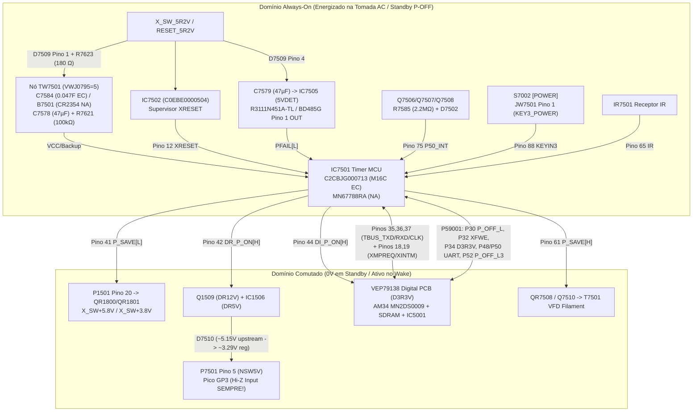
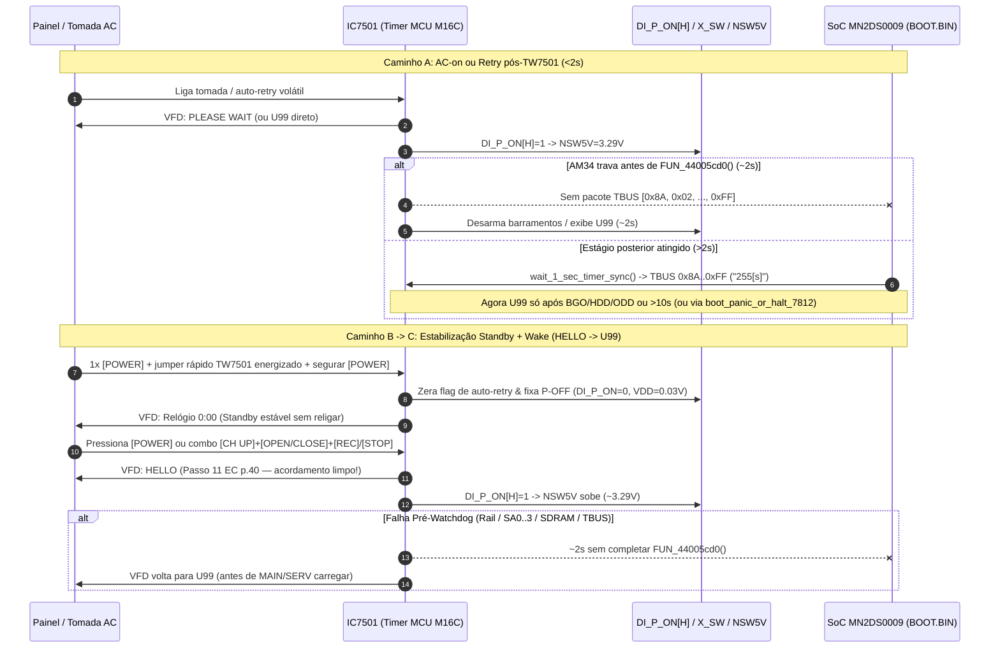

# Arquitetura de Standby (`IC7501`), Barramento `TBUS`, Circuito `TW7501` e Estados de Boot (`DMR-EH55`)

> 🌐 **Idioma / Language:** **Português (Brasil)** | [English (`STANDBY_IC7501_TBUS_TW7501_AND_BOOT_STATES_ARCHITECTURE.md`)](../en-US/STANDBY_IC7501_TBUS_TW7501_AND_BOOT_STATES_ARCHITECTURE.md) · [Portal `docs/INDEX.md`](../INDEX.md) · [Compêndio Global](./COMPENDIO_GLOBAL_COMUNIDADE_FIRMWARE_E_HARDWARE_DIGA.md) · [Pseudocódigo Ghidra](../pseudocode/INDICE_EVIDENCIA_PSEUDOCODIGO_GHIDRA.md) · [Guia Pico `P7501`](./FIRMWARE_PICO_P7501_GUIA.md)

> **Fontes Primárias Verificadas:** Esquemáticos e fluxos de serviço oficiais Panasonic ([`panasonic_dmr_eh55ec_service_manual_europe.pdf`](../../manuals_and_schematics/dmr-eh55/service/panasonic_dmr_eh55ec_service_manual_europe.pdf) pp. 18–25, 40, 47, 50, 54, 62–65; [`panasonic_dmr_eh55ec_service_manual_vol2_schematics.pdf`](../../manuals_and_schematics/dmr-eh55/service/panasonic_dmr_eh55ec_service_manual_vol2_schematics.pdf) pp. 121–122; [`panasonic_dmr_eh55p9_eh55pc9_service_manual_north_america.pdf`](../../manuals_and_schematics/dmr-eh55/service/panasonic_dmr_eh55p9_eh55pc9_service_manual_north_america.pdf) pp. 21–24, 62–64; [`panasonic_dmr_es10_service_manual_north_america.pdf`](../../manuals_and_schematics/dmr-es10/service/panasonic_dmr_es10_service_manual_north_america.pdf) p. 27), disassembly MN103S de `BOOT.BIN` ([`EVIDENCIA_PSEUDOCODIGO_GHIDRA_MN103S.md`](../pseudocode/EVIDENCIA_PSEUDOCODIGO_GHIDRA_MN103S.md) §§1.2–1.3) e telemetria real de bancada em `COM10` / `VEP79138`.

---

## 1. Sumário Executivo & Assinaturas Empíricas Reais no Display VFD

A engenharia desenvolvida pela equipe da **Matsushita (Panasonic)** na família DIGA (`DMR-EH55`) separa o **subsistema de gerenciamento de energia, VFD, IR e watchdog** — executado pelo microcontrolador auxiliar **Timer MCU `IC7501`** (`M16C` `C2CBJG000713` na variante europeia `EC`, ou `MN67788RA` + `IC8001` na variante norte-americana `NA`) — do **subsistema multimídia principal** executado pelo SoC RISC 32 bits **`AM34` / `MN2DS0009`** e sua Flash NOR Spansion **`IC5001`** (`S29JL064H70TFI00`, 8 MB).

A observação rigorosa em bancada sobre unidades reais em falha **`U99`** corrige uma simplificação imprecisa e estabelece **três comportamentos empíricos distintos no display VFD frontal**:

| Cenário Real de Bancada | Sequência Exata Exibida no VFD | Tempo até `U99` | Estado Eletrônico Subjacente em `IC7501` / `VEP79138` |
| :--- | :--- | :---: | :--- |
| **A1. Tomada AC / Loop Pós-Glitch** | **`PLEASE WAIT` $\rightarrow$ `U99`** | `~2 s` | `IC7501` sai de recuperação AC / descarga `TW7501` com flag de recuperação/`SELF CHECK`, liga `DI_P_ON[H]=1` (`NSW5V` ativo) e derruba em `U99` antes do handshake `TBUS` de `255s`. Ao tentar desligar no painel `[POWER]`, pode religar sozinho após ~2s. |
| **A2. Falha Direta Pré-Banner** | **`U99` direto** (sem `PLEASE WAIT`) | `< 2 s` | `IC7501` entra diretamente no estado de erro/retry pré-handshake sem sequer exibir `PLEASE WAIT`. |
| **B. Estabilização em Standby Real** | `1x [POWER]` $\rightarrow$ pulso curto em `TW7501` energizado $\rightarrow$ segurar `[POWER]` $\rightarrow$ **`0:00` / Standby contínuo** | Permanece em Standby | Limpeza da trava volátil de auto-religamento (`C7584`/`TW7501`) simultânea à leitura sustentada de `KEYIN3` (`S7002 KEY3_POWER`), estacionando `IC7501` em **`P-OFF`** com **`DI_P_ON[H]=0`** (`VDD=0.03V`, `NSW5V=0`) sem religar em 2s. |
| **C. Acordar do Standby Estável** *(botão `[POWER]` ou combo frontal)* | **`HELLO` $\rightarrow$ `U99`** (não exibe `PLEASE WAIT`!) | `~2 s` | Passo 11 da p. 40 do manual `EC`: o acordamento limpo a partir de `P-OFF` exibe o banner **`HELLO`** (tanto por `[POWER]` quanto por `[CH UP]+[OPEN/CLOSE]+[REC]`/`[STOP]`), eleva `DI_P_ON[H]=1`, mas cai novamente para **`U99`** antes que o `AM34` complete o boot e chegue ao `MAIN`. |

> [!IMPORTANT]
> **O aparelho NUNCA exibe `HELLO -> PLEASE WAIT -> U99` em sequência nesse erro.**
> - Na inicialização na tomada / auto-retry, ele mostra **`PLEASE WAIT -> U99` (~2s)** ou vai **direto para `U99`**.
> - Ao ser estabilizado em **Standby (`TW7501` rápido energizado + segurar `[POWER]`)** e acordado em seguida, ele exibe **`HELLO`** e, ~2 segundos depois, retorna para **`U99`** antes de concluir a inicialização.

---

## 2. Topologia Elétrica dos Domínios de Energia (`EC` vs. `NA`)

Nos esquemáticos oficiais da placa Main e da placa Digital **`VEP79138`**, a alimentação do gravador é particionada em **dois domínios fisicamente separados**:

1. **Domínio Sempre Vivo (*Always-On / Standby Backup Rail*): `X_SW_5R2V` / `RESET_5R2V`:**
   - Permanece energizado continuamente enquanto o cabo AC está conectado na tomada.
   - Alimenta o bloco de detecção AC (`Q7506` / `Q7507` / `Q7508` / `R7585 = 2.2 MΩ` / `D7502` $\rightarrow$ `IC7501 Pino 75 P50_INT`), o receptor infravermelho **`IR7501`**, os reguladores locais de standby do **`IC7501`**, o circuito do supercapacitor **`C7584` (`0.047F`)**, o ponto de teste **`TW7501`**, o detector de queda de tensão **`IC7505`** e o supervisor de reset **`IC7502`**.
2. **Domínio Comutado (*Switched Rails* — Desligado em `P-OFF`, Ligado apenas durante Boot/Operação):**
   - Controlado pelos pinos de saída do `IC7501`: **`P_SAVE[L]`** (Pino 41), **`DR_P_ON[H]`** (Pino 42), **`DI_P_ON[H]`** (Pino 44) e **`P_SAVE[H]`** (Pino 61).
   - Inclui `X_SW+5.8V`, `X_SW+3.8V`, `X_SW+5.2V` (`IC1502`), `JC+5V` (`IC1504`), `DR+5V` (`IC1506`), `DR12V` (`Q1509`), `ANA+3.3V` (`IC1507`), `D3R3V` (`VEP79138`), o filamento VFD `T7501` e **todos os pull-ups do conector de serviço `P7501`**.



---

## 3. Matriz Verificada de Pinos do `IC7501`, `IC3001` e Interconexão `P59001`

### 3.1 Pinos Críticos Verificados no Timer MCU `IC7501` (`EC p. 64–65`, `vol2 p. 122`)

| Pino `IC7501` | Sinal / Rede Esquemática | Origem / Destino no Circuito | Função Elétrica e Papel no Erro `U99` |
| :---: | :--- | :--- | :--- |
| **12** | `XRESET` | Saída de **`IC7502`** (`C0EBE0000504`) alimentado por `RESET_5R2V` / `X_SW_5R2V` | Reset de hardware síncrono do Timer MCU `IC7501` durante perda de `X_SW_5R2V` ou descarga/transiente em `TW7501`. |
| **16** | `VCC1 (3.3V)` | Barramento lógico 3.3V do Timer | Alimentação principal de núcleo/I/O 3.3V do `IC7501`. |
| **18** | `XMPREQ` | Barramento `TBUS` $\leftrightarrow$ `AM34` | Linha de requisição mestre/protocolo no enlace síncrono-serial `TBUS`. |
| **19** | `XINTM` | Barramento `TBUS` $\leftrightarrow$ `AM34` | Interrupção / sinalização de handshake `Main <-> Timer`. |
| **35** | `TBUS_TXD` | Transmissão serial `Timer -> AM34` | Envio de pacotes de estado, teclas e respostas `startup reason` para `BOOT.BIN`. |
| **36** | `TBUS_RXD` | Recepção serial `AM34 -> Timer` | Recebe comandos **`0x80`**, **`0x81`** e **`0x8A` (`255s` Hung-up Watchdog)** do `AM34`. |
| **37** | `TBUS_CLK` | Clock de deslocamento `TBUS` | Relógio do enlace `TBUS`; falha física aqui ou em TXD/RXD causa `U99` em ~2s sem resposta do `IC7501`. |
| **41** | `P_SAVE[L]` | $\rightarrow$ `P1501 Pino 20` $\rightarrow$ `QR1800` / `QR1801` | Habilita os reguladores chaveados **`X_SW+5.8V`** e **`X_SW+3.8V`** (`0` lógico = ligado). |
| **42** | `DR_P_ON[H]` | $\rightarrow$ `Q1509` (`DR12V`) e **`IC1506`** (`DR5V`) | Energiza o drive óptico (`12V`/`5V`) e alimenta a malha de origem **`NSW5V`** via `D7510`. |
| **44** | `DI_P_ON[H]` | Barramento digital `VEP79138` (`D3R3V`) | Habilita toda a placa Digital (`AM34`, SDRAM e Flash NOR `IC5001`). Em Standby real cai a **`0V`**. |
| **61** | `P_SAVE[H]` | $\rightarrow$ `QR7508` / `Q7510` $\rightarrow$ `T7501` | Controla o filamento do display VFD frontal. |
| **62** | `VCC2 (5V)` | Barramento 5V do Timer | Alimentação analógica/driver 5V do `IC7501`. |
| **65** | `IR` | Receptor infravermelho **`IR7501`** | Recebe quadros Panasonic Kaseikyo `38 kHz` (`Power`, códigos `SERV` remotos); **não passa pelo `P7501`**. |
| **75** | `P50_INT` | `Q7506`/`Q7507`/`Q7508` + `R7585 (2.2MΩ)` + `D7502` | Interrupção de sensoriamento de energia / estado de saída `P50`. |
| **76** | `P50(H)/(L)` | Inversor $\rightarrow$ `AV1` pino 10 | Sinal de comutação externa AV/SCART (`[8][4]`/`[8][5]` em modo `SERV`). |
| **88** | `KEYIN3` | `JW7501 Pino 1 (KEY3_POWER)` $\leftarrow$ **`S7002 [POWER]`** | Entrada dedicada do botão `[POWER]` frontal (**não passa pelo `P7501`**); pressão contínua força desligamento (`EC p. 20`, Forced Power-Off). |
| **89** | `VDD2 (5V)` | Barramento auxiliar 5V do Timer | Alimentação dos port drivers 5V de `IC7501`. |
| `EEPROM_W_C` | **`NC (OPEN)`** | Não conectado | Confirma esquematicamente (`EC vol1 p. 68`, `vol2 p. 122`) que o **DMR-EH55 NÃO possui EEPROM serial externa no Timer MCU**: toda NVRAM/EEMUL persistente fica em **`SA134..SA141`** na `IC5001`. |

> [!NOTE]
> **`IC3001` (`C1AB00002379`):** É o circuito integrado matriz de comutação de Áudio/Vídeo de **100 pinos** (controlado via I²C por `IC7501`), **não** o microcontrolador Timer nem memória EEPROM.

### 3.2 Conector Inter-Placa `P59001` (`EC p. 54`) vs. Diferença Estrutural `EC` / `NA`

No modelo europeu (`EC p. 54`, ligação `Main PCB -> P59001 TO DIGITAL P.C.B. VEP79138`), o conector carrega:

| Pino `P59001` | Sinal (`EC p. 54`) | Rota / Circuito Associado | Implicação Direta para Depuração `P7501` |
| :---: | :--- | :--- | :--- |
| **30** | `P_OFF_L` | Sinalização de desligamento para `VEP79138` | Informa o AM34 antes do corte de energia pelo Timer. |
| **32** | `XFWE` | Transita por `Q7401`, `D7403`, `QR7403`, `QR7404` | Estritamente associado à habilitação de gravação Flash / modo serial. |
| **34** | `D3R3V` | Alimentação digital 3.3V para `VEP79138` | Zerada (`0V`) em Standby real; sobe somente quando `DI_P_ON[H]` comuta. |
| **48** | `UARTP2M` | Saída TX assíncrona do AM34 (`115200 8N1`) | Chega ao **`P7501 Pino 6 (UARTP2M_T)`** $\rightarrow$ Pico `GP2` RX. |
| **50** | `UARTM2P` | Entrada RX assíncrona do AM34 (`115200 8N1`) | Chega ao **`P7501 Pino 3 (UARTM2P_T)`** via `Q7514` $\leftarrow$ Pico `GP4` TX. |
| **52** | `P_OFF_L3` | Linha secundária `P_OFF` | Monitoramento lógico de estado de alimentação. |
| *(Ausente)* | **`XRESET` não cruza `P59001` no `EC`** | No `EC`: `IC7502` reseta `IC7501 Pino 12` na Main; `P7501 Pino 2` (`QR7503`) reseta localmente a `VEP79138`. | Pulsar `XRESET` pelo Pico **em Standby desligado (`VDD=0.03V`) não acorda `IC7501`**. Na placa `NA p. 64`, `IC8001` (`C2BBFD000536`) e `Q7510`/`Q7514`/`QR7503` ficam na Main PCB. |

---

## 4. Física Elétrica da Sequência `TW7501` + Segurar `[POWER]`

Por que descarregar **`TW7501`** na tomada gera o loop de religamento de 2s (`PLEASE WAIT -> U99` ao desligar/ligar), e por que **desligar 1x no botão + curto rápido em `TW7501` energizado + segurar `[POWER]`** estabiliza permanentemente o **Standby (`0:00`)**?

1. **Fase 1 — Descarga de `TW7501` fora da tomada (`C7584` zerado):**
   - `TW7501` (`VWJ0795=5`, `EC p. 63`) está em paralelo direto com o supercapacitor de backup **`C7584` (`0.047F`)**, `C7578` (`47µF`) e `R7621` (`100 kΩ`), alimentado a partir de `X_SW_5R2V` através de **`R7623` (`180 Ω`)** e **`D7509` Pino 1**.
   - Curto-circuitar `TW7501` com o aparelho fora da tomada descarrega `C7584` até `0 V`, apagando integralmente a SRAM de estado volátil interna do `IC7501` (inclusive relógio e flag de encerramento limpo).
   - Ao plugar na tomada AC, `IC7501` detecta perda de backup (modo de auto-restauração pós-AC / `SELF CHECK`, comparável aos passos 3–4 da p. 40 do manual `EC`): ele próprio energiza `DI_P_ON[H]=1`, exibe **`PLEASE WAIT`** (ou vai direto a **`U99`**) e tenta inicializar o drive óptico (`ODD` foco de laser) e o `AM34`. Se o boot falha em ~2s antes do handshake, a flag interna de retentativa faz com que, mesmo após 1 toque em `[POWER]`, o `IC7501` volte a religar sozinho ~2s depois.
2. **Fase 2 — Sequência Empírica de Estabilização do Standby:**
   ```text
   1. Pressionar [POWER] rapidamente 1x para iniciar a queda momentânea do barramento;
   2. Aplicar jumper rápido (< 1s) em TW7501 COM A PLACA ENERGIZADA na tomada AC;
   3. Manter [POWER] (S7002 / KEY3_POWER -> IC7501 Pino 88 KEYIN3) pressionado continuamente.
   ```
   - **O que ocorre eletronicamente passo a passo:**
     1. Durante o curto momentâneo em `TW7501` sob AC conectado, o resistor **`R7623` (`180 Ω`)** limita a corrente transitória oriunda de `X_SW_5R2V` (`~5.2V / 180Ω ≈ 29 mA`, protegendo o regulador) enquanto a tensão no nó de **`C7584`** e **`C7579` (`IC7505 5VDET` / `IC7502 XRESET`)** cai brevemente abaixo do limiar de detecção.
     2. Isso reinicia a máquina de estados e **apaga a trava volátil de auto-religamento de 2s** dentro do `IC7501`.
     3. No exato instante em que `IC7501` sai do reset (`IC7502` libera o Pino 12 `XRESET`), o operador já está mantendo **`S7002 [POWER]`** fechado (`IC7501 Pino 88 KEYIN3` ativo — lógica análoga ao *Forced power-off* da p. 20 do manual `EC`). O Timer MCU lê a solicitação explícita de desligamento / modo `P-OFF`, **não** dispara `DI_P_ON[H]`, mantém `P_SAVE[L]` em standby e estaciona silenciosamente em **Standby verdadeiro (`0:00`)** com `VDD = 0.03V` e `NSW5V = 0`!
3. **Fase 3 — Por que o Acordamento a partir desse Standby Muda o Display para `HELLO -> U99`:**
   - Agora que `IC7501` está em **Standby verdadeiro `P-OFF`** (não em loop de perda AC pós-`TW7501`), qualquer comando de acordamento — seja `[POWER]` normal ou combinação frontal (**`[CH UP] + [OPEN/CLOSE] + [REC]`** para `SERV` ou **`[STOP] + [CH UP] + [OPEN/CLOSE]`** para `TEST Mode`) — executa a transição oficial do passo 11 (`EC p. 40`): o VFD escreve **`HELLO`** e sobe `DI_P_ON[H]=1`.
   - Contudo, aproximadamente **2 segundos depois**, antes mesmo de completar o carregamento do `MAIN` (onde moram `SERV` e `TEST Mode`), o `IC7501` derruba o sistema novamente para **`U99`**.

---

## 5. Correlação Exata no Código MN103S de `BOOT.BIN` (`PROG061`) & Watchdog `255s`

Por que tanto **`PLEASE WAIT (~2s) -> U99`** (tomada/auto-retry), quanto **`U99` direto**, quanto **`HELLO (~2s) -> U99`** (acordando de Standby estabilizado) convergem para o **mesmo limite temporal de ~2 segundos** e impedem `SERV`?

A resposta está literalmente no disassembly verificado de `BOOT.BIN` em [`EVIDENCIA_PSEUDOCODIGO_GHIDRA_MN103S.md`](../pseudocode/EVIDENCIA_PSEUDOCODIGO_GHIDRA_MN103S.md) (linhas 2144–2320):

```c
// wait_1_sec_timer_sync @ 0x4400b34d (140 B)
void wait_1_sec_timer_sync(void) {
  uart0_printf("wait 1 second.\n");                       // 0x44035222
  delay_ms(1000);                                         // Aguarda estabilização inicial (1,0 s!)
  uart0_printf("*** timer correspond initialize ***\n");  // 0x44035232
  FUN_4400597e(0);
  FUN_440056b1(0x80, 0);                                  // Prepara sessão TBUS (comando 0x80)
  FUN_4400592c(2, *(undefined4 *)(in_A3 + 8));            // Consulta motivo do wakeup no IC7501
  uart0_printf("startup reason = [%x]\n",
               (uint)*(byte *)(*(int *)(in_A3 + 8) + 1)); // 0x44035257
  FUN_440056b1(0x81, 1);                                  // Confirma sincronismo (comando 0x81)
  FUN_44005cd0();                                         // -> Watchdog passa a 255[s]!
  FUN_440057f3();
  if (*(char *)(*(int *)(in_A3 + 8) + 1) != '\x04') {
    FUN_440058d0();
  }
}

// FUN_44005cd0 (`vfd_wait_5cd0`) @ 0x44005cd0 (70 B)
void FUN_44005cd0(void) {
  // Zera frame de 15 bytes (FUN_4402c348), define:
  // byte[0] = 0x8A, byte[1] = 0x02, byte[3] = 0xFF (255 s)
  FUN_44005747(0xf, frame);
  uart0_printf("Main hung-up time changed %u[s].\n", 0xff); // 0x44034058
}
```

### Linha do Tempo Esquemática Comparada



### As Duas Causas Possíveis para o Corte Exato de ~2 Segundos (`HELLO -> U99` ou `PLEASE WAIT -> U99`)

1. **Silêncio Absoluto no AM34 antes do handshake `wait_1_sec_timer_sync` (`rxd_edges = 0` na UART `P7501 Pino 6` durante a janela em que `NSW5V` sobe):**
   - Indica que o `AM34` sequer conseguiu imprimir `"Loader ver0.61"` / `"DDR CHECK"`: falha de barramento comutado (`X_SW+3.8V`, `X_SW+5.8V`, `D3R3V`), queda de `PFAIL[L]` (`IC7505`), bloqueio prematuro em **`SA0..SA3` (`0x80000000..0x8003FFFF`)**, defeito de clock/cristal na placa Digital `VEP79138` ou erro de `SDRAM` antes da inicialização da `UART0`.
2. **AM34 imprime em `UARTP2M_T` (`rxd_edges > 0`), mas não conclui `FUN_44005cd0()` em `<= ~2s` (ou chama `FUN_44007836`/`FUN_440079a4`):**
   - Ou o boot trava em `DDR CHECK` / validação BGO pré-watchdog / `startup_reason`, ou o enlace físico **`TBUS`** (`IC7501 Pinos 35, 36, 37, 18, 19` $\leftrightarrow$ `AM34`) impede que o comando `0x8A 0x02 .. 0xFF` alcance o `IC7501`, fazendo o watchdog nativo (~2s) derrubar o sistema mesmo com o AM34 vivo! (Nota: funções de pânico como `boot_panic_or_halt_7812` $\rightarrow$ `FUN_44007836` e `FUN_440079a4` também enviam `0x80`/`0x81`/`0x8A` explícito antes de parar em `while(true)`.)

---

## 6. Procedimento Científico com a Sonda Pico (`P7501`, `PREJIG WAKE` & GDB Assíncrono)

Para descobrir exatamente em qual milissegundo o `AM34` trava ou se `UARTP2M_T` (`P7501 Pino 6 -> Pico GP2`) emite bytes durante a janela de ~2s após **`HELLO`**:

### 6.1 Invariantes Físicas Obrigatórias na Bancada
* **`P7501 Pino 5 (NSW5V -> Pico GP3)`**: **SEMPRE `Hi-Z Input` sem pulls**. Nunca configurar como saída push-pull (`~5.15V` upstream via `D7510` / `~3.29V` em repouso destruiria o SoC `AM34` ou o `RP2040/RP2350`).
* **`P7501 Pino 2 (XRESET -> Pico GP5)`**: **Estritamente Open-Drain** (`0V` para aterrar ou `Hi-Z` para liberar; nunca injetar `+3.3V` ativo).
* **`P7501 Pino 1 (SW_UART -> Pico GP26 / ADC0)`**: Linha de strap lógico (`< 10 mA`); **NUNCA alimentar o Pico pelo `P7501`**.
* **Clock DWire32A & Putty / RealTerm:** A interface `P7501` do `DMR-EH55` expõe apenas UART assíncrona (`115200 8N1`), **não** interface síncrona JTAG/DWire32A. Além disso, alternar baud rate no PuTTY/RealTerm não produz dados se `rxd_edges == 0`; o firmware C11 do Pico executa **`BAUDSCAN`** por hardware (`PIO1` anti-glitch + `IRQ 4` de erro de framing) diretamente em `GP2`.

### 6.2 Modo `PREJIG` + `WAKE` (Captura desde `t = 0 ms` a partir do Standby Estabilizado)

Como em `Standby P-OFF` `NSW5V = 0V` (`VDD = 0.03V`), armar o monitor **após** estabilizar o Standby com a sequência do `TW7501`:

1. **Execute a bateria guiada interativa (recomendada):**
   ```powershell
   panadiga pico bench-wizard --port COM10
   ```
   O assistente realiza triagem prévia do barramento (`STATUS`, `PINCHECK`, `BUSDIAG`), arma **`BOOTTRACE` / `PREJIG:3000 WAKE:45000`** ou **`DIAGWATCH ... PREJIG:3000 NONE RELEASE WAKE:45000`**, aguarda você pressionar `[POWER]` ou o combo desejado, mede automaticamente **`BAUDSCAN ... WAKE`** e correlaciona com todas as **457 entradas** do dicionário (`DRV` + `BOOT.BIN` + VFD).
2. **Critério de Leitura de Resultados (`PREJIG WAKE` sem pulsar `XRESET`):**
   - `PREJIG` mantém `SW_UART` (`GP26`) em `LOW` silenciosamente enquanto `NSW5V == 0` e **só inicia o temporizador quando `NSW5V` (`GP3`) sobe** ao acordar (`p7501_pio_wait_standby_wake`).
   - **`rxd_edges == 0` e `nsw5v_edges > 0`**: Confirma 100% que a energia digital subiu (`HELLO` ligado, `NSW5V` comutou), porém o `AM34` **nem chegou ao transmissor UART0** antes de ~2s (inspecionar `D3R3V`, `X_SW+3.8/+5.8`, `IC5001 SA0..SA3` ou fiação Pin 6 vs Pin 3).
   - **`rxd_edges > 0` com `PANAMON1>` ou `_dev_SERIAL`**: Permite conexão imediata do proxy assíncrono Ghidra GDB RSP (`panadiga pico bridge --port COM10 --target-mode panamon1`).
   - **Se `PANAMON1>` ainda não aparecer via `P7501` em modo `PREJIG`:** O congelamento ocorre antes mesmo de `BOOT.BIN` ler `SW_UART` (ou na própria NOR **`SA0..SA3` / `BGO` / SDRAM**), indicando extração/inspeção direta da Flash Spansion `IC5001` em gravador **`TSOP-48`** (mantendo `SA0..SA3` em leitura estrita de referência e tratando cirurgicamente `SA4..SA133` / NVRAM `SA134..SA141`).
