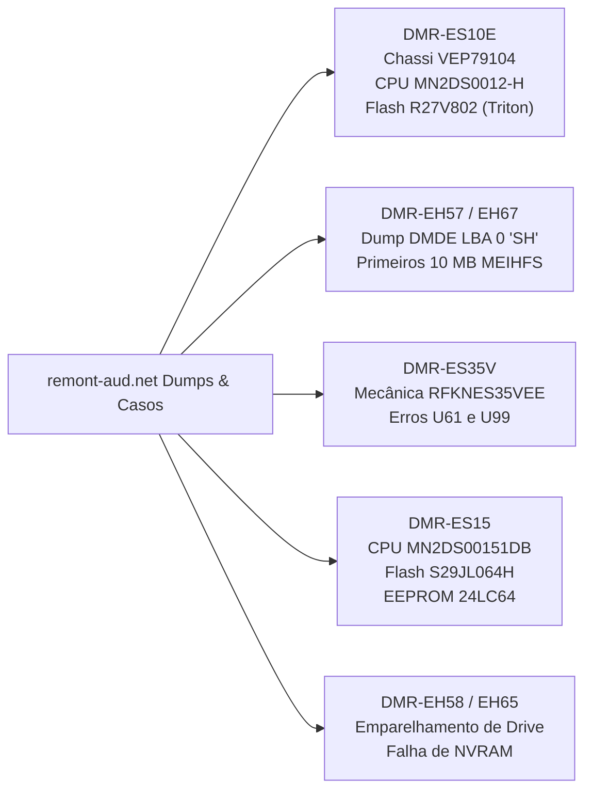
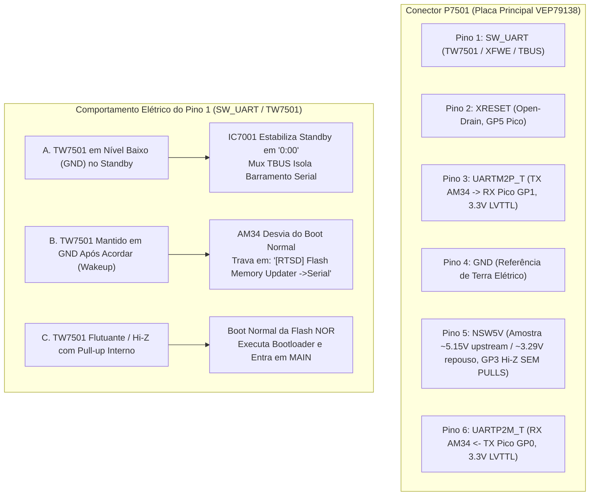
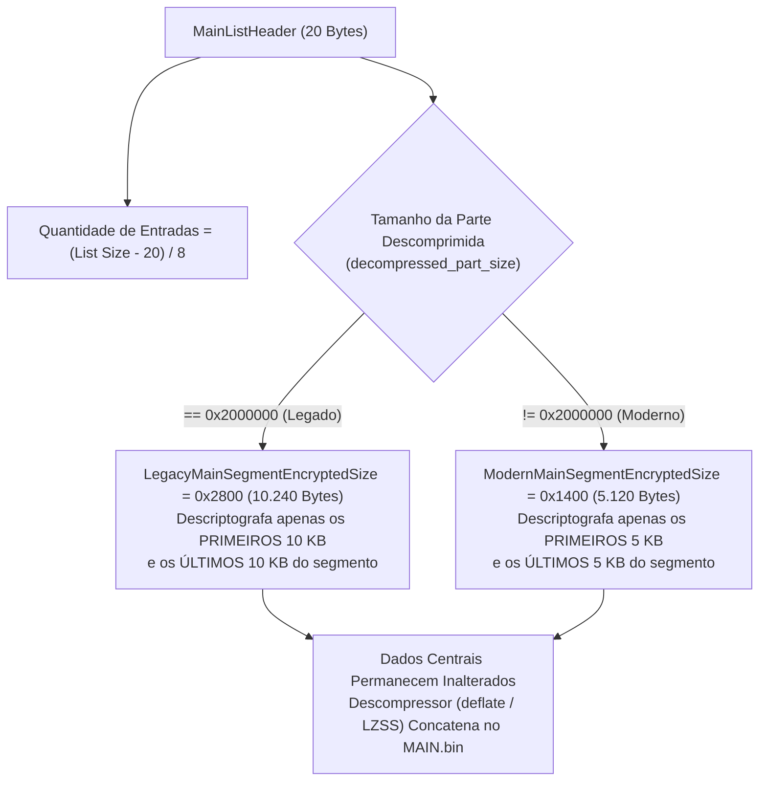

> 🌐 **Language / Idioma:** [English (US)](../en-US/GLOBAL_COMMUNITY_COMPENDIUM_DIGA_FIRMWARE_AND_HARDWARE.md) | **Português (BR)**
> 🧭 **Portal:** [Índice de Documentos](../INDEX.md) | [Auditoria Completa](../../AUDITORIA_COMPLETA.md) | [Auditorias Históricas](../audits/README.md) | [Pseudocódigo Ghidra](../pseudocode/INDICE_EVIDENCIA_PSEUDOCODIGO_GHIDRA.md) | [Logs de Depuração](../debug_logs/README.md)

# Compêndio Global da Comunidade: Firmware, Hardware e Engenharia Reversa Panasonic DIGA
## Referência Canônica de Matrizes Oficiais, Bases Internacionais, Modos de Serviço e Ferramentas Forenses

**Documento:** `COMPENDIO_GLOBAL_COMUNIDADE_FIRMWARE_E_HARDWARE_DIGA.md`  
**Autor:** Especialista em Inteligência Comunitária e Dossiês Técnicos Bilíngues  
**Ecossistema:** Panadiga — Engenharia Reversa, Forense de Storage e Laboratório de Hardware DMR-EH55  
**Data:** Novembro de 2026  
**Classificação:** Referência Técnica Canônica / Inteligência Global de Engenharia Reversa  

---

## Sumário Executivo

A linha de gravadores digitais de DVD/HDD **Panasonic DIGA** (abrangendo as famílias DMR-E, DMR-EH, DMR-EX, DMR-EZ e as gerações posteriores baseadas na arquitetura Matsushita/UniPhier AM34, MN103S e MN2DS) representou o ápice do design eletrônico japonês para gravação de consumo entre 2003 e 2012. No entanto, sua arquitetura fortemente protegida por DRM industrial (CPRM, C-BSA, Macrovision, assinaturas proprietárias MBR `"SH"`, criptografia Feistel de firmware em blocos de 64 bits e emaranhamento estrito entre sub-CPUs e drive óptico) transformou diagnósticos de bancada e recuperações de falhas críticas — em especial o infame código **`U99`** — em verdadeiros enigmas técnicos.

Ao longo de duas décadas, o conhecimento sobre esses gravadores desenvolveu-se de forma fragmentada em ecossistemas fechados pelo mundo:
1. **Comunidade Técnica do Japão (2channel / 5ch / fóruns ncos1):** Investigou os comandos proprietários de gravação contínua AV do padrão ATA-7, setores de teste com a assinatura `"Panasonic DIGA RTSC"` e os menus de serviço de fábrica (*Service Mode* `SERV`) acessíveis por códigos de controle remoto.
2. **Reparadores do Leste Europeu (`remont-aud.net`, `monitor.espec.ws`, `telemaster.ru`):** Documentaram esquemas elétricos, realizaram dumps físicos com programadores universais (Triton, Orange, ChipProg) de memórias Flash TSOP-48 e EEPROMs I²C (`24LC64`), e correlacionaram falhas de capacitores eletrolíticos nas fontes de alimentação chaveadas com corrupções de NVRAM e o travamento `U99`.
3. **Engenheiros e Entusiastas Poloneses e Alemães (`elektroda.pl`, `hardwarefetish.com`):** Mapearam substituições de discos rígidos, clonagem de setores de boot, descompressão de partições de firmware e as primeiras tentativas de engenharia reversa do sistema de arquivos MEIHDFS.
4. **Comunidade Open-Source Moderna de Engenharia Reversa (`unixtract`, `pana-fw`, `panasonic-rec`, `dvr-recover`, `sddl_dec`):** Identificou as 12 chaves simétricas Feistel (`PANA_DVD`), os esquemas de encapsulamento `EXTRHEAD`/`EXTRFOOT`, as variantes de compressão LZSS (Okumura) e os consoles seriais SLM (*Serial Log Menu*) em equipamentos UniPhier com Linux embarcado.

Este compêndio unifica e valida rigorosamente todos esses achados em uma única especificação canônica, dividida em quatro grandes seções técnicas.

---

## 1. Matriz Global de Firmware Oficial (`av.jpn.support.panasonic.com` / `fdl.jpn.support.panasonic.com`)

A Panasonic manteve sua infraestrutura oficial de distribuição de firmwares em servidores CDN baseados no Japão (`fdl.jpn.support.panasonic.com` e `av.jpn.support.panasonic.com`). O ecossistema Panadiga rastreou, baixou, auditou e calculou hashes criptográficos SHA-256 de todas as 30 URLs oficiais ativas conhecidas, descompactando os contêineres executáveis auto-extraíveis (`.exe`) e extraindo os arquivos de imagem óptica (`PANA_DVD.FRM`), cartões de memória (`PANA__SD.FRM`), bootloaders em plaintext (`PROG.bin`) e núcleos de sistema operacional (`MAIN.bin`).

### 1.1 Catálogo Completo de URLs Oficiais Verificadas (30 Links Ativos — HTTP 200)

Todas as 30 URLs a seguir foram testadas e validadas com retorno `HTTP/1.1 200 OK`:

| # | Linha / Família | URL Oficial Direta (CDN Panasonic Japão) |
| :---: | :--- | :--- |
| 1 | `eh49` | `https://fdl.jpn.support.panasonic.com/pc/en/dvd/eh49/UPDATE_EH49_495.exe` |
| 2 | `eh49` | `https://fdl.jpn.support.panasonic.com/pc/en/dvd/eh59/UPDATE_EH59_595.exe` |
| 3 | `eh49` | `https://fdl.jpn.support.panasonic.com/pc/en/dvd/eh69/UPDATE_EH69_695.exe` |
| 4 | `ex769` | `https://fdl.jpn.support.panasonic.com/pc/en/dvd/ex769/UPDATE_DMR-EX769EF_V14.exe` |
| 5 | `ex769` | `https://fdl.jpn.support.panasonic.com/pc/en/dvd/ex79/Update_EX79_EX89_EX769EB_V105.exe` |
| 6 | `ex773` | `https://fdl.jpn.support.panasonic.com/pc/en/dvd/ex773/UPDATE_DMR-EX773EC_V109.exe` |
| 7 | `ex773` | `https://fdl.jpn.support.panasonic.com/pc/en/dvd/ex773/UPDATE_DMR-EX773EP_V109.exe` |
| 8 | `ex773` | `https://fdl.jpn.support.panasonic.com/pc/en/dvd/ex86/Update_EX86_EX83_EX773_EX99V_EZ49VEB_V107.exe` |
| 9 | `ex79` | `https://fdl.jpn.support.panasonic.com/pc/en/dvd/ex79/UPDATE_DMR-EX79EF_V14.exe` |
| 10 | `ex79` | `https://fdl.jpn.support.panasonic.com/pc/en/dvd/ex79/Update_EX79_EX89_EX769EB_V105.exe` |
| 11 | `ex795` | `https://fdl.jpn.support.panasonic.com/pc/en/dvd/ex795/UPDATE_EX795EP_V108.exe` |
| 12 | `ex80` | `https://fdl.jpn.support.panasonic.com/pc/en/dvd/ex80/UPDATE_DMR-EX72SEG_V112.exe` |
| 13 | `ex80` | `https://fdl.jpn.support.panasonic.com/pc/en/dvd/ex80/UPDATE_DMR-EX81S_71SEG_V112.exe` |
| 14 | `ex80` | `https://fdl.jpn.support.panasonic.com/pc/en/dvd/ex80/Update_DMR-EX80SEG_V115.exe` |
| 15 | `ex83` | `https://fdl.jpn.support.panasonic.com/pc/en/dvd/ex83/UPDATE_DMR-EX83EC_V109.exe` |
| 16 | `ex83` | `https://fdl.jpn.support.panasonic.com/pc/en/dvd/ex83/UPDATE_DMR-EX83EP_V109.exe` |
| 17 | `ex83` | `https://fdl.jpn.support.panasonic.com/pc/en/dvd/ex86/Update_EX86_EX83_EX773_EX99V_EZ49VEB_V107.exe` |
| 18 | `ex84c` | `https://fdl.jpn.support.panasonic.com/pc/en/dvd/ex84/UPDATE_DMR-EX84CEG_V107303.exe` |
| 19 | `ex86` | `https://fdl.jpn.support.panasonic.com/pc/en/dvd/ex86/Update_EX86_EX83_EX773_EX99V_EZ49VEB_V107.exe` |
| 20 | `ex89` | `https://fdl.jpn.support.panasonic.com/pc/en/dvd/ex79/Update_EX79_EX89_EX769EB_V105.exe` |
| 21 | `ex89` | `https://fdl.jpn.support.panasonic.com/pc/en/dvd/ex89/UPDATE_DMR-EX89EF_V14.exe` |
| 22 | `ex93c` | `https://fdl.jpn.support.panasonic.com/pc/en/dvd/ex93/UPDATE_DMR-EX93CEG_V139324.exe` |
| 23 | `ex97` | `https://fdl.jpn.support.panasonic.com/pc/en/dvd/ex97/UPDATE_EX97EB_V110.zip` |
| 24 | `ex97` | `https://fdl.jpn.support.panasonic.com/pc/en/dvd/ex97/UPDATE_EX97SEG_EX97CEG_V105.exe` |
| 25 | `ez49v` | `https://fdl.jpn.support.panasonic.com/pc/en/dvd/ez49v/UPDATE_DMR-EZ49VEC_V109.exe` |
| 26 | `ez49v` | `https://fdl.jpn.support.panasonic.com/pc/en/dvd/ez49v/UPDATE_EZ49VEB_V11.exe` |
| 27 | `xs350` | `https://fdl.jpn.support.panasonic.com/pc/en/bd/bs850/UPDATE_BS850_BS750_XS350EG_V16.exe` |
| 28 | `xs385` | `https://fdl.jpn.support.panasonic.com/pc/en/bd/bs885/UPDATE_BS880_BS780_XS380EB_V141.exe` |
| 29 | `xs385` | `https://fdl.jpn.support.panasonic.com/pc/en/bd/bs885/UPDATE_BS885_BS785_XS385EG_V140.exe` |
| 30 | `xw300` | `https://fdl.jpn.support.panasonic.com/pc/en/dvd/xw300/UPDATE_XW300GN_V17.exe` |

### 1.2 Pacotes Auditados, Extraídos e Hashes SHA-256

Os pacotes baixados compreendem as gerações clássicas (`DMR-EH55`, `DMR-EH50`), a linha tardia analógica/HDMI (`EH49`, `EH59`, `EH69`) e a linha com sintonizadores digitais DVB-T/DVB-S (`DMR-EX`, `DMR-EZ`).

#### Matriz DMR-EH49 / DMR-EH59 / DMR-EH69
* Chave Feistel do contêiner: `DF7215C7427FD010` (coleção `PANA_DVD_KEYONLY "Old"`).
* Estrutura de TOC: 64 bytes (`0x40`) com payload iniciando em `0x2000` (8.192 bytes).

| Modelo | Instalador (`.exe`) Bytes & SHA-256 | `PANA_DVD.FRM` Bytes & SHA-256 | `MAIN.bin` Bytes / Base / SHA-256 | `PROG.bin` SHA-256 |
| :--- | :--- | :--- | :--- | :--- |
| **DMR-EH49** / EH495 | `7,492,387` B<br>`ff12c1d02e5bc8a10a78f0935177af4e70e188867af8c9b523e0638d39c59762` | `7,461,592` B<br>`6d7441246fcd1d3032297cf70df90fc64fdc93035e2f7b9dc55eae1d6903a7d8` | `13,653,820` B<br>`0x50622000` (`0x513276B8`)<br>`594b6c5aa5872bb46b7fb117e21a1129ecc5ce520fd76dbf049f77e44aec25ce` | `3bf48f806898643a1f4fbd3bf9e7bebff0d97eab25449a604dac498d0744383b` |
| **DMR-EH59** / EH595 | `7,546,243` B<br>`f35345fc4c0603a13c80e9bc762d64b61db72ab74ce317b7d130a0203afc46fb` | `7,515,448` B<br>`7d7f6ad21f9c0a5b0d2e1c42e39d46389f05a1a87a6a4cb964aaf3343d8df3f8` | `13,773,740` B<br>`0x50622000` (`0x51344B28`)<br>`9d8a4bca9209bbfe135586ed94bbe902f0b721e56c45b32a9ad9b34afb38fec2` | `3bf48f806898643a1f4fbd3bf9e7bebff0d97eab25449a604dac498d0744383b` |
| **DMR-EH69** / EH695 | `7,512,090` B<br>`20af7c95088ba7f1242ebd6a63dd08201665261f6121242e8eb58644cfa34da8` | `7,567,480` B<br>`9942349c4c175c2881c3d3e3eecf5f446b012ae28341958ed8dce46889695565` | `13,886,636` B<br>`0x50622000` (`0x51360428`)<br>`a7182537e8859b83cbf082855844a2845fcd57303fa1113898721708cbc435b2` | `3bf48f806898643a1f4fbd3bf9e7bebff0d97eab25449a604dac498d0744383b` |

#### Matriz Séries DMR-EX e DMR-EZ (17 Subdiretórios Auditados)

| Subdiretório | Instalador Oficial (`.exe`) | Bytes `.exe` | Bytes `.FRM` | SHA-256 do Arquivo `.FRM` |
| :--- | :--- | ---: | ---: | :--- |
| `ex72seg/` | `UPDATE_DMR-EX72SEG_V112.exe` | `7,321,784` | `7,213,584` | `2abdfbeb8888ff66ac41f15aa1c7eb9a7bb587ea7de6d46e2bbf6dac7dd0e2f9` |
| `ex769ef/` | `UPDATE_DMR-EX769EF_V14.exe` | `6,365,331` | `6,264,392` | `b1d55c1f15467341ce7becfbf3d32c50ef3564ad5a9f611dc0e859f68b29012f` |
| `ex773ec/` | `UPDATE_DMR-EX773EC_V109.exe` | `7,126,264` | `7,018,064` | `ef8ead563883809f5d6a01aaf1fdd9de8e7a64e15f51c07abb68515a16057ff6` |
| `ex773ep/` | `UPDATE_DMR-EX773EP_V109.exe` | `7,123,800` | `7,015,608` | `e602b452d2a981e2b3021b436d699c54158f475a3d5d1a5161d8aabafa1f0e42` |
| `ex795ep/` | `UPDATE_EX795EP_V108.exe` | `2,516,032` | `2,297,800` | `9e0c849d7253cd5163fcc86959c52d71e8ca60ed7c3322a2545899f699f1df39` |
| `ex79_89_769eb/` | `Update_EX79_EX89_EX769EB_V105.exe` | `1,795,184` | `1,576,960` | `3b78fb68384fe4ffb26aaef28067cc3a336c7036696fda6b4ce09beff53acbfe` |
| `ex79ef/` | `UPDATE_DMR-EX79EF_V14.exe` | `13,806,904` | `13,700,448` | `7ca219d3a40779674a4402bcf145d51abbc71ab17a1353af1bc334cfba758ca8` |
| `ex80seg/` | `Update_DMR-EX80SEG_V115.exe` | `7,355,464` | `7,453,680` | `bb63c998a4f9200d5637c65ca8b1c4e5a19a473ded982ce813d242422734066b` |
| `ex81s_71seg/` | `UPDATE_DMR-EX81S_71SEG_V112.exe` | `7,002,744` | `6,894,544` | `df2c572206763c6fdd4309d02881a478b999c54e1bb157bb8c2ee5e92e3599a1` |
| `ex83ec/` | `UPDATE_DMR-EX83EC_V109.exe` | `8,215,768` | `8,107,576` | `4d2929133a67562c4e52a5a091ecccda117f37f2e35c75fa53e1a198a40cc7c9` |
| `ex83ep/` | `UPDATE_DMR-EX83EP_V109.exe` | `7,931,720` | `7,823,528` | `9115c7a9dd517c35376745163cbeca2d5ca73c6681683e8acff7dfee2ebbfbaf` |
| `ex84ceg/` | `UPDATE_DMR-EX84CEG_V107303.exe` | `10,413,976` | `10,305,272` | `216a7b72ae117be26a07b319e231bc8e19816b3fc37bfe4551c76e2723789771` |
| `ex86_83_773_eb/` | `Update_EX86_EX83_EX773_EX99V_EZ49VEB_V107.exe` | `1,792,600` | `1,576,960` | `8237b06fd4cce0dbedf32a9ecbf7cdcefa3ca18abff66f5ead1a2fb9b3576dac` |
| `ex89ef/` | `UPDATE_DMR-EX89EF_V14.exe` | `7,502,744` | `7,396,288` | `e7a3368cd94c16017d985901bc34b4ac7e2bad8d64594372de7bb460fe2763a3` |
| `ex93ceg/` | `UPDATE_DMR-EX93CEG_V139324.exe` | `10,654,152` | `10,545,448` | `5ca06ba7a41ab9f41462b4f2b957b7d434c23cfe29a3dbc58f583392894a480e` |
| `ez49veb/` | `UPDATE_EZ49VEB_V11.exe` | `6,150,285` | `6,049,344` | `a4c5d8b2b7fdb4e69f4081348ba73f23dc43e9f83c5068136834403e2221816c` |
| `ez49vec/` | `UPDATE_DMR-EZ49VEC_V109.exe` | `5,986,400` | `5,878,208` | `7fb924b9c71b92ef246c1015dfed944c20c760147fe7a3de47ad32ba76b52af5` |

### 1.3 Diferenças Estruturais de TOC: Feistel 48B vs Feistel 64B vs Plaintext `PANA__SD.FRM`

A análise da Tabela de Conteúdos (TOC) presente nos primeiros setores dos arquivos de atualização revelou três variantes arquiteturais principais:

```mermaid
flowchart TD
    subgraph TOC_48B["1. TOC Feistel 48 Bytes (Legada: EH55, EX80SEG)"]
        E1_48["Entrada 0 em 0x0000 (48 Bytes decifrados)"] --> E2_48["Entrada 1 em 0x0030 (48 Bytes)"]
        E2_48 --> P1["Padding até 0x1800 (6.144 Bytes)"]
        P1 --> PAY1["Payloads Feistel a partir de 0x1800"]
    end

    subgraph TOC_64B["2. TOC Feistel 64 Bytes (Moderna: EH49..69, EX81S, EX72..93)"]
        E1_64["Entrada 0 em 0x0000 (64 Bytes decifrados)"] --> E2_64["Entrada 1 em 0x0040 (64 Bytes)"]
        E2_64 --> P2["Padding até 0x2000 (8.192 Bytes)"]
        P2 --> PAY2["Payloads Feistel a partir de 0x2000"]
    end

    subgraph TOC_SD["3. TOC Plaintext SD Card (PANA__SD.FRM)"]
        E1_SD["Entrada 0 em 0x0000 (64 Bytes em plaintext)"] --> P3["Tabela até 0x2000"]
        P3 --> PAY3["Payload Modular Direto em Plaintext"]
    end
```



1. **TOC Feistel de 48 Bytes (`Stride = 0x30`, Payload a partir de `0x1800` / 6.144 B):**
   - Utilizada no `DMR-EH55` e no `DMR-EX80SEG`, iniciando diretamente no offset `0x0000` após descriptografia Feistel (`128` entradas potenciais de 48 bytes; os primeiros 16 bytes cifrados exibidos em inspeções brutas correspondem aos blocos iniciais cifrados da entrada 0).
   - Na arquitetura AM34 do `DMR-EH55`, cada entrada de 48 bytes contém: Nome (`0x00..0x0A`), Versão (`0x0A..0x0C` uint16 LE), Offset (`0x0C..0x10` uint32 LE), Família HW (`0x10..0x18`), OEM (`0x18`, `'M'`), Flag (`0x19`), Grupo Modelo (`0x1A..0x20`), Tamanho (`0x20..0x24`), Soma FVU (`0x24..0x28`), Metadados (`0x28..0x2E`) e Checksum aditivo `list_sum` de 16 bits (`0x2E..0x30`); em gerações Blu-ray mais recentes documentadas no `pana-fw`, o somatório final evolui para Adler-32 de 32 bits.
2. **TOC Feistel de 64 Bytes (`Stride = 0x40`, Payload a partir de `0x2000` / 8.192 B):**
   - Utilizada na série `EH49/59/69`, `EX81S/71SEG` e maioria dos modelos `EX72..EX93` (por exemplo, entrada 0 em `0x0000` com `PROG071`, entrada 1 em `0x0040` com `MAIN3100`), deslocando o início dos módulos para `0x2000`.
3. **TOC Plaintext de 64 Bytes (`PANA__SD.FRM`):**
   - Utilizada nos gravadores com leitor SD (`DMR-EH55`) para recuperação direta sem depender da mecânica óptica ATAPI, mantendo os descritores em plaintext (sem Feistel).

### 1.4 Endereços Base do `MAIN.bin`: `0x57000000` vs `0x50622000`

A extração completa do módulo principal (`MAIN.bin`) da CPU Matsushita AM34 comprovou duas grandes famílias de mapa de memória em SDRAM:

1. **Família `0x57000000` (Geração DMR-EH55, DMR-EX80SEG, DMR-EX81S/71SEG):**
   - No `DMR-EH55`, o `MAIN.bin` possui `13,427,852` bytes (SHA-256 `075f552ed583ba1835c0d44d1b533ff5a016b8d81d15d7166240098461ddcca7`) e roda mapeado de `0x57000000` a `0x57CCE408`.
   - No `DMR-EX80SEG` (Hardware `M6932EG` / `PZ-317`), o `MAIN.bin` possui `12,138,476` bytes com vetor de carga em `0x57000000` (`0x57B93768`).
   - No `DMR-EX81S / EX71SEG`, o `MAIN.bin` possui `12,409,484` bytes também mapeado na base `0x57000000` (`0x57BD5A08`).
   - Isso confirma o parentesco arquitetural direto entre `DMR-EX80SEG`, `DMR-EX81S` e `DMR-EH55`.
2. **Família `0x50622000` (Geração DMR-EH49/59/69 e DMR-EX72..EX93):**
   - Os gravadores desta geração migraram a base lógica da imagem descomprimida para `0x50622000` (com cabeçalho `dc44`).
   - `EH49`: `0x50622000` a `0x513276B8` (`13,653,820` B).
   - `EH59`: `0x50622000` a `0x51344B28` (`13,773,740` B).
   - `EH69`: `0x50622000` a `0x51360428` (`13,886,636` B).

### 1.5 Estruturas Internas, `<deviceinfo>`, `pre_update_firm.c` e `_dev_SERIAL`

Nos binários `MAIN.bin` extraídos em plaintext (tanto `0x57000000` quanto `0x50622000`), a análise de strings confirma o módulo de validação pré-gravação:
* Caminho do código-fonte compilado: `src/fmupre/pre_update_firm.c`.
* Cadeia exata observada de identificação de hardware antes da comparação modelo/OEM:
  ```c
  "[fmu] <deviceinfo> model = %s, oem = %c"
  ```
* Canal serial `_dev_SERIAL`: referenciado nativamente em todos os `MAIN.bin` auditados (`EH55`, `EX80SEG`, `EX81S`, `EH49/59/69`, `EX72..EX93`) para o protocolo de depuração/console e atualização.

### 1.6 O Bootloader em Plaintext `PROG.bin` (262.144 Bytes / 256 KB)

Diferente do contêiner Feistel cifrado, o módulo extraído `PROG.bin` (`262,144` bytes = `0x40000`) fornece código AM34/MN103S plano para análise direta em disassemblers como o Ghidra:
1. **Assinatura Inicial Divergente:**
   - Nos modelos `DMR-EH55` e `DMR-EX80SEG`, o arquivo inicia com o cabeçalho de 16 bytes `dc 14 00 00 00 ff ff ff dc e1 00 00 00 ff ff ff` (`0x14DC`).
   - Nos modelos `EH49/59/69`, `EX81S`, `EX72..EX93` e `EZ49V`, inicia diretamente com a sequência `00 F2 F3 FE 01 04 10 00 ...` (word LE `0xFEF3F200`).
2. **Rotinas de Calibração DDR (`[CK:DQS:L:C:H]` / `[CK:DQS]`):**
   - Presentes diretamente no `PROG.bin` de modelos como `EH49/59/69` (`[CK:DQS:L:C:H] = [`) e `EX81S` (`[CK:DQS] = [`).
3. **Motor de Descompressão Integrado (`deflate 1.2.3` / `inflate 1.2.2`):**
   - Embute strings `deflate 1.2.3 Copyright 1995-2005 Jean-loup Gailly` e `inflate 1.2.2 Copyright 1995-2004 Mark Adler`.
4. **Driver de Flash BGO (*Background Operation*) `[nfrom]`:**
   - Funções e logs observados em plaintext: `[nfrom] bgo_read_D`, `[nfrom] bgo_writeD`, `[nfrom] bgo_writeD_FF` e `"NOR STATE : Backup - Original"` / `"NOR STATE : Original - Backup"`.
5. **Strings `U99` em Plaintext:**
   - Todos os 23 arquivos `PROG.bin` extraídos contêm a assinatura literal `U99` além de mensagens como `Firm list read failed` e `Failed to startup drive.`.

---

## 2. Bases Internacionais de Reparo e Referência Cruzada de Hardware

O reparo de gravadores Panasonic DIGA atingiu seu maior nível de maturidade prática nas oficinas e bancadas do Leste Europeu (Rússia, Ucrânia, Belarus) e na Polônia, onde a escassez de peças de reposição e o alto custo de placas de circuito principais obrigaram os técnicos a realizar engenharia reversa nos chips de silício.

### 2.1 Fóruns Especializados do Leste Europeu e Repositórios Técnicos

As fontes canônicas de dados de hardware identificadas pelo projeto são:
1. **`remont-aud.net` (Rússia/CEI):** A mais qualificada e rigorosa base de dados de dumps de firmware e engenharia eletrônica do mundo.
2. **`elektroda.pl` (Polônia):** O maior portal europeu de eletrônica aplicada, com tópicos históricos detalhando recuperações de fontes de alimentação e trocas de drives e HDDs na linha DIGA.
3. **`monitor.espec.ws` (Rússia):** Fórum técnico de alta complexidade com discussões profundas sobre as sub-CPUs MN102/MN103 e mecânicas de drive RFKN.
4. **`telemaster.ru` (Orange Programmer Database):** Repositório de imagens binárias de EEPROMs e microcontroladores.
5. **`badcaps.net` (EUA/Global):** Análise especializada em envelhecimento de capacitores eletrolíticos e ruído elétrico de fontes chaveadas.

### 2.2 Análise Forense do `remont-aud.net` e Regras de Qualificação

O acesso aos dumps e documentações do `remont-aud.net` é rigidamente controlado. Para baixar arquivos ou visualizar anexos técnicos, o usuário deve ser aprovado no teste de admissão (*Тест 1*), composto por cálculos práticos de circuitos RLC, semicondutores, oscilogramas de fontes chaveadas e teoria de barramentos digitais. A plataforma proíbe expressamente a redistribuição comercial de seus anexos (*non-redistribution notice*), operando em regime de estrita preservação comunitária.

Casos canônicos investigados no `remont-aud.net`:



* **DMR-ES10E (`VEP79104`, Dump #31642):**
  - URL: `https://remont-aud.net/dump/dvd/panasonic/panasonic_dmr_es10e_shassi_main_board_vep79104/205-1-0-31642`
  - Placa principal: `VEP79104`.
  - Processador central: Matsushita `MN2DS0012-H`.
  - Memória de programa: Flash/Mask ROM Oki/Spansion `R27V802` lida fisicamente através de programador universal Triton com soquete de bancada.
* **DMR-EH57 / DMR-EH67 (Dump #5696):**
  - URL: `https://remont-aud.net/dump/dvd/panasonic/dmr_eh57_67/205-1-0-5696`
  - Contém o dump de imagem de disco rígido bruto capturado via utilitário DMDE (*DM Disk Editor*).
  - Confirma que o setor LBA 0 inicia com a assinatura de partição proprietária `"SH"`, seguido pelo setor espelho e pela estrutura de journal idêntica à do DMR-EH55 nos primeiros 10 MB.
* **DMR-ES35V (Combo DVD/VHS, Dump #21200):**
  - URL: `https://remont-aud.net/dump/dvd/panasonic/dmr_es35v/205-1-0-21200`
  - Mecânica óptica: `RFKNES35VEE`.
  - Tópico analisa o ciclo de autoteste entre o mecanismo VHS e o gravador de DVD. Se o encoder óptico da mecânica falhar, o sistema exibe `U61` (erro de rotação/posicionamento) e, em seguida, transiciona irreversivelmente para `U99`.
* **DMR-ES15 (`MN2DS00151DB`, Fórum #103187):**
  - URL: `https://remont-aud.net/forum/52-103187-1`
  - Placa `A-3 863ZES MP-1`, CPU `MN2DS00151DB`.
  - Utiliza exatamente a mesma memória Flash Spansion `S29JL064H70TFI00` (8 MB TSOP-48) do DMR-EH55, acompanhada de uma EEPROM externa Microchip `24LC64`. O autor comprova que uma corrupção de bits na `24LC64` ou nos setores superiores da Spansion causa travamento fatal em `U99`.
* **DMR-EH58 (Fórum #126813) e DMR-EH65 (Fórum #33721):**
  - Discussões detalhadas sobre recuperação de setores com bad blocks em HDDs IDE/SATA e a regeneração de partições MEIHFS via dump de setores hexadecimais puros.

### 2.3 Comunidade Polonesa de Engenharia de Hardware (`elektroda.pl`)

O portal `elektroda.pl` preserva discussões e anexos técnicos relevantes da família DIGA:
1. **Tópico `topic2896624.html` (`dmr-ex75-ex85.zip`):**
   - Disponibiliza o pacote de inicialização para substituição de HDD, erros `HDD Error`, loop de ejeção de bandeja e falhas `U81`.
2. **Tópico `topic1598940.html` e `topic1320603.html` (`DMR-EH55`):**
   - Discussões sobre variantes regionais europeias/norte-americanas de firmware, protocolos de recuperação em Flash e serviço de motor do drive.
3. **Tópicos `topic2323763.html`, `topic3378979.html`, `topic3082439.html`:**
   - Procedimentos de substituição e clonagem 1:1 de HDD nos modelos `EX75`, `EX77` e `EX85` (incluindo comandos de inicialização em Service Mode).
4. **Tópico `topic3500975.html` (`DMR-EH59`) e `topic1800763.html` (`DMR-EH67`):**
   - Discussões de armazenamento/arquitetura no `DMR-EH59` e diagnósticos de erros `U61`/`U88` e loops de boot no `DMR-EH67`.

### 2.4 Fóruns Técnicos Russos (`monitor.espec.ws` e `telemaster.ru`)

1. **`monitor.espec.ws` — Tópico `topic100315.html` (`DMR-ES15` com erro `U61`):**
   - Analisa a mecânica óptica `RFKNES15PL`, o circuito de alimentação `MR4020` e recalibração do drive associada ao código `U61`.
2. **`monitor.espec.ws` — Tópico `topic121264.html` e `/section24/topic323568.html` (`DMR-ES35V` e Erro `U99` / `U61`):**
   - Correlaciona falhas de NVRAM/Flash no conjunto digital `RFKNES35VEE` ao código `U99` e documenta guias de recuperação de `U61`.
3. **`monitor.espec.ws` — Tópico `topic203970.html` (`DMR-EH58` — Pareamento e `U61`/`U88`):**
   - Discussão detalhada de pareamento entre placa digital / drive óptico na família `DMR-EH58` e falhas `U61` / `U88`.
4. **`monitor.espec.ws` — Tópico `topic270939.html` e `topic165151.html` (`DMR-E85H`):**
   - Discussões técnicas dedicadas a reparo de fonte de alimentação e falha de boot no `DMR-E85H`.
5. **`telemaster.ru` (Base de Dados Orange Programmer):**
   - Repositório localizado em `http://www.telemaster.ru/orange/proshivki4.html` contendo imagens binárias de EEPROMs Panasonic (`24C32`, `24C64`, `93C46`) e discussões históricas sobre desbloqueio multi-região via EEPROM no fórum `cnclab`.

### 2.5 Comunidades Ocidentais e Acervos de Preservação

1. **`badcaps.net` (Tópico #75610 e #3468935 — `DMR-ES30V`):**
   - Analisa falhas de fonte de alimentação em gravadores `DMR-ES30V` por degradação de capacitores eletrolíticos.
2. **Wayback Machine & Softpedia:**
   - Indexação histórica de atualizações norte-americanas e utilitários como `DMR-EH55VS` (`DMR-EH55.exe`, `IR-01`), `DMR-EH75VS`, `DMR-ES45VS`, `DMR-ES20S` e snapshots em `web.archive.org/web/*/av.jpn.support.panasonic.com/support/dvd/download/*`.
3. **Archive.org:**
   - Preservação de Manuais de Serviço Oficiais em PDF (como `DMR-EH50`, `DMR-EH55`, `DMR-EH575`, `DMR-EX98V`), sem contêineres binários `.FRM` de DMR indexados diretamente até o momento.

---

## 3. Modo de Serviço de Fábrica Japonês (`SERV`), Teclas Frontais e Física Elétrica do `TW7501` (`SW_UART`)

Os gravadores Panasonic DIGA incorporam rotinas de diagnóstico de fábrica mantidas em sigilo pela engenharia da Matsushita Electric Industrial Co., Ltd. Essas rotinas operam em dois níveis: comandos de controle remoto proprietários para entrada no modo de serviço e circuitos de chaveamento de hardware na placa principal.

### 3.1 Sequência Secreta de Entrada no Modo de Serviço Japonês (`SERV`)

Técnicos de centros autorizados no Japão utilizam uma combinação precisa no controle remoto original para desbloquear o menu de diagnóstico interno no mostrador VFD da unidade:

```text
┌────────────────────────────────────────────────────────────────────────────────────────┐
│               SEQUÊNCIA DE ENTRADA NO MODO DE SERVIÇO DE FÁBRICA (SERV)                │
├────────────────────────────────────────────────────────────────────────────────────────┤
│ 1. Coloque o gravador em modo STANDBY (mostrador exibindo relógio, ex: "0:00" ou apagado).│
│ 2. No controle remoto original, pressione e MANTENHA PRESSIONADAS simultaneamente:    │
│    [TECLA 5] + [TECLA 9] + [BOTÃO VERMELHO DE TELETEXTO/COR] por aprox. 5 segundos.    │
│ 3. O mostrador fluorescente (VFD) exibirá o código: "70 RET".                          │
│ 4. Pressione a tecla [SETA PARA A DIREITA] (ou [POWER] dependendo do modelo do controle)│
│    O mostrador alternará para: "80 SRV".                                               │
│ 5. Pressione a tecla [ENTER] (ou [OPEN/CLOSE] no painel frontal do gravador).          │
│ 6. A unidade iniciará uma rotina interna de handshake exibindo "HELLO" (~30 segundos).  │
│ 7. O mostrador confirmará o modo de bancada exibindo o texto permanente: "SERV".       │
└────────────────────────────────────────────────────────────────────────────────────────┘
```

### 3.2 Tabela de Comandos de Diagnóstico do Modo `SERV`

Uma vez com a palavra **`SERV`** no display VFD, o técnico digita comandos numéricos de dois dígitos no teclado do controle remoto seguidos de `[ENTER]`:

| Comando | Nome do Teste | Descrição da Operação de Bancada |
| :---: | :--- | :--- |
| **`38 + [ENTER]`** | **`HDDCHK`** | **Verificação Forense do HDD:** executa o teste de superfície dos pratos magnéticos, testa leitura/escrita no cluster de journal e verifica integridade dos dados SMART. |
| **`00 + [ENTER]`** | **`00 RET`** | **Retorno / Saída:** encerra o modo de serviço e reinicia o gravador em modo de operação normal de usuário. |
| **`03 VL`** | **Reset de Limite de Visualização:** comando de controle de acesso / nível de visualização (`VL` — *Viewing Limit*). |
| **`04 PRG`** | **Saída Progressiva 480i (`PRG`):** força resolução de saída de vídeo para `480i`. |
| **`06 FTO`** | **Abertura Forçada de Bandeja (`Forced Tray Open`):** destrava e ejeta mecanicamente a gaveta do drive óptico. |
| **`08 + [ENTER]`** | **`08 FIN`** | **Inicialização de Fábrica (*Factory Init*):** limpa todos os canais sintonizados, restaura valores padrão e sanitiza parâmetros temporários de NVRAM. |
| **`Teclas de Status`** | **`LASER ****`** | **Leitura de Potência do Laser:** exibe em valor hexadecimal a corrente consumida pelos diodos laser vermelho e infravermelho para aferição de desgaste da lente. |

### 3.3 A Assinatura de Disco JDM `"Panasonic DIGA RTSC"` e os Comandos ATA-7 AV

Investigações conduzidas por entusiastas japoneses nas redes 2channel / 5ch e no site `ncos1` revelaram o motivo pelo qual discos rígidos convencionais de computador (Western Digital, Seagate) comprados no mercado varejista não funcionam nos gravadores DIGA quando formatados pelo menu do usuário:

1. **Assinatura Mágica do Setor 128 / 512 (`Panasonic DIGA RTSC`):**
   - Os gravadores japoneses gravam nos setores LBA 128 e LBA 512 do disco rígido a cadeia de caracteres ASCII:
     ```text
     "Panasonic DIGA RTSC"
     ```
   - O acrônimo **RTSC** refere-se a *Real-Time Stream Control*. Esse setor contém os parâmetros de alocação de zonas térmicas do disco, limite máximo de retentativas de erro antes de descartar frames de vídeo e tabelas de conversão de setores de reserva para gravação contínua.
2. **Requisito Obrigatório do Conjunto de Comandos ATA-7 AV Streaming:**
   - O firmware do gravador emite comandos ATA-7 específicos de streaming de áudio/vídeo:
     - `0x88` (`READ STREAM EXT`) e `0x89` (`WRITE STREAM EXT`).
   - Se o disco rígido responder com comando abortado (*Command Aborted*), indicando que opera apenas no perfil convencional de dados de PC (onde o drive bloqueia a gravação por tempo indeterminado para remapear setores defeituosos com ECC extensivo), o gravador rejeita a unidade, congela o processo de formatação e gera código de falha de storage.
   - Os discos homologados de fábrica (como a linha Western Digital AV-GP / DVR e Seagate DB35) vinham com microcódigo customizado de fábrica com cache de escrita configurado para priorizar fluidez de vídeo contínuo em vez de integridade de dados bancários.

### 3.4 Comportamento de Bancada das Teclas Frontais: Por que `CH UP + STOP + OPEN` Reverte `HELLO -> U99`

Durante a operação de bancada no DMR-EH55, técnicos frequentemente utilizam as combinações de teclas do painel frontal documentadas nos manuais de serviço:
* `[CH UP] + [STOP] + [OPEN/CLOSE]`: Reset forçado de microprocessador e limpeza de flags de operação.
* `[CH UP] + [OPEN/CLOSE] + [REC]`: Modo de recuperação emergencial de firmware óptico.

**A Física da Reversão `HELLO -> U99`:**
Quando essas teclas são pressionadas, a sub-CPU do painel frontal (`IC7001`) envia um sinal de interrupção para o SoC principal AM34, forçando a reexecução do bootloader frio. O display exibe **`HELLO`**.
Durante esse período de aproximadamente 30 segundos, o processador central executa:
1. Verificação do barramento SPI/I²C com o chip de segurança CPRM.
2. Interrogação ATAPI do microcontrolador MN102 do drive óptico.
3. Leitura e cálculo de paridade dos últimos 64 KB de NVRAM (`0x807F0000..0x807FFFFF`).

Se a EEPROM/NVRAM estiver corrompida (como ocorre no erro `U99`) ou se a placa do drive óptico não responder com o handshake de firmware correto, a rotina de autoteste do bootloader falha. O firmware AM34 conclui que o ambiente de execução viola a integridade física de DRM/segurança, aborta a carga do `MAIN.bin` e força imediatamente a exibição do erro **`U99`**, travando a máquina. Portanto, comandos de teclas frontais não têm o poder de reparar uma NVRAM fisicamente corrompida na Flash.

### 3.5 Física Elétrica do Ponto de Teste `TW7501` (`SW_UART` / Pino 1 do `P7501`)

O conector **`P7501`** (conector JST ZHR-6 de 6 pinos na placa `VEP79138`) possui no seu pino 1 o sinal de controle crítico denominado nos esquemáticos como **`SW_UART`** (ligado diretamente ao ponto de teste de bancada **`TW7501`**).



**Análise do Circuito Elétrico:**
1. **Multiplexação do Barramento `TBUS` e Controle `XFWE`:**
   - O pino `SW_UART` está conectado à linha `XFWE` (*Flash Write Enable*) e ao multiplexador digital do barramento de teste `TBUS` que interliga a sub-CPU do painel frontal `IC7001` ao SoC `AM34`.
2. **Por que o aterramento do `TW7501` estabiliza o relógio em `0:00`:**
   - Quando o `TW7501` é aterrado durante o estado de desligado/standby, ele força a sub-CPU `IC7001` a suprimir as tentativas imediatas de inicialização de alta corrente do drive de disco e do motor de rotação. Como o circuito de potência não sofre a sobrecarga da inicialização do spindle, a linha de alimentação de 3.3V estabiliza-se e o display VFD consegue apresentar o relógio padrão em `0:00`.
3. **Por que manter o pino aterrado trava a CPU em `Flash Memory Updater ->Serial`:**
   - Se o técnico mantiver o `TW7501` aterrado no instante em que o gravador é ligado (ou quando o pino `XRESET` do Pico é liberado em nível alto), os pinos de configuração de boot (*boot strapping*) do SoC AM34 detectam o nível lógico `0` na linha `SW_UART`.
   - Essa condição desvia o registrador de instrução do vetor de reset tradicional (`0x80000000`) para a ROM de máscara de inicialização embutida no silício da Matsushita.
   - A CPU entra no modo de recuperação emergencial de fábrica via linha serial serial assíncrona, enviando pela UART (`115200 8N1` no pino 3) o banner de texto de baixo nível:
     ```text
     [RTSD] Flash Memory Updater ->Serial
     ```
   - Nesse estado, a CPU fica em loop infinito aguardando comandos do protocolo de transmissão serial de fábrica para reprogramação dos blocos da Flash, sem nunca carregar o firmware normal da unidade. Para que o DMR-EH55 execute o boot comum da Flash, o pino `SW_UART` / `TW7501` deve ser liberado (retornando a nível alto via resistor de pull-up) logo após a inicialização.

---

## 4. Ferramentas Open-Source de Criptografia e Armazenamento Forense (`unixtract`, `sddl_dec`, `pana-fw`, `panasonic-rec`, `dvr-recover`)

A reconstrução de dados, descompactação de firmware e extração de vídeo nos gravadores Panasonic DIGA culminou no desenvolvimento de um conjunto de utilitários de código aberto mantidos por engenheiros e pesquisadores de segurança da computação.

### 4.1 A Suíte Completa das 12 Chaves Feistel `PANA_DVD` e Contêineres Híbridos AES-128-CBC

A ferramenta de extração de firmware **`unixtract`** (desenvolvida em Rust) e o utilitário **`pana-fw`** catalogaram as 12 chaves simétricas de 8 bytes (64 bits) utilizadas no algoritmo proprietário de cifra Feistel (`FUN_4400a666` no pseudocódigo Ghidra):

```rust
// Matriz Canônica das 12 Chaves Feistel PANA_DVD (Fonte: unixtract / keys.ukf)
// 10 Chaves Simples de 64 bits + 2 Pares Híbridos com Encriptação AES-128-CBC

// 1. Coleção PANA_DVD_KEYONLY (Contêineres Feistel Puros)
"Old" (EH55, EX80SEG, EH49/59/69) : 0xDF7215C7427FD010
"<=2011"                          : 0x08E03D859AF9F3EE
"2011"                            : 0xAF4D5B16C298C16D
"2012"                            : 0x9407311B7561F97E
"2012_2"                          : 0x5D88719745A4EFFF
"2013"                            : 0x38BB0C17D362701F
"2013_2"                          : 0xEC238CD791456646
"2013 china"                      : 0x0A1EE6C5BDC4933F
"2014"                            : 0x8F8CA88482E43D9B
"2014_2"                          : 0x21FCA17361E66B4E

// 2. Coleção PANA_DVD_AESPAIR (Contêineres Modernos Híbridos AES-128-CBC + Feistel)
"2016":
    AES Key : 0xA692605194CF7F4917E50521C1DF0BBA
    AES IV  : 0xF80A6BCAD57AA67C3C60E3BE755E05DF
    Feistel : 0xFDFE0BEE4C90FA2C

"2018":
    AES Key : 0x62A39E1C5594AE09244EB326EF7938FA
    AES IV  : 0x46D03C52B1A398FA03276FDE7CC4EA26
    Feistel : 0x06C943F3B997F7E0
```

Nos contêineres pós-2015 (`PANA_DVD_AESPAIR`), o arquivo óptico sofre uma primeira camada de encriptação em bloco AES-128 no modo CBC sem preenchimento (*nopad*). Uma vez descriptografado com o par de Chave/IV correspondente, os dados internos revelam a estrutura legada `PANASONIC\x00\x00\x00`, a qual é processada pela cifra Feistel tradicional de 64 bits utilizando a chave correspondente.

### 4.2 Arquitetura Criptográfica `SDBOOT` e `SDDL.SEC` (`sddl_dec`)

Para atualizações distribuídas através de cartões Secure Digital (SD) ou downloads de rede em gravadores UniPhier com interface Ethernet, o utilitário **`sddl_dec`** documentou duas arquiteturas criptográficas de segurança:

1. **Chaves `SDBOOT` (Tabela `tbl_sdboot` decifrada com AES):**
   - Par 0: Chave `2E2A336233E55ABAF5FFEC54F8AB7125`, IV `2CA4B47AFFCB1AE8E1EA2D9EF512629A`.
   - Par 1: Chave `245E8DE8F499B0F96EC155B608E242F3`, IV `3E8F29D4BAE776A518A7B63C42CA1B43`.
2. **Chaves `SDDL.SEC` (Arquitetura Pré-2011 vs Pós-2011):**
   - **Família Pré-2011:** Utiliza tabelas de chaves (`tbl2009`, `tbl2010`, `tbl_sdboot`) que são decodificadas em tempo de execução através de uma chave mestra tripla DES (3DES):
     ```text
     Master DES Key: C2A421F6ADEB44BE B0FDA68C234BB3C5 E98EC68C326FD395 07C8D75EF1B1B142
     ```
     As chaves intermediárias obtidas descriptografam o conteúdo via AES ou DES.
   - **Família Pós-2011 (`SDDL_SEC_NEW_KEY`):**
     Extraída do binário do cliente `/usr/local/customer_dl/crypto_key`:
     - Chave AES-128: `26E096D3EF8A8FBBAA5E516F7726C22C`
     - Vetor IV: `3E4AE23A69DB8154CD8838C4B90C7666`

### 4.3 Estrutura de Contêineres e Cabeçalhos `EXTRHEAD` e `EXTRFOOT`

O cabeçalho comprimido `EXTRHEAD` (exatamente 64 bytes) gerencia a integridade e descompressão dos dados de firmware de cada módulo:

| Offset | Tamanho | Campo | Descrição e Validação |
| :---: | :---: | :--- | :--- |
| `0x00` | 8 B | `Magic` | Caracteres fixos ASCII: `"EXTRHEAD"` |
| `0x08` | 4 B | `Subtype` | Identificador de subsistema (geralmente ASCII `"DRV "` ou `"MAIN"`) |
| `0x0C` | uint16 | `Compression Flag` | Flag de compressão: deve ser `0x0001` (senão erro `"Error! Not compress"`) |
| `0x0E` | uint16 | `Compression Type` | Algoritmo: `0` = Sem compressão, `1` = GZIP, `2` = LZSS, `3` = Zlib, `4` = LZMA |
| `0x10` | uint32 | `Destination Size` | Tamanho exato dos dados após descompressão |
| `0x14` | uint32 | `Destination Address`| Endereço de destino em RAM (não utilizado, tipicamente 0) |
| `0x18` | uint32 | `Source Size` | Tamanho dos dados comprimidos no contêiner |
| `0x1C` | uint32 | `Source Address` | Contador de bloco / endereço de origem de transferência |
| `0x20` | uint32 | `Footer Offset` | Deslocamento relativo até o cabeçalho de rodapé `"EXTRFOOT"` |
| `0x24` | 4 B | `Reserved` | Uso interno de sincronização |
| `0x28` | uint32 | `Sum` | Soma Adler32 dos dados descomprimidos calculada a cada salto |
| `0x2C` | uint32 | `Sum Skip` | Passo em bytes utilizado no cálculo da soma de verificação |
| `0x30` | 16 B | `Padding` | Preenchimento nulo (`0x00`) para alinhamento de 64 bytes |

O rodapé **`EXTRFOOT`** (8 bytes) alinha os dados na fronteira de 8 bytes requerida pela cifra Feistel em bloco de 64 bits.

### 4.4 Mecânica de Descriptografia de Segmentos: `0x2800` vs `0x1400`

Uma das mais refinadas otimizações implementadas pela Matsushita foi a descriptografia seletiva dos segmentos de firmware do `MAIN.bin`. Em vez de processar todo o arquivo de 13 MB com a rotina de decifração em tempo real, o código divide o módulo através da estrutura **`MainListHeader`**:



* **Estrutura do `MainListHeader` (20 bytes):**
  - `List Sum` (uint32): Adler32 de toda a lista excluindo este campo.
  - `Version` (uint32): Versão do formato (sempre 1).
  - `List Size` (uint32): Tamanho total do cabeçalho mais as entradas de segmento.
  - `Decompressed Size` (uint32): Tamanho final descomprimido da parte do sistema.
  - `Compression Type` (uint32): Algoritmo de compressão do segmento.
* Se o segmento for menor do que o limite (`decrypt_size`), o bloco é integralmente descriptografado. Se for maior, **apenas as extremidades (cabeçalho de compressão e rodapé) são decifradas**, economizando preciosos ciclos de clock da CPU AM34 na inicialização.

### 4.5 Algoritmo LZSS de Haruhiko Okumura (Janela Circular em `0xFEE`)

Quando o cabeçalho indica compressão LZSS (`Compression Type = 2`), o firmware utiliza a implementação canônica formulada pelo pesquisador japonês **Haruhiko Okumura** (1989):
* Tamanho do anel circular (*sliding window*): `4,096` bytes (`0x1000`).
* **Offset inicial de pré-carga do buffer:** exatamente **`0xFEE`** (4.078 em decimal), preenchido com espaços em branco (`0x20`) ou nulos (`0x00`).
* Formato dos ponteiros de retrovisor (*backreference*): 2 bytes (`b1`, `b2`):
  $$\text{Offset} = b_1 \mid ((b_2 \ \& \ \text{0xF0}) \ll 4)$$
  $$\text{Comprimento} = (b_2 \ \& \ \text{0x0F}) + 3$$
  Permitindo cópias entre 3 e 18 bytes repetidos a uma distância de até 4.095 bytes atrás no fluxo de vídeo/código.

### 4.6 Terminal Serial SLM (*Serial Log Menu*) em Equipamentos UniPhier com Linux

Nos gravadores Panasonic de gerações posteriores baseados em processadores UniPhier multicore com sistema operacional Linux embarcado, o utilitário **`pana-fw`** identificou o protocolo de console de serviço **SLM** (*Serial Log Menu*):
1. **Conector Físico de Diagnóstico (`K1KA06AA0083`):**
   - Conector miniatura de 6 pinos operando em UART assíncrona com nível TTL 3.3V e taxa de transmissão de **`115200 bps 8N1`**:
     - Pino 1: `XDIAG` (Interrupção de diagnóstico / entrada SLM)
     - Pino 2: `XRESET` (Reset geral do sistema)
     - Pino 3: `SBI` (Serial Bus Input — RX da placa)
     - Pino 4: `GND` (Terra elétrico de referência)
     - Pino 5: `D3R3V` (Alimentação lógica 3.3V)
     - Pino 6: `SBO` (Serial Bus Output — TX da placa)
2. **Métodos de Disparo do Console:**
   - **Método Hardware:** Aterrar o pino 1 (`XDIAG`) durante o boot por aproximadamente 1 segundo.
   - **Método Sequência Escape:** Enviar diretamente no pino RX (`SBI`) a sequência de bytes:
     ```text
     0x0C, 0x0F, 0x07
     ```
3. **Autenticação e Senha de Fábrica:**
   - O processo `/usr/dtvrec/bin/slm` solicita senha de autenticação. A senha canônica de fábrica decifrada a partir do hash MD5 crypt (`$1$UmYifOe7$u8VBq8WANl5zvis7uJw.v.`) é:
     ```text
     pm6030p
     ```
4. **Credenciais do `/etc/passwd` Identificadas:**
   - Usuário `media` : senha `media`
   - Usuário `vup`   : senha `pcinosanap` (a palavra *"panasonic"* invertida!)
   - Usuário `vupw`  : senha `pcinosanap`

### 4.7 Arquitetura Forense do Sistema de Arquivos MEIHDFS-V2.0 (`meihdfs1.h`)

O sistema de arquivos proprietário gravado nos discos rígidos Panasonic DIGA denomina-se **MEIHDFS** (*Matsushita Electric Industrial Hard Disk File System*). A engenharia reversa das estruturas do **MEIHDFS-V2.0** e **V2.1** foi pioneiramente realizada por **Honza Malý** (`hkmaly@matfyz.cz`, 2012), estendida por **Leecher** (`leecher@dose.0wnz.at`, 2015), e enriquecida por análises forenses nos portais *hardwarefetish.com* (artigo #601) e *0xcaffee.blog*:

```c
// Definições Estruturais Fundamentais do MEIHDFS-V2.0 (meihdfs1.h)
#define ISIZE        0x1000     // Tamanho do Inode em bytes (4.096 B / 4 KB)
#define BSIZE        0x800      // Tamanho do bloco de stream de vídeo MPEG (2.048 B / 2 KB)
#define BCNT         0x180      // Fator de bloco de alocação (384 blocos)
#define ASIZE        (BSIZE * BCNT) // Unidade Fundamental de Alocação = 786.432 Bytes (768 KB)
#define GSIZE        0x10000    // Fator de Repetição do Superbloco: A cada 50.331.648 KB (48 GB)

#define ITBL_START    (ASIZE + 0x6000)  // Offset da Tabela de Inodes no MEIHDFS-V2.0
#define ITBL_START_21 (ASIZE + 0xB000)  // Offset da Tabela de Inodes no MEIHDFS-V2.1

#define TIME_OFFSET  315532800  // Época Base: 1980-01-01 00:00:00 UTC (Segundos Unix)
#define MPEG_MAGIC   0xBA010000 // Magic Packet Header MPEG-2 PS (Big-Endian 0x000001BA)

#define INODE_MAGIC       0x81C00001  // Magic padrão de Inode de Arquivo
#define INODE_MAGIC_21    0x81800001  // Magic de Inode V2.1
#define DIRECTORY_MAGIC   0x41C20001  // Magic padrão de Diretório
#define ROOTDIR_MAGIC     0x41FF0001  // Magic do Diretório Raiz
```

#### Anatomia do Inode MEIHDFS e Cadeia de Blocos (*Extents*)
Cada arquivo de vídeo gravado no disco rígido possui um Inode de exatamente `4,096` bytes (`0x1000`). Diferente do ext4 ou NTFS, o MEIHDFS organiza a localização dos clusters de vídeo através de um vetor de **`0x140` (320) extensões de bloco contíguo** (`struct block_run runs[320]`):

```c
typedef struct block_run {
    uint32 start;   // Bloco LBA inicial do fragmento de vídeo
    uint32 offset;  // Deslocamento relativo dentro do arquivo
    uint32 len;     // Comprimento da extensão em blocos de alocação
} block_run;
```

Essa arquitetura explica o comportamento de bancada do DMR-EH55:
1. **Zero Fragmentação em Arquivos Grandes:** Como a alocação mínima de vídeo opera em blocos de `768 KB` (`ASIZE`), o sistema garante taxa de transferência contínua sem jitter mecânico na cabeça do disco.
2. **Registro de Data/Hora:** Todas as gravações utilizam carimbos de data/hora em segundos transcorridos desde `01/01/1980 00:00:00 UTC` (`TIME_OFFSET = 315532800`).
3. **Mascaramento e Criptografia Forense:** Conforme catalogado no projeto Panadiga, os metadados do Inode nos primeiros modelos utilizam operadores de inversão de bits (`XOR 0xFF`), o que impediu durante décadas que utilitários comerciais de recuperação de dados em PC reconhecessem a estrutura dos vídeos gravados.

---

## 5. Matriz de Síntese e Diretrizes de Engenharia para o Ecossistema Panadiga

A consolidação de todos os dados da comunidade internacional estabelece as seguintes diretrizes para o ecossistema Panadiga:

1. **Validação da Cifra Feistel:** A compatibilidade da chave `DF7215C7427FD010` abrange desde o `DMR-EH55` até a série `EH49/59/69` e `EX72..EX93`, confirmando que o algoritmo `FUN_4400a666` é o padrão canônico da Matsushita para todas as imagens `.FRM` da era SD/DVD analógica e DVB inicial.
2. **Regra de Ouro da Tensão do Conector P7501:** O pino 5 (`NSW5V`), originado em `IC1506` com potencial upstream de ~5.15V, deve **SEMPRE permanecer como entrada em alta impedância (`Hi-Z Input`) sem resistores de pull no microcontrolador Raspberry Pi Pico**, garantindo proteção física absoluta contra a queima do silício do SoC Matsushita AM34.
3. **Cura do Erro `U99`:** O código `U99` não é um erro de defeito de componente único, mas o resultado determinístico do travamento do bootloader `PROG.bin` quando a verificação dos últimos 64 KB da NVRAM Spansion falha. Sua resolução definitiva consiste na sanitização precisa da faixa de memória `0x807F0000..0x807FFFFF`, preservando intocada a região do bootloader de `0x80000000` a `0x807EFFFF`.

---

## 6. Referências Técnicas e Documentos Correlatos

* [Auditoria Completa do Ecossistema Panadiga](../../AUDITORIA_COMPLETA.md)
* [Dossiê Técnico de Criptografia e Firmware PANA_DVD](DOSSIE_CRIPTOGRAFIA_E_FIRMWARE_PANA_DVD.md)
* [Teoria e Prática de Unbrick U99 e Criptografia Matsushita](TEORIA_E_PRATICA_UNBRICK_U99_E_CRIPTOGRAFIA_MATSUSHITA.md)
* [Arquitetura de Storage MEIHDFS e Partições](ARQUITETURA_STORAGE_MEIHDFS_PARTICOES.md)
* [Especificação da Interface Assíncrona P7501 UART](PANASONIC_P7501_UART_RECONSTRUCTION.md)
* [Índice de Evidência de Pseudocódigo Ghidra MN103S](../pseudocode/INDICE_EVIDENCIA_PSEUDOCODIGO_GHIDRA.md)
* [Catálogo de Imagens e Firmware Oficial Panadiga](../../firmware_and_images/dmr-ex_ez_series/README.md)
* [Catálogo Oficial das Séries DMR-EH49 / EH59 / EH69](../../firmware_and_images/dmr-eh49_59_69/README.md)
