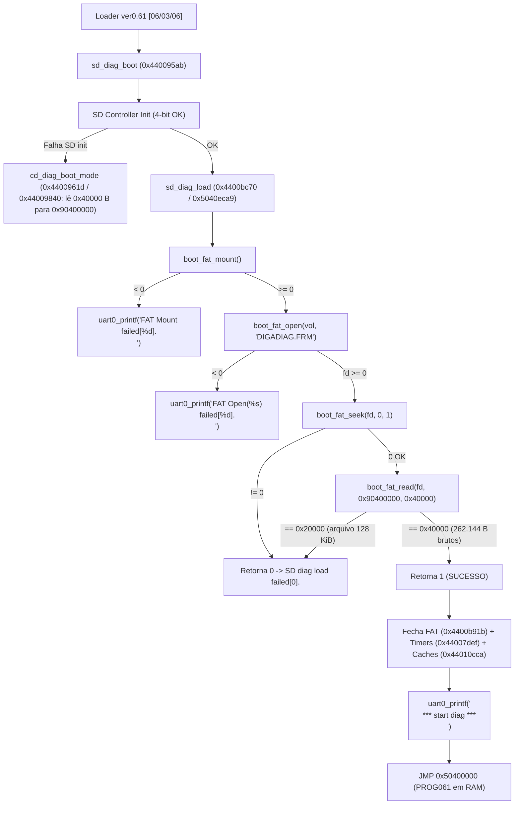

> 🌐 **Idioma / Language:** [English (US)](../en-US/FORENSIC_DOSSIER_BOOTLOADER_SDDIAG_EH55.md) | **Português (BR)**
> 🧭 **Portal:** [Índice da Documentação](../INDEX.md) | [Auditoria Completa](../../AUDITORIA_COMPLETA.md) | [Pseudocódigo Ghidra](../pseudocode/INDICE_EVIDENCIA_PSEUDOCODIGO_GHIDRA.md)

# Dossiê Técnico Forense: Engenharia Reversa do Bootloader SDDIAG (DMR-EH55 `Loader ver0.61` vs `Loader ver0.63`)

**Dispositivo Alvo:** Panasonic DMR-EH55 (Plataforma MN103S / MN103SA27GA)  
**Bootloader Real na NOR do DMR-EH55:** `Loader ver0.61 [06/03/06]` (confirmado via UART `P7501` e alinhado ao código-objeto `sd_load.o` em `prog061_dec.bin` @ `0x5040e9ae..0x5040edce` e ao dump NOR contemporâneo de março de 2006 `dmr-es35v/flash.bin` `Loader ver0.18 [06/03/13]` @ `0x440085d9` / `0x440095ab` / `0x44009840` / `0x4400b975..0x4400bd97`)  
**Bootloader de Referência Analisado no Ghidra (`/BOOT.BIN`):** `C:\ghidra\binaries\BOOT.BIN` — `Loader ver0.63 [07/10/24] (4MB/TOP BOOT)` (`262.144 B`, SHA-256 `7c13c72a54c77387f3f7df0ddc213e4800e20b27eecbfd225cbc05a8fc73e377`, geração posterior, ex.: DMR-EZ485V)  
**Descompilador & Auditoria de Baixo Nível:** Ghidra 12.1.4 PUBLIC (Headless Java Analyzer — 11 scripts em `C:\ghidra\*.java`, consolidados literalmente em [`doc_boot_fat_sd_java.txt`](../pseudocode/raw/doc_boot_fat_sd_java.txt)) + inspeção direta de opcodes MN103S/AM33 e especificação SLEIGH (`mn103.sinc` / `am33.sinc`)  
**Ambiente de Bancada:** Raspberry Pi Pico (Firmware Panadiga Bench Probe @ `COM10`, 115200 8N1)

---

## 1. Resumo Executivo: Causa Raiz Comprovada de `SD diag load failed[0].`

Durante os testes na bancada (`COM10`, comando `JIGBOOT 8000` / `UARTSTREAM 20000 JIG:2500`), o bootloader **`Loader ver0.61 [06/03/06]`** do DMR-EH55:
1. Inicializou o cartão SD de 2 GB em barramento de 4 bits (`Card type:2`, `capacity:3c4000[LBA]`, `RCA:2`, `Bus Width:4`, `SD = 0x3C4000[LBA]`, `... SD init end`).
2. **Montou a partição FAT16 de 32 MB com sucesso** (não houve `FAT Mount failed[%d].`).
3. **Abriu `DIGADIAG.FRM` no diretório raiz com sucesso** (não houve `FAT Open(DIGADIAG.FRM) failed[%d].`).
4. Executou **`SD diag load failed[0].`** e caiu para `***** normal mode *****`.

### Por que falhou mesmo com FAT16 montado e `DIGADIAG.FRM` aberto?

A comparação binária direta entre `/BOOT.BIN` (`Loader ver0.63 [07/10/24]`), `prog061_dec.bin` (`06/03/06`, base `0x50400000`) e o dump NOR de março de 2006 (`flash.bin`, base `0x44000000`, `Loader ver0.18 [06/03/13]`) provou que **o `Loader ver0.61 [06/03/06]` NÃO utiliza o formato `EXTRHEAD` de 128 KiB (`0x20000`)**:

* No **`Loader ver0.63 [07/10/24]`** (`C:\ghidra\binaries\BOOT.BIN`):
  - `FUN_4400a97c` (`sd_diag_load`) lê **`0x20000` bytes (131.072 B)** de `DIGADIAG.FRM` para `0x93fc0000`, e `FUN_44007ba5` passa esse buffer para `uncompress(&DAT_93fc0000)` (formato `EXTRHEAD` + LZSS).
  - `FUN_4400aa5f` lê TOC plaintext de **`0x2000` bytes (8.192 B)** de `PANA__SD.FRM` com stride de **64 bytes** (`sd64`).

* No **`Loader ver0.61 [06/03/06]`** (DMR-EH55 real, espelhado em `prog061_dec.bin` e `flash.bin` `03/2006`):
  - `sd_diag_load` (`0x5040eca9` em `prog061_dec.bin` / `0x4400bc70` em `flash.bin`) chama `boot_fat_read(fd, 0x90400000, 0x40000)` — solicitando **`0x40000` bytes (262.144 B / 256 KiB brutos)** diretamente no alias físico *uncached* da DDR SDRAM (`0x90400000`, correspondente a `0x50400000`).
  - Quando o arquivo `DIGADIAG.FRM` gravado no SD possuía apenas **131.072 bytes (`0x20000`)**, `boot_fat_read` truncou a leitura para `FileSize` (`0x20000`) e retornou `0x20000`. A verificação `ret == 0x40000` (`0x5040ed66: fc c8 00 00 04 00 c9 08` / `0x4400bd2d: fc c8 00 00 04 00 c9 08`) falhou, fazendo `sd_diag_load` retornar **`0`** e `sd_diag_boot` imprimir **`SD diag load failed[0].`**.
  - Na sequência de boot da NOR de março de 2006 (`flash.bin` @ `0x440085d9..0x44008605`), o bootloader **não chama `uncompress`**: ele fecha o FAT (`0x4400b91b`), desabilita timers (`0x44007def`), invalida/limpa os caches (`0x44010cca`), imprime `\n*** start diag ***\n` (`0x4402ffe6`) e executa salto direto para **`0x50400000`** (`0x44008601: dc ff 79 3f 0c` $\rightarrow$ `jmp 0x50400000`).
  - E `PANA__SD.FRM` na família `03/2006` (`ver0.61` / `ver0.18`) usa TOC plaintext de **`0x1800` bytes (6.144 B)** com **128 entradas de 48 bytes (`0x30`, modo `sd48`)**, validado por `sd_read_firm_list` (`0x5040ed7c` / `0x4400bd43`) e `sd_find_firm_entry` (`0x5040ea7d` / `0x4400ba44`).

---

## 2. Tabela Comparativa Definitiva: `Loader ver0.61` / NOR `03/2006` vs `Loader ver0.63` (`/BOOT.BIN`)

| Aspecto | `Loader ver0.61 [06/03/06]` (DMR-EH55 / `prog061_dec.bin`) & NOR `03/2006` (`flash.bin` `ver0.18 [06/03/13]`) | `Loader ver0.63 [07/10/24]` (`/BOOT.BIN` DMR-EZ485V) |
| :--- | :--- | :--- |
| **Endereço de `sd_diag_load`** | `0x5040eca9` (`prog061_dec.bin`) / `0x4400bc70` (`flash.bin`) | `0x4400a97c` (`FUN_4400a97c`) |
| **Tamanho exato lido de `DIGADIAG.FRM`** | **`0x40000` (262.144 bytes / 256 KiB)** | `0x20000` (131.072 bytes / 128 KiB) |
| **Buffer de destino na RAM** | **`0x90400000`** (alias uncached de `0x50400000`) | `0x93fc0000` (`&DAT_93fc0000`) |
| **Formato de `DIGADIAG.FRM`** | **Binário puro descomprimido (`dc 14 00 00 00 ...`)**, sem wrapper `EXTRHEAD` | Container `EXTRHEAD` comprimido + `EXTRFOOT` |
| **Execução após leitura bem-sucedida** | Fecha FAT (`0x4400b91b`) $\rightarrow$ desabilita timers (`0x44007def`) $\rightarrow$ limpa caches (`0x44010cca`) $\rightarrow$ imprime `\n*** start diag ***\n` $\rightarrow$ **`JMP 0x50400000`** (`0x44008601`) | Imprime `diag loader uncompress start...\n` $\rightarrow$ `uncompress(0x93fc0000)` $\rightarrow$ executa destino |
| **Fallback óptico (`cd_diag_boot_mode`)** | Lê **`0x40000` B** para **`0x90400000`** (`flash.bin` @ `0x44009840..0x440098b2`) | Descomprime `EXTRHEAD` via `uncompress(&DAT_93fc0000)` |
| **Tamanho da TOC de `PANA__SD.FRM`** | **`0x1800` bytes (6.144 B)** via `0x5040ed7c` / `0x4400bd43` | `0x2000` bytes (8.192 B) via `0x4400aa5f` |
| **Stride por entrada na TOC de `PANA__SD.FRM`** | **`0x30` (48 bytes)** — modo **`sd48`** (`0x5040ea7d` / `0x4400ba44`) | `0x40` (64 bytes) — modo `sd64` |
| **Descritor `DAVIS` linkado** | `LIB:davis.a ver1.45 (2005/10/28)` (`prog061`) / `ver1.50 (2005/11/02)` (`flash.bin`) | Geração posterior (`4MB/TOP BOOT`) |

---

## 3. Evidência Verificada em Código de Máquina: `prog061_dec.bin` (`sd_load.o`) e NOR `03/2006` (`flash.bin`)

A inspeção direta das instruções MN103S em `C:\Users\danie\Documents\Panadiga\firmware_and_images\extracted_partitions\frm_unpacked\prog061_dec.bin` (base `0x50400000`, `262.144 B`, SHA-256 `c7da9121174fcf4c54f35f5bb1f7b23a3dc0c93ab227158ad4fdd90a1ea24a81`) e em `flash.bin` dentro de `dmr-es35v-8mb-nor-flash-and-eeprom-triton-dump.zip` (base `0x44000000`, `8.388.608 B`, SHA-256 `0969f2580ad30b98027271a8e3947f5a6ae1c02dec06462b87ce1057a7a1bcf9`) confirma que ambos compilaram **exatamente o mesmo módulo-objeto `sd_load.o`** (mesma ordem de funções e lógica, mudando apenas endereços de relocação).

### 3.1 Mapeamento Completo de `sd_load.o` (`prog061_dec.bin` vs NOR `03/2006` `flash.bin`)

| Função / Papel | `prog061_dec.bin` (`06/03/06`) | NOR `flash.bin` (`06/03/13`) | Comportamento Verificado em Disassembly |
| :--- | :--- | :--- | :--- |
| **`decrypt_toc_entry`** (Decrypt TOC 48B) | `0x5040e9ae` *(prólogo cobrindo `0x5040e9b2`)* | `0x4400b975` | Na 1ª chamada (`0x504802f8 == 0`), inicializa key schedule Feistel (`0x50416a76` / `0x44013180`) com chaves 7+8 B em `0x50480344`/`0x5048034b`; decifra `len` bytes em blocos de `8 B` (`add -8, d1` via `0x50416d5d` / `0x44013467`). |
| **`list_sum`** (Checksum TOC 48B) | `0x5040ea1c` *(prólogo de `0x5040ea1d`)* | `0x4400b9e3` | Soma os bytes `0..45` (`add 46, d0`, `movhu`) e compara com `*(ushort *)(entry + 0x2e)`; em divergência imprime `"[fmu] error! list_sum is invalid.\n"` via `0x5040fe60` / `0x4400c684`. *(Contém `0x5040ea52: bra 0x5040ea2f` — causa de sobreposição no Ghidra se definida em `0x5040ea30`.)* |
| **`sd_find_firm_entry`** (Stride `0x30`) | `0x5040ea7d` | `0x4400ba44` | Percorre `128` slots (`cmp 0x7f, d0; ble`), stride **`0x30` (48 bytes)** na tabela `0x50481b5c` (`0x504814ac` na NOR): compara 8 B do nome (`+0x10`), 4 B do ID (`+0x00`), 1 B do flag (`+0x18`) e valida com `list_sum`. |
| **`bytes_sum32`** | `0x5040eb35` | `0x4400bafc` | Soma linear acumulada de 32 bits (`movbu (a0), d0; add d1, d0`) sobre `(buf, len)`. |
| **`dvdram_read_firm_list`** (DVD-RAM TOC) | `0x5040eb78` *(logo após `ret` em `0x5040eb75`)* | `0x4400bb3f` | Lê `0x1800` B via `0x5040edd3` (`0x4400c3bb`) para `0x50481b5c` (`0x504814ac`), exige `ret == 0x1800` e decifra todas as 128 entradas (`0..127`) de `0x30` B com `decrypt_toc_entry`. |
| **`sd_open_pana_sd_frm`** | `0x5040ebfe` | `0x4400bbc5` | Chama `boot_fat_mount` (`0x5041174e` / `0x4400d660`), imprime `"FAT Mount ID = 0x%X\n"`, abre `"PANA__SD.FRM"` (`0x50411923` / `0x4400d835`) e imprime `"FAT Open Old File ID = 0x%X\n"`. |
| **`sd_diag_load`** | `0x5040eca9` | `0x4400bc70` | Monta FAT, abre `"DIGADIAG.FRM"`, faz `seek(fd, 0, 1)` (`0x504119ee` / `0x4400d900`), chama `boot_fat_read(fd, 0x90400000, 0x40000)` (`0x504119be` / `0x4400d8d0`) e exige retorno exato **`0x40000`**. |
| **`sd_read_firm_list`** | `0x5040ed7c` | `0x4400bd43` | Faz `seek(fd, 0, 1)` e lê **`0x1800` bytes (6.144 B)** *plaintext* em `0x50481b5c` (`0x504814ac`), exigindo `ret == 0x1800` (sem decifração Feistel). |
| **`fat_debug_printf`** | `0x5040fe60` | `0x4400c684` | Se `param_1 == 0`, encaminha até 10 argumentos da pilha para `uart0_printf` (`0x50404dcd` em `prog061_dec.bin`, onde `0x50404dce` é byte +1 do prólogo `cf 10`, ou `0x44005f9e` em `flash.bin`). |

### 3.2 Trecho Verificado de `sd_diag_load` (`0x5040eca9` / `0x4400bc70`) e `sd_read_firm_list` (`0x5040ed7c`)

```text
; prog061_dec.bin @ 0x5040ed45..0x5040ed7a (idêntico a flash.bin @ 0x4400bd0c..0x4400bd40)
0x5040ed45: fc a4 00 03 48 50      mov  (0x50480300), d0      ; fd de DIGADIAG.FRM
0x5040ed4b: fc cd 00 00 04 00      mov  0x00040000, d1        ; size = 262.144 B (256 KiB)
0x5040ed51: 46 0c                  mov  d1, (0xc, sp)
0x5040ed53: fc cd 00 00 40 90      mov  0x90400000, d1        ; dst  = 0x90400000 (alias de 0x50400000)
0x5040ed59: dd 65 2c 00 00 00 00   call 0x504119be,[],0x0    ; boot_fat_read() (equiv. 0x4400d8d0 na NOR)
0x5040ed60: f8 13 fc               mov  d0, (-0x4, a3)
0x5040ed63: f8 03 fc               mov  (-0x4, a3), d0
0x5040ed66: fc c8 00 00 04 00      cmp  0x00040000, d0        ; exigiu exatos 0x40000 bytes!
0x5040ed6c: c9 08                  bne  0x5040ed74             ; se 0x20000 -> retorna 0 (SD diag load failed[0])
0x5040ed6e: 80 01                  mov  0x1, d0

; prog061_dec.bin @ 0x5040eda1..0x5040edc7 (sd_read_firm_list)
0x5040eda1: fc a4 00 03 48 50      mov  (0x50480300), d0      ; fd de PANA__SD.FRM
0x5040eda7: fc cd 5c 1b 48 50      mov  0x50481b5c, d1        ; buffer TOC 128 x 48B
0x5040edad: 24 00 18               mov  0x1800, a0            ; size = 6.144 B (modo sd48)
0x5040edb0: 43 0c                  mov  a0, (0xc, sp)
0x5040edb2: dd 0c 2c 00 00 00 00   call 0x504119be,[],0x0    ; boot_fat_read()
0x5040edbf: fa c8 00 18            cmp  0x1800, d0            ; exigiu exatos 0x1800 bytes!
```

### 3.3 Rotinas de Atualização Drive-Firm no `PROG061` (`0x50405b8c..0x50406126` & `0x50407bd8`)

No `prog061_dec.bin`, a função iniciada em **`0x50405b8c`** (logo após `0x50405b89: df 10 04` `ret [a3],0x4`, abrangendo o alinhamento `0x50405b8a`) implementa o carregador unificado do Drive-Firm:
1. Chama `0x5040d24c` (SD init; em falha imprime `"SD card init error.\n"` @ `0x504330ff`).
2. Chama **`0x5040ebfe`** (`sd_open_pana_sd_frm`; em falha imprime `"SD mount or file open error.\n"` @ `0x50433114`) e **`0x5040ed7c`** (`sd_read_firm_list`, `0x1800` B).
3. Itera até 10 entradas na tabela de descritores `0x50480c90` (stride `0x34` = 52 B), chamando **`0x5040ea7d`** (`sd_find_firm_entry`) para localizar cada firmware no TOC de 48 B.
4. Quando o método é disco (`0x50480284 == 1`), lê via `0x5040c9ac`; quando é cartão SD (`0x50480284 == 2`, `0x50405e8b..0x50406124`), busca com `0x504119ee` e lê com `0x504119be`, validando o payload por meio de **`0x50407bd8`**, que invoca **`bytes_sum32` (`0x5040eb35`)** em `0x50407c6b` e imprime `"Cheking for %s check-sum.\n"` (`0x5043394e`), `"check_sum = 0x%x.\n"` (`0x50433969`) ou `"error! %s check-sum invalid.\n"` (`0x5043397c`).

### 3.4 Cadeia de Transferência e Fallback Óptico na NOR `03/2006` (`flash.bin`)

Na imagem NOR contemporânea (`flash.bin` `Loader ver0.18 [06/03/13]`), a sequência pós-`sd_diag_boot` (`0x440085d9..0x44008605`) e os dois caminhos de carga (`0x440095ab` e `0x44009840`) são explícitos:

```text
; flash.bin @ 0x440085d9..0x44008605
0x440085d9: cd d2 0f 00 00         call 0x440095ab           ; sd_diag_boot ("SDDIAG", chama 0x4400bc70)
0x440085de: dd 3d 33 00 00 00 00   call 0x4400b91b           ; fecha handle/volume FAT
0x440085e5: dd 0a f8 ff ff 00 00   call 0x44007def           ; desabilita timers
0x440085ec: dd de 86 00 00 00 00   call 0x44010cca           ; invalida / limpa caches
0x440085f3: fc cd e6 ff 02 44      mov  0x4402ffe6, d1       ; "\n*** start diag ***\n"
0x440085f9: 84                     mov  d1, d0
0x440085fa: dd a4 d9 ff ff 00 00   call 0x44005f9e           ; uart0_printf
0x44008601: dc ff 79 3f 0c         jmp  0x50400000           ; executa DIGADIAG.FRM carregado em 0x90400000!

; flash.bin @ 0x4400985a..0x44009890 (dentro do fallback cd_diag_boot_mode @ 0x4400983e..0x440098b6)
0x44009864: fc cc 00 00 04 00      mov  0x00040000, d0       ; tamanho = 262.144 B (0x40000)
0x44009874: fc cc 00 00 40 90      mov  0x90400000, d0       ; destino = 0x90400000 (alias de 0x50400000)
0x4400987b: dd 44 2d 00 00 00 00   call 0x4400c5bf           ; leitura do disco óptico
0x44009888: fc c8 00 00 04 00      cmp  0x00040000, d0       ; exige exatos 0x40000 bytes!
```

### 3.5 Fluxo Corrigido para o DMR-EH55 (`Loader ver0.61 [06/03/06]`)



---

## 4. Catálogo Completo dos 11 Scripts Java (Ghidra 12.1.4) e Análise Forense FAT + Driver SD (`/BOOT.BIN`)

Todas as 26 funções descompiladas pelos 11 scripts Java em `C:\ghidra\*.java` (além das duas sondas `NULL` e da investigação `DumpAsm.java` em `0x4400c760..0x4400c7b0`) estão preservadas literalmente em [`docs/pseudocode/raw/doc_boot_fat_sd_java.txt`](../pseudocode/raw/doc_boot_fat_sd_java.txt).

### 4.1 Inventário dos 11 Scripts Java e Funções Extraídas

| # | Script Java (`C:\ghidra\`) | Log Headless | Funções / Endereços Extraídos | Papel Verificado |
| :---: | :--- | :--- | :--- | :--- |
| **1** | `DecompileFat.java` | `task-36919.log` | `FUN_4400a97c`, `FUN_4400c696`, `FUN_4400c879`, `FUN_4400c922`, `FUN_4400c94d`, `FUN_4400c9c0`, `0x4400d335` (`NULL`) | `sd_diag_load` (`0x20000 -> 0x93fc0000`) + API pública FAT (`mount`, `open`, `read`, `seek`, `seek_internal`). `0x4400d335` retornou `NULL` pois o prólogo real fica em `0x4400d32f`. |
| **2** | `DecompileFat2.java` | `task-36929.log` + `steps/36986` | `FUN_4400d16b`, `FUN_4400d32f`, `FUN_4400ced2`, `FUN_4400cfde`, `FUN_4400d11e` | Abertura interna de arquivo, motor principal de leitura (`"ASF"` vs FAT normal), inicialização do cache FAT de 3 setores, parser 8.3 e alocador de handle único (`200`). |
| **3** | `DecompileFat3.java` | `task-36939.log` | `FUN_4400dce2`, `FUN_4400c510`, `FUN_4400c0a8`, `0x4400c436` (`NULL`) | Varredura de diretório FAT (clusters ou root), unpack 32 B de direntry, unpack 512 B de VBR/BPB (`0x4400c0a8`). |
| **4** | `DecompileFat4.java` | `task-36949.log` | `FUN_4400cb21`, `FUN_4400e51f`, `FUN_4400e592` | Leitor MBR/VBR/BPB com fallback backup FAT32 (`+6`), conversor cluster $\rightarrow$ LBA e varredura do diretório raiz fixo FAT12/FAT16. |
| **5** | `DecompileFat5.java` | `task-36960.log` | `FUN_4400dfc8`, `FUN_4400dc64`, `FUN_4400e737`, `FUN_4400edbf` | Leitor dedicado `"ASF"`, wrapper de leitura de setor (`+partition_lba`), cache FAT 3-setores / próximo cluster (`FAT12`/`16`/`32`) e scanner de clusters contíguos limitado (`FUN_4400edbf`). |
| **6** | `DecompileFat6.java` | `task-36967.log` | `FUN_4400ca59`, `FUN_4400dc64` | Leitor em blocos de até `0x1fc` (508) setores para buffer fixo `0x91c00000` + `memcpy` ao destino. |
| **7** | `DecompileFat7.java` | `task-36974.log` | `FUN_440098fc` | Despachante de dispositivo de bloco (`param_1 == 0` $\rightarrow$ `FUN_44009980`; `param_1 == 3` SD $\rightarrow$ `FUN_440262cb`). |
| **8** | `DecompileFat8.java` | `task-36981.log` | `FUN_4400b3d9` | Wrapper de log FAT/SD que encaminha `param_2..param_12` + `&stack0x34` para `uart0_printf`. |
| **9** | `DumpAsm.java` | `task-36994.log` | `0x4400c760..0x4400c7b0` | `getInstructionAt(0x4400c760)` retornou `null` (0 linhas) porque `0x4400c760` cai no byte `+1` da instrução `0x4400c75f: f8 11 18 mov d0,(0x18,a1)`. Desmontado manualmente na Seção 5. |
| **10** | `DecompileSdRead.java` | `task-37053.log` | `FUN_440262cb` | Driver de leitura SD: checagem `_DAT_505748f8 == 2` (`Card type:2`), chunking `0x10000`, `CMD17` (`FUN_440282d6`) vs `CMD18` (`FUN_44028257`), e `DAVIS_Read_BufStatus` (`FUN_44013cb1`). |
| **11** | `DecompileCardType.java` | `task-37066.log` | `FUN_4402724f` | Negociação OCR (`ACMD41` `0x100000` / `0x40100000`, fallback MMC `CMD1`), detecção de `Card type` (`_DAT_505748f8`: `1`=SDSC, `2`=SDHC, `3`=MMC), `CMD2` e `CMD3` RCA. |

### 4.2 Análise Forense da Pilha FAT12 / FAT16 / FAT32 (`/BOOT.BIN`)

1. **Montagem, MBR/BPB e Limite de Clusters (`FUN_4400c696` $\rightarrow$ `FUN_4400cb21` $\rightarrow$ `FUN_4400c0a8`)**:
   - `FUN_4400cb21` lê o LBA `0` para `0x5056b6d4`, verifica `0x55 0xAA`, percorre as 4 entradas MBR (`+0x1be`, stride `0x10`) buscando boot flag `0x00`/`0x80` e `PartitionType != 0` para obter `PartitionStartLBA` (`+0x8` no descritor de volume `0x5056b640`). Se a leitura do VBR falhar em FAT32, tenta uma única vez `PartitionStartLBA + 6` (VBR backup).
   - `FUN_4400c0a8` desempacota 512 B de BPB (`BytesPerSec` precisa ser `0x200`, `SecPerClus != 0`, `NumFATs in 1..2`); se `FATSz16 == 0` e `SectorsPerFat16 == 0`, chama `FUN_4400c35a` para extrair `FATSz32` e valida assinatura `"FAT32"` (`0x440356e0`).
   - `FUN_4400c696` calcula `FatSectors = NumFATs * FATSz`, `RootDirSectors = (RootEntCnt * 32) / BytesPerSec`, `FATStartLBA = ReservedSectors` (`+0x10`), `RootStartLBA = ReservedSectors + FatSectors` (`+0x14`), `DataStartLBA = RootStartLBA + RootDirSectors` (`+0x18`), e `DataClusters = (TotalSectors - ReservedSectors - FatSectors - RootDirSectors) / SecPerClus` (`+0x3c`, **onde o bug SLEIGH `SUB` inverte `ReservedSectors - TotSec32` no C**). Classifica `< 0xff6` $\rightarrow$ `0xc` (FAT12), `<= 0xfff5` $\rightarrow$ `0x10` (FAT16), `< 0xffffff6` $\rightarrow$ `0x20` (FAT32 — porém retorna erro `0xffffd8d7` = `-10025` no mount FAT32 neste ramo!).
2. **Cache FAT de 3 Setores (`FUN_4400ced2` & `FUN_4400e737`)**:
   - A estrutura de cache de FAT em `0x505716d4` (stride `0xdec` = 3.564 B por volume) guarda até **3 setores contíguos (`1.536` B)** a partir de `+0x18`, com `cache_start_sec` em `+0x10` e `cache_sec_count` em `+0x14`.
   - `FUN_4400ced2` pré-carrega `min(FatSectors, 3)` setores da FAT1 (com fallback para FAT2 em `+0xc` se `NumFATs > 1`) e inicializa 500 slots em `+0x61c` com `0xffffffff`.
   - Em `FUN_4400e737`, caso o setor da FAT desejado não esteja na janela `[+0x10, +0x10 + +0x14)`, alinha a base da janela em múltiplos de 3 usando multiplicação recíproca `((uint)(sec * -0x55555555) >> 1) * 3` — alinhamento de **3 setores = 1.536 bytes**, divisível exatamente por 3 bytes (pares de entradas FAT12 de 12 bits), 2 bytes (FAT16) e 4 bytes (FAT32) — e lê `min(3, FatSectors - window_start)` setores (outro local afetado pelo `SUB` SLEIGH em `0x4400e948`/`0x4400eb29`/`0x4400ed63`).
3. **Alocação de Handle, Lookup 8.3 e Leitura com Scanner Contíguo (`FUN_4400c879` $\rightarrow$ `FUN_4400d16b` $\rightarrow$ `FUN_4400d32f`)**:
   - `FUN_4400d11e` controla handle único (`DAT_5056b6d0` $\rightarrow$ handle `200`, estrutura do arquivo em `0x5056b680`). `FUN_4400cfde` converte nomes até 12 caracteres para 8.3 com espaços (`0x20`). `FUN_4400dce2` varre clusters de diretório (ou delega para `FUN_4400e592` quando o diretório raiz é área fixa FAT12/FAT16) e `FUN_4400c510` desempacota entradas de 32 bytes.
   - `FUN_4400c922(fd, dst, size)` chama **`FUN_4400d32f(fd - 200, dst, size)`**.
   - **Despacho por extensão `"ASF"` (`FUN_4400d32f` $\rightarrow$ `FUN_4400dfc8`)**: no ramo inicial de `FUN_4400d32f` (`0x4400d43f`), `FUN_4402c398(0x5056b691, &DAT_440356e9)` compara a extensão de 3 bytes em `0x5056b680 + 0x11` com **`"ASF"`** (`0x440356e9`):
     * Se **não** for `"ASF"`: segue em `FUN_4400d32f` (suporta FAT12/FAT16/FAT32), trunca `size` a `FileSize - Offset` (`0x4400d525`), usa **`FUN_4400edbf`** (scanner de clusters contíguos limitado por `max_clusters`) e lê em rajadas de no máximo **`0x20` (32) setores = 16 KiB** por chamada a `FUN_4400dc64` (`0x4400d33c: mov 0x20, d0`; rearmado em `puVar1[-0xc] = 0x20` para próximos segmentos contíguos).
     * Se **for** `"ASF"`: zera o hint de cluster (`*(int *)(puVar1[-5] + 0x3c) = -1`) e delega para **`FUN_4400dfc8`**, que usa **`FUN_4400ef58`** (scanner contíguo irrestrito sem argumento `max_clusters`, exigindo FAT32 `0x20` se `cluster <= 1`) e também lê em janelas de **`0x20` (32) setores** (`0x4400dfd4: mov 0x20, d0`; `puVar1[-0xb] = 0x20`).
   - **Staging em SDRAM (`FUN_4400ca59`)**: cada chamada `FUN_4400dc64` repassa para `FUN_4400ca59`, que fraciona leituras acima de **`0x1fc` (508) setores (`0x3f800` B = 260.096 B)** usando o buffer SDRAM fixo **`0x91c00000`** via `FUN_440098fc(3, 0x01000000, lba, chunk_sectors)` e copia via `FUN_4402c2f7` ao buffer destino.

### 4.3 Análise Forense do Driver SD Baixo Nível (`FUN_4402724f` & `FUN_440262cb`)

1. **Detecção de `Card type == 2` (`_DAT_505748f8`) em `FUN_4402724f`**:
   - Configura o controlador em `0x89001848` (`0x140`), emite `CMD0` (`FUN_440271a1(0, 0)`), consulta `FUN_440271fc()`.
   - Quando `_DAT_505748f8 == 0`: tenta `CMD55` (`0x37`) + `ACMD41(0x100000)` (SDSC) até 300 ciclos de 10 ms; em falha `-0x1637d`/`-0x1637b`, muda `_DAT_50574914 = 3`, **`_DAT_505748f8 = 3` (MMC)** e entra em loop `CMD1(0xff0000)`.
   - Quando `_DAT_505748f8 == 2` (fluxo v2.0 pós-`CMD8`): envia `CMD55(0)` + **`ACMD41(0x40100000)`** (bit HCS=1). Ao receber OCR pronto (`_DAT_50574926 & 0x8000`), testa bit CCS (`_DAT_50574926 & 0x4000`): se `0`, rebaixa **`_DAT_505748f8 = 1` (SDSC)**; se `!= 0`, confirma **`_DAT_505748f8 = 2` (SDHC, endereçamento por LBA)**! Prossegue então com `CMD2` (`ALL_SEND_CID`) e `CMD3` (`SEND_RCA`, até 10 tentativas / 3 retries).
2. **Leitura de Blocos SD em `FUN_440262cb` (`CMD17` vs `CMD18`, Chunking `0x10000`, DMA/BufStatus)**:
   - Valida estado via `FUN_44026626()`, ativa transferência via `FUN_440276a1(1)`.
   - Se **`_DAT_505748f8 != 2`** (SDSC/MMC): multiplica `param_2` por 512 (`param_2 <<= 9`) para converter LBA em endereço de byte; se **`_DAT_505748f8 == 2`** (SDHC): mantém `param_2` em LBA puro.
   - Inicializa `*(param_1 + 8) = 0` e `*(param_1 + 0xc) = 0x200` (512 B), e itera enquanto `param_3 > 0`:
     * Limita cada comando SD a no máximo **`0x10000` (65.536) setores = 32 MiB** por transferência.
     * Chama `FUN_44027600(0x32)`.
     * **Leitura de 1 setor (`uVar4 == 1`)**: chama **`FUN_440282d6(addr, param_1)`**, que prepara e envia **`CMD17` (`0x11` = `READ_SINGLE_BLOCK`)** via `FUN_440268b0` + `FUN_440271a1(0x11, addr)` + `FUN_440149b9(1, 0x18, ...)`.
     * **Leitura multi-setor (`uVar4 > 1`)**: grava `*(param_1 + 0xc) = uVar4 * 0x200` e chama **`FUN_44028257(addr, param_1, uVar4)`**, que envia **`CMD18` (`0x12` = `READ_MULTIPLE_BLOCK`)** via `FUN_440266ae(uVar4)` + `FUN_440268b0(uVar4, 0x12)` + `FUN_440271a1(0x12, addr)` + `FUN_440149b9(1, 0x18, ...)` + `FUN_440266fa` + `FUN_44026768(0x1000)` + `FUN_44027579(0x12)`.
     * Se `*(char *)(param_1 + 0x10) == '\x01'`, invoca `FUN_44013cb1(param_1, auStack_40, 0x20)` (`DAVIS_Read_BufStatus`, que delega para `0x44012331` ou `0x44013aa0` com bloco `0x0200`) e atualiza `*(param_1 + 4)` com `iStack_38 << 9`; caso contrário, avança `*(param_1 + 4) += uVar4 * 0x200`.

---

## 5. Prova em Código de Máquina: Bug de Inversão de Operandos `SUB` no Módulo SLEIGH MN103S/AM33 do Ghidra (Armadilha #8)

Ao auditar o código de máquina bruto de `FUN_4400c696`, `FUN_4400ca59`, `FUN_4400d32f`, `FUN_4400dfc8` e `FUN_4400e737` em `C:\ghidra\binaries\BOOT.BIN` frente ao decompilador C do Ghidra 12.1.4 e às definições SLEIGH da extensão `GhidraMn10300`, identificou-se a **causa exata da Armadilha #8**:

* **Arquivo SLEIGH defeituoso:** `C:\ghidra\ghidra_12.1.4_PUBLIC\Ghidra\Extensions\GhidraMn10300\data\languages\am33.sinc`, **linha 184**:
  ```text
  :SUB Rm2, Rn0, Rd2  is op8=0xfb; op8=0x9c; Rm2 & Rn0; Rd2 & op4l=0
      { local val:4 = Rm2; update_sub(val, Rn0); Rd2 = val; }
  ```
* **Semântica real da CPU Panasonic MN103S / AM33 (`fb 9c`):** `SUB Rm, Rn, Rd` executa **`Rd = Rn - Rm`** (assim como as instruções de 2 operandos `SUB Dm, Dn` em `mn103.sinc` linha 421 `Dn = Dn - Dm` e os shifts 3-operandos `LSR`/`ASL` em `am33.sinc` linhas 306/312 `Rd2 = Rn0 >> Rm2` e `Rd2 = Rn0 << Rm2`).
* **O que o SLEIGH de `am33.sinc` emite no Ghidra:** inicializa `val = Rm2` e chama `update_sub(val, Rn0)` (`val = val - Rn0`), gerando **`Rd2 = Rm2 - Rn0`** (exatamente invertido!). *(Nota adicional: em `mn103.sinc` L421, a forma de 2 operandos `f1 0x` `SUB Dm1, Dn0` está correta: `update_sub(Dn0, Dm1)`; já em `am33.sinc` L186–L188 `:SUB SIMM8/24/32, Rn0` chama `update_add` erroneamente.)*

### Prova Binária Direta dos 5 Pontos Auditados em `C:\ghidra\binaries\BOOT.BIN`

| Função | Endereço Real da Instrução (e Ref. Adjacente) | Bytes Brutos & Disassembly MN103S Verificado | Pseudo-C Errado (SLEIGH Ghidra) | Execução Real na CPU MN103S |
| :--- | :--- | :--- | :--- | :--- |
| **`FUN_4400c696`** (`boot_fat_mount`) | **`0x4400c77b`** *(byte `+1` em `0x4400c77c`)* | `0x4400c775: f8 64 24` (`movhu (0x24,a0),d1`)<br>`0x4400c778: f8 01 34` (`mov (0x34,a1),d0`)<br>`0x4400c77b: fb 9c dc d0` (`sub d1,d0,d1`) | `*(ushort *)(puVar1[-5] + 0x24) - *(int *)(puVar1[-5] + 0x34)` (`ReservedSectors - TotSec32`) | **`d1 = d0 - d1`** = `TotSec32 - ReservedSectors` (cálculo de clusters FAT16/32 sem bug!) |
| **`FUN_4400ca59`** (`sd_read_chunked`) | **`0x4400caeb`** *(byte `0xf8` em `0x4400caea` de `0x4400cae8: f8 03 f8`)* | `0x4400cae5: f8 07 0c` (`mov (0xc,a3),d1`)<br>`0x4400cae8: f8 03 f8` (`mov (-0x8,a3),d0`)<br>`0x4400caeb: fb 9c cd c0` (`sub d0,d1,d0`) | `puVar1[3] = puVar1[-2] - puVar1[3]` (`chunk_sectors - remaining`) | **`d0 = d1 - d0`** = `remaining - chunk_sectors` (decrementa setores restantes no loop) |
| **`FUN_4400d32f`** (`fat_read_internal`) | **`0x4400d525`** *(+ 7 ocorrências `0x4400d7ef..0x4400db58`; nota: `0x4400d4b0` é `e4` `add d1,d0` no ramo `== 0x10`)* | `0x4400d51f: f8 04 40` (`mov (0x40,a0),d1`)<br>`0x4400d522: f8 01 44` (`mov (0x44,a1),d0`)<br>`0x4400d525: fb 9c cd c0` (`sub d0,d1,d0`) | `puVar1[7] = *(int *)(puVar1[-5] + 0x44) - *(int *)(puVar1[-5] + 0x40)` (`Offset - FileSize`) | **`d0 = d1 - d0`** = `FileSize - Offset` (trunca leitura de `0x40000` para `0x20000`!) |
| **`FUN_4400dfc8`** (`fat_read_asf`) | **`0x4400e0c6`** *(byte `+1` em `0x4400e0c7`; + 5 ocorrências `0x4400e2f9..0x4400e3d4`)* | `0x4400e0c0: f8 04 40` (`mov (0x40,a0),d1`)<br>`0x4400e0c3: f8 01 44` (`mov (0x44,a1),d0`)<br>`0x4400e0c6: fb 9c cd c0` (`sub d0,d1,d0`) | `param_3 = _DAT_5056b6c4 - _DAT_5056b6c0` (`Offset - FileSize`) | **`d0 = d1 - d0`** = `FileSize - Offset` (trunca leitura ASF ao EOF) |
| **`FUN_4400e737`** (`fat_next_cluster`) | **`0x4400e948`** *(FAT12; idêntico em FAT16 `0x4400eb29` e FAT32 `0x4400ed63`)* | `0x4400e942: f8 04 2c` (`mov (0x2c,a0),d1`)<br>`0x4400e945: f8 01 10` (`mov (0x10,a1),d0`)<br>`0x4400e948: fb 9c cd c0` (`sub d0,d1,d0`) | `*(int *)(puVar1[-6] + 0x10) - *(int *)(puVar1[-7] + 0x2c)` (`cache_start_sec - FatSectors`) | **`d0 = d1 - d0`** = `FatSectors - cache_start_sec` (setores restantes na janela de 3 setores) |

---

## 6. Restrições Obrigatórias de Mídia, Partição, BPB FAT16 e Arquivos (`Loader ver0.61`)

A análise do código de máquina de `FUN_4402724f`, `FUN_440262cb`, `FUN_4400cb21`, `FUN_4400c0a8`, `FUN_4400c696`, `FUN_4400cfde`, `FUN_4400d11e` e `sd_diag_load` (`0x4400bc70` / `0x5040eca9`) explica exatamente por que um cartão SD aparentemente "válido" no PC falha durante dias no gravador Panasonic até atender a **todas** as travas do bootloader simultaneamente:

### 6.1 Camada Física e Controlador SD (`FUN_4402724f`, `FUN_440262cb`, `FUN_44027826`)

| Restrição | Regra Verificada no Bootloader | Sintoma se Violar |
| :--- | :--- | :--- |
| **Tipo de Cartão (`CSD_STRUCTURE`)** | Aceita **SDSC ($\le 2\text{ GiB}$, `Card type:1`, endereço em bytes `LBA << 9`)** e **SDHC ($2{,}12\text{–}31{,}9\text{ GiB}$, `Card type:2`, endereço em LBA)**. | **SDXC ($\ge 64\text{ GiB}$) falha** (`-91008` / `-0x16380`). Prefira **SDSC $\le 2\text{ GiB}$**. |
| **Barramento 4-bit Obrigatório** | Após iniciar em 1-bit, envia `CMD55 + ACMD6(2)` e revalida `GetSD_Status` (`ACMD13`) nos 4 pinos **`DAT0..DAT3`**. | Mau contato ou trilha aberta em `DAT1..DAT3` gera **`SetBusWidth:SD Status ERROR -91006`** / `SD init failed[-90002]` (**sem fallback** para 1-bit via `P7501`). |

### 6.2 Tabela de Partições MBR e Campos do BPB FAT16 (`FUN_4400cb21`, `FUN_4400c0a8`, `FUN_4400c696`)

1. **Esquema de Particionamento MBR (não GPT, evitar *superfloppy*):**
   - `FUN_4400cb21` lê o **LBA `0`**, exige assinatura **`0x55 0xAA`** em `+0x1FE..+0x1FF` e percorre as **4 entradas MBR em `+0x1BE`** (passo `0x10`), procurando `BootIndicator` $\in \{\texttt{0x00}, \texttt{0x80}\}$ e `PartitionType != 0` para extrair `PartitionStartLBA` (`+0x08`). Cartões sem tabela MBR (*superfloppy*) ou em GPT falham na localização da partição.
2. **Constantes Rígidas do BPB no VBR (`FUN_4400c0a8`):**
   - `+0x1FE..+0x1FF`: assinatura `0x55 0xAA` obrigatória.
   - `+0x0B` (`BytesPerSec`): **precisa ser exatamente `512` (`0x0200`)**; qualquer outro tamanho retorna **`-10025` (`0xFFFFD8D7`)**.
   - `+0x0D` (`SecPerClus`): precisa ser `!= 0` (potência de 2).
   - `+0x0E` (`ReservedSectors`): precisa ser `!= 0` (Windows `ufat.dll` usa canônico **`01 00` = `1`**).
   - `+0x10` (`NumFATs`): precisa ser **`1` ou `2`** (`0` ou $\ge 3$ falha).
   - `+0x11` (`RootEntCnt`): na prática padrão FAT16 Microsoft, **`512` (`00 02`)**.
   - `+0x36` (`BS_FilSysType`, 5 bytes): precisa ser literalmente **`"FAT12"`** ou **`"FAT16"`**. `exFAT` e `NTFS` falham de imediato.
3. **Bloqueio Explícito de FAT32 (`DataClusters > 0xFFF5`):**
   - Em `FUN_4400c696` (linhas 175–188 de `DecompileFat.java`), o bootloader classifica `DataClusters < 0xFF6` como FAT12 (`0x0C`) e `0xFF6..0xFFF5` como FAT16 (`0x10`), mas se **`DataClusters > 0xFFF5` (`65.525` clusters)**, marca tipo `0x20` (FAT32) e **aborta imediatamente a montagem retornando `0xFFFFD8D7` (`-10025`)**.
   - Consequentemente, partições $> 2\text{ GiB}$ ou com clusters pequenos demais ultrapassam `0xFFF5` clusters e forçam FAT32, sendo rejeitadas.

> **Por que `mkfs.vfat 4.2+` (Linux) vs `format /FS:FAT` (Windows) causou tantos dias de tentativa e erro:**
> Ferramentas Linux modernas (`mkfs.vfat 4.2+`) frequentemente formatam SD/SDHC em FAT32 por padrão, alteram `ReservedSectors` para alinhamento (ex.: `64` ou `4` setores = `04 00` em `xxd /dev/sdb1`) ou criam volume *superfloppy* sem MBR quando aplicadas direto no dispositivo inteiro. Já o **`format` nativo do Windows** sobre uma partição MBR $\le 2\text{ GiB}$ gera exatamente o BPB canônico esperado por drivers embarcados Panasonic/Microsoft (`JumpBoot = EB 3C 90`, `BytesPerSec = 00 02`, `ReservedSectors = 01 00`, `RootEntCnt = 00 02`, `"FAT16   "`):
> ```powershell
> # Windows (particao MBR de 32 MB..2 GB, ex. E: com 256 MB):
> format E: /FS:FAT /Q /A:8192 /V:SDCARD
> ```
> No Linux, se precisar formatar via terminal, crie tabela **DOS/MBR** + partição tipo `0x06` (`FAT16`, tamanho `32 MB..2 GB`) e force explicitamente parâmetros canônicos:
> ```bash
> sudo mkfs.fat -F 16 -R 1 -r 512 -f 2 -s 16 -n SDCARD /dev/sdX1
> ```

### 6.3 Regras de Diretório, Nomes 8.3 e Versão do Bootloader (`ver0.61` vs `ver0.63`)

1. **Raiz e Nomes 8.3 Estritos:** Os arquivos devem estar no **diretório raiz** em formato 8.3 (`FUN_4400cfde`), com grafia exata: **`DIGADIAG.FRM`** e **`PANA__SD.FRM`** (*dois underscores* `__` entre `PANA` e `SD`). Além disso, há apenas **1 handle simultâneo** (`slot 200`, erro `-10011` se ocupado) e tratamento especial reservado à extensão `.ASF`.
2. **Armadilha Fatal de Formato (`ver0.61` Real vs `ver0.63` `/BOOT.BIN`):**
   - Em um **DMR-EH55 real (`Loader ver0.61 [06/03/06]`)**, `DIGADIAG.FRM` precisa ter **exatos `262.144 bytes` (`0x40000`) brutos descomprimidos** (`dc 14 00 00 00 ...`, carregado em `0x90400000` $\rightarrow$ `JMP 0x50400000`). O arquivo `131.072 B` (`EXTRHEAD`) do `/BOOT.BIN` `ver0.63` causa `SD diag load failed[0].`.
   - O Estágio 2 `PROG061` exige **`PANA__SD.FRM` em modo `sd48`** (TOC de `0x1800` B = `128 x 48 B`), e **não** `sd64` (`0x2000` B do `ver0.63`).

### 6.4 Kit Canônico no Repositório (`firmware_and_images/sd_unbrick_kit/`) & Opções `ver0.61`

* **Kit Canônico Atual no Repositório (`firmware_and_images/sd_unbrick_kit/`, gerado com `--loader-profile ver061 --bgo-mode uart_monitor`):**
  * **`DIGADIAG.FRM`** (`262.144 B` = `0x40000`, `SHA-256: de72e2640ee48a7628a674e3dad731cff71548fc9ea3403ca616f3e5f7e392c0`, idêntico a `PROG061_PATCHED.bin`): `PROG061` bruto (`RAW_VER061`, `JMP 0x50400014`) com desvio incondicional `0x5040A2BC: ca 11 cb cb cb cb cb` (`BRA 0x5040A2CD` logo após `FUN_50404592`), hook `0x5040A2CD -> PANAMON1` (`0x50439494`), ABI `CALL ..., [], 0` + `ADD ±imm8, SP` e `PUTC_D3_BYTES` (`46 B`, timeout `0x00040000`). Validado via `Mn103Vm`, desmontagem Ghidra (`SUMMARY_CALLS: total=55 bad=0`) e `panadiga unbrick verify-sd`.
  * **`PANA__SD.FRM`** (`7.181.224 B`, `SHA-256: cdcc2cdf4617c4f08d8af3f617db369cfd360d8db2601b33c84bae0e6f995d90`): contêiner **`sd48`** (`0x1800 B` TOC, **6 entradas** compartilhando os 3 payloads para `M6930LB` nos slots `0..2` e `M6930` nos slots `3..5` com `[0x18] = 0x4D`: `DRV S211`, `PROG061 ` `UART_MONITOR_PANAMON1`, `MAIN3410PQ` `AV_PASSTHROUGH` LBA48 dinâmico).
* **Opção Stock Verificada para `ver0.61` (`sd_card_eh55_FACTORY_STOCK\` / `sd_card_eh55\OPCAO_3_FORMATO_VER061_RAW\`) — PASSA em `panadiga unbrick verify-sd`:**
  * **`DIGADIAG.FRM`**: **262.144 bytes (`0x40000`)** — `prog061_dec.bin` stock descomprimido (`JMP 0x50400014`). SHA-256: `c7da9121174fcf4c54f35f5bb1f7b23a3dc0c93ab227158ad4fdd90a1ea24a81`
  * **`PANA__SD.FRM`**: **7.531.744 bytes (`0x72ece0`)** — contêiner **`sd48`** (`DRV S211`, `PROG061 `, `MAIN3060NP`). SHA-256: `9394e027c8e62f430a2f818f291945783c5ac452b7ce40a4f91e272227cf36c5`
* **Nota Histórica (`sd_card_eh55_unbrick_kit\` legado pré-consolidação):** Contava com `DIGADIAG.FRM` `RAW_VER061` em modo `BYPASS_CHECKS_ONLY` (`668f1df3...`) pareado acidentalmente com `PANA__SD.FRM` `sd64` (`b653709d...`, `ver0.63`), falha `INCOMPLETE_OR_INVALID` eliminada após a migração canônica para `firmware_and_images/sd_unbrick_kit/` com padrão `--loader-profile ver061`.

---

## 7. Diagnóstico de Campo: Display em `SDDIAG`, Prova ao Vivo `COM10` & Correção ABI MN103S do `PANAMON1`

Quando o aparelho exibe **`SDDIAG` fixo no display VFD e não reinicia sozinho** com os arquivos `ver0.61` (`262.144 B` raw), o comportamento traz **uma confirmação empírica positiva** e **cinco causas exatas provadas em bancada e no disassembly de `PROG061` (`FUN_50404fa7` & auxiliares)**:

1. **O Estágio 1 (`sd_diag_load`) avançou (ou parou no halt pós-boot):**
   - Ao contrário do arquivo `131.072 B` (`EXTRHEAD`, que falhava com `SD diag load failed[0].` e caía para o boot normal/`U99`), o `Loader ver0.61` imprime **`SDDIAG`** no VFD em `0x440095b1` **e não troca essa mensagem ao executar `JMP 0x50400000` (`*** start diag ***`)**.
   - Em `PROG061`, `FUN_5040b7d9` apenas escreve a nova string (`"U99   "`, `"FMLIST"`, `"FINISH"`) no buffer RAM `0x50481720` e depende da interrupção do Timer MCU `IC7501` (**quadro `'H'` em `FUN_5040b440` $\rightarrow$ `FUN_5040b940()`**) para atualizar o VFD físico. Logo, se o código parar **antes** de o serviço `'H'` rodar (ou durante loop do `PANAMON1>`), o display permanece exibindo **`SDDIAG`**.
2. **Por que o aparelho NÃO reinicia sozinho (`iRam504802a0 != 1`):**
   - Na desmontagem de `FUN_50404fa7` (`0x50405324+`), a rotina de **`*** Chip Reset ***`** (`UNK_c0001004` bit `0`) **só é alcançada em `Factory Production Mode` (`FUN_50409fdb(0x11) == 1`)**.
   - Em unidades fora desse modo de fábrica (`iRam504802a0 == 0`), **todo desfecho de `PROG061` termina em laço infinito** (`while(true)` exibindo `FINISH` em `iRam50480284 == 5`, ou `while (iRam504f00f4 == 0) sleep(50ms)` em `FUN_504068bd` $\rightarrow$ `FUN_50406972`), **nunca reiniciando sozinho** — o desligamento AC manual é parte do fluxo normal do gravador Panasonic ao fim da rotina FVU.
3. **Se `DIGADIAG.FRM` for o STOCK (`c7da9121...`) em placa com BGO/NFROM corrompido (provado na `COM10`):**
   - Na captura ao vivo `BOOTTRACE 12000 JIG:2500`, o `PROG061` stock imprimiu **`669 bytes`** completos até `*** start diag ***` $\rightarrow$ `***** Fvu ver0.61 [05/11/01] *****` $\rightarrow$ `BGO driver init failed[1].`, provando que **`FUN_5040a294()` (`0x5040501f`)** falhou na NOR BGO e desviou para **`FUN_5040689d()` $\rightarrow$ `FUN_504068bd(1, "U99   ", "U99   ")`** (laço infinito sem reboot).
4. **Causa raiz das capturas `641 bytes` do `PANAMON1` (provada na `COM10`) & correção em `de72e264...`:**
   - Tanto na 1ª compilação quanto na revisão `1ad964c1...` do `PANAMON1`, `UARTSTREAM 30000 JIG:2500` / `BOOTTRACE 12000 JIG:2500` capturaram exatos **`641 bytes`** (`ferr=0, perr=0, ovf=NO, SW_rel=YES@26284us(SERIAL_BOOT)`): imprimiu `***** Fvu ver0.61 [05/11/01] *****` e **não emitiu `"BGO driver init failed[1]."`**, ficando o VFD em `SDDIAG`.
   - Auditoria direta nos binários `PROG061` (`1.386/1.386` chamadas) e `BOOT.BIN` (`1.065/1.065` chamadas) além do fluxo `FUN_5040a294()` provou **três fatores de silício real**:
     1. **ABI do compilador Panasonic (`CALL target, [], 0x00`):** exige `imm8 = 0` com `ADD -imm8, SP` / `ADD +imm8, SP` explícito (`RET [], 0x00` ou `MOVM [D2..A3], (SP); ADD -16, SP ... RET [D2..A3], 0x20` como em `0x50415CAD`);
     2. **`PUTC_D3_BYTES` (`46 B`):** salva `D1` (`ADD -4, SP`) com timeout limitado (`MOV 0x00040000, D1`) ao testar `SC0STR (0xD400200C) & 0xA0`, igual a `FUN_50404d15` / `uart0_putc`; e
     3. **Conflito `SPEC_BGO_SUM` × ramo condicional `0x5040A2CD` (provado no reteste `1ad964c1...`):** `patch_prog061_bgo_in_place_with_policy` em modo `uart_monitor` aplicava `SPEC_BGO_SUM` (`0x504230F0: ca 0a`, forçando partições BGO válidas em `FUN_50423058`), fazendo **`FUN_5040248e(0,0,0)` (`0x5040A2BC`)** retornar `D0 == 0` -> **`0x5040A2CB: BEQ 0x5040A2E1`** saltar **por cima** de `0x5040A2CD` (`PANAMON1`) direto para `FUN_50409ef4()` -> `0x50409F41: CALL 0x5040689d` (halt `U99` silencioso, exatos `641 B`) — ou travar em `0x50426B3A` sobre Flash BGO corrompida. **`SPEC_A2BC_BRA_MONITOR`** agora grava **`ca 11 cb cb cb cb cb` (`BRA +17 -> 0x5040A2CD; NOP x5`)** em `0x5040A2BC` logo após `FUN_50404592` (`0x5040A2B0`, setup GPIOs NOR + CFI/Read Array `0x00F0`), entrando incondicionalmente em `PANAMON1` no novo `DIGADIAG.FRM` (`de72e264...`, validado em `Mn103Vm` a partir de `0x5040A2BC` com `D0 == 0` e no Ghidra `SUMMARY_CALLS: total=55 bad=0`).
5. **Se o boot foi disparado via JIG (`SW_UART`) sem o flag `0x10` (`SD version up mode`) ativo em `DeviceInfo`:**
   - Em `FUN_50404fa7`, `iRam50480284 = 5` (`"SD version up mode.\n"`) só é ligado se `FUN_50409fdb(0x10) == 1` (`cRam50480f06 != 0`). Sem esse bit em `DeviceInfo` (`iRam50480284 == 0`), mesmo após bypass, `FUN_504056a3` **não entra no ramo `"treat as SD."` (`FUN_50405b8c`)**: em vez disso, tenta acessar o **Drive Óptico ATAPI (`FUN_5040c9ac` $\rightarrow$ `FUN_5040c779`)** com múltiplos timeouts de **24 segundos** — por isso `PANAMON1` intercepta o boot **antes** de `FUN_504056a3` ou força atualização/diagnóstico via comandos `[B/R/W/D/F/J/E/U/Q]`.

---

## 8. Sonda de Verificação na Bancada (`COM10`)

Com o kit [`firmware_and_images/sd_unbrick_kit/`](../../firmware_and_images/sd_unbrick_kit/SHA256SUMS.txt) (`DIGADIAG.FRM` `de72e264...` + `PANA__SD.FRM` `cdcc2cdf...`, 6 entradas `M6930LB`+`M6930`) na raiz FAT16 do cartão SDSC e o Pico conectado em **`P7501` (`COM10`)** (`115200 8N1`), dispare o trace ou captura estendida:
```text
BOOTTRACE 12000 JIG:2500
# ou modo interativo pós-boot:
UARTSTREAM 30000 JIG:2500
```

**Telemetria Observada/Esperada no Estágio 1 (`Loader ver0.61 [06/03/06]`) + Estágio 2 (`PROG061` / `PANAMON1`):**
```text
***** Loader ver0.61 [06/03/06] *****
***** serial boot mode *****
...
SD init start...
[SDCD] === This Card Spec ====
...
SD = 0x3C4000[LBA]
... SD init end

*** start diag ***
***** Fvu ver0.61 [05/11/01] *****   <-- Capturado em 669 B (stock) e 641 B (1ª build + 1ad964c1);
BGO driver init failed[1].           <-- Aparece APENAS no stock (c7da9121...); suprimido em PANAMON1
PANAMON1>[B/R/W/D/F/J/E/U/Q]         <-- Alcançado ao vivo na COM10 com DIGADIAG.FRM (de72e264...)
```

---

## 9. Captura Ouro `IC5001` (8 MiB), Geometria Real BGO (`0x440337A4`) & Eliminação Comprovada do `U99` (`BOOTTRACE 15000 NOJIG`)

1. **Extração Fatiada via Espelho *Uncached* (`0x9043950E` $\rightarrow$ `J 904394FA`):**
   - Com `PANAMON1>` ativo na `COM10`, ajustando os limites `MOV` do dumper `PANADMP1` diretamente no espelho de SDRAM *uncached* (`0x9043950E`, evitando retenção na D-cache *write-back* de `0x5043950E`), foram extraídos de forma 100% somente-leitura os três artefatos ouro em [`firmware_and_images/`](../../firmware_and_images/README.md):
     * `eh55_nor_8mb_ic5001_dump.bin` (`8.388.608 B`, `0x84000000..0x847FFFFF`, `SHA-256: c1faee798f60545853eefdba0d15f23678b471466dc2bc84f522bc972f15a02d`);
     * `eh55_loader_ver061_256k.bin` (`262.144 B`, `0x84000000..0x8403FFFF`, `SHA-256: 9f5c448d8879106be5ca3da6d6ac649026d50fbc191251ae0f4a003efca63800`);
     * `eh55_nvram_64k_raw.bin` (`65.536 B`, `0x847F0000..0x847FFFFF`, `SHA-256: 803d1465f48fb32e17d3e478e02b2a9a7e707bbb675bb424b02c5c1df92f3643`).
2. **Tabela BGO Real (`0x440337A4`) vs. `Loader ver0.63` (`/BOOT.BIN`) & `PROG061` (`0x50436E30`):**
   - Ao contrário de `Loader ver0.63 [07/10/24]` (BGO `0x84200000..0x843FFFFF`, controle `0x0801`, `8` FAT, `4` dir) e do `PROG061` (`0x50436E30`: `3` P1 + `28` P2 + `4` spares = `35` setores, `max_pid=0x0A1A`), o **`Loader ver0.61 [06/03/06]`** real do EH55 aponta **`0x440337A4`** para **`45` (`0x2D`) setores de `64 KiB` em `0x84130000..0x843FFFFF` (`SA26..SA70`)** (`1` P1 `0xF101`, `40`/`0x28` P2 `0xF201..0xF228`, `4` spares `0xFFFF`, `max_pid=0x0F24`, controle `0x0F01`, dir `0x0F02..0x0F04`, FAT primária `0x0F07..0x0F15` + backup `0x0F16..0x0F24`), isolado da região **Upper EEMUL** `"1284"` (`SA71..SA141`, `0x84400000..0x847FFFFF`, `SA134` @ `0x847F0000` com `0ff00000002c` e `SA135..SA141` `0xFF`).
   - Como o apagamento real de `64 KiB` na Spansion `S29JL064H` dura ~`700 ms` enquanto o laço DQ7 limitado (`0x00100000`) retorna `OK:ERASE` antecipadamente, o reparo aguardou readback `0xFF*32` em **`SA70` (`0x843F0000`)** antes de programar `256` bytes `0x00` em `0x843F0100`, seguido de **`1.629` escritas puras `1->0`** em `13` spares (`SA42..SA66`, restaurando `0xF209`, `0xF21D..0xF228`, bloco 2 de `ifodev2` `0x0055` @ `0x84250800` e FAT `0x0F0A`/`0x0F19` @ `0x8427A200`/`0x8427AE00`) + **`6` bytes em `SA41+0x14`** (`0x84220014..0x84220023` $\rightarrow$ `SA29`).
3. **Verificação em Normal Mode (`BOOTTRACE 15000 NOJIG`):**
   - Após testar `FUN_4401EF77` em RAM pelo stub `DD3754BEB30000DF0000` (`0x90439B40`), o boot normal na `COM10` imprimiu `DDR CHECK: OK` (+10 ms) $\rightarrow$ `F/E Address = 0x90202000 , Drive(compress) Size = 0xACC50` (+20 ms) $\rightarrow$ `uncompress dst=90202000 len=160000 src=84080040 len=acc01` (+26 ms) $\rightarrow$ `HEADER:5627DD54, DECOMP:5627DD54` (+775 ms) $\rightarrow$ `F/E reset release finish ...` (+778 ms) $\rightarrow$ **`***** Loader ver0.61 [06/03/06] *****`** (+781 ms) $\rightarrow$ **`***** normal mode *****`** (+785 ms) $\rightarrow$ **`*** RTSC Initialize ***`** (+802 ms; `310 B`, `ferr=0 perr=0 ovf=NO`), provando a eliminação definitiva de `BGO driver init failed[1].` (`U99`) e avanço para a carga do `MAIN` via HDD RTSC/DAVIS.
4. **Fallback SD Stock (`Fvu ver0.61 [05/11/01]`) vs. Kit Canônico `sd_unbrick_kit`:**
   - Caso o boot normal ainda encontre erro físico no HDD (`CH1`, `HDD_MAX_LBA get failed[0xE8000000]`) com um cartão SD contendo FVU stock (`0x2182DC9`, `PROG061` sem bypass), o `Fvu ver0.61 [05/11/01]` ainda emite `BGO driver init failed[1].` porque o driver legado em `PROG061` (`0x50436E30`) enxerga a janela `0x84200000..0x843FFFFF` (`35` setores) em vez da tabela real do EH55 (`0x440337A4`: `0x84130000..0x843FFFFF`, `45` setores). Por isso, o [`PANA__SD.FRM`](../../firmware_and_images/sd_unbrick_kit/SHA256SUMS.txt) canônico (`cdcc2cdf4617c4f08d8af3f617db369cfd360d8db2601b33c84bae0e6f995d90`) embarca `PROG061` em modo `UART_MONITOR_PANAMON1` em ambas as famílias `M6930LB` e `M6930`.
5. **Entrada Direta em `PANAMON1>` via Fallback SD sem JIG (`[PROVADO EM HARDWARE REAL]`):**
   - Com o [`PANA__SD.FRM`](../../firmware_and_images/sd_unbrick_kit/SHA256SUMS.txt) canônico (`cdcc2cdf...`, `0x214E681`), o fallback após `HDD_MAX_LBA get failed[0xE8000000]` entra diretamente no monitor `PANAMON1>` sem necessidade de JIG externo nem injeção manual em RAM, viabilizando sondas automatizadas de registradores `DAVIS` ([`probe_ch1_full_diag_20261119.log`](../debug_logs/probe_ch1_full_diag_20261119.log) · [`probe_ch1_live_v2_0deg_20261119.log`](../debug_logs/probe_ch1_live_v2_0deg_20261119.log)).

---

## Referências Cruzadas no Repositório

- Dossiê histórico consolidado (BGO Ciclo 2, `PANAMON1>` direto, `DAVIS`/`CH1` e região `PAL-M`): [`HISTORICO_UNBRICK_EH55_BGO_CH1_DAVIS_E_REGIAO.md`](./HISTORICO_UNBRICK_EH55_BGO_CH1_DAVIS_E_REGIAO.md)
- Captura literal dos 11 scripts Java e descompilações do Ghidra 12.1.4: [`docs/pseudocode/raw/doc_boot_fat_sd_java.txt`](../pseudocode/raw/doc_boot_fat_sd_java.txt)
- Dossiê integral de pseudocódigo e disassembly MN103S: [`EVIDENCIA_PSEUDOCODIGO_GHIDRA_MN103S.md`](../pseudocode/EVIDENCIA_PSEUDOCODIGO_GHIDRA_MN103S.md) · [`INDICE_EVIDENCIA_PSEUDOCODIGO_GHIDRA.md`](../pseudocode/INDICE_EVIDENCIA_PSEUDOCODIGO_GHIDRA.md)
- Catálogo das armadilhas MN103S (incluindo Armadilha #8): [`ARMADILHAS_MN103S_E_RESOLUCAO_GHIDRA.md`](./ARMADILHAS_MN103S_E_RESOLUCAO_GHIDRA.md)
- Formatos `DIGADIAG.FRM` vs `PANA__SD.FRM` e salto `0x50400000`: [`DIGADIAG_PANA_SD_E_TBC_AUTONOMO.md`](./DIGADIAG_PANA_SD_E_TBC_AUTONOMO.md) · [`DIGADIAG_SALTO_50400000_E_ESCRITA_PROTEGIDA.md`](./DIGADIAG_SALTO_50400000_E_ESCRITA_PROTEGIDA.md)
