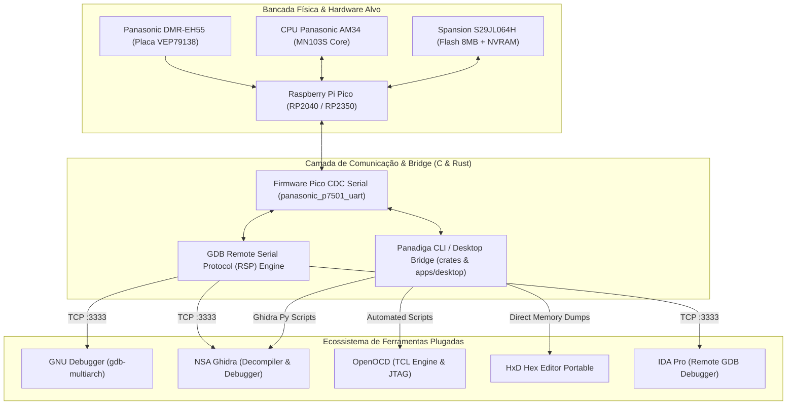

> 🌐 **Idioma / Language:** [English (US)](../en-US/GHIDRA_GDB_INTEGRATION_STRATEGY.md) | **Português (BR)**
> 🧭 **Portal:** [Índice da Documentação](../INDEX.md) | [Auditoria Completa](../../AUDITORIA_COMPLETA.md) | [Auditorias](../audits/README.md) | [Pseudocódigo Ghidra](../pseudocode/INDICE_EVIDENCIA_PSEUDOCODIGO_GHIDRA.md) | [Logs de Debug](../debug_logs/README.md)

# Estratégia de Integração do Ecossistema: Ghidra, GDB, OpenOCD e Panadiga

Este documento formaliza a estratégia técnica e arquitetural adotada para integrar plenamente as maiores ferramentas de engenharia reversa do mundo (**Ghidra**, **GNU Debugger / gdb-multiarch**, **OpenOCD** e **IDA Pro**) com o ecossistema **Panadiga**.

---

## 1. Visão Geral da Arquitetura

O ecossistema Panadiga atua como a ponte central (*Master Hub*) entre o hardware proprietário da Panasonic (baseado no processador AM34 / MN103S e memória Spansion S29JL064H) e as ferramentas industriais de análise de firmware.



---

## 2. Como as Ferramentas se Conectam

### 2.1 GNU Debugger (`gdb-multiarch`)
* **Protocolo:** GDB Remote Serial Protocol (RSP) padronizado.
* **Porta:** `127.0.0.1:3333` (TCP).
* **Arquitetura Alvo:** `mn10300` / `am34`.
* **Como Funciona:**
  1. No Panadiga Desktop, clique em **"Iniciar Servidor GDB"** (ou use a CLI `panadiga pico gdb-bridge`).
  2. O servidor abre o socket `127.0.0.1:3333` e o canal USB CDC com a Raspberry Pi Pico.
  3. Ao clicar em **"GDB Multiarch"** no Desktop, o script [`tools/conectar_gdb_multiarch.cmd`](../../tools/conectar_gdb_multiarch.cmd) é disparado em uma nova janela de terminal, pré-carregando a arquitetura e emitindo `target remote 127.0.0.1:3333`.
  4. O usuário pode pausar (`Ctrl+C`), inspecionar registradores (`info registers`), ler memória (`x/16wx 0x807FE000`) e executar instruções passo-a-passo (`stepi`).

### 2.2 NSA Ghidra (Descompilador & Ghidra Debugger)
Ghidra é a ferramenta primária de descompilação de código estático e análise dinâmica. A suíte Panadiga gera de forma determinística a partir do SSOT em Rust ([`crates/panadiga-core/src/ghidra/`](../../crates/panadiga-core/src/ghidra/mod.rs)) 7 scripts Jython em [`tools/ghidra/`](../../tools/ghidra/) (disparados pelos lançadores em [`tools/`](../../tools/)):

1. **`tools/ghidra/ghidra_am34_memory_map.py` (Mapeador de Barramento):**
   - Cria no Ghidra as regiões exatas da placa mãe:
     - `INTERNAL_SRAM` (`0x00000000` - 256 KB)
     - `SRAM_LOADER` (`0x00004000` - 4 KB para injeção de payload)
     - `SPANSION_FLASH` (`0x80000000` - 8 MB)
     - `NVRAM_EEMUL` (`0x807F0000` - 64 KB, setores SA134..SA141)
     - `ASIC_MMIO` (`0xC0000000` - UniPhier System MMIO)
     - `ATA_IDE_MMIO` (`0xD4000000` - Controladora PATA do disco MEIHDFS)
2. **`tools/ghidra/ghidra_importar_simbolos_panadiga.py` / `ghidra_import_symbols_panadiga.py` (Anotador de Símbolos):**
   - Rótulos automáticos para o vetor de reset (`0x80000000`), vetores de interrupção (NMI, Trap, DMA, IDE), sequências de desbloqueio da Flash Spansion (`0x80000AAA`, `0x80000554`) e todos os 8 micro-setores da NVRAM.
3. **`tools/ghidra/ghidra_conectar_debugger.py` / `ghidra_connect_debugger.py` (Ghidra Debugger Bridge):**
   - Orienta a conexão da perspectiva dinâmica do Ghidra (Window -> Debugger) via conector GDB local apontando para `127.0.0.1:3333`.
   - O código descompilado do Ghidra sincroniza com a posição física do registrador PC da CPU Panasonic DMR-EH55.
4. **`tools/ghidra/ghidra_auto_unbrick_audit.py` & `ghidra_mn103_fix_decompilation.py` (Resolvedores Armadilhas 1–7):**
   - Automatizam referências cruzadas de unbrick pré-MAIN/MAIN e recuperação de ilhas de código/stack-purge (`??`).

### 2.3 Ponte Nativa Assíncrona GDB RSP (`panadiga pico gdb-bridge`)
* **Arquitetura Alvo:** Matsushita **`mn10300`** (`AM34 / MN103S`), evitando abstrações genéricas incompatíveis com JTAG ARM padrão.
* **Por que `P7501` exige Ponte Assíncrona:** O conector `P7501` transporta **UART assíncrona `115200 8N1`** (`UARTP2M_T` Pino 6 / `UARTM2P_T` Pino 3) sem linha síncrona `DWire32A`. No modo `ocd` legado (`GDB`), [`p7501_bus_protocol.c`](../../firmware/pico-p7501/protocol/p7501_bus_protocol.c) retorna `0xFFFFFFFF` por falta de clock síncrono.
* **Três Modos Selecionáveis (`--target-mode`):**
  - **`panamon1`** (`panadiga pico gdb-bridge --port COM10 --target-mode panamon1`): aciona `BRIDGE 115200 PASSIVE` no Pico e traduz pacotes RSP síncronos do Ghidra (`$qSupported`, `$qXfer:memory-map:read`, `$g`, `$m`, `$M` com guarda IPL) em comandos assíncronos `R`/`W` no monitor **`PANAMON1>`** (`DIGADIAG.FRM`).
  - **`panarsp`** (`--target-mode panarsp`): encaminha frames RSP direto ao stub `_dev_SERIAL` quando o `MAIN` está ativo.
  - **`ocd`** (legado): modo RSP embarcado no Pico.
* **Disparador & Pré-diagnóstico:** [`tools/iniciar_ponte_gdb.cmd`](../../tools/iniciar_ponte_gdb.cmd), [`tools/conectar_gdb_multiarch.cmd`](../../tools/conectar_gdb_multiarch.cmd) ou `panadiga pico bench-wizard` (para verificar antes se o alvo saiu de `U99` e expôs monitor UART).

### 2.4 HxD Hex Editor Portable
* **Executável Integrado:** [`tools/HxD/app/HxD64.exe`](../../tools/Abrir_HxD.cmd).
* **Disparador:** Botão **"HxD Editor"** na interface web.
* **Uso:** Inspeção imediata dos dumps de NVRAM, firmware Spansion e setores LBA do disco MEIHDFS sem depender de instalações no Windows.

---

## 3. Disparo em 1 Clique a Partir do Panadiga Desktop

A comunicação entre a interface gráfica declarativa e o sistema operacional ocorre através do comando nativo Tauri (`apps/desktop/src-tauri/src/commands/hardware.rs`):

```rust
#[tauri::command]
pub fn launch_external_tool_command(tool: String) -> Result<String, String> {
    match tool.to_lowercase().as_str() {
        "gdb" => {
            Command::new("cmd")
                .args(["/c", "start", "tools\\conectar_gdb_multiarch.cmd"])
                .spawn()
                .map_err(|e| format!("Falha ao iniciar GDB: {}", e))?;
            Ok("Sessão interativa do GDB iniciada em novo terminal.".to_string())
        }
        "ghidra" => {
            Command::new("explorer").arg("tools\\ghidra").spawn().map_err(...)?;
            Ok("Pasta de scripts do Ghidra aberta.".to_string())
        }
        "hxd" => {
            Command::new("cmd").args(["/c", "start", "tools\\Abrir_HxD.cmd"]).spawn().map_err(...)?;
            Ok("HxD Hex Editor iniciado.".to_string())
        }
        "terminal" => {
            Command::new("cmd").args(["/c", "start", "powershell"]).spawn().map_err(...)?;
            Ok("Terminal PowerShell iniciado.".to_string())
        }
    }
}
```

Isso garante que engenheiros de bancada e pesquisadores possam saltar da visualização de métricas e status para a depuração profunda em assembly em milissegundos.
