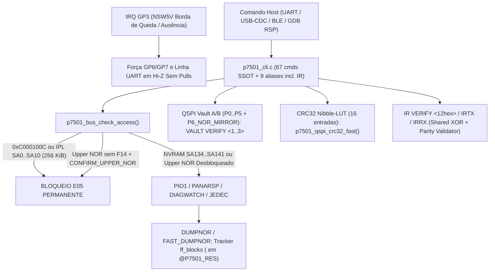

> 🌐 **Idioma / Language:** [English (US)](../en-US/PICO_P7501_FIRMWARE_GUIDE.md) | **Português (BR)**
> 🧭 **Portal:** [Índice da Documentação](../INDEX.md) | [Auditoria Completa](../../AUDITORIA_COMPLETA.md) | [Auditorias](../audits/README.md) | [Pseudocódigo Ghidra](../pseudocode/INDICE_EVIDENCIA_PSEUDOCODIGO_GHIDRA.md) | [Logs de Debug](../debug_logs/README.md)

# Panasonic P7501 Async UART & Boot Probe Firmware Engine (RP2040 / RP2350)

Firmware oficial do controlador de bancada baseado em **Raspberry Pi Pico (RP2040)** e **Raspberry Pi Pico 2 (RP2350)** para captura de boot, diagnóstico elétrico e comunicação UART assíncrona (**`115200 8N1`**) através do conector de serviço **`P7501` (`B6B-ZR-3R4`, legenda `TO JIGU`)** do gravador **Panasonic DMR-EH55** (processador **Matsushita `AM34` / `MN103S`** + Syscon `IC7501`, placa `VEP79138`).

---

## 1. Visão Geral do Sistema (Arquitetura Zero-Gadget em `P0_FW_RO`)

O firmware modular em [`firmware/pico-p7501/`](../../firmware/pico-p7501/) implementa em hardware e ISO C11 estrito módulos desacoplados em `cli/`, `common/`, `diag/`, `flash/`, `gdb/`, `generated/` (`p7501_ssot.h`), `hal/`, `tests/` e `uart/`:

> [!NOTE]
> **Decisão Arquitetural Zero-Gadget (v0.2.0):** A sonda Raspberry Pi Pico (`RP2040` / `RP2350`) opera com **zero periféricos autônomos extras** (sem display OLED `SSD1306`, buzzer ou botões dedicados na sonda). Todo visor, síntese áudio/visual e painel **DIGA Commander IR** rodam no **Smartphone Android (via USB-C OTG / BLE NUS)** ou **Workbench Desktop Tauri 2**, mantendo a sonda enxuta dentro da partição `P0_FW_RO` (`256 KiB`: `RP2040` `text=160.208 B` / `bss=73.280 B`; `RP2350` `text=157.552 B` / `bss=72.900 B`).

1. **Motor UART PIO1 Full-Duplex Multi-Baud + PIO0 (`p7501_uart_duplex.pio` / `uart/p7501_uart_pio_engine.c`):**
   * Recepção passiva determinística via **`PIO1` (`SM0`)** em **`GP2`** (`P7501` Pino 6 `UARTP2M_T` / `MAX TXD`) e transmissão dedicada via **`PIO1` (`SM1`)** em **`GP4`** (`P7501` Pino 3 `UARTM2P_T` / `MAX RXD` via transistor `Q7514`), com divisor fracionário em ponto fixo para taxas dinâmicas (`BAUD` e autobaud `BAUDSCAN`), captura contínua (`UARTSTREAM`), log com deltas em microssegundos em RAM (`HEXCAP`, zero-drop a `115200 8N1`), injeção por gatilho (`WAITTX`) e ponte transparente USB-CDC ↔ SC0 (`BRIDGE`).
   * Mantém ainda a captura dedicada em `PIO0` (`p7501_uart_duplex.pio` + `uart/p7501_uart_capture.c`), `p7501_logic_sampler.pio` e `p7501_sds_sampler.pio` para compatibilidade com `BOOTCAP` / `UARTMON` / `JIGBOOT` / `PIOLOGIC` / `SDSNIFF`.
2. **Controle Seguro de Reset em Dreno Aberto (`XRESET` / `GP5`):** `GP5` (`P7501` Pino 2) opera exclusivamente alternando entre `0V` (reset ativo) e `Hi-Z` (entrada sem pulls, tempo de subida medido `~10–20 µs` via `QR7503`), prevenindo curto-circuito contra o supervisor de reset da Panasonic.
3. **Proteção Estrita em `NSW5V` (`GP3` / `P7501` Pino 5) & Controle `SW_UART` (`GP26` / `ADC0`, Pino 1):**
   * **`GP3` (`NSW5V` / `X_SW_5R2V`):** Provém de `IC1506` (`~5.15V` upstream via `D7510`, repouso em `~3.29V` nos resistores `R7570`/`R7572`). **PERMANECE SEMPRE como `Hi-Z Input` sem pull-up/pull-down** e nunca é dirigido em push-pull.
   * **`GP26` (`SW_UART`):** Amostra a tensão via `ADC0` (`~3.24–3.25V` em Hi-Z, `~2.70V` sob pull-down, `~3.26V` sob pull-up) e força nível `LOW` apenas pelo intervalo exato de entrada em modo serial boot (`XFWE`, ex. `JIG:350`), restaurando `ADC0 Hi-Z` via `p7501_hw_restore_sw_uart_adc0()` quando TX em `GP4` precisa cruzar `Q7514`.
4. **Driver de LED Não-Bloqueante com Trava Manual (`hal/p7501_led.c` & `hal/p7501_led_logic.c`):** Máquina de estados pura (10 Hz) alimentada por `repeating_timer` IRQ-safe (`GP25` em Pico/RP2040 e Pico 2/RP2350; fallback por tick para `CYW43_WL_GPIO_LED_PIN` em Pico W / Pico 2 W), com `MANUAL_LOCK` para impedir que polls `STATUS` sobrescrevam o modo escolhido pelo operador (`LED <IDLE|ACTIVE|GDB|FAULT|OFF|AUTO>`).
5. **Console Serial USB CDC + BLE Opcional (`PANADIGA> `):** Interface interativa a `115200 bps` compatível com terminais padrão (PuTTY, TeraTerm), `panadiga` CLI e aplicativo desktop/Android Tauri (`panadiga-desktop` / APK). Placas `pico_w` e `pico2_w` habilitam também ponte Bluetooth LE Nordic UART Service (`PANADIGA_BLE_ENABLED=1`).
6. **Ponte GDB RSP & Injeção/Sanitização Fail-Loud (Política NOR em 2 Camadas):** Inclui servidor **GNU Remote Serial Protocol (RSP)** (`GDB`) e primitivas `AUTODETECT` / `INJECT_LOADER CONFIRM` / `ERASE_NVRAM CONFIRM` que recusam operar no vazio se `DCSR=0xFFFFFFFF`. Para unidades já bricadas em `U99`, a rota primária sem dessolda combina **`SDDIAG` (`DIGADIAG.FRM` + `PANA__SD.FRM` `ver0.61` com `JIG:2500`)** ou entrada headless **Porta #1 (`0x0B1800`)** $\rightarrow$ **`PANAMON1>`**, exigindo backup prévio de **8 MiB** (`PANADMP1` + SHA-256) e mantendo a **Camada 1 IPL (`SA0..SA10`) permanentemente bloqueada (`E05`)** enquanto autoriza explicitamente `CONFIRM_UPPER_NOR` (reservando `SVOD 4` / `XGecu T48` como contingência física se IPL ou slot SD falharem).

---

## 2. Requisitos de Ferramentas de Compilação

Para compilar o firmware a partir do código-fonte:
* **CMake** $\ge$ 3.13 (disponível no `PATH`)
* **Compilador ARM GCC:** `arm-none-eabi-gcc` $\ge$ 10.3
* **Build System:** `Ninja` (recomendado) ou `MinGW Makefiles`
* **Raspberry Pi Pico SDK:** configurada via variável de ambiente `PICO_SDK_PATH` (importada por `firmware/pico-p7501/pico_sdk_import.cmake`)

---

## 3. Como Compilar o Firmware Multi-Plataforma (RP2040 e RP2350)

O subsistema em [`firmware/pico-p7501/`](../../firmware/pico-p7501/) possui suporte nativo multi-placa (`pico`, `pico_w`, `pico2`, `pico2_w`), orquestrado pelo builder multiplataforma `scripts/build.py` e pela CLI Rust nativa (compilando *out-of-tree* em `target/pico-build/`):

### Opção A: Builder Unificado do Repositório (Windows / Linux / macOS)
```bash
# Compila RP2040 + RP2350, gera panasonic_p7501_uart_unified.uf2 e sincroniza crates/panadiga-core/src/pico/firmware_bins/
npm run build:pico
# Ou diretamente via Python:
python scripts/build.py --pico
```

### Opção B: CMake Manual + Fusão UF2 Nativa via Rust CLI
```bash
cmake -S firmware/pico-p7501 -B target/pico-build/pico -G Ninja -DCMAKE_BUILD_TYPE=Release -DPICO_BOARD=pico
cmake --build target/pico-build/pico --config Release

cmake -S firmware/pico-p7501 -B target/pico-build/pico2 -G Ninja -DCMAKE_BUILD_TYPE=Release -DPICO_BOARD=pico2
cmake --build target/pico-build/pico2 --config Release

cargo run -p panadiga-cli -- pico merge-uf2 \
  --rp2040 target/pico-build/pico/panasonic_p7501_uart.uf2 \
  --rp2350 target/pico-build/pico2/panasonic_p7501_uart.uf2 \
  --out target/pico-build/out/panasonic_p7501_uart_unified.uf2
```

### Artefatos Binários Gerados & Footprint Verificado
A compilação sincroniza o contêiner unificado em `crates/panadiga-core/src/pico/firmware_bins/` (embutido no binário Rust) e separa fatias por família via `extract_uf2_family_slice`:
* **`panasonic_p7501_uart_unified.uf2`** (**`636.416 bytes` / `1.243` blocos**, `SHA-256: 1af8da3e15ca65abc78e1a4fb4d3281e99d34cc5c968186584243de717b14077`) $\leftarrow$ Imagem universal `RP2040` + `RP2350`:
  * **RP2040 (`pico`):** `text = 160.208 B` (`P0_FW_RO = 256 KiB`), `bss = 73.280 B`.
  * **RP2350 (`pico2`):** `text = 157.552 B` (`P0_FW_RO = 256 KiB`), `bss = 72.900 B` (`s_default_gdb_ctx` otimizado para `6.736 B` / `0x1A50 B`).
* Imagens auxiliares (`.elf`, `.bin`, `.hex`, `.map`) geradas por `pico_add_extra_outputs(panasonic_p7501_uart)` permanecem em `target/pico-build/`.

### Integração Contínua (CI/CD)
A esteira em [`.github/workflows/ci.yml`](../../.github/workflows/ci.yml) e a validação local (`python scripts/validate.py` / `npm run validate`) executam **38 suítes/funções de teste host C11 em 4 módulos** ([`test_gdb_rsp_host.c`](../../firmware/pico-p7501/tests/test_gdb_rsp_host.c), [`test_pana_diag_drv.c`](../../firmware/pico-p7501/tests/test_pana_diag_drv.c), [`test_pana_logic.c`](../../firmware/pico-p7501/tests/test_pana_logic.c) e [`test_uart_codec.c`](../../firmware/pico-p7501/tests/test_uart_codec.c)) com `-Wall -Wextra -Werror` + check ARM dual-target RP2040/RP2350, além dos demais Quality Gates (Rust `337` testes em `6` crates, Vitest `128`, E2E `27`, `uxlint` `386`, `jscpd` `0%`, Python `mypy`/`pytest`).



---

## 4. Como Gravar o Arquivo `.uf2` no Raspberry Pi Pico

O microcontrolador RP2040 / RP2350 possui bootloader USB nativo em ROM (**UF2 Bootloader**). Também é possível automatizar via `panadiga pico flash --port COM10`:

```text
       GRAVAÇÃO DRAG & DROP NO RASPBERRY PI PICO
  ┌───────────────────────────────────────────────────────────┐
  │  1. Desconecte o cabo USB do Pico                         │
  │  2. Mantenha pressionado o botão branco BOOTSEL           │
  │  3. Conecte o cabo USB ao computador                      │
  │  4. Solte o botão BOOTSEL                                 │
  │  5. O volume "RPI-RP2" (ou "RP2350") aparecerá no sistema │
  │  6. Copie "panasonic_p7501_uart_unified.uf2" para o drive │
  │  7. O Pico reiniciará automaticamente no novo firmware!   │
  └───────────────────────────────────────────────────────────┘
```

*(Com o firmware já rodando em USB CDC, também é possível enviar o comando `BOOTSEL` no prompt `PANADIGA> ` para entrar diretamente em modo UF2 sem pressionar o botão físico.)*

---

## 5. Conexão Serial USB CDC (Terminal & Tauri)

Após a reinicialização, o Pico enumera uma porta serial USB CDC (`COMx` no Windows, `/dev/ttyACM0` no Linux, `/dev/cu.usbmodem*` no macOS ou USB-OTG no Android):
* **Baud Rate:** `115200` (USB CDC 12 Mbps nativo)
* **Configuração:** 8 bits de dados, sem paridade, 1 stop bit (`8N1`), sem controle de fluxo

Ao conectar ou pressionar `<ENTER>`, o console exibe o banner oficial de [`p7501_cli_help.c`](../../firmware/pico-p7501/cli/p7501_cli_help.c):

```text
====================================================================
   PANADIGA: Panasonic DMR-EH55 P7501 Async UART & Boot Bench Probe
   MCU Host : RP2040 (Pico / ARM Cortex-M0+)
   Bus      : P7501 (B6B-ZR-3R4) 115200 8N1 (PIO1) + SW_UART / XRESET / NSW5V(Hi-Z)
   [GDB-RSP] Active Server Mode (RP2040 8 KB Cache)
   Type HELP for available P7501 UART, PIO1, FMU, diag, Flash, LED & GDB commands.
====================================================================

PANADIGA> 
```

---

## 6. Referência Completa de Comandos (`p7501_cli.c` / `p7501_cli_help.c`)

O firmware atende tanto operadores humanos quanto automação em Rust (`panadiga`), o script de bancada (`scripts/bench/`) e a UI reativa Tauri (`SSOT` em `crates/panadiga-core/src/ssot/spec.rs`):

| Comando | Sintaxe | Função Operacional Verificada |
| :--- | :--- | :--- |
| **`PING`** | `PING` | Responde `PONG` para verificação rápida de conectividade. |
| **`STATUS` / `VDD` / `WDT`** | `STATUS` \| `VDD` \| `WDT` | Amostra `GP26 (ADC0)` em `P7501` Pino 1 (`SW_UART`), imprime `VDD: X.XXV (OK / LOW / FLOATING)` e reporta rastreabilidade de Watchdog (`WDT`). |
| **`BANNER`** / **`HELP`** | `BANNER` \| `HELP` \| `?` | Imprime banner de identificação ou lista completa de comandos. |
| **`BAUD` / `FRAMING`** | `BAUD [bps]` \| `FRAMING [8N1\|8E1\|8O1]` | Consulta ou ajusta o baud rate (`300..921600 bps`) e paridade por hardware da **`PIO1` (`SM0`/`SM1`)** via divisor fracionário FP16. |
| **`BAUDSCAN`** | `BAUDSCAN [ms] [NORMAL\|JIG[:ms]\|NOPULL] [APPLY]` | Detector dual-polarity (LOW/HIGH) por cluster anti-glitch + contagem de `framing_errs` (`PIO1 IRQ 4`) e ASCII em `GP2` (`APPLY` aplica na `PIO1`). **Obs.:** trocar baud no PuTTY/RealTerm muda apenas a porta CDC virtual — só `BAUD`/`BAUDSCAN` ajustam o barramento `P7501`. |
| **`UARTSTREAM`** | `UARTSTREAM [ms] [NORMAL\|JIG[:ms]\|NOPULL]` | Captura em tempo real via `PIO1` com suporte a soltura temporizada de `SW_UART` (`JIG:2500` para `Loader ver0.61` ou `JIG:350`) e restauração automática em `ADC0`. |
| **`HEXCAP`** | `HEXCAP [ms] [NORMAL\|JIG[:ms]\|NOPULL]` | Captura em RAM (`HEXCAP_RAM_BUF_CAP` = `2048` bytes) com delta `+us` e dump hex+ASCII após a janela (zero `overflow` a `115200 bps`). |
| **`UARTTXHEX`** | `UARTTXHEX [LOW:]<hex\|BRK> [rx_ms]` | Injeta sequência arbitrária em hexadecimal ou pulso `BREAK` de `120 ms` via `PIO1 TX` (`Q7514` requer `SW_UART` liberado, salvo prefixo `LOW:`). |
| **`WAITTX`** | `WAITTX <ms> <NORMAL\|JIG[:ms]\|NOPULL> "<trig>" <hex\|BRK> [post_ms]` | Aguarda substring de gatilho em `GP2` (ex.: `"wait 1"` após `JIG:350`) e injeta payload/BREAK pela `PIO1 TX` mantendo `NSW5V` em `Hi-Z`. |
| **`BRIDGE`** | `BRIDGE [baud] [NORMAL\|JIG[:ms]\|NOPULL]` | Ponte transparente bit/byte USB-CDC ↔ `SC0` (`PIO1`), encerrada pela sequência de escape `~~~` (ou timeout). |
| **`PWRTRACE` / `BOOTTRACE`** | `PWRTRACE [ms] [boot]` \| `BOOTTRACE [ms] [boot\|PREJIG] [WAKE]` | `PWRTRACE` amostra min/max `ADC0` + bordas `RXD/NSW5V/TXD`; `BOOTTRACE` correlaciona PIO1 UART + `GP3..5` + `ADC0` (inclui `PREJIG WAKE` em standby `IC7501`). |
| **`PIOLOGIC`** | `PIOLOGIC [ms] [boot] [khz] [CTRL]` | Amostrador lógico de 4 canais em `PIO0` (`GP2..5`) para bordas e temporização de handshake FMU/SC0. |
| **`SDSNIFF`** | `SDSNIFF [ms] [boot]` | Sniffer passivo `Hi-Z` do barramento SD via `PIO0` (`GP10..15`) com validação de CRC16 e lanes de dados 4-bit. |
| **`JIGSWEEP`** | `JIGSWEEP [HOLD\|DELAY\|PREBOOT] [ms..]` | Varredura de janela de retenção `SW_UART` e temporização pré-DDR na Bootrom para captura determinística de `SDDIAG`. |
| **`BOOTCAP`** | `BOOTCAP [ms]` | Reseta `XRESET` em Open-Drain com `SW_UART` liberado e captura stream UART `115200 8N1` no boot (`PIO0`). |
| **`UARTMON`** | `UARTMON [ms]` | Escuta passivamente `GP2` (`UARTP2M_T`) sem forçar reset ou `SW_UART`. |
| **`JIGBOOT`** | `JIGBOOT [ms]` | Executa boot com `SW_UART = LOW` (`XFWE` / modo JIG) após pulso `XRESET` e captura `GP2` a `115200 8N1`. |
| **`JIGPIN`** | `JIGPIN [LOW\|HIZ\|STATUS]` | Controla em Open-Drain a linha `P7501` Pino 1 (`SW_UART` / `GP26`, historicamente apelidada `"TW7501"` no CLI — distinta do pino físico `TW7501` na linha de backup 5V de `IC7501`). |
| **`UARTSEND`** | `UARTSEND [LOW:]<texto>` | Transmite comandos ASCII/bytes pela linha `GP4` (`UARTM2P_T`) em `115200 8N1` (`Hi-Z` padrão permite passagem por `Q7514`; prefixo `LOW:` força `SW_UART` baixo). |
| **`UARTPROBE`** | `UARTPROBE [sec]` | Executa varredura serial em `P7501` e restaura `GP26` ao estado `ADC0 Hi-Z` ao término. |
| **`PANARSP`** | `PANARSP [ms] [boot] [WAIT:x] <act>` | Cliente `_dev_SERIAL` RSP (`REGS`, `MEM`, `WMEM`, `DUMPNOR`, `CALL`, `NORUNLOCK:CONFIRM_UPPER_NOR`, `NORLOCK`, `JEDEC_ERASE:<addr>`, `JEDEC_PROG:<addr>,<hex>`). |
| **`DIAGWATCH`** | `DIAGWATCH [ms] [boot] [act] [WAKE]` | Watchdog autônomo em `SC0` e monitor residente `PANAMON1>` (`NORUNLOCK:CONFIRM_UPPER_NOR` / `NORLOCK` com sequência em duas etapas `'U'` → `'W'`/`'E'`). |
| **`DRVPANA`** | `DRVPANA [ms] [boot] [NOPASS] <cmd>` | Interface CLI de fábrica do drive óptico Matshita `R6-MV4` com envio automático de desbloqueio `PASS 0x4d415453 0x48495441` (ou `NOPASS`). |
| **`IR` / `IRTX` / `IRRX`** | `IR [TX\|RX\|VERIFY <12hex>]` \| `IRTX ...` | Emissor PWM 38 kHz Kaseikyo ([`p7501_ir_codec.c`](../../firmware/pico-p7501/diag/p7501_ir_codec.c)) em `GP6..9`/`GP16..22`, captura e verificação estrita offline (`IR VERIFY <12hex>`: OEM `0x02,0x20`, vendor parity + XOR `dev ^ sub ^ cmd` $\rightarrow$ `parity=OK\|ERR`). |
| **`VAULT`** | `VAULT [STATUS\|VERIFY <1..3>\|DUMP\|ERASE]` | Cofre A/B na QSPI (`P6_NOR_MIRROR`, `P7501_VAULT_PAYLOAD_SLOTS=3`, slot `0` = manifesto). `VAULT VERIFY <1..3>` calcula `CRC32` IEEE nibble-LUT via XIP (`p7501_qspi_crc32_fast`) + contagem `non_ff` emitindo `sub=VERIFY` (`ENOENT`/`ECRC` se ausente/corrupto). |
| **`DUMPNOR` (`ff_blocks`)** | `PANARSP DUMPNOR ...` \| `FAST_DUMPNOR` | Contagem inline de blocos `0xFF` (512 B) via `p7501_dumpnor_ff_tracker_t` emitindo `ff_blocks=<u32>` em `@P7501_RES` e resumo `PANARSP:`. |
| **`FMUSCAN` / `FMUTEST` / `FMUBATCH`** | `FMUSCAN` \| `FMUTEST` \| `FMUBATCH` | Sondas de temporização e varredura de bytes na Bootrom/FMU via `P7501`. |
| **`PINCHECK`** | `PINCHECK` | Matriz elétrica dos 6 pinos de `P7501` (`Hi-Z`, pull-down, pull-up em `GP26`, contagem de bordas em `GP2`, tempo de subida `XRESET`, guarda em `NSW5V`/`GP3`). |
| **`BUSDIAG` / `SNIFF`** | `BUSDIAG` \| `SNIFF [ms]` | Diagnóstico de atividade de barramento e contagem passiva de transições. |
| **`ISOLATE` / `HIZ`** | `ISOLATE` \| `HIZ` | Desativa drivers TX e coloca os pinos de interface em alta impedância segura (`NSW5V` e `XRESET` em `Hi-Z`, `GP26` em `ADC0`). |
| **`ENGAGE`** | `ENGAGE` | Coloca `GP4` (`UARTM2P_T`) em idle HIGH para transmissão UART ativa, mantendo `NSW5V` (`GP3`) estritamente em `Hi-Z Input`. |
| **`RESET`** | `RESET` | Executa pulso Open-Drain ativo em nível baixo em `XRESET` (`GP5`) e libera para `Hi-Z`. |
| **`HANDSHAKE` / `SCAN` / `BREAK_IN`** | `BREAK_IN [0..3]` \| `SCAN` | Perfis discretos de sequência `SW_UART + XRESET` (`0..3`) e verificação de resposta no barramento. |
| **`DUMP` / `AUTODETECT` / `CFI` / `FLASH_SIZE`** | `DUMP [addr] [words]` \| `FLASH_SIZE [2\|4\|8\|16]` | Leitura de abertura no monitor, detecção fail-loud (`DCSR=0xFFFFFFFF` aborta), consulta CFI `QRY` e seleção de geometria `EEMUL`. |
| **`INJECT_LOADER`** | `INJECT_LOADER CONFIRM` | Injeta micro-driver AM34 (`ram_loader_am34_target.c`) em `0x00004000` (exige token `CONFIRM` e monitor síncrono ativo). |
| **`ERASE_NVRAM`** | `ERASE_NVRAM CONFIRM` | Dispara limpeza JEDEC nos micro-setores NVRAM/EEMUL (exige token `CONFIRM` e acesso ativo ao barramento alvo). |
| **`NOR_MAP`** | `NOR_MAP` | Mapeia todos os **142 setores (`SA0..SA141`)** da Spansion `S29JL064H` diretamente no Pico (`IPL`, `NORFROM`, `EXTRHEADDRV`, 45 setores BGO, Upper `EEMUL`, NVRAM), emitindo frames push `@P7501_PROG phase=MAP` e resumo `[NOR_MAP] ... healthy=YES|NO`. |
| **`FAST_READ`** | `FAST_READ <hex_va> <hex_len_mult_100>` | Carrega sob demanda o stub binário MN103S verificado (`606 B` em `0x9043A000`, `CRC32 0x3D2D3D4A`), lê páginas de `256 B` com elisão de páginas `0xFF`, emissão push `@P7501_PROG phase=READ` + `@P7501_CHUNK` e resumo `CRC32` IEEE. |
| **`FAST_WRITE`** | `FAST_WRITE <hex_va> <even_hex_bytes> CONFIRM_UPPER_NOR` | Gravação rápida em janela BGO (`SA26..SA70`) com guarda **E05 permanente na Camada 1 IPL (`SA0..SA10`)**, verificação pré-voo de monotonicidade **`1 -> 0`** no próprio Pico, progresso push `@P7501_PROG phase=WRITE` e `U LOCK` incondicional em todas as saídas. |
| **`GDB`** | `GDB` | Alterna o canal USB CDC para o servidor **GDB Remote Serial Protocol (RSP)**. |
| **`LED`** | `LED [IDLE\|ACTIVE\|GDB\|FAULT\|OFF\|AUTO\|STATUS]` | Seleciona padrão visual com `MANUAL_LOCK` (`IDLE`, `ACTIVE`, `GDB`, `FAULT`, `OFF`), devolve ao controle automático (`AUTO`) ou consulta estado atual (`STATUS`). |
| **`BOOTSEL`** | `BOOTSEL` | Reinicia o Pico diretamente no bootloader USB UF2 ROM sem exigir botão físico. |

---

## 7. Exemplos Práticos de Sessão

### Exemplo 1: Inspeção Elétrica Inicial (Modo Seguro sem TX Ativo)
```text
PANADIGA> PING
PONG
PANADIGA> STATUS
VDD: 3.25V (OK)
PANADIGA> PINCHECK
...
PANADIGA> ISOLATE
[BUS] P7501 pins placed in High-Impedance Isolation (NSW5V/XRESET Hi-Z, GP26 ADC0).
```

### Exemplo 2: Captura Multi-Baud PIO1, JIG Temporizado & Controle LED
```text
PANADIGA> LED GDB
[LED] Pico GP25 (Standard Pico / RP2040 / RP2350) | mode=GDB_RSP | lock=MANUAL | pin=1
LED: OK (GDB_RSP, MANUAL_LOCK)

PANADIGA> BAUDSCAN 3500 NORMAL
... edges=2124 min_low_us=8 max_low_us=54 raw_bps=125000 snapped_baud=115200
BAUDSCAN: OK

PANADIGA> HEXCAP 3000 NORMAL
... (348 bytes em RAM sem drop: DDR CHECK: OK .. Loader ver0.61 [06/03/06]) ...
HEXCAP: OK (348 bytes, framing_err=0, overflow=NO)

PANADIGA> PWRTRACE 3000 JIG:350
... GP26_SWUART: min=3.21V max=3.30V | Edges: RXD=2124 NSW5V=0 TXD=0 (final NSW5V=1)
PWRTRACE: OK

PANADIGA> WAITTX 8000 JIG:350 "wait 1" 0D 4000
... [WAITTX] Trigger matched! Injecting payload via Q7514 (SW_UART=Hi-Z)...
WAITTX: OK (triggered=YES, rx=715 bytes)

PANADIGA> LED AUTO
[LED] Pico GP25 (Standard Pico / RP2040 / RP2350) | mode=HEARTBEAT_IDLE | lock=AUTO | pin=1
LED: OK (HEARTBEAT_IDLE, AUTO)
```

> [!NOTE]
> Use preferencialmente os comandos **`PIO1` (`BAUD`, `BAUDSCAN`, `UARTSTREAM`, `BOOTTRACE`, `HEXCAP`, `PWRTRACE`, `WAITTX`, `DIAGWATCH`, `PANARSP`)** em novos testes de bancada. Para **`Loader ver0.61`**, utilize `JIG:2500` em `UARTSTREAM 12000 JIG:2500` para reter `SW_UART` até a leitura completa de `DIGADIAG.FRM` (enquanto `JIG:350` atende janelas rápidas de bootrom); em ambos, o temporizador libera `GP26 -> ADC0 Hi-Z` para que `Q7514` conduza `TX`. O comando `ISOLATE` continua obrigatório após sessões legadas (`UARTSEND` / `UARTPROBE`).

### Exemplo 3: Injeção / Apagamento com Trava `CONFIRM` e Conformidade `U99` Sem Dessolda
```text
PANADIGA> INJECT_LOADER CONFIRM
[INJECT_LOADER] Target Address : 0x00004000 (AM34 Internal SRAM)
[INJECT_LOADER] Flash Geometry : 8 MB (NVRAM Window: 0x807F0000..0x807FFFFF)
...
INJECT_LOADER: OK

PANADIGA> ERASE_NVRAM CONFIRM
[ERASE_NVRAM] Launching JEDEC Sector Erase on Spansion Flash (8 MB)
[ERASE_NVRAM] Target Memory Range: 0x807F0000 to 0x807FFFFF (64 KB)
[ERASE_NVRAM] Micro-sectors      : SA134 to SA141 (8 x 8 KB)
...
ERASE_NVRAM: OK
```

*(Observação de Compliance `U99`: em um gravador DMR-EH55 já bricado em `U99`, tente primeiro a recuperação **100% sem dessolda** via `SDDIAG` `DIGADIAG.FRM` + `PANA__SD.FRM` `ver0.61` em cartão SDSC FAT16 com `JIG:2500`, ou entrada headless **Porta #1** `0x0B1800` $\rightarrow$ `PANAMON1>`, realizando obrigatoriamente backup prévio completo de `8 MiB` via `PANADMP1` + SHA-256 antes de autorizar a Camada 2 BGO `U CONFIRM_UPPER_NOR` / `NORUNLOCK:CONFIRM_UPPER_NOR` — pois a Camada 1 IPL `SA0..SA10` permanece protegida em `E05`. A extração externa TSOP-48 da Spansion `S29JL064H` [`IC5001`] em **SVOD 4** / **XGecu T48** + `panadiga nvram clean` fica como contingência caso o IPL `SA0..SA10` ou o leitor SD esteja fisicamente danificado.)*

---

## 8. Modo Ponte GDB RSP (Depuração Interativa com Ghidra / IDA Pro)

O firmware embarca um servidor **GNU Remote Serial Protocol (RSP)** controlado por [`gdb/gdb_rsp.h`](../../firmware/pico-p7501/gdb/gdb_rsp.h), [`gdb_rsp_codec.c`](../../firmware/pico-p7501/gdb/gdb_rsp_codec.c) e [`gdb_rsp_memory.c`](../../firmware/pico-p7501/gdb/gdb_rsp_memory.c):
* Comando serial: `GDB` (ou autodetecção de pacotes iniciados por `$`).
* Pacotes de controle Upper NOR no protocolo RSP:
  * `$qPanadigaNorUnlock:CONFIRM_UPPER_NOR#<xx>` — autoriza temporariamente escrita na **Camada 2 (`SA4..SA133`)**.
  * `$qPanadigaNorLock#<xx>` — restaura a política padrão `NorWritePolicy::NvramOnly` (`E05`).
* Ponte TCP/Serial unificada na CLI Rust (com tradução assíncrona sobre UART `P7501`, já que não há clock síncrono `DWire32A`):
  ```bash
  # Ponte assíncrona Ghidra/GDB sobre DIGADIAG PANAMON1> (R/W) ou MAIN _dev_SERIAL:
  panadiga pico gdb-bridge --port COM10 --target-mode panamon1 --listen 127.0.0.1:3333
  panadiga pico gdb-bridge --port COM10 --target-mode panarsp  --listen 127.0.0.1:3333
  # Bateria guiada multi-boot em bancada (Standby WAKE, PREJIG sem XRESET, BAUDSCAN, Dicionário de Erros):
  panadiga pico bench-wizard --port COM10
  panadiga pico bench-wizard --port COM10 --profile prejig --wake-timeout-ms 45000
  panadiga pico error-lookup 0x83A7
  ```
* Guia detalhado passo a passo para Ghidra, IDA Pro e `gdb-multiarch`:
  * 📖 **[Guia de Depuração Interativa de Hardware: GDB, Ghidra e IDA Pro](GUIA_DEPURACAO_GDB_GHIDRA_IDA.md)**

---

## 9. Política NOR em Duas Camadas & Gravação JEDEC Real via Stub SRAM

O subsistema Flash ([`p7501_flash.c`](../../firmware/pico-p7501/flash/p7501_flash.c)) espelha integralmente [`NorWritePolicy`](../../crates/panadiga-core/src/pico/rsp_codec/policy.rs) sobre a Spansion `S29JL064H` (`0x80000000..0x807FFFFF` / espelho *uncached* `0x84000000..0x847FFFFF`):

| Camada | Setores & Faixa de Barramento | Política no Firmware Pico | Comandos de Controle / Observação |
| :--- | :--- | :--- | :--- |
| **Camada 1 — IPL / Bootloader Crítico** | `0x80000000..0x8003FFFF` / `0x84000000..0x8403FFFF` (`256 KiB`: `SA0..SA3` na política `64 KiB`; fisicamente `SA0..SA10` = `8×8K+3×64K`) | **Leitura estrita permanente (`immutable RO`, `never` gravável) → `E05`** | Nunca pode ser desbloqueada pela sonda Pico para preservar o boot `P7501`. |
| **Camada 2 — Upper NOR / BGO App** | `0x80040000..0x807EFFFF` / `0x84040000..0x847EFFFF` (`SA4..SA133` na política; fisicamente `SA11..SA133`) | **Bloqueada por padrão (`NvramOnly` → `E05`, forbidden sem unlock)** | Desbloqueio explícito via `$qPanadigaNorUnlock:CONFIRM_UPPER_NOR#<xx>`, `PANAMON1` (`U CONFIRM_UPPER_NOR`), ou `PANARSP`/`DIAGWATCH` (`NORUNLOCK:CONFIRM_UPPER_NOR`). Inclui BGO EH55 `ver0.61` (`0x84130000..0x843FFFFF`, `SA26..SA70`) vs `ver0.63`/`PROG061` (`0x84200000..0x843FFFFF`) e Upper EEMUL (`SA71..SA133`). |
| **Camada 3 — NVRAM / EEMUL Topo** | `SA134..SA141` (`0x807F0000..0x807FFFFF`, setores de `8 KiB`) | **Autorizada por padrão** | No EH55 real, `SA134` (`0x847F0000`) contém cabeçalho `"1284"` (`0ff00000002c`, `6 B`) e `SA135..SA141` estão `0xFF`. |

* **Stubs JEDEC em SRAM (`0x51800000`), Espelho *Uncached* (`0x90400000`) & Temporização `S29JL064H` (~700 ms):**
  * Os comandos `PANARSP JEDEC_ERASE:<addr>` e `PANARSP JEDEC_PROG:<addr>,<hex>` (`1..=16` bytes por chamada) carregam o stub [`p7501_pana_jedec.h`](../../firmware/pico-p7501/uart/p7501_pana_jedec.h) / [`p7501_pana_jedec_stubs.c`](../../firmware/pico-p7501/uart/p7501_pana_jedec_stubs.c) em `0x51800000`, concluindo com **`PANAJEDEC_OK`** ou **`PANAJEDEC_TO`**. No monitor `PANAMON1>`, o [`p7501_diag_watch.c`](../../firmware/pico-p7501/uart/p7501_diag_watch.c) dispara `'U'` antes de `'W'`/`'E'`.
  * **Coerência `0x90400000` (SDRAM *Uncached*):** ao modificar código em execução na SDRAM do `PROG061` (`0x50400000`), escreva no alias *uncached* **`0x90400000`** (ex.: limites `MOV` do `PANADMP1` em `0x9043950E` $\rightarrow$ `J 904394FA`, ou stub de teste em `0x90439B40`) para evitar desfasamento de D-cache/I-cache.
  * **Temporização real de Erase (~700 ms) vs Polling DQ7:** o apagamento de `64 KiB` na Spansion `S29JL064H` leva ~`700 ms`; como o laço DQ7 limitado (`0x00100000` iterações) em `jedec_emit.rs` pode retornar `OK:ERASE` antes do término interno, aguarde readback `0xFF` × 32 antes de programar bytes `W`.
* **Fallback Offline Copy-on-Write:** Patches em arquivo usam `panadiga nvram patch-upper-nor` ([`nvram.rs`](../../crates/panadiga-cli/src/cli/handlers/nvram.rs)) com `--backup` SHA-256 obrigatório (mantendo os `256 KiB` iniciais bloqueados salvo `--allow-critical-ipl` offline).
* **Arquitetura Completa de Standby `IC7501`, `TW7501`, `TBUS` & Estados VFD Reais:** Consulte o dossiê dedicado [`ARQUITETURA_STANDBY_IC7501_TBUS_TW7501_E_MODOS_BOOT.md`](./ARQUITETURA_STANDBY_IC7501_TBUS_TW7501_E_MODOS_BOOT.md) (`PLEASE WAIT -> U99` vs `HELLO -> U99`, física de estabilização `TW7501` + `[POWER]`, handshake `FUN_44005cd0` `255s` e captura `PREJIG WAKE`).
