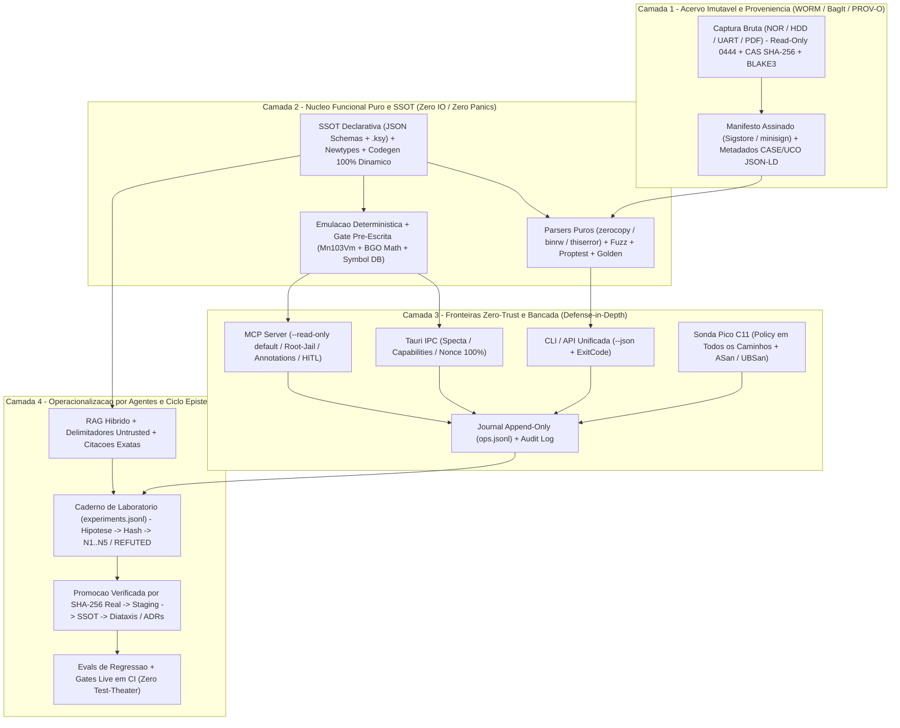
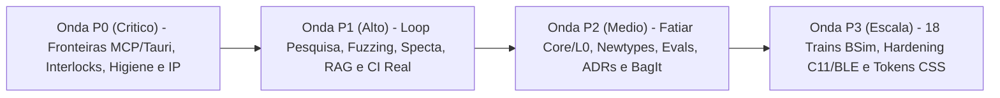

> 🌐 **Idioma / Language:** **Português (BR)** · [English Version (`en-US`)](../en-US/GOLD_STANDARD_FORENSIC_RE_ARCHITECTURE_AND_AUDIT.md) · [Portal `docs/INDEX.md`](../INDEX.md) · [Status & Diátaxis](../STATUS.md)

# Padrão Ouro para Arquitetura Forense de Engenharia Reversa & Auditoria Ponto a Ponto do Panadiga

> **Escopo & Metodologia:** Este documento define o **Padrão Ouro (Gold Standard)** para operacionalizar pesquisa técnica de engenharia reversa de hardware/firmware com rigor forense em **7 dimensões** (*Acervo, Arquivo, Código, Arquitetura, Design, Segurança e Uso de Agentes*) e cruza cada critério, ponto a ponto, com o estado verificado do repositório `Panadiga` na linha de base pós-sync (`a343cdc`, incluindo a decomposição de `main_bgo_retarget/` & `sata_bridge_stage2/`, consolidação para 29 skills, `firmware/panadiga-openos/` e plano documental [`docs/audits/GIT_FILTER_REPO_PLAN.md`](../audits/GIT_FILTER_REPO_PLAN.md)).

---

## Sumário Executivo & Scorecard de Maturidade

O **Panadiga** possui pilares sólidos em múltiplas frentes: SSOT relacional com 89 modelos e gate de compilação (`crates/panadiga-core/build.rs`), 7 regras AST customizadas de arquitetura (`packages/oxlint-plugin-panadiga`), trava epistêmica contra sobre-reivindicação em CI (`scripts/tests/test_docs_parity.py`), política de silício centralizada no Pico C11 (`p7501_bus_policy.c`) e 65 Actions pinadas por SHA-40. Ainda assim, a auditoria ponto a ponto identificou **lacunas críticas de contenção de fronteiras** (path traversal e bypass de HITL no MCP/Tauri, bypasses de interlock em comandos UART brutos), **elos quebrados no loop operacional** (`panadiga-vault::Journal` desconectado em produção, `promote.rs` sem recalcular SHA-256 do arquivo em disco, `profiles/staging/` inexistente), **dívida forense/legal no Git** (`225+ MiB` de pack com 32 PDFs e 8 binários proprietários sob MIT genérica + `datasheets/SHA256SUMS.txt:5` corrompido sem checagem em CI) e **ausência de fuzzing/property-testing/evals de agentes**.

| # | Dimensão | Maturidade (0–5) | Forças Já em Padrão Ouro | Principais Gaps Restantes (Crítico / Alto) |
| :-: | :--- | :-: | :--- | :--- |
| **1** | **Acervo** | **2.3 / 5** | Ledger SHA-256 no CI; `panadiga-vault` com cadeia SHA-256 + `.vault.lock`; segregação `raw/frm/recompiled` em runtime | `0%` read-only OS ou CAS em disco; 32 PDFs (`144 MB`) + 8 binários Panasonic no Git sob MIT sem `NOTICE`; `datasheets/SHA256SUMS.txt:5` corrompido (63 chars) fora do CI; 21 arquivos em `docs/evidence/` fora do `ledger.json`; `Journal` desconectado |
| **2** | **Arquivo** | **3.0 / 5** | 44/44 pares bilíngues sem órfãos; 28 logs UART com SHA-256 no CI; refutações registradas; `-` solto já removido e `/test-results/`, `/backups/` no `.gitignore` | Sem BagIt (RFC 8493) / OAIS SIP-AIP-DIP; sem `docs/adr/`; `docs/STATUS.md` e `ledger.json:304` com `SA0..SA3` obsoleto; falta `experiments.jsonl` consultável por máquina; `README.md` (`75 KB`) monolítico |
| **3** | **Código** | **3.2 / 5** | Zero `TODO`/`FIXME`; apenas 2 `allow(dead_code)`; 14 `unsafe` restritos a `Mmap`/IOCTL; 398+ `#[test]` Rust; `main_bgo_retarget/` e `sata_bridge_stage2/` modularizados | **Zero `cargo-fuzz`, `proptest` ou `insta`** em parsers binários; `anyhow` 381× vs `thiserror` 2×; 23 `.unwrap()` + 12 `panic!` em prod; sem `rust-toolchain.toml`, `[workspace.lints]`, `deny.toml` ou `pyproject.toml`; `tracing` quase sem instrumentação |
| **4** | **Arquitetura** | **3.4 / 5** | DAG de 11 crates acíclico; `build.rs` gate de SSOT + `SSOT_CONTRACT_HASH`; isolamento Android/Desktop no Vite; patch SLEIGH 12 defeitos | `panadiga-core` continua **god-crate** (`~55k LOC`) violando FCIS (`std::fs` em 36 arquivos prod); L0 `panadiga-constants` puxa `memmap2`/`opentelemetry`; `profiles_codegen` usa trechos estáticos; `profiles/symbols/` ainda parcial para os 18 trains |
| **5** | **Design** | **2.9 / 5** | MVVM imposto por AST (`oxlint-plugin-panadiga`); zero `console.*`; 20+ bundles i18n; schema de símbolos hash-bound | **121 comandos Tauri sem `tauri-specta`/`ts-rs`** (Zod 1×, dual-casing em `ipc.ts`); zero specs declarativas (`.ksy`/`binrw`/`zerocopy`) e **1.100+ hex mágicos** em prod; **0 Newtypes** em `ir`/`profiles`; 23 `!important` no CSS |
| **6** | **Segurança** | **2.3 / 5** | 100% Actions SHA-40; zero plugins Tauri terceiros; `withGlobalTauri: false`; zero `strcpy`/`sprintf` C11 e zero `shell=True` Python; zero DRM/CPRM | **Path traversal R/W no MCP e Tauri**; **bypass HITL** no MCP (`live_apply`/`run_live`); nonces efêmeros em só 2/12 comandos destrutivos Tauri; `cmd /c` em `os_launch.rs`; 6 bypasses de interlock físico (`UARTSEND`/`BRIDGE`/CDC/GDB/Android/RAG); keystore hardcoded no `release.yml`; zero Threat Model/SLSA/SBOM/`cargo-audit` |
| **7** | **Uso de Agentes** | **2.9 / 5** | Skills consolidadas (35 → 29) com pasta `panadiga-functional-math-and-patterns`; `HardwareSafetyValidator` determinístico; pre-commit ativo | **Zero least-privilege nas 6 personas** (todas write + `auto`); **RAG perde `file_path`** nas citações e emite `"L5-L5"` para páginas PDF; zero delimitadores untrusted em PDFs; **test-theater** (`--check` só em `tmp_path`); zero `evals/` de regressão; 7 arquivos manuais de regras |

### Arquitetura de Referência — Fluxo Padrão Ouro de Pesquisa Forense

---

## Parte I — Especificação do Padrão Ouro (7 Dimensões)

### 1. Acervo (*ISO/IEC 27037, NIST SP 800-86, RFC 8493 BagIt, W3C PROV-O, CASE/UCO JSON-LD*)
1. **Imutabilidade Física e Lógica (WORM + CAS):** Todo dump bruto (`NOR`, `NAND`, `EEPROM`, `HDD`, `.FRM`, capturas UART/lógicas) reside fora do histórico Git (object storage / DVC / git-annex / cofre privado), com permissão OS read-only (`0444` / `attrib +R`) e endereçamento por conteúdo (`<sha256[0..16]>_<slug>.<ext>`).
2. **Integridade Dupla & Assinatura:** Digest duplo (**SHA-256** + **BLAKE3**) em manifesto único assinado (`minisign` ou Sigstore `cosign`) e verificado integralmente no CI.
3. **Proveniência Estruturada:** Todo artefato e saída JSON de bancada carrega `acquired_at_utc`, `operator`, `tool_name`, `tool_version`, `git_commit` (árvore limpa), `device_model`, `device_serial`, `board_rev`, `acquisition_method` e `derived_from_sha256[]` exportável em **CASE/UCO JSON-LD**.
4. **Higiene Legal Clean-Room:** Repositórios públicos sob MIT/Apache-2.0 versionam apenas código original, schemas, tabelas de hashes e patches clean-room (`bsdiff`/JSON declarativo), com `LICENSE` + `NOTICE` + `THIRD_PARTY_LICENSES.md` — jamais manuais PDF ou binários proprietários de fabricantes.

### 2. Arquivo (*OAIS ISO 14721, BagIt RFC 8493, Diátaxis, MADR*)
1. **Separação OAIS / BagIt:** Segregação estrita entre `sip_raw/` (captura bruta imutável), `aip_curated/` (extrações/símbolos validados) e `dip_kits/` (kits derivados/relatórios), com ponto único canônico de logs.
2. **Nomenclatura & Higiene:** ASCII minúsculo sem espaços (`YYYYMMDD_HHMMSS_<model>_<region>_<artifact>.<ext>`), caminhos POSIX `/` em JSONs, gate de tamanho máximo de blob (`> 1 MiB` bloqueado em CI) e bloqueio de captura sobre working tree sujo.
3. **Documentação Diátaxis + ADRs:** `README.md` portal enxuto (`< 250` linhas), quadrantes **Diátaxis** (*Tutorials, How-To, Reference, Explanation*), registro **MADR** em `docs/adr/` e zero contagens voláteis duplicadas manualmente em prosa.
4. **Caderno de Laboratório (`experiments.jsonl`):** Registro cronológico `exp_id → hypothesis → setup → evidence_sha256[] → outcome (CONFIRMED | REFUTED | INCONCLUSIVE) → tier → conclusion`, preservando resultados negativos.

### 3. Código (*Determinismo, Segurança de Memória & Parsers Hostis*)
1. **Núcleo Puro Determinístico:** Bibliotecas puras usam enums `thiserror` mapeados para `ErrorCode` único (`anyhow` apenas nas bordas CLI/app), zero `.unwrap()`/`.expect()`/`panic!` em produção e `#![forbid(unsafe_code)]` em todos os crates puros.
2. **Verificação de Parsers Binários:** Todo parser proprietário (`MEIHFS`, `.FRM`, `EXTRHEAD`, `BGO`, `LZSS`, `Feistel`, `UF2`, `GDB RSP`) possui targets `cargo-fuzz`, testes de propriedades ida-e-volta (`proptest`) e snapshots (`insta`).
3. **Reprodutibilidade & Observabilidade:** `rust-toolchain.toml`, `[workspace.lints]` + MSRV, `rustfmt.toml`, `deny.toml`, `pyproject.toml` + hashes (`--require-hashes`), além de instrumentação real via `tracing::instrument`.

### 4. Arquitetura (*FCIS, DAG Limpo, SSOT Real & Pipeline RE*)
1. **Functional Core, Imperative Shell (FCIS):** Camada L0 contém apenas constantes, tipos e erros (zero I/O, zero `std::fs`, zero telemetria). Domínios puros (`hdd`, `emu`, `ghidra`, `ssot`) residem em crates coesos (`< 10k LOC`, arquivos `< 400–800 LOC`) e todo I/O vive nos adaptadores de borda.
2. **SSOT 100% Dinâmica:** Schemas e catálogos geram dinamicamente Rust, TypeScript, C11 e Python sem templates hardcoded nem constantes literais duplicadas, verificados por `git diff --exit-code` no CI.
3. **Pipeline RE Multi-Modelo:** Patch SLEIGH empacotado cross-platform com verificação SHA-256 do alvo; `profiles/symbols/` cobrindo todos os estágios críticos (`BOOT`, `PROG`, `MAIN`, `DRV`) dos trains + propagação via **Ghidra BSim / Version Tracking / `.fidb`**.

### 5. Design (*Domínio Forte, Specs Declarativas, Contratos & UX*)
1. **Domínio sem Primitive Obsession:** Newtypes distintos em tempo de compilação (`PhysAddr`, `VirtAddr`, `SectorIndex`, `Lba`, `ModelId`, `Sha256Hex`), evitando troca acidental entre `0x8000_0000` e `0x8400_0000` ou offsets físicos.
2. **Specs Declarativas de Formatos:** Estruturas binárias descritas com `zerocopy`/`binrw`/`deku` + arquivos `.ksy` Kaitai Struct como especificação viva.
3. **Contratos Tipados Ponta a Ponta:** Geração automática dos bindings TS a partir do Rust (`tauri-specta`/`ts-rs`), CLI com envelope `--json` e `ExitCode` padronizado, e UI MVVM com CSS Custom Properties semânticas (zero `!important`).

### 6. Segurança (*OWASP Top 10, OWASP MCP/LLM Top 10, SLSA L3*)
1. **Threat Model Formal:** DFD + matriz STRIDE + árvores de ataque cobrindo WebView↔IPC, MCP↔FS/Serial, GDB/BLE↔Pico↔SoC e pipeline `.FRM`/NOR.
2. **Defense-in-Depth de Silício:** Invariantes (`<= 3.3V`, `NSW5V` Hi-Z, `0xC000100C`, `IPL SA0..SA10`) aplicados em **todos** os caminhos (inclusive raw UART/BRIDGE, payloads hex, GDB, Android e RAG) e testados isoladamente.
3. **Zero-Trust Desktop/Android:** Tauri v2 `capabilities/*.json` mínimas, CSP rígido, root-jail por `canonicalize()`, zero `cmd /c`, nonces efêmeros em **100%** dos comandos destrutivos e Android BLE com LESC/Bonding.
4. **Segurança MCP & RAG:** Modo **`--read-only` padrão**, root-jail `canonicalize_within`, `annotations` nas 26 tools, HITL fora de banda, limite de saída (`64 KiB`), audit log JSONL, PDFs em delimitadores `UNTRUSTED_DATA` e cache privado (`0600`).
5. **Firmware C11, GDB & Supply Chain:** GDB restrito a loopback, C11 com `-fstack-protector-strong` + ASan/UBSan + `cppcheck`, SLSA L3 provenance, SBOM, `cosign`, `cargo-audit`/`cargo-deny`/`gitleaks`/CodeQL/Dependabot, `SECURITY.md` e `CODEOWNERS`.

### 7. Uso de Agentes (*Governança, RAG Auditável, Evals & Loop Epistêmico*)
1. **SSOT de Regras:** Uma única fonte gera projeções enxutas (`AGENTS.md`, `GEMINI.md`, `.cursorrules`, `.mcp.json`) sem contradições e `< 3.000` tokens fixos.
2. **Skills Ortogonais & Personas Least-Privilege:** Zero sobreposição fora do budget; auditores/pesquisadores em modo somente-leitura sem `auto` e com schemas formais de handoff.
3. **Loop de Pesquisa Fechado & Evals:** Promoção verifica o SHA-256 real do arquivo em disco; RAG preserva `file_path` + `page`/`line_range`; suíte `evals/` mede Recall@k, roteamento de tools e Red-Team; scripts `--check` rodam ao vivo contra a árvore real (zero test-theater).

---

## Parte II — Cruzamento Ponto a Ponto: Padrão Ouro × Estado Atual do Panadiga

### Dimensão 1 — Acervo (`A1–A3, A8`)

| ID | Critério Padrão Ouro | Estado Atual Verificado (Evidência) | Sev. | Remediação Concreta |
| :--- | :--- | :--- | :-: | :--- |
| **A1** | Imutabilidade WORM + CAS fora do Git | `0` dumps com atributo `IsReadOnly` ou nomeação CAS; sem Git LFS/annex/DVC; histórico Git carrega revisões de `eh55_nor_8mb_ic5001_repaired.bin` e `PANA__SD.FRM` via [.gitignore](../../.gitignore#L97-L109); [layout.rs](../../crates/panadiga-core/src/vault/layout.rs#L126-L136) não aplica permissão read-only ao gravar artefatos. | **Crítico** | Executar offload planejado em [GIT_FILTER_REPO_PLAN.md](../audits/GIT_FILTER_REPO_PLAN.md) após aprovação do usuário; em `ingest_vault_artifact()`, aplicar `readonly = true` (`0444`) e padrão CAS. |
| **A2** | Manifestos duplos assinados em CI | Só SHA-256 (0 BLAKE3, 0 assinaturas `cosign`/`minisign`). [datasheets/SHA256SUMS.txt](../../manuals_and_schematics/datasheets/SHA256SUMS.txt#L5) possui hash corrompido de 63 chars (`...c3e7c2ad...` vs real `...c3e75c2ad...`) sem verificação em CI; 21 arquivos em `docs/evidence/` e 24 PDFs não constam em manifestos. | **Alto** | Corrigir `datasheets/SHA256SUMS.txt:5`, verificar todos os `SHA256SUMS.txt` no `test_docs_parity.py`, fazer backfill dos arquivos faltantes no `ledger.json`, adotar BLAKE3 + assinatura `cosign` nos manifestos. |
| **A3** | Cadeia de custódia (PROV-O / CASE-UCO) | [panadiga-vault/src/journal/types.rs](../../crates/panadiga-vault/src/journal/types.rs#L29-L83) implementa `ops.jsonl` encadeado, mas `Journal::open` tem **0 chamadas em produção**; [vault/mod.rs](../../crates/panadiga-core/src/vault/mod.rs#L119-L146) e JSONs de sonda omitem `operator`, `device_serial`, `board_rev`, `tool_version`/`git_sha` e `derived_from_sha256[]`. | **Alto** | Plugar `panadiga-vault::Journal` em CLI/MCP/Tauri; adicionar cabeçalho completo de proveniência + exportador `CASE/UCO JSON-LD`. |
| **A8** | Clean-room IP & licenciamento | [LICENSE](../../LICENSE) é MIT global sem `NOTICE` nem `THIRD_PARTY_LICENSES.md`, enquanto o Git versiona 32 PDFs proprietários e 8 binários Panasonic + `Panasonic_DVD_TV.ir`. | **Crítico** | Adicionar `NOTICE` + `THIRD_PARTY_LICENSES.md` delimitando MIT ao código/docs próprios e executar o plano clean-room após aprovação. |

### Dimensão 2 — Arquivo (`A4–A7, A9–A10`)

| ID | Critério Padrão Ouro | Estado Atual Verificado (Evidência) | Sev. | Remediação Concreta |
| :--- | :--- | :--- | :-: | :--- |
| **A4** | Empacotamento BagIt / OAIS | Sem `panadiga vault pack-bag` (RFC 8493). `firmware_and_images/` mistura dumps brutos, kits e `.ir`; logs de bancada divididos entre `docs/debug_logs/` (`28`) e `docs/evidence/` (`boottrace_*.log`). | **Médio** | Implementar `panadiga vault pack-bag` (`data/{sip_raw,aip_curated,dip_kits}`) e unificar política de logs/capturas. |
| **A5** | Nomenclatura & limpeza | Arquivo solto `-` foi removido e `/test-results/`, `/backups/`, `.env*`, `*.pem`, `*.key`, `*.jks`, `*.p12`, `*.pfx`, `/.aider-desk/` foram incluídos no `.gitignore`. Restam 13 arquivos com espaços em `firmware_and_images/`, backslashes Windows em `prepare_report.json` e nomes de dumps sem data/região. | **Médio** | Impor validação de nomes ASCII sem espaços para novas evidências e normalizar caminhos POSIX `/` em JSONs gerados. |
| **A6** | Diátaxis, ADRs & zero deriva | Zero ADRs (`docs/adr/` ausente); `README.md` (`75 KB`) monolítico; [docs/STATUS.md](../STATUS.md#L37) ainda traz `SA0..SA3`; 2 pares bilíngues divergem `>10%` em linhas; contagens em `AGENTS.md:82-90` sofrem deriva manual. | **Alto** | Criar `docs/adr/` (MADR), enxugar `README.md` (`<250` L) para quadrantes Diátaxis, mover auditorias da raiz para `docs/audits/` e validar paridade estrutural no CI. |
| **A7** | Caderno de laboratório epistêmico | Refutações em prosa ([RELATORIO_SESSAO...md](../pt-BR/RELATORIO_SESSAO_ENGENHARIA_REVERSA_EH55_100_FIEL.md#L85-L94)), porém sem `experiments.jsonl`; citação órfã `no_ide_cable_boot.log` na linha 66; 21 arquivos em `docs/evidence/` fora do `ledger.json`. | **Médio** | Criar `docs/evidence/experiments.jsonl`, concluir backfill dos 21 arquivos no `ledger.json` e corrigir citação órfã. |
| **A9** | Higiene de blobs grandes | Sem limite máximo de tamanho de blob no pre-commit/CI (incl. `fleet_main_function_maps_part*.txt` ~4,6 MB cada). | **Alto** | Adicionar gate `> 1 MiB` (salvo allowlist explícita) em pre-commit e `ci.yml` + compactar mapas brutos. |
| **A10** | Árvore limpa pré-captura | Capturas de bancada anteriores coexistiram com árvores sujas sem registro automático de `git_commit`/`git_dirty`. | **Alto** | Scripts de captura devem gravar `git_commit` + `git_dirty` e exigir árvore limpa (salvo `--allow-dirty` explícito). |

### Dimensão 3 — Código (`C2–C4, C7–C8, C10, C12`)

| ID | Critério Padrão Ouro | Estado Atual Verificado (Evidência) | Sev. | Remediação Concreta |
| :--- | :--- | :--- | :-: | :--- |
| **C2** | Ausência de god-modules (`<800` L) | `main_bgo_retarget.rs` e `sata_hdd_autoboot` foram modularizados com sucesso em diretórios! Resta [ghidra_zero_undef_pipeline.py](../../tools/ghidra/ghidra_zero_undef_pipeline.py) (`2.229 L`) acima de 800 linhas. | **Médio** | Decompor `ghidra_zero_undef_pipeline.py` em pacote FP (`passes 1..4` + adaptadores PyGhidra) `<400 L`/módulo e impor teto no Gate 9. |
| **C3** | `thiserror`, zero panics, `forbid(unsafe_code)` | Em prod Rust: **23 `.unwrap()`**, **38 `.expect()`**, **12 `panic!()`** ([guardrails.rs](../../crates/panadiga-rag/src/guardrails.rs#L12) 12×, [uf2.rs](../../crates/panadiga-core/src/pico/flasher/uf2.rs#L12-L183) 6×, `ssot/` 12×, [cli/main.rs](../../crates/panadiga-cli/src/main.rs#L45)); `anyhow` 381× vs `thiserror` 2×; `panadiga-crypto`, `panadiga-rag` e `panadiga-mcp` precisam `#![forbid(unsafe_code)]`. | **Alto** | Aplicar `#![forbid(unsafe_code)]` em todos os crates puros, migrar parsers para `thiserror`, eliminar `.unwrap()`/`panic!` de prod e ativar `clippy::unwrap_used`. |
| **C4** | Fuzzing, property & snapshot tests | **0** `cargo-fuzz`, **0** `proptest`, **0** `insta` sobre `MEIHFS`, `.FRM`, `EXTRHEAD`, `BGO`, `LZSS`, `Feistel`, `UF2` e `GDB RSP`. | **Crítico** | Criar `fuzz/` (`cargo-fuzz`) + `proptest` de ida-e-volta + `insta` para saídas JSON CLI/MCP. |
| **C7** | Pirâmide equilibrada | Crates L1 críticos sub-testados (`panadiga-vault` 1, `panadiga-bench` 2, `panadiga-constants` 2, `panadiga-ir` 4, `panadiga-profiles` 9). | **Médio** | Adicionar testes de crash/corrupção/backpressure/capability negativa nos crates L1. |
| **C8** | Observabilidade (`tracing`) | `logger_tracing.rs` sem exportador OTLP/JSON; `cli`, `mcp`, `rag` e `src-tauri` têm 0 spans `tracing::` apesar da dependência; `cli` usa 29 `println!`. | **Médio** | Instrumentar bordas com `#[tracing::instrument]`, wiring opt-in JSONL/OTLP e `ErrorCode` único. |
| **C10** | Toolchains pinadas & lints | Ausentes `rust-toolchain.toml`, `rust-version`, `[workspace.lints]`, `rustfmt.toml`, `clippy.toml`, `deny.toml` e `pyproject.toml`/hashes Python. | **Alto** | Adicionar arquivos de pin/política e rodar `cargo deny check` + `pip install --require-hashes` no CI. |
| **C12** | Suppressions & duplicação | 0 `TODO`/`FIXME`, só 2 `allow(dead_code)`, mas 17 `#[allow(clippy::too_many_arguments)]` e `.jscpd.json` em `"mode": "weak"`. | **Baixo** | Substituir argumentos excessivos por structs de request e subir `.jscpd.json` para `"mode": "mild"`. |

### Dimensão 4 — Arquitetura (`C1, C6, C11`)

| ID | Critério Padrão Ouro | Estado Atual Verificado (Evidência) | Sev. | Remediação Concreta |
| :--- | :--- | :--- | :-: | :--- |
| **C1** | DAG limpo + FCIS sem god-crate | `panadiga-core` (`~55k LOC`) mistura domínios puros com `std::fs` (36 arquivos), `serialport`, `memmap2`, `windows-sys`. L0 `panadiga-constants` puxa `opentelemetry_sdk`, `memmap2`, `rayon`, `flate2`, `md-5`. | **Alto** | Purificar L0 extraindo `logger*`/`forensic.rs`; fatiar `panadiga-core` em domínios FP (`hdd`, `emu`, `ghidra`, `ssot`) e adaptadores I/O. |
| **C6** | Codegen SSOT 100% dinâmico | `ssot/profiles_codegen/` ainda contém emissores de string estática e há literais duplicados (`0xC000100C`, `0x807F0000`, `115200`) em múltiplos arquivos C/Rust/TS/Python. | **Alto** | Gerar projeções TS/Python/C11 dinamicamente dos schemas e impor lint anti-literal no `validate.py`. |
| **C11** | Pipeline RE escalável | Patch SLEIGH documentado com paths Windows fixos (`C:\ghidra\...`); cobertura parcial de `profiles/symbols/` entre 18 trains; sem BSim/Version Tracking/FID. | **Médio** | Empacotar instalador cross-platform do SLEIGH com hash do `mn103.sla`, expandir `profiles/symbols/` e integrar BSim/VT. |

### Dimensão 5 — Design (`C5, C9`)

| ID | Critério Padrão Ouro | Estado Atual Verificado (Evidência) | Sev. | Remediação Concreta |
| :--- | :--- | :--- | :-: | :--- |
| **C5** | Specs declarativas & Newtypes | Zero `.ksy`/`binrw`/`zerocopy`; parsing por slices literais; >1.100 literais hex em produção; zero Newtypes em `panadiga-ir` e `panadiga-profiles`. | **Alto** | Adotar `zerocopy`/`binrw` (+ `.ksy`), Newtypes (`PhysAddr`, `VirtAddr`, `SectorIndex`, `Lba`, `ModelId`, `Sha256Hex`) e mover constantes para SSOT. |
| **C9** | IPC auto-gerado, Design System & CLI | **121 comandos `#[tauri::command]`** sem `tauri-specta`/`ts-rs` (Zod 1×; [ipc.ts](../../apps/desktop/src/services/ipc.ts#L61-L73) duplica casing); [index.css](../../apps/desktop/src/index.css#L38-L100) usa **23 `!important`**; CLI sem `ExitCode` padronizado. | **Alto** | Integrar `tauri-specta`/`ts-rs`, migrar temas para CSS Custom Properties sem `!important` e padronizar `ExitCode` + envelope `--json`. |

### Dimensão 6 — Segurança (`S1–S11`)

| ID | Critério Padrão Ouro | Estado Atual Verificado (Evidência) | Sev. | Remediação Concreta |
| :--- | :--- | :--- | :-: | :--- |
| **S1** | Threat Model formal | Inexistente (`STRIDE`/DFD/attack trees ausentes em `docs/`). | **Médio** | Criar `docs/security/THREAT_MODEL.md` cobrindo as 4 fronteiras. |
| **S2** | Hardening Tauri v2 & Android | `src-tauri/capabilities/` ausente; CSP tem `'unsafe-inline'`; `paths.rs` usa denylist (lê `~/.ssh/*`); `os_launch.rs` usa `cmd /c` + `powershell` + `terminal`; **nonces em só 2/12 comandos destrutivos**; Android `INTERNET` + `file_paths.xml` amplo + `@JavascriptInterface` contorna Rust. | **Alto** | Criar `capabilities/default.json`, CSP rígido, root-jail allowlist em `paths.rs`, `Command::new` direto em `os_launch.rs`, nonces em 100% dos comandos destrutivos, restringir Android e validar USB/BLE em Rust. |
| **S3** | Segredos & keystores | [android_verify.py](../../scripts/build_lanes/android_verify.py#L19-L20) hardcodeia `panadigabench`/`panadiga` e [release.yml](../../.github/workflows/release.yml#L440) assina release com ele; chaves vendor em `crypto_frm.rs`/`aes128/keys.rs`. | **Alto** | Usar GitHub Secrets (`env:ANDROID_KS_PASS`) em releases, travar `ensure_bench_keystore` a `--dev-bench`, externalizar chaves vendor e rodar `gitleaks`. |
| **S4** | Supply chain CI/CD | Fetches não pinados (`pip install`, `pico-sdk --branch 2.1.1`, `npx --yes @tauri-apps/cli`); interpolação direta em `release.yml:320`; zero `cosign`/SLSA/SBOM/`cargo-audit`/`cargo-deny`/CodeQL/Scorecard/Dependabot. | **Alto** | Pinar tudo (SHA-40 + `--require-hashes`), corrigir `release.yml:320` via `env:`, ativar SLSA, SBOM, `cosign`, scanners e Dependabot. |
| **S5** | Política de dependências | `Cargo.lock` e `package-lock.json` OK; faltam `deny.toml` e lockfile Python. | **Médio** | Adicionar `deny.toml` + `scripts/requirements-dev.txt --require-hashes`. |
| **S6** | Interlocks físicos Defense-in-Depth | **6 bypasses:** (1) Pico `UARTSEND`/`UARTTXHEX`/`WAITTX`/`BRIDGE` contornam `p7501_bus_policy.c`/F14; (2) [telemetry.rs](../../crates/panadiga-core/src/pico/bench_decoders/telemetry.rs#L75-L95) só vê ASCII `"C000100C"` e 3 cmds IPL; (3) GDB host (`bridge.rs`/`session.rs`) não filtra pacotes; (4) `AndroidPicoBridge.kt` contorna validador; (5) RAG [safety/mod.rs](../../crates/panadiga-rag/src/safety/mod.rs#L158-L177) ignora `0xC000100C` em `is_query=true` com palavra de negação e não checa `NSW5V` push-pull; (6) `hal/p7501_hw.c` fora de `C11_HOST_SOURCES`. | **Alto** | Inspecionar payloads UART/BRIDGE, decodificar hex em `telemetry.rs`, filtrar RSP no host, corrigir `safety/mod.rs` + regra `NSW5V` e testar `p7501_hw.c` com mock GPIO no Gate 8. |
| **S7** | Segurança MCP & IA | **5 falhas graves:** (1) Path traversal R/W arbitrário em [workspace.rs](../../crates/panadiga-mcp/src/workspace.rs#L9-L16) e symlink em `resources.rs`; (2) `live_apply`/`run_live` sem `--read-only` nem HITL fora de banda e token estático exposto em `defs_re_ext.rs:151`; (3) 0/26 tools com `annotations`; (4) sem teto `64 KiB` ou audit log; (5) RAG `retrieve_filtered` ignora `q.is_injection`, PDFs sem delimitadores untrusted e cache em `temp_dir()`. | **Crítico** | Root-jail `canonicalize_within`, `--read-only` default + HITL fora de banda, `annotations` nas 26 tools, teto `64 KiB` + audit JSONL, checar `q.is_injection` em `retrieve_filtered`, delimitadores untrusted e cache privado `0600`. |
| **S8** | GDB / C11 / BLE | Android BLE conecta sem LESC/Bonding; GDB TCP não exige loopback; `CMakeLists.txt` omite flags hardening (`-fstack-protector-strong`, `-Wformat=2`); zero ASan/UBSan/`cppcheck`. | **Alto** | Exigir `ip().is_loopback()` no GDB, LESC/Bonding BLE, hardening CMake + ASan/UBSan + `cppcheck` no CI. |
| **S9** | Scripts Python | Base limpa (0 `shell=True`/`eval`/`pickle`), mas `7z` sem `--`/checagem de symlink e `mkdtemp()` sem context manager em 3 scripts. | **Baixo** | Passar `["--", path]` + checagem symlink, usar `TemporaryDirectory()` e rodar `bandit`. |
| **S10** | Governança | Faltam `SECURITY.md`, `.github/CODEOWNERS`, commits assinados e `gitleaks` no hook. | **Médio** | Criar `SECURITY.md`, `CODEOWNERS` e `gitleaks protect --staged` no pre-commit. |
| **S11** | Postura jurídica / DRM | Zero código DRM/CPRM; risco de takedown pelos PDFs/binários/chaves vendor sob MIT. | **Alto** | Executar `A8` + `S3` e documentar escopo em `NOTICE` / `THIRD_PARTY_LICENSES.md`. |

### Dimensão 7 — Uso de Agentes (`G1–G10`)

| ID | Critério Padrão Ouro | Estado Atual Verificado (Evidência) | Sev. | Remediação Concreta |
| :--- | :--- | :--- | :-: | :--- |
| **G1** | Entrada única & zero contradições | 7 arquivos manuais de regras (`AGENTS.md`, `GEMINI.md`, `.cursorrules`, `.agents/rules/*`) com contradições (`React 19` vs `^18.3.1`, `.cursorrules:8`, `ledger.json:304` `SA0..SA3`, `hardware.rs:356` 6 crates vs 11). | **Alto** | Gerar projeções de IDE a partir de fonte SSOT única e eliminar todas as contradições. |
| **G2** | Skills ortogonais no budget | Consolidadas de 35 para **29 skills** (ótimo avanço!). Restam referências fantasma em `git-cicd-and-releases/SKILL.md:41,51` e contagem `32` desatualizada em documentos antigos. | **Médio** | Validar 100% dos links/caminhos das 29 skills via `test_agent_layer.py` e remover clusters ainda redundantes se necessário. |
| **G3** | Personas Least-Privilege | Todas as 6 personas em `.agents/agents/*.md` usam permissões idênticas de escrita + `auto` (incl. `panadiga-qa-auditor`), nomes legados (`view_file`/`replace_file_content`, 0 MCP) e zero schema de handoff. | **Alto** | Tornar `panadiga-qa-auditor` somente-leitura sem `auto`, atualizar tools + MCP e definir schemas de handoff. |
| **G4** | Rigor epistêmico verificável | `ledger.json` cobre `N1..N5`, mas sem tiers `HYPOTHESIS`/`PROBABLE`/`REFUTED`; `ledger.json:304-307` tem `SA0..SA3` fora da varredura `STALE_SA_PATTERN`. | **Médio** | Incluir `ledger.json` no `test_profiles_ssot.py` e adicionar `experiments.jsonl` com resultados negativos. |
| **G5** | HITL & guardrails programáticos | Zero `.agents/hooks`; MCP sem confinamento/`annotations`/HITL fora de banda; string de override exposta em `defs_re_ext.rs:151`. | **Crítico** | Executar `S7` integralmente e adicionar `.agents/hooks` pré-ferramenta. |
| **G6** | Evals de regressão | Zero suíte `evals/` (Q&A PT/EN Recall@k, roteamento das 26 tools MCP, suíte Red-Team PT+EN). | **Alto** | Criar `evals/` versionado no repositório com gate automático no CI. |
| **G7** | Engenharia do RAG | `RagAnswer::to_query_result()` descarta `file_path`; `pdf.rs:169` grava página em `line_start`/`line_end` (`L5-L5`); `generator.rs:45,123` e `safety/mod.rs:279` ainda citam `SA0..SA133`; `KNOWN_COMPONENTS` duplicado; omite `profiles/` e `.agents/skills/`. | **Alto** | Preservar `file_path`, separar `page` vs `line_range`, indexar `profiles/` e `.agents/skills/`, corrigir `SA0..SA133`, deduplicar constantes e adotar delimitadores untrusted. |
| **G8** | Loop operacional fechado | `profiles/staging/manual_proposals/` inexistente; `promote.rs` não calcula o SHA-256 real do arquivo em disco; `Journal` desconectado em prod; `promote` não sincroniza `ledger.json`. | **Alto** | Calcular SHA-256 real em `promote_model_claim`, conectar `Journal`, criar `review-proposal` e sincronizar `ledger.json`. |
| **G9** | Detecção de deriva LIVE (zero test-theater) | `test_tool_arsenal.py` / `test_firmware_atlas.py` / `test_repo_sanitize_and_sync.py` rodam `--check` em `tmp_path` em vez da árvore real; Gate 7 não checa `git diff --exit-code`; falta `test_agent_layer.py`. | **Alto** | Ligar `--check` ao vivo no CI, adicionar `git diff --exit-code` no Gate 7 e criar `test_agent_layer.py`. |
| **G10** | Portabilidade multi-IDE | Regras e `.mcp.json` / `.agents/mcp_config.json` ainda sincronizados manualmente. | **Médio** | Gerar projeções IDE/MCP via `panadiga ssot export-agents` e checar no CI. |

---

## Parte III — Forças Já em Padrão Ouro (Preservar Sem Regressão)

1. **Gate de Compilação SSOT & `SSOT_CONTRACT_HASH`** ([build.rs](../../crates/panadiga-core/build.rs)): valida 89 modelos e 12 JSON Schemas Draft 2020-12 em tempo de compilação e verifica paridade de contrato entre Rust, TS e C11.
2. **Guarda Epistêmica Anti-Alucinação em CI** ([test_docs_parity.py](../../scripts/tests/test_docs_parity.py)): bloqueia dossiês sem entrada de ledger correspondente, audita SHA-256 das 28 capturas em `docs/debug_logs/` e exige paridade 1:1 dos pares bilíngues.
3. **Governança Arquitetural via AST no Frontend** (`packages/oxlint-plugin-panadiga`): 7 regras customizadas impondo MVVM estrito, imutabilidade, `zero-hardcode`, zero casts inseguros e `ux-guard` 100/100 + zero `console.*` + isolamento de assets Android no `vite.config.ts`.
4. **Proteção de Silício em C11** ([p7501_bus_policy.c](../../firmware/pico-p7501/flash/p7501_bus_policy.c)): gate autoritativo para `0xC000100C..F`, IPL `SA0..SA10`, F14 sem fio, IRQ de queda `NSW5V` (`p7501_hw.c`), allowlist GDB RSP, `-Wframe-larger-than=512` e zero `strcpy`/`sprintf`.
5. **Blocos Fundacionais Prontos para Integração**: `panadiga-vault` (`ops.jsonl` encadeado + lock), `panadiga-bench` (coalescing stream + `OperationNonceStore`), `PROG061.json` / `MAIN3060NP.json` / `MAIN3410PQ.json` hash-bound, patch SLEIGH 12 defeitos, 65 Actions SHA-40, zero DRM/CPRM e zero `shell=True`/`eval`/`pickle` em Python.

---

## Parte IV — Roadmap Priorizado de Execução (`P0 → P3`)

1. **Onda P0 — Crítico (Segurança de Fronteira, Interlocks Físicos, Higiene & IP):**
   - **Acervo/IP:** corrigir `datasheets/SHA256SUMS.txt:5` + checagem em CI, backfill completo no `ledger.json`, corrigir `SA0..SA3` em `ledger.json:304-307` e `docs/STATUS.md:37`, adicionar `NOTICE` e `THIRD_PARTY_LICENSES.md` (mantendo [`GIT_FILTER_REPO_PLAN.md`](../audits/GIT_FILTER_REPO_PLAN.md) somente-leitura para aprovação prévia do usuário).
   - **MCP (`S7`, `G5`):** root-jail `canonicalize_within`, `--read-only` padrão + HITL fora de banda para `live_apply`/`run_live`, `annotations` nas 26 tools, teto `64 KiB` + audit log JSONL, remover string estática de override do schema, corrigir lista dos 11 crates.
   - **RAG (`S6`, `S8`):** corrigir `if is_query || !has_warning` em `0xC000100C..F`, regra `NSW5V`/`GP3` push-pull, texto 3-zonas e `#![forbid(unsafe_code)]`.
   - **Tauri/Android & Interlocks (`S2`, `S3`, `S6`, `S8`):** `capabilities/default.json`, CSP, allowlist `paths.rs`, eliminar `cmd /c`, nonces em 100% dos comandos destrutivos, Android manifest/paths/USB-BLE + secrets release, inspeção `UARTSEND`/`UARTTXHEX`/`BRIDGE`, decodificador hex `telemetry.rs`, loopback/filtro GDB e mock GPIO para `hal/p7501_hw.c`.
2. **Onda P1 — Alto (Loop de Pesquisa, Parsers, IPC & CI Real):**
   - Plugar `panadiga-vault::Journal` em produção, SHA-256 real no `promote.rs`, `profiles/staging/manual_proposals/` + `review-proposal`, bit `readonly` no `ingest`.
   - Preservar `file_path` e `page` no RAG, checar `q.is_injection` em `retrieve_filtered`, delimitadores untrusted em PDFs, cache privado `0600`, indexar `profiles/` e `.agents/skills/`.
   - Criar `fuzz/` (`cargo-fuzz`) + `proptest` + `insta`, `#![forbid(unsafe_code)]`, zero `.unwrap()`/`panic!` em prod, `thiserror`, `tauri-specta`/`ts-rs` nos 121 comandos, pin de toolchains + `deny.toml` + `cargo-audit`/`gitleaks`/SLSA/SBOM/`cosign`/CodeQL/Dependabot, `--check` ao vivo no CI, `test_agent_layer.py`, unificar regras SSOT e restringir `panadiga-qa-auditor` a read-only.
3. **Onda P2 — Médio (Decomposição FCIS, Domínio FP, Evals & Memória Formal):**
   - Purificar L0 `panadiga-constants`, fatiar `panadiga-core`, decompor `ghidra_zero_undef_pipeline.py`, codegen SSOT 100% dinâmico via schemas, eliminar literais duplicados (`0xC000100C`, `0x807F0000`, `115200`), Newtypes + `zerocopy`/`binrw` (+ `.ksy`), `tracing`, `evals/`, `THREAT_MODEL.md`, `SECURITY.md`, `CODEOWNERS`, `docs/adr/`, `experiments.jsonl` e `panadiga vault pack-bag`.
4. **Onda P3 — Escala Multi-Modelo (89 Modelos / 18 Trains) & Polimento:**
   - Instalador SLEIGH cross-platform, símbolos de 18 trains + Ghidra BSim/VT, hardening C11 (`-fstack-protector-strong`, ASan/UBSan, `cppcheck`), `bandit`, BLE LESC/Bonding, CSS Custom Properties (zero `!important`), `README.md` enxuto (`< 250` L) Diátaxis, `ExitCode` CLI, zero `allow(too_many_arguments)` e `.jscpd.json` `"mode": "mild"`.
