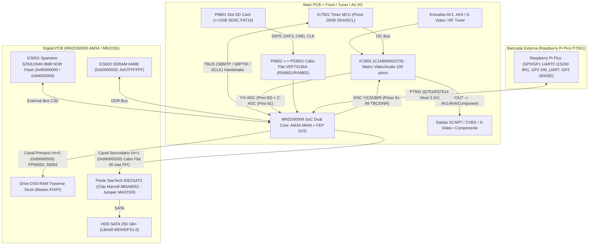
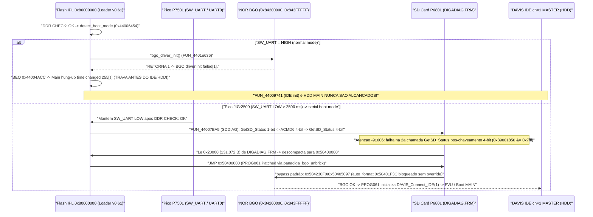

> 🌐 **Idioma / Language:** [English (US)](../en-US/EXPLODED_VIEW_PICO_INJECTION_ARCHITECTURE_AND_BYPASS_PASSTHROUGH.md) | **Português (BR)**
> 🧭 **Portal:** [Índice da Documentação](../INDEX.md) | [Auditoria Completa](../../AUDITORIA_COMPLETA.md) | [Auditorias](../audits/README.md) | [Pseudocódigo Ghidra](../pseudocode/INDICE_EVIDENCIA_PSEUDOCODIGO_GHIDRA.md) | [Logs de Debug](../debug_logs/README.md)

# Vista Explodida da Arquitetura `DMR-EH55`, Consolidação Rust/MCP/RAG, Injeção via Pico & Bypass/Passthrough AV

> [!IMPORTANT]
> **Escopo & Integridade Forense:** Toda função, endereço virtual, offset de arquivo, pino, CI e registrador listado neste dossiê consolidado foi verificado diretamente contra os binários reais extraídos (`eh55_frm_PROG061_BOOT.bin`, `EH55_MAIN_3410PQ.bin`, `main3060np_unpacked.bin`, `EH55_DRV_S211.bin`), binários comparativos do `DMR-EH58` (`BOOT.BIN`, `DRV_decomp.bin`), código-fonte C11/Rust do ecossistema `panadiga`, capturas ao vivo na porta `P7501` (`COM10`) e esquemáticos oficiais Panasonic (`panasonic_dmr_eh55ec_service_manual_europe.pdf`, `vol2_schematics.pdf`). O dump de HDD `panasonic DMR EH-55 Firmware hdd_100.bin` utilizado como referência pertence ao acervo do **Internet Archive**, e **não** ao disco rígido físico da bancada.

---

## 1. Status 100% Plaintext, Descriptografia e Decompilação do Projeto

Uma pergunta recorrente em bancada é se *"o firmware já está 100% em texto claro (`plaintext`)"*. A resposta exige separar **dois níveis de representação**:

1. **Nível Binário Executável (`100% Plaintext / Unpacked` em Disco — Concluído):**
   * **Zero criptografia ou compressão residual:** todos os contêineres proprietários da Panasonic (cifra de bloco **Feistel 64-bit ECB** em `PANA_DVD.FRM` e partições de firmware do HDD `0x02000000`/`0x04000000`, além do empacotamento `EXTRHEAD`/`zlib` + Adler-32 amostrado) foram completamente quebrados, validados e automatizados em Rust (`crates/panadiga-core/src/crypto/`).
   * Todas as instruções de máquina **Matsushita AM34 / MN103S**, tabelas de despacho, ponteiros MMIO e strings **ASCII / Shift-JIS (CP932)** estão 100% abertas para leitura, cross-reference (`XREF`), disassembly, decompilação C no Ghidra (`Panadiga_MN103S`) e patching direto com reempacotamento válido para `DIGADIAG.FRM`, `PANA__SD.FRM`, `PANA_DVD.FRM` e HDD `MEIHDFS1.0`.
2. **Nível Código-Fonte C Original (`Stripped ELF` vs Reconstrução Funcional):**
   * Os firmwares de produção da Panasonic foram compilados sem tabelas DWARF de nomes de variáveis locais, porém preservaram strings de asserts, drivers e caminhos de módulos originais (`src/hdd_cmd.c`, `src/hdd_ctl.c`, `DVR_SYSTEM_LIB: serial.a`, `rtscdd.a`, `rtsdauth.a`, `sys_boot.a`, `sys_cd.a`, `sys_cntl.a`, `DAVIS`, `nfrom`, `FPC`, `RTSC`).
   * Assim, cada subsistema crítico (boot, IDE/ATA, HDD LBA48, NVRAM/BGO, stub serial `_dev_SERIAL`, driver óptico `DRV` e MCU Timer) possui pseudocódigo decompilado, mapa de endereços exato e patchers idempotentes em Rust prontos para modificação.

| Binário Unpacked | Origem Verificada | Base VA | Tamanho (`bytes`) | SHA-256 | Status |
| :--- | :--- | :--- | ---: | :--- | :--- |
| **`eh55_frm_PROG061_BOOT.bin`** | `PANA_DVD.FRM` (`NP-309`, slot `PROG061`) | `0x50400000` | `262.144` | `c7da9121174fcf4c54f35f5bb1f7b23a3dc0c93ab227158ad4fdd90a1ea24a81` | **100% Unpacked / Mapeado** (`Fvu ver0.61 [05/11/01]`) |
| **`EH55_MAIN_3410PQ.bin`** | HDD Internet Archive (Partição 1 `0x02000000`) | `0x57000000` | `13.003.052` | `c3275d39549b68f48db16bc5fd043c6f8a373d4ba416826de09be5c55dc991b1` | **100% Unpacked / Patchável** (`MAIN` + `_dev_SERIAL` + `src/hdd_cmd.c`) |
| **`main3060np_unpacked.bin`** | `PANA_DVD.FRM` (`NP-309`, slot `MAIN`) | `0x57000000` | `13.427.852` | `075f552ed583ba1835c0d44d1b533ff5a016b8d81d15d7166240098461ddcca7` | **100% Unpacked / Patchável** (`MAIN` ótico equivalente) |
| **`EH55_DRV_S211.bin`** | `PANA_DVD.FRM` **≡** HDD Partição 2 (`0x04000000`) | `0x90202000` / `0x40000000` | `1.441.792` | `6f2b61ede80ea9e3e9185d3d677813593f3d361446678e437c905a0037060243` | **100% Unpacked / Idêntico byte a byte** (`DRV S211`, CLI `113` cmds) |
| **`BOOT.BIN`** *(comparativo EH58)* | `dmr-eh58/DVDRAM.7z` | `0x44000000` | `262.144` | `7c13c72a54c77387f3f7df0ddc213e4800e20b27eecbfd225cbc05a8fc73e377` | **Referência MN103S** (`Loader ver0.63`; contém `DAT_505733d4` ausente no EH55) |
| **`DRV_decomp.bin`** *(comparativo EH58)* | `dmr-eh58/DVDRAM.7z` | `0x40000000` | `1.441.792` | `694a4ab8aa29fcc45350dc0712047663602bdee7e4bff313b8ae62b057efd052` | **Referência MN103S** (`MATSHITA R6-MV4 A0 S415`) |
| **Flash NOR `IC5001` (`S29JL064H`)** *(pendente em bancada)* | Digital PCB física via Pico `PANADMP1` ou leitor TSOP-48 | `0x80000000` / `0x84000000` | `8.388.608` | *(a capturar do aparelho físico)* | **Aguardando dump físico** (somente logs UART `COM10` capturados até aqui) |

---

## 2. Consolidação Python → Rust, MCP (`18` Tools) e RAG Zero-Error

As rotinas críticas de engenharia reversa e bancada que antes residiam dispersas em scripts Python foram consolidadas nativamente na crate `panadiga-core`, expostas pelo servidor MCP (`panadiga-mcp`, **`18` ferramentas**) e indexadas automaticamente pelo motor `panadiga-rag`:

| Origem Histórica (Python / Pesquisa) | Módulo Rust Consolidado (`crates/panadiga-core`) | Exposição MCP / Interface |
| :--- | :--- | :--- |
| `scripts/re/pana_frm.py` *(cifra/packing)* | [`crates/panadiga-core/src/crypto/`](../../crates/panadiga-core/src/crypto/mod.rs) (`feistel_decrypt_buffer`, `unpack_extrhead`, `build_digadiag_frm`, `pack_frm`) | `panadiga_inspect_frm` + CLI `panadiga frm` |
| `scripts/re/mn10300.py` | [`crates/panadiga-core/src/re/mn10300/`](../../crates/panadiga-core/src/re/mn10300/mod.rs) (`decode_branch_call_refs`, `find_callers_to`, `find_fc_immediate_loads`, `find_pointer_xrefs`) | API interna + CLI `panadiga re xrefs` |
| `scripts/bench/nor_dumper.py` | [`crates/panadiga-core/src/re/nor_dumper.rs`](../../crates/panadiga-core/src/re/nor_dumper.rs) (`build_readonly_nor_dumper_stub`, `decode_nor_dump_stream`, guarda estrita `0x80000000`/`0x84000000`) | **`panadiga_nor_dumper_stub`** (MCP Tool #15) |
| Análise histórica `hdd_cmd.c` (`MaxProductLBA`) | [`crates/panadiga-core/src/hdd/capacity_patch/`](../../crates/panadiga-core/src/hdd/capacity_patch/mod.rs) (`inspect_main_hdd_capacity`, `patch_main_hdd_capacity`, `DynamicUnclamped`) | **`panadiga_hdd_capacity`** (MCP Tool #14) + CLI `panadiga hdd inspect-capacity` + Desktop UI |
| Descoberta pré-MAIN BGO (`0x50401F3C` / `0x504230F0`) | [`crates/panadiga-core/src/re/bgo_unbrick.rs`](../../crates/panadiga-core/src/re/bgo_unbrick.rs) (`inspect_prog061_bgo_sites`, `patch_prog061_bgo_in_place`, `patch_prog061_or_build_digadiag`) | **`panadiga_bgo_unbrick`** (MCP Tool #16) — gera `DIGADIAG.FRM` (`131.072 B`) |
| `MAIN` AV TBC (`E-E`) & `_dev_SERIAL` (`0x574F0775`) | [`crates/panadiga-core/src/re/main_passthrough.rs`](../../crates/panadiga-core/src/re/main_passthrough.rs) (`inspect_main_passthrough_sites`, `patch_main_passthrough_file`, `build_passthrough_rsp_plan`) | **`panadiga_main_passthrough`** (MCP Tool #17) + Pico `PANARSP PASSTHROUGH` / `CALL:` |
| Orquestração de Kit SD & Diag Unbrick | [`crates/panadiga-core/src/re/unbrick_sd_kit/`](../../crates/panadiga-core/src/re/unbrick_sd_kit/mod.rs) (`compose`, `io`, `verify`) | **`panadiga_sd_unbrick_kit`** (MCP Tool #18) + `panadiga unbrick` + `Centro Unbrick` |
| Manuais PDF + `docs/` + C11 + Rust | [`panadiga-rag`](../../crates/panadiga-rag/src/indexer/mod.rs) (indexação hierárquica automática + `FactCritic` + `HardwareSafetyValidator`) | `panadiga_rag_query`, `panadiga_search_code`, `panadiga_search_manuals`, `panadiga://docs/...` |

---

## 3. Vista Explodida: Ligações Físicas, Fluxo de Boot, Processos e Chamadas

### 3.1 Arquitetura Explodida de Hardware e Barramentos (`DMR-EH55`)

### 3.2 Fluxo de Chamadas Pré-MAIN (`Normal Mode` vs `JIG:2500` `SDDIAG`) & Mapa BGO

---

## 4. Ponte SATA-PATA `StarTech IDE2SAT2`: Por Que Apenas Marvell `88SA8052` é Confiável (e Obrigatório em `MASTER`)

### 4.1 Marvell `88SA8052` vs JMicron `JM20330` / Genéricos

| Recurso de Protocolo ATA/ATAPI Exigido pelo `MN2DS0009` (`DAVIS`) | StarTech `IDE2SAT2` (**Marvell `88SA8052`**) | Adaptadores **JMicron (`JM20330`)** / Baratos |
| :--- | :--- | :--- |
| **`MultiWord DMA MODE2` (`16.6 MB/s`)** — o `DMR-EH55` **não** negocia UDMA no canal HDD (`FUN_5041f782` / `FUN_5710c82a` força `Set Feature PIO` + `MWDMA2`) | **Suportado fielmente** em hardware | Muitos bridges JMicron falham/travam no handshake `SET FEATURES (0xEF)` -> `MWDMA2` (`0x22`) ou anunciam timing incompatível em `IDENTIFY DEVICE` |
| **`ATA Streaming DMA EXT` (`0x2A` / `0x3A`)** & comandos AV RTSD (`DAVIS`) | Traduz blocos contínuos AV em tempo real | Implementação focada apenas em UDMA PC padrão; causa erro `0x8000040d` ou dropout de escrita |
| **Controle de Spin-Up (`PUIS` / timeout `4000 ms`)** & **`DAVIS_Get_DriveID(1, 1)`** | Propaga `DRDY` (`+0x38 & 0x40`) e registros de status determinísticos | Mantém `BSY`/`DRQ` preso no polling estrito de `100` ciclos em `FUN_5041f61b` / `FUN_5710c6c3` |
| **Consistência `Master/Slave` (`DEV` bit 4 em `0x89000D38`)** | Segue jumper físico estrito (`MASTER` / `SLAVE` / `CS`) | Pontes baratas frequentemente ignoram seleção de pino 28 `CSEL` ou espelham respostas no Device 0 e Device 1 |

### 4.2 Regra Inviolável do Jumper no `DMR-EH55` (`MASTER`, Nunca `CS` nem `Slave`)

A auditoria adversarial provou nos esquemáticos (`vol2_schematics.pdf` pp. 46, 52, 113, 125–126) e no código de máquina (`eh55_frm_PROG061_BOOT.bin` + `EH55_MAIN_3410PQ.bin`) que:
* **ODD (`ch = 0, dev = 0`, Primary Master)** e **HDD (`ch = 1, dev = 0`, Secondary MASTER)** operam em **barramentos IDE fisicamente separados**.
* A tabela hardcoded `acStack_70[4] = { 2, 0, 1, 0 }` em `FUN_50414908` (`PROG061`) e `FUN_574d1de8` (`MAIN`) só reconhece HDD em **`ch = 1, dev = 0` (`Secondary MASTER`)**. A variável `DAT_505733d4` só existe no `BOOT.BIN` do `DMR-EH58`.
* **Nunca use `CS` (`Cable Select`) nem `Slave` na `StarTech IDE2SAT2`**: sempre configure o jumper explicitamente em **`MASTER`**.

---

## 5. Por Que Gravar o Firmware no HDD Não Dá Start no Brick Pré-MAIN — e Como Resolver

1. **Bloqueio Pré-IDE (`0x44004ACC`):**
   Mesmo que o HDD SATA conectado na `StarTech IDE2SAT2` (`Marvell 88SA8052`) esteja perfeitamente clonado ou desbloqueado para 250 GB (`panadiga_hdd_capacity`), no brick atual a Digital PCB trava no **Bootloader NOR de 1º estágio (`0x80000000`)** antes mesmo de inicializar o controlador IDE (`FUN_44009741`):
   * `FUN_440049eb` executa `bgo_driver_init()` (`FUN_4401e636`) -> falha com **`BGO driver init failed[1].`** -> `BEQ 0x44004ACC` chama `boot_panic_or_halt_7812` -> Timer MCU `IC7501` contabiliza `Main hung-up time changed 255[s].` e derruba em **`U99`**.
2. **Soluções Ordenadas para Sair do Brick Pré-MAIN:**
   * **Solução 1 — Sem Dessolda via `JIG:2500` → `SDDIAG` + `DIGADIAG.FRM` BGO Unbrick (`panadiga_bgo_unbrick`):**
     * No modo `JIG` (`SW_UART` mantido em LOW $\ge 2500\text{ ms}$ até passar `DDR CHECK: OK`), `FUN_44006cd9` salta a checagem de `BGO` do boot normal e executa `SDDIAG` (`FUN_44007ba5`).
     * Use **`panadiga_bgo_unbrick`** em `eh55_frm_PROG061_BOOT.bin` (**`mode = "bypass"`** padrão seguro ou `uart_monitor`, `wrap_as_digadiag = true`) para gerar um `DIGADIAG.FRM` de exatamente **`131.072` bytes (`0x20000`)**:
       * **`0x504230F0` (`0x000230F0`):** `C8 0A -> CA 0A` (bypassa checagem de soma `N(N+1)/2` em `bgo_sum_23058`).
       * **`0x50405097` (`0x00005097`):** `C8 15 -> CA 15` (bypassa falha quando `"INFO"` em `DeviceInfo` está ausente/corrompido).
       * **`0x5040A2CD` (`0x0000A2CD`):** modo `auto_format` (`nfrom_format @ 0x50401F3C`) fica **bloqueado fail-closed** sem `--allow-unsafe-bgo-format` (atua na janela CS1 `0x84200000..0x843FFFFF` e ponteiros RAM `0x504F8464..6C` antes de `0x504802B0==1`); use **`bypass`** (padrão) ou **`uart_monitor`**.
     * **Cuidado crítico com erro `-91006` no SD Card (`Fuji 2 GB`):** `FUN_4402791a` passa na 1ª chamada `GetSD_Status` (**1-bit**), chaveia para **4-bit** (`0x89001850 &= 0x7fff`) e falha apenas na **2ª leitura `ACMD13` em 4-bit** quando há mau contato/impedância no cabo `P6802 <-> P53501`, resistores `RX6801`/`RX6802` ou resposta `SD_STATUS[2] != 0` do cartão. Exige cartão **SDSC $\le 2\text{ GB}$ em `FAT16`/`FAT12` ($\le 65.525$ clusters)** com as 4 vias `DAT0..DAT3` íntegras.
   * **Solução 2 — Bancada TSOP-48 (`IC5001` `S29JL064H`):**
     * Se nem `SDDIAG` (por `-91006` físico no slot/cartão) nem `CDDIAG` (por falha laser `0x83A7` no `DRV`) conseguirem carregar payload para SDRAM, o caminho determinístico sem risco é extrair o dump de 8 MB da `IC5001`, aplicar sanitização de NVRAM (`SA134..SA141`, `0x7F0000..0x7FFFFF`) + reconstrução da partição BGO (`0x84200000..0x843FFFFF`) em imagem limpa validada antes da regravação na TSOP-48.

---

## 6. Hot Write I/O (`$M/$X/$G`) e Flash Dump de 8 MB via Pico

### 6.1 Quando a Injeção Hot Write I/O Funciona (`_dev_SERIAL` no `MAIN`)

Importante distinção arquitetural verificada:
* **Pré-MAIN (`/BOOT.BIN` e `PROG061`):** `uart0_getc @ 0x4400479F` e `FUN_50404c78` possuem **zero chamadores** — **não existe console RX pré-MAIN**. Toda injeção pré-MAIN ocorre via **Pinos (`SW_UART JIG:2500`, `P01`, `P10`)** ou carga de **binário `DIGADIAG.FRM`** na SDRAM (`0x50400000`).
* **Pós-MAIN (`EH55_MAIN_3410PQ.bin`, driver `_dev_SERIAL` @ `0x574F0775`):** quando o sistema alcança o `MAIN` (com ISR vetor `0x15 -> 0x574F0F9F` ativa), o kernel expõe um **stub GDB RSP completo por UART a `115200 8N1`**:
  * **Leitura Hex `$m<addr>,<len>#<csum>` / Binária Rápida `$x<addr>,<len>#<csum>` (`FUN_574f0a33` @ `0x574F0A33`):** blocos de `0x400` B (`$m`) ou `0x440` (`1.088`) B crus sem escape (`$x`), com retorno `+$<payload>#<sum8>`. No Pico (`PANADIGA>`), usar `XMEM:<addr>:<len>`.
  * **Dump de Registradores `$g#<csum>` (`FUN_574f0da3` @ `0x574F0DA3`):** lê `0x70` (`112`) bytes (`28` palavras LE de `32` bits).
  * **Escrita em RAM / Hot Write I/O (`FUN_574f0c63` @ `0x574F0C63`):**
    * **Hex:** `$M<addr_hex>,<len_hex>:<dados_hex>#<sum8>` → grava bytes arbitrários em **SDRAM** (`0x50000000..0x57FFFFFF`, p.ex. patching ao vivo de rotinas em RAM ou carga de stubs em `0x51800000`) e responde **`+$OK#9A`**.
    * **Binário:** `$X<addr_hex>,<len_hex>:<bytes_crus>#<sum8>` → escrita em alta velocidade em RAM.
    * **Retomada/Exit Loop (`$Z0#..` / `$Z1#..`):** limpa a flag do laço RSP, sinaliza `0xC0001002 |= 0x80` e devolve controle ao kernel.

> [!CAUTION]
> **Guarda Física de Tensão & Endereços:** A porta `P7501` (`Q7510`/`Q7514`) opera estritamente a **3,3 V TTL** (`5V0` destrói o SoC) e `GP5 (XRESET)` só deve operar em **open-drain / coletor aberto**. Nunca emita `$M`/`$X` diretamente para regiões da Flash NOR (`0x80000000..0x807EFFFF`) como se fossem RAM — Flash NOR exige sequência CFI (`0x55/0xAA`) em área segura.

### 6.2 Flash Dump Completo de 8 MB NOR via Pico (`PANADMP1..PANADONE`)

O módulo Rust [`crates/panadiga-core/src/re/nor_dumper.rs`](../../crates/panadiga-core/src/re/nor_dumper.rs) (exposto via ferramenta MCP **`panadiga_nor_dumper_stub`**) gera um stub **100% read-only em código de máquina MN103S** projetado para rodar em SDRAM livre (`0x51800000`):
* **Parâmetros padrão para dump completo da `IC5001` (`S29JL064H`):**
  * `start_addr = 0x84000000` (janela não-cacheada da Flash NOR, evitando aliasing de cache D$)
  * `total_len = 0x800000` (`8.388.608` bytes = 8 MB exatos)
  * `block_size = 4096` (`0x1000`, 2.048 blocos com checksum `u32` LE ao final de cada bloco)
* **Protocolo de Saída em UART (`SC0TXB` `0xD4002008` polling `SC0STR` `0xD400200C & 0xA0`):**
  `PANADMP1` + `<start_u32><len_u32><blk_u32>` → `[4096 B dados + sum32 LE] * 2048` → `PANADONE` → laço seguro `BRA .`.
* O decodificador `decode_nor_dump_stream()` valida cada bloco byte a byte e gera o arquivo completo `firmware_and_images/IC5001.bin` (`SHA-256` verificado).

---

## 7. Contorno de Erros & Uso do `DMR-EH55` como Passthrough / TBC de Sinal AV

Muitos entusiastas utilizam gravadores Panasonic DIGA como **Time Base Corrector (TBC) + Frame Synchronizer + Conversor Composto/S-Video/SCART ↔ Componente** para digitalização de VHS/LaserDisc. Mesmo com o drive óptico (`ODD`) com falha `0x83A7` ou sem gravar discos, os esquemáticos do Manual de Serviço Europeu (`panasonic_dmr_eh55ec_service_manual_europe.pdf`, pp. 22, 26, 45–47, 59–60) revelam **duas rotas concretas de passthrough**:

| Abordagem | Caminho de Sinal Verificado | Mantém TBC Digital (`MN2DS0009`)? | Requisitos & Trade-offs |
| :--- | :--- | :---: | :--- |
| **Opção A (Recomendada): Unbrick BGO + Diskless / Skip-Error Patch + `E-E` / Service Mode `[1][3]`** | `AV1..AV4` → **`IC3001`** (`C1AB00002379`) → **`Y/V ADC` (pino 83) / `C-ADC` (pino 81)** → **Digital PCB `MN2DS0009` (TBC/3D DNR/Frame Sync)** → **`ENC Y/C/G/B/R` (pinos 91–99)** → **`IC3001`** → Saídas `AV1/AV4/Component` | **SIM (TBC completo ativo)** | 1. Recuperar a `BGO` via `DIGADIAG.FRM` (`panadiga_bgo_unbrick`) + conectar HDD `250 GB` na `StarTech IDE2SAT2` em `MASTER` (com `MAIN` patched para 250 GB / skip checks de ODD `0x83A7`). 2. Em operação normal (`AV1`/`AV2`/`L1`/`L2` em modo *E-E monitor*) ou no **Service Mode `[1][3]` (`RTSC Return in XP (A & V)`)**, o sinal entra pelos ADCs, passa pelo encoder/decoder MPEG/TBC em tempo real **sem precisar gravar ou reproduzir DVD**, e retorna sincronizado pelos pinos `91..99` ao `IC3001`. Também existem os testes `[8][0]..[8][3]` para roteamento analógico/digital direto. |
| **Opção B (Fallback de Hardware se Digital PCB permanecer sem boot): Controle Direto I2C do `IC3001` (`C1AB00002379`)** | `AV1..AV4` → chaves analógicas internas `SW1..SW10` / `SA1..SA5` do **`IC3001`** → Saídas `AV1/AV4` *(bypass direto analógico sem passar pelos ADCs/Digital PCB)* | **NÃO (apenas matriz de vídeo/áudio analógica)** | O `IC3001` (Main PCB, 100 pinos) é controlado via **`I2C` (`SDA` pino 89 / `SCL` pino 88)** pelo Timer MCU **`IC7501` (pinos 29/30)**. Contudo, o `IC7501` monitora o barramento **`TBUS` (`SBMTP`/`SBPTM`/`SCLK`)** da Digital PCB e **desliga as fontes (`U99` + standby `HALT`)** caso o `MN2DS0009` não responda. Portanto, usar a Opção B isolada exigiria alimentar manualmente os trilhos `+5V/+9V` de vídeo e injetar comandos `I2C` no `IC3001` via Pico com o `IC7501` isolado — tornando a **Opção A** muito mais vantajosa e segura para preservar o TBC. |

### Sequência Prática Recomendada na Bancada Agora

1. **Não descarte o HDD + `StarTech IDE2SAT2`:** deixe o jumper da placa StarTech estritamente em **`MASTER`**. Aplique o patch de capacidade (`panadiga_hdd_capacity` modo `dynamic` ou `cap` 250 GB) quando for preparar o `MAIN` no disco.
2. **Ataque primeiro o brick pré-MAIN (`BGO driver init failed[1].`):** após medição a frio das vias `DAT1..DAT3` (`P6801`/`P6802`/`VEP73136A`) e desconexão de eventual flat ODD aquecido, gere o `DIGADIAG.FRM` (`131.072 B`) com `panadiga_bgo_unbrick` (`bypass` padrão seguro ou `uart_monitor`) e teste via `JIG:2500` em cartão **SDSC $\le 2\text{ GB}$ FAT16** (usando `SDSNIFF` se `-91006` persistir).
3. **Se `SDDIAG` não subir por barramento 4-bit físico e o ODD continuar com `0x83A7`:** faça a leitura externa TSOP-48 da **`IC5001`** (8 MB) para backup integral antes de qualquer escrita, recupere a região BGO/NVRAM e então faça o dump de validação + passthrough TBC pelo **`MN2DS0009` + `IC3001`**.

---

## 8. Anatomia Comparativa dos Contêineres (`DIGADIAG.FRM` vs `PANA_DVD.FRM` vs `PANA__SD.FRM`) & Automação Autônoma via Pico (`18` Tools MCP)

### 8.1 Como o Bootloader Carrega e Lê Cada Contêiner `.FRM`

| Aspecto | `DIGADIAG.FRM` (Diagnóstico / Unbrick Direto) | `PANA_DVD.FRM` (Atualização Ótica CD/DVD) | `PANA__SD.FRM` (`PANA_*`, Atualização SD) |
| :--- | :--- | :--- | :--- |
| **Despachante no `/BOOT.BIN`** | `FUN_44007BA5` (`SDDIAG`) / `FUN_4400A97C` (`CDDIAG`) | `FUN_4400A6D0` (`CD-R / ISO9660`, acionado via disco de firmware) | `FUN_440075AA` (`PANA__SD.FRM` no diretório raiz FAT12/FAT16 do cartão SD) |
| **Proteção de Cifra** | **100% Plaintext** (`EXTRHEAD` + stream `zlib` + `EXTRFOOT`) | **Feistel 64-bit ECB** (`FUN_4400a666`, 8 rodadas, S-Box `0x44035D84`, chave derivada de 7 B): TOC inteira cifrada; `DRV` cifra primeiros `0x400` B; `MAIN` cifra primeiros `0x400` B e últimos `0x400` B | **TOC em Plaintext** (`64` B / `0x40` no `/BOOT.BIN` `FUN_440075AA`; `48` B / `0x30` no `PROG061`) apontando para módulos `EXTRHEAD` |
| **Estrutura de Cabeçalho / TOC** | Sem TOC global: começa em `0x00` com cabeçalho `EXTRHEAD` de `0x40` bytes (`tag = "FVU "` ou `"DIAG"`, `dst_addr = 0x50400000`, `adler_step = 4`) | Cabeçalho global de `16` bytes (`0x00..0x0F`) + **`3 x 48` bytes (`0x30`)** de registros `"Firm list"` (`list_sum` u16 em `+0x2E` e `fvu_checksum_u32` em `+0x24`) | Até `128` (`0x2000` B) ou `16` slots (`0x400` B) em `BOOT.BIN`: registros de `64` B (`0x40`) com soma 16-bit `list_sum_u16` em `+0x3E` |
| **Orçamento de Leitura & RAM** | Em `SDDIAG`, `/BOOT.BIN` lê exatamente **`0x20000` bytes (`131.072` B = 128 KiB)** para o buffer temporário **`0x93FC0000`**, valida o checksum Adler-32 amostrado (`FUN_4401e5a3`, passo `4`) e descompacta `zlib` direto para **`0x50400000`** | Carrega a TOC (`0x90` B após o cabeçalho de `16` B), decifra em memória e lê os 3 módulos sequenciais: `PROG061` (`FVU` -> `0x50400000`), `DRV` (`EH55_DRV_S211.bin` -> ATAPI `WRITE BUFFER` do ODD) e `MAIN` (Partição 1 do HDD em `LBA 65536` / `0x02000000`) | Percorre as entradas com `list_sum_u16` válido, carrega os payloads `EXTRHEAD` via `FAT16` (`P6801`, `<= 2 GB SDSC`) para SDRAM e executa o atualizador `FVU` (`0x50400000`) |

### 8.2 Consolidação das 4 Pontas Soltas e Upgrade Autônomo do Raspberry Pi Pico (`PANARSP`)

Para eliminar a subutilização do microcontrolador **Raspberry Pi Pico (RP2040 / RP2350)** na bancada (`COM10`), o firmware C11 em `firmware/pico-p7501/` e o workspace Rust (`panadiga-core` + `panadiga-mcp`, agora com **`18` ferramentas MCP**) consolidam as soluções das 4 frentes críticas:

1. **Destravamento Pré-MAIN (`SDDIAG -91006` / `CDDIAG 0x83A7`) & Monitor `PANAMON1`:**
   * `DIGADIAG.FRM` (`panadiga_bgo_unbrick`) cabe dentro do teto estrito de `131.072` B (`0x20000`), mantendo checksum Adler-32 strided válido em `0x50400000` nos modos `inspect`, `bypass_only` (padrão seguro), **`uart_monitor`** (menu interativo **`PANAMON1>[B/F/D/Q]`** em `0x50439494`: `B`=bypass BGO, `F`=executar `nfrom_format`, `D`=dump de 8 MB NOR em `0x84000000`, `Q`=abortar) e `auto_format` (`0x50401F3C`, bloqueado fail-closed sem `--allow-unsafe-bgo-format`).
   * Requer barramento SD de 4 linhas (`DAT0..DAT3` entre `P6801` e `P53501`) íntegro na 2ª consulta `GetSD_Status` pós-`ACMD6`; caso `SW_OPT_BOOT` (`P65` / `DR_POWER_ON`) ou o pickup óptico (`0x83A7`) impeça `CDDIAG`, `SDDIAG` via `JIG:2500` permanece a rota primária sem dessolda.
2. **Protocolo `_dev_SERIAL` (`0x574F0775`) & Execução Autônoma no Pico (`PANARSP` + `DIAGWATCH`):**
   * O Pico agora executa nativamente sobre a PIO1 (`115200 8N1`, TX `GP4`, RX `GP2`, `SW_UART` `GP26`, `XRESET` `GP5`, `NSW5V` Hi-Z `GP3`) os comandos autônomos de **`PANARSP`** e **`DIAGWATCH`**:
     * **Handshake 3-byte (`MAGIC`):** envia `0x0E, 0x04, 0x02` (`DEV_SERIAL_HANDSHAKE_BYTES`, avançando a máquina de estados `0x515B2E60`: `0 -> 2 -> 4`) seguido de `0x15` (`NAK`).
     * **`PANARSP WMEM:<addr_hex>,<data_hex>` & `PANARSP WRITE32:<addr_hex>,<u32_hex>`:** constrói e transmite quadros GDB RSP `$M<addr>,<len>:<hex>#<csum>` diretamente da CLI do Pico sem exigir PC/Python externo.
     * **`PANARSP DUMPNOR [<addr_hex> [<len_hex>]]` (`DUMPNOR:<start>,<len>`):** monta autonomamente os `162` B do stub read-only `PANADMP1..PANADONE`, faz upload em `0x51800000` via `$M`, redireciona `0x515B2E40 -> 0x51800000`, dispara `$g#67` e faz stream binário pela USB CDC.
     * **`PANARSP CALL:<addr_hex>`:** executa o handshake + `0x15`, grava `<addr_hex>` (32 bits LE) no ponteiro do callback serial registrado **`0x515B2E40`** (`DEV_SERIAL_CALLBACK_VA`, alternativamente ao contexto salvo de ISR em `0x5316AE8C` + offset `0x64`) via `$M515B2E40,4:<le_hex>#<xx>`, e envia `$g#67` para acionar a rotina alvo em RAM (como `0x50401F3C` ou o dumper em `0x51800000`).
     * **`PANARSP PASSTHROUGH`:** transmite sequencialmente o handshake + `0x15` e os 3 quadros `$M` que configuram o **`MAIN` (`EH55_MAIN_3410PQ.bin`, base VA `0x57000000`)** para operação AV TBC (`E-E`) contínua mesmo sem ODD:
       * `0x5771ABFB` (`+0x0071ABFB`, 6 B, controle de status do painel frontal): `80 01 F0 FC CB CB` → `$M5771ABFB,6:8001f0fccbcb#7a`.
       * `0x574F7B8C` (`+0x004F7B8C`, 4 B, desvio de estado do ODD): `CC D0 00 CB` (`jmp16 +0x00D0 -> 0x574F7C5C; nop`) → `$M574F7B8C,4:ccd000cb#40`.
       * `0x574F7C5C` (`+0x004F7C5C`, 7 B, status de inicialização do ODD): `80 00 CB CB CB CB CB` (`clr d0; nop x5`) → `$M574F7C5C,7:8000cbcbcbcbcb#63`.
     * **`DIAGWATCH [ms] [NORMAL|JIG[:ms]|NOPULL] [AUTO|BYPASS|FORMAT|DUMP|NONE] [RELEASE|HOLD]`:** watchdog autônomo na PIO1 com timestamps em ms que segura `SW_UART` (`GP26`) LOW até detectar `serial boot mode` em modo `JIG` (ou `DDR CHECK: OK` em `NORMAL`), liberando `Hi-Z` / `Q7514` exatamente após a amostragem de `P50`, classifica eventos `SDDIAG (-91006/-90002)`, `CDDIAG (80040904/83A7)` e `BGO` (`U99`), e envia `'B'`, `'F'` ou `'D'` ao surgir `PANAMON1>`. (Também `PANARSP` e `WAITTX` liberam `JIG` automaticamente ao detectar `serial boot mode`.)
3. **Módulo Rust `main_passthrough.rs` & Ferramenta MCP #17 (`panadiga_main_passthrough`):**
   * O crate `panadiga-core::re::main_passthrough` inspeciona/aplica os 3 sítios acima em imagens `EH55_MAIN_3410PQ.bin` (com reversão segura para `FACTORY_ORIGINAL`) e gera planos `rsp_plan` exatos para a bancada Pico via ferramenta MCP **`panadiga_main_passthrough`**.
4. **Leitura Segura de 8 MB NOR + Geometria BGO (`0x84000000` / `0x84200000..0x843FFFFF`):**
   * Unificação da janela read-only `0x84000000` (`panadiga_nor_dumper_stub`, Pico `PANARSP XMEM`/`DUMPNOR`, `FLASH_SIZE` e `INJECT_LOADER [UNCACHED] CONFIRM`) + geometria da partição BGO (`0x84200000..0x843FFFFF`, `32 x 64 KB`), preservando integralmente o bootloader IPL sem tocar em setores fora de escopo.
