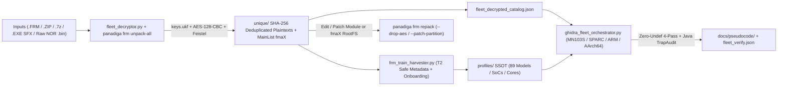

# Panadiga Reverse Engineering & Discovery Automation (`scripts/re/`)

> 🌐 **Portal Bilíngue / Bilingual Guide (PT-BR & EN-US)**  
> [Índice da Documentação](../../docs/INDEX.md) · [Arquitetura Geral (`panadiga-core`)](../../docs/pt-BR/ARQUITETURA_E_BLUEPRINT_DE_ENGENHARIA.md) · [Dossiê `PANA_DVD.FRM`](../../docs/pt-BR/DOSSIE_CRIPTOGRAFIA_E_FIRMWARE_PANA_DVD.md) · [Compêndio Comunitário](../../docs/pt-BR/COMPENDIO_GLOBAL_COMUNIDADE_FIRMWARE_E_HARDWARE_DIGA.md)

Esta pasta centraliza o pipeline **multifuncional, determinístico e orientado à SSOT (`profiles/`)** para engenharia reversa, extração em massa e automação Ghidra Headless em **toda a linha Panasonic DIGA / UniPhier / Blu-ray / DVD-R / STB**.

---

## 1. Fluxo End-to-End / End-to-End Architecture Flow



---

## 2. Matriz de Paridade & Integração (`pana-fw` + `unixtract` + Legado DIGA)

Panadiga unifica em **Rust puro (`crates/panadiga-core`)** — sem dependências externas de runtime e com `#![deny(unsafe_code)]` — os protocolos das ferramentas irmãs comunitárias (**`WeebDataHoarder/pana-fw`** em Go e **`theubusu/unixtract`** em Rust) com o ecossistema legado Panasonic DIGA (`DMR-EH55`, `EH49..69`, `ES35V`, `EZ485V`, `XW`, `BS`, `BW`, `BWT`, `DMP/DP`):

| Capacidade / Formato | `WeebDataHoarder/pana-fw` (Go) | `theubusu/unixtract` (Rust) | **Panadiga Universal Engine (`panadiga-core` + `scripts/re/`)** |
| :--- | :--- | :--- | :--- |
| **Legado DVD-R (`48B` / `64B` Feistel TOC, `12` chaves `DF72..`)** | Parcial (Feistel + `findKeySlow`) | Extração | **Full Unpack & Lossless Repack** (`LegacyDvd48B`, `LegacyDvd64B`, `panadiga frm pack/repack`) |
| **Factory SD & Unbrick (`SdPlain48B`, `SdPlain64B`, `DIGADIAG.FRM`)** | Não | Parcial | **Full Unpack, Compose, Retarget `BGO` & Repack** (`SDDIAG ver0.61/ver0.63+`) |
| **Blu-ray / UniPhier `Feistel` (`48B` Adler-32 TOC + `PANASONIC\0\0\0` 48B Outer Header)** | Sim (leitura / repack) | Sim (extrator) | **Full Unpack & Repack Preserving Outer Header** (`BlurayFeistel`: `bs850`, `bs880`, `bs885`, `xw300gn`) |
| **Blu-ray `AES-128-CBC` (`AesHeader` + `2016`/`2018` pairs)** | Sim | Sim | **Pure-Rust FIPS-197 AES-128-CBC + Wrap/Unwrap + `--drop-aes`** (`BlurayAes`) |
| **Keyring Externo (`keys.ukf`) & `NetworkKeyIV`** | Hardcoded + `libdownloadlib.so` | `keys.ukf` embutido | **Catalogo nativo + Loader `--key-file keys.ukf` + `derive_network_key_iv()`** |
| **`MAIN` `MainList` (`20B` header, `GZIP`/`LZSS`/`LZMA`, Edge Crypt, `fmaX`)** | Sim (`0x1400`/`0x2800` span) | Parcial (`Okumura LZSS`) | **Full Demux + Embedded FS Scanner + Validated `fmaX` Reassembly** (`RomFS`/`CramFS` CRC32 + capacity guard) |
| **`VGD` Plain-Skip, `DRV1`/`DRV2` Edge Crypt & `STB` (`ST20`/`MStar`)** | Sim (`DRV` + `VGD`) | Parcial | **Unificado em `universal_frm` & `try_decode_stb_slot`** |
| **SSOT Hardware + `re bench-runtime` + Ghidra Zero-Undef (`0 ??`)** | Não | Não | **Nativo:** `profiles/` (`89` modelos) + `ghidra_fleet_orchestrator.py` + `Mn103Vm` gate |

---

## 3. Ferramentas & Módulos em `scripts/re/`

| Script / Módulo | Função Principal (PT-BR / EN-US) |
| :--- | :--- |
| [`fleet_decryptor.py`](fleet_decryptor.py) | Decodificador e deduplicador SHA-256 universal para arquivos únicos ou diretórios inteiros (`.FRM` Legado/SD/Blu-ray/AES, `.zip`/`.7z`/`.rar`/`.exe` SFX, raw NOR/IPL `.bin`). Fatia kernels Linux UniPhier via `scan_embedded_filesystems` e registra `PANAEUSB.FRM` bloqueados em `locked_containers` sem abortar o lote. |
| [`ghidra_fleet_orchestrator.py`](ghidra_fleet_orchestrator.py) | Orquestrador Ghidra Headless parametrizado (zero paths pessoais hardcoded), resolvendo ISA via SSOT (`MN10300`, `SPARC V8`, `ARMv7`, `AArch64` + fallback ELF `e_machine`), executando o pipeline Zero-Undef em 4 passadas, auditoria Java `PanadigaMn103sTrapAudit` e exportando bundles divididos + `fleet_verify.json`. |
| [`frm_train_harvester.py`](frm_train_harvester.py) | Varre `--frm-root` ou um único `--frm` (`--key-file` opcional), sincroniza metadados `T2` (`official_frm_verified`) em `profiles/firmware_trains/` sem jamais degradar `T3`/`T4`, e lista `unmatched_containers` para onboarding de novos aparelhos. |
| [`nor_intake_analyzer.py`](nor_intake_analyzer.py) | Triagem forense de dumps NOR (`2..16 MiB`), detectando *16-bit byte-swap* (`XERTDAEH`), espelhamento por pino de endereço solto, gerações `EEMUL` (`"1284"`) e gerando rascunhos `nor_layout` + `model`. |
| [`manual_spec_extractor.py`](manual_spec_extractor.py) | Extrai tokens de PCB (`VEP`/`REP`), SoC, Flash e EEPROM de manuais PDF para a área de quarentena `profiles/staging/manual_proposals/` com citações exatas de página. |
| [`pana_frm.py`](pana_frm.py), [`mn10300.py`](mn10300.py), [`mn103_traps.py`](mn103_traps.py) | Analisadores estáticos puros para `EXTRHEAD`, `DRV` (`S211`/`S514`), tabelas ATAPI CDB, chamadas `MN10300` e detecção de armadilhas de desmontagem. |
| [`_discovery_common.py`](_discovery_common.py) | Helpers compartilhados tipados (`mypy --strict`): SHA-256, entropia de Shannon, scanner CramFS/RomFS/SquashFS, extrator ZIP/SFX/7z, resolução de `model_id` e invariantes de tier `T0..T4`. |

---

## 4. Receitas Reproduzíveis de CLI / CLI Recipes

### Rust CLI (`panadiga frm` & `panadiga re`)

```bash
# 1. Extrair qualquer .FRM (Legado, SD, Blu-ray Feistel ou Blu-ray AES) + dividir partições fmaX:
cargo run -p panadiga-cli -- frm unpack-all firmware_and_images/dmr-xw_bd_series/bs850_bs750_xs350eg/PANA_DVD.FRM \
  --out-dir tmp/bs850_unpacked --split-main --json -

# 2. Usar keyring externo keys.ukf (ex.: modelos EU/JP com chaves adicionais):
cargo run -p panadiga-cli -- frm unpack-all path/to/PANAEUSB.FRM \
  --out-dir tmp/usb_unpacked --key-file path/to/keys.ukf --split-main --json -

# 3. Reempacotar com patch em partição fma5 (RootFS) removendo camada externa AES (--drop-aes):
cargo run -p panadiga-cli -- frm repack --input tmp/bs850_orig.FRM --out tmp/bs850_mod.FRM \
  --patch-partition fma5=tmp/rootfs_patched.romfs --patch-force --drop-aes --json -

# 4. Extrair ELFs de partições Linux RomFS/CramFS (read-only e seguro no Windows) direto do .FRM ou fmaX:
cargo run -p panadiga-cli -- frm extract-fs firmware_and_images/dmr-xw_bd_series/bs850_bs750_xs350eg/PANA_DVD.FRM \
  --out-dir tmp/bs850_fs --elf-only --json -

# 5. Inspecionar plano runtime completo em bancada (cascata keyring: embutidas -> PANADIGA_KEY_FILE -> keys.local.ukf -> --key-file):
cargo run -p panadiga-cli -- re bench-runtime \
  --input firmware_and_images/PANA_DVD.FRM --out-dir tmp/bench_plan --model DMR-EH55 --json -
```

### Automação Python (`scripts/re/` & `validate.py`)

```bash
# 1. Decriptar, fatiar kernels e extrair ELFs user-space UniPhier (`USER_ELF`):
python -m scripts.re.fleet_decryptor \
  --input firmware_and_images --out-dir tmp/decrypted_fleet --split-main --extract-rootfs-elfs --json tmp/fleet_report.json

# 2. Reprocessar apenas os contêineres bloqueados (`PANAEUSB.FRM`) após adicionar nova chave em `keys.local.ukf`:
python -m scripts.re.fleet_decryptor \
  --retry-locked tmp/decrypted_fleet/fleet_decrypted_catalog.json --out-dir tmp/decrypted_fleet --json -

# 3. Verificar novos binários inéditos em relação a `fleet_verify.json` (< 1s, sem JVM):
python -m scripts.re.ghidra_fleet_orchestrator \
  --catalog tmp/decrypted_fleet/fleet_decrypted_catalog.json --check-drift --json -

# 4. Catalogar trens de firmware e detectar contêineres novos para onboarding:
python -m scripts.re.frm_train_harvester \
  --frm firmware_and_images/dmr-xw_bd_series/bs850_bs750_xs350eg/PANA_DVD.FRM --unpack-missing --json -

# 5. Analisar catálogo decriptado no Ghidra Headless (ISA via SSOT `ghidra_language_id` + preflight `*.ldefs` XML):
python -m scripts.re.ghidra_fleet_orchestrator \
  --catalog tmp/decrypted_fleet/fleet_decrypted_catalog.json \
  --out-c-dir tmp/pseudocode_full --shard small --workers 6 --java-audit --assemble

# 6. Validação diária dos 9 Quality Gates vs smoke real opt-in no Ghidra (micro-fixture Traps #1-#8):
python scripts/validate.py
python scripts/validate.py --ghidra-smoke
```

---

## 5. Garantias de Qualidade / Engineering Invariants

* **Forense Não-Destrutiva:** Nenhuma ferramenta modifica contêineres `.FRM`, imagens de HDD ou dumps NOR originais *in-place*.
* **Proteção Hardware (`DMR-EH55` & Bancada):** Todas as invariantes de segurança (`P7501` Pino 5 `NSW5V` estritamente `Hi-Z`, `IPL SA0..SA10` imutável via sonda, registrador letal `0xC000100C` proibido) são preservadas por projeto.
* **Qualidade de Código:** Zero duplicação (`jscpd` 0%), tipagem Python estrita (`mypy --strict scripts`) e validação completa via `python scripts/validate.py` (`9/9` gates).
